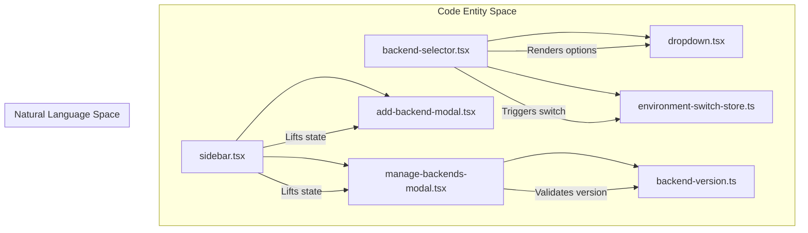
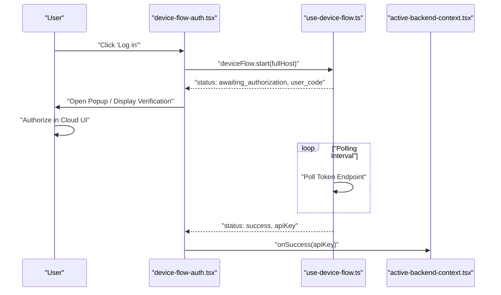
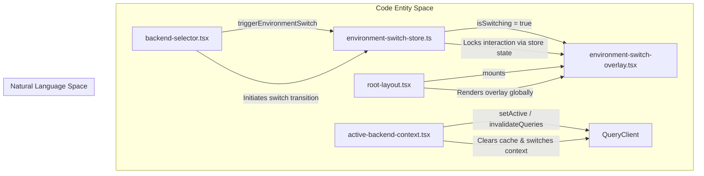

<!-- source: DeepWiki mcp.deepwiki.com · repo All-Hands-AI/OpenHands · page 3.2 Backend Selector UI and Environment Switching · fetched 2026-10-26 -->

# Backend Selector UI and Environment Switching

Relevant source files

The following files were used as context for generating this wiki page:

- [__tests__/components/backends/backend-selector.test.tsx](__tests__/components/backends/backend-selector.test.tsx)
- [__tests__/components/backends/environment-switch-overlay.test.tsx](__tests__/components/backends/environment-switch-overlay.test.tsx)
- [__tests__/components/features/conversation/conversation-main.test.tsx](__tests__/components/features/conversation/conversation-main.test.tsx)
- [__tests__/components/features/settings/cloud-settings-link.test.tsx](__tests__/components/features/settings/cloud-settings-link.test.tsx)
- [__tests__/components/features/sidebar/sidebar-cloud-settings.test.tsx](__tests__/components/features/sidebar/sidebar-cloud-settings.test.tsx)
- [__tests__/components/features/sidebar/sidebar.test.tsx](__tests__/components/features/sidebar/sidebar.test.tsx)
- [__tests__/components/settings/llm-profiles/delete-profile-modal.test.tsx](__tests__/components/settings/llm-profiles/delete-profile-modal.test.tsx)
- [__tests__/components/settings/llm-profiles/profile-name-input.test.tsx](__tests__/components/settings/llm-profiles/profile-name-input.test.tsx)
- [__tests__/components/settings/llm-profiles/rename-profile-modal.test.tsx](__tests__/components/settings/llm-profiles/rename-profile-modal.test.tsx)
- [__tests__/hooks/use-resizable-panels.test.ts](__tests__/hooks/use-resizable-panels.test.ts)
- [__tests__/routes/root-layout.test.tsx](__tests__/routes/root-layout.test.tsx)
- [src/components/features/backends/backend-selector.tsx](src/components/features/backends/backend-selector.tsx)
- [src/components/features/backends/device-flow-auth.tsx](src/components/features/backends/device-flow-auth.tsx)
- [src/components/features/backends/environment-switch-overlay.tsx](src/components/features/backends/environment-switch-overlay.tsx)
- [src/components/features/backends/environment-switch-store.ts](src/components/features/backends/environment-switch-store.ts)
- [src/components/features/files-tab/segmented-toggle.tsx](src/components/features/files-tab/segmented-toggle.tsx)
- [src/components/features/settings/api-key-modal-base.tsx](src/components/features/settings/api-key-modal-base.tsx)
- [src/components/features/settings/brand-button.tsx](src/components/features/settings/brand-button.tsx)
- [src/components/features/settings/cloud-settings-link.tsx](src/components/features/settings/cloud-settings-link.tsx)
- [src/components/features/settings/llm-profiles/delete-profile-modal.tsx](src/components/features/settings/llm-profiles/delete-profile-modal.tsx)
- [src/components/features/settings/llm-profiles/index.ts](src/components/features/settings/llm-profiles/index.ts)
- [src/components/features/settings/llm-profiles/profile-name-input.tsx](src/components/features/settings/llm-profiles/profile-name-input.tsx)
- [src/components/features/settings/llm-profiles/rename-profile-modal.tsx](src/components/features/settings/llm-profiles/rename-profile-modal.tsx)
- [src/components/features/settings/settings-input.tsx](src/components/features/settings/settings-input.tsx)
- [src/components/features/sidebar/sidebar-conversation-list.tsx](src/components/features/sidebar/sidebar-conversation-list.tsx)
- [src/components/features/sidebar/sidebar-rail-body.tsx](src/components/features/sidebar/sidebar-rail-body.tsx)
- [src/components/features/sidebar/sidebar.tsx](src/components/features/sidebar/sidebar.tsx)
- [src/hooks/use-filtered-events.ts](src/hooks/use-filtered-events.ts)
- [src/hooks/use-resizable-panels.ts](src/hooks/use-resizable-panels.ts)
- [src/index.css](src/index.css)
- [src/routes/root-layout.tsx](src/routes/root-layout.tsx)
- [src/routes/shared-conversation.tsx](src/routes/shared-conversation.tsx)

The Backend Selector system provides the user interface for managing multiple agent-server environments. It enables users to register local or cloud backends, monitor their health, and switch between them seamlessly using a specialized overlay that manages state transitions and split-pane layouts.

---

## 1. Purpose and Scope

This document details the frontend implementation of backend selection, authentication flows, and layout management within Agent Canvas. It covers component architectures for `BackendSelector` [src/components/features/backends/backend-selector.tsx:142-150](), backend management modals, OAuth 2.0 device flow authentication (`DeviceFlowAuth`) [src/components/features/backends/device-flow-auth.tsx:71-85](), the environment switching transition overlay (`EnvironmentSwitchOverlay`) [src/components/features/backends/environment-switch-overlay.tsx:1](), and split-pane sizing via `useResizablePanels` [src/hooks/use-resizable-panels.ts:1]().

Sources:
- [src/components/features/backends/backend-selector.tsx:142-150]()
- [src/components/features/backends/device-flow-auth.tsx:71-85]()
- [src/components/features/backends/environment-switch-overlay.tsx:1]()
- [src/hooks/use-resizable-panels.ts:1]()

---

## 2. Backend Selector UI Components

The primary entry point for backend management is the `BackendSelector` component [src/components/features/backends/backend-selector.tsx:142-150](), typically mounted inside the sidebar rail [src/components/features/sidebar/sidebar-rail-body.tsx:28]().

### BackendSelector Implementation
`BackendSelector` utilizes a custom `Dropdown` component [src/ui/dropdown/dropdown.tsx:1]() to render registered backends and cloud organizations [src/components/features/backends/backend-selector.tsx:62-113]().
- **Organization Expansion**: For cloud backends, it fetches organization hierarchies via `useAllCloudOrganizations` [src/components/features/backends/backend-selector.tsx:10]() and maps each entry to individual options [src/components/features/backends/backend-selector.tsx:82-110]().
- **Health Indicators**: It embeds `BackendStatusDot` [src/components/features/backends/backend-status-dot.tsx:1]() into each option prefix based on probes from `useBackendsHealth` [src/components/features/backends/backend-selector.tsx:13-15]().
- **Switching Trigger**: Option selection invokes `triggerEnvironmentSwitch` [src/components/features/backends/backend-selector.tsx:24]() to manage loading states prior to updating the active context [src/components/features/backends/backend-selector.tsx:216-224]().

### Modals: AddBackendModal and ManageBackendsModal
Backend creation and management modals are lifted into parent containers (such as `Sidebar` [src/components/features/sidebar/sidebar.tsx:23-35]()) to prevent state loss during collapsed popover unmounting.
- `ManageBackendsModal` [src/components/features/backends/manage-backends-modal.tsx:63]() displays registered servers, their connection states, and remote version evaluations via `BackendVersion` [src/components/features/backends/backend-version.tsx:1]().
- `AddBackendModal` [src/components/features/backends/add-backend-modal.tsx:1]() coordinates host inputs, API key validation, and connectivity handshakes.

Sources:
- [src/components/features/backends/backend-selector.tsx:1-178]()
- [src/components/features/sidebar/sidebar.tsx:23-35]()
- [src/components/features/sidebar/sidebar-rail-body.tsx:28]()
- [src/components/features/backends/manage-backends-modal.tsx:63]()
- [src/components/features/backends/add-backend-modal.tsx:1]()
- [src/ui/dropdown/dropdown.tsx:1]()

---

## 3. Cloud Login and Device Flow

For cloud-backed deployments, `DeviceFlowAuth` [src/components/features/backends/device-flow-auth.tsx:71-85]() manages the OAuth 2.0 Device Authorization flow to acquire API tokens safely without raw text copying.

### DeviceFlowAuth Mechanics
1. **Initiation**: `handleStartAuth` opens a verification popup and invokes `deviceFlow.start()` [src/components/features/backends/device-flow-auth.tsx:136-167]().
2. **Polling & Verification**: The underlying hook (`useDeviceFlow`) polls the authorization server until the user completes sign-in in the external browser window [src/hooks/use-device-flow.ts]().
3. **Completion**: Upon receiving a valid token, `onSuccess` receives the `apiKey`, resetting the flow state and closing popup references [src/components/features/backends/device-flow-auth.tsx:125-134]().

Sources:
- [src/components/features/backends/device-flow-auth.tsx:71-200]()
- [src/hooks/use-device-flow.ts]()

---

## 4. Environment Switching and Overlays

Switching environments resets active execution graphs to prevent cross-backend contamination.

### EnvironmentSwitchOverlay Implementation
Mounted globally in the root layout [src/routes/root-layout.tsx:29-31](), `EnvironmentSwitchOverlay` watches `useEnvironmentSwitchStore` [src/components/features/backends/environment-switch-store.ts](). When `isSwitching` is active, it renders a full-screen blocker.

Sources:
- [src/components/features/backends/environment-switch-overlay.tsx:1-20]()
- [src/routes/root-layout.tsx:29-31]()
- [src/components/features/backends/backend-selector.tsx:22-25]()
- [src/components/features/backends/environment-switch-store.ts:1-30]()

---

## 5. Split-Pane Layout Management

`useResizablePanels` manages split-pane dimensions across conversation views and tool outputs [src/hooks/use-resizable-panels.ts:1]().
- **Dimension Tracking**: Intercepts mouse coordinates during drag events to update split ratios dynamically.
- **Persistence**: Saves dimension offsets to `localStorage` using unique identifier keys [src/hooks/use-resizable-panels.ts:1]().

Sources:
- [src/hooks/use-resizable-panels.ts:1]()

---

