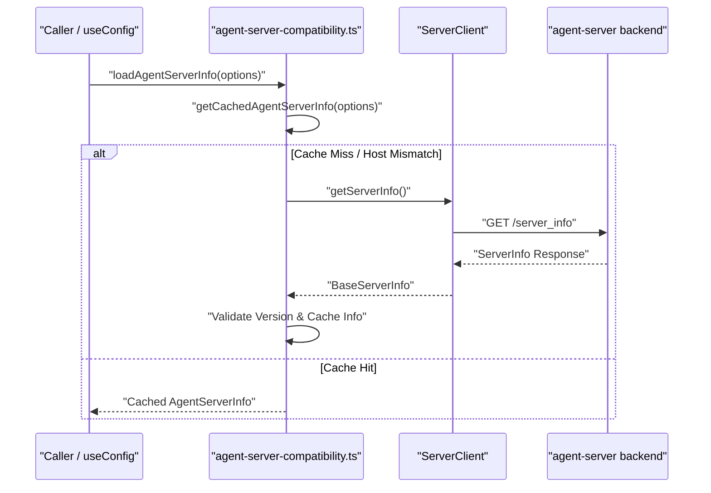
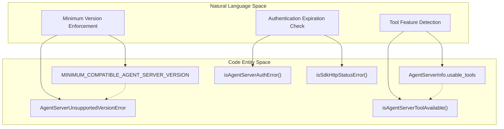

<!-- source: DeepWiki mcp.deepwiki.com · repo All-Hands-AI/OpenHands · page 3.3 Agent Server Compatibility and Version Checks · fetched 2026-10-26 -->

# Agent Server Compatibility and Version Checks

Relevant source files

The following files were used as context for generating this wiki page:

- [.github/workflows/sdk-version-sync.yml](.github/workflows/sdk-version-sync.yml)
- [__tests__/api/agent-server-compatibility-bundled-pin.test.ts](__tests__/api/agent-server-compatibility-bundled-pin.test.ts)
- [__tests__/api/option-service.test.ts](__tests__/api/option-service.test.ts)
- [__tests__/constants/acp-providers.test.ts](__tests__/constants/acp-providers.test.ts)
- [__tests__/scripts/check-sdk-version-sync.test.ts](__tests__/scripts/check-sdk-version-sync.test.ts)
- [__tests__/scripts/ingress.test.ts](__tests__/scripts/ingress.test.ts)
- [scripts/ingress.mjs](scripts/ingress.mjs)
- [scripts/proxy-utils.mjs](scripts/proxy-utils.mjs)
- [scripts/static-build.mjs](scripts/static-build.mjs)
- [src/api/agent-server-compatibility.ts](src/api/agent-server-compatibility.ts)
- [src/api/option-service/option-service.api.ts](src/api/option-service/option-service.api.ts)
- [src/constants/acp-providers.test.ts](src/constants/acp-providers.test.ts)
- [src/constants/acp-providers.ts](src/constants/acp-providers.ts)
- [src/hooks/query/use-config.ts](src/hooks/query/use-config.ts)

The `src/api/agent-server-compatibility.ts` module is the central authority for ensuring that the Agent Canvas frontend communicates with a supported version of the `agent-server` backend. It implements minimum version enforcement, feature detection through tool advertising, caching of server info, and structured error handling for version mismatches, connectivity issues, and authentication states.

## Version Enforcement Logic

Agent Canvas enforces a minimum required version for the `agent-server` to ensure that necessary APIs and tool sets are available. 

### Key Version Constants and Structures
*   **Minimum Version Floor**: The frontend reads `compatibility.minimumAgentServer` from `config/defaults.json` [src/api/agent-server-compatibility.ts:14-20](). This is exported as `MINIMUM_COMPATIBLE_AGENT_SERVER_VERSION` [src/api/agent-server-compatibility.ts:19-20]().
*   **Error Codes**: Version discrepancies yield specific error identifiers: `AGENT_SERVER_UNSUPPORTED_VERSION_ERROR_CODE` (`"AGENT_SERVER_UNSUPPORTED_VERSION"`) and `AGENT_SERVER_UNKNOWN_VERSION_ERROR_CODE` (`"AGENT_SERVER_UNKNOWN_VERSION"`) [src/api/agent-server-compatibility.ts:21-24]().
*   **Server Info Type**: The `AgentServerInfo` interface extends base server info to track `sdk_version`, `usable_tools`, and `runtime_services` [src/api/agent-server-compatibility.ts:34-38]().

Sources:
* [src/api/agent-server-compatibility.ts:14-38]()

## Implementation and Data Flow

Compatibility evaluation occurs when probing backend health or loading server configuration via the client layer.

### Caching and Lookup Flow
The module maintains module-level state for caching responses per host via `getCachedAgentServerInfo` and invalidates them using `clearCachedAgentServerInfo` [src/api/agent-server-compatibility.ts:40-41](), [src/api/agent-server-compatibility.ts:144-156]().

Sources:
* [src/api/agent-server-compatibility.ts:40-48]()
* [src/api/agent-server-compatibility.ts:144-156]()
* [__tests__/api/agent-server-compatibility-bundled-pin.test.ts:70-96]()

## Feature Detection and Tool Advertising

Beyond version strings, the module inspects advertised capabilities to govern UI features conditionally.

*   **Advertised Tools**: `getAdvertisedTools` inspects `usable_tools` on the `AgentServerInfo` object [src/api/agent-server-compatibility.ts:43-48]().
*   **Tool Availability Check**: `isAgentServerToolAvailable` checks if a particular tool name exists within the advertised array or defaults to available if no tool constraints are reported [src/api/agent-server-compatibility.ts:158-164]().

### Natural Language to Code Entity Mapping

Sources:
* [src/api/agent-server-compatibility.ts:19-24]()
* [src/api/agent-server-compatibility.ts:43-48]()
* [src/api/agent-server-compatibility.ts:141-143]()
* [src/api/agent-server-compatibility.ts:158-164]()

## Error Handling and UI Feedback

The module defines a hierarchy of custom error classes extending `AgentServerUnavailableError` to supply contextual diagnostics.

| Error Class | Error Code | Trigger Condition | Code Reference |
| :--- | :--- | :--- | :--- |
| `AgentServerUnavailableError` | `N/A` | Server unreachable or registry empty | [src/api/agent-server-compatibility.ts:50-68]() |
| `AgentServerUnsupportedVersionError` | `AGENT_SERVER_UNSUPPORTED_VERSION` | Backend version below minimum requirement | [src/api/agent-server-compatibility.ts:81-93]() |
| `AgentServerUnknownVersionError` | `AGENT_SERVER_UNKNOWN_VERSION` | Missing or unparseable version string | [src/api/agent-server-compatibility.ts:95-112]() |

Sources:
* [src/api/agent-server-compatibility.ts:50-130]()

## Authentication Compatibility

Session token and API key validation are integrated into the compatibility layer via HTTP status inspection.

*   **Auth Error Detection**: `isAgentServerAuthError` evaluates whether an operation failed with an HTTP `401` status code while authentication is required (`isAuthRequired()`) [src/api/agent-server-compatibility.ts:141-143]().
*   **SDK Status Helpers**: `isSdkHttpError` and `isSdkHttpStatusError` inspect SDK-specific error objects to safely extract status codes without manual casting [src/api/agent-server-compatibility.ts:166-183]().

Sources:
* [src/api/agent-server-compatibility.ts:132-183]()

---

