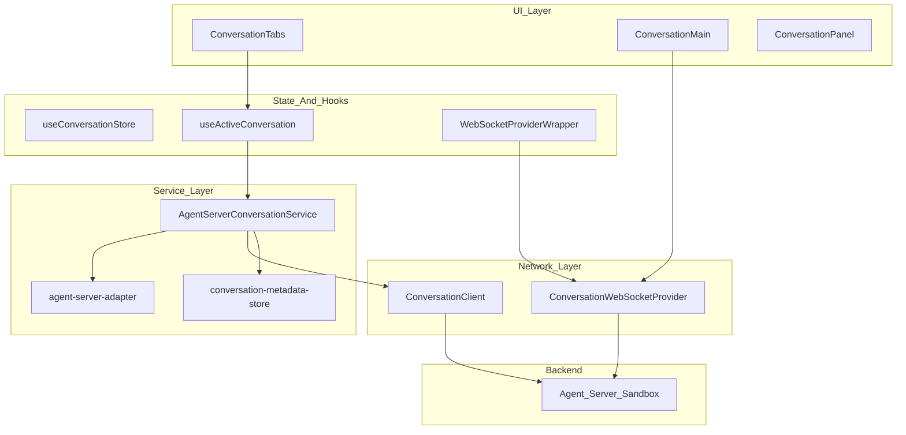
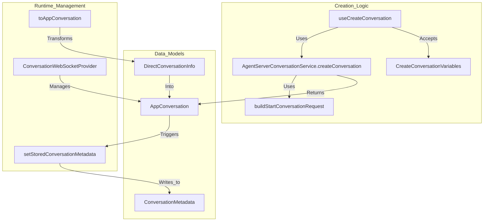

<!-- source: DeepWiki mcp.deepwiki.com · repo All-Hands-AI/OpenHands · page 4 Conversation System · fetched 2026-10-26 -->

# Conversation System

Relevant source files

The following files were used as context for generating this wiki page:

- [.env.sample](.env.sample)
- [__tests__/api/agent-server-adapter.test.ts](__tests__/api/agent-server-adapter.test.ts)
- [__tests__/api/agent-server-config.test.ts](__tests__/api/agent-server-config.test.ts)
- [__tests__/api/agent-server-conversation-service.test.ts](__tests__/api/agent-server-conversation-service.test.ts)
- [__tests__/api/hooks-service.test.ts](__tests__/api/hooks-service.test.ts)
- [__tests__/api/use-create-conversation-metadata.test.ts](__tests__/api/use-create-conversation-metadata.test.ts)
- [__tests__/components/features/chat/skill-install-restart-banner.test.tsx](__tests__/components/features/chat/skill-install-restart-banner.test.tsx)
- [__tests__/components/features/conversation/conversation-mobile-panel-page.test.tsx](__tests__/components/features/conversation/conversation-mobile-panel-page.test.tsx)
- [__tests__/e2e/mock-llm-reporting.test.ts](__tests__/e2e/mock-llm-reporting.test.ts)
- [__tests__/hooks/mutation/use-create-conversation.test.tsx](__tests__/hooks/mutation/use-create-conversation.test.tsx)
- [__tests__/hooks/query/use-task-polling.test.tsx](__tests__/hooks/query/use-task-polling.test.tsx)
- [__tests__/hooks/query/use-user-conversation.test.tsx](__tests__/hooks/query/use-user-conversation.test.tsx)
- [__tests__/routes/conversation-backend-switch.test.tsx](__tests__/routes/conversation-backend-switch.test.tsx)
- [src/api/agent-server-adapter.test.ts](src/api/agent-server-adapter.test.ts)
- [src/api/agent-server-adapter.ts](src/api/agent-server-adapter.ts)
- [src/api/agent-server-config.ts](src/api/agent-server-config.ts)
- [src/api/conversation-service/agent-server-conversation-service.api.ts](src/api/conversation-service/agent-server-conversation-service.api.ts)
- [src/api/hooks-service.ts](src/api/hooks-service.ts)
- [src/components/features/conversation/conversation-main/conversation-mobile-panel-page.tsx](src/components/features/conversation/conversation-main/conversation-mobile-panel-page.tsx)
- [src/hooks/mutation/use-create-conversation.ts](src/hooks/mutation/use-create-conversation.ts)
- [src/hooks/query/use-sub-conversations.ts](src/hooks/query/use-sub-conversations.ts)
- [src/hooks/query/use-task-polling.ts](src/hooks/query/use-task-polling.ts)
- [src/hooks/query/use-user-conversation.ts](src/hooks/query/use-user-conversation.ts)
- [src/routes/conversation.tsx](src/routes/conversation.tsx)
- [tests/e2e/mock-llm/scripts/upsert-pr-comment.mjs](tests/e2e/mock-llm/scripts/upsert-pr-comment.mjs)

## Purpose and Scope

The Conversation System manages the lifecycle of agent sessions in Agent Canvas. It handles the creation of new sessions, retrieval of conversation history, real-time communication via WebSockets, and the persistence of session metadata. The system is designed to be backend-agnostic, supporting both local agent-server instances and cloud-based sandboxes.

**Key Responsibilities:**
- **Service Layer**: Provides a unified API for conversation CRUD operations and agent interactions via `AgentServerConversationService` [src/api/conversation-service/agent-server-conversation-service.api.ts:14-79]().
- **Protocol Translation**: Adapts frontend settings and UI models to the agent-server wire format using `agent-server-adapter` [src/api/agent-server-adapter.ts:63-134]().
- **Real-time Orchestration**: Manages WebSocket connections for streaming agent events and user messages via `ConversationWebSocketProvider` [src/routes/conversation.tsx:28]().
- **State Persistence**: Tracks conversation metadata (e.g., repository, branch, active LLM profiles) in local storage to maintain context across sessions [src/api/conversation-metadata-store.ts:58-64]().

**Sub-pages:**
- [Conversation Service and Agent Server Adapter](#4.1) — Detail `AgentServerConversationService`, the adapter translation layer, and the metadata store.
- [WebSocket Communication Layer](#4.2) — Explain dual-socket orchestration, event processing pipeline, idempotency, and the bash command runner.
- [Conversation Panel and Card UI](#4.3) — Document `ConversationPanel`, `ConversationCard`, `CompactConversationRow`, and sidebar preferences.
- [Conversation Tabs and Main Layout](#4.4) — Describe `ConversationTabs`, `ConversationMain` layout, and panel toggles.

Sources: [src/api/conversation-service/agent-server-conversation-service.api.ts:14-79](), [src/api/agent-server-adapter.ts:63-134](), [src/api/conversation-metadata-store.ts:58-64](), [src/routes/conversation.tsx:28]()

---

## Conversation Architecture Overview

The conversation system bridges the frontend UI with the remote agent-server runtime. It uses a combination of REST for management and WebSockets for execution.

Title: "Conversation System Architecture Data Flow"

Sources: [src/api/conversation-service/agent-server-conversation-service.api.ts:1-79](), [src/routes/conversation.tsx:28](), [src/api/agent-server-adapter.ts:63-134]()

---

## Code Entity Mapping

This diagram maps high-level conversation concepts to the specific TypeScript classes and functions that implement them, bridging natural language requirements to precise code entities in the repository.

Title: "Creation and Transformation Pipeline Entity Mapping"

Sources: [src/api/agent-server-adapter.ts:63-134](), [src/api/conversation-service/agent-server-conversation-service.api.ts:39-49](), [src/hooks/mutation/use-create-conversation.ts:32-51](), [src/hooks/mutation/use-create-conversation.ts:80-176]()

---

## Key Components Overview

### Conversation Service and Adapter
`AgentServerConversationService` acts as the primary gateway for all conversation-related network requests. It utilizes the `@openhands/typescript-client` to communicate with the agent-server [src/api/conversation-service/agent-server-conversation-service.api.ts:7-13]().

- **`createConversation`**: Orchestrates the startup of a new session, resolving working directories and building request payloads [src/api/conversation-service/agent-server-conversation-service.api.ts:16-21](). The `useCreateConversation` hook wraps this call, handling telemetry tracking and metadata persistence [src/hooks/mutation/use-create-conversation.ts:62-176]().
- **`toAppConversation`**: Transforms raw backend `DirectConversationInfo` into the standardized `AppConversation` format used across UI components [src/api/agent-server-adapter.ts:63-134]().
- **Metadata Management**: `conversation-metadata-store` persists non-runtime configuration such as selected repositories, branches, and workspace modes [src/api/conversation-metadata-store.ts:58-64]().

For details, see [Conversation Service and Agent Server Adapter](#4.1).

Sources: [src/api/conversation-service/agent-server-conversation-service.api.ts:7-21](), [src/hooks/mutation/use-create-conversation.ts:62-176](), [src/api/agent-server-adapter.ts:63-134](), [src/api/conversation-metadata-store.ts:58-64]()

### WebSocket Communication Layer
Agent Canvas implements robust real-time communication handling via a dual-socket orchestration pattern, ensuring events are correctly synchronized between the frontend event store and active agent containers.

- **Dual-Socket Orchestration**: `ConversationWebSocketProvider` coordinates primary and auxiliary agent channels [src/routes/conversation.tsx:28]().
- **Event Processing**: Handles incoming events, validates message types, and updates the global event store [src/routes/conversation.tsx:28]().
- **Idempotency & Resilience**: Manages resend modes and deduplicates message streaming to maintain reliable UI state [src/routes/conversation.tsx:33-141]().

For details, see [WebSocket Communication Layer](#4.2).

Sources: [src/routes/conversation.tsx:28](), [src/routes/conversation.tsx:33-141]()

### Conversation Panel and Card UI
The sidebar and overview interfaces provide flexible navigation, filtering, and status tracking for all active or historical agent conversations.

- **`ConversationPanel` and `ConversationCard`**: Render session cards and list rows with budget progress bars, pinned states, and search filtering [src/routes/conversation.tsx:24-25]().
- **Compact Rows**: `CompactConversationRow` enables high-density session management within constrained sidebar layouts.

For details, see [Conversation Panel and Card UI](#4.3).

Sources: [src/routes/conversation.tsx:24-25]()

### Conversation Tabs and Main Layout
The main viewport organizes active sessions into browser-like tabs alongside a rich tool panel layout.

- **`ConversationTabs`**: Supports tab switching, context menus for renaming, and lifecycle actions [src/routes/conversation.tsx:24]().
- **`ConversationMain`**: Integrates the chat interface wrapper, event streams, file browsers, and terminal toggles into a unified layout [src/routes/conversation.tsx:24]().

For details, see [Conversation Tabs and Main Layout](#4.4).

Sources: [src/routes/conversation.tsx:24]()

---

