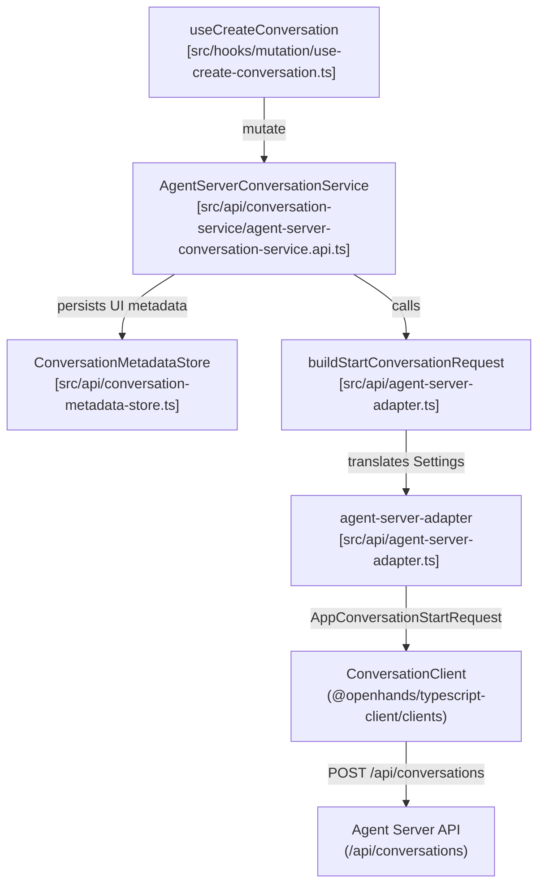
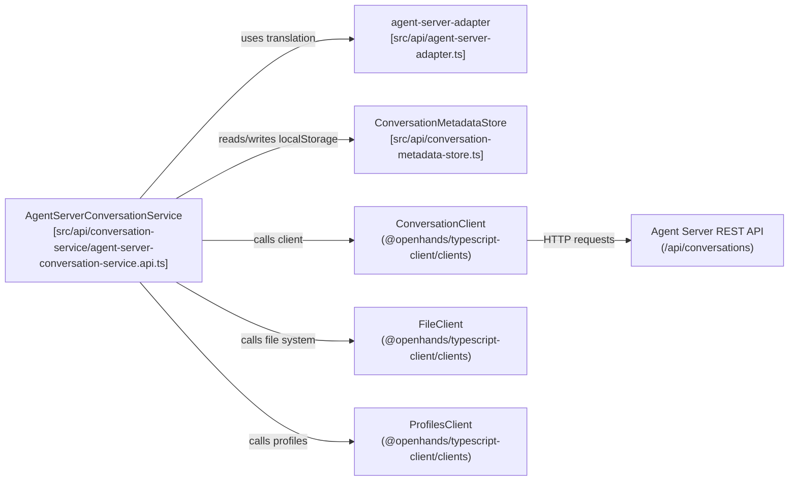

<!-- source: DeepWiki mcp.deepwiki.com · repo All-Hands-AI/OpenHands · page 4.1 Conversation Service and Agent Server Adapter · fetched 2026-10-26 -->

# Conversation Service and Agent Server Adapter

Relevant source files

The following files were used as context for generating this wiki page:

- [.env.sample](.env.sample)
- [__tests__/api/agent-server-adapter.test.ts](__tests__/api/agent-server-adapter.test.ts)
- [__tests__/api/agent-server-config.test.ts](__tests__/api/agent-server-config.test.ts)
- [__tests__/api/agent-server-conversation-service.test.ts](__tests__/api/agent-server-conversation-service.test.ts)
- [__tests__/api/cloud/sandbox-service.test.ts](__tests__/api/cloud/sandbox-service.test.ts)
- [__tests__/api/hooks-service.test.ts](__tests__/api/hooks-service.test.ts)
- [__tests__/api/use-create-conversation-metadata.test.ts](__tests__/api/use-create-conversation-metadata.test.ts)
- [__tests__/components/features/chat/skill-install-restart-banner.test.tsx](__tests__/components/features/chat/skill-install-restart-banner.test.tsx)
- [__tests__/hooks/mutation/use-create-conversation.test.tsx](__tests__/hooks/mutation/use-create-conversation.test.tsx)
- [__tests__/hooks/mutation/use-switch-llm-profile-and-log.test.tsx](__tests__/hooks/mutation/use-switch-llm-profile-and-log.test.tsx)
- [__tests__/hooks/mutation/use-switch-llm-profile.test.tsx](__tests__/hooks/mutation/use-switch-llm-profile.test.tsx)
- [__tests__/hooks/use-unified-vscode-url.test.tsx](__tests__/hooks/use-unified-vscode-url.test.tsx)
- [__tests__/scripts/docker-vscode-route-sync.test.ts](__tests__/scripts/docker-vscode-route-sync.test.ts)
- [__tests__/scripts/vscode-base-path-opt-in.test.ts](__tests__/scripts/vscode-base-path-opt-in.test.ts)
- [__tests__/utils/vscode-origin.test.ts](__tests__/utils/vscode-origin.test.ts)
- [src/api/agent-server-adapter.test.ts](src/api/agent-server-adapter.test.ts)
- [src/api/agent-server-adapter.ts](src/api/agent-server-adapter.ts)
- [src/api/agent-server-config.ts](src/api/agent-server-config.ts)
- [src/api/cloud/sandbox-service.api.ts](src/api/cloud/sandbox-service.api.ts)
- [src/api/cloud/sandbox-service.types.ts](src/api/cloud/sandbox-service.types.ts)
- [src/api/conversation-metadata-store.ts](src/api/conversation-metadata-store.ts)
- [src/api/conversation-service/agent-server-conversation-service.api.ts](src/api/conversation-service/agent-server-conversation-service.api.ts)
- [src/api/conversation-service/conversation-service.api.ts](src/api/conversation-service/conversation-service.api.ts)
- [src/api/hooks-service.ts](src/api/hooks-service.ts)
- [src/hooks/chat/record-model-switch-message.test.ts](src/hooks/chat/record-model-switch-message.test.ts)
- [src/hooks/chat/record-model-switch-message.ts](src/hooks/chat/record-model-switch-message.ts)
- [src/hooks/mutation/use-create-conversation.ts](src/hooks/mutation/use-create-conversation.ts)
- [src/hooks/mutation/use-switch-llm-profile-and-log.ts](src/hooks/mutation/use-switch-llm-profile-and-log.ts)
- [src/hooks/mutation/use-switch-llm-profile.ts](src/hooks/mutation/use-switch-llm-profile.ts)
- [src/hooks/query/use-cloud-sandbox.ts](src/hooks/query/use-cloud-sandbox.ts)
- [src/hooks/query/use-unified-vscode-url.ts](src/hooks/query/use-unified-vscode-url.ts)
- [src/stores/model-store.ts](src/stores/model-store.ts)

## Purpose and Scope

The Conversation Service and Agent Server Adapter form the core communication layer between the Agent Canvas frontend and the OpenHands agent-server backends. This layer handles conversation lifecycle management (`createConversation`, `sendMessage`, `switchProfile`, batch fetches), translates frontend configuration and settings into payloads required by the agent-server SDK via `agent-server-adapter.ts`, and manages local persistence of UI-specific conversation metadata through `conversation-metadata-store.ts`.

Sources: [src/api/conversation-service/agent-server-conversation-service.api.ts:1-80](), [src/api/agent-server-adapter.ts:1-38](), [src/api/conversation-metadata-store.ts:1-92]()

## AgentServerConversationService

`AgentServerConversationService` is the primary API entry point for managing agent sessions within `AgentServerConversationService` [src/api/conversation-service/agent-server-conversation-service.api.ts:1-80](). It abstracts differences between local backends and cloud-based agent-server instances, providing a unified interface for React hooks.

### Key Functions and Implementation

- **`createConversation`**: Orchestrates the startup of a new agent session. It resolves the working directory via `FileClient.getHome` [__tests__/api/agent-server-conversation-service.test.ts:177-178](), prepares the initial message, and constructs the `AppConversationStartRequest` [src/api/conversation-service/agent-server-conversation-service.api.ts:245-316](). It also handles the park-and-patch flow for cloud-based conversations [src/api/conversation-service/agent-server-conversation-service.api.ts:262-273]().
- **`sendMessage`**: Transmits user input to an active conversation through `ConversationClient.sendEvent` [src/api/conversation-service/agent-server-conversation-service.api.ts:430-456]().
- **`switchProfile`**: Modifies the LLM profile for an existing conversation using `ConversationClient.switchProfile`, ensuring the backend updates its runtime model configuration [src/api/conversation-service/agent-server-conversation-service.api.ts:517-536]().
- **Batch Fetches (`batchGetAppConversations`)**: Efficiently retrieves multiple conversation records from the backend in batch, normalizing varying wire shapes into the `AppConversation` structure [src/api/conversation-service/agent-server-conversation-service.api.ts:342-364]().
- **`readConversationFile`**: Downloads specific target files from the agent's working directory—such as `PLAN.md` inside `.agents_tmp`—using `FileClient.downloadTextFile` [src/api/conversation-service/agent-server-conversation-service.api.ts:468-502]().

Sources: [src/api/conversation-service/agent-server-conversation-service.api.ts:245-536](), [src/api/conversation-service/agent-server-conversation-service.api.ts:7-12]()

### Data Flow: Conversation Creation

**Conversation Creation Flow**

Sources: [src/api/conversation-service/agent-server-conversation-service.api.ts:245-316](), [src/api/agent-server-adapter.ts:243-382](), [src/api/conversation-metadata-store.ts:76-83](), [src/hooks/mutation/use-create-conversation.ts:80-175]()

## Agent Server Adapter Layer

The adapter module (`agent-server-adapter.ts`) acts as a translation bridge. It consumes frontend-internal `Settings` and `LLMConfig` structures and transforms them into the JSON schema expected by the underlying Python agent-server via the TypeScript client SDK [src/api/agent-server-adapter.ts:1-38]().

### Translation Logic

- **`buildStartConversationRequest`**: Assembles the `AppConversationStartRequest` payload. It merges user settings, determines whether the agent kind is standard OpenHands or an ACP subprocess via `ACPAgent` [src/api/agent-server-adapter.ts:89-107](), and injects bundled skills from `SKILLS_CATALOG` into `agent_context` [src/api/agent-server-adapter.ts:243-382](). ACP model selection is handled via `resolveEffectiveAcpModel` [src/api/agent-server-adapter.ts:9-12]().
- **`toAppConversation`**: Converts raw `DirectConversationInfo` payloads returned by the backend into a normalized `AppConversation` object [src/api/agent-server-adapter.ts:465-546](). It inspects the `kind` discriminator (e.g., `"ACPAgent"`) and extracts the `acp_server` identity from conversation tags [src/api/agent-server-adapter.ts:89-103]().
- **`buildRuntimeServicesSystemSuffix`**: Constructs a Markdown formatted block detailing reachable services (such as the automation backend) [src/api/agent-server-adapter.ts:201-241](). This text block is injected directly into the agent's system prompt via `AgentContext.system_message_suffix` [src/api/agent-server-adapter.ts:360-363]().

### Runtime Services Injection

The agent instance inside its isolated sandbox requires knowledge of frontend and automation service endpoints. This metadata is retrieved from the backend's `/server_info` endpoint using `fetchBackendRuntimeServicesInfo` [src/api/agent-server-adapter.ts:13-17](). The adapter parses the response into `RuntimeServicesInfo` [src/api/agent-server-adapter.ts:158-180]() for prompt injection.

Sources: [src/api/agent-server-adapter.ts:1-382](), [src/api/agent-server-adapter.ts:465-546]()

## Conversation Metadata Store

While the agent-server persists conversation logs, history, and workspace files, `conversation-metadata-store.ts` handles client-side persistence of UI-specific attributes inside the browser's `localStorage` [src/api/conversation-metadata-store.ts:1-92]().

### Metadata Structure

The `ConversationMetadata` interface tracks:
- **`selected_repository` / `selected_branch`**: Git coordinates picked during conversation creation [src/api/conversation-metadata-store.ts:9-19]().
- **`active_profile`**: The specific named LLM profile associated with the session [src/api/conversation-metadata-store.ts:31-37]().
- **`workspace_mode`**: Specifies whether the session runs in `local_repo` or `new_worktree` mode [src/api/conversation-metadata-store.ts:22-29]().
- **`plugins`**: Coordinates for installed plugins stored as `PluginSpec` references [src/api/conversation-metadata-store.ts:39-48]().

### Implementation Details

Metadata records are indexed by conversation ID. The store exposes core functions including `getStoredConversationMetadata`, `setStoredConversationMetadata`, and `removeStoredConversationMetadata` [src/api/conversation-metadata-store.ts:72-92]().

Sources: [src/api/conversation-metadata-store.ts:1-92]()

## Code Entity Mapping

**Code Entity Mapping**

Sources: [src/api/conversation-service/agent-server-conversation-service.api.ts:7-12](), [src/api/agent-server-adapter.ts:1-11](), [src/api/conversation-metadata-store.ts:72-83]()

---

