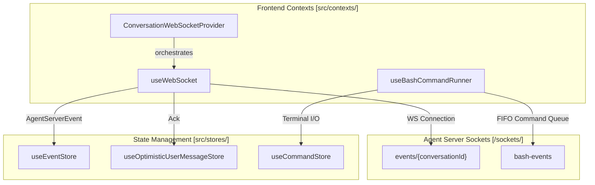
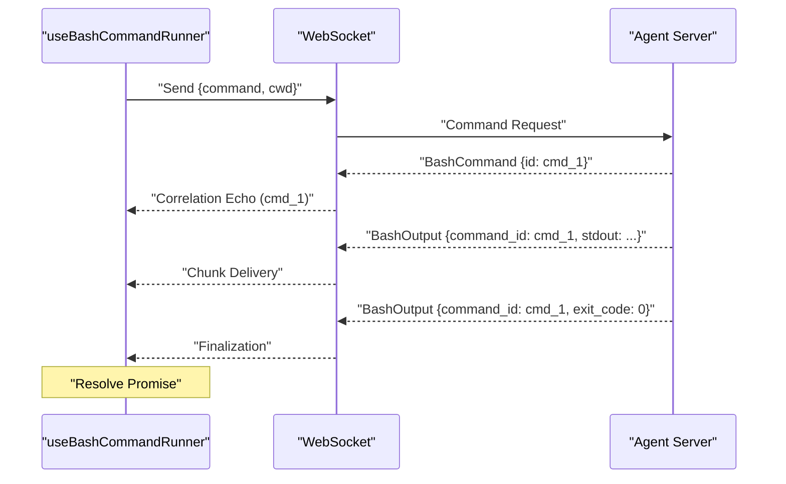

<!-- source: DeepWiki mcp.deepwiki.com · repo All-Hands-AI/OpenHands · page 4.2 WebSocket Communication Layer · fetched 2026-10-26 -->

# WebSocket Communication Layer

Relevant source files

The following files were used as context for generating this wiki page:

- [__tests__/api/bash-service.test.ts](__tests__/api/bash-service.test.ts)
- [__tests__/api/event-service.test.ts](__tests__/api/event-service.test.ts)
- [__tests__/api/runtime-service/agent-server-runtime-service.test.ts](__tests__/api/runtime-service/agent-server-runtime-service.test.ts)
- [__tests__/build-websocket-url.test.ts](__tests__/build-websocket-url.test.ts)
- [__tests__/contexts/conversation-websocket-context.test.tsx](__tests__/contexts/conversation-websocket-context.test.tsx)
- [__tests__/hooks/query/use-bash-command-logs-enabled.test.tsx](__tests__/hooks/query/use-bash-command-logs-enabled.test.tsx)
- [__tests__/hooks/query/use-bash-command-logs.test.tsx](__tests__/hooks/query/use-bash-command-logs.test.tsx)
- [__tests__/hooks/query/use-conversation-history.test.tsx](__tests__/hooks/query/use-conversation-history.test.tsx)
- [__tests__/hooks/use-bash-command-runner.test.ts](__tests__/hooks/use-bash-command-runner.test.ts)
- [__tests__/hooks/use-load-older-events.test.tsx](__tests__/hooks/use-load-older-events.test.tsx)
- [__tests__/hooks/use-websocket.test.ts](__tests__/hooks/use-websocket.test.ts)
- [__tests__/stores/use-event-store.test.ts](__tests__/stores/use-event-store.test.ts)
- [__tests__/utils/streaming-delta-batcher.test.ts](__tests__/utils/streaming-delta-batcher.test.ts)
- [__tests__/utils/websocket-url.test.ts](__tests__/utils/websocket-url.test.ts)
- [src/api/bash-service/bash-service.api.ts](src/api/bash-service/bash-service.api.ts)
- [src/api/event-service/event-service.api.ts](src/api/event-service/event-service.api.ts)
- [src/api/runtime-service/agent-server-runtime-service.ts](src/api/runtime-service/agent-server-runtime-service.ts)
- [src/contexts/conversation-websocket-context.tsx](src/contexts/conversation-websocket-context.tsx)
- [src/hooks/query/use-bash-command-logs.ts](src/hooks/query/use-bash-command-logs.ts)
- [src/hooks/query/use-conversation-history.ts](src/hooks/query/use-conversation-history.ts)
- [src/hooks/use-bash-command-runner.ts](src/hooks/use-bash-command-runner.ts)
- [src/hooks/use-load-older-events.ts](src/hooks/use-load-older-events.ts)
- [src/hooks/use-websocket.ts](src/hooks/use-websocket.ts)
- [src/stores/use-event-store.ts](src/stores/use-event-store.ts)
- [src/utils/streaming-delta-batcher.ts](src/utils/streaming-delta-batcher.ts)
- [src/utils/websocket-handshake.ts](src/utils/websocket-handshake.ts)
- [src/utils/websocket-url.ts](src/utils/websocket-url.ts)

## Purpose and Scope

This document explains the real-time communication architecture of OpenHands, focusing on the native WebSocket implementation (V1). The system orchestrates bidirectional communication between the Agent Canvas frontend and the agent-server, handling event streaming, state synchronization, and low-level bash interactions.

The core of this layer is the `ConversationWebSocketProvider` [src/contexts/conversation-websocket-context.tsx:124-138](), which manages the lifecycle of multiple WebSocket connections and integrates them with the application's global state stores.

Sources: [src/contexts/conversation-websocket-context.tsx:124-138]()

## Architecture Overview

The WebSocket layer uses a dual-socket orchestration to support parallel agentic workflows and a specialized sidecar socket for synchronous-like terminal interactions.

Title: WebSocket Communication Flow and Entity Mapping

Sources: [src/contexts/conversation-websocket-context.tsx:124-138](), [src/hooks/use-websocket.ts:22-152](), [src/hooks/use-bash-command-runner.ts:61-65](), [src/utils/websocket-url.ts:89-135]()

## Conversation WebSocket Provider

The `ConversationWebSocketProvider` is the primary orchestrator for a conversation session. It manages two distinct connections to the agent-server to separate main agent activity from planning sub-tasks [src/contexts/conversation-websocket-context.tsx:140-143]():

1.  **Main Connection**: Handles the primary agent's event stream.
2.  **Planning Connection**: Dedicated to sub-conversations (e.g., a planning agent), allowing parallel execution without interleaving event streams [src/contexts/conversation-websocket-context.tsx:142-143]().

### Connection Lifecycle and Authentication
Connections are established using the `useWebSocket` hook [src/hooks/use-websocket.ts:22-152](). Authentication is handled post-connection via a specialized `"auth"` frame containing the `session_api_key` [src/utils/websocket-auth.ts:4-18](). This prevents leaking sensitive keys in URL query parameters [src/hooks/use-websocket.ts:68]().

URLs are constructed using `buildWebSocketUrl`, which dynamically selects between `ws://` and `wss://` based on the page's security context and the target host [src/utils/websocket-url.ts:109-135]().

### Event Processing Pipeline
Incoming messages are parsed and routed through a series of type guards [src/contexts/conversation-websocket-context.tsx:24-43]() to determine their impact on the application state:

*   **Event Storage**: Actions and observations are dispatched to `addEvent` or `addEvents` in the `useEventStore` [src/contexts/conversation-websocket-context.tsx:151-152](), [src/stores/use-event-store.ts:67-74]().
*   **Idempotency & Ack**: When a `MessageEvent` is echoed back from the server, the provider extracts the text using `extractMessageEventText` [src/contexts/conversation-websocket-context.tsx:113-122]() and calls `consumeMatchingPendingMessage` to remove the optimistic UI entry [src/contexts/conversation-websocket-context.tsx:158-160]().
*   **Streaming Optimization**: To prevent excessive re-renders, the provider uses `createStreamingDeltaBatcher` to coalesce streaming deltas to ≤1 store commit per frame [src/contexts/conversation-websocket-context.tsx:45-47, 167-180]().
*   **Model Switching**: If a `SwitchLLMObservationEvent` is detected, the provider records the model switch via `recordModelSwitchMessage` [src/contexts/conversation-websocket-context.tsx:39, 70-73](). It also persists state changes locally [src/contexts/conversation-websocket-context.tsx:68]().

Sources: [src/contexts/conversation-websocket-context.tsx:24-47, 68-73, 113-122, 140-180](), [src/hooks/use-websocket.ts:22-152](), [src/utils/websocket-auth.ts:4-18](), [src/utils/websocket-url.ts:109-135](), [src/stores/use-event-store.ts:67-74]()

## useWebSocket Hook

The `useWebSocket` hook provides a resilient wrapper around the native `WebSocket` API [src/hooks/use-websocket.ts:22]().

### Key Features
*   **Auto-Reconnect**: Implements an exponential backoff strategy (1s base delay, capped at 30s) with random jitter to prevent parallel sockets from retrying in lockstep [src/hooks/use-websocket.ts:19-20, 128-132]().
*   **Instance Tracking**: Uses a `WeakSet` (`allowedToReconnectRef`) to track which socket instances are active, preventing stale instances from triggering reconnection loops after unmount [src/hooks/use-websocket.ts:31, 59, 86]().
*   **Handshake Watchdog**: `startHandshakeWatchdog` is used to abort a WebSocket connection that gets stuck in the `CONNECTING` state, preventing it from holding Chrome's per-host handshake lock indefinitely [src/hooks/use-websocket.ts:64, 84]().
*   **State Synchronization**: Exposes `isConnected`, `isReconnecting`, and `error` as reactive states for UI components [src/hooks/use-websocket.ts:23-25]().

Sources: [src/hooks/use-websocket.ts:19-31, 59-66, 84-86, 128-132]()

## Event Resend Strategies

OpenHands supports two modes for synchronizing event history over WebSockets, controlled by query parameters:

1.  **`resend_mode=since`**: For the main conversation, the WebSocket connects with a timestamp of the latest cached event to replay only missed events [src/contexts/conversation-websocket-context.tsx:333-337]().
2.  **`resend_all=true`**: Used for planning agents. The server streams the entire event history upon connection [src/contexts/conversation-websocket-context.tsx:348-350]().

History is primarily loaded via REST using `useConversationHistory`, which fetches the tail of the conversation (default 50 events) sorted by `TIMESTAMP_DESC` [src/hooks/query/use-conversation-history.ts:10, 22-29, 52-55]().

Sources: [src/contexts/conversation-websocket-context.tsx:333-350](), [src/hooks/query/use-conversation-history.ts:10-55]()

## useBashCommandRunner

The `useBashCommandRunner` hook provides a synchronous-like interface for executing terminal commands over a dedicated WebSocket (`/sockets/bash-events`) [src/hooks/use-bash-command-runner.ts:61-65, 77]().

### Execution Flow
1.  **Command Queuing**: Commands are buffered in a `waitingQueueRef` until the socket is open and authenticated [src/hooks/use-bash-command-runner.ts:68, 190-196]().
2.  **FIFO Correlation**: The runner uses a FIFO `pendingQueueRef` to match sent commands with the server's `BashCommand` echo to retrieve a `command_id` [src/hooks/use-bash-command-runner.ts:70, 112-121]().
3.  **Output Accumulation**: As `BashOutput` frames arrive, `stdout` and `stderr` are buffered in a map (`activeCommandsRef`) keyed by `command_id` [src/hooks/use-bash-command-runner.ts:72, 122-126]().
4.  **Promise Resolution**: When a frame with a non-null `exit_code` is received, the corresponding promise is resolved with the aggregated output [src/hooks/use-bash-command-runner.ts:127-134]().

Title: Bash Command Execution Pipeline

Sources: [src/hooks/use-bash-command-runner.ts:61-203](), [src/utils/websocket-url.ts:89-101]()

---

