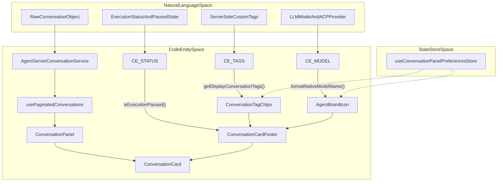
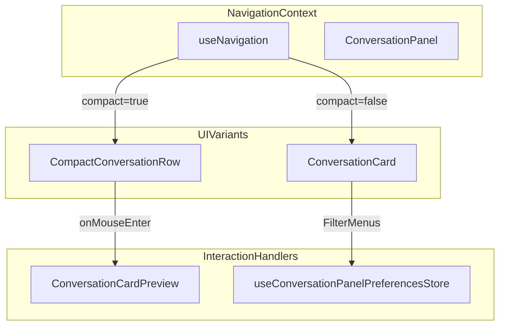

<!-- source: DeepWiki mcp.deepwiki.com · repo All-Hands-AI/OpenHands · page 4.3 Conversation Panel and Card UI · fetched 2026-10-26 -->

# Conversation Panel and Card UI

Relevant source files

The following files were used as context for generating this wiki page:

- [__tests__/components/features/conversation-panel/conversation-card.test.tsx](__tests__/components/features/conversation-panel/conversation-card.test.tsx)
- [__tests__/components/features/conversation-panel/conversation-panel-list-helpers.test.ts](__tests__/components/features/conversation-panel/conversation-panel-list-helpers.test.ts)
- [__tests__/components/features/conversation-panel/conversation-panel.test.tsx](__tests__/components/features/conversation-panel/conversation-panel.test.tsx)
- [__tests__/components/features/conversation/conversation-name-with-status.test.tsx](__tests__/components/features/conversation/conversation-name-with-status.test.tsx)
- [__tests__/components/features/conversation/conversation-name.test.tsx](__tests__/components/features/conversation/conversation-name.test.tsx)
- [__tests__/hooks/query/concurrency-limiter.test.ts](__tests__/hooks/query/concurrency-limiter.test.ts)
- [__tests__/hooks/query/use-automation-run-summaries.test.tsx](__tests__/hooks/query/use-automation-run-summaries.test.tsx)
- [__tests__/hooks/query/use-latest-automation-runs.test.tsx](__tests__/hooks/query/use-latest-automation-runs.test.tsx)
- [__tests__/hooks/query/use-paginated-conversations.test.tsx](__tests__/hooks/query/use-paginated-conversations.test.tsx)
- [__tests__/hooks/use-click-outside-element.test.tsx](__tests__/hooks/use-click-outside-element.test.tsx)
- [__tests__/manifests/automation-interface.test.ts](__tests__/manifests/automation-interface.test.ts)
- [__tests__/stores/conversation-panel-preferences-store.test.ts](__tests__/stores/conversation-panel-preferences-store.test.ts)
- [__tests__/utils/hover-reveal-classes.test.ts](__tests__/utils/hover-reveal-classes.test.ts)
- [src/api/event-service/event-service.api.test.ts](src/api/event-service/event-service.api.test.ts)
- [src/api/event-service/event-service.types.ts](src/api/event-service/event-service.types.ts)
- [src/components/features/controls/server-status-context-menu.tsx](src/components/features/controls/server-status-context-menu.tsx)
- [src/components/features/conversation-panel/conversation-card/conversation-card-actions.tsx](src/components/features/conversation-panel/conversation-card/conversation-card-actions.tsx)
- [src/components/features/conversation-panel/conversation-card/conversation-card-context-menu.tsx](src/components/features/conversation-panel/conversation-card/conversation-card-context-menu.tsx)
- [src/components/features/conversation-panel/conversation-card/conversation-card-footer.tsx](src/components/features/conversation-panel/conversation-card/conversation-card-footer.tsx)
- [src/components/features/conversation-panel/conversation-card/conversation-card.tsx](src/components/features/conversation-panel/conversation-card/conversation-card.tsx)
- [src/components/features/conversation-panel/conversation-panel-list-helpers.ts](src/components/features/conversation-panel/conversation-panel-list-helpers.ts)
- [src/components/features/conversation-panel/conversation-panel.tsx](src/components/features/conversation-panel/conversation-panel.tsx)
- [src/components/features/conversation/conversation-name-context-menu.tsx](src/components/features/conversation/conversation-name-context-menu.tsx)
- [src/components/features/conversation/conversation-name-with-status.tsx](src/components/features/conversation/conversation-name-with-status.tsx)
- [src/components/features/conversation/conversation-name.tsx](src/components/features/conversation/conversation-name.tsx)
- [src/components/features/conversation/transcript-export-modal.tsx](src/components/features/conversation/transcript-export-modal.tsx)
- [src/hooks/query/concurrency-limiter.ts](src/hooks/query/concurrency-limiter.ts)
- [src/hooks/query/use-automation-run-summaries.ts](src/hooks/query/use-automation-run-summaries.ts)
- [src/hooks/query/use-latest-automation-runs.ts](src/hooks/query/use-latest-automation-runs.ts)
- [src/hooks/query/use-paginated-conversations.ts](src/hooks/query/use-paginated-conversations.ts)
- [src/hooks/use-conversation-name-context-menu.ts](src/hooks/use-conversation-name-context-menu.ts)
- [src/manifests/automation-interface.ts](src/manifests/automation-interface.ts)
- [src/stores/conversation-panel-preferences-store.ts](src/stores/conversation-panel-preferences-store.ts)
- [src/utils/transcript-export/__snapshots__/index.test.ts.snap](src/utils/transcript-export/__snapshots__/index.test.ts.snap)

The **Conversation Panel** is the primary interface for browsing, searching, and managing agent sessions (conversations) within Agent Canvas. It serves as a persistent sidebar in the desktop layout and a modal drawer on mobile, providing users with metadata-rich entry points into active and historical agent tasks.

## Overview and Purpose

The conversation management UI is designed to handle high-volume agent interactions. It supports:
- **Multi-Backend Filtering**: Automatically scopes the list to the active backend and organization [src/components/features/conversation-panel/conversation-panel.tsx:83-85]().
- **State Persistence**: User preferences for sorting, grouping, and metadata visibility are persisted via Zustand [src/stores/conversation-panel-preferences-store.ts:125-140]().
- **Rich Metadata Rendering**: Displays agent types (OpenHands vs. ACP), LLM models, git repository context, and custom tags [src/components/features/conversation-panel/conversation-card/conversation-card-footer.tsx:106-130]().
- **Pinned & Grouped Layouts**: Pinning priority conversations and organizing folders by repository or workspace [src/components/features/conversation-panel/conversation-panel.tsx:41-42]().

Sources: [src/components/features/conversation-panel/conversation-panel.tsx:83-85](), [src/stores/conversation-panel-preferences-store.ts:125-140](), [src/components/features/conversation-panel/conversation-card/conversation-card-footer.tsx:106-130]()

## Implementation Architecture

The UI is built as a hierarchy of components that transform raw API data into interactive cards.

### UI Component Hierarchy

| Component | Responsibility | Source Citing |
| :--- | :--- | :--- |
| `ConversationPanel` | The main controller for fetching, filtering, and sorting the conversation list. | [src/components/features/conversation-panel/conversation-panel.tsx:78]() |
| `ConversationCard` | The standard list item rendering title, status, and metadata. | [src/components/features/conversation-panel/conversation-card/conversation-card.tsx:71]() |
| `CompactConversationRow` | A minimal, icon-only variant used when the sidebar is collapsed. | [src/components/features/conversation-panel/conversation-panel.tsx:67-71]() |
| `ConversationLayoutsMenu` | A dropdown for toggling visibility of older threads, tags, and models. | [src/components/features/conversation-panel/conversation-layouts-menu.tsx:15]() |
| `ConversationGroupFolderList` | Handles folder-based grouping of conversations (e.g., by Workspace or Repository). | [src/components/features/conversation-panel/conversation-group-folder-list.tsx:1-41]() |

Sources: [src/components/features/conversation-panel/conversation-panel.tsx:31-78](), [src/components/features/conversation-panel/conversation-card/conversation-card.tsx:71]()

### Data Flow: From Server to UI

The following diagram bridges the natural language conceptual space of conversation data to the concrete code entities processing them.

**Conversation Data Transformation (Natural Language to Code Entity Space)**

Sources: [src/components/features/conversation-panel/conversation-card/conversation-card-footer.tsx:74-180](), [src/stores/conversation-panel-preferences-store.ts:31-50](), [src/hooks/query/use-paginated-conversations.ts:10-61]()

## Key Components

### ConversationPanel and Sidebar List
The `ConversationPanel` uses the `usePaginatedConversations` hook to fetch data [src/hooks/query/use-paginated-conversations.ts:10-61]() with a 30-second polling interval (paused on automation routes) [src/hooks/query/use-paginated-conversations.ts:54](). It applies several local filtering and partitioning strategies:
- **Older Conversation Cutoff**: Conversations updated before a specified interval can be partitioned and hidden via `partitionByCutoff` [src/components/features/conversation-panel/conversation-panel-list-helpers.ts:53-70]().
- **Pinned Section**: High-priority threads managed by `usePinnedConversationsStore` are rendered at the top via `ConversationPanelPinnedSection` [src/components/features/conversation-panel/conversation-panel.tsx:42]().
- **Automation Filtering**: Users can filter the list to show all threads, hide automations, or show specific automation runs via `applyAutomationConversationFilter` [src/components/features/conversation-panel/conversation-panel-list-helpers.ts:3-17]().

Sources: [src/components/features/conversation-panel/conversation-panel.tsx:35-60](), [src/components/features/conversation-panel/conversation-panel-list-helpers.ts:53-70](), [src/hooks/query/use-paginated-conversations.ts:10-61]()

### ConversationCard and Footer
The `ConversationCard` renders core metadata for a session, handling both native OpenHands agents and **ACP (Agent Client Protocol)** agents [src/components/features/conversation-panel/conversation-card/conversation-card.tsx:71]().

- **ACP Handling**: When `agentKind` is `"acp"`, the card resolves the provider brand via `getAcpProviderDisplayName` and `resolveAcpProviderIcon` [src/components/features/conversation-panel/conversation-card/conversation-card-footer.tsx:107-118]().
- **Tag Rendering**: Non-reserved tags render as chips, gated by `showTagsMetadata` [src/components/features/conversation-panel/conversation-card/conversation-card-footer.tsx:136-136]().
- **Repository Metadata**: Displays the git repository and branch using raised pill chips [__tests__/components/features/conversation-panel/conversation-card.test.tsx:137-159]().

Sources: [src/components/features/conversation-panel/conversation-card/conversation-card.tsx:71](), [src/components/features/conversation-panel/conversation-card/conversation-card-footer.tsx:107-136](), [__tests__/components/features/conversation-panel/conversation-card.test.tsx:137-159]()

### CompactConversationRow and Preview
When rendered with `compact=true` (e.g., in a collapsed sidebar), `ConversationPanel` renders minimal rows where each row displays a status indicator [src/components/features/conversation-panel/conversation-panel.tsx:67-71](). Hovering triggers a `ConversationCardPreview` containing full card content [src/components/features/conversation-panel/conversation-panel.tsx:31-32]().

Sources: [src/components/features/conversation-panel/conversation-panel.tsx:67-71]()

## State Management and Preferences

### conversation-panel-preferences-store
The `useConversationPanelPreferencesStore` Zustand store manages user toggles for sorting, grouping, metadata visibility, and active filters, persisting state to `localStorage` [src/stores/conversation-panel-preferences-store.ts:1-50]().

| State Property | Default | Description |
| :--- | :--- | :--- |
| `showOlderConversations` | `true` | Visibility of older threads [src/stores/conversation-panel-preferences-store.ts:32](). |
| `showArchivedConversations` | `false` | Visibility of archived conversations [src/stores/conversation-panel-preferences-store.ts:38](). |
| `showRepoBranchMetadata` | `false` | Visibility of repository and branch metadata [src/stores/conversation-panel-preferences-store.ts:39](). |
| `showLlmProfiles` | `false` | Visibility of the LLM model chip [src/stores/conversation-panel-preferences-store.ts:40](). |
| `showTagsMetadata` | `true` | Visibility of conversation tags [src/stores/conversation-panel-preferences-store.ts:41](). |
| `organizeMode` | `"chronological"` | List grouping style (chronological vs grouped) [src/stores/conversation-panel-preferences-store.ts:43](). |
| `conversationSort` | `"updated"` | Sorting field (updated vs created) [src/stores/conversation-panel-preferences-store.ts:44](). |
| `threadScope` | `"all"` | Scope of threads to display [src/stores/conversation-panel-preferences-store.ts:45](). |
| `automationFilterMode` | `"all"` | Filter mode for automation-born threads [src/stores/conversation-panel-preferences-store.ts:46](). |

Sources: [src/stores/conversation-panel-preferences-store.ts:31-50](), [__tests__/stores/conversation-panel-preferences-store.test.ts:11-24]()

## Visual Interaction Logic

The following diagram maps the structural transition between the expanded sidebar view and the collapsed compact representation.

**Sidebar State Transition**

Sources: [src/components/features/conversation-panel/conversation-panel.tsx:64-81](), [src/stores/conversation-panel-preferences-store.ts:31-50]()

---

