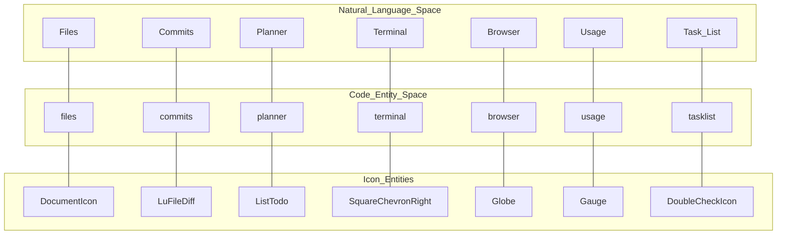
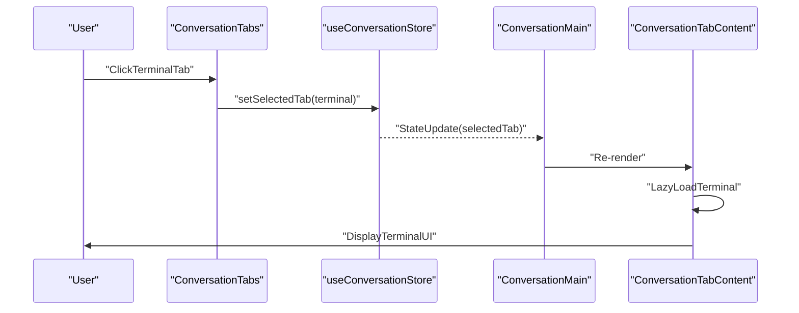

<!-- source: DeepWiki mcp.deepwiki.com · repo All-Hands-AI/OpenHands · page 4.4 Conversation Tabs and Main Layout · fetched 2026-10-26 -->

# Conversation Tabs and Main Layout

Relevant source files

The following files were used as context for generating this wiki page:

- [__tests__/components/features/conversation/conversation-tab-content.test.tsx](__tests__/components/features/conversation/conversation-tab-content.test.tsx)
- [__tests__/components/features/conversation/conversation-tabs-context-menu.test.tsx](__tests__/components/features/conversation/conversation-tabs-context-menu.test.tsx)
- [__tests__/components/features/conversation/conversation-tabs.test.tsx](__tests__/components/features/conversation/conversation-tabs.test.tsx)
- [__tests__/components/features/conversation/right-panel-toggle.test.tsx](__tests__/components/features/conversation/right-panel-toggle.test.tsx)
- [__tests__/components/features/files-tab/file-tree-view.test.tsx](__tests__/components/features/files-tab/file-tree-view.test.tsx)
- [__tests__/conversation-local-storage.test.ts](__tests__/conversation-local-storage.test.ts)
- [__tests__/i18n/library-namespace.test.ts](__tests__/i18n/library-namespace.test.ts)
- [__tests__/utils/file-priority.test.ts](__tests__/utils/file-priority.test.ts)
- [src/components/features/conversation/conversation-main/chat-interface-wrapper.tsx](src/components/features/conversation/conversation-main/chat-interface-wrapper.tsx)
- [src/components/features/conversation/conversation-main/conversation-main.tsx](src/components/features/conversation/conversation-main/conversation-main.tsx)
- [src/components/features/conversation/conversation-tabs/conversation-tab-content/conversation-tab-content.tsx](src/components/features/conversation/conversation-tabs/conversation-tab-content/conversation-tab-content.tsx)
- [src/components/features/conversation/conversation-tabs/conversation-tab-content/tab-container.tsx](src/components/features/conversation/conversation-tabs/conversation-tab-content/tab-container.tsx)
- [src/components/features/conversation/conversation-tabs/conversation-tab-content/tab-content-area.tsx](src/components/features/conversation/conversation-tabs/conversation-tab-content/tab-content-area.tsx)
- [src/components/features/conversation/conversation-tabs/conversation-tab-nav.tsx](src/components/features/conversation/conversation-tabs/conversation-tab-nav.tsx)
- [src/components/features/conversation/conversation-tabs/conversation-tabs-context-menu.tsx](src/components/features/conversation/conversation-tabs/conversation-tabs-context-menu.tsx)
- [src/components/features/conversation/conversation-tabs/conversation-tabs.tsx](src/components/features/conversation/conversation-tabs/conversation-tabs.tsx)
- [src/components/features/conversation/right-panel-toggle.tsx](src/components/features/conversation/right-panel-toggle.tsx)
- [src/components/features/diff-viewer/editor-container.tsx](src/components/features/diff-viewer/editor-container.tsx)
- [src/components/features/files-tab/file-tree-view.tsx](src/components/features/files-tab/file-tree-view.tsx)
- [src/components/features/files-tab/tree-node.tsx](src/components/features/files-tab/tree-node.tsx)
- [src/stores/conversation-store.ts](src/stores/conversation-store.ts)
- [src/utils/conversation-local-storage.ts](src/utils/conversation-local-storage.ts)
- [src/utils/file-priority.ts](src/utils/file-priority.ts)
- [tests/e2e/mock-llm/files/mock-llm-files-and-git.spec.ts](tests/e2e/mock-llm/files/mock-llm-files-and-git.spec.ts)
- [tests/e2e/mock-llm/settings/mock-llm-acp-agent.spec.ts](tests/e2e/mock-llm/settings/mock-llm-acp-agent.spec.ts)

The **Conversation Tabs and Main Layout** system defines the primary workspace where users interact with AI agents. It orchestrates a dual-pane interface comprising a central chat area and a flexible right-hand panel for developer tools including Files, Terminal, Browser, and the Planner.

## ConversationMain Layout

`ConversationMain` is the top-level layout component for the active session. It manages the responsive split-pane view between the chat interface and the tool tabs [src/components/features/conversation/conversation-main/conversation-main.tsx:23-23]().

### Desktop vs. Mobile Rendering
- **Desktop**: Uses a resizable split-pane layout managed by the `useResizablePanels` hook [src/components/features/conversation/conversation-main/conversation-main.tsx:30-36](). The right panel can be toggled, triggering a CSS transition that adjusts the width of active panes [src/components/features/conversation/conversation-main/conversation-main.tsx:111-118]().
- **Mobile**: Switches to a vertical stack. The chat occupies the main screen [src/components/features/conversation/conversation-main/conversation-main.tsx:41-43](). Detailed tool panels are accessed via a dedicated mobile route (`/conversations/:conversationId/panel`), rendered by `ConversationMobilePanelPage` [src/routes/conversation.tsx:25-25]().

### Layout Components Hierarchy
| Component | Role |
| :--- | :--- |
| `ConversationMain` | Root layout orchestrator for the session [src/components/features/conversation/conversation-main/conversation-main.tsx:23-23](). |
| `ChatInterfaceWrapper` | A container that constrains the chat width to a maximum of `800px` for readability [src/components/features/conversation/conversation-main/chat-interface-wrapper.tsx:17-18](). |
| `ResizeHandle` | A draggable gripper that allows users to adjust the width ratio between chat and tools [src/components/features/conversation/conversation-main/conversation-main.tsx:104-106](). |
| `ConversationTabContent` | A dynamic container that renders the active tool based on the `selectedTab` state [src/components/features/conversation/conversation-tabs/conversation-tab-content/conversation-tab-content.tsx:34-34](). |
| `ConversationOverviewDrawer` | A secondary drawer for high-level conversation metadata and history [src/components/features/conversation/conversation-main/conversation-main.tsx:135-138](). |

**Sources:** [src/components/features/conversation/conversation-main/conversation-main.tsx:23-142](), [src/components/features/conversation/conversation-main/chat-interface-wrapper.tsx:14-19](), [src/routes/conversation.tsx:25-25]()

## Conversation Tabs System

The `ConversationTabs` component provides navigation for the right-hand panel. It supports pinning, unpinning, and dynamic tab availability based on the current workspace or task context [src/components/features/conversation/conversation-tabs/conversation-tabs.tsx:27-34]().

### Tab Availability and Persistence
Tabs are filtered based on environment and conversation state:
- **Planner**: Always available in current local/cloud configurations [src/components/features/conversation/conversation-tabs/conversation-tabs.tsx:106-113]().
- **Task List**: Injected dynamically if the conversation contains tasks, detected via the `useTaskList` hook [src/components/features/conversation/conversation-tabs/conversation-tabs.tsx:143-154]().
- **Persistence**: Tab selection and pin states are persisted in `localStorage` via `useConversationLocalStorageState`, keyed by `conversationId` [src/components/features/conversation/conversation-tabs/conversation-tabs.tsx:40-41]().
- **MRU Restoration**: The component restores the most-recently-used tab from `localStorage` on mount to maintain context across reloads [src/components/features/conversation/conversation-tabs/conversation-tabs.tsx:64-66]().

### Tab Context Menu
Users can access the `ConversationTabsContextMenu` to manage their workspace. This menu allows for:
- **Pinning/Unpinning**: Unpinned tabs are hidden from the main bar unless they are currently active [src/components/features/conversation/conversation-tabs/conversation-tabs-context-menu.tsx:136-154]().
- **Direct Navigation**: Clicking a tab label in the menu switches the view via `navigateToTab` [src/components/features/conversation/conversation-tabs/conversation-tabs-context-menu.tsx:120-126]().
- **Archive Safety**: Controls are disabled if the conversation is archived [src/components/features/conversation/conversation-tabs/conversation-tabs-context-menu.tsx:121-123]().

### Natural Language to Code Entity Mapping (Tabs)
"Natural Language Space" refers to the labels seen by the user, while "Code Entity Space" refers to the underlying `tabValue` identifiers and icon classes.

**Sources:** [src/components/features/conversation/conversation-tabs/conversation-tabs.tsx:85-141](), [src/components/features/conversation/conversation-tabs/conversation-tabs-context-menu.tsx:93-118](), [src/stores/conversation-store.ts:8-15]()

## Data Flow and State Management

The layout and tab system rely on a combination of URL parameters, Zustand stores, and React context hooks.

### Key Logic and Flow
1. **Responsive State**: `ConversationMain` uses the `useBreakpoint` hook to determine if it should render in mobile or desktop mode [src/components/features/conversation/conversation-main/conversation-main.tsx:24-25]().
2. **Resizing**: On desktop, the `useResizablePanels` hook manages the `leftWidth` and `rightWidth` percentages, persisting them to `localStorage` under the key `desktop-layout-panel-width` [src/components/features/conversation/conversation-main/conversation-main.tsx:30-36]().
3. **Panel Visibility**: The `useConversationStore` maintains `isRightPanelShown`. When toggled, `ConversationMain` triggers a CSS transition [src/components/features/conversation/conversation-main/conversation-main.tsx:111-118]().
4. **Layout Synchronization**: If the panel is opened but no tab is selected, it defaults to the `files` tab [src/components/features/conversation/conversation-tabs/conversation-tabs.tsx:69-80]().

### Tab Content Rendering
The `ConversationTabContent` component uses `React.lazy` to load tab implementations (e.g., `Terminal`, `BrowserTab`) on demand, optimizing the bundle size of the conversation route [src/components/features/conversation/conversation-tabs/conversation-tab-content/conversation-tab-content.tsx:12-28]().

**Sources:** [src/components/features/conversation/conversation-main/conversation-main.tsx:26-36](), [src/components/features/conversation/conversation-tabs/conversation-tabs.tsx:64-80](), [src/components/features/conversation/conversation-tabs/conversation-tab-content/conversation-tab-content.tsx:30-61]()

## State Preservation and Constraints

### Session vs. Local Storage
- **`selectedTab`**: Persisted in `localStorage` so users return to their last active tool [src/utils/conversation-local-storage.ts:32-32]().
- **`isRightPanelShown`**: Intentionally **session-only** (Zustand state). It is not mirrored from `localStorage` to ensure a clean, focused chat view for fresh sessions [src/components/features/conversation/conversation-tabs/conversation-tabs.tsx:60-64]().
- **Task IDs**: Conversation IDs starting with `task-` bypass `localStorage` persistence to avoid polluting storage with transient IDs [__tests__/components/features/conversation/conversation-tabs.test.tsx:143-151]().

### RightPanelToggle Mechanics
The `RightPanelToggle` component provides an entry point in the chat header to explicitly reveal or hide the right side panel [src/components/features/conversation/right-panel-toggle.tsx:27-39](). On desktop, it updates the Zustand store and persists `rightPanelShown` into the conversation's storage record [src/components/features/conversation/right-panel-toggle.tsx:58-63](). On mobile viewports, it triggers a navigation event to `/conversations/:conversationId/panel` [src/components/features/conversation/right-panel-toggle.tsx:45-55]().

**Sources:** [src/stores/conversation-store.ts:115-146](), [src/components/features/conversation/right-panel-toggle.tsx:27-105](), [__tests__/components/features/conversation/conversation-tabs.test.tsx:143-151]()

---

