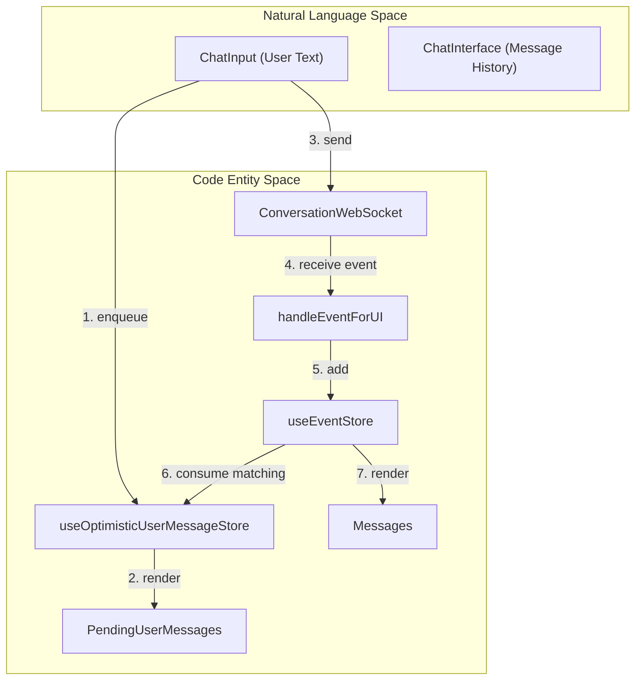

<!-- source: DeepWiki mcp.deepwiki.com · repo All-Hands-AI/OpenHands · page 5 Chat Interface · fetched 2026-10-26 -->

# Chat Interface

Relevant source files

The following files were used as context for generating this wiki page:

- [__tests__/components/chat/chat-interface.test.tsx](__tests__/components/chat/chat-interface.test.tsx)
- [__tests__/components/chat/message-display-continuity.test.tsx](__tests__/components/chat/message-display-continuity.test.tsx)
- [__tests__/components/features/chat/typing-indicator.test.ts](__tests__/components/features/chat/typing-indicator.test.ts)
- [src/components/conversation-events/chat/event-content-helpers/get-action-event-title.ts](src/components/conversation-events/chat/event-content-helpers/get-action-event-title.ts)
- [src/components/features/chat/chat-interface.tsx](src/components/features/chat/chat-interface.tsx)
- [src/components/features/chat/typing-indicator.tsx](src/components/features/chat/typing-indicator.tsx)

The **Chat Interface** is the primary communication hub between the user and the OpenHands agent. It manages the rendering of message history, provides real-time feedback on agent activity, and handles the optimistic lifecycle of user inputs. The system handles high-frequency streaming events from the `agent-server` while maintaining a responsive UI through local state management.

For detailed documentation, see the child pages:
- [Chat Interface Components](#5.1) — Documenting `ChatInterface`, `ChatMessage`, `UserMessageBody`, `PendingUserMessages`, `TypingIndicator`, `ErrorMessageBanner`, `error-message-store`, and optimistic message state.
- [Event Message System](#5.2) — Explaining how agent events are rendered: `handle-event-for-ui.ts`, `use-event-store`, `EventMessage`, `EventGroup`, event-content helpers, tool visualizers, and message streaming deduplication.
- [Chat Input and Controls](#5.3) — Documenting chat input components (`ChatInputActions`, `ChatInputModel`, profile picker, `SlashCommandMenu`), `useChatInputLogic`, draft persistence, attachments, resize hooks, git control bar, and context window meter.

---

### System Architecture and Data Flow

The chat system bridges the gap between raw WebSocket events and a human-readable conversation stream. It coordinates between `useEventStore` for historical events and `useOptimisticUserMessageStore` for messages currently in flight.

Sources: [src/components/features/chat/chat-interface.tsx:93-101](), [src/stores/optimistic-user-message-store.ts:1-20]()

---

### Core Components and Messaging

The interface is anchored by the `ChatInterface` component, which serves as the layout controller for the conversation stream.

*   **Message Rendering**: The system distinguishes between user messages and agent messages. The `Messages` component handles high-level iteration over `uiEvents`, folding consecutive tool calls into collapsible groups [src/components/features/chat/chat-interface.tsx:40](). For details, see [Event Message System](#5.2).
*   **Optimistic Updates**: To ensure zero-latency feedback, the `PendingUserMessages` component renders messages immediately after submission, showing a loading state until the server echoes a real `UserMessageEvent` [src/components/features/chat/chat-interface.tsx:41](). For details, see [Chat Interface Components](#5.1).
*   **Live Activity**: The `TypingIndicator` provides real-time feedback by deriving the agent's current task (e.g., executing a terminal command or thinking) from unresolved events in the store [src/components/features/chat/typing-indicator.tsx:130](). This derivation logic is encapsulated in `deriveLiveActivity` [src/components/features/chat/typing-indicator.tsx:71-124](). For details, see [Chat Interface Components](#5.1).
*   **Error Handling**: If a message fails to reach the server, `useErrorMessageStore` and `ErrorMessageBanner` surface the failure, while the optimistic store allows marking specific messages with errors [src/components/features/chat/chat-interface.tsx:33-36](). For details, see [Chat Interface Components](#5.1).

Sources: [src/components/features/chat/chat-interface.tsx:33-41](), [src/components/features/chat/typing-indicator.tsx:71-130]()

---

### Event Message System

Agent activity consists of `Action` and `Observation` events defined in the core protocol.

*   **Event Reconciliation**: The `handleEventForUI` utility processes raw server events into renderable UI objects. It handles the reconciliation of streaming delta events, ensuring intermediate tokens are merged and finalized messages replace their streamed counterparts.
*   **Reasoning and Thinking**: The system extracts reasoning from `reasoning_content` or `thinking_blocks` and renders it in collapsible containers.
*   **Action Event Titles**: The `getActionEventTitleDescriptor` function [src/components/conversation-events/chat/event-content-helpers/get-action-event-title.ts:29-147]() generates human-readable titles for agent actions, such as `ACTION_MESSAGE$RUN` for `TerminalAction` or `ACTION_MESSAGE$READ` for `FileEditorAction`.

For details on event processing, see **[Event Message System](#5.2)**.

Sources: [src/components/conversation-events/chat/event-content-helpers/get-action-event-title.ts:29-147]()

---

### Chat Input and Controls

The input area is a control center that manages text entry, file attachments, and agent state.

*   **Logic**: `ChatInterface` coordinates message sending via `useSendMessage` and tracks analytics through `useTracking` [src/components/features/chat/chat-interface.tsx:69-85]().
*   **Status & Banners**: The interface displays context-sensitive banners like `LlmNotConfiguredBanner` or `GoalStatusBanner` [src/components/features/chat/chat-interface.tsx:9](), [src/components/features/chat/chat-interface.tsx:38]().
*   **Agent State**: Input and action controls are contextually disabled when the agent is in a `RUNNING` or `LOADING` state [src/components/features/chat/chat-interface.tsx:135-137]().

For details on input mechanisms, see **[Chat Input and Controls](#5.3)**.

Sources: [src/components/features/chat/chat-interface.tsx:9-85](), [src/components/features/chat/chat-interface.tsx:135-137]()

---

### Component Relationships

| Component | Responsibility | State Source |
| :--- | :--- | :--- |
| `ChatInterface` | Main container, scroll management, and layout [src/components/features/chat/chat-interface.tsx:66]() | `useFilteredEvents` |
| `Messages` | Renders confirmed server events with grouping [src/components/features/chat/chat-interface.tsx:40]() | `useEventStore` |
| `PendingUserMessages` | Renders messages currently being sent [src/components/features/chat/chat-interface.tsx:41]() | `useOptimisticUserMessageStore` |
| `TypingIndicator` | Displays current live activity of the agent [src/components/features/chat/typing-indicator.tsx:130]() | `useFilteredEvents` |
| `InteractiveChatBox` | Orchestrates chat input and file uploads [src/components/features/chat/interactive-chat-box.tsx:27]() | `useConversationStore`, `useAgentState` |

Sources: [src/components/features/chat/chat-interface.tsx:40-66](), [src/components/features/chat/typing-indicator.tsx:130](), [src/components/features/chat/interactive-chat-box.tsx:27]()

---

