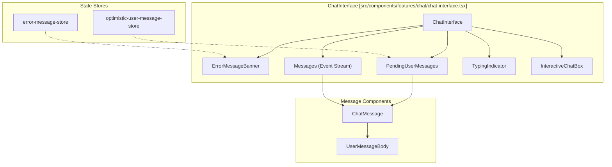
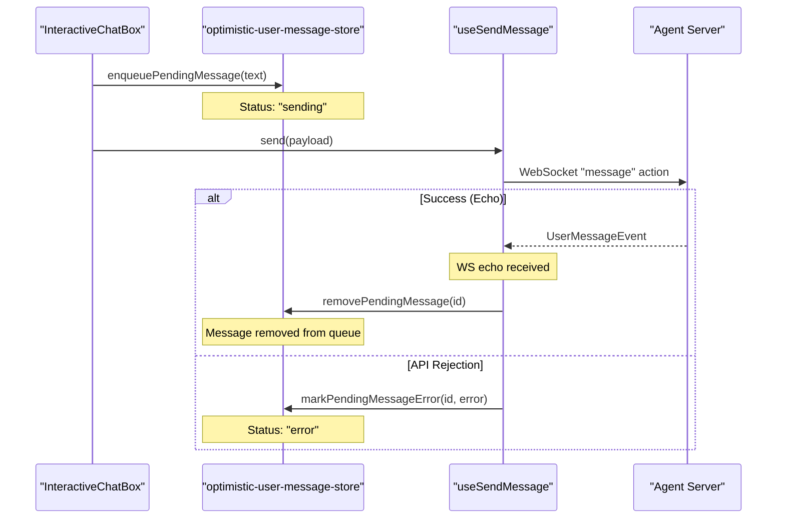

<!-- source: DeepWiki mcp.deepwiki.com · repo All-Hands-AI/OpenHands · page 5.1 Chat Interface Components · fetched 2026-10-26 -->

# Chat Interface Components

Relevant source files

The following files were used as context for generating this wiki page:

- [__tests__/components/chat-message.test.tsx](__tests__/components/chat-message.test.tsx)
- [__tests__/components/chat/chat-interface.test.tsx](__tests__/components/chat/chat-interface.test.tsx)
- [__tests__/components/chat/error-message-banner.test.tsx](__tests__/components/chat/error-message-banner.test.tsx)
- [__tests__/components/chat/message-display-continuity.test.tsx](__tests__/components/chat/message-display-continuity.test.tsx)
- [__tests__/components/features/chat/pending-user-messages.test.tsx](__tests__/components/features/chat/pending-user-messages.test.tsx)
- [__tests__/components/features/chat/typing-indicator.test.ts](__tests__/components/features/chat/typing-indicator.test.ts)
- [__tests__/components/shared/text-shimmer.test.tsx](__tests__/components/shared/text-shimmer.test.tsx)
- [__tests__/stores/error-message-store.test.ts](__tests__/stores/error-message-store.test.ts)
- [__tests__/utils/error-handler.test.ts](__tests__/utils/error-handler.test.ts)
- [src/components/conversation-events/chat/event-content-helpers/get-action-event-title.ts](src/components/conversation-events/chat/event-content-helpers/get-action-event-title.ts)
- [src/components/features/chat/chat-interface.tsx](src/components/features/chat/chat-interface.tsx)
- [src/components/features/chat/chat-message.tsx](src/components/features/chat/chat-message.tsx)
- [src/components/features/chat/error-message-banner.tsx](src/components/features/chat/error-message-banner.tsx)
- [src/components/features/chat/pending-user-messages.tsx](src/components/features/chat/pending-user-messages.tsx)
- [src/components/features/chat/typing-indicator.tsx](src/components/features/chat/typing-indicator.tsx)
- [src/components/features/chat/user-message-body.tsx](src/components/features/chat/user-message-body.tsx)
- [src/components/shared/buttons/conversation-confirmation-buttons.tsx](src/components/shared/buttons/conversation-confirmation-buttons.tsx)
- [src/components/shared/text-shimmer.tsx](src/components/shared/text-shimmer.tsx)
- [src/dev/seed-pending-chat-preview.ts](src/dev/seed-pending-chat-preview.ts)
- [src/hooks/chat/use-chat-input-logic.ts](src/hooks/chat/use-chat-input-logic.ts)
- [src/hooks/chat/use-draft-persistence.ts](src/hooks/chat/use-draft-persistence.ts)
- [src/icons/stop-circle.svg](src/icons/stop-circle.svg)
- [src/stores/error-message-store.ts](src/stores/error-message-store.ts)
- [src/utils/error-handler.ts](src/utils/error-handler.ts)
- [src/utils/transcript-export/index.ts](src/utils/transcript-export/index.ts)
- [src/utils/transcript-export/load-complete-events.ts](src/utils/transcript-export/load-complete-events.ts)

The Chat Interface is the primary interaction point for users within Agent Canvas. It manages the display of conversation history, real-time agent activity, and provides mechanisms for optimistic message handling and error reporting.

## Overview of ChatInterface

The `ChatInterface` component serves as the central orchestrator for the chat UI. It integrates event streaming, user input, and state-driven banners to provide a responsive agent interaction experience [src/components/features/chat/chat-interface.tsx:66-156]().

### Key Responsibilities
*   **Event Rendering**: Orchestrates the display of historical and live events using the `Messages` component [src/components/features/chat/chat-interface.tsx:40-40]().
*   **State Management**: Monitors the `AgentState` via `useAgentState` to toggle UI elements like the `TypingIndicator` and build buttons [src/components/features/chat/chat-interface.tsx:117-137]().
*   **Optimistic UI**: Coordinates with the `useOptimisticUserMessageStore` to show user messages immediately before server confirmation [src/components/features/chat/chat-interface.tsx:93-101]().
*   **Error Handling**: Displays global errors via `ErrorMessageBanner` and specific message failures within the chat bubble [src/components/features/chat/chat-interface.tsx:33-36]().
*   **Input Blocking**: Disables interaction if the LLM is not configured, if the conversation is archived, or if the sandbox status is invalid [src/components/features/chat/chat-interface.tsx:124-132]().

### Chat Interface Component Hierarchy
This diagram maps the high-level React components to their respective responsibilities in the UI.

"Chat Interface Component Tree"

Sources: [src/components/features/chat/chat-interface.tsx:33-41](), [src/components/features/chat/pending-user-messages.tsx:25-56](), [src/stores/error-message-store.ts:11-21](), [src/components/features/chat/chat-message.tsx:12-15]()

---

## Message Rendering

### ChatMessage
The `ChatMessage` component is a generic wrapper for both user and agent messages. It handles common UI concerns such as:
*   **Copy to Clipboard**: A hover-triggered action to copy message content [src/components/features/chat/chat-message.tsx:58-61]().
*   **Pending States**: Displays "sending" or "error" treatments for optimistic updates [src/components/features/chat/chat-message.tsx:77-79]().
*   **Stop/Retry Actions**: Provides controls for messages that are currently being transmitted or have failed. The "Stop" button allows users to cancel a pending send and restore the text to the input box [src/components/features/chat/chat-message.tsx:203-222]().

### UserMessageBody
Specialized for user-originated content, this component handles text truncation to prevent long messages from dominating the viewport [src/components/features/chat/user-message-body.tsx:21-31]().
*   **Truncation Logic**: Automatically applies a `line-clamp-5` if the message exceeds 5 lines, 360 characters, or contains many newlines [src/components/features/chat/user-message-body.tsx:8-10](), [src/components/features/chat/user-message-body.tsx:55-61]().
*   **View More**: Provides an expandable overlay that appears on hover when content is truncated [src/components/features/chat/user-message-body.tsx:95-112]().

Sources: [src/components/features/chat/chat-message.tsx:34-44](), [src/components/features/chat/user-message-body.tsx:40-72](), [src/components/features/chat/chat-message.tsx:203-222]()

---

## Optimistic State & Pending Messages

To ensure the UI feels instantaneous, Agent Canvas uses an **Optimistic Message Store**. When a user sends a message, it is immediately added to a local queue before the server acknowledges it.

### Data Flow: User Message Submission
This diagram illustrates how a user message moves from the input box to the server, and how the UI manages the intermediate "pending" state.

"User Message Optimistic Flow"

Sources: [src/components/features/chat/pending-user-messages.tsx:58-85](), [src/components/features/chat/chat-interface.tsx:93-101](), [src/components/features/chat/pending-user-messages.tsx:108-134]()

### PendingUserMessages
This component renders the queue of messages from the `optimistic-user-message-store` that haven't been echoed back by the server yet [src/components/features/chat/pending-user-messages.tsx:25-56]().
*   **Filtering**: Only displays messages belonging to the current `conversationId` to prevent leakage between sessions [src/components/features/chat/pending-user-messages.tsx:45-56]().
*   **Retry/Dismiss**: Users can manually retry a failed message or dismiss it from the UI [src/components/features/chat/pending-user-messages.tsx:58-100]().

Sources: [src/components/features/chat/pending-user-messages.tsx:25-56](), [src/components/features/chat/pending-user-messages.tsx:58-100]()

---

## Real-time Feedback and Error Handling

### TypingIndicator
The `TypingIndicator` provides visual feedback when the agent is actively processing or "thinking". It is gated by the `curAgentState` provided by `useAgentState` [src/components/features/chat/chat-interface.tsx:117-137]().

Sources: [src/components/features/chat/chat-interface.tsx:20-20](), [src/components/features/chat/chat-interface.tsx:117-137]()

### ErrorMessageBanner
A global notification component for critical conversation errors, such as connection failures or ACP authentication requirements [src/components/features/chat/error-message-banner.tsx:24-31]().
*   **Header Resolution**: Uses `getAcpErrorHeaderKey` to show user-friendly titles based on structured error codes [src/components/features/chat/error-message-banner.tsx:33-33]().
*   **Copy & Expand**: Supports copying the full error stack to the clipboard and expanding long error messages [src/components/features/chat/error-message-banner.tsx:46-53](), [src/components/features/chat/error-message-banner.tsx:152-163]().
*   **Error Classification**: Displays different icons (error or warning) and potentially a re-authentication button based on the `ErrorClassification` provided [src/components/features/chat/error-message-banner.tsx:103-120](), [src/components/features/chat/error-message-banner.tsx:141-150]().

Sources: [src/components/features/chat/error-message-banner.tsx:96-211](), [src/stores/error-message-store.ts:11-21](), [src/components/features/chat/chat-interface.tsx:72-78]()

---

## State Stores

| Store | Purpose | File |
| :--- | :--- | :--- |
| `useErrorMessageStore` | Manages global error state and banner visibility. It distinguishes between "connection" errors (transient) and "conversation" errors (sticky) [src/stores/error-message-store.ts:9-10](). | [src/stores/error-message-store.ts]() |
| `useOptimisticUserMessageStore` | Tracks user messages that are in-flight or failed, allowing immediate UI updates. | [src/stores/optimistic-user-message-store.ts]() |
| `useConversationStore` | Manages UI-related conversation state like message drafts and input focus [src/components/features/chat/chat-interface.tsx:70-71](). | [src/stores/conversation-store.ts]() |
| `useEventStore` | The source of truth for all confirmed agent/user events received via WebSocket. | [src/stores/use-event-store.ts]() |

Sources: [src/stores/error-message-store.ts:44-66](), [src/components/features/chat/pending-user-messages.tsx:28-39](), [src/components/features/chat/chat-interface.tsx:70-78]()

---

