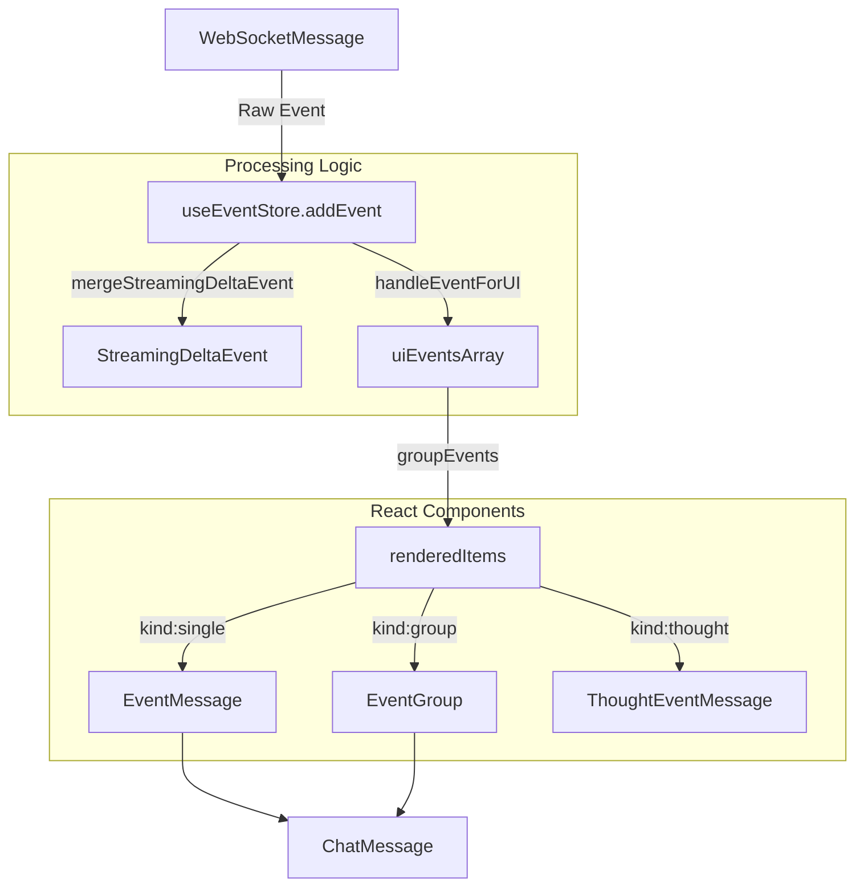
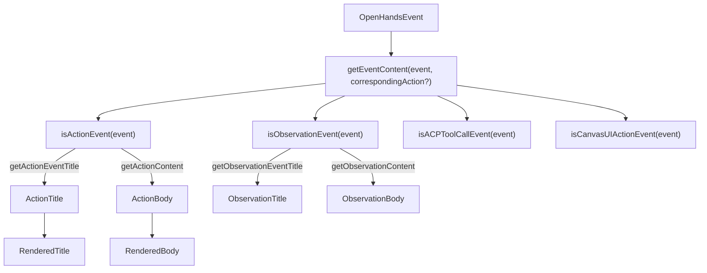

<!-- source: DeepWiki mcp.deepwiki.com · repo All-Hands-AI/OpenHands · page 5.2 Event Message System · fetched 2026-10-26 -->

# Event Message System

Relevant source files

The following files were used as context for generating this wiki page:

- [__tests__/components/conversation-events/chat/duplicate-streamed-message.test.tsx](__tests__/components/conversation-events/chat/duplicate-streamed-message.test.tsx)
- [__tests__/components/conversation-events/chat/event-content-helpers/get-invoke-skill-items.test.ts](__tests__/components/conversation-events/chat/event-content-helpers/get-invoke-skill-items.test.ts)
- [__tests__/components/conversation-events/chat/event-content-helpers/get-observation-result.test.ts](__tests__/components/conversation-events/chat/event-content-helpers/get-observation-result.test.ts)
- [__tests__/components/conversation-events/chat/event-content-helpers/should-render-event.test.ts](__tests__/components/conversation-events/chat/event-content-helpers/should-render-event.test.ts)
- [__tests__/components/conversation-events/chat/event-message-acp-tool-call.test.tsx](__tests__/components/conversation-events/chat/event-message-acp-tool-call.test.tsx)
- [__tests__/components/conversation-events/chat/event-message-components/event-group.test.tsx](__tests__/components/conversation-events/chat/event-message-components/event-group.test.tsx)
- [__tests__/components/conversation-events/chat/event-message-components/skill-ready-content-list.test.tsx](__tests__/components/conversation-events/chat/event-message-components/skill-ready-content-list.test.tsx)
- [__tests__/components/conversation-events/chat/messages-confirmation.test.tsx](__tests__/components/conversation-events/chat/messages-confirmation.test.tsx)
- [__tests__/components/conversation-events/get-event-content.test.tsx](__tests__/components/conversation-events/get-event-content.test.tsx)
- [__tests__/components/features/chat/chat-markdown-path-linking.test.tsx](__tests__/components/features/chat/chat-markdown-path-linking.test.tsx)
- [__tests__/components/features/chat/file-path-chip.test.tsx](__tests__/components/features/chat/file-path-chip.test.tsx)
- [__tests__/components/features/chat/path-component.test.tsx](__tests__/components/features/chat/path-component.test.tsx)
- [__tests__/components/features/chat/tool-visualizers/dispatcher.test.tsx](__tests__/components/features/chat/tool-visualizers/dispatcher.test.tsx)
- [__tests__/components/features/chat/tool-visualizers/file-editor/file-editor.test.tsx](__tests__/components/features/chat/tool-visualizers/file-editor/file-editor.test.tsx)
- [__tests__/services/canvas-ui.test.ts](__tests__/services/canvas-ui.test.ts)
- [__tests__/utils/format-event-timestamp.test.ts](__tests__/utils/format-event-timestamp.test.ts)
- [__tests__/utils/handle-event-for-ui.test.ts](__tests__/utils/handle-event-for-ui.test.ts)
- [__tests__/utils/path-utils.test.ts](__tests__/utils/path-utils.test.ts)
- [__tests__/utils/workspace-relative-path.test.ts](__tests__/utils/workspace-relative-path.test.ts)
- [src/components/conversation-events/chat/event-content-helpers/get-event-content.tsx](src/components/conversation-events/chat/event-content-helpers/get-event-content.tsx)
- [src/components/conversation-events/chat/event-content-helpers/get-observation-content.ts](src/components/conversation-events/chat/event-content-helpers/get-observation-content.ts)
- [src/components/conversation-events/chat/event-content-helpers/get-observation-result.ts](src/components/conversation-events/chat/event-content-helpers/get-observation-result.ts)
- [src/components/conversation-events/chat/event-content-helpers/should-render-event.ts](src/components/conversation-events/chat/event-content-helpers/should-render-event.ts)
- [src/components/conversation-events/chat/event-message-components/event-group.tsx](src/components/conversation-events/chat/event-message-components/event-group.tsx)
- [src/components/conversation-events/chat/event-message-components/finish-event-message.tsx](src/components/conversation-events/chat/event-message-components/finish-event-message.tsx)
- [src/components/conversation-events/chat/event-message-components/generic-event-message-wrapper.tsx](src/components/conversation-events/chat/event-message-components/generic-event-message-wrapper.tsx)
- [src/components/conversation-events/chat/event-message-components/thought-event-message.tsx](src/components/conversation-events/chat/event-message-components/thought-event-message.tsx)
- [src/components/conversation-events/chat/event-message-components/user-assistant-event-message.tsx](src/components/conversation-events/chat/event-message-components/user-assistant-event-message.tsx)
- [src/components/conversation-events/chat/event-message.tsx](src/components/conversation-events/chat/event-message.tsx)
- [src/components/conversation-events/chat/messages.tsx](src/components/conversation-events/chat/messages.tsx)
- [src/components/features/chat/chat-markdown-path-code.tsx](src/components/features/chat/chat-markdown-path-code.tsx)
- [src/components/features/chat/generic-event-message.tsx](src/components/features/chat/generic-event-message.tsx)
- [src/components/features/chat/path-component.tsx](src/components/features/chat/path-component.tsx)
- [src/components/features/chat/tool-visualizers/file-editor/file-editor.tsx](src/components/features/chat/tool-visualizers/file-editor/file-editor.tsx)
- [src/components/features/chat/tool-visualizers/primitives/file-path-chip.tsx](src/components/features/chat/tool-visualizers/primitives/file-path-chip.tsx)
- [src/components/shared/buttons/styled-tooltip.tsx](src/components/shared/buttons/styled-tooltip.tsx)
- [src/hooks/mutation/conversation-mutation-utils.test.ts](src/hooks/mutation/conversation-mutation-utils.test.ts)
- [src/hooks/mutation/conversation-mutation-utils.ts](src/hooks/mutation/conversation-mutation-utils.ts)
- [src/services/canvas-ui.ts](src/services/canvas-ui.ts)
- [src/types/agent-server/core/base/action.ts](src/types/agent-server/core/base/action.ts)
- [src/types/agent-server/core/base/base.ts](src/types/agent-server/core/base/base.ts)
- [src/types/agent-server/core/base/observation.ts](src/types/agent-server/core/base/observation.ts)
- [src/types/agent-server/core/events/acp-tool-call-event.ts](src/types/agent-server/core/events/acp-tool-call-event.ts)
- [src/types/agent-server/type-guards.ts](src/types/agent-server/type-guards.ts)
- [src/utils/handle-event-for-ui.ts](src/utils/handle-event-for-ui.ts)
- [src/utils/path-utils.ts](src/utils/path-utils.ts)
- [src/utils/workspace-relative-path.ts](src/utils/workspace-relative-path.ts)

The Event Message System processes, deduplicates, and renders the real-time stream of agent events (actions and observations) within the chat interface. It manages the translation from raw WebSocket events to a structured, user-friendly conversation history that supports streaming deltas, collapsible tool-call groups, and thought reconciliation.

Sources: [src/utils/handle-event-for-ui.ts:1-38]()

## 1. Overview and Data Flow

Events arrive via WebSockets and are stored in a centralized store (`useEventStore`). The system differentiates between **Raw Events** (the full history) and **UI Events** (a reduced set where actions are replaced by their corresponding observations to maintain a clean chat flow).

### Event Processing Pipeline

1. **Ingestion**: Events are added via `addEvent` or `addEvents` [src/stores/event-store.ts:67-74]().
2. **Streaming Deduplication**: Consecutive `StreamingDeltaEvent` objects from the same sender are merged using `mergeStreamingDeltaEvent` [src/utils/handle-event-for-ui.ts:20-29]().
3. **UI Transformation**: The `handleEventForUI` utility processes the event stream to replace `ActionEvent` with its matching `ObservationEvent` once the environment responds [src/utils/handle-event-for-ui.ts:246-258]().
4. **Grouping**: The `Messages` component uses `groupEvents` to fold consecutive tool calls into collapsible `EventGroup` components [src/components/conversation-events/chat/messages.tsx:58-61]().

### Code Entity Space Bridge: Agent Event Lifecycle

The following diagram maps the logical flow of an agent action through the system's key code entities.

**Agent Event Lifecycle Diagram**

Sources: [src/stores/event-store.ts:92-124](), [src/utils/handle-event-for-ui.ts:20-29](), [src/components/conversation-events/chat/messages.tsx:58-126]()

---

## 2. Event Storage and Reconciliation

### use-event-store
The `useEventStore` Zustand store maintains the ground truth for the conversation. It handles:
* **Deduplication**: Ensures events with the same `id` are not added twice [src/stores/event-store.ts:94-97]().
* **Sorting**: Sorts events by ISO timestamp if they arrive out of order [src/stores/event-store.ts:24-35]().
* **Delta Merging**: Concatenates `content` and `reasoning_content` for streaming tokens from the same agent using `mergeStreamingDeltaEvent` and `isSameStreamingSender` [src/utils/handle-event-for-ui.ts:20-37]().

### handle-event-for-ui.ts
This utility core logic reconciles streaming output with finalized events, preventing message duplication (Issue #1534). When an agent streams text and then emits a finalized `ActionEvent` containing that same text in its `thought` field, `handleEventForUI` performs supersession:
1. It identifies trailing `StreamingDeltaEvent` objects that match the incoming finalized event's content via `getCurrentTurnContentDeltas` [src/utils/handle-event-for-ui.ts:84-98]().
2. If the finalized event contains the same text (determined via `matchStreamedSegments`), it strips the content from the deltas while preserving any unique `reasoning_content` using `supersedeStreamingContent` [src/utils/handle-event-for-ui.ts:150-169]().

Sources: [src/stores/event-store.ts:1-90](), [src/utils/handle-event-for-ui.ts:1-178](), [__tests__/utils/handle-event-for-ui.test.ts:130-144]()

---

## 3. Rendering Components

### Messages Component
The `Messages` component acts as the entry point for rendering the chat history, accepting `messages` (UI events) and `allEvents` (full history) as props [src/components/conversation-events/chat/messages.tsx:13-16]().
* Hoists agent thoughts into `ThoughtEventMessage` components so they appear as distinct bubbles even if the action itself is grouped [src/components/conversation-events/chat/messages.tsx:94-100]().
* Anchors `/model` commands to specific events using `useModelStore` and `maybeRenderModelMessages` [src/components/conversation-events/chat/messages.tsx:31-50]().
* Memoizes rendering output via a custom equality check comparing message lengths, last event IDs, and references [src/components/conversation-events/chat/messages.tsx:132-140]().

### EventGroup
Consecutive actions (such as `ls`, `cd`, `cat` runs) are wrapped in an `EventGroup` component [src/components/conversation-events/chat/event-message-components/event-group.tsx:39-40]().
* **Live Tail**: While the agent is working (`isFinalized=false`), the group displays the title of the latest action alongside a running status spinner and completion counters [src/components/conversation-events/chat/event-message-components/event-group.tsx:42-50]().
* **Finalized**: Once subsequent events are emitted (`isFinalized=true`), the group collapses to a compact count summary [src/components/conversation-events/chat/event-message-components/event-group.tsx:51-53]().

### EventMessage and Specialized Wrappers
`EventMessage` dispatches visual representations based on event type guards [src/components/conversation-events/chat/event-message.tsx:41-56]().
* `UserAssistantEventMessage`: Renders user prompts, assistant messages, image carousels, and branch-from-here actions (`useForkConversation`) [src/components/conversation-events/chat/event-message-components/user-assistant-event-message.tsx:26-112]().
* `GenericEventMessageWrapper`: Wraps tool observations and `SkillReadyEvent` items with expandable details via `GenericEventMessage` [src/components/conversation-events/chat/event-message-components/generic-event-message-wrapper.tsx:67-126]().

| Event Type | Logic / Handling |
| :--- | :--- |
| `StreamingDeltaEvent` | Routes inline `<think>` blocks to `CollapsibleThinking` and content to `ChatMessage` [src/utils/handle-event-for-ui.ts:20-29](). |
| `ObservationEvent` | Replaces the action in the UI event list via `handleEventForUI` [src/utils/handle-event-for-ui.ts:246-258](). |
| `MessageEvent` | Filters out internal goal loop re-prompts using `shouldRenderEvent` [src/components/conversation-events/chat/event-content-helpers/should-render-event.ts:110-112](). |
| `ACPToolCallEvent` | Renders tool call cards using `GenericEventMessageWrapper` [src/types/agent-server/type-guards.ts:35-35](). |

Sources: [src/components/conversation-events/chat/messages.tsx:1-140](), [src/components/conversation-events/chat/event-message.tsx:1-375](), [src/components/conversation-events/chat/event-message-components/event-group.tsx:59-169]()

---

## 4. Event Content Helpers

The `event-content-helpers` directory provides utilities for extracting and formatting event data.

### get-event-content.tsx
The `getEventContent` function acts as a central dispatcher determining titles and body content for any `OpenHandsEvent` [src/components/conversation-events/chat/event-content-helpers/get-event-content.tsx:131-220]().

### Code Entity Space Bridge: Event Content Resolution

**Event Content Resolution Diagram**

Sources: [src/components/conversation-events/chat/event-content-helpers/get-event-content.tsx:1-251](), [src/types/agent-server/type-guards.ts:67-215]()

### get-action-event-title.ts and should-render-event.ts
* `getActionEventTitleDescriptor(event)`: Returns a descriptor object for rendering titles using translation keys [src/components/conversation-events/chat/event-content-helpers/get-action-event-title.ts:100-102]().
* `getActionSummaryTitle(event)`: Provides a concise summary title for actions, used in `EventGroup` [src/components/conversation-events/chat/event-content-helpers/get-action-event-title.ts:104-106]().
* `shouldRenderEvent(event)`: Determines whether an `OpenHandsEvent` should be displayed in the chat UI, filtering out empty deltas or internal re-prompts [src/components/conversation-events/chat/event-content-helpers/should-render-event.ts:53-145]().

Sources: [src/components/conversation-events/chat/event-content-helpers/get-action-event-title.ts:1-110](), [src/components/conversation-events/chat/event-content-helpers/should-render-event.ts:1-145]()

---

## 5. Canvas UI Action Handling

The `handleCanvasUIAction` function processes agent-driven UI commands, such as navigating to files or switching tabs [src/services/canvas-ui.ts:53-89]().

* `navigate_to_file`: Switches the UI to the files tab and updates `FilesTabStore` with the target path [src/services/canvas-ui.ts:58-69]().
* `open_tab`: Programmatically switches between valid conversation tabs (`files`, `browser`, `terminal`, etc.) [src/services/canvas-ui.ts:71-87]().
* `PathComponent` & `FilePathChip`: Interactive elements rendered within event messages allowing users to deep-link straight into workspace files using `openWorkspaceFile` [src/components/features/chat/path-component.tsx:62-94](), [src/components/features/chat/tool-visualizers/primitives/file-path-chip.tsx:23-52]().

Sources: [src/services/canvas-ui.ts:1-89](), [src/components/features/chat/path-component.tsx:1-130](), [src/components/features/chat/tool-visualizers/primitives/file-path-chip.tsx:1-52]()

---

