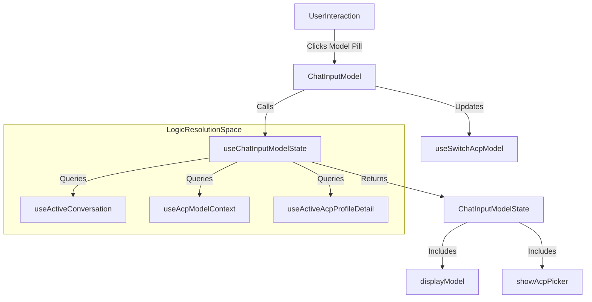
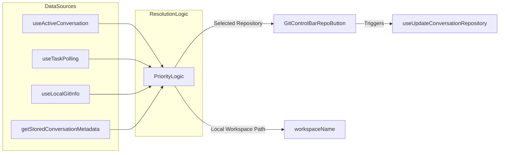

<!-- source: DeepWiki mcp.deepwiki.com · repo All-Hands-AI/OpenHands · page 5.3 Chat Input and Controls · fetched 2026-10-26 -->

# Chat Input and Controls

Relevant source files

The following files were used as context for generating this wiki page:

- [.github/pr-assets/pr-16268-01-thumbnail-in-message.png](.github/pr-assets/pr-16268-01-thumbnail-in-message.png)
- [.github/pr-assets/pr-16268-02-lightbox-open.png](.github/pr-assets/pr-16268-02-lightbox-open.png)
- [.github/pr-assets/pr-16268-03-lightbox-closed.png](.github/pr-assets/pr-16268-03-lightbox-closed.png)
- [__tests__/api/agent-server-conversation-service-condense.test.ts](__tests__/api/agent-server-conversation-service-condense.test.ts)
- [__tests__/components/automations/detail/prompt-section.test.tsx](__tests__/components/automations/detail/prompt-section.test.tsx)
- [__tests__/components/features/chat/change-agent-context-menu.test.tsx](__tests__/components/features/chat/change-agent-context-menu.test.tsx)
- [__tests__/components/features/chat/components/chat-input-actions.test.tsx](__tests__/components/features/chat/components/chat-input-actions.test.tsx)
- [__tests__/components/features/chat/components/chat-input-model.test.tsx](__tests__/components/features/chat/components/chat-input-model.test.tsx)
- [__tests__/components/features/chat/components/context-window-meter.test.tsx](__tests__/components/features/chat/components/context-window-meter.test.tsx)
- [__tests__/components/features/chat/components/context-window-ring.test.tsx](__tests__/components/features/chat/components/context-window-ring.test.tsx)
- [__tests__/components/features/chat/git-control-bar-pull-button.test.tsx](__tests__/components/features/chat/git-control-bar-pull-button.test.tsx)
- [__tests__/components/features/chat/git-control-bar-repo-button.test.tsx](__tests__/components/features/chat/git-control-bar-repo-button.test.tsx)
- [__tests__/components/features/chat/git-control-bar.test.tsx](__tests__/components/features/chat/git-control-bar.test.tsx)
- [__tests__/components/features/chat/user-assistant-event-message.test.tsx](__tests__/components/features/chat/user-assistant-event-message.test.tsx)
- [__tests__/components/image-preview.test.tsx](__tests__/components/image-preview.test.tsx)
- [__tests__/hooks/use-auto-resize.test.tsx](__tests__/hooks/use-auto-resize.test.tsx)
- [__tests__/hooks/use-chat-input-model-state.test.tsx](__tests__/hooks/use-chat-input-model-state.test.tsx)
- [__tests__/hooks/use-context-window-usage.test.ts](__tests__/hooks/use-context-window-usage.test.ts)
- [__tests__/hooks/use-drag-resize.test.tsx](__tests__/hooks/use-drag-resize.test.tsx)
- [__tests__/hooks/use-live-conversation-metrics.test.ts](__tests__/hooks/use-live-conversation-metrics.test.ts)
- [__tests__/stores/conversation-store.test.ts](__tests__/stores/conversation-store.test.ts)
- [__tests__/utils/format-token-count.test.ts](__tests__/utils/format-token-count.test.ts)
- [src/components/features/chat/components/chat-input-actions.tsx](src/components/features/chat/components/chat-input-actions.tsx)
- [src/components/features/chat/components/chat-input-grip.tsx](src/components/features/chat/components/chat-input-grip.tsx)
- [src/components/features/chat/components/chat-input-model.tsx](src/components/features/chat/components/chat-input-model.tsx)
- [src/components/features/chat/components/context-window-meter.tsx](src/components/features/chat/components/context-window-meter.tsx)
- [src/components/features/chat/components/context-window-ring.tsx](src/components/features/chat/components/context-window-ring.tsx)
- [src/components/features/chat/custom-chat-input.tsx](src/components/features/chat/custom-chat-input.tsx)
- [src/components/features/chat/git-control-bar-pr-button.tsx](src/components/features/chat/git-control-bar-pr-button.tsx)
- [src/components/features/chat/git-control-bar-pull-button.tsx](src/components/features/chat/git-control-bar-pull-button.tsx)
- [src/components/features/chat/git-control-bar-push-button.tsx](src/components/features/chat/git-control-bar-push-button.tsx)
- [src/components/features/chat/git-control-bar-repo-button.tsx](src/components/features/chat/git-control-bar-repo-button.tsx)
- [src/components/features/chat/git-control-bar.tsx](src/components/features/chat/git-control-bar.tsx)
- [src/components/features/chat/interactive-chat-box.tsx](src/components/features/chat/interactive-chat-box.tsx)
- [src/components/features/chat/uploaded-files.tsx](src/components/features/chat/uploaded-files.tsx)
- [src/components/features/conversation-panel/conversation-card/conversation-status-badges.tsx](src/components/features/conversation-panel/conversation-card/conversation-status-badges.tsx)
- [src/components/features/images/image-lightbox.tsx](src/components/features/images/image-lightbox.tsx)
- [src/components/features/images/image-preview.tsx](src/components/features/images/image-preview.tsx)
- [src/components/shared/buttons/remove-button.tsx](src/components/shared/buttons/remove-button.tsx)
- [src/context/scroll-context.tsx](src/context/scroll-context.tsx)
- [src/hooks/chat/use-grip-resize.ts](src/hooks/chat/use-grip-resize.ts)
- [src/hooks/mutation/use-fork-conversation.ts](src/hooks/mutation/use-fork-conversation.ts)
- [src/hooks/use-acp-model-context.ts](src/hooks/use-acp-model-context.ts)
- [src/hooks/use-auto-resize.ts](src/hooks/use-auto-resize.ts)
- [src/hooks/use-chat-input-model-state.ts](src/hooks/use-chat-input-model-state.ts)
- [src/hooks/use-drag-resize.ts](src/hooks/use-drag-resize.ts)
- [src/utils/constants.ts](src/utils/constants.ts)

## Purpose and Scope
This page documents the chat input component architecture, hooks for text editing and attachment handling, resizing mechanics, draft persistence, model/profile pickers (`ChatInputActions`, `ChatInputModel`), the `/` slash command engine (`SlashCommandMenu`), repository controls (`GitControlBar`), and the context window meter.

---

## 1. Chat Input Components

The chat input is a modular system composed of specialized components and hooks that coordinate user interactions with the backend agent.

### ChatInputActions
`ChatInputActions` serves as the primary container for input-related controls. It dynamically adjusts its layout based on available width using a `ResizeObserver` to handle overflow by relocating controls into an overflow context menu when space is constrained [src/components/features/chat/components/chat-input-actions.tsx:110-159]().

Key capabilities include:
*   **LLM and Profile Selection**: Renders either `ChatInputLlmProfilePicker` for standard OpenHands agents or `ChatInputModel` for Agent Client Protocol (ACP) agents [src/components/features/chat/components/chat-input-actions.tsx:7-11]().
*   **Agent Status**: Displays the execution state via `AgentStatus` [src/components/features/chat/components/chat-input-actions.tsx:5]().
*   **Execution Controls**: Exposes actions to pause or resume conversations through unified pause and resume hooks [src/components/features/chat/components/chat-input-actions.tsx:63-65]().
*   **Tools Integration**: Houses context menus for agent-profile switching during pre-start conversation windows [src/components/features/chat/components/chat-input-actions.tsx:76-81]().

### ChatInputModel
`ChatInputModel` manages model selection for ACP-backed agents (such as Claude Code or Codex), which handle subprocess-level model configuration rather than OpenHands LLM profiles [src/hooks/use-chat-input-model-state.ts:74-83]().

*   **Model Label Resolution**: Truncates long strings for UI presentation and resolves human-readable provider labels (e.g., "Claude Sonnet") from `acp_server` and raw model identifiers [__tests__/components/features/chat/components/chat-input-model.test.tsx:99-101]().
*   **Live Switching**: Leverages `useSwitchAcpModel` to update the active subprocess model dynamically [src/hooks/mutation/use-switch-acp-model.ts:48-59]().
*   **Fallback Handling**: Falls back to user settings when no active conversation context exists [__tests__/components/features/chat/components/chat-input-model.test.tsx:128-143]().

### SlashCommandMenu
The slash command engine identifies `/` inputs and presents a dropdown of built-in commands (`/new`, `/btw`, `/model`, `/goal`, `/plan`, `/code`) and available skills [src/utils/constants.ts:54-119]().
*   **Trigger Detection**: The `useSlashCommand` hook tracks input content to filter command options dynamically [src/components/features/chat/custom-chat-input.tsx:145-153]().

Sources:
* [src/components/features/chat/components/chat-input-actions.tsx:1-160]()
* [src/hooks/use-chat-input-model-state.ts:74-83]()
* [src/hooks/mutation/use-switch-acp-model.ts:48-59]()
* [src/utils/constants.ts:54-119]()
* [src/components/features/chat/custom-chat-input.tsx:145-153]()

---

## 2. State Management and Input Logic

Input state and persistence are managed by dedicated hooks operating within `CustomChatInput` [src/components/features/chat/custom-chat-input.tsx:30-226]().

### useChatInputLogic and Draft Persistence
`useChatInputLogic` oversees the text editing lifecycle, including draft storage and content validation [src/components/features/chat/custom-chat-input.tsx:81-87]().
*   **Draft Persistence**: Implements `saveDraft` to capture unsent text in local storage or session state, mitigating data loss during navigation [src/components/features/chat/custom-chat-input.tsx:81-87]().
*   **Empty State Checks**: Provides `checkIsContentEmpty` to control placeholder visibility and send button activation [src/components/features/chat/custom-chat-input.tsx:84]().

### useChatInputModelState
This hook centralizes model resolution across conversations, settings, and provider defaults [src/hooks/use-chat-input-model-state.ts:30-121]().

| Property | Description |
| :--- | :--- |
| `isAcpContext` | Boolean indicating if the active agent is an ACP provider [src/hooks/use-chat-input-model-state.ts:20]() |
| `displayModel` | Human-readable label for the currently active model [src/hooks/use-chat-input-model-state.ts:95-98]() |
| `showAcpPicker` | Controls whether the ACP model dropdown is accessible [src/hooks/use-chat-input-model-state.ts:105-106]() |
| `switchConversationId` | Target identifier for runtime ACP model switches [src/hooks/use-chat-input-model-state.ts:107-109]() |

Sources:
* [src/components/features/chat/custom-chat-input.tsx:30-226]()
* [src/hooks/use-chat-input-model-state.ts:30-121]()

---

## 3. Resizing and Attachment Handling

### Resizing Hooks
The input box incorporates specialized hooks to handle height adjustments:
*   **`useAutoResize`**: Automatically scales the input element based on scroll height changes with debounced animation frames [__tests__/hooks/use-auto-resize.test.tsx:158-176]().
*   **`useGripResize`**: Coordinates manual resizing via a draggable grip element on the top edge of the chat input container [src/components/features/chat/custom-chat-input.tsx:106-120]().

### File and Image Attachments
*   **`useFileHandling`**: Manages drag-and-drop interactions, paste events, and file input changes [src/components/features/chat/custom-chat-input.tsx:95-104]().
*   **Partitioning**: Images and files are managed through `partitionImagesForUpload` to handle inline embedding versus file uploads separately [src/components/features/chat/interactive-chat-box.tsx:49-54]().

Sources:
* [src/components/features/chat/custom-chat-input.tsx:95-120]()
* [__tests__/hooks/use-auto-resize.test.tsx:158-176]()
* [src/components/features/chat/interactive-chat-box.tsx:46-55]()

---

## 4. Git Control Bar

The `GitControlBar` embeds repository and branch context directly into the chat interface [src/components/features/chat/git-control-bar.tsx:34-111]().

### Data Resolution Priority
1.  **Active Conversation**: Explicit metadata via `useActiveConversation` [src/components/features/chat/git-control-bar.tsx:76-81]().
2.  **Task Polling**: Runtime repository state from `useTaskPolling` [src/components/features/chat/git-control-bar.tsx:77-81]().
3.  **Local Git Discovery**: Fallback inspection via `useLocalGitInfo` [src/components/features/chat/git-control-bar.tsx:84-88]().

`GitControlBarRepoButton` renders external repository links or provides a "Connect Repository" call-to-action when unlinked [src/components/features/chat/git-control-bar-repo-button.tsx:35-48]().

Sources:
* [src/components/features/chat/git-control-bar.tsx:34-111]()
* [src/components/features/chat/git-control-bar-repo-button.tsx:35-111]()

---

## 5. Context Window Meter

The context window meter visually tracks token consumption relative to the LLM model's token limit. It uses `ContextWindowMeter` and `ContextWindowRing` components to render usage metrics and warn users when approaching capacity thresholds.

Sources:
* [src/components/features/chat/components/context-window-meter.tsx]()
* [src/components/features/chat/components/context-window-ring.tsx]()

---

## 6. System Architecture Diagrams

### Chat Input Logic Flow

Sources:
* [src/hooks/use-chat-input-model-state.ts:30-121]()
* [src/components/features/chat/components/chat-input-model.tsx:53-64]()
* [src/hooks/mutation/use-switch-acp-model.ts:48-136]()

### Git Control Bar Data Resolution

Sources:
* [src/components/features/chat/git-control-bar.tsx:72-101]()
* [src/components/features/chat/git-control-bar-repo-button.tsx:20-111]()

---

