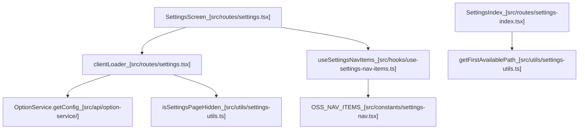
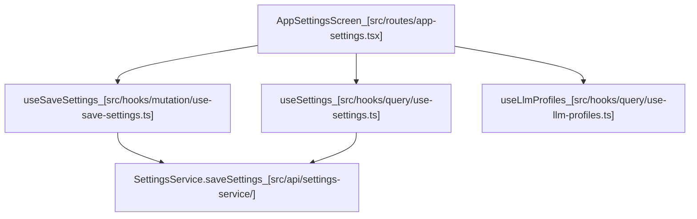

<!-- source: DeepWiki mcp.deepwiki.com · repo All-Hands-AI/OpenHands · page 6 Settings System · fetched 2026-10-26 -->

# Settings System

Relevant source files

The following files were used as context for generating this wiki page:

- [__tests__/components/features/settings/integrations-settings-link.test.tsx](__tests__/components/features/settings/integrations-settings-link.test.tsx)
- [__tests__/hooks/use-settings-nav-items.test.tsx](__tests__/hooks/use-settings-nav-items.test.tsx)
- [__tests__/routes/app-settings.test.tsx](__tests__/routes/app-settings.test.tsx)
- [__tests__/routes/settings-index.test.tsx](__tests__/routes/settings-index.test.tsx)
- [__tests__/routes/settings.test.tsx](__tests__/routes/settings.test.tsx)
- [src/components/features/settings/integrations-settings-link.tsx](src/components/features/settings/integrations-settings-link.tsx)
- [src/constants/settings-nav.tsx](src/constants/settings-nav.tsx)
- [src/hooks/use-settings-nav-items.ts](src/hooks/use-settings-nav-items.ts)
- [src/routes/app-settings.tsx](src/routes/app-settings.tsx)
- [src/routes/settings-index.tsx](src/routes/settings-index.tsx)
- [src/routes/settings.tsx](src/routes/settings.tsx)
- [src/utils/settings-utils.ts](src/utils/settings-utils.ts)

The Settings System in Agent Canvas provides a unified configuration hub for managing LLM profiles, agent settings, secrets, MCP servers, and application preferences. It supports both local `agent-server` backends and multi-tenant cloud environments [src/constants/settings-nav.tsx:7-68]().

## Purpose and Scope

The settings system manages the lifecycle of credentials, model parameters, tool integrations (MCP), and frontend-owned preferences. The UI is structured into distinct navigation domains [src/constants/settings-nav.tsx:15-68]():
- **Agent Profiles & Settings**: Management of agent kinds (`openhands`, `acp`) and execution profiles [src/constants/settings-nav.tsx:15-25]().
- **LLM Profiles**: Configuration of model providers, API keys, and inference parameters [src/constants/settings-nav.tsx:27-31]().
- **Condenser & Agent Context**: Context window management and persistent memory (`agent_context.load_memory`) [src/constants/settings-nav.tsx:33-49]().
- **Verification**: Critic and iterative refinement parameters [src/constants/settings-nav.tsx:50-55]().
- **Application Preferences**: Frontend-owned settings including UI language, sound notifications, git author details, and analytics consent [src/routes/app-settings.tsx:89-137]().
- **Secrets Management**: Secure storage and retrieval of provider tokens and API keys [src/constants/settings-nav.tsx:62-67]().

This is a PARENT page. For deep technical details on specific subsystems, refer to the child pages:
- [Settings Service and Data Flow](#6.1) — Detail `SettingsService` (local and cloud), the `X-Expose-Secrets` pattern, `settings-utils.ts`, and TanStack Query integration.
- [LLM Profiles Management](#6.2) — Explain `LlmSettingsLocalView`, `ProfileActionsMenu`, `ProfileRow`, `LlmProfilesManager`, provider connections, and config-service.
- [Agent Settings and ACP Providers](#6.3) — Document agent-settings route, ACP provider constants, `AgentProfilesManager`, and `sdk-settings-schema.ts`.
- [Secrets Management](#6.4) — Explain `SecretsService` (local/cloud), `secret-form.tsx`, `LookupSecret`, and `with-retry.ts`.
- [MCP Server Configuration](#6.5) — Document MCP settings UI components, `MCPConfig` types, `mcp-config.ts`, and installed servers.

Sources: [src/constants/settings-nav.tsx:7-68](), [src/routes/app-settings.tsx:89-137]()

---

## Settings Navigation and Layout

The settings interface is organized via `SettingsLayout` and managed by the router [src/routes/settings.tsx:42-107](). 

### Navigation Structure
Navigation items are defined in `OSS_NAV_ITEMS` and dynamically filtered by `useSettingsNavItems` based on feature flags, backend type (local vs cloud), and lock-to-cloud configurations [src/constants/settings-nav.tsx:15-68](), [src/hooks/use-settings-nav-items.ts:20-50]():
- `/settings/agents`: Agent profile library [src/constants/settings-nav.tsx:22-25]().
- `/settings/llm`: LLM profile management [src/constants/settings-nav.tsx:28-31]().
- `/settings/condenser`: Context condenser settings [src/constants/settings-nav.tsx:34-37]().
- `/settings/agent-context`: Persistent memory context [src/constants/settings-nav.tsx:46-49]().
- `/settings/verification`: Verification configuration [src/constants/settings-nav.tsx:52-55]().
- `/settings/app`: Application preferences (`AppSettingsScreen`) [src/routes/app-settings.tsx:30]().
- `/settings/secrets`: Credentials and lookup secrets [src/constants/settings-nav.tsx:64-67]().

### Route Guards and Index Redirects
The `clientLoader` in `src/routes/settings.tsx` checks feature flags (`hide_llm_settings`) and redirects users to available routes via `getFirstAvailablePath()` if a hidden page is accessed [src/routes/settings.tsx:20-40](), [src/utils/settings-utils.ts:60-78](). The `SettingsIndex` component handles mobile hub views or defaults desktop users to `/settings/agents` (or `/settings/app` when locked to a cloud host) [src/routes/settings-index.tsx:10-27]().

Sources: [src/constants/settings-nav.tsx:15-68](), [src/routes/settings.tsx:20-40](), [src/hooks/use-settings-nav-items.ts:20-50](), [src/routes/settings-index.tsx:10-27](), [src/utils/settings-utils.ts:60-78]()

---

## Application Settings and Preferences (`AppSettingsScreen`)

The application settings route (`/settings/app`) handled by `AppSettingsScreen` manages local user configuration [src/routes/app-settings.tsx:30-137]():
- **Language & Notifications**: Updates UI locale and sound notification triggers [src/routes/app-settings.tsx:90-101]().
- **Git Author**: Configures `git_user_name` and `git_user_email` used across agent workspaces [src/routes/app-settings.tsx:102-107]().
- **Analytics Consent**: Manages `user_consents_to_analytics` (automatically enabled and locked for cloud backends) [src/routes/app-settings.tsx:96-98]().
- **Title Generation LLM Profile**: Allows selecting a dedicated lightweight LLM profile for generating conversation titles [src/routes/app-settings.tsx:57-87]().

Sources: [src/routes/app-settings.tsx:30-137]()

---

## Code Entity Map

### Settings Routing and Navigation Resolution

Sources: [src/routes/settings.tsx:20-40](), [src/hooks/use-settings-nav-items.ts:20-50](), [src/constants/settings-nav.tsx:15-68](), [src/routes/settings-index.tsx:10-27](), [src/utils/settings-utils.ts:52-78]()

### Application Settings Form Data Flow

Sources: [src/routes/app-settings.tsx:30-40](), [src/hooks/query/use-settings.ts:1-20](), [src/hooks/query/use-llm-profiles.ts:1-20]()

---

