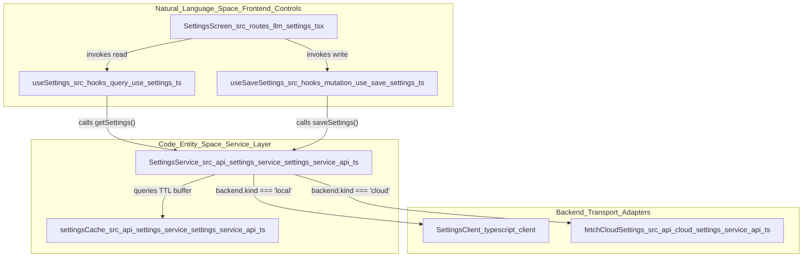
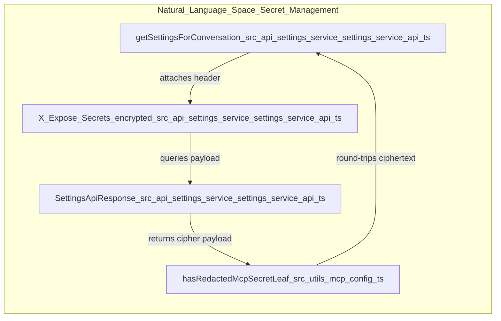
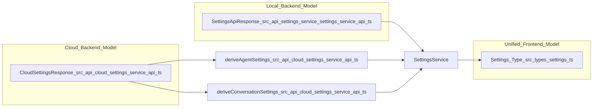

<!-- source: DeepWiki mcp.deepwiki.com · repo All-Hands-AI/OpenHands · page 6.1 Settings Service and Data Flow · fetched 2026-10-26 -->

# Settings Service and Data Flow

<details>
<summary>Relevant source files</summary>

The following files were used as context for generating this wiki page:

- [__tests__/api/cloud/settings-service.test.ts](__tests__/api/cloud/settings-service.test.ts)
- [__tests__/api/llm-subscription-service.test.ts](__tests__/api/llm-subscription-service.test.ts)
- [__tests__/api/settings-service.test.ts](__tests__/api/settings-service.test.ts)
- [__tests__/components/features/settings/mcp-settings/mcp-server-form.validation.test.tsx](__tests__/components/features/settings/mcp-settings/mcp-server-form.validation.test.tsx)
- [__tests__/hooks/query/use-agent-settings-schema.test.tsx](__tests__/hooks/query/use-agent-settings-schema.test.tsx)
- [__tests__/utils/mcp-config.test.ts](__tests__/utils/mcp-config.test.ts)
- [eslint.config.js](eslint.config.js)
- [specs/llm-defaults.md](specs/llm-defaults.md)
- [src/api/cloud/settings-service.api.ts](src/api/cloud/settings-service.api.ts)
- [src/api/llm-balance-service.test.ts](src/api/llm-balance-service.test.ts)
- [src/api/llm-balance-service.ts](src/api/llm-balance-service.ts)
- [src/api/llm-subscription-service.ts](src/api/llm-subscription-service.ts)
- [src/api/no-direct-agent-server-calls.test.ts](src/api/no-direct-agent-server-calls.test.ts)
- [src/api/settings-service/settings-service.api.ts](src/api/settings-service/settings-service.api.ts)
- [src/components/features/onboarding/steps/setup-llm-step.tsx](src/components/features/onboarding/steps/setup-llm-step.tsx)
- [src/components/features/settings/mcp-settings/mcp-server-form.tsx](src/components/features/settings/mcp-settings/mcp-server-form.tsx)
- [src/hooks/mutation/use-add-mcp-server.ts](src/hooks/mutation/use-add-mcp-server.ts)
- [src/hooks/mutation/use-update-mcp-server.ts](src/hooks/mutation/use-update-mcp-server.ts)
- [src/mocks/settings-handlers.ts](src/mocks/settings-handlers.ts)
- [src/services/settings.ts](src/services/settings.ts)
- [src/types/mcp-server.ts](src/types/mcp-server.ts)
- [src/types/settings.ts](src/types/settings.ts)
- [src/utils/mcp-config.ts](src/utils/mcp-config.ts)
- [src/utils/mcp-installed-servers.ts](src/utils/mcp-installed-servers.ts)
- [src/utils/mcp-server-name.ts](src/utils/mcp-server-name.ts)
- [tests/e2e/mock-llm/mcp/mock-llm-mcp-github.spec.ts](tests/e2e/mock-llm/mcp/mock-llm-mcp-github.spec.ts)
- [tests/e2e/mock-llm/onboarding/mock-llm-onboarding-regressions.spec.ts](tests/e2e/mock-llm/onboarding/mock-llm-onboarding-regressions.spec.ts)
- [tests/e2e/support/onboarding-helpers.ts](tests/e2e/support/onboarding-helpers.ts)

</details>


## Purpose and Scope

The Settings System in OpenHands provides a unified interface for managing application preferences, LLM configurations, and sensitive credentials across both local and cloud backends. The architecture relies on `SettingsService` [src/api/settings-service/settings-service.api.ts:1]() that abstracts underlying API differences, a robust in-memory caching mechanism, secure secret handling via the `X-Expose-Secrets` header pattern, and seamless integration with TanStack Query hooks.

Sources: [src/api/settings-service/settings-service.api.ts:1-19]()

## Settings Architecture and Data Flow

The frontend interacts with settings primarily through `SettingsService`, which routes requests to either the local agent-server API client or the OpenHands Cloud API depending on the active backend registry state.

### Code Entity Space to System Flow


Sources: [src/api/settings-service/settings-service.api.ts:10-18](), [src/api/settings-service/settings-service.api.ts:165-176](), [src/api/cloud/settings-service.api.ts:13-17]()

## SettingsService Implementation

The `SettingsService` coordinator manages normalization of settings shapes, in-memory caching, and resilient retry logic using exponential backoff [src/api/settings-service/settings-service.api.ts:137-159](). It utilizes a singleton pattern to maintain cached payloads across the application lifecycle.

### Key Functions and Behavior

| Function | File | Description |
| :--- | :--- | :--- |
| `getSettings()` | [src/api/settings-service/settings-service.api.ts]() | Fetches settings with redacted secrets. Uses `settingsCache` if valid [src/api/settings-service/settings-service.api.ts:180](). |
| `saveSettings()` | [src/api/settings-service/settings-service.api.ts]() | Persists changes using partial diffs (`SettingsUpdateRequest`). Invalidates cache on success [src/api/settings-service/settings-service.api.ts:80](). |
| `getSettingsForConversation()` | [src/api/settings-service/settings-service.api.ts]() | Fetches settings with `X-Expose-Secrets: encrypted` for starting agent runs [__tests__/api/settings-service.test.ts:90-108](). |
| `withRetry()` | [src/api/settings-service/settings-service.api.ts:137-159]() | Exponential backoff wrapper for resilient network calls. |
| `invalidateCache()` | [src/api/settings-service/settings-service.api.ts:182-184]() | Manually clears the in-memory settings cache. |

Sources: [src/api/settings-service/settings-service.api.ts:137-184](), [__tests__/api/settings-service.test.ts:90-108]()

### The `X-Expose-Secrets` Pattern

To protect sensitive API keys and tokens in the UI while enabling the frontend to pass credentials back to the agent-server when launching conversations, the API relies on the `X-Expose-Secrets` header contract:



- **Redacted (Default):** Omits the header; returns `"**********"` for sensitive fields.
- **Encrypted:** Sends `X-Expose-Secrets: encrypted`, returning cipher-encrypted values (prefixed with `gAAAAA_mock_encrypted_` in test mocks) that the frontend cannot plain-text read but can safely round-trip back to the server [src/api/settings-service/settings-service.api.ts:121-126](), [__tests__/api/settings-service.test.ts:90-108]().
- **Plaintext:** Returns raw secret values (restricted to internal backend administrative usage).

Sources: [src/api/settings-service/settings-service.api.ts:121-126](), [src/api/settings-service/settings-service.api.ts:314-334](), [src/utils/mcp-config.ts:44-51](), [__tests__/api/settings-service.test.ts:90-108]()

## Local vs. Cloud Data Flow

The data structures differ between local and cloud backends. `SettingsService` and `src/api/cloud/settings-service.api.ts` reconcile these representations into a unified `Settings` type [src/types/settings.ts:112-160]().

### Data Normalization



- **Local Backend:** Uses a nested structure mirroring the Python SDK `SettingsApiResponse` containing `agent_settings`, `conversation_settings`, and `misc_settings` blocks [src/api/settings-service/settings-service.api.ts:57-67]().
- **Cloud Backend:** Uses a flat structure for top-level properties (e.g., `llm_model`, `confirmation_mode`). The frontend transforms these using `deriveAgentSettings` and `deriveConversationSettings` into the nested format expected by UI components [src/api/cloud/settings-service.api.ts:71-123]().

Sources: [src/api/settings-service/settings-service.api.ts:57-67](), [src/api/cloud/settings-service.api.ts:23-123](), [src/types/settings.ts:112-160]()

## App Preferences and Misc Settings

Fields like `language`, `git_user_name`, and `disabled_skills` are categorized as "App Preferences". In local mode, these are stored under `misc_settings.app_preferences` [src/api/settings-service/settings-service.api.ts:25-35]().

### Saving App Preferences

When executing `saveSettings()`, the service extracts recognized app-preference keys from the flat UI patch and routes them into `misc_settings_diff.app_preferences` for local backends, or as flat top-level fields for cloud backends [src/api/settings-service/settings-service.api.ts:103-116](), [src/api/cloud/settings-service.api.ts:167-198]().

```typescript
// src/api/settings-service/settings-service.api.ts:26-35
export const APP_PREFERENCE_FIELDS = [
  "language",
  "user_consents_to_analytics",
  "enable_sound_notifications",
  "git_user_name",
  "git_user_email",
  "title_llm_profile",
  "disabled_skills",
  "enabled_skills",
] as const;
```

Sources: [src/api/settings-service/settings-service.api.ts:26-35](), [src/api/settings-service/settings-service.api.ts:103-116](), [__tests__/api/settings-service.test.ts:142-174]()

## LLM Defaults and Guardrails

The frontend enforces explicit LLM fallback values to avoid relying on backend SDK defaults:

- **`DEFAULT_SETTINGS`**: Defines `"openai/gpt-5.6-sol"` as the fallback model [src/services/settings.ts:5-8](). This is also referenced as `ONBOARDING_DEFAULT_LLM_MODEL` during onboarding initialization [src/components/features/onboarding/steps/setup-llm-step.tsx:28]().
- **Normalization**: `SettingsService.getSettings()` normalizes derived fields like `llm_model` and `confirmation_mode` for predictable consumption across UI components [__tests__/api/settings-service.test.ts:50-59]().
- **LLD-001**: The frontend guarantees that an explicit model string is always transmitted in conversation start payloads, even if the agent-server returns an absent or empty `llm.model` [specs/llm-defaults.md:5-9]().

Sources: [src/services/settings.ts:5-8](), [src/components/features/onboarding/steps/setup-llm-step.tsx:28](), [__tests__/api/settings-service.test.ts:50-59](), [specs/llm-defaults.md:5-9]()

---

