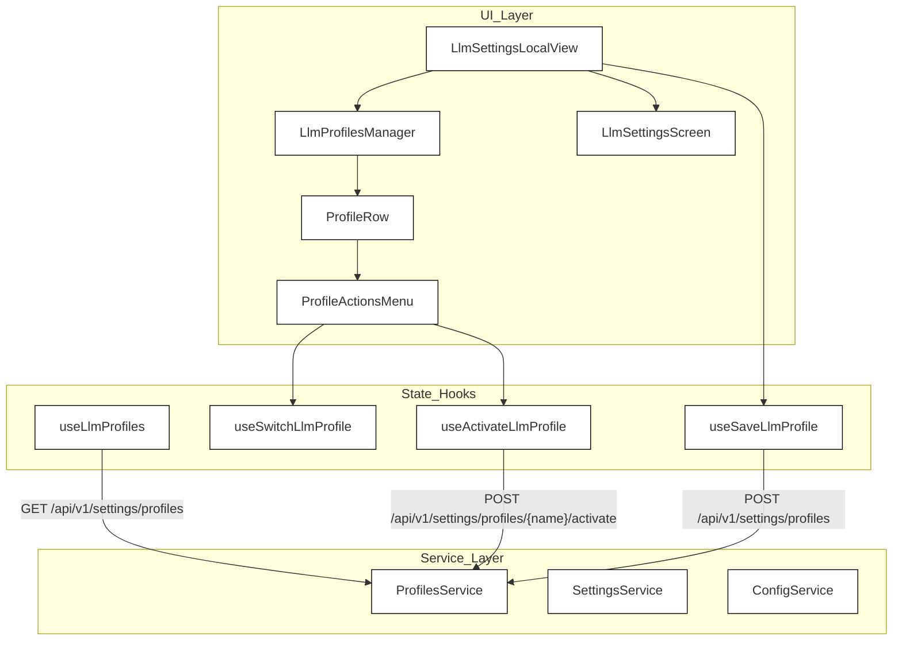
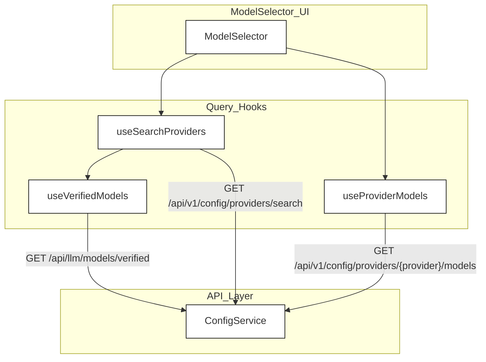
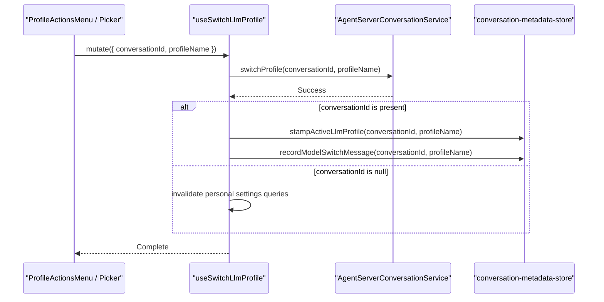

<!-- source: DeepWiki mcp.deepwiki.com · repo All-Hands-AI/OpenHands · page 6.2 LLM Profiles Management · fetched 2026-10-26 -->

# LLM Profiles Management

Relevant source files

The following files were used as context for generating this wiki page:

- [__tests__/api/cloud/provider-connections-service.test.ts](__tests__/api/cloud/provider-connections-service.test.ts)
- [__tests__/api/config-service.test.ts](__tests__/api/config-service.test.ts)
- [__tests__/components/features/chat/components/chat-input-llm-profile-picker.test.tsx](__tests__/components/features/chat/components/chat-input-llm-profile-picker.test.tsx)
- [__tests__/components/features/chat/model-messages.test.tsx](__tests__/components/features/chat/model-messages.test.tsx)
- [__tests__/components/features/settings/settings-dropdown-input.test.tsx](__tests__/components/features/settings/settings-dropdown-input.test.tsx)
- [__tests__/components/modals/settings/model-selector-openhands.test.tsx](__tests__/components/modals/settings/model-selector-openhands.test.tsx)
- [__tests__/components/settings/agent-profiles/agent-profiles-manager.test.tsx](__tests__/components/settings/agent-profiles/agent-profiles-manager.test.tsx)
- [__tests__/components/settings/llm-profiles/llm-profiles-manager.test.tsx](__tests__/components/settings/llm-profiles/llm-profiles-manager.test.tsx)
- [__tests__/components/settings/llm-profiles/llm-settings-local-view.test.tsx](__tests__/components/settings/llm-profiles/llm-settings-local-view.test.tsx)
- [__tests__/components/settings/llm-profiles/profile-actions-menu.test.tsx](__tests__/components/settings/llm-profiles/profile-actions-menu.test.tsx)
- [__tests__/components/settings/llm-profiles/profile-row.test.tsx](__tests__/components/settings/llm-profiles/profile-row.test.tsx)
- [__tests__/components/settings/llm-profiles/profiles-body.test.tsx](__tests__/components/settings/llm-profiles/profiles-body.test.tsx)
- [__tests__/components/shared/modals/settings/settings-form.test.tsx](__tests__/components/shared/modals/settings/settings-form.test.tsx)
- [__tests__/hooks/chat/use-slash-command.test.ts](__tests__/hooks/chat/use-slash-command.test.ts)
- [__tests__/hooks/query/use-search-providers.test.tsx](__tests__/hooks/query/use-search-providers.test.tsx)
- [__tests__/routes/llm-settings.test.tsx](__tests__/routes/llm-settings.test.tsx)
- [__tests__/utils/format-model-name.test.ts](__tests__/utils/format-model-name.test.ts)
- [hero.ts](hero.ts)
- [src/api/cloud/provider-connections-service.api.ts](src/api/cloud/provider-connections-service.api.ts)
- [src/api/config-service/config-service.api.ts](src/api/config-service/config-service.api.ts)
- [src/api/provider-connections-service/provider-connections-service.api.ts](src/api/provider-connections-service/provider-connections-service.api.ts)
- [src/components/features/chat/components/chat-input-llm-profile-picker.tsx](src/components/features/chat/components/chat-input-llm-profile-picker.tsx)
- [src/components/features/chat/model-messages.tsx](src/components/features/chat/model-messages.tsx)
- [src/components/features/settings/agent-profiles/agent-profile-actions-menu.tsx](src/components/features/settings/agent-profiles/agent-profile-actions-menu.tsx)
- [src/components/features/settings/agent-profiles/agent-profile-row.tsx](src/components/features/settings/agent-profiles/agent-profile-row.tsx)
- [src/components/features/settings/llm-profiles/llm-profiles-manager.tsx](src/components/features/settings/llm-profiles/llm-profiles-manager.tsx)
- [src/components/features/settings/llm-profiles/llm-settings-local-view.tsx](src/components/features/settings/llm-profiles/llm-settings-local-view.tsx)
- [src/components/features/settings/llm-profiles/profile-actions-menu.tsx](src/components/features/settings/llm-profiles/profile-actions-menu.tsx)
- [src/components/features/settings/llm-profiles/profile-row.tsx](src/components/features/settings/llm-profiles/profile-row.tsx)
- [src/components/features/settings/llm-profiles/profiles-body.tsx](src/components/features/settings/llm-profiles/profiles-body.tsx)
- [src/components/features/settings/llm-profiles/provider-connection-modal.tsx](src/components/features/settings/llm-profiles/provider-connection-modal.tsx)
- [src/components/features/settings/llm-profiles/provider-connections-manager.test.tsx](src/components/features/settings/llm-profiles/provider-connections-manager.test.tsx)
- [src/components/features/settings/settings-dropdown-input.tsx](src/components/features/settings/settings-dropdown-input.tsx)
- [src/components/shared/modals/settings/model-selector.tsx](src/components/shared/modals/settings/model-selector.tsx)
- [src/components/shared/modals/settings/settings-form.tsx](src/components/shared/modals/settings/settings-form.tsx)
- [src/hooks/chat/use-slash-command.ts](src/hooks/chat/use-slash-command.ts)
- [src/hooks/query/use-provider-connections.ts](src/hooks/query/use-provider-connections.ts)
- [src/hooks/query/use-provider-models.ts](src/hooks/query/use-provider-models.ts)
- [src/hooks/query/use-search-providers.ts](src/hooks/query/use-search-providers.ts)
- [src/hooks/query/use-verified-models.ts](src/hooks/query/use-verified-models.ts)
- [src/routes/llm-settings.tsx](src/routes/llm-settings.tsx)
- [src/tailwind.css](src/tailwind.css)
- [src/utils/format-model-name.ts](src/utils/format-model-name.ts)
- [tailwind.config.js](tailwind.config.js)
- [tests/e2e/mock-llm/settings/mock-llm-cloud-providers-pagination.spec.ts](tests/e2e/mock-llm/settings/mock-llm-cloud-providers-pagination.spec.ts)
- [tests/e2e/mock-llm/settings/mock-llm-provider-connection-selector.spec.ts](tests/e2e/mock-llm/settings/mock-llm-provider-connection-selector.spec.ts)

This page documents the technical architecture and implementation of the LLM profiles management system in Agent Canvas. The system provides an integrated mechanism for defining, editing, persisting, and switching between multiple named LLM configurations (encompassing models, API keys, base URLs, and advanced hyperparameters) either globally or per-conversation.

## Overview and Core Architecture

The LLM profiles architecture bridges low-level SDK `LLM` configuration objects with a user-facing profile manager. It coordinates state via TanStack Query hooks, React Context (`ActiveBackendContext`), and local component orchestration.

Key components in the management subsystem include:
- `LlmSettingsLocalView`: Root state coordinator handling list, create, and edit modes for local agent-server setups [src/components/features/settings/llm-profiles/llm-settings-local-view.tsx:88-95]().
- `LlmProfilesManager`: Renders the sorted list of profiles and entry points for creating new ones.
- `ProfileRow`: Displays summary details (name, model, active badge) and hosts the actions dropdown [__tests__/components/settings/llm-profiles/profile-row.tsx:51-105]().
- `ProfileActionsMenu`: A portaled popup menu offering Edit, Rename, Duplicate, Set Default, and Delete actions [src/components/features/settings/llm-profiles/profile-actions-menu.tsx:37-47]().
- `LlmSettingsScreen`: The underlying form renderer driven by `SdkSectionPage` [src/routes/llm-settings.tsx:124-156]().

### Profile Management Architecture

Sources: [src/components/features/settings/llm-profiles/llm-settings-local-view.tsx:88-95](), [src/components/features/settings/llm-profiles/profile-actions-menu.tsx:37-47](), [__tests__/components/settings/llm-profiles/profile-row.tsx:51-105]()

## Model Selection, Discovery, and Verification

The `ModelSelector` component provides a robust search interface for picking providers and model identifiers, drawing directly from backend configuration discovery services [src/components/shared/modals/settings/model-selector.tsx:36-43]().

### Discovery Pipeline
- **Providers Search**: `useSearchProviders` queries `ConfigService.searchProviders`, handling multi-page pagination cursor walks for cloud backends up to a depth limit of 10 pages [src/hooks/query/use-search-providers.ts:19-56]().
- **Verified Models**: `use-verified-models` fetches a map of verified models grouped by provider to prioritize standard options in the UI [src/hooks/query/use-search-providers.ts:74-78]().
- **Free Model Identification**: The system parses the backend-provided `free` flag on model payloads (`LLMModel`), rendering a "Free" badge and companion notes for qualifying OpenHands routes [src/components/shared/modals/settings/model-selector.tsx:75-84](), [src/utils/format-model-name.ts:37-39]().

### Model Selector Data Flow

Sources: [src/components/shared/modals/settings/model-selector.tsx:36-84](), [src/hooks/query/use-search-providers.ts:19-86](), [src/hooks/query/use-verified-models.ts:1-22]()

## Provider Connections

Shared provider connections allow multiple LLM profiles to share a single API key and base URL resource. This is managed via `ProviderConnectionsManager` and `ProviderConnectionModal`.

### Provider Connection Workflow
- **Creation**: `useCreateProviderConnection` triggers an endpoint call to `ProviderConnectionsService.create`.
- **Editing**: `useUpdateProviderConnection` dispatches a PATCH request to `ProviderConnectionsService.update`. Blank API keys on edit follow an "unchanged" convention and are omitted from the update payload.
- **Linking**: When creating or editing an LLM profile in local view, if connections exist, users can bind the profile to a shared connection via `LLM_PROVIDER_CONNECTION_KEY` (`llm.provider_connection_id`) [src/routes/llm-settings.tsx:44-45]().

Sources: [src/api/provider-connections-service/provider-connections-service.api.ts:1-30](), [src/routes/llm-settings.tsx:44-45]()

## Profile Switching

The `useSwitchLlmProfile` mutation coordinates active profile transitions. It operates in two modes depending on context:

1. **Conversation Mode**: When passed a `conversationId`, it invokes `AgentServerConversationService.switchProfile`, changing the runtime model for that session without modifying global settings [src/hooks/mutation/use-switch-llm-profile.ts:57-58](). It then stamps the active profile name into the `conversation-metadata-store` [src/hooks/mutation/use-switch-llm-profile.ts:83-91]().
2. **Global Mode**: When `conversationId` is null, it activates the profile globally across the agent server and invalidates `SettingsService` caches.

### Profile Switch Sequence

Sources: [src/hooks/mutation/use-switch-llm-profile.ts:51-95](), [src/api/conversation-metadata-store.ts:108-118]()

## Implementation Details

### Base Config Merge on Save
When editing existing profiles, `LlmSettingsLocalView` fetches the full encrypted profile config (`ProfilesService.getProfile`) [src/components/features/settings/llm-profiles/llm-settings-local-view.tsx:165-168](). Upon saving, user changes are merged against this `baseConfig` to ensure hidden or inactive tab fields are preserved rather than reset to default values [src/components/features/settings/llm-profiles/llm-settings-local-view.tsx:61-70]().

### Modal Portaling
`ProfileActionsMenu` anchors against its triggering element, measuring its bounding rectangle via `useLayoutEffect` and rendering into a document portal (`ReactDOM.createPortal`) with fixed positioning. This design prevents clipping by parent containers with `overflow: auto` or `hidden` [src/components/features/settings/llm-profiles/profile-actions-menu.tsx:33-78](), [src/components/features/settings/llm-profiles/profile-actions-menu.tsx:200-209]().

Sources: [src/components/features/settings/llm-profiles/llm-settings-local-view.tsx:61-70](), [src/components/features/settings/llm-profiles/profile-actions-menu.tsx:33-78](), [src/components/features/settings/llm-profiles/profile-actions-menu.tsx:200-209]()

---

