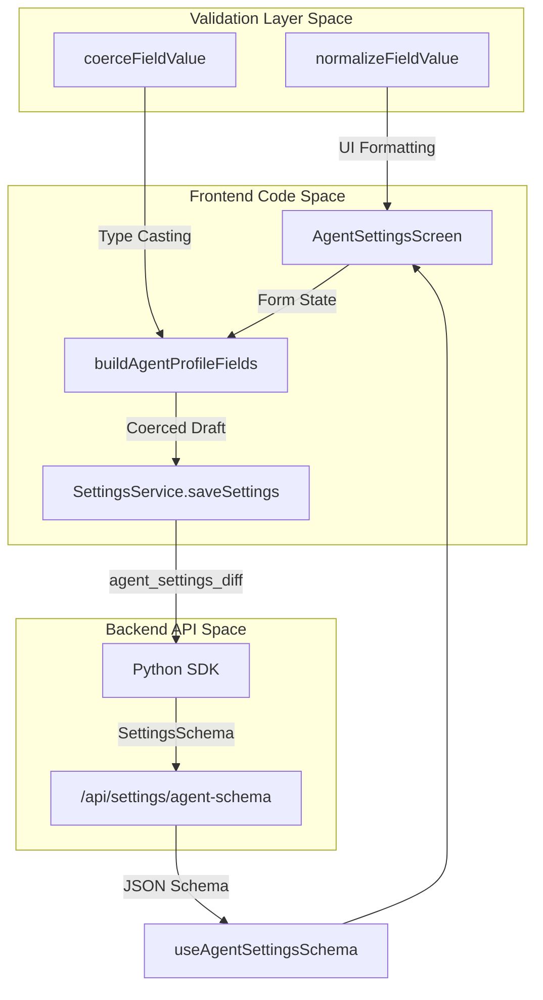
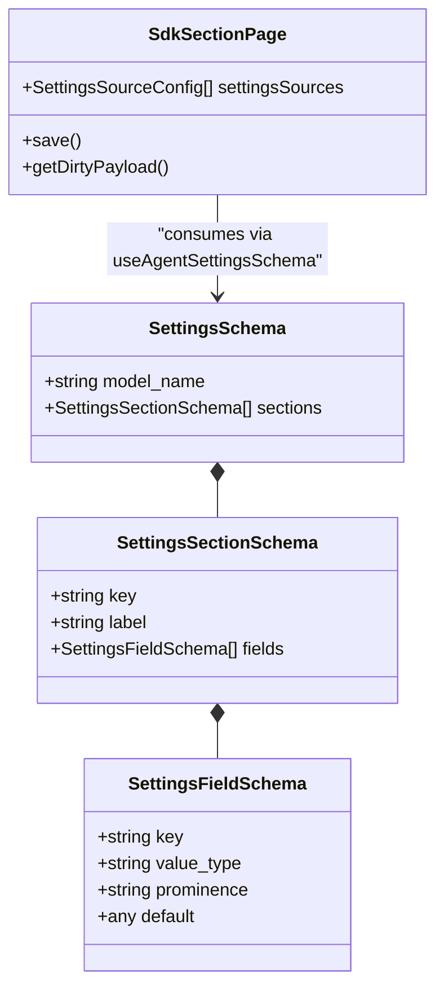

<!-- source: DeepWiki mcp.deepwiki.com · repo All-Hands-AI/OpenHands · page 6.3 Agent Settings and ACP Providers · fetched 2026-10-26 -->

# Agent Settings and ACP Providers

Relevant source files

The following files were used as context for generating this wiki page:

- [__tests__/api/agent-profiles-service/profile-field-support.test.ts](__tests__/api/agent-profiles-service/profile-field-support.test.ts)
- [__tests__/components/features/settings/sdk-settings/sdk-section-page.test.tsx](__tests__/components/features/settings/sdk-settings/sdk-section-page.test.tsx)
- [__tests__/components/features/settings/secrets-settings/secret-form.test.tsx](__tests__/components/features/settings/secrets-settings/secret-form.test.tsx)
- [__tests__/components/home/llm-not-configured-banner.test.tsx](__tests__/components/home/llm-not-configured-banner.test.tsx)
- [__tests__/components/settings/agent-profiles/agent-profiles-local-view.test.tsx](__tests__/components/settings/agent-profiles/agent-profiles-local-view.test.tsx)
- [__tests__/components/settings/agent-profiles/merge-agent-profile-save-input.test.ts](__tests__/components/settings/agent-profiles/merge-agent-profile-save-input.test.ts)
- [__tests__/constants/profile-scope.test.ts](__tests__/constants/profile-scope.test.ts)
- [__tests__/routes/agent-settings.test.tsx](__tests__/routes/agent-settings.test.tsx)
- [__tests__/routes/build-agent-profile-fields.test.ts](__tests__/routes/build-agent-profile-fields.test.ts)
- [__tests__/routes/secrets-settings.test.tsx](__tests__/routes/secrets-settings.test.tsx)
- [__tests__/utils/sdk-settings-schema.test.ts](__tests__/utils/sdk-settings-schema.test.ts)
- [src/api/agent-profiles-service/profile-field-support.ts](src/api/agent-profiles-service/profile-field-support.ts)
- [src/components/features/settings/agent-profiles/agent-profiles-local-view.tsx](src/components/features/settings/agent-profiles/agent-profiles-local-view.tsx)
- [src/components/features/settings/agent-profiles/profile-scope-list.tsx](src/components/features/settings/agent-profiles/profile-scope-list.tsx)
- [src/components/features/settings/sdk-settings/sdk-section-page.tsx](src/components/features/settings/sdk-settings/sdk-section-page.tsx)
- [src/components/features/settings/secrets-settings/secret-form.tsx](src/components/features/settings/secrets-settings/secret-form.tsx)
- [src/constants/profile-scope.ts](src/constants/profile-scope.ts)
- [src/mocks/agent-profiles-handlers.ts](src/mocks/agent-profiles-handlers.ts)
- [src/mocks/handlers.ts](src/mocks/handlers.ts)
- [src/routes/agent-settings.tsx](src/routes/agent-settings.tsx)
- [src/utils/sdk-settings-schema.ts](src/utils/sdk-settings-schema.ts)

## Purpose and Scope

This wiki page documents the agent settings architecture in Agent Canvas, covering the `/settings/agent` route (`src/routes/agent-settings.tsx`), ACP provider constants (`src/constants/acp-providers.ts`), agent profile management (`src/components/features/settings/agent-profiles/agent-profiles-local-view.tsx`), the SDK-driven settings component (`src/components/features/settings/sdk-settings/sdk-section-page.tsx`), the settings schema validation layer (`src/utils/sdk-settings-schema.ts`), and agent-context settings integration.

---

## 1. Overview and Data Flow

The settings architecture bridges the frontend UI and the Python SDK configuration requirements. It handles two primary agent classifications:
1. **OpenHands Native**: Managed through SDK settings such as `enable_sub_agents` and `tool_concurrency_limit` [src/routes/agent-settings.tsx:63-67]().
2. **ACP (Agent Client Protocol)**: Drives external coding agents (Claude Code, Codex, Gemini CLI) by managing launch commands, model selection, and subprocess credentials [src/constants/acp-providers.ts:76-114]().

### Configuration Data Flow
The following diagram maps out how settings move from the React UI components through schema-driven validation to backend persistence.

**Settings Persistence Flow**

**Sources:** [src/routes/agent-settings.tsx:171-183](), [src/utils/sdk-settings-schema.ts:241-260](), [src/components/features/settings/sdk-settings/sdk-section-page.tsx:8-10]()

---

## 2. Agent Profiles Management & Persistence

The `AgentProfilesManager` and `AgentProfilesLocalView` components allow users to manage multiple named agent configurations (profiles) on local backends [src/components/features/settings/agent-profiles/agent-profiles-local-view.tsx:3](). Users can create, edit, and activate different agent profiles, each associated with specific agent types and LLM profiles.

### Profile Merging and Persistence Rules
When saving a profile, the system performs a whole-profile overwrite. To avoid losing fields unmanaged by the form (such as `condenser` or `verification` settings), the `mergeAgentProfileSaveInput` utility is invoked [src/components/features/settings/agent-profiles/agent-profiles-local-view.tsx:4]().

* **Identity Stripping**: Managed identifiers like `id`, `name`, and `revision` are stripped before submission so the server controls versioning [src/components/features/settings/agent-profiles/agent-profiles-local-view.tsx:198-202]().
* **Encrypted Exposure**: Profiles are requested with the `encrypted` flag so that MCP tool secrets arrive as Fernet tokens instead of masked strings, permitting safe round-tripping during saves [src/components/features/settings/agent-profiles/agent-profiles-local-view.tsx:140-146]().

**Sources:** [src/components/features/settings/agent-profiles/agent-profiles-local-view.tsx:3-4](), [src/components/features/settings/agent-profiles/agent-profiles-local-view.tsx:140-146](), [src/components/features/settings/agent-profiles/agent-profiles-local-view.tsx:198-202]()

---

## 3. ACP Provider Registry

The `acp-providers.ts` module serves as the single source of truth for external agent integrations, enriching the SDK provider list with UI metadata like icons and i18n keys [src/constants/acp-providers.ts:129-145]().

### Key Constants and Functions
| Entity Name | Code Role & Description |
| :--- | :--- |
| `ACP_PROVIDERS` | Registry of supported ACP agents (Claude Code, Codex, Gemini CLI) enriched with frontend metadata [src/constants/acp-providers.ts:129-145](). |
| `resolveEffectiveAcpModel` | Prioritizes runtime values over configured defaults when resolving model strings [src/constants/acp-providers.ts:48-65](). |
| `ACP_MANAGED_SENTINEL` | Sentinel value (`acp-managed`) utilized by legacy SDKs to indicate that the ACP server manages its own model [src/constants/acp-providers.ts:20](). |
| `getAcpProviderSecrets` | Returns required environment variables (`ANTHROPIC_API_KEY`, `CODEX_AUTH_JSON`, etc.) for specific providers [src/constants/acp-providers.ts:208-230](). |
| `resolveCodexDefaultCommand` | Overrides the `codex` launch command temporarily to ensure compatibility with `gpt-6-astra` [src/constants/acp-providers.ts:166-169](). |

**Sources:** [src/constants/acp-providers.ts:20-65](), [src/constants/acp-providers.ts:129-145](), [src/constants/acp-providers.ts:166-169](), [src/constants/acp-providers.ts:208-230]()

---

## 4. SDK-Driven Settings (`SdkSectionPage`)

The `SdkSectionPage` component is a schema-driven form renderer that consumes `SettingsSchema` definitions provided by the backend [src/components/features/settings/sdk-settings/sdk-section-page.tsx:186-203]().

### Prominence Tiers and Views
Settings fields carry prominence levels (`critical`, `major`, `minor`). The `ViewToggle` component allows filtering fields across three detail tiers [src/components/features/settings/sdk-settings/sdk-section-page.tsx:40]():
* **Basic**: Restricts display to `critical` fields (e.g., primary API keys) [src/utils/sdk-settings-schema.ts:34]().
* **Advanced**: Includes `critical` and `major` fields [src/utils/sdk-settings-schema.ts:35]().
* **All**: Renders all defined fields including `minor` configurations [src/utils/sdk-settings-schema.ts:36]().

### Settings Architecture Entity Map

**Sources:** [src/components/features/settings/sdk-settings/sdk-section-page.tsx:186-203](), [src/utils/sdk-settings-schema.ts:1-8](), [src/utils/sdk-settings-schema.ts:34-36]()

---

## 5. Route Implementations and Agent Context

### Agent Settings (`/settings/agent`)
The `AgentSettingsScreen` component coordinates high-level agent configurations across variants:
* **OpenHands Branch**: Renders sub-agent toggles and concurrency limits, using `buildAgentProfileFields` to coerce numeric inputs such as `tool_concurrency_limit` [src/routes/agent-settings.tsx:171-183]().
* **ACP Branch**: Renders `AcpCredentialsSection` alongside provider-specific command and model selectors, inferring presets from command token signatures [src/routes/agent-settings.tsx:82-93]().
* **LLM Tool Support**: The `enable_switch_llm_tool` field is guarded by `agentProfileSupportsSwitchLlmTool` to ensure backend compatibility before payload construction [src/routes/agent-settings.tsx:50](), [__tests__/routes/agent-settings.test.tsx:25-28]().

### Agent Context Settings (`/settings/agent-context`)
A specialized deployment of `SdkSectionPage` targeting the `agent_context` schema bucket. This interface manages features such as persistent memory (`agent_context.load_memory`) [tests/e2e/mock-llm/automations/mock-llm-automation.spec.ts:100-102]().

**Sources:** [src/routes/agent-settings.tsx:45-183](), [src/routes/agent-settings.tsx:50](), [src/routes/agent-settings.tsx:82-93](), [src/routes/agent-settings.tsx:171-183](), [__tests__/routes/agent-settings.test.tsx:25-28](), [tests/e2e/mock-llm/automations/mock-llm-automation.spec.ts:100-102]()

---

## 6. Technical Utilities and Schema Helpers

### `sdk-settings-schema.ts`
* `coerceFieldValue`: Converts form strings back to native numeric, boolean, or structured JSON values [src/utils/sdk-settings-schema.ts:241-260]().
* `isValidSettingsSchema`: Guard function preventing frontend exceptions if backends return malformed schema objects [src/utils/sdk-settings-schema.ts:51-55]().
* `normalizeFieldValue`: Prepares raw backend settings values for rendering in form controls [src/utils/sdk-settings-schema.ts:134-159]().
* `normalizeComparableValue`: Establishes stable scalar or structured representations of settings values to guarantee accurate dirty-state tracking [src/utils/sdk-settings-schema.ts:183-221]().

**Sources:** [src/utils/sdk-settings-schema.ts:51-260](), [src/utils/sdk-settings-schema.ts:134-159](), [src/utils/sdk-settings-schema.ts:183-221]()

---

