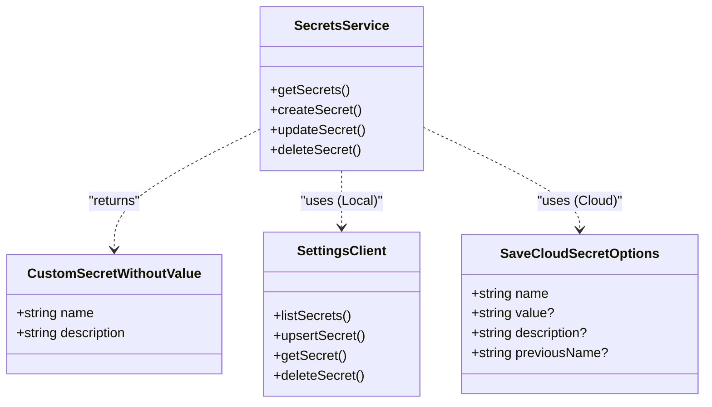

<!-- source: DeepWiki mcp.deepwiki.com · repo All-Hands-AI/OpenHands · page 6.4 Secrets Management · fetched 2026-10-26 -->

# Secrets Management

<details>
<summary>Relevant source files</summary>

The following files were used as context for generating this wiki page:

- [__tests__/api/cloud/secrets-service.test.ts](__tests__/api/cloud/secrets-service.test.ts)
- [__tests__/api/secrets-service.test.ts](__tests__/api/secrets-service.test.ts)
- [__tests__/utils/responder-deployment.test.ts](__tests__/utils/responder-deployment.test.ts)
- [src/api/cloud/secrets-service.api.ts](src/api/cloud/secrets-service.api.ts)
- [src/api/secrets-service.ts](src/api/secrets-service.ts)
- [src/api/with-retry.ts](src/api/with-retry.ts)
- [src/components/features/automations/responder-deployment-modal.tsx](src/components/features/automations/responder-deployment-modal.tsx)
- [src/hooks/mutation/use-update-secret.ts](src/hooks/mutation/use-update-secret.ts)
- [src/hooks/use-responder-url-secret.ts](src/hooks/use-responder-url-secret.ts)
- [src/utils/responder-deployment.ts](src/utils/responder-deployment.ts)
- [tests/e2e/mock-llm/automations/mock-llm-preset-automation.spec.ts](tests/e2e/mock-llm/automations/mock-llm-preset-automation.spec.ts)
- [tests/e2e/mock-llm/regressions/mock-llm-ui-regressions.spec.ts](tests/e2e/mock-llm/regressions/mock-llm-ui-regressions.spec.ts)

</details>


The Secrets Management system in OpenHands provides a secure mechanism for storing and managing sensitive credentials (e.g., API keys for LLM providers or ACP agents) required by the agent-server. The architecture is designed to prevent exposing secret values within the frontend state or local storage, utilizing a "LookupSecret" pattern where the frontend only handles secret metadata (names and descriptions) while the actual values are securely transmitted to and stored by the backend.

## Architecture and Data Flow

The system distinguishes between **Local** backends (self-hosted agent-server) and **Cloud** backends (managed OpenHands environment). The `SecretsService` acts as a unified interface that routes requests based on active backend types defined in `src/api/backend-registry/active-store.ts` [src/api/secrets-service.ts:3-16]().

### Secret Lifecycle Diagram
The following diagram illustrates the flow of creating and updating secrets, highlighting the separation between metadata and values while mapping natural language concepts to concrete code entities.

**Secret Management Flow**
```mermaid
graph TD
    subgraph "Frontend Space"
        SecretForm[""src/components/features/settings/secrets-settings/secret-form.tsx""] -- "onSubmit" --> useCreateSecret_useUpdateSecret[""useCreateSecret / useUpdateSecret""]
        useCreateSecret_useUpdateSecret -- "mutate" --> SecretsService[""SecretsService (src/api/secrets-service.ts)""]
    end

    subgraph "Service Layer Space"
        SecretsService -- "kind === 'local'" --> SettingsClient[""SettingsClient (@openhands/typescript-client)""]
        SecretsService -- "kind === 'cloud'" --> CloudSecretsAPI[""fetchCloudSecrets / saveCloudSecret (src/api/cloud/secrets-service.api.ts)""]
        SettingsClient -- "retries" --> withRetry[""withRetry (src/api/with-retry.ts)""]
        CloudSecretsAPI -- "retries" --> withRetry
    end

    subgraph "Backend Space"
        SettingsClient -- "PUT /api/settings/secrets" --> LocalAgentServer["Local Agent Server"]
        CloudSecretsAPI -- "POST /api/v1/secrets" --> CloudProxy["Cloud Proxy"]
    end

    LocalAgentServer -- "Stores Value" --> SecureStorage["Secure Storage"]
    CloudProxy -- "Proxies to Cloud API" --> CloudVault["Cloud Vault"]
```
Sources: [src/api/secrets-service.ts:13-24](), [src/api/cloud/secrets-service.api.ts:80-85](), [src/api/with-retry.ts:4-8]()

## Key Components

### SecretsService
The `SecretsService` class is the central coordinator for secret operations (`src/api/secrets-service.ts`). It handles the logic for fetching, creating, updating, and deleting secrets across different backend types.

*   **`getSecrets()`**: Fetches a list of `CustomSecretWithoutValue`. It explicitly maps backend responses to ensure secret values are never included in the returned array [src/api/secrets-service.ts:20-41]().
*   **`createSecret()`**: Performs an upsert. For local backends, it uses the `SettingsClient.upsertSecret` method [src/api/secrets-service.ts:60-76](). For cloud backends, it calls `saveCloudSecret` [src/api/secrets-service.ts:65-67]().
*   **`updateSecret()`**: Handles complex updates including renames. Because the local backend typically uses upsert logic, renaming a secret involves fetching the existing value (if not provided), upserting it under the new name, and deleting the old entry [src/api/secrets-service.ts:90-121](). For cloud backends, it calls `saveCloudSecret` with `previousName` [src/api/secrets-service.ts:97-102]().
*   **`deleteSecret()`**: Removes a secret by name. It includes specialized error handling to treat `404 Not Found` as a successful deletion [src/api/secrets-service.ts:130-155](). For cloud backends, it calls `deleteCloudSecret` [src/api/secrets-service.ts:132-134]().

Sources: [src/api/secrets-service.ts:26-156](), [src/api/cloud/secrets-service.api.ts:80-118]()

### Secret-Form Component
The `SecretForm` component (`src/components/features/settings/secrets-settings/secret-form.tsx`) provides the UI for adding and editing secrets. It enforces naming conventions and validation rules before delegating to mutation hooks like `useCreateSecret` and `useUpdateSecret` [src/hooks/mutation/use-update-secret.ts:4-17]().

| Feature | Behavior |
| :--- | :--- |
| **Add Mode** | Requires both a Name and a Value. |
| **Edit Mode** | Allows leaving the Value field blank to preserve the existing stored value. |
| **Validation** | Checks for duplicate names within the current local state before submission. |

Sources: [src/hooks/mutation/use-update-secret.ts:4-17]()

## Implementation Details

### Cloud vs. Local Handling
The implementation differs significantly based on the `BackendKind`:

1.  **Local Backend**: Communicates directly with the `SettingsClient` from the `@openhands/typescript-client` [src/api/secrets-service.ts:18-19](). It relies on standard REST endpoints like `GET /api/settings/secrets` [src/api/secrets-service.ts:29]().
2.  **Cloud Backend**: Uses a proxy-based approach (`callCloudProxy`) [src/api/cloud/secrets-service.api.ts:37-41](). The cloud implementation handles pagination via `fetchCloudSecrets`, walking through pages using `next_page_id` until all metadata is retrieved [src/api/cloud/secrets-service.api.ts:27-48](). For saving, it coordinates between `PUT /api/v1/secrets/{name}` (for metadata/renames) and `POST /api/v1/secrets` (for value updates) [src/api/cloud/secrets-service.api.ts:80-109]().

Sources: [src/api/secrets-service.ts:14-16](), [src/api/cloud/secrets-service.api.ts:27-48](), [src/api/cloud/secrets-service.api.ts:80-109]()

### The LookupSecret Mechanism
To maintain security, the frontend operates on `CustomSecretWithoutValue` [src/api/secrets-service.types.ts:10]().
*   When listing secrets, the backend returns only the `name` and `description` [src/api/secrets-service.ts:20-23]().
*   When the agent needs a secret (e.g., an LLM API key), it references the secret by its `name`. The `agent-server` then retrieves the actual `value` from its internal secure store before making the external request.
*   The `useResponderUrlSecret` hook [src/hooks/use-responder-url-secret.ts:17-60]() is an example of this pattern, ensuring the `OPENHANDS_URL` secret is present for the active backend without exposing its value in the frontend. It checks for the existence of the secret and creates it if missing, using `window.location.origin` as the value [src/hooks/use-responder-url-secret.ts:38-46]().

Sources: [src/api/secrets-service.ts:20-23](), [src/hooks/use-responder-url-secret.ts:17-60]()

### Resilience with `withRetry`
All secret operations are wrapped in the `withRetry` utility (`src/api/with-retry.ts`) to handle transient network issues. This utility implements an exponential backoff strategy:
*   **Default Retries**: 3 attempts [src/api/with-retry.ts:6]().
*   **Backoff Formula**: `baseDelayMs * 2 ** attempt` [src/api/with-retry.ts:17]().

Sources: [src/api/with-retry.ts:4-26](), [src/api/secrets-service.ts:15-17]()

## Data Models

### Entity Mapping
The following diagram maps the high-level secret concepts to their specific TypeScript implementations and classes.

**Code Entity Mapping**

Sources: [src/api/secrets-service.ts:26-156](), [src/api/cloud/secrets-service.api.ts:50-58]()

### Update Logic Matrix
When `SecretsService.updateSecret` is called, the system behaves as follows:

| Scenario | Value Provided? | Action |
| :--- | :--- | :--- |
| **Rename** | No | 1. `getSecret(old)` <br> 2. `upsertSecret(new, old_value)` <br> 3. `deleteSecret(old)` [src/api/secrets-service.ts:90-121]() |
| **Rename** | Yes | 1. `upsertSecret(new, new_value)` <br> 2. `deleteSecret(old)` [src/api/secrets-service.ts:90-121]() |
| **Metadata Update** | No | 1. `getSecret(name)` <br> 2. `upsertSecret(name, old_value, new_desc)` [src/api/secrets-service.ts:90-121]() |

Sources: [src/api/secrets-service.ts:90-121](), [__tests__/api/secrets-service.test.ts:114-134]()

---

