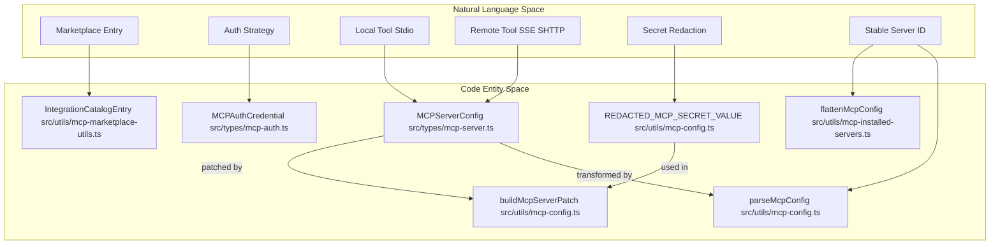
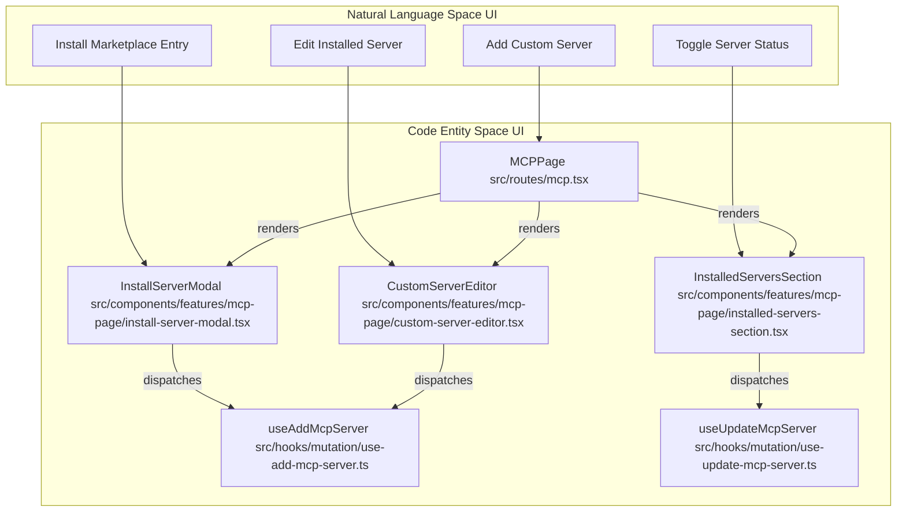
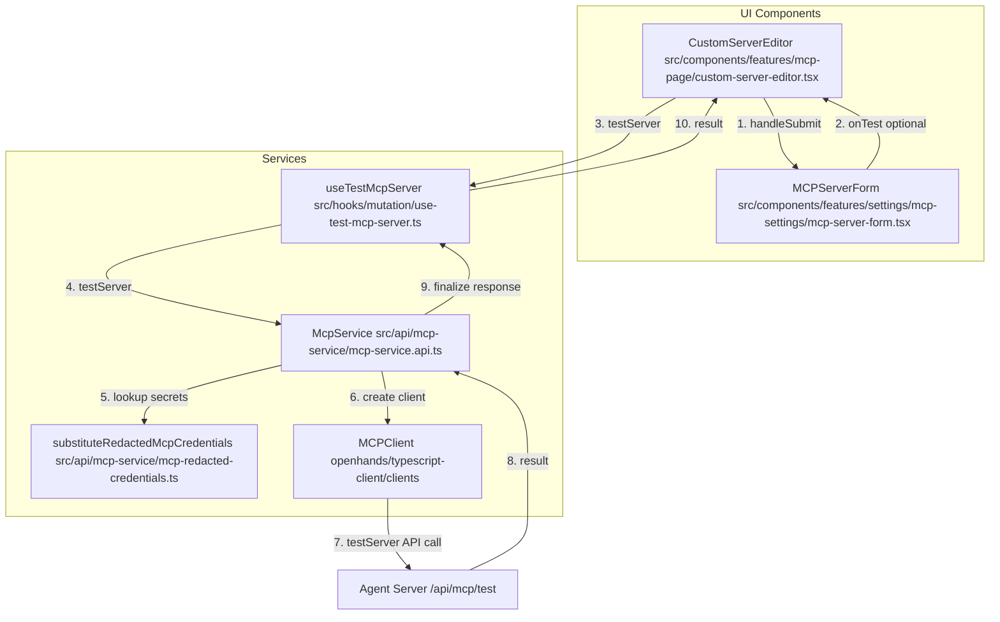

<!-- source: DeepWiki mcp.deepwiki.com · repo All-Hands-AI/OpenHands · page 6.5 MCP Server Configuration · fetched 2026-10-26 -->

# MCP Server Configuration

Relevant source files

The following files were used as context for generating this wiki page:

- [__tests__/api/mcp-service/mcp-service.api.test.ts](__tests__/api/mcp-service/mcp-service.api.test.ts)
- [__tests__/components/automations/recommended-automations.test.tsx](__tests__/components/automations/recommended-automations.test.tsx)
- [__tests__/components/features/mcp-page/custom-server-editor.test.tsx](__tests__/components/features/mcp-page/custom-server-editor.test.tsx)
- [__tests__/components/features/mcp-page/install-server-modal.test.tsx](__tests__/components/features/mcp-page/install-server-modal.test.tsx)
- [__tests__/components/features/settings/mcp-settings/mcp-server-form.validation.test.tsx](__tests__/components/features/settings/mcp-settings/mcp-server-form.validation.test.tsx)
- [__tests__/constants/extensions-catalogs.test.ts](__tests__/constants/extensions-catalogs.test.ts)
- [__tests__/routes/mcp-page.test.tsx](__tests__/routes/mcp-page.test.tsx)
- [__tests__/utils/mcp-config.test.ts](__tests__/utils/mcp-config.test.ts)
- [__tests__/utils/mcp-marketplace-utils.test.ts](__tests__/utils/mcp-marketplace-utils.test.ts)
- [src/api/mcp-service/mcp-service.api.ts](src/api/mcp-service/mcp-service.api.ts)
- [src/components/features/automations/recommended-automations-launcher.tsx](src/components/features/automations/recommended-automations-launcher.tsx)
- [src/components/features/automations/recommended-automations-section.tsx](src/components/features/automations/recommended-automations-section.tsx)
- [src/components/features/mcp-logo-badge.tsx](src/components/features/mcp-logo-badge.tsx)
- [src/components/features/mcp-page/custom-server-editor.tsx](src/components/features/mcp-page/custom-server-editor.tsx)
- [src/components/features/mcp-page/install-server-modal.tsx](src/components/features/mcp-page/install-server-modal.tsx)
- [src/components/features/mcp-page/installed-server-card.tsx](src/components/features/mcp-page/installed-server-card.tsx)
- [src/components/features/mcp-page/installed-servers-section.tsx](src/components/features/mcp-page/installed-servers-section.tsx)
- [src/components/features/mcp-page/marketplace-card.tsx](src/components/features/mcp-page/marketplace-card.tsx)
- [src/components/features/mcp-page/marketplace-section.tsx](src/components/features/mcp-page/marketplace-section.tsx)
- [src/components/features/mcp-page/mcp-logo-stack-badge.tsx](src/components/features/mcp-page/mcp-logo-stack-badge.tsx)
- [src/components/features/settings/mcp-settings/mcp-server-form.tsx](src/components/features/settings/mcp-settings/mcp-server-form.tsx)
- [src/hooks/mutation/use-add-mcp-server.ts](src/hooks/mutation/use-add-mcp-server.ts)
- [src/hooks/mutation/use-update-mcp-server.ts](src/hooks/mutation/use-update-mcp-server.ts)
- [src/routes/mcp.tsx](src/routes/mcp.tsx)
- [src/types/mcp-server.ts](src/types/mcp-server.ts)
- [src/types/settings.ts](src/types/settings.ts)
- [src/utils/mcp-config.ts](src/utils/mcp-config.ts)
- [src/utils/mcp-installed-servers.ts](src/utils/mcp-installed-servers.ts)
- [src/utils/mcp-marketplace-utils.ts](src/utils/mcp-marketplace-utils.ts)
- [src/utils/mcp-server-name.ts](src/utils/mcp-server-name.ts)
- [tests/e2e/mock-llm/mcp/mock-llm-mcp-github.spec.ts](tests/e2e/mock-llm/mcp/mock-llm-mcp-github.spec.ts)

This leaf page details the Model Context Protocol (MCP) configuration subsystem in OpenHands. It covers the MCP settings user interface (`mcp-server-form`, `install-server-modal`, `custom-server-editor`, `marketplace-card`), `MCPConfig` types, configuration serialization utilities (`mcp-config.ts`), installed server flattening utilities (`mcp-installed-servers.ts`), and the integrated marketplace catalog.

---

## MCP Configuration Models and Types

OpenHands supports three primary transport types of MCP servers. Configurations are stored within the `agent_settings.mcp_config` field of application settings [src/types/settings.ts:141-153]() and conform to the `MCPConfig` type imported from `@openhands/typescript-client` [src/types/settings.ts:1-2]().

| Type | Description | Key Attributes |
| :--- | :--- | :--- |
| **SSE** | Server-Sent Events for remote tool streaming. | `url`, `headers`, `auth`, `sse_read_timeout` [__tests__/utils/mcp-config.test.ts:17-51]() |
| **Stdio** | Local servers running via standard input/output. | `command`, `args`, `env`, `cwd` [__tests__/utils/mcp-config.test.ts:17-51]() |
| **SHTTP** | Stateless HTTP transport (labeled as `http` in the SDK). | `url`, `headers`, `auth`, `timeout` [__tests__/utils/mcp-config.test.ts:111-118]() |

### Authentication Strategies
MCP servers support multiple authentication methods via the `MCPAuthCredential` type [src/types/mcp-server.ts:9]().
- **API Key**: Token-based auth via a specific header (e.g., `X-API-Key`).
- **Bearer**: Standard `Authorization: Bearer <token>` header.
- **Basic**: Username and password combination.
- **Header**: Arbitrary key-value pairs for custom headers [__tests__/utils/mcp-config.test.ts:188-195]().
- **OAuth2**: Managed OAuth flow including client authentication methods and token states [__tests__/utils/mcp-config.test.ts:53-70]().

Sources: [src/types/settings.ts:1-153](), [src/types/mcp-server.ts:1-20](), [__tests__/utils/mcp-config.test.ts:17-212]()

---

## Configuration Utilities and Serialization (`mcp-config.ts` & `mcp-installed-servers.ts`)

The `mcp-config.ts` and `mcp-installed-servers.ts` modules manage transformation between UI state, wire format, and flattened list representations.

### Normalization and Redaction
- **Stable Identities**: The `parseMcpConfig` utility ensures map keys in `mcp_config` remain stable persistence identities across transport grouping or reordering [__tests__/utils/mcp-config.test.ts:17-51]().
- **Redaction Safety**: The `hasRedactedMcpSecretLeaf` utility detects configurations containing `REDACTED_MCP_SECRET_VALUE` [__tests__/utils/mcp-config.test.ts:111-118](). `buildMcpServerPatch` uses this to omit unchanged redacted credentials during updates, preventing frontend overwrites [__tests__/utils/mcp-config.test.ts:121-134]().
- **Enabled State**: Servers can be explicitly disabled via an `enabled: false` flag, withholding them from agents while preserving secrets [__tests__/utils/mcp-config.test.ts:91-107]().
- **Server Flattening**: `flattenMcpConfig` transforms nested `MCPConfig` maps into arrays of `MCPServerConfig` objects suitable for rendering in UI tables [src/components/features/automations/recommended-automations-launcher.tsx:105-112](), [src/routes/mcp.tsx:52-55]().

### Natural Language to Code: MCP Configuration Mapping
The following diagram maps natural language configuration concepts to their concrete code entities.

Title: "MCP Configuration Entity Mapping"

Sources: [src/utils/mcp-marketplace-utils.ts:1-14](), [src/types/mcp-server.ts:1-20](), [src/utils/mcp-config.ts:1-12](), [src/utils/mcp-installed-servers.ts:1-10](), [__tests__/utils/mcp-config.test.ts:1-134]()

---

## MCP Marketplace and Discovery

OpenHands provides an integrated marketplace catalog hydrated from `@openhands/extensions/integrations` [src/routes/mcp.tsx:19-21]().

### Catalog Filtering and Integration
- **`getMcpMarketplaceCatalog`**: Filters the global integration catalog to include only entries providing valid local/remote MCP connection options [src/utils/mcp-marketplace-utils.ts:110-114]().
- **Marketplace Cards (`marketplace-card`)**: Renders marketplace tiles with logos, descriptions, keywords, and installed badges [__tests__/routes/mcp-page.test.tsx:70-84]().

### Installation Logic (`install-server-modal.tsx`)
The `InstallServerModal` handles one-click and templated installations of marketplace servers:
1. **Option Selection**: Identifies locally installable connection options (e.g., Stdio/API key fallbacks) [src/utils/mcp-marketplace-utils.ts:66-70]().
2. **Pre-flight Testing**: Calls `McpService.testServer` to verify endpoint connectivity before persisting [src/components/features/mcp-page/install-server-modal.tsx:157]().
3. **Health Seeding**: Seeds test results into the `mcp-health-store` via `seedMcpServerHealth` so the UI immediately renders a healthy status [src/components/features/mcp-page/install-server-modal.tsx:17]().
4. **Secret Management**: Toggles sensitive credential fields to be saved as OpenHands secrets instead of plain text settings [src/components/features/mcp-page/install-server-modal.tsx:8]().

Sources: [src/routes/mcp.tsx:19-21](), [src/utils/mcp-marketplace-utils.ts:66-114](), [src/components/features/mcp-page/install-server-modal.tsx:1-163](), [__tests__/routes/mcp-page.test.tsx:70-84]()

---

## MCP Settings UI Components

The MCP settings route (`src/routes/mcp.tsx`) integrates toolbar controls, installed server lists, and custom server editors.

### Key UI Modules
- **`installed-servers-section.tsx`**: Displays active servers with toggle controls, search filtering, and edit actions [src/routes/mcp.tsx:150-156]().
- **`custom-server-editor.tsx`**: Provides form inputs for adding or editing custom (non-marketplace) Stdio, SSE, or SHTTP servers [src/routes/mcp.tsx:179-183]().
- **`mcp-server-form.tsx`**: Enforces strict validation rules (e.g., name patterns matching `^[a-zA-Z0-9_-]+$`, non-empty Stdio commands, valid URLs for SSE/SHTTP) [__tests__/components/features/settings/mcp-settings/mcp-server-form.validation.test.tsx:1]().

### Natural Language to Code: UI Component Mapping
The following diagram maps user-facing settings actions to their corresponding UI components and API mutation hooks.

Title: "MCP UI Component and Mutation Data Flow"

Sources: [src/routes/mcp.tsx:39-189](), [src/components/features/mcp-page/install-server-modal.tsx:1-185](), [src/hooks/mutation/use-add-mcp-server.ts:1-25](), [src/hooks/mutation/use-update-mcp-server.ts:1-25]()

---

## Testing and Connectivity Data Flow

Connectivity verification is managed via `McpService` and exposed through `useTestMcpServer`.

### Execution Flow
1. **Credential Substitution**: `substituteRedactedMcpCredentials` retrieves raw secrets from `SecretsService` when configurations contain redacted placeholders [src/api/mcp-service/mcp-service.api.ts:54]().
2. **Backend Probe**: The `testServer` method dispatches connectivity requests to the agent-server endpoint via `MCPClient` [src/api/mcp-service/mcp-service.api.ts:198-203]().
3. **Cloud Short-circuit**: Cloud backends bypass local testing (returning synthetic success) because sandbox execution requires active conversation sessions [src/api/mcp-service/mcp-service.api.ts:193-195]().
4. **Response Finalization**: `finalizeMcpTestResponse` evaluates tool responses against catalog validation criteria [src/api/mcp-service/mcp-service.api.ts:100-122]().

Title: "MCP Test and Save Data Flow"

Sources: [src/api/mcp-service/mcp-service.api.ts:50-210](), [src/hooks/mutation/use-test-mcp-server.ts:1-9]()

---

