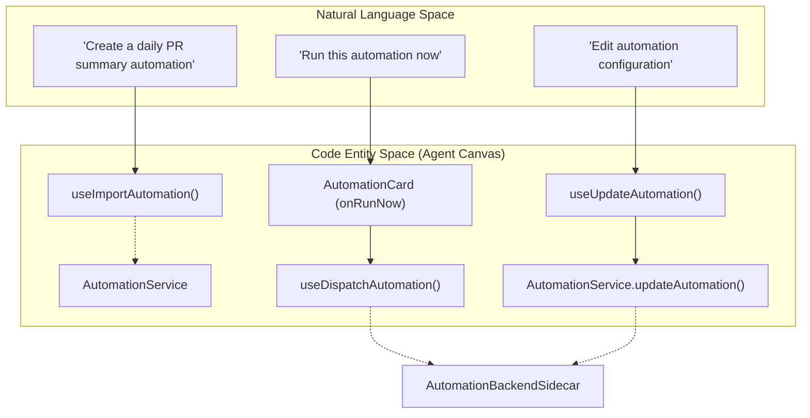
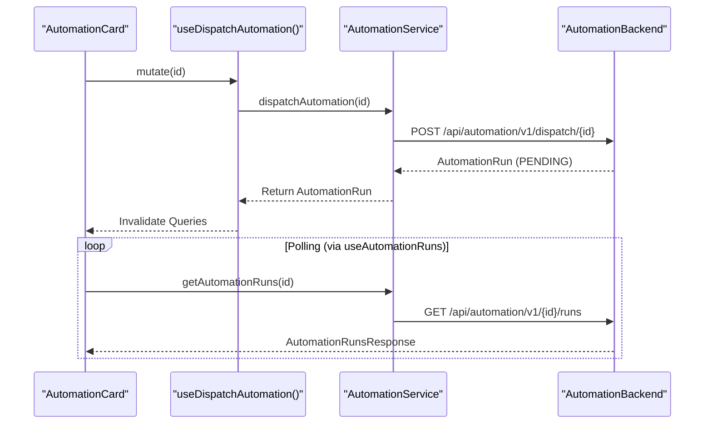

<!-- source: DeepWiki mcp.deepwiki.com · repo All-Hands-AI/OpenHands · page 7 Automations System · fetched 2026-10-26 -->

# Automations System

Relevant source files

The following files were used as context for generating this wiki page:

- [__tests__/components/automations/add-automation-modal.test.tsx](__tests__/components/automations/add-automation-modal.test.tsx)
- [__tests__/components/automations/automation-card.test.tsx](__tests__/components/automations/automation-card.test.tsx)
- [__tests__/components/automations/automation-list-row.test.tsx](__tests__/components/automations/automation-list-row.test.tsx)
- [__tests__/components/automations/create-instructions.test.tsx](__tests__/components/automations/create-instructions.test.tsx)
- [__tests__/hooks/query/use-automations-backend-switch.test.tsx](__tests__/hooks/query/use-automations-backend-switch.test.tsx)
- [__tests__/manifests/automation-insights.test.ts](__tests__/manifests/automation-insights.test.ts)
- [src/components/features/automations/automation-card.tsx](src/components/features/automations/automation-card.tsx)
- [src/components/features/automations/automation-list-row.tsx](src/components/features/automations/automation-list-row.tsx)
- [src/components/features/automations/create-instructions.tsx](src/components/features/automations/create-instructions.tsx)
- [src/hooks/query/use-automation-detail.ts](src/hooks/query/use-automation-detail.ts)
- [src/hooks/query/use-automations.ts](src/hooks/query/use-automations.ts)
- [src/manifests/automation-insights.ts](src/manifests/automation-insights.ts)
- [src/mocks/automation-handlers.ts](src/mocks/automation-handlers.ts)
- [src/mocks/automations.mock.ts](src/mocks/automations.mock.ts)
- [src/types/automation.ts](src/types/automation.ts)

The Automations system in OpenHands enables scheduled and event-driven agent runs, allowing agents to perform tasks autonomously (e.g., daily repository maintenance, PR summaries, or periodic code audits). The feature consists of a frontend management interface, a manifest-driven setup process, and a backend sidecar service that handles scheduling and execution.

### Automation Lifecycle

Automations transition through several states: from creation via natural language in a conversation, to management in the UI, and finally execution (either via schedule or manual dispatch).

1.  **Creation**: Users can create automations by instructing the agent in a standard chat session or via the "park-and-patch" strategy in the `AutomationService` which creates an inert record before applying final triggers [src/types/automation.ts:24-82]().
2.  **Management**: Automations are listed and managed via the `AutomationCard` [src/components/features/automations/automation-card.tsx:57-66]() and `AutomationListRow` [src/components/features/automations/automation-list-row.tsx:53-62](). These components provide toggles for enabling/disabling and access to menus for editing and exporting.
3.  **Execution**: The system dispatches runs which are tracked as `AutomationRun` entities [src/types/automation.ts:149-189](). Runs track `status` (PENDING, RUNNING, COMPLETED, FAILED), LLM `cost`, and provide links to sandbox logs via `bash_command_id` [src/types/automation.ts:154-160]().

Sources: [src/types/automation.ts:24-82](), [src/components/features/automations/automation-card.tsx:57-66](), [src/components/features/automations/automation-list-row.tsx:53-62](), [src/types/automation.ts:149-189]()

### High-Level Architecture

The following diagram illustrates the flow from a user's natural language intent to the underlying code entities that manage the automation lifecycle.

**Natural Language to Code Entity Mapping**

Sources: [src/hooks/query/use-automations.ts:52-64](), [src/components/features/automations/automation-card.tsx:57-164](), [src/hooks/query/use-automations.ts:66-79](), [src/hooks/query/use-automations.ts:94-113]()

### System Components

| Component | Description |
| :--- | :--- |
| **Automation Service** | The API layer managing communication with the automation backend. Handles local vs cloud routing and request dispatching [src/types/automation.ts:24-106](). |
| **Automations UI** | The React-based interface for listing and viewing details. Uses `AutomationCard` for grid views [src/components/features/automations/automation-card.tsx:57]() and `AutomationListRow` for list views [src/components/features/automations/automation-list-row.tsx:53](). |
| **Automation Hooks** | TanStack Query hooks like `useAutomations`, `useDispatchAutomation`, and `useToggleAutomation` managing server state [src/hooks/query/use-automations.ts:19-131](). |

Sources: [src/types/automation.ts:24-106](), [src/components/features/automations/automation-card.tsx:57-66](), [src/components/features/automations/automation-list-row.tsx:53-62](), [src/hooks/query/use-automations.ts:19-131]()

### Data Flow and Service Interaction

The `AutomationService` acts as the central hub for interacting with the backend automation API endpoints.

**Automation Execution Flow**

Sources: [src/hooks/query/use-automations.ts:94-113](), [src/types/automation.ts:149-189](), [__tests__/hooks/query/use-automations-backend-switch.test.tsx:179-190]()

---

### Feature Modules

#### 7.1. Automation Service and API
For details, see [Automation Service and API](#7.1). This sub-topic details the `AutomationService` class, the "park-and-patch" strategy for creation, and how the system handles telemetry consent and capabilities detection across different backend kinds.
*   **Key Files**: `src/api/automation-service/automation-service.api.ts`, `src/types/automation.ts`

#### 7.2. Automations UI
For details, see [Automations UI](#7.2). This sub-topic covers the component structure for the Automations dashboard, including `AutomationCard` [src/components/features/automations/automation-card.tsx:57-66]() and `AutomationListRow` [src/components/features/automations/automation-list-row.tsx:53-62](), display status, triggers, and health indicators.
*   **Key Files**: `src/components/features/automations/automation-card.tsx`, `src/components/features/automations/automation-list-row.tsx`, `src/components/features/automations/create-instructions.tsx`

#### 7.3. Automation Setup Manifests
For details, see [Automation Setup Manifests](#7.3). This sub-topic explains the manifest system used to provide guided setup flows and recommended automation templates.
*   **Key Files**: `src/manifests/automation-insights.ts`, `src/types/automation.ts`

Sources: [src/components/features/automations/automation-card.tsx:57-66](), [src/components/features/automations/automation-list-row.tsx:53-62](), [src/types/automation.ts:24-106]()

---

