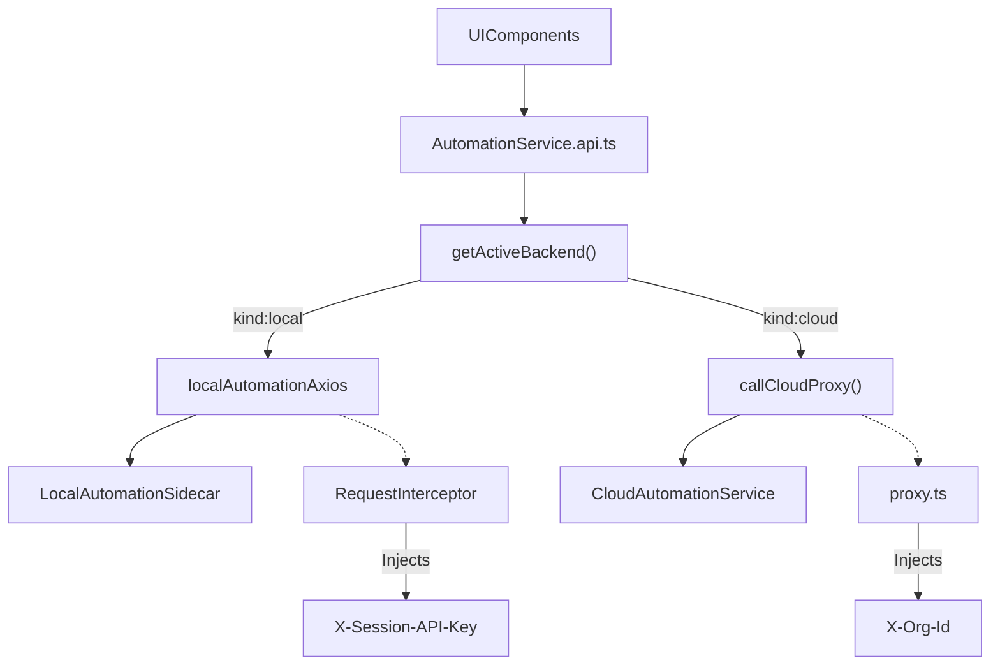
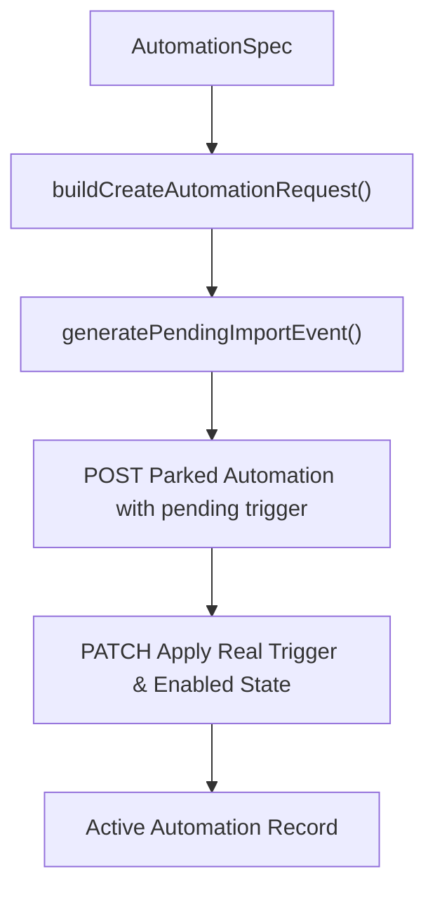

<!-- source: DeepWiki mcp.deepwiki.com · repo All-Hands-AI/OpenHands · page 7.1 Automation Service and API · fetched 2026-10-26 -->

# Automation Service and API

Relevant source files

The following files were used as context for generating this wiki page:

- [.github/pr-assets/pr-16982-validation.png](.github/pr-assets/pr-16982-validation.png)
- [__tests__/api/automation-service.test.ts](__tests__/api/automation-service.test.ts)
- [__tests__/api/cloud/organization-service.test.ts](__tests__/api/cloud/organization-service.test.ts)
- [__tests__/api/cloud/proxy.test.ts](__tests__/api/cloud/proxy.test.ts)
- [__tests__/components/automations/add-automation-modal.test.tsx](__tests__/components/automations/add-automation-modal.test.tsx)
- [__tests__/components/automations/create-instructions.test.tsx](__tests__/components/automations/create-instructions.test.tsx)
- [__tests__/components/automations/detail/configuration-section.test.tsx](__tests__/components/automations/detail/configuration-section.test.tsx)
- [__tests__/hooks/query/use-automation-sdk-version.test.tsx](__tests__/hooks/query/use-automation-sdk-version.test.tsx)
- [__tests__/hooks/query/use-automations-backend-switch.test.tsx](__tests__/hooks/query/use-automations-backend-switch.test.tsx)
- [__tests__/hooks/query/use-git-sync.test.tsx](__tests__/hooks/query/use-git-sync.test.tsx)
- [__tests__/routes/automation-git-sync.test.tsx](__tests__/routes/automation-git-sync.test.tsx)
- [src/api/README.md](src/api/README.md)
- [src/api/automation-service/automation-service.api.ts](src/api/automation-service/automation-service.api.ts)
- [src/api/cloud/organization-service.api.ts](src/api/cloud/organization-service.api.ts)
- [src/api/cloud/proxy.ts](src/api/cloud/proxy.ts)
- [src/components/features/automations/create-instructions.tsx](src/components/features/automations/create-instructions.tsx)
- [src/components/features/automations/detail/configuration-section.tsx](src/components/features/automations/detail/configuration-section.tsx)
- [src/components/features/automations/git-sync/git-sync-activity-row.test.tsx](src/components/features/automations/git-sync/git-sync-activity-row.test.tsx)
- [src/components/features/automations/git-sync/git-sync-activity-row.tsx](src/components/features/automations/git-sync/git-sync-activity-row.tsx)
- [src/components/features/automations/git-sync/git-sync-config-form.test.tsx](src/components/features/automations/git-sync/git-sync-config-form.test.tsx)
- [src/components/features/automations/git-sync/git-sync-config-form.tsx](src/components/features/automations/git-sync/git-sync-config-form.tsx)
- [src/hooks/query/use-automation-detail.ts](src/hooks/query/use-automation-detail.ts)
- [src/hooks/query/use-automation-sdk-version.ts](src/hooks/query/use-automation-sdk-version.ts)
- [src/hooks/query/use-automations.ts](src/hooks/query/use-automations.ts)
- [src/hooks/query/use-cloud-org-member.ts](src/hooks/query/use-cloud-org-member.ts)

The Automation System in Agent Canvas enables scheduled and event-driven agent workflows. The `AutomationService` acts as the primary interface for managing these automations, providing a unified API that abstracts the differences between local sidecar execution and cloud-hosted environments [src/api/automation-service/automation-service.api.ts:1-48]().

## Architecture and Routing

Agent Canvas uses a dual-routing strategy for automation requests. Requests are routed either to a local automation sidecar or to a cloud proxy based on the active backend configuration [src/api/automation-service/automation-service.api.ts:64-68](), [src/api/automation-service/automation-service.api.ts:44-44]().

### Local vs. Cloud Routing
*   **Local Routing**: Uses `localAutomationAxios`, an Axios instance configured with request interceptors to target the local automation sidecar mounted behind the local agent-server [src/api/automation-service/automation-service.api.ts:64-68]().
*   **Cloud Routing**: Uses the `callCloudProxy` function from the `src/api/cloud/proxy.ts` module to dispatch requests to remote OpenHands cloud services [src/api/automation-service/automation-service.api.ts:44-44](), [src/api/cloud/proxy.ts:18-39]().

### Request Interception and Headers
The `localAutomationAxios` instance uses an interceptor to dynamically resolve the active local backend and inject security headers [src/api/automation-service/automation-service.api.ts:83-111]():
*   **X-Session-API-Key**: Derived from the backend registry (`getEffectiveLocalBackend()`) to ensure consistency with the agent-server session [src/api/automation-service/automation-service.api.ts:101-109]().
*   **X-OpenHands-Client**: Set via `AGENT_CANVAS_CLIENT_HEADERS` [src/api/automation-service/automation-service.api.ts:46-48](), [src/api/automation-service/automation-service.api.ts:75-75]().
*   **X-OpenHands-Telemetry-Distinct-Id**: Injects the PostHog distinct ID to correlate frontend actions with backend automation logs [src/api/automation-service/automation-service.api.ts:47-48](), [src/api/automation-service/automation-service.api.ts:76-78]() via `buildAutomationRequestHeaders` [src/api/automation-service/automation-service.api.ts:70-81]().

### Data Flow Diagram: Automation Service Routing Logic
This diagram associates natural language system operations with code entities in `src/api/automation-service/automation-service.api.ts` and `src/api/cloud/proxy.ts`.

Title: "Automation Service Routing Logic"

Sources: [src/api/automation-service/automation-service.api.ts:40-44](), [src/api/automation-service/automation-service.api.ts:64-111](), [src/api/cloud/proxy.ts:18-39]()

## Key Service Functions

### 1. `listAutomations`
Fetches a paginated list of automations. It supports `limit` and `offset` parameters for efficient data retrieval [src/api/automation-service/automation-service.api.ts:131-136](). The `useAutomations` hook [src/hooks/query/use-automations.ts:19-33]() utilizes this function and automatically refetches when the active backend changes [__tests__/hooks/query/use-automations-backend-switch.test.tsx:145-163]().

### 2. `createAutomation` (Park-and-Patch Strategy)
The service implements a "park-and-patch" strategy when importing or creating automations from manifests to ensure atomicity and safety [src/api/automation-service/automation-service.api.ts:184-207]():
1.  **Park**: Creates a "preset" automation (prompt or plugin-based) using a unique, inert event trigger (`pending.[UUID]`) [src/api/automation-service/automation-service.api.ts:155-163](), [src/api/automation-service/automation-service.api.ts:191-198](). This prevents the automation from firing immediately upon creation. The `generatePendingImportEvent` function creates this unique event name [src/api/automation-service/automation-service.api.ts:155-163]().
2.  **Patch**: Immediately follows up with an update call to apply the actual user-defined trigger (cron or real event) and set the desired enabled state.

### 3. `syncTelemetryConsent`
Synchronizes the user's telemetry consent from the frontend to the automation backend. This ensures that the automation sidecar respects the same privacy settings as the UI [src/api/automation-service/automation-service.api.ts:1-8](). For local backends, it uses `getTelemetryDistinctIdForConsentSync` to identify the user [src/api/automation-service/automation-service.api.ts:6-6]().

### 4. `dispatchAutomation`
Manually triggers an execution of an existing automation [src/hooks/query/use-automations.ts:94-113](). This supports the manual execution features exposed in the automation dashboard [src/hooks/query/use-automations.ts:98-112]().

### 5. `getCapabilities`
Retrieves `DeploymentCapabilities` of the current backend [src/api/automation-service/automation-service.api.ts:33-37](). This metadata informs the UI about which triggers (cron vs event) and providers are supported by the active environment.

### Diagram: Park-and-Patch Import Flow
This sequence illustrates the entity lifecycle inside `createAutomation`.

Title: "Park-and-Patch Import Flow"

Sources: [src/api/automation-service/automation-service.api.ts:138-207](), [src/hooks/query/use-automations.ts:52-64]()

Sources: [src/api/automation-service/automation-service.api.ts:1-48](), [src/api/automation-service/automation-service.api.ts:131-207](), [src/hooks/query/use-automations.ts:19-113](), [__tests__/hooks/query/use-automations-backend-switch.test.tsx:145-163]()

## Git-Sync and SDK Version Hooks

### SDK Version Hook (`useAutomationSdkVersion`)
The `useAutomationSdkVersion` hook queries the automation backend for its SDK version [src/hooks/query/use-automation-sdk-version.ts:23-51]() using `AutomationService.getSdkVersion` [src/hooks/query/use-automation-sdk-version.ts:17-17](). 
*   It caches the version using `AUTOMATION_SDK_VERSION_CACHE_NAMESPACE` [src/hooks/query/use-automation-sdk-version.ts:8-8] with a stale time of one hour [src/hooks/query/use-automation-sdk-version.ts:10-10]().
*   Failing lookups settle safely as a `null` result without breaking UI rendering [__tests__/hooks/query/use-automation-sdk-version.test.tsx:63-78]().
*   It re-runs when the active backend changes (`backend.id`, `backend.kind`, `backend.host`, `orgId`) [src/hooks/query/use-automation-sdk-version.ts:32-38]().

### Git-Sync Configuration
Automation specs support git repository binding (`repository`, `branch`), enabling automations to execute against specific code versions and pull requests [src/api/automation-service/automation-service.api.ts:171-182](). Git-sync status responses and configuration update requests are managed via dedicated types [src/api/automation-service/automation-service.api.ts:18-22]().

Sources: [src/api/automation-service/automation-service.api.ts:18-22](), [src/api/automation-service/automation-service.api.ts:171-182](), [src/hooks/query/use-automation-sdk-version.ts:1-51](), [__tests__/hooks/query/use-automation-sdk-version.test.tsx:63-78]()

## Cloud Proxy Implementation

The `src/api/cloud/proxy.ts` module provides a standardized interface to communicate with cloud-specific automation endpoints [src/api/cloud/proxy.ts:18-39]().

| Function / Type | Description |
| :--- | :--- |
| `callCloudProxy` | Dispatches a `CloudProxyRequest`. Selects the appropriate client based on `hostOverride` [src/api/cloud/proxy.ts:18-24](). |
| `createCloudClient` | Factory for the HTTP client used in standard cloud communication [src/api/cloud/proxy.ts:3-3](), [src/api/cloud/proxy.ts:23-23](). |
| `CloudProxyRequest` | Interface defining method, path, body, headers, timeout, hostOverride, and authMode [src/api/cloud/proxy.ts:5-16](). |

For automation requests, `callCloudProxy` routes requests directly to the cloud host using the configured API key, bypassing proxy envelopes when appropriate [__tests__/api/cloud/proxy.test.ts:155-186]().

Sources: [src/api/cloud/proxy.ts:1-39](), [__tests__/api/cloud/proxy.test.ts:155-186]()

---

