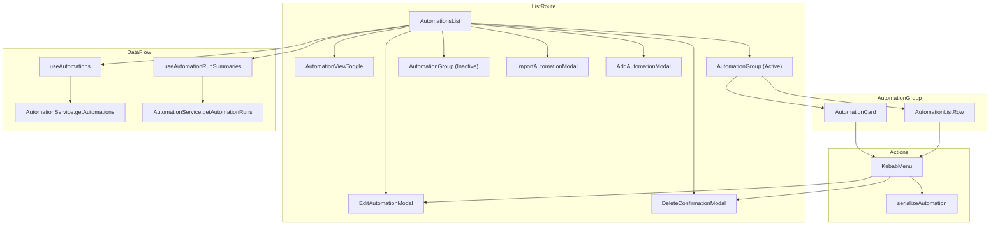
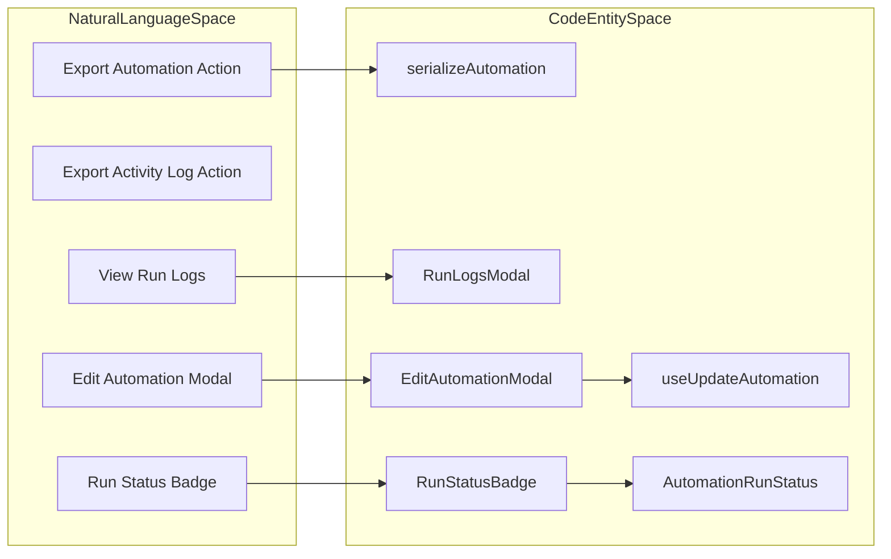

<!-- source: DeepWiki mcp.deepwiki.com · repo All-Hands-AI/OpenHands · page 7.2 Automations UI · fetched 2026-10-26 -->

# Automations UI

Relevant source files

The following files were used as context for generating this wiki page:

- [__tests__/components/automations/automation-view-toggle.test.tsx](__tests__/components/automations/automation-view-toggle.test.tsx)
- [__tests__/components/automations/detail/activity-log-item.test.tsx](__tests__/components/automations/detail/activity-log-item.test.tsx)
- [__tests__/components/automations/detail/activity-log-section.test.tsx](__tests__/components/automations/detail/activity-log-section.test.tsx)
- [__tests__/components/automations/detail/disabled-reason-banner.test.tsx](__tests__/components/automations/detail/disabled-reason-banner.test.tsx)
- [__tests__/components/automations/detail/edit-automation-modal.test.tsx](__tests__/components/automations/detail/edit-automation-modal.test.tsx)
- [__tests__/components/automations/detail/run-logs-modal.test.tsx](__tests__/components/automations/detail/run-logs-modal.test.tsx)
- [__tests__/components/automations/detail/run-status-badge.test.tsx](__tests__/components/automations/detail/run-status-badge.test.tsx)
- [__tests__/components/automations/kebab-menu.test.tsx](__tests__/components/automations/kebab-menu.test.tsx)
- [__tests__/components/features/home/build-pinned-automation-menu-items.test.ts](__tests__/components/features/home/build-pinned-automation-menu-items.test.ts)
- [__tests__/components/features/home/featured-automations-section.test.tsx](__tests__/components/features/home/featured-automations-section.test.tsx)
- [__tests__/components/features/home/home-automation-run-tooltip.test.tsx](__tests__/components/features/home/home-automation-run-tooltip.test.tsx)
- [__tests__/routes/automation-detail.test.tsx](__tests__/routes/automation-detail.test.tsx)
- [__tests__/routes/automations-list.test.tsx](__tests__/routes/automations-list.test.tsx)
- [__tests__/utils/automation-activity-log-export.test.ts](__tests__/utils/automation-activity-log-export.test.ts)
- [__tests__/utils/automation-disabled-reason.test.ts](__tests__/utils/automation-disabled-reason.test.ts)
- [__tests__/utils/automation-schedule.test.ts](__tests__/utils/automation-schedule.test.ts)
- [__tests__/utils/automation-timeout.test.ts](__tests__/utils/automation-timeout.test.ts)
- [src/components/features/automations/add-automation-modal.tsx](src/components/features/automations/add-automation-modal.tsx)
- [src/components/features/automations/automation-view-toggle.tsx](src/components/features/automations/automation-view-toggle.tsx)
- [src/components/features/automations/detail/active-status-badge.tsx](src/components/features/automations/detail/active-status-badge.tsx)
- [src/components/features/automations/detail/activity-log-item.tsx](src/components/features/automations/detail/activity-log-item.tsx)
- [src/components/features/automations/detail/activity-log-section.tsx](src/components/features/automations/detail/activity-log-section.tsx)
- [src/components/features/automations/detail/detail-header.tsx](src/components/features/automations/detail/detail-header.tsx)
- [src/components/features/automations/detail/detail-skeleton.tsx](src/components/features/automations/detail/detail-skeleton.tsx)
- [src/components/features/automations/detail/disabled-reason-banner.tsx](src/components/features/automations/detail/disabled-reason-banner.tsx)
- [src/components/features/automations/detail/edit-automation-modal.tsx](src/components/features/automations/detail/edit-automation-modal.tsx)
- [src/components/features/automations/detail/run-logs-modal.tsx](src/components/features/automations/detail/run-logs-modal.tsx)
- [src/components/features/automations/detail/run-status-badge.tsx](src/components/features/automations/detail/run-status-badge.tsx)
- [src/components/features/automations/kebab-menu-item-content.tsx](src/components/features/automations/kebab-menu-item-content.tsx)
- [src/components/features/automations/kebab-menu.tsx](src/components/features/automations/kebab-menu.tsx)
- [src/components/features/automations/toggle-switch.tsx](src/components/features/automations/toggle-switch.tsx)
- [src/components/features/automations/view-menu-item-content.tsx](src/components/features/automations/view-menu-item-content.tsx)
- [src/components/features/chat/chat-messages-skeleton.tsx](src/components/features/chat/chat-messages-skeleton.tsx)
- [src/components/features/conversation-panel/budget-progress-bar.tsx](src/components/features/conversation-panel/budget-progress-bar.tsx)
- [src/components/features/home/featured-automations/build-home-automation-menu-items.tsx](src/components/features/home/featured-automations/build-home-automation-menu-items.tsx)
- [src/components/features/home/featured-automations/build-pinned-automation-menu-items.tsx](src/components/features/home/featured-automations/build-pinned-automation-menu-items.tsx)
- [src/components/features/home/featured-automations/home-automation-run-tooltip.tsx](src/components/features/home/featured-automations/home-automation-run-tooltip.tsx)
- [src/components/features/home/featured-automations/pinned-automation-card.tsx](src/components/features/home/featured-automations/pinned-automation-card.tsx)
- [src/components/features/home/featured-automations/running-automations-list.tsx](src/components/features/home/featured-automations/running-automations-list.tsx)
- [src/components/features/skills/add-skill-modal.tsx](src/components/features/skills/add-skill-modal.tsx)
- [src/hooks/query/use-manifest-capabilities.ts](src/hooks/query/use-manifest-capabilities.ts)
- [src/hooks/use-home-automation-actions.ts](src/hooks/use-home-automation-actions.ts)
- [src/mocks/automation-runs.mock.ts](src/mocks/automation-runs.mock.ts)
- [src/routes/automation-detail.tsx](src/routes/automation-detail.tsx)
- [src/routes/automations-list.tsx](src/routes/automations-list.tsx)
- [src/utils/automation-activity-log-export.ts](src/utils/automation-activity-log-export.ts)
- [src/utils/automation-disabled-reason.ts](src/utils/automation-disabled-reason.ts)
- [src/utils/automation-schedule.ts](src/utils/automation-schedule.ts)
- [src/utils/automation-timeout.ts](src/utils/automation-timeout.ts)

The Automations UI provides a management interface for scheduled and event-driven agent tasks. It allows users to monitor automation health, configure triggers (cron or events), view execution history, and export/import automation specifications. The system is designed with a "local-first" editing model where advanced configuration is primarily available for local backends.

## Navigation and Routing

The automations interface is divided into two primary routes:

*   **`automations-list` route**: A dashboard for viewing all configured automations, supporting both grid (card) and list (table) views [src/routes/automations-list.tsx:106-108]().
*   **`automation-detail` route**: A deep-dive view into a specific automation's configuration, prompt, and activity logs [src/routes/automation-detail.tsx:57-200]().

### Data Flow and Guarding
The `AutomationDetail` component implements a **backend-change guard**. Since automation IDs are specific to a backend, if the user switches the active backend while viewing a detail page, the component prevents further fetches using a `useRef` to track the `mountedBackendId` [src/routes/automation-detail.tsx:99-101]().

Sources: [src/routes/automations-list.tsx:87-108](), [src/routes/automation-detail.tsx:57-101]()

## Automations List View

The `AutomationsList` component [src/routes/automations-list.tsx:87-182]() is the main entry point for displaying and managing automations. It fetches automations using `useAutomations` [src/routes/automations-list.tsx:134-138]() and their run summaries via `useAutomationRunSummaries` [src/routes/automations-list.tsx:140-142](). The list supports filtering by search query, status, and trigger type, and sorting by various criteria [src/routes/automations-list.tsx:99-105]().

### View Modes and Components
Users can toggle between two visual representations, persisted in `localStorage` via `readStoredAutomationViewMode` [src/routes/automations-list.tsx:106-108]():

| Component | Role | File |
| :--- | :--- | :--- |
| `AutomationCard` | Grid-based summary showing name, prompt, and schedule pills. | [src/components/features/automations/automation-card.tsx:54-63]() |
| `AutomationListRow` | Compact table-row format for dense information display. | [src/components/features/automations/automation-list-row.tsx:53-62]() |
| `AutomationGroup` | Container that renders a set of automations using the selected `viewMode`. | [src/components/features/automations/automation-group.tsx]() |

The `AutomationViewToggle` component [src/routes/automations-list.tsx:23]() allows switching between these modes, and the selected mode is stored using `writeStoredAutomationViewMode` [src/routes/automations-list.tsx:26]().

### Components Interaction Diagram

Sources: [src/routes/automations-list.tsx:87-182](), [src/components/features/automations/automation-card.tsx:54-63](), [src/hooks/query/use-automations.ts:19-113](), [src/components/features/automations/automation-list-row.tsx:53-62]()

## Automation Detail and Activity

The detail page (`AutomationDetail`) provides a comprehensive view of an automation's state and history.

### Detail Components
*   **`DetailHeader`**: Displays the automation name, an `ActiveStatusBadge`, and a `ToggleSwitch` for enabling/disabling the task [src/components/features/automations/detail/detail-header.tsx:33-44](). It houses the primary `Run Now` action [src/routes/automation-detail.tsx:121]() and `KebabMenu` [src/components/features/automations/detail/detail-header.tsx:125]().
*   **`ActivityLogSection`**: Renders a list of recent executions, supporting pagination and deep-linking to specific runs via `highlightedRunId` [src/routes/automation-detail.tsx:83](). It uses `useAutomationRuns` to fetch run data.
*   **`ActivityLogItem`**: Represents a single `AutomationRun`. It links to the resulting conversation if successful [src/components/features/automations/detail/activity-log-item.tsx:152-166](). It handles LLM cost rendering via `formatRunCost` [src/components/features/automations/detail/activity-log-item.tsx:46-49](). The component includes logic to display a "Conversation not created" label only when a run has reached a terminal status without a conversation [src/components/features/automations/detail/activity-log-item.tsx:61-66]().
*   **`ConfigurationSection`**: Displays the automation's configuration details such as repository, trigger type, model, and timeout.

### Run Logs and Status
The execution state is visualized using the `RunStatusBadge`, which maps the `AutomationRunStatus` enum (PENDING, RUNNING, COMPLETED, FAILED, CANCELLED, SKIPPED) to UI indicators [src/components/features/automations/detail/run-status-badge.tsx]() via `getAutomationRunDisplay` [src/components/features/automations/detail/activity-log-item.tsx:82]().

If a run has a `bash_command_id`, the `ActivityLogItem` provides a button to open the `RunLogsModal` [src/components/features/automations/detail/activity-log-item.tsx:96-108](). This modal allows users to view raw terminal output from the automation's execution environment by fetching logs from the bash event stream.

Sources: [src/components/features/automations/detail/activity-log-item.tsx:51-180](), [src/components/features/automations/detail/run-status-badge.tsx](), [src/routes/automation-detail.tsx:83-121](), [src/components/features/automations/detail/run-logs-modal.tsx]()

## Kebab Menus and Actions

The `KebabMenu` component [src/components/features/automations/kebab-menu.tsx:24-143]() provides contextual action menus for automation cards, list rows, and the detail header. 

### Positioning and Portal Architecture
*   `KebabMenu` uses `ReactDOM.createPortal` to render the popup menu into `document.body` [src/components/features/automations/kebab-menu.tsx:135-140]().
*   It uses a `useLayoutEffect` hook with `getBoundingClientRect()` to compute target coordinates and automatically flips the menu upward if it overflows below the viewport [src/components/features/automations/kebab-menu.tsx:31-67]().
*   Global `mousedown` and `Escape` key listeners handle outside-click dismissal and keyboard navigation [src/components/features/automations/kebab-menu.tsx:69-95]().

Sources: [src/components/features/automations/kebab-menu.tsx:24-143]()

## Configuration and Editing

The `EditAutomationModal` handles updates to automation metadata and triggers using a `FormState` object [src/components/features/automations/detail/edit-automation-modal.tsx:66-76]().

### Form State and Validation
The modal manages fields including `name`, `prompt`, `model`, and trigger settings.
*   **Local vs Cloud Backends**: Editing is restricted based on backend permissions. The `canManage` flag determines if write actions are permitted [src/routes/automations-list.tsx:126]().
*   **Cron Parsing**: Triggers are converted between human-readable form state and cron expressions using `parseCronSchedule` [src/components/features/automations/detail/edit-automation-modal.tsx:93-121]().
*   **Timeout Enforcement**: Timeouts are validated against deployment capabilities (e.g., `maxAutomationTimeoutSeconds`) via `validateAutomationTimeout` [src/components/features/automations/detail/edit-automation-modal.tsx:27-29]().

Sources: [src/routes/automations-list.tsx:126](), [src/components/features/automations/detail/edit-automation-modal.tsx:66-121](), [src/utils/automation-timeout.ts:25-33]()

## Utilities and Export

The system supports portability through automation and activity log export utilities.

### Automation Export
*   **`serializeAutomation`**: Strips runtime-specific IDs and timestamps to create an `AutomationSpec` suitable for sharing [src/routes/automation-detail.tsx:48]().
*   **`getAutomationExportFilename`**: Generates a slugified filename based on the automation name [src/routes/automation-detail.tsx:47]().
*   `downloadBlob` utility triggers file downloads in the browser [src/routes/automation-detail.tsx:50]().

### Activity Log Export
The activity log export utilities allow users to download execution history in structured formats [src/utils/automation-activity-log-export.ts]() by mapping `AutomationRun` entities into flat rows.

### UI-Code Entity Mapping

Sources: [src/utils/automation-export.ts:1-25](), [src/utils/automation-activity-log-export.ts:1-138](), [src/types/automation.ts:22-35](), [src/hooks/query/use-automations.ts:66-79]()

---

