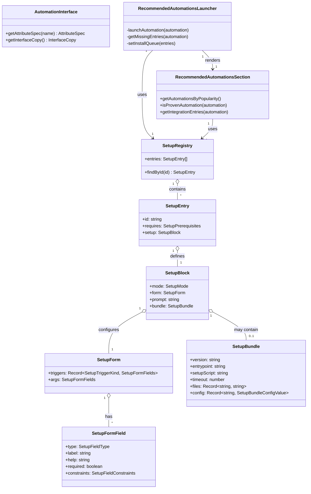

<!-- source: DeepWiki mcp.deepwiki.com · repo All-Hands-AI/OpenHands · page 7.3 Automation Setup Manifests · fetched 2026-10-26 -->

# Automation Setup Manifests

Relevant source files

The following files were used as context for generating this wiki page:

- [__tests__/components/automations/recommended-automations-rail.test.tsx](__tests__/components/automations/recommended-automations-rail.test.tsx)
- [__tests__/components/automations/recommended-automations.test.tsx](__tests__/components/automations/recommended-automations.test.tsx)
- [__tests__/components/features/mcp-page/install-server-modal.test.tsx](__tests__/components/features/mcp-page/install-server-modal.test.tsx)
- [__tests__/components/manifest/manifest-setup-dialog.test.tsx](__tests__/components/manifest/manifest-setup-dialog.test.tsx)
- [__tests__/constants/extensions-catalogs.test.ts](__tests__/constants/extensions-catalogs.test.ts)
- [__tests__/manifests/automation-setup.test.ts](__tests__/manifests/automation-setup.test.ts)
- [__tests__/manifests/manifest-validation.test.ts](__tests__/manifests/manifest-validation.test.ts)
- [__tests__/routes/mcp-page.test.tsx](__tests__/routes/mcp-page.test.tsx)
- [__tests__/utils/mcp-marketplace-utils.test.ts](__tests__/utils/mcp-marketplace-utils.test.ts)
- [__tests__/utils/recommended-automation-rail.test.ts](__tests__/utils/recommended-automation-rail.test.ts)
- [src/components/features/automations/recommended-automations-launcher.tsx](src/components/features/automations/recommended-automations-launcher.tsx)
- [src/components/features/automations/recommended-automations-rail.tsx](src/components/features/automations/recommended-automations-rail.tsx)
- [src/components/features/automations/recommended-automations-section.tsx](src/components/features/automations/recommended-automations-section.tsx)
- [src/components/features/mcp-logo-badge.tsx](src/components/features/mcp-logo-badge.tsx)
- [src/components/features/mcp-page/install-server-modal.tsx](src/components/features/mcp-page/install-server-modal.tsx)
- [src/components/features/mcp-page/installed-server-card.tsx](src/components/features/mcp-page/installed-server-card.tsx)
- [src/components/features/mcp-page/installed-servers-section.tsx](src/components/features/mcp-page/installed-servers-section.tsx)
- [src/components/features/mcp-page/marketplace-card.tsx](src/components/features/mcp-page/marketplace-card.tsx)
- [src/components/features/mcp-page/marketplace-section.tsx](src/components/features/mcp-page/marketplace-section.tsx)
- [src/components/features/mcp-page/mcp-logo-stack-badge.tsx](src/components/features/mcp-page/mcp-logo-stack-badge.tsx)
- [src/hooks/use-drag-scroll.ts](src/hooks/use-drag-scroll.ts)
- [src/manifests/automation-setup.ts](src/manifests/automation-setup.ts)
- [src/manifests/manifest-validation.ts](src/manifests/manifest-validation.ts)
- [src/manifests/types.ts](src/manifests/types.ts)
- [src/routes/mcp.tsx](src/routes/mcp.tsx)
- [src/utils/mcp-marketplace-utils.ts](src/utils/mcp-marketplace-utils.ts)
- [src/utils/recommended-automation-rail.ts](src/utils/recommended-automation-rail.ts)

The **Automation Setup Manifest System** provides a guided, form-based onboarding experience for complex automations. While simple automations can be launched via chat prompts, sophisticated ones (e.g., PR Reviewers, Repo Monitors) require specific configurations, repository access, and external integrations like Slack or GitHub.

This system centralizes the definitions of these requirements, providing validation, capability checks, and automated form generation to ensure an automation is correctly configured before deployment.

## System Architecture

The manifest system bridges the gap between the static **Automation Catalog** (defined in `@openhands/extensions`) and the runtime environment of the **Automation Backend**.

### Data Flow Overview

The following diagram illustrates how a manifest moves from the registry to a live automation, bridging natural language intent to code entities.

**Automation Setup Data Flow**

```mermaid
graph TD
    subgraph "Natural Language Space"
        User["UserIntent"] -- "Selects Recommendation" --> RecCard["RecommendedAutomationCard"]
    end

    subgraph "Code Entity Space"
        Catalog["AUTOMATION_CATALOG (@openhands/extensions)"]
        Registry["SETUP_REGISTRY (manifest-sources.ts)"]
        Launcher["RecommendedAutomationsLauncher (recommended-automations-launcher.tsx)"]
        UI["Automation Setup Route (automation-setup-route.tsx)"]
        Service["AutomationService (automation-service.api.ts)"]
        Backend["Automation Backend Sidecar"]

        Catalog -- "id match" --> Registry
        Registry -- "SetupEntry" --> Launcher
        Launcher -- "automationSetupPath(automation.id)" --> UI
        UI -- "validate endpoint" --> Service
        Service -- "/v1/validate" --> Backend
        UI -- "createPlugin endpoint" --> Service
        Service -- "/v1/preset/plugin" --> Backend
    end
```

Sources: [src/components/features/automations/recommended-automations-section.tsx:54-54](), [src/manifests/manifest-sources.ts:27-27](), [src/components/features/automations/recommended-automations-launcher.tsx:128-130](), [src/manifests/types.ts:218-221]()

## Setup Registry and Admission

The `SETUP_REGISTRY` [src/manifests/manifest-sources.ts:27-27]() is the central authority for all guided automation setups. It manages `SetupEntry` objects, which define the UI and validation logic for a specific automation ID.

### SetupEntry Types
A `SetupEntry` consists of:
*   **Requirements (`requires`)**: Features and Integrations (e.g., `github`) needed for the automation to function.
*   **Setup Configuration (`setup`)**: Defines the `SetupMode` ("direct" or "assisted") and the form schema.
*   **Form Definition**: A schema of `SetupFormFields` including types like `cron`, `repo-picker`, `timezone`, and `select`.

### Admission Validation
The `SetupValidationResult` [src/manifests/manifest-validation.ts:73-76]() is generated by the `SetupChecker` class [src/manifests/manifest-validation.ts:99-105](), which enforces strict security and structural policies:
*   **Markup Protection**: Copy must not contain HTML markup [src/manifests/manifest-validation.ts:108-110]().
*   **Placeholder Safety**: Only known namespaces like `form` or `automation` are allowed in templates [src/manifests/manifest-validation.ts:118-120]().
*   **Field Constraints**: Validates `minLength`, `maxLength`, and specific formats like `safeExpressionLiteral`.

Sources: [src/manifests/types.ts:201-212](), [src/manifests/manifest-validation.ts:1-17](), [src/manifests/manifest-validation.ts:99-145]()

## Manifest Capabilities

Before showing a setup form, the system performs a **Capability Assessment**. This checks the `requires` field of a manifest against the `DeploymentCapabilities` reported by the automation backend.

| Capability Field | Description |
| :--- | :--- |
| `maxAutomationTimeoutSeconds` | Absolute timeout ceiling enforced by the deployment. |
| `triggerKinds` | Support for `cron` schedules or `event` (webhook) triggers. |
| `eventSources` | List of supported event providers (e.g., "github"). |
| `features` | Array of strings representing specific backend capabilities. |

### Assessment Logic
The system uses these capabilities to gate specific features. For example, helper utilities are used by hooks like `usePaginatedConversations` to pause polling when the user is within the automation dashboard.

Sources: [src/manifests/types.ts:191-204](), [src/manifests/automation-interface.ts:133-137](), [src/hooks/query/use-paginated-conversations.ts:54-54]()

## Validation and Error Mapping

The system employs a three-tier validation strategy:

1.  **Local Validation**: The `SetupChecker` ensures the manifest itself is valid before admission into the `SETUP_REGISTRY` [src/manifests/manifest-validation.ts:99-105](). The `validateFormValues` function performs client-side validation of user input against the `SetupFormField` constraints [src/manifests/manifest-local-validation.ts:1-10]().
2.  **Preflight (Remote Validation)**: The UI calls the `validate` endpoint [src/manifests/types.ts:218-218](). The response returns specific `DraftValidationError` objects.
3.  **Error Mapping**: The validation error includes a `field` (dotted path) and a `code`, allowing the UI to highlight the specific input causing the error. Helper functions translate these backend errors into a format usable by the frontend forms [src/manifests/manifest-error-map.ts:1-15](), [src/manifests/automation-setup.ts:10-10]().

Sources: [src/manifests/manifest-validation.ts:1-17](), [src/manifests/types.ts:206-230](), [src/manifests/manifest-local-validation.ts:1-10](), [src/manifests/manifest-error-map.ts:1-15](), [src/manifests/automation-setup.ts:10-10]()

## Recommended Automations UI

Discovery of these manifests happens through two primary UI components: the `RecommendedAutomationsSection` (full catalog) and the `RecommendedAutomationsRail` (compact discovery).

### Popularity and Grouping
Automations are sorted by `popularityRank` using `getAutomationsByPopularity` [src/components/features/automations/recommended-automations-section.tsx:54-54](). Proven automations (featured) are rendered before Beta ones [src/components/features/automations/recommended-automations-section.tsx:58-64](). The `RecommendedAutomationsRail` specifically filters for "proven" workflows and conversation-launchable extras to keep the rail focused [src/utils/recommended-automation-rail.ts:37-53]().

### Integration Status
The UI indicates if required MCP servers are connected. The `buildRecommendedAutomationPills` function uses `findInstalledEntryMatch` to check if the user has already configured the necessary integrations [src/components/features/automations/recommended-automations-section.tsx:122-132](). If integrations are missing, the `RecommendedAutomationsLauncher` may queue an `InstallServerModal` [src/components/features/mcp-page/install-server-modal.tsx:1-1](), [src/components/features/automations/recommended-automations-launcher.tsx:189-193]().

Sources: [src/components/features/automations/recommended-automations-section.tsx:54-64](), [src/components/features/automations/recommended-automations-section.tsx:114-171](), [src/utils/recommended-automation-rail.ts:37-53](), [src/components/features/mcp-page/install-server-modal.tsx:1-1](), [src/components/features/automations/recommended-automations-launcher.tsx:189-193]()

## Key Implementation Components

The following class diagram bridges conceptual manifest structures to concrete code entities in the codebase.

**Manifest System Class Diagram**

Sources: [src/manifests/types.ts:68-166](), [src/manifests/automation-interface.ts:167-179](), [src/manifests/manifest-sources.ts:27-27](), [src/components/features/automations/recommended-automations-launcher.tsx:72-173](), [src/components/features/automations/recommended-automations-launcher.tsx:175-181](), [src/components/features/automations/recommended-automations-launcher.tsx:93-93](), [src/components/features/automations/recommended-automations-section.tsx:52-52](), [src/components/features/automations/recommended-automations-section.tsx:60-62](), [src/components/features/automations/recommended-automations-section.tsx:80-91]()

### Interface and Routing
The `automation-interface.ts` module provides the mapping between the manifest and the host's route registrations [src/manifests/automation-interface.ts:38-43]().
*   `automationListPath()`: `/automations` [src/manifests/automation-interface.ts:112-114]().
*   `automationSetupPath(id)`: `/automations/new/:automationId` [src/manifests/automation-interface.ts:116-118]().
*   `automationDetailPath(id)`: `/automations/:automationId` [src/manifests/automation-interface.ts:120-122]().

The `getInterfaceCopy()` function extracts user-visible strings (e.g., `sidebarLabel`, `listTitle`) defined in the interface manifest, ensuring the host remains agnostic to the specific wording used for automations [src/manifests/automation-interface.ts:167-179]().

Sources: [src/manifests/automation-interface.ts:38-43](), [src/manifests/automation-interface.ts:112-122](), [src/manifests/automation-interface.ts:167-179]()

---

