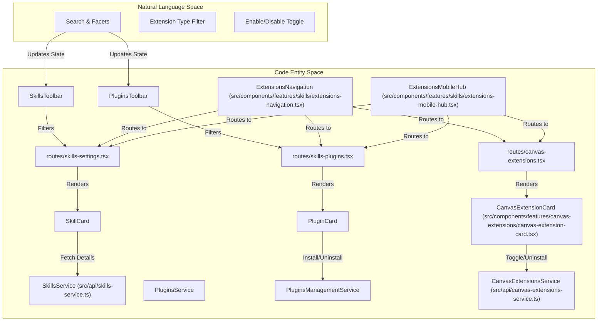

<!-- source: DeepWiki mcp.deepwiki.com · repo All-Hands-AI/OpenHands · page 8 Skills, Plugins and Extensions · fetched 2026-10-26 -->

# Skills, Plugins and Extensions

Relevant source files

The following files were used as context for generating this wiki page:

- [__tests__/components/features/skills/extensions-mobile-hub.test.tsx](__tests__/components/features/skills/extensions-mobile-hub.test.tsx)
- [__tests__/components/features/skills/extensions-navigation.test.tsx](__tests__/components/features/skills/extensions-navigation.test.tsx)
- [__tests__/routes/extensions-hub.test.tsx](__tests__/routes/extensions-hub.test.tsx)
- [__tests__/utils/mobile-section-nav.test.ts](__tests__/utils/mobile-section-nav.test.ts)
- [src/components/features/skills/extensions-mobile-hub.tsx](src/components/features/skills/extensions-mobile-hub.tsx)
- [src/components/features/skills/extensions-navigation.tsx](src/components/features/skills/extensions-navigation.tsx)
- [src/components/shared/modals/confirmation-modal.tsx](src/components/shared/modals/confirmation-modal.tsx)
- [src/routes.ts](src/routes.ts)
- [src/routes/extensions-hub.tsx](src/routes/extensions-hub.tsx)
- [src/utils/mobile-section-nav.ts](src/utils/mobile-section-nav.ts)

The **Skills, Plugins and Extensions** system in Agent Canvas provides a mechanism for extending agent capabilities through specialized knowledge, repository-specific instructions, and toolsets. This system allows the agent to adapt to different coding environments, follow project-specific conventions, and utilize external tools efficiently.

OpenHands manages agent capabilities through three primary extension categories: **MCP Servers** (Model Context Protocol for external tools), **Skills** (specialized knowledge and triggers), and **Plugins / Canvas Extensions** (agent-server side capabilities and applications).

Sources: [src/routes.ts:19-23](), [src/components/features/skills/extensions-navigation.tsx:73-165]()

## System Overview

The system is designed around discovery and management. The Agent Canvas frontend provides a dedicated UI for browsing, searching, and configuring these extensions, which are then synchronized with the backend to guide agent behavior.

### Core Components

*   **`skills` route**: The primary route for managing skills, handling faceted search, filtering, and skill detail views [src/routes.ts:19]().
*   **`plugins` route**: The primary route for managing plugins, handling search, filtering, and lifecycle operations [src/routes.ts:20]().
*   **`apps` route**: The primary route for managing Canvas Extensions (Apps) [src/routes.ts:21]().
*   **`ExtensionsNavigation`**: A sidebar component that facilitates switching between MCP Servers, Skills, Plugins, and Apps [src/components/features/skills/extensions-navigation.tsx:73-165]().
*   **`SkillsService`**: Manages the discovery of public, user, and project-specific skills [src/api/skills-service.ts:39-77]().
*   **`CanvasExtensionsService`**: Manages the lifecycle (install, uninstall, enable) of Canvas Extensions (Apps) on the agent-server [src/api/canvas-extensions-service.ts:121-190]().

### Extension Discovery and UI Mapping

The following diagram bridges the user-facing UI components to the underlying code entities responsible for managing extensions.

**Extensions UI and Service Architecture**

Sources: [src/routes.ts:19-21](), [src/components/features/skills/extensions-navigation.tsx:73-165](), [src/components/features/skills/extensions-mobile-hub.tsx:23-83](), [src/api/skills-service.ts:39-77](), [src/api/canvas-extensions-service.ts:121-190](), [src/components/features/canvas-extensions/canvas-extension-card.tsx:18-124]()

## Skills Settings and Navigation

Agent Canvas provides a unified navigation hub for customizing the agent's environment via the `ExtensionsNavigation` component [src/components/features/skills/extensions-navigation.tsx:73-165](). This component dynamically renders navigation links for "MCP Servers", "Skills", "Plugins", and "Apps" based on the active backend type. For cloud backends, "Skills" links to an external cloud-hosted page, while "Plugins" and "Apps" are hidden [src/components/features/skills/extensions-navigation.tsx:17-19](). The `ExtensionsMobileHub` component provides similar navigation for mobile viewports [src/components/features/skills/extensions-mobile-hub.tsx:23-83]().

The skills system supports faceted filtering by type (e.g., "knowledge"), status, and triggers. It utilizes a debounced URL synchronization mechanism to ensure search queries are reflected in the browser history. The `SkillsService` distinguishes between public skills bundled with `@openhands/extensions` and local skills fetched from the agent-server [src/api/skills-service.ts:30-37]().

For details on UI components like `SkillsToolbar`, `SkillCard`, `SkillTypeBadge`, `SkillsModal`, and `SkillsService`, see [Skills Settings and Navigation](#8.1).

Sources: [src/components/features/skills/extensions-navigation.tsx:17-19](), [src/components/features/skills/extensions-navigation.tsx:73-165](), [src/components/features/skills/extensions-mobile-hub.tsx:23-83](), [src/api/skills-service.ts:30-37]()

## Plugins System

Plugins represent lower-level extensions managed at the agent-server level. Unlike Skills, which are often knowledge-based, Plugins can include bundled tools, files, and complex logic. The `plugins` route [src/routes.ts:20]() is responsible for displaying and managing these plugins.

The `CanvasExtensionsService` handles the installation, enabling/disabling, and uninstallation of Canvas Extensions (Apps) [src/api/canvas-extensions-service.ts:121-190](). These operations are exposed via TanStack Query mutations like `useInstallCanvasExtension`, `useSetCanvasExtensionEnabled`, and `useUninstallCanvasExtension` [src/hooks/mutation/use-manage-canvas-extensions.ts:22-65](). The `CanvasExtensionCard` component displays individual installed extensions and provides controls for their management [src/components/features/canvas-extensions/canvas-extension-card.tsx:18-124]().

For details on the plugin architecture, query hooks, `PluginDetailModal`, and view models, see [Plugins System](#8.2).

Sources: [src/routes.ts:20](), [src/api/canvas-extensions-service.ts:121-190](), [src/hooks/mutation/use-manage-canvas-extensions.ts:22-65](), [src/components/features/canvas-extensions/canvas-extension-card.tsx:18-124]()

## Canvas Extensions Subsystem

Canvas extensions build on top of the base extension platform by introducing isolated UI views and service handlers located under `src/extensions/` and `src/fixtures/canvas-extensions`. They are managed via dedicated services and hooks such as `canvas-extensions-service.ts` and `use-manage-canvas-extensions` [src/api/canvas-extensions-service.ts]().

For specifications, testing guides, and component wiring (`CanvasExtensionCard`, `AddCanvasExtensionModal`), see [Canvas Extensions](#8.3).

Sources: [src/api/canvas-extensions-service.ts]()

## Integration Logic

| Component | Role | File Reference |
| :--- | :--- | :--- |
| `skills` route | Main route for skill discovery and filtering | [src/routes.ts:19]() |
| `plugins` route | Main route for plugin management | [src/routes.ts:20]() |
| `apps` route | Main route for Canvas Extension (App) management | [src/routes.ts:21]() |
| `ExtensionsNavigation` | Sidebar navigation for extensions | [src/components/features/skills/extensions-navigation.tsx:73-165]() |
| `ExtensionsMobileHub` | Mobile navigation for extensions | [src/components/features/skills/extensions-mobile-hub.tsx:23-83]() |
| `SkillsService` | Fetches skills from public catalog and agent-server | [src/api/skills-service.ts:39-77]() |
| `CanvasExtensionsService` | Manages Canvas Extensions (Apps) lifecycle | [src/api/canvas-extensions-service.ts:121-190]() |
| `useInstallCanvasExtension` | Hook for installing Canvas Extensions | [src/hooks/mutation/use-manage-canvas-extensions.ts:22-43]() |
| `useSetCanvasExtensionEnabled` | Hook for enabling/disabling Canvas Extensions | [src/hooks/mutation/use-manage-canvas-extensions.ts:46-52]() |
| `useUninstallCanvasExtension` | Hook for uninstalling Canvas Extensions | [src/hooks/mutation/use-manage-canvas-extensions.ts:55-65]() |
| `CanvasExtensionCard` | UI component for displaying and managing an installed Canvas Extension | [src/components/features/canvas-extensions/canvas-extension-card.tsx:18-124]() |

Sources: [src/routes.ts:19-21](), [src/components/features/skills/extensions-navigation.tsx:73-165](), [src/components/features/skills/extensions-mobile-hub.tsx:23-83](), [src/api/skills-service.ts:39-77](), [src/api/canvas-extensions-service.ts:121-190](), [src/hooks/mutation/use-manage-canvas-extensions.ts:22-65](), [src/components/features/canvas-extensions/canvas-extension-card.tsx:18-124]()

## Child Pages
*   **[Skills Settings and Navigation](#8.1)**: Documentation for the `skills-settings` route, `SkillsToolbar`, `SkillCard`, `SkillTypeBadge`, `ExtensionsNavigation`, `ExtensionsMobileHub`, `SkillsModal`, and `SkillsService`.
*   **[Plugins System](#8.2)**: Overview of the `plugins-page` route, `PluginDetailModal`, `PluginsToolbar`, `PluginCard`, `PluginFilesSection`, `PluginsService`, `PluginsManagementService`, and view models.
*   **[Canvas Extensions](#8.3)**: Documentation for `canvas-extensions-service.ts`, `use-manage-canvas-extensions`, `CanvasExtensionCard`, `AddCanvasExtensionModal`, and testing guides.

---

