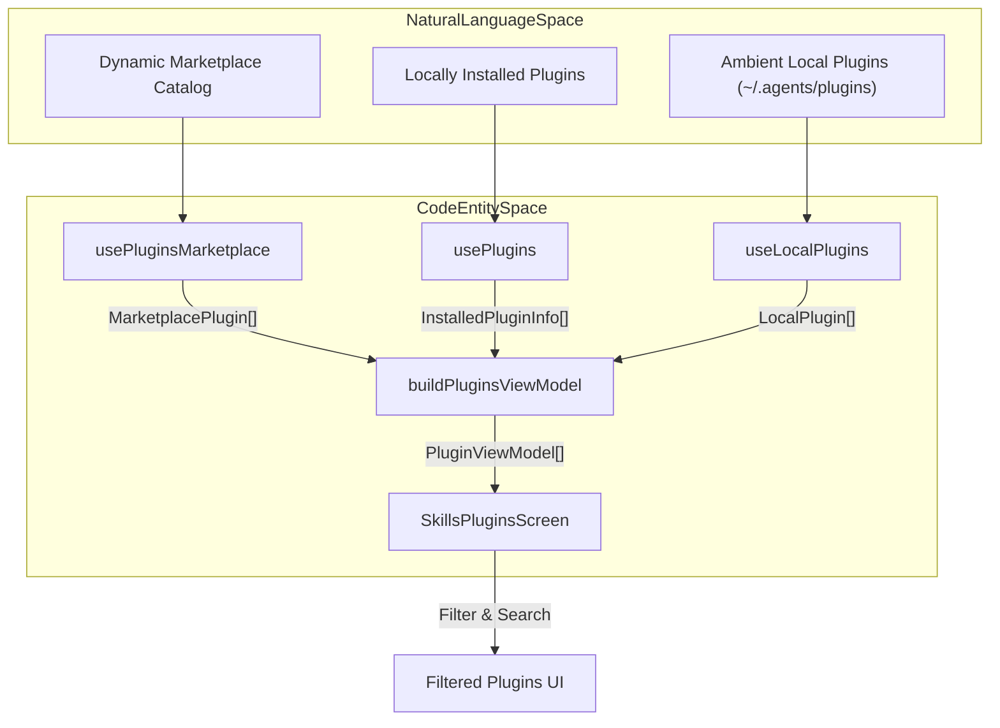
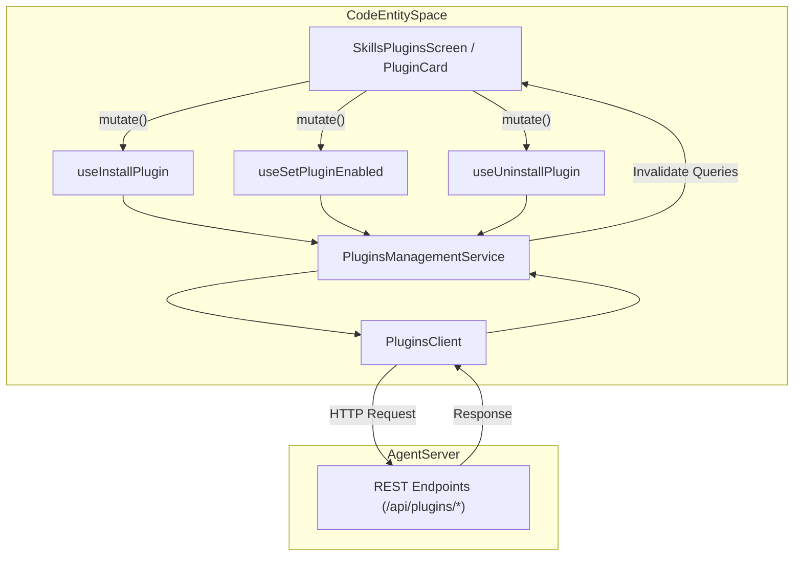

<!-- source: DeepWiki mcp.deepwiki.com · repo All-Hands-AI/OpenHands · page 8.2 Plugins System · fetched 2026-10-26 -->

# Plugins System

Relevant source files

The following files were used as context for generating this wiki page:

- [__tests__/components/features/plugins/build-plugins-view-model.test.ts](__tests__/components/features/plugins/build-plugins-view-model.test.ts)
- [__tests__/components/features/plugins/plugin-files-section.test.tsx](__tests__/components/features/plugins/plugin-files-section.test.tsx)
- [__tests__/routes/plugins-page.test.tsx](__tests__/routes/plugins-page.test.tsx)
- [src/api/plugins-management-service.ts](src/api/plugins-management-service.ts)
- [src/api/plugins-service.test.ts](src/api/plugins-service.test.ts)
- [src/api/plugins-service.ts](src/api/plugins-service.ts)
- [src/components/features/plugins/build-plugins-view-model.ts](src/components/features/plugins/build-plugins-view-model.ts)
- [src/components/features/plugins/plugin-card.tsx](src/components/features/plugins/plugin-card.tsx)
- [src/components/features/plugins/plugin-detail-modal.tsx](src/components/features/plugins/plugin-detail-modal.tsx)
- [src/components/features/plugins/plugin-files-section.tsx](src/components/features/plugins/plugin-files-section.tsx)
- [src/components/features/plugins/plugins-toolbar.tsx](src/components/features/plugins/plugins-toolbar.tsx)
- [src/hooks/query/query-keys.ts](src/hooks/query/query-keys.ts)
- [src/routes/skills-plugins.tsx](src/routes/skills-plugins.tsx)

The Plugins System in Agent Canvas provides a technical control center for discovering, installing, configuring, and inspecting agent plugins and extensions. It bridges the dynamic marketplace catalog, locally installed package management, ambient local plugins, and individual plugin file inspection.

## Purpose and Scope

The plugins subsystem enables users to extend agent capabilities via structured packages containing bundled skills and asset files. It operates primarily against local agent-server runtimes (`ActiveBackendProvider` kind `"local"`), managing persistence via local storage directories and REST/WebSocket clients from `@openhands/typescript-client`.

Sources: [src/routes/skills-plugins.tsx:35-40](), [src/api/plugins-service.ts:76-79]()

## Plugins-Page Route and View Model Transformation

The primary interface is hosted at `SkillsPluginsScreen` (`src/routes/skills-plugins.tsx`), which renders within the settings layout context alongside extensions navigation [src/routes/skills-plugins.tsx:35-128](). It coordinates data from three separate sources and merges them via `buildPluginsViewModel` [src/components/features/plugins/build-plugins-view-model.ts:51-130]().

### Data Reconciliation Architecture

Sources: [src/routes/skills-plugins.tsx:41-60](), [src/components/features/plugins/build-plugins-view-model.ts:51-130]()

`buildPluginsViewModel` reconciles `MarketplacePlugin`, `InstalledPluginInfo`, and `LocalPlugin` entries into a normalized `PluginViewModel` array [src/components/features/plugins/build-plugins-view-model.ts:14-130](). Installed entries take precedence for configuration state (`enabled`, `version`, `install_path`), while marketplace entries supply remote git source coordinates. Ambient local plugins are appended as read-only items if their names do not collide with managed installations [src/components/features/plugins/build-plugins-view-model.ts:98-119]().

Sources: [src/components/features/plugins/build-plugins-view-model.ts:14-130]()

## Service Layer: PluginsService and PluginsManagementService

The API layer is partitioned into read-only discovery (`PluginsService`) and mutation management (`PluginsManagementService`).

### PluginsService (`src/api/plugins-service.ts`)
*   `getPluginsMarketplace()`: Queries `PluginsClient.getPluginsMarketplace()` to fetch remote registry listings. Returns an empty array on cloud backends or failure [src/api/plugins-service.ts:76-91]().
*   `getLocalPlugins()`: Calls `PluginsClient.getPlugins({ load_user: true, load_project: false })` to discover ambient user-level plugins [src/api/plugins-service.ts:104-117]().
*   `getPluginFileContent(basePath, relativePath)`: Downloads individual plugin files using `FileClient.downloadFile` and applies binary heuristic checks via `isLikelyBinary` [src/api/plugins-service.ts:56-65](), [src/api/plugins-service.ts:127-147]().

Sources: [src/api/plugins-service.ts:67-147]()

### PluginsManagementService (`src/api/plugins-management-service.ts`)
*   `listInstalledPlugins()`: Retrieves installed packages from the agent-server [src/api/plugins-management-service.ts:76-90]().
*   `installPlugin(request)`: Submits an `InstallPluginRequest` containing `source`, `ref`, and `repo_path` [src/api/plugins-management-service.ts:92-101]().
*   `setPluginEnabled(name, enabled)`: Toggles active auto-load status [src/api/plugins-management-service.ts:103-113]().
*   `uninstallPlugin(name)`: Removes an installed plugin [src/api/plugins-management-service.ts:115-122]().
*   `refreshPlugin(name)`: Synchronizes an installed plugin with its upstream source [src/api/plugins-management-service.ts:124-133]().

Sources: [src/api/plugins-management-service.ts:76-134]()

## Core UI Components

### PluginsToolbar
`PluginsToolbar` renders the search input with clear controls and status filter tabs (`all`, `installed`, `available`, `local`) [src/components/features/plugins/plugins-toolbar.tsx:24-94](). It interacts with `matchesPluginSearch` and `matchesPluginStatus` to scope view models [src/routes/skills-plugins.tsx:62-70]().

Sources: [src/components/features/plugins/plugins-toolbar.tsx:24-94](), [src/components/features/plugins/build-plugins-view-model.ts:133-161]()

### PluginCard
`PluginCard` displays summary details for a single plugin, including name, source, description, version badges, and an interactive `CirclePlusCheckToggle` for installed status or a `BrandButton` for installation [src/components/features/plugins/plugin-card.tsx:25-131]().

Sources: [src/components/features/plugins/plugin-card.tsx:25-131]()

### PluginDetailModal
`PluginDetailModal` provides a deep inspection modal when a plugin card is selected [src/components/features/plugins/plugin-detail-modal.tsx:26-141](). It renders:
*   Metadata pills (`isLocal`, `version`, `ref`, `repoPath`) [src/components/features/plugins/plugin-detail-modal.tsx:68-91]().
*   An active toggle (`SettingsSwitch`) for installed packages [src/components/features/plugins/plugin-detail-modal.tsx:93-107]().
*   Bundled skills using `SkillIconBadge` [src/components/features/plugins/plugin-detail-modal.tsx:109-136]().
*   The `PluginFilesSection` for exploring files inside the bundle [src/components/features/plugins/plugin-detail-modal.tsx:138-140]().

Sources: [src/components/features/plugins/plugin-detail-modal.tsx:26-141]()

### PluginFilesSection
`PluginFilesSection` mounts a file tree view over `plugin.path` and `plugin.files`, fetching file contents on-demand via `PluginsService.getPluginFileContent` [src/api/plugins-service.ts:127-147](). It handles text decoding or displays binary fallback notices [__tests__/components/features/plugins/plugin-files-section.test.tsx:27-85]().

Sources: [src/components/features/plugins/plugin-files-section.tsx](), [src/api/plugins-service.ts:127-147]()

## Plugin Query Hooks and Cache Keys

TanStack Query manages caching and invalidation for all plugin data structures using keys defined in `PLUGINS_QUERY_KEYS` [src/hooks/query/query-keys.ts:48-55]().

| Query Key Constant | Value Definition | Purpose |
| :--- | :--- | :--- |
| `PLUGINS_QUERY_KEYS.marketplace` | `["plugins-marketplace"]` | Dynamic marketplace catalog [src/hooks/query/query-keys.ts:50-50]() |
| `PLUGINS_QUERY_KEYS.installed` | `["plugins-installed"]` | Locally installed plugin states [src/hooks/query/query-keys.ts:52-52]() |
| `PLUGINS_QUERY_KEYS.local` | `["plugins-local"]` | Ambient local directory plugins [src/hooks/query/query-keys.ts:54-54]() |

Sources: [src/hooks/query/query-keys.ts:48-55]()

### Plugin Management Data Flow

Sources: [src/routes/skills-plugins.tsx:46-49](), [src/api/plugins-management-service.ts:92-122]()

---

