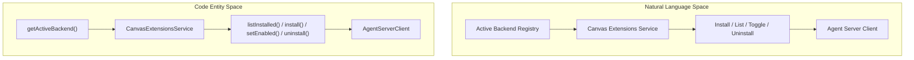
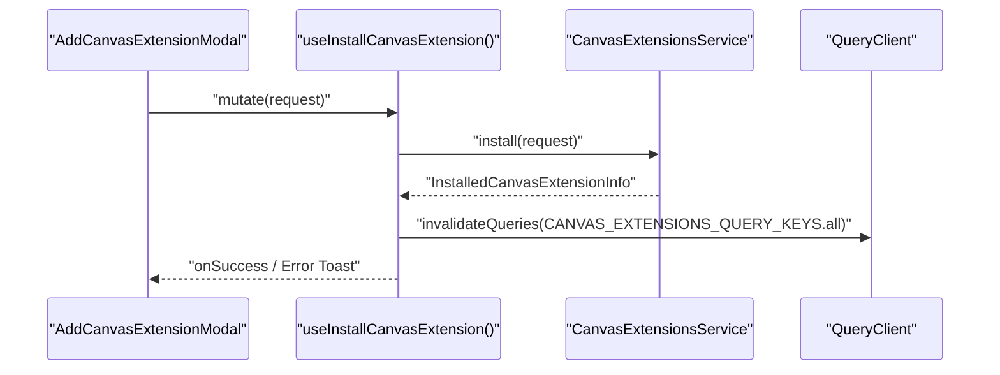
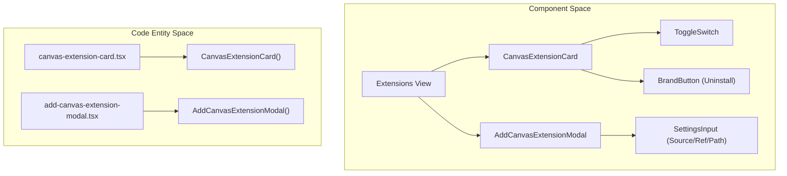

<!-- source: DeepWiki mcp.deepwiki.com · repo All-Hands-AI/OpenHands · page 8.3 Canvas Extensions · fetched 2026-10-26 -->

# Canvas Extensions

<details>
<summary>Relevant source files</summary>

The following files were used as context for generating this wiki page:

- [__tests__/hooks/mutation/use-install-canvas-extension.test.ts](__tests__/hooks/mutation/use-install-canvas-extension.test.ts)
- [docs/CANVAS_EXTENSIONS_TESTING.md](docs/CANVAS_EXTENSIONS_TESTING.md)
- [specs/canvas-extensions.md](specs/canvas-extensions.md)
- [src/api/canvas-extensions-service.test.ts](src/api/canvas-extensions-service.test.ts)
- [src/api/canvas-extensions-service.ts](src/api/canvas-extensions-service.ts)
- [src/components/features/canvas-extensions/add-canvas-extension-modal.tsx](src/components/features/canvas-extensions/add-canvas-extension-modal.tsx)
- [src/components/features/canvas-extensions/canvas-extension-card.tsx](src/components/features/canvas-extensions/canvas-extension-card.tsx)
- [src/hooks/mutation/use-manage-canvas-extensions.ts](src/hooks/mutation/use-manage-canvas-extensions.ts)

</details>


The Canvas Extensions subsystem provides an extensible architecture for Agent Canvas, allowing installable packages to dynamically modify the frontend control center itself (contributing custom routed pages, UI panels, renderers, and themes). Unlike skills and plugins—which modify the behavior of the agent—Canvas Extensions modify the application experience. 

---

## 1. Architecture and Backend Service Layer

The active Agent Server owns extensions [specs/canvas-extensions.md:21-25](). Extensions are installed on the machine or container running the Agent Server, where their source, resolved revision, files, manifest, and enabled state reside. The frontend discovers and loads extensions exclusively from the active backend via `CanvasExtensionsService` (`[src/api/canvas-extensions-service.ts:121-190]()`).


*Sources: [specs/canvas-extensions.md:21-25](), [src/api/canvas-extensions-service.ts:5-65]()*, [src/api/canvas-extensions-service.ts:121-190]()

### `CanvasExtensionsService` API

`CanvasExtensionsService` handles communication with the backend agent server for extension lifecycle management:
- `listInstalled()`: Fetches installed extensions and parsed manifests from `[src/api/canvas-extensions-service.ts:122-130]()`.
- `install(request)`: Posts a new installation request (normalized via `normalizeInstallRequest`) to `[src/api/canvas-extensions-service.ts:132-142]()`.
- `setEnabled(name, enabled)`: Updates the enabled state of a specific installed extension via `[src/api/canvas-extensions-service.ts:144-155]()`.
- `uninstall(name)`: Removes an extension via `[src/api/canvas-extensions-service.ts:157-162]()`.
- `fetchBundle(name, backend)`: Retrieves the compiled entrypoint bundle as text via `[src/api/canvas-extensions-service.ts:164-171]()`.
- `requestAgentServer(request, backend)`: Proxies authenticated root-relative requests to the agent server via `[src/api/canvas-extensions-service.ts:173-189]()`.

Unsupported backends (such as cloud backends or older agent server instances missing the router) throw a `CanvasExtensionsUnsupportedError` with reasons like `"no-backend"`, `"cloud-backend"`, or `"missing-api"` (`[src/api/canvas-extensions-service.ts:19-38]()`).

*Sources: [src/api/canvas-extensions-service.ts:19-190]()*

---

## 2. Mutation Hooks and React Query Integration

State mutations and cache invalidation are managed by React Query hooks defined in `[src/hooks/mutation/use-manage-canvas-extensions.ts:1-65]()`.


*Sources: [src/hooks/mutation/use-manage-canvas-extensions.ts:1-65]()*, [src/api/canvas-extensions-service.ts:132-142]()

### Hook Inventory
- `useInstallCanvasExtension()`: Handles extension installation, handles error extraction using `getApiErrorBody` / `retrieveAxiosErrorMessage`, fires success/error toasts, and invalidates queries (`[src/hooks/mutation/use-manage-canvas-extensions.ts:22-44]()`).
- `useSetCanvasExtensionEnabled()`: Toggles extension enablement (`[src/hooks/mutation/use-manage-canvas-extensions.ts:46-53]()`).
- `useUninstallCanvasExtension()`: Uninstalls an extension and invalidates the query cache (`[src/hooks/mutation/use-manage-canvas-extensions.ts:55-65]()`).

*Sources: [src/hooks/mutation/use-manage-canvas-extensions.ts:1-65]()*

---

## 3. UI Components: Cards and Modals

User management of extensions occurs within the Customize view using dedicated React components.

### `CanvasExtensionCard`
Rendered in `[src/components/features/canvas-extensions/canvas-extension-card.tsx:18-124]()`, this card displays metadata for an installed extension (display name, source, description, version, contributed pages, resolved revision, and repo path). It provides a toggle switch to enable/disable the extension and a delete button to uninstall it.

### `AddCanvasExtensionModal`
Rendered in `[src/components/features/canvas-extensions/add-canvas-extension-modal.tsx:16-115]()`, this modal provides a form to input source coordinates (`source`, `ref`, and `repo_path`) to install new extensions.


*Sources: [src/components/features/canvas-extensions/canvas-extension-card.tsx:18-124](), [src/components/features/canvas-extensions/add-canvas-extension-modal.tsx:16-115]()*

---

## 4. Package Contract, Manifests, and Fixtures

As specified in `[specs/canvas-extensions.md:64-113]()`, Canvas Extensions adhere to a strict package contract centered around a manifest file named `canvas-extension.json`.

### Manifest Structure
```json
{
  "schema_version": 1,
  "name": "example-dashboard",
  "display_name": "Example dashboard",
  "version": "0.1.0",
  "description": "A backend-specific project dashboard.",
  "entrypoint": "dist/extension.js",
  "contributes": {
    "pages": [
      {
        "id": "dashboard",
        "title": "Dashboard",
        "path": "/dashboard",
        "nav_label": "Dashboard"
      }
    ]
  }
}
```

### Trust and Lifecycle Model
1. **Trusted Code**: Extension code runs in the same realm with ambient browser authority (`[specs/canvas-extensions.md:26-29]()`).
2. **Install vs. Enable**: Installation always yields a disabled extension. Enablement is explicit and hot-loaded (`[specs/canvas-extensions.md:30-39]()`).
3. **Fixtures**: Local development and mock environments utilize test fixtures located under `src/fixtures/canvas-extensions` (`[docs/CANVAS_EXTENSIONS_TESTING.md:40-48]()`).

*Sources: [specs/canvas-extensions.md:64-113](), [docs/CANVAS_EXTENSIONS_TESTING.md:1-93]()*

---

## 5. Extensions Testing Guide

Developers can exercise canvas extensions locally prior to full backend integration by launching the MSW mock frontend (`[docs/CANVAS_EXTENSIONS_TESTING.md:1-93]()`).

### Local Mock Execution
```sh
VITE_FRONTEND_PORT=3102 \
VITE_BACKEND_BASE_URL=http://127.0.0.1:8000 \
VITE_SESSION_API_KEY=canvas-extension-dev \
npm run dev:mock
```
*Sources: [docs/CANVAS_EXTENSIONS_TESTING.md:13-23]()*

### Verification Steps
1. Navigate to `http://localhost:3102/extensions`.
2. Add the fixture source: `src/fixtures/canvas-extensions/demo-page`.
3. Verify that installation leaves the extension disabled without executing its bundle.
4. Enable the extension and confirm its navigation entry and rendered views operate correctly.

*Sources: [docs/CANVAS_EXTENSIONS_TESTING.md:38-67]()*

---

