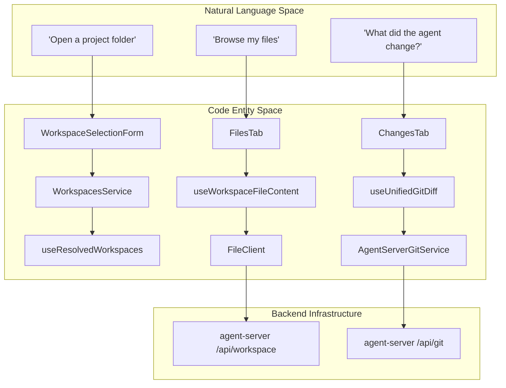
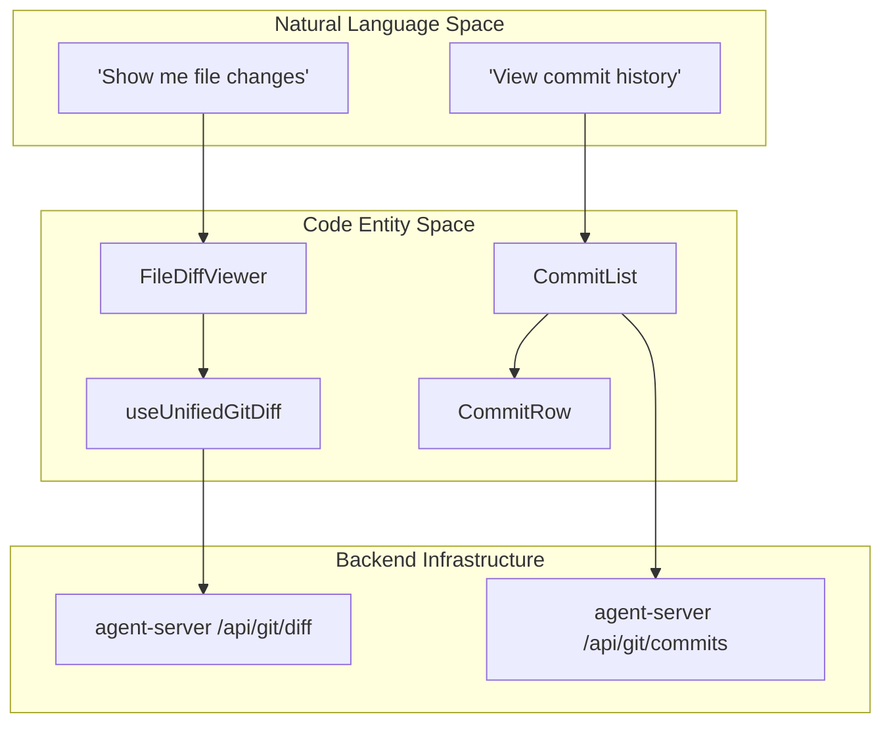

<!-- source: DeepWiki mcp.deepwiki.com · repo All-Hands-AI/OpenHands · page 9 Workspace and File Management · fetched 2026-10-26 -->

# Workspace and File Management

Relevant source files

The following files were used as context for generating this wiki page:

- [__tests__/api/workspaces-service.test.ts](__tests__/api/workspaces-service.test.ts)
- [__tests__/components/features/home/workspace-selection-form.test.tsx](__tests__/components/features/home/workspace-selection-form.test.tsx)
- [src/api/workspaces-service/workspaces-service.api.ts](src/api/workspaces-service/workspaces-service.api.ts)
- [src/components/features/conversation-panel/local-new-conversation-menu.tsx](src/components/features/conversation-panel/local-new-conversation-menu.tsx)
- [src/components/features/home/repo-selection-form.tsx](src/components/features/home/repo-selection-form.tsx)
- [src/components/features/home/workspace-dropdown/folder-browser-modal.tsx](src/components/features/home/workspace-dropdown/folder-browser-modal.tsx)
- [src/components/features/home/workspace-dropdown/manage-workspaces-modal.tsx](src/components/features/home/workspace-dropdown/manage-workspaces-modal.tsx)
- [src/components/features/home/workspace-dropdown/workspace-dropdown.tsx](src/components/features/home/workspace-dropdown/workspace-dropdown.tsx)
- [src/components/features/home/workspace-selection-form.tsx](src/components/features/home/workspace-selection-form.tsx)
- [src/hooks/query/use-local-workspaces.ts](src/hooks/query/use-local-workspaces.ts)
- [src/hooks/query/use-resolved-workspaces.ts](src/hooks/query/use-resolved-workspaces.ts)
- [src/hooks/query/use-search-subdirs.ts](src/hooks/query/use-search-subdirs.ts)
- [src/mocks/file-service-handlers.ts](src/mocks/file-service-handlers.ts)

Workspace and file management in OpenHands bridges the agent's execution environment and the user's local or cloud-hosted project files. The system handles directory discovery, file content inspection, and deep git integration to visualize changes made by the agent.

## System Overview

The workspace architecture is divided into three primary functional areas:
1. **Workspace Selection**: Mechanisms for identifying and mounting project directories into the agent's runtime [src/components/features/home/workspace-selection-form.tsx:67-90]().
2. **File Browsing**: A tree-based explorer for navigating the active workspace and viewing file contents [src/hooks/query/use-resolved-workspaces.ts:52-136]().
3. **Git Integration**: Real-time tracking of file modifications, diffing, and commit history visualization.

### Natural Language to Code Entity Mapping

The following diagram illustrates how user-facing workspace concepts map to specific code entities and service layers.

Sources: [src/components/features/home/workspace-selection-form.tsx:67-90](), [src/hooks/query/use-resolved-workspaces.ts:52-136](), [src/api/workspaces-service/workspaces-service.api.ts:1-20]()

## Workspace Selection and Management

The workspace selection system allows users to pick specific directories for the agent to operate within. It distinguishes between static workspaces and parent workspaces that automatically index their subdirectories [src/hooks/query/use-resolved-workspaces.ts:41-51]().

For details on `WorkspaceSelectionForm`, `WorkspaceDropdown`, `FolderBrowserModal`, `ManageWorkspacesModal`, `useResolvedWorkspaces`, pagination in `searchAllSubdirectories`, `WorkspacesService`, and workspace upload path resolution, see [Workspace Selection and Management](#9.1).

Sources: [src/hooks/query/use-resolved-workspaces.ts:9-136](), [src/components/features/home/workspace-selection-form.tsx:37-65](), [src/components/features/home/workspace-dropdown/workspace-dropdown.tsx:98-150]()

## Files Tab and Diff Viewer

Once a workspace is active, the files tab provides a dual-mode interface for interacting with the file system, viewing file trees, inspecting file contents, and monitoring git diffs and commits.

### Git Diff Mapping

Sources: [src/api/workspaces-service/workspaces-service.api.ts:1-20]()

For details on the `files-tab` route, `file-tree-view`, `tree-node`, `file-content-viewer`, `agent-server-git-service`, `FileDiffViewer`, `CommitRow`, `CommitList`, `use-unified-git-diff`, auto-refresh on edit, changes/commits routes, and local git info hooks, see [Files Tab and Diff Viewer](#9.2).

Sources: [src/routes/files-tab.tsx:43-172](), [__tests__/routes/files-tab.test.tsx:59-227](), [src/hooks/query/use-search-subdirs.ts:53-62]()

## Home Screen and Conversation Launcher

The home route serves as the entry point for starting new agent sessions, integrating workspace selection, repository pickers, and conversation launcher dialogs.

For details on the `home` route, `HomeChatLauncher`, `RepoSelectionForm` dropdowns, `LocalNewConversationMenu`, `CloudNewConversationMenu`, the `launch` route, the sidebar onboarding checklist, `LlmNotConfiguredBanner`, and the command menu, see [Home Screen and Conversation Launcher](#9.3).

Sources: [src/components/features/home/workspace-selection-form.tsx:67-170](), [src/components/features/home/repo-selection-form.tsx:176-200](), [src/components/features/home/workspace-dropdown/folder-browser-modal.tsx:119-227]()

---

