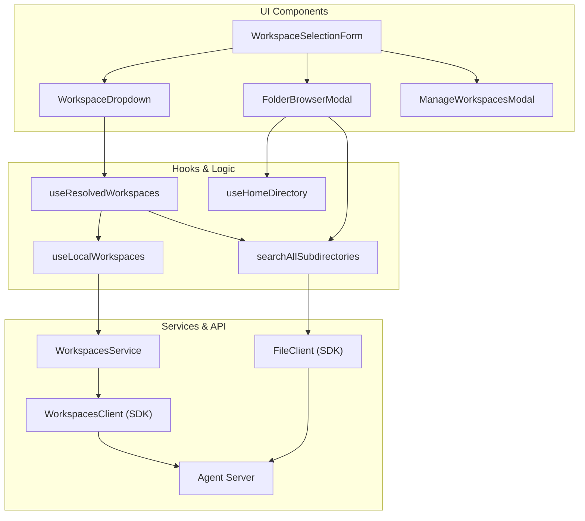
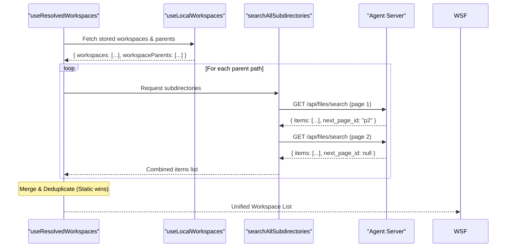

<!-- source: DeepWiki mcp.deepwiki.com · repo All-Hands-AI/OpenHands · page 9.1 Workspace Selection and Management · fetched 2026-10-26 -->

# Workspace Selection and Management

Relevant source files

The following files were used as context for generating this wiki page:

- [__tests__/api/conversation-file-upload.test.ts](__tests__/api/conversation-file-upload.test.ts)
- [__tests__/api/conversation-service.test.ts](__tests__/api/conversation-service.test.ts)
- [__tests__/api/workspace-upload-path.test.ts](__tests__/api/workspace-upload-path.test.ts)
- [__tests__/api/workspaces-service.test.ts](__tests__/api/workspaces-service.test.ts)
- [__tests__/components/features/home/workspace-selection-form.test.tsx](__tests__/components/features/home/workspace-selection-form.test.tsx)
- [specs/workspace-upload-path.md](specs/workspace-upload-path.md)
- [src/api/agent-server-home.ts](src/api/agent-server-home.ts)
- [src/api/conversation-file-upload.api.ts](src/api/conversation-file-upload.api.ts)
- [src/api/workspace-path-resolution.test.ts](src/api/workspace-path-resolution.test.ts)
- [src/api/workspace-upload-path.ts](src/api/workspace-upload-path.ts)
- [src/api/workspaces-service/workspaces-service.api.ts](src/api/workspaces-service/workspaces-service.api.ts)
- [src/components/features/conversation-panel/local-new-conversation-menu.tsx](src/components/features/conversation-panel/local-new-conversation-menu.tsx)
- [src/components/features/home/repo-selection-form.tsx](src/components/features/home/repo-selection-form.tsx)
- [src/components/features/home/workspace-dropdown/folder-browser-modal.tsx](src/components/features/home/workspace-dropdown/folder-browser-modal.tsx)
- [src/components/features/home/workspace-dropdown/manage-workspaces-modal.tsx](src/components/features/home/workspace-dropdown/manage-workspaces-modal.tsx)
- [src/components/features/home/workspace-dropdown/workspace-dropdown.tsx](src/components/features/home/workspace-dropdown/workspace-dropdown.tsx)
- [src/components/features/home/workspace-selection-form.tsx](src/components/features/home/workspace-selection-form.tsx)
- [src/hooks/query/use-local-workspaces.ts](src/hooks/query/use-local-workspaces.ts)
- [src/hooks/query/use-resolved-workspaces.ts](src/hooks/query/use-resolved-workspaces.ts)
- [src/hooks/query/use-search-subdirs.ts](src/hooks/query/use-search-subdirs.ts)
- [src/mocks/file-service-handlers.ts](src/mocks/file-service-handlers.ts)

The Workspace Selection system provides the interface and logic for defining the agent's working directory. It bridges the gap between the local filesystem (or containerized environment) and the OpenHands agent-server, allowing users to select individual repositories or entire parent directories for the agent to operate within, while handling path resolution and workspace uploads.

## Overview and Data Flow

Workspace management is centered around the `WorkspaceSelectionForm`, which coordinates between persistent storage (via `WorkspacesService`) and dynamic discovery of subdirectories on the agent-server.

### System Architecture Diagram

"Workspace Management Component Interaction"

Sources: [src/components/features/home/workspace-selection-form.tsx:7-14](), [src/hooks/query/use-resolved-workspaces.ts:5-7](), [src/hooks/query/use-search-subdirs.ts:1-4](), [src/api/workspaces-service/workspaces-service.api.ts:41-67]()

## Key Components

### WorkspaceSelectionForm
The primary entry point for workspace selection (`src/components/features/home/workspace-selection-form.tsx`). It manages the state of the selected workspace and persists the choice in `sessionStorage` under the key `HOME_SELECTED_WORKSPACE_PATH_KEY` [src/components/features/home/workspace-selection-form.tsx:37-38](). When a workspace is selected and the user clicks "Launch", it triggers `createConversation` with the `workingDir` set to the workspace path [src/components/features/home/workspace-selection-form.tsx:163-169]().

### WorkspaceDropdown
A combobox component (built with `downshift`) that lists available workspaces (`src/components/features/home/workspace-dropdown/workspace-dropdown.tsx`) [src/components/features/home/workspace-dropdown/workspace-dropdown.tsx:176-179](). It organizes workspaces into two categories:
1.  **Static Workspaces:** Individual paths explicitly added by the user.
2.  **Parent-Derived Workspaces:** Subdirectories found within "Workspace Parents".

The dropdown groups items by their `parentPath`. If a workspace has no parent, it is placed in a sentinel group `STATIC_GROUP_KEY` (`__ungrouped__`) [src/components/features/home/workspace-dropdown/workspace-dropdown.tsx:24-24]() labeled as "Other" [src/components/features/home/workspace-dropdown/workspace-dropdown.tsx:130-131]().

### FolderBrowserModal
A filesystem navigation interface (`src/components/features/home/workspace-dropdown/folder-browser-modal.tsx`) that allows users to pick a directory from the agent-server. It provides:
*   **Sidebar Navigation:** Quick access to "Home", "Favorites", and "Locations" fetched via `useHomeDirectory` [src/components/features/home/workspace-dropdown/folder-browser-modal.tsx:156-176]().
*   **Path Traversal:** Ability to move into subdirectories or go up to parent directories using `getParentPath` [src/components/features/home/workspace-dropdown/folder-browser-modal.tsx:84-98]().
*   **Selection Modes:** Users can either add the current directory as a single workspace (`onAdd`) or add it as a "Workspace Parent" (`onAddParent`) to automatically track all its subdirectories [src/components/features/home/workspace-dropdown/folder-browser-modal.tsx:204-225]().

### ManageWorkspacesModal
Provides a management interface for existing workspaces and parents (`src/components/features/home/workspace-dropdown/manage-workspaces-modal.tsx`). It allows users to remove individual static workspaces or unregister parent directories that were previously added via the `FolderBrowserModal`. It utilizes `useRemoveWorkspace` and `useRemoveWorkspaceParent` mutations [src/components/features/home/workspace-selection-form.tsx:77-79]().

Sources: [src/components/features/home/workspace-selection-form.tsx:67-170](), [src/components/features/home/workspace-dropdown/workspace-dropdown.tsx:54-150](), [src/components/features/home/workspace-dropdown/folder-browser-modal.tsx:119-226]()

## Workspace Resolution Logic

The `useResolvedWorkspaces` hook (`src/hooks/query/use-resolved-workspaces.ts`) is responsible for merging different workspace sources into a single unified list.

### Static vs. Parent Workspaces
*   **Static Workspaces:** Persisted on the agent-server via `WorkspacesService` [src/api/workspaces-service/workspaces-service.api.ts:46-50](). They have a fixed name and path.
*   **Workspace Parents:** Directories whose immediate subdirectories are dynamically scanned and treated as individual workspaces.
*   **Implicit Parents:** In development mode (`import.meta.env.DEV`), the directory `/projects` is automatically added as a parent to facilitate easy access to local dev repos [src/hooks/query/use-resolved-workspaces.ts:35-39]().

### Conflict Resolution
If a dynamic subdirectory (from a parent) has the same path as a static workspace, the static workspace takes precedence to ensure user-defined names/IDs are preserved [src/hooks/query/use-resolved-workspaces.ts:121-124]().

### Subdirectory Discovery & Pagination
The `searchAllSubdirectories` function (`src/hooks/query/use-search-subdirs.ts`) handles recursive fetching of subdirectories from the `FileClient`. It continues requesting pages using `next_page_id` until all items are retrieved, preventing UI freezes on large directories while ensuring a complete list is available for the dropdown [src/hooks/query/use-search-subdirs.ts:26-51]().

"Workspace Resolution Data Flow"

Sources: [src/hooks/query/use-resolved-workspaces.ts:52-136](), [src/hooks/query/use-search-subdirs.ts:26-51]()

## API, Services and Upload Path Resolution

### WorkspacesService
A service layer (`src/api/workspaces-service/workspaces-service.api.ts`) that communicates with the agent-server's `/api/workspaces` endpoints via the SDK's `WorkspacesClient` [src/api/workspaces-service/workspaces-service.api.ts:11-14](). It persists the user's saved workspaces and workspace parents in the server-side `workspaces.json` file [src/api/workspaces-service/workspaces-service.api.ts:1-5]().

### Workspace Upload Path Resolution
When handling file uploads or containerized absolute paths, working directories must be normalized. This is managed via `src/api/workspace-upload-path.ts` and `src/api/agent-server-home.ts`:
*   **`resolveAbsoluteWorkspacePath` / `resolveAbsoluteAgentServerPath`**: Resolves relative working dirs (such as the default fallback `workspace/project`) against the agent-server's home directory (`GET /api/file/home`) rather than the container's filesystem root, avoiding read-only file system errors [specs/workspace-upload-path.md:5-15](). Absolute paths (POSIX, Windows drive letters) pass through unchanged [src/api/workspace-upload-path.ts:31-36]().
*   **Caching**: Home directory lookups are cached per backend host so concurrent requests share a single in-flight round-trip [specs/workspace-upload-path.md:9-10](), [__tests__/api/workspace-upload-path.test.ts:73-77]().
*   **`buildWorkspaceUploadPath`**: Combines absolute working directory paths with sanitized leaf file names (stripping traversal segments via `getSafeUploadFileName`) to build destination paths for file uploads [src/api/workspace-upload-path.ts:42-50]().

Sources: [src/api/workspaces-service/workspaces-service.api.ts:41-67](), [src/api/workspace-upload-path.ts:15-50](), [specs/workspace-upload-path.md:1-16](), [__tests__/api/workspace-upload-path.test.ts:48-96]()

---

