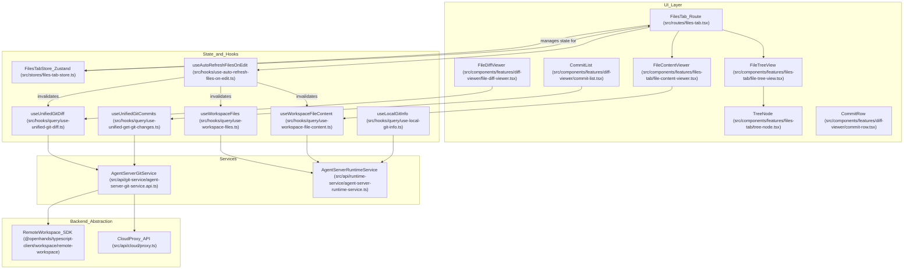
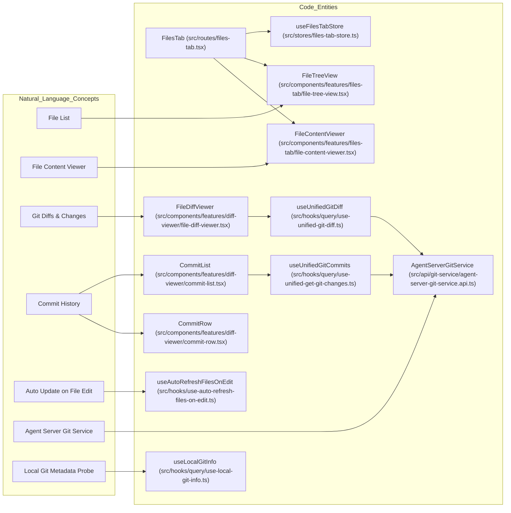

<!-- source: DeepWiki mcp.deepwiki.com · repo All-Hands-AI/OpenHands · page 9.2 Files Tab and Diff Viewer · fetched 2026-10-26 -->

# Files Tab and Diff Viewer

Relevant source files

The following files were used as context for generating this wiki page:

- [__tests__/api/cloud/conversation-title.test.ts](__tests__/api/cloud/conversation-title.test.ts)
- [__tests__/api/git-service.test.ts](__tests__/api/git-service.test.ts)
- [__tests__/api/mock-conversation-handlers.test.ts](__tests__/api/mock-conversation-handlers.test.ts)
- [__tests__/components/features/diff-viewer/file-diff-viewer.test.tsx](__tests__/components/features/diff-viewer/file-diff-viewer.test.tsx)
- [__tests__/components/features/files-tab/file-content-viewer.test.tsx](__tests__/components/features/files-tab/file-content-viewer.test.tsx)
- [__tests__/components/features/files-tab/workspace-path.test.tsx](__tests__/components/features/files-tab/workspace-path.test.tsx)
- [__tests__/components/features/home/use-url-search.test.tsx](__tests__/components/features/home/use-url-search.test.tsx)
- [__tests__/hooks/query/use-has-git-commits.test.tsx](__tests__/hooks/query/use-has-git-commits.test.tsx)
- [__tests__/hooks/query/use-local-git-info.test.tsx](__tests__/hooks/query/use-local-git-info.test.tsx)
- [__tests__/hooks/query/use-workspace-file-content.test.tsx](__tests__/hooks/query/use-workspace-file-content.test.tsx)
- [__tests__/hooks/query/use-workspace-files.test.tsx](__tests__/hooks/query/use-workspace-files.test.tsx)
- [__tests__/hooks/query/use-workspace-session.test.tsx](__tests__/hooks/query/use-workspace-session.test.tsx)
- [__tests__/routes/commits-tab.test.tsx](__tests__/routes/commits-tab.test.tsx)
- [__tests__/routes/files-tab.test.tsx](__tests__/routes/files-tab.test.tsx)
- [__tests__/utils/azure-devops-remote-links.test.ts](__tests__/utils/azure-devops-remote-links.test.ts)
- [__tests__/utils/get-git-path.test.ts](__tests__/utils/get-git-path.test.ts)
- [__tests__/utils/parse-git-remote-url.test.ts](__tests__/utils/parse-git-remote-url.test.ts)
- [src/api/cloud/conversation-service.api.ts](src/api/cloud/conversation-service.api.ts)
- [src/api/git-service/git-service.api.ts](src/api/git-service/git-service.api.ts)
- [src/components/features/automations/git-sync/git-sync-overview-section.test.tsx](src/components/features/automations/git-sync/git-sync-overview-section.test.tsx)
- [src/components/features/chat/git-control-bar-branch-button.tsx](src/components/features/chat/git-control-bar-branch-button.tsx)
- [src/components/features/diff-viewer/commit-list.tsx](src/components/features/diff-viewer/commit-list.tsx)
- [src/components/features/diff-viewer/commit-row.tsx](src/components/features/diff-viewer/commit-row.tsx)
- [src/components/features/diff-viewer/file-diff-viewer.tsx](src/components/features/diff-viewer/file-diff-viewer.tsx)
- [src/components/features/files-tab/file-content-viewer.tsx](src/components/features/files-tab/file-content-viewer.tsx)
- [src/components/features/files-tab/workspace-path.tsx](src/components/features/files-tab/workspace-path.tsx)
- [src/components/features/home/git-repo-dropdown/use-url-search.tsx](src/components/features/home/git-repo-dropdown/use-url-search.tsx)
- [src/hooks/query/use-has-git-commits.ts](src/hooks/query/use-has-git-commits.ts)
- [src/hooks/query/use-local-git-info.ts](src/hooks/query/use-local-git-info.ts)
- [src/hooks/query/use-unified-get-git-changes.ts](src/hooks/query/use-unified-get-git-changes.ts)
- [src/hooks/query/use-unified-git-diff.ts](src/hooks/query/use-unified-git-diff.ts)
- [src/hooks/query/use-workspace-file-content.ts](src/hooks/query/use-workspace-file-content.ts)
- [src/hooks/query/use-workspace-files.ts](src/hooks/query/use-workspace-files.ts)
- [src/hooks/query/use-workspace-session.ts](src/hooks/query/use-workspace-session.ts)
- [src/mocks/git-repository-handlers.ts](src/mocks/git-repository-handlers.ts)
- [src/routes/commits-tab.tsx](src/routes/commits-tab.tsx)
- [src/routes/files-tab.tsx](src/routes/files-tab.tsx)
- [src/stores/files-tab-store.ts](src/stores/files-tab-store.ts)
- [src/stores/use-workspace-mutation-counter.ts](src/stores/use-workspace-mutation-counter.ts)
- [src/utils/get-git-path.ts](src/utils/get-git-path.ts)
- [src/utils/parse-git-remote-url.ts](src/utils/parse-git-remote-url.ts)

The Files Tab is a central workspace management interface in Agent Canvas that provides a multi-view experience for exploring project files, reviewing agent-generated changes (diffs), and inspecting the commit history. It integrates directly with the agent-server’s runtime to provide real-time updates as the agent modifies the environment. This page explains the implementation and data flow of the Files Tab and Diff Viewer, covering the key React components, hooks, and services involved.

---

## Overview and Routing

The Files Tab is implemented primarily in the `files-tab` route and provides three main UI modes:

- **Files View**: Traditional file explorer with a tree view and a content viewer, enabling file browsing and editing.
- **Changes View**: Shows uncommitted or pending git changes in a diff interface.
- **Commits View**: Displays commit history for the conversation’s workspace.

Currently, the `files-tab` route focuses on the file tree and file content views, while the changes and commits views are implemented in sibling routes `changes-tab` and `commits-tab` respectively [src/routes/files-tab.tsx:39-42]().

The UI state for the Files Tab, including open files, selected file path, tree visibility, and content view mode (`rich` or `plain`), is persisted on a per-conversation basis via local storage, using the `useConversationLocalStorageState` hook [src/routes/files-tab.tsx:53-57](), [src/stores/files-tab-store.ts:1-80]().

Sources:
- [src/routes/files-tab.tsx:39-62]()
- [src/stores/files-tab-store.ts:1-80]()

---

## System Architecture and Data Flow

This section illustrates the key components and data flow involved in the Files Tab and Diff Viewer features.

Sources:
- [src/routes/files-tab.tsx:1-256]()
- [src/hooks/use-auto-refresh-files-on-edit.ts:1-151]()
- [src/hooks/query/use-unified-git-diff.ts:1-79]()
- [src/api/git-service/agent-server-git-service.api.ts:1-282]()
- [src/hooks/query/use-local-git-info.ts:1-163]()
- [src/hooks/query/use-workspace-files.ts:1-197]()
- [src/hooks/query/use-workspace-file-content.ts:1-303]()

---

## Files Tab Route and State Management

### `FilesTab` Component

Defined in `src/routes/files-tab.tsx`, the `FilesTab` route component coordinates rendering the file tree, file tabs and content viewers, and manages state restoration and UI preferences.

Key points:

- Uses `useFilesTabStore` Zustand store to track which files are open (`openPaths`), current selected file, and conversation scoping to avoid path leakage [src/routes/files-tab.tsx:82-91]().
- Restores tabs and selections from conversation-scoped local storage to survive page reloads via `useConversationLocalStorageState` hooks [src/routes/files-tab.tsx:53-57, 120-132]().
- A resizable drawer (`useResizableDrawerWidth`) controls the width of the file tree pane, with persistent width stored under key `FILES_TAB_TREE_WIDTH_STORAGE_KEY` [src/routes/files-tab.tsx:64-77]().
- Refresh button invalidates queries for workspace files and file contents to forcibly update the UI reads from the agent server workspace [src/routes/files-tab.tsx:134-146]().
- Integrates `useAutoRefreshFilesOnEdit` to keep workspace files updated on agent output [src/routes/files-tab.tsx:46-47]().

Sources:
- [src/routes/files-tab.tsx:39-146]()
- [src/stores/files-tab-store.ts:1-80]()

### `useFilesTabStore`

A Zustand store managing:

- `selectedPath`: The currently selected file path scoped by conversation ID.
- `openPaths`: The list of open files shown as tabs.
- Methods like `setSelectedPath(path, conversationId)`, `closeOpenPath(path)` to update these states.

This store guarantees that file tabs do not leak state between conversations by maintaining separate selected/open paths per conversation.

Sources:
- [src/stores/files-tab-store.ts:1-80]()

---

## File Tree View and `TreeNode`

The `FileTreeView` component renders the file and folder hierarchy inside the workspace using a nested tree structure. It uses the `TreeNode` component recursively.

- `FileTreeView` fetches the workspace file list via `useWorkspaceFiles` hook, which shells out a `find` command against the backend local workspace (local mode) or requests file lists over API (cloud mode) [src/hooks/query/use-workspace-files.ts:55-165]().
- `TreeNode` renders either a folder or file; folders can be expanded/collapsed and contain child `TreeNode` recursive items.
- Clicking a file calls `handleSelectFile` which sets the path in the `useFilesTabStore` and opens a tab [src/routes/files-tab.tsx:103-106]().

The tree supports toggling visibility with persistence to local storage [src/routes/files-tab.tsx:59-62]().

Sources:
- [src/routes/files-tab.tsx:59-106]()
- [src/hooks/query/use-workspace-files.ts:55-197]()

---

## File Content Viewer

The `FileContentViewer` component renders the contents of the selected file path.

- Uses `useWorkspaceFileContent` hook to fetch file data including text, static URL, mime type, and kind (`text`, `image`, `pdf`, `binary`) [src/hooks/query/use-workspace-file-content.ts:31-47]().
- Supports different rendering modes (`rich` or `plain`):
  - Rich mode renders inline previews for images, PDFs, Markdown, and HTML using safe elements like `img` and `iframe` [src/components/features/files-tab/file-content-viewer.tsx:69-180]().
  - Plain mode shows raw text or a binary fallback placeholder [src/components/features/files-tab/file-content-viewer.tsx:111-122]().
- Cache-busters via `useWorkspaceMutationCounter` help refresh files on edits [src/components/features/files-tab/file-content-viewer.tsx:76-76]().
- Minting static sessions uses `useWorkspaceSession` to exchange keys for workspace session cookies [src/hooks/query/use-workspace-session.ts:18-45]().

Sources:
- [src/components/features/files-tab/file-content-viewer.tsx:1-230]()
- [src/hooks/query/use-workspace-file-content.ts:1-303]()
- [src/hooks/query/use-workspace-session.ts:1-116]()

---

## Git Integration Service: `AgentServerGitService`

This service abstracts the git operations necessary for displaying changes and commits related to the current conversation's workspace.

- Supports both local mode (calling the RemoteWorkspace SDK directly) and cloud mode (calling proxied backend API endpoints) [src/api/git-service/agent-server-git-service.api.ts:45-95]().
  
Key methods:

| Method | Functionality |
|--------|---------------|
| `getGitChanges(conversationId: string)` | Lists current changed files with statuses in the workspace [src/api/git-service/agent-server-git-service.api.ts:112-165](). |
| `getGitChangeDiff(conversationId, path)` | Fetches diff content for a given file; supports commit-specific diffs [src/api/git-service/agent-server-git-service.api.ts:242-282](). |
| `getGitCommits(conversationUrl, sessionApiKey, path)` | Lists recent commits from the conversation's workspace, returns `null` if unsupported [src/api/git-service/agent-server-git-service.api.ts:171-239](). |

It handles path normalization such as converting relative paths to absolute for cloud runtime compatibility [src/api/git-service/agent-server-git-service.api.ts:55-57, 122-122]().

Sources:
- [src/api/git-service/agent-server-git-service.api.ts:45-282]()

---

## Diff Viewer and Hooks

### `useUnifiedGitDiff` Hook

This hook fetches the unified diff for a given file path and change type (e.g., Added, Modified, Deleted).

- It builds the absolute file path for the git workspace using `getGitPath` [src/hooks/query/use-unified-git-diff.ts:29-32]().
- Skips fetching diffs for deleted files in working-tree mode to avoid errors; enables diffs for deleted files in commit mode [src/hooks/query/use-unified-git-diff.ts:35-39, 75-75]().
- Caches diffs with query keys that include commit SHA if provided, otherwise uses working-tree diff cache [src/hooks/query/use-unified-git-diff.ts:45-60]().

Sources:
- [src/hooks/query/use-unified-git-diff.ts:1-79]()

### `FileDiffViewer` Component

This component uses Monaco Editor’s diff editor to render side-by-side diffs of file changes.

- Supports viewing the whole diff, old content only, or new content only (`diff`, `old`, `new` modes) [src/components/features/diff-viewer/file-diff-viewer.tsx:26-32]().
- Adjusts editor height dynamically to limit max size for usability [src/components/features/diff-viewer/file-diff-viewer.tsx:44-48, 147-161]().
- Indicates change status visually (`added`, `deleted`, `modified`, etc.) with icons [src/components/features/diff-viewer/file-diff-viewer.tsx:50-56, 193-199]().
- Expands/collapses diff content with accordion UI [src/components/features/diff-viewer/file-diff-viewer.tsx:107-116]().

Sources:
- [src/components/features/diff-viewer/file-diff-viewer.tsx:1-357]()

---

## Commit List and Commit Row

- `CommitList` renders a scrollable list of recent commits obtained from the agent-server [src/components/features/diff-viewer/commit-list.tsx](). It uses `useUnifiedGitCommits` to fetch the commit data.
- Each commit is displayed using `CommitRow`, showing metadata like short SHA, author, message subject, and timestamp [src/components/features/diff-viewer/commit-row.tsx]().

Sources:
- [src/components/features/diff-viewer/commit-list.tsx]()
- [src/components/features/diff-viewer/commit-row.tsx]()

---

## Workspace Git Info Hook: `useLocalGitInfo`

`useLocalGitInfo` probes git metadata for the local backend workspace by running a consolidated shell script over a persistent bash WebSocket connection via `useBashCommandRunner` [src/hooks/query/use-local-git-info.ts:38-50, 122-126]().

- The probe script fetches the remote URL and current branch at the workspace root, falling back to nested git repositories if needed [src/hooks/query/use-local-git-info.ts:38-50]().
- Parses remote URLs using `parseGitRemoteUrl` to extract providers (GitHub, GitLab, Bitbucket, Azure DevOps) and repositories [src/utils/parse-git-remote-url.ts:93-121]().
- This hook only runs in local backend mode and when the active conversation lacks complete git metadata [src/hooks/query/use-local-git-info.ts:110-117]().
- Polls every 10 seconds to detect updates in branch or remote URL automatically [src/hooks/query/use-local-git-info.ts:157-158]().

Sources:
- [src/hooks/query/use-local-git-info.ts:38-163]()
- [src/utils/parse-git-remote-url.ts:1-121]()

---

## Auto-Refresh on File Edits

`useAutoRefreshFilesOnEdit` hook tracks agent observations indicating filesystem mutations (file edits or terminal execution) from the event store and invalidates related query caches:

- On detection of relevant mutating events, triggers invalidation of queries:
  - `workspace-files`
  - `workspace-file-content`
  - `file_changes`
  - `file_diff`
- Increments a mutation counter used for cache busting static file URLs to update iframes or images [src/hooks/use-auto-refresh-files-on-edit.ts:1-151]().

Sources:
- [src/hooks/use-auto-refresh-files-on-edit.ts:1-151]()

---

## Natural Language to Code Entity Mapping

Sources:
- [src/routes/files-tab.tsx]()
- [src/components/features/files-tab/file-tree-view.tsx]()
- [src/components/features/files-tab/file-content-viewer.tsx]()
- [src/components/features/diff-viewer/file-diff-viewer.tsx]()
- [src/components/features/diff-viewer/commit-list.tsx]()
- [src/components/features/diff-viewer/commit-row.tsx]()
- [src/stores/files-tab-store.ts]()
- [src/hooks/use-auto-refresh-files-on-edit.ts]()
- [src/hooks/query/use-unified-git-diff.ts]()
- [src/hooks/query/use-unified-get-git-changes.ts]()
- [src/hooks/query/use-local-git-info.ts]()
- [src/api/git-service/agent-server-git-service.api.ts]()

---

# Summary

The Files Tab and Diff Viewer in Agent Canvas form a tightly integrated system that provides rich file browsing, content viewing, and git integration directly tied to the active conversation’s workspace. The architecture cleanly separates UI components, state stores, data-fetch hooks, and backend service APIs.

- The main `FilesTab` route manages state and layout [src/routes/files-tab.tsx:39-146]().
- File trees are rendered by `FileTreeView` and recursive `TreeNode` components [src/hooks/query/use-workspace-files.ts:55-165]().
- File contents are shown with rich previews or plain text in `FileContentViewer` [src/components/features/files-tab/file-content-viewer.tsx:69-180]().
- Diffs are rendered by the `FileDiffViewer` component using Monaco Editor, backed by `useUnifiedGitDiff` fetching unified diffs from `AgentServerGitService` [src/api/git-service/agent-server-git-service.api.ts:242-282](), [src/hooks/query/use-unified-git-diff.ts:1-79]().
- Commit histories are displayed as lists of `CommitRow` components in `CommitList` [src/components/features/diff-viewer/commit-list.tsx](), [src/components/features/diff-viewer/commit-row.tsx]().
- `useAutoRefreshFilesOnEdit` ensures the UI reacts in near real-time as the agent writes files [src/hooks/use-auto-refresh-files-on-edit.ts:1-151]().
- Local git metadata is probed periodically via `useLocalGitInfo` using persistent websocket bash command execution [src/hooks/query/use-local-git-info.ts:38-163]().

This modular design tightly couples the frontend Files Tab experience with the agent-server backend runtime, enabling an interactive, real-time developer experience for AI-assisted coding workflows.

---

# References

- `src/routes/files-tab.tsx` [1-257]()
- `src/components/features/files-tab/file-tree-view.tsx`
- `src/components/features/files-tab/tree-node.tsx`
- `src/components/features/files-tab/file-content-viewer.tsx` [1-231]()
- `src/hooks/use-auto-refresh-files-on-edit.ts` [1-151]()
- `src/hooks/query/use-unified-git-diff.ts` [1-79]()
- `src/api/git-service/agent-server-git-service.api.ts` [1-282]()
- `src/hooks/query/use-local-git-info.ts` [1-163]()
- `src/components/features/diff-viewer/file-diff-viewer.tsx` [1-358]()
- `src/components/features/diff-viewer/commit-list.tsx`
- `src/components/features/diff-viewer/commit-row.tsx`
- `src/hooks/query/use-workspace-files.ts` [1-198]()
- `src/hooks/query/use-workspace-file-content.ts` [1-304]()
- `src/utils/parse-git-remote-url.ts` [1-122]()

---

**End of Section 9.2**

---

