# Page: Agent Canvas Overview

# Agent Canvas Overview

<details>
<summary>Relevant source files</summary>

The following files were used as context for generating this wiki page:

- [.release-please-manifest.json](.release-please-manifest.json)
- [AGENTS.md](AGENTS.md)
- [README.md](README.md)
- [README.windows.md](README.windows.md)
- [__tests__/scripts/acp-docker-env-sync.test.ts](__tests__/scripts/acp-docker-env-sync.test.ts)
- [__tests__/scripts/dev-safe.test.ts](__tests__/scripts/dev-safe.test.ts)
- [config/defaults.json](config/defaults.json)
- [docs/ACP_AGENTS.md](docs/ACP_AGENTS.md)
- [docs/README.md](docs/README.md)
- [docs/SELF_HOSTING.md](docs/SELF_HOSTING.md)
- [examples/acp-docker/.env.example](examples/acp-docker/.env.example)
- [examples/acp-docker/README.md](examples/acp-docker/README.md)
- [examples/acp-docker/docker-compose.yml](examples/acp-docker/docker-compose.yml)
- [helm/agent-canvas/Chart.yaml](helm/agent-canvas/Chart.yaml)
- [package-lock.json](package-lock.json)
- [package.json](package.json)
- [scripts/check-sdk-version-sync.mjs](scripts/check-sdk-version-sync.mjs)
- [scripts/dev-safe.mjs](scripts/dev-safe.mjs)
- [scripts/gen-acp-docker-env.mjs](scripts/gen-acp-docker-env.mjs)
- [tests/e2e/live-acp/README.md](tests/e2e/live-acp/README.md)
- [tests/e2e/live-acp/acp-docker-e2e.mts](tests/e2e/live-acp/acp-docker-e2e.mts)

</details>


Agent Canvas is the React/TypeScript frontend control center for the OpenHands ecosystem [README.md:5-12](). It serves as a self-hosted developer control center where users can interact with AI coding agents, manage long-running automations, and orchestrate complex development workflows across local, remote, and cloud environments [README.md:33-35]().

The project is designed to be highly portable, running as a local CLI tool via npm [README.md:70-73](), a containerized service [README.md:95-100](), or a desktop application [package.json:109](). It bridges high-level natural language instructions and low-level code execution by interfacing with the `agent-server` (`openhands-agent-server`) and the automation backend [README.md:33-35](), [config/defaults.json:35-38]().

## Purpose and Key Capabilities

Agent Canvas provides a unified interface for multiple agentic workflows and capabilities:

*   **Multi-Backend Support**: Connect to agents running locally, in Docker containers, on remote VMs, or via OpenHands Cloud and Enterprise infrastructure [README.md:35-42]().
*   **ACP Agent Integration**: Native support for the Agent-Client Protocol (ACP), allowing users to drive external agents like Claude Code, Codex, and Gemini CLI through the Canvas UI [README.md:46](), [docs/ACP_AGENTS.md:8-16]().
*   **Automations**: A dedicated system for scheduled or event-driven tasks, integrating with services like Slack, GitHub, and Linear [README.md:33-43]().
*   **Integrated Workspace**: A full-featured development environment including file management, terminal tools, and git integration [README.md:33-37]().

Sources: [README.md:5-46](), [config/defaults.json:35-38](), [docs/ACP_AGENTS.md:8-16]()

## High-Level Architecture and SDK Integration

The Agent Canvas architecture follows a frontend-first philosophy where the React UI orchestrates multiple backend services through a centralized ingress proxy [docs/SELF_HOSTING.md:23-46](). Agent Canvas interacts with agent runtimes through the `agent-server` API [docs/ACP_AGENTS.md:20-27](). The frontend leverages `@openhands/typescript-client` to maintain strict type safety across network boundaries [package.json:27]().

Title: "Request Routing and Backend Integration"
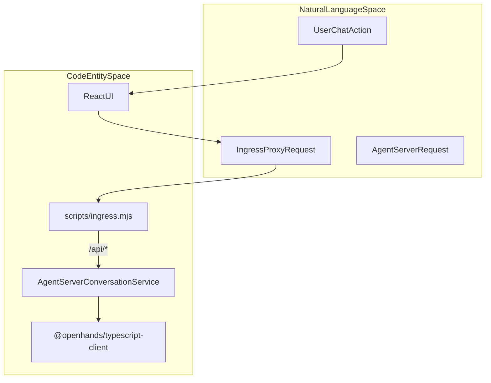
Sources: [package.json:27](), [docs/SELF_HOSTING.md:23-46](), [docs/ACP_AGENTS.md:17-27]()

## Deployment Models and Runtime Modes

Agent Canvas supports multiple deployment models to suit different security and operational requirements:
1.  **Local CLI**: Installed via `npm install -g @openhands/agent-canvas`, executing the `agent-canvas` binary [README.md:70-73](), [package.json:16-18]().
2.  **Docker Sandbox**: An all-in-one container image (`ghcr.io/openhands/agent-canvas`) providing full execution isolation [README.md:95-100](), [config/defaults.json:17]().
3.  **Electron Desktop**: Native packaging for desktop workflows [package.json:108-111]().
4.  **Self-Hosted VM**: Secure multi-service topology behind an ingress proxy using `--public` mode and `LOCAL_BACKEND_API_KEY` [docs/SELF_HOSTING.md:13-59]().

Title: "Runtime Deployment to Code Entity Mapping"
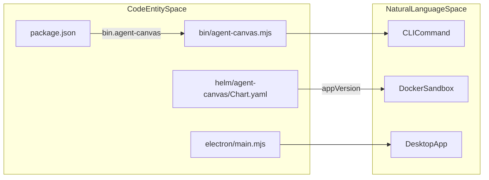
Sources: [package.json:16-18](), [helm/agent-canvas/Chart.yaml:10-16](), [README.md:70-100]()

---

## Child Pages

For deeper technical dives into specific areas of Agent Canvas, refer to the following child pages:

*   **[Project Structure and Technology Stack](#1.1)**: For details on the monorepo layout (`src/`, `scripts/`, `bin/`, `docker/`, `electron/`, `helm/`), technology choices (React, TypeScript, Vite, TanStack Query, Zustand, MSW), and library entrypoints, see [Project Structure and Technology Stack](#1.1).
*   **[Runtime Modes and Deployment Models](#1.2)**: For details on runtime modes (`dev`, `dev:minimal`, `dev:static`, `dev:mock`, Docker, Electron, self-hosted VM), ingress proxy topology, and security configurations, see [Runtime Modes and Deployment Models](#1.2).

Sources: [package.json:22-115](), [config/defaults.json:1-45](), [docs/SELF_HOSTING.md:1-59]()

---

# Page: Project Structure and Technology Stack

# Project Structure and Technology Stack

<details>
<summary>Relevant source files</summary>

The following files were used as context for generating this wiki page:

- [.release-please-manifest.json](.release-please-manifest.json)
- [AGENTS.md](AGENTS.md)
- [README.md](README.md)
- [README.windows.md](README.windows.md)
- [__tests__/package-library.test.ts](__tests__/package-library.test.ts)
- [__tests__/scripts/dev-safe.test.ts](__tests__/scripts/dev-safe.test.ts)
- [config/defaults.json](config/defaults.json)
- [helm/agent-canvas/Chart.yaml](helm/agent-canvas/Chart.yaml)
- [package-lock.json](package-lock.json)
- [package.json](package.json)
- [scripts/check-sdk-version-sync.mjs](scripts/check-sdk-version-sync.mjs)
- [scripts/dev-safe.mjs](scripts/dev-safe.mjs)

</details>


## Purpose and Scope

This document details the monorepo layout, technology stack choices, package export structures, and network topology for **Agent Canvas**, the self-hosted developer control center for AI coding agents and autonomous workflows. It serves as a comprehensive architectural reference for developers contributing to or integrating with the `@openhands/agent-canvas` codebase.

Sources: [README.md:1-12](), [package.json:1-11]()

---

## Monorepo Layout

The OpenHands monorepo is organized into specialized directories separating core application source code, CLI orchestration binaries, container definitions, desktop wrappers, and infrastructure deployment helm charts.

### Project Directory Map

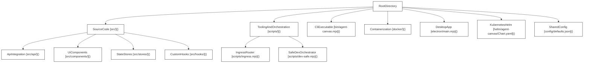

Sources: [package.json:16-18](), [config/defaults.json:1-45](), [scripts/dev-safe.mjs:30-66]()

### Key Directories and Files

| Directory / File | Purpose | Key Responsibilities |
|------------------|---------|----------------------|
| `src/` | Core React application source code | Contains views, routers, components, custom hooks, and state stores. |
| `scripts/` | Tooling for development, proxying, and CI/CD | Orchestrates local processes via `scripts/dev-safe.mjs` and ingress routing via `scripts/ingress.mjs`. |
| `bin/` | Executable binaries for npm distribution | Contains `bin/agent-canvas.mjs` [package.json:16-18](), serving as the entrypoint for the global CLI command. |
| `docker/` | Containerization definitions | Houses `docker/Dockerfile` and runtime entrypoint scripts for packaging the all-in-one distribution. |
| `electron/` | Desktop application wrapper | Implements native desktop window management via `electron/main.mjs` and preload scripts. |
| `helm/` | Kubernetes deployment artifacts | Defines the Helm chart structure in `helm/agent-canvas/Chart.yaml` [helm/agent-canvas/Chart.yaml:1-16]() for stateful cluster deployments. |
| `config/` | Shared configuration constants | Houses `config/defaults.json` [config/defaults.json:1-45](), acting as the single source of truth for version pins, ports, and paths. |

Sources: [package.json:1-18](), [config/defaults.json:1-45](), [scripts/dev-safe.mjs:1-66](), [helm/agent-canvas/Chart.yaml:1-16]()

---

## Technology Stack and Architecture

Agent Canvas is built on a modern React 19 stack emphasizing type safety, asynchronous state caching, and reactive UI updates.

### System Entity Relationship

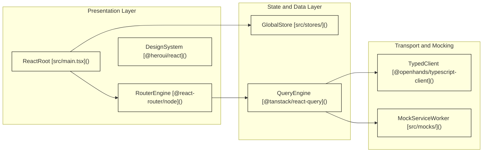

Sources: [package.json:22-72](), [AGENTS.md:6-9]()

#### Core Technology Choices

*   **React 19 & TypeScript**: Provides component encapsulation and static type validation (`react` `19.2.8`, `typescript` `6.0.3`) [package.json:49, 112](), [package-lock.json:39, 112]().
*   **React Router 7**: Manages SPA routing (`@react-router/node` `7.18.2`) [package.json:28](), [package-lock.json:18]().
*   **TanStack Query (v5)**: Handles server-state caching, automatic background refetching, and synchronization (`@tanstack/react-query` `5.101.4`) [package.json:31](), [package-lock.json:21]().
*   **Zustand**: Manages lightweight client-side global states such as event logs and conversation filters (`zustand` `5.0.14`) [package.json:72](), [package-lock.json:62]().
*   **HeroUI & Tailwind CSS**: Supplies the underlying design system components (`@heroui/react` `2.8.10`) [package.json:23](), [package-lock.json:13]() and styling utilities (`tailwindcss` `4.3.3`) [package.json:69](), [package-lock.json:111]().
*   **MSW (Mock Service Worker)**: Intercepts network layer interactions during mock development (`npm run dev:mock`) and E2E testing (`msw` `2.15.0`) [package.json:80](), [package-lock.json:107]().

Sources: [package.json:22-72](), [package-lock.json:7-62]()

---

## Library Entrypoints and Package Exports

The `@openhands/agent-canvas` package functions both as a standalone executable control center and as a modular library exportable to external React hosts.

### Package Exports Mapping

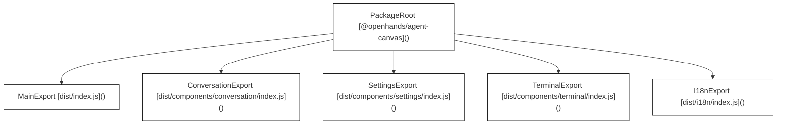

Sources: [__tests__/package-library.test.ts:29-61]()

### Library Build and Consumption
*   **Build Command**: Executed via `npm run build:lib`, which invokes `tsc -p tsconfig.lib.json` and bundles entrypoints in library mode [package.json:105]().
*   **Scope Isolation**: Style encapsulation is enforced by `AgentServerUIRoot`, which injects scoped CSS custom properties (`var(--oh-*)`) into the React component subtree to prevent CSS collision with host applications [src/components/providers/agent-server-ui-root.tsx:21-56]().

Sources: [package.json:105](), [__tests__/package-library.test.ts:29-61](), [src/components/providers/agent-server-ui-root.tsx:21-56]()

---

## Network Topology and Ingress Proxy

Agent Canvas runs an integrated ingress proxy (`scripts/ingress.mjs`) that routes traffic between the frontend single-page application and backend orchestration services.

### Ingress Routing Architecture

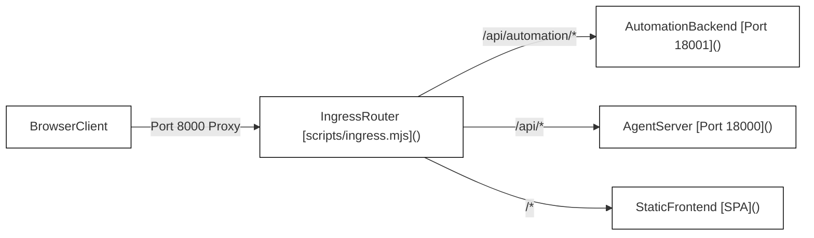

Sources: [config/defaults.json:19-23](), [scripts/dev-safe.mjs:39-42]()

### Proxy Rules
*   **Ingress Port**: Binds to port `8000` by default [config/defaults.json:22]().
*   **`/api/automation/*`**: Proxies requests to the automation service running on port `18001` [config/defaults.json:21]().
*   **`/api/*`**: Proxies requests to the Python agent server running on port `18000` [config/defaults.json:20]().
*   **Root `/*`**: Serves the React frontend assets [package.json:83]().

Sources: [config/defaults.json:19-23](), [package.json:83]()

---

## Configuration Management

Configuration defaults are centralized in `config/defaults.json`, providing version pins and port assignments consumed across npm launchers, Docker entrypoints, and CI workflows [config/defaults.json:1-45]().

| Configuration Key | Value | Description |
|-------------------|-------|-------------|
| `versions.agentServer` | `1.46.0` | Pinned Python agent server version [config/defaults.json:4](). |
| `versions.agentCanvas` | `1.18.0` | Current frontend package version [config/defaults.json:5](). |
| `ports.proxy` | `8000` | Default ingress proxy port [config/defaults.json:22](). |
| `paths.stateSubdir` | `agent-canvas` | Local filesystem state storage subdirectory under `~/.openhands` [config/defaults.json:27](). |
| `compatibility.minimumAgentServer` | `1.28.0` | Minimum agent server version required for API compatibility [config/defaults.json:9](). |

Sources: [config/defaults.json:1-45](), [scripts/dev-safe.mjs:30-37]()

---

# Page: Runtime Modes and Deployment Models

# Runtime Modes and Deployment Models

<details>
<summary>Relevant source files</summary>

The following files were used as context for generating this wiki page:

- [.dockerignore](.dockerignore)
- [.github/ISSUE_TEMPLATE/bug_report.yml](.github/ISSUE_TEMPLATE/bug_report.yml)
- [.github/ISSUE_TEMPLATE/feature_request.yml](.github/ISSUE_TEMPLATE/feature_request.yml)
- [.github/dependabot.yml](.github/dependabot.yml)
- [.github/pr-assets/pr-16605-test-results.png](.github/pr-assets/pr-16605-test-results.png)
- [.github/pull_request_template.md](.github/pull_request_template.md)
- [.github/scripts/check_issue_readiness.py](.github/scripts/check_issue_readiness.py)
- [.github/scripts/check_pr_description.py](.github/scripts/check_pr_description.py)
- [.github/scripts/markdown_sections.py](.github/scripts/markdown_sections.py)
- [.github/scripts/post-readiness-comment.mjs](.github/scripts/post-readiness-comment.mjs)
- [.github/scripts/tests/__init__.py](.github/scripts/tests/__init__.py)
- [.github/scripts/tests/test_issue_readiness.py](.github/scripts/tests/test_issue_readiness.py)
- [.github/scripts/tests/test_markdown_sections.py](.github/scripts/tests/test_markdown_sections.py)
- [.github/scripts/tests/test_pr_description.py](.github/scripts/tests/test_pr_description.py)
- [.github/workflows/ci-script-tests.yml](.github/workflows/ci-script-tests.yml)
- [.github/workflows/issue-readiness-check.yml](.github/workflows/issue-readiness-check.yml)
- [.github/workflows/pr-artifacts.yml](.github/workflows/pr-artifacts.yml)
- [.github/workflows/pr-description-check.yml](.github/workflows/pr-description-check.yml)
- [__tests__/bin/agent-canvas.test.ts](__tests__/bin/agent-canvas.test.ts)
- [__tests__/scripts/dev-static.test.ts](__tests__/scripts/dev-static.test.ts)
- [__tests__/scripts/dev-with-automation.test.ts](__tests__/scripts/dev-with-automation.test.ts)
- [__tests__/scripts/static-server.test.ts](__tests__/scripts/static-server.test.ts)
- [bin/agent-canvas.mjs](bin/agent-canvas.mjs)
- [docker/entrypoint.sh](docker/entrypoint.sh)
- [scripts/dev-static.mjs](scripts/dev-static.mjs)
- [scripts/dev-with-automation.mjs](scripts/dev-with-automation.mjs)
- [scripts/runtime-services-info.mjs](scripts/runtime-services-info.mjs)
- [scripts/static-server.mjs](scripts/static-server.mjs)
- [vite.config.ts](vite.config.ts)

</details>


## Purpose and Scope
This document details the runtime modes, ingress proxy topologies, service orchestration scripts, connection initialization flows, and security architectures supported by Agent Canvas (`OpenHands/OpenHands`). It targets a technical audience implementing or operating local development stacks, containerized Docker deployments, or desktop Electron shells.

---

## 1. Overview of Runtime Modes

Agent Canvas provides multiple execution entrypoints defined via `npm` scripts and orchestrator modules.

| Runtime Mode | Command | Orchestrator / Entrypoint | Description |
| :--- | :--- | :--- | :--- |
| **Full Dev** | `npm run dev` | `scripts/dev-with-automation.mjs` | Runs the Vite dev server (`:3001`), Agent Server (`:18000`), Automation Backend (`:18001`), and Ingress Proxy (`:8000`) [scripts/dev-with-automation.mjs:1-45](). |
| **Minimal** | `npm run dev:minimal` | `scripts/dev-safe.mjs` | Runs an isolated development stack without the automation backend [scripts/dev-safe.mjs:1-182](). |
| **Static** | `npm run dev:static` | `scripts/dev-static.mjs` | Serves a pre-built production frontend via `scripts/static-server.mjs` alongside local backends [scripts/static-server.mjs:1-28](). |
| **Mock** | `npm run dev:mock` | Vite + MSW | Frontend-only mode using Mock Service Worker handlers to simulate agent-server and automation APIs without local Python processes. |
| **Docker** | `docker run` | `docker/entrypoint.sh` | Containerized all-in-one deployment binding services behind an ingress proxy and mounting projects at `/projects` [docker/entrypoint.sh:1-57](). |
| **Electron** | Desktop App | `electron/main.mjs` | Desktop application packaging the frontend and managing embedded Python runtimes and local child processes. |

Sources: [scripts/dev-with-automation.mjs:1-45](), [scripts/dev-safe.mjs:1-182](), [scripts/static-server.mjs:1-28](), [docker/entrypoint.sh:1-57]()

---

## 2. Ingress Proxy Topology and Network Routing

Except for `dev:mock`, Agent Canvas routes all traffic through an ingress proxy layer implemented by `scripts/ingress.mjs` (using `polka` and `httpxy`) or `scripts/static-server.mjs` [scripts/ingress.mjs:1-28](), [scripts/static-server.mjs:1-28](). The proxy shares route parsing logic with `scripts/proxy-utils.mjs`.

### Diagram: Ingress Routing Topology (Code Entity Space)
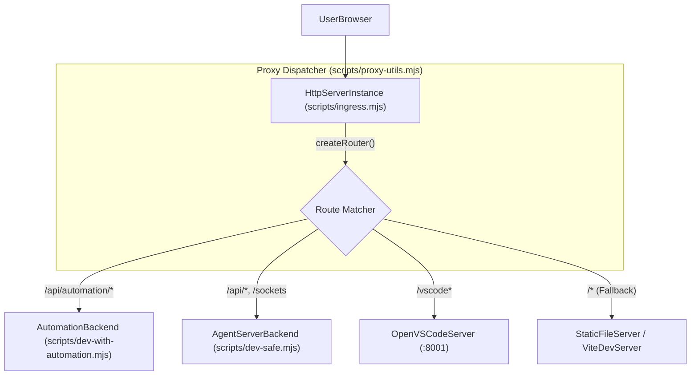
Sources: [scripts/ingress.mjs:1-28](), [scripts/static-server.mjs:1-28](), [scripts/proxy-utils.mjs:1-50](), [scripts/dev-with-automation.mjs:9-22]()

---

## 3. Implementation Details: `dev-safe.mjs` and Service Orchestration

The `scripts/dev-safe.mjs` module coordinates local process lifecycles, port allocation, and credential persistence.

Key functions and classes:
*   `findFreePort` / `findFreePorts`: Dynamically allocate TCP ports to avoid collisions across development runs [__tests__/scripts/dev-safe.test.ts:51-174]().
*   `getOrCreatePersistedApiKey(filePath, label)`: Reads or generates a 256-bit hex session API key stored at `DEFAULT_API_KEY_PATH` (`~/.openhands/agent-canvas/api-key.txt`) [scripts/dev-safe.mjs:72-180]().
*   `buildAgentServerCommand`: Constructs the `uvx` execution command for `openhands-agent-server` pinned to `DEFAULT_AGENT_SERVER_VERSION` from `config/defaults.json` [scripts/dev-safe.mjs:30-65]().

Sources: [scripts/dev-safe.mjs:30-180](), [__tests__/scripts/dev-safe.test.ts:51-174](), [config/defaults.json:1-45]()

---

## 4. Canvas-to-Agent-Server Connection and Service Injection

Canvas connects to backend instances through the `Backend Registry`. Runtime configuration metadata is injected into `index.html` at startup by `scripts/runtime-services-info.mjs`.

### Diagram: Runtime Services Data Flow (Code Entity Space)
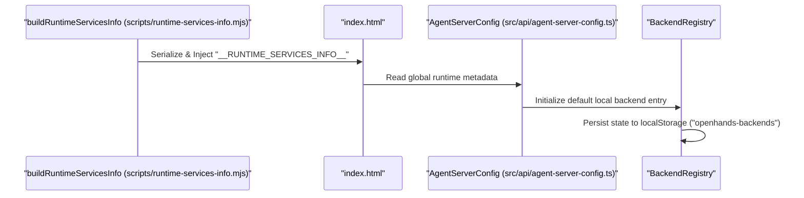
Sources: [scripts/runtime-services-info.mjs:1-25](), [src/api/agent-server-config.ts:1-40]()

---

## 5. Security Posture, `--public` Flag, and Secret Encryption

### Session Authentication
By default, backends validate incoming requests using the `X-Session-API-Key` header. This key is automatically generated and persisted via `getOrCreatePersistedApiKey` [scripts/dev-safe.mjs:123-180]().

### The `--public` Flag and `--auth-required`
When launching via `bin/agent-canvas.mjs` or Docker with `--public` (`OH_CANVAS_PUBLIC=true`):
1.  **Network Binding**: Services bind to `0.0.0.0` instead of `127.0.0.1` [scripts/dev-with-automation.mjs:176-179]().
2.  **Omission of Key Injection**: The session key is **not** baked into the frontend bundle. Users must manually provide the key through the UI login prompt.
3.  **Static Server Gate**: `scripts/static-server.mjs` supports `--auth-required`, which is semantically equivalent for static deployments [scripts/static-server.mjs:157-159]().

### Secrets Encryption
Sensitive settings (such as LLM credentials) are encrypted using `OH_SECRET_KEY` prior to persistence at `DEFAULT_SECRET_KEY_PATH` (`~/.openhands/agent-canvas/secret-key.txt`) [scripts/dev-safe.mjs:101-106]().

Sources: [scripts/dev-safe.mjs:84-180](), [scripts/dev-with-automation.mjs:176-179](), [scripts/static-server.mjs:157-159](), [bin/agent-canvas.mjs:71-75]()

---

## 6. Containerized and Desktop Deployments (Docker & Electron)

*   **Docker (`docker/entrypoint.sh`)**: Orchestrates the agent server, automation service, and static server inside a single container. It normalizes paths via `normalize_base_path` and coordinates `VSCODE_BASE_PATH` settings with `openvscode-server` [docker/entrypoint.sh:87-117](). Host project directories are mounted into `/projects`.
*   **Electron (`electron/main.mjs`)**: Packages the frontend SPA with an embedded Python execution environment (`uv`), managing local child processes and enforcing strict navigation policies via `electron-builder.config.mjs`.

Sources: [docker/entrypoint.sh:1-117](), [config/defaults.json:1-45]()

---

# Page: Getting Started

# Getting Started

<details>
<summary>Relevant source files</summary>

The following files were used as context for generating this wiki page:

- [.release-please-manifest.json](.release-please-manifest.json)
- [AGENTS.md](AGENTS.md)
- [README.md](README.md)
- [README.windows.md](README.windows.md)
- [__tests__/scripts/dev-safe.test.ts](__tests__/scripts/dev-safe.test.ts)
- [config/defaults.json](config/defaults.json)
- [helm/agent-canvas/Chart.yaml](helm/agent-canvas/Chart.yaml)
- [package-lock.json](package-lock.json)
- [package.json](package.json)
- [scripts/check-sdk-version-sync.mjs](scripts/check-sdk-version-sync.mjs)
- [scripts/dev-safe.mjs](scripts/dev-safe.mjs)

</details>


This page provides a high-level guide for setting up a local development environment for Agent Canvas, running the application in various modes, and understanding the configuration system. Developers new to the codebase should start here to understand the relationship between the React frontend and the `agent-server` backend [AGENTS.md:5-9]().

For detailed instructions, prerequisites, environment variables, and self-hosting strategies, refer to the child pages:
- Development Environment Setup: See [Development Environment Setup](#2.1)
- Configuration and Environment Variables: See [Configuration and Environment Variables](#2.2)
- Self-Hosting and Docker Deployment: See [Self-Hosting and Docker Deployment](#2.3)

---

## Development Workflow Overview

Agent Canvas is a React/TypeScript application that serves as the control center for OpenHands agents [AGENTS.md:30-48](). Development typically involves running the frontend via Vite and connecting it to one or more `agent-server` instances.

### Local Development Stack and Launchers

The recommended local workflow uses `npm run dev`, orchestrated by `scripts/dev-with-automation.mjs` and `scripts/dev-safe.mjs`, which sets up a full stack without requiring Docker.

Diagram: Local Development Stack Architecture to Code Entities
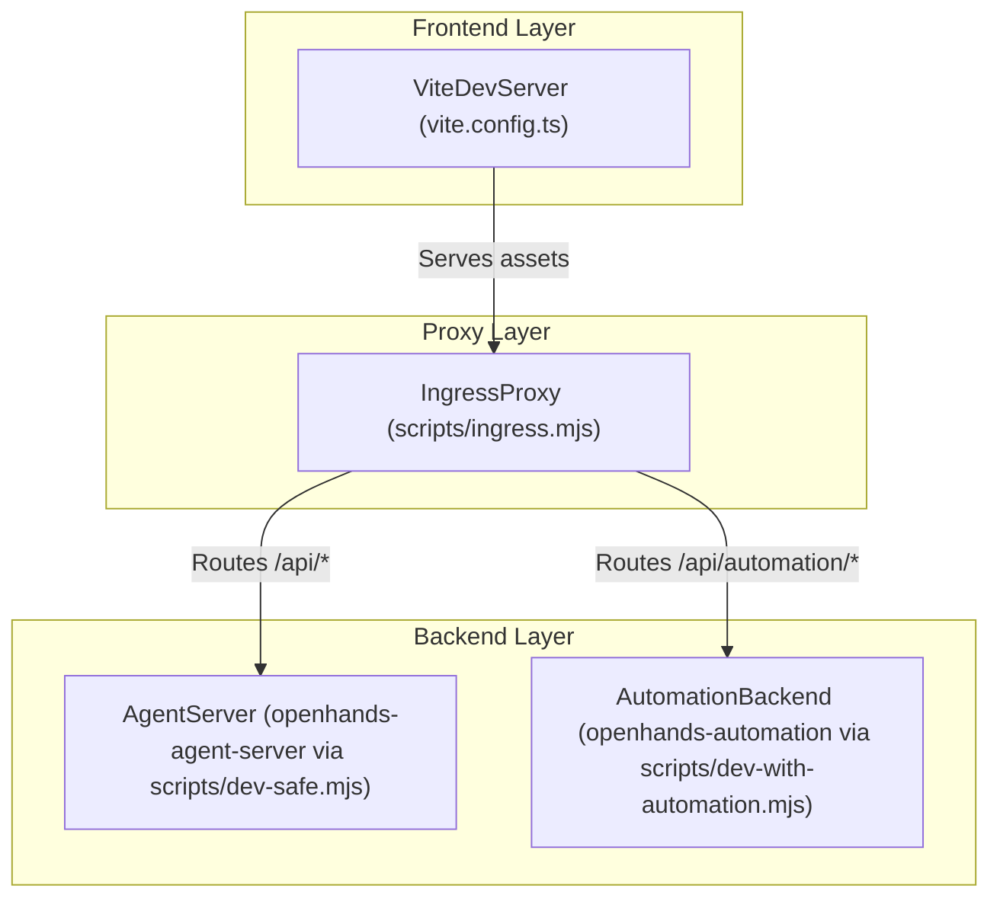
Sources: [scripts/dev-safe.mjs:30-40](), [package.json:74-78]()

---

## Development Environment Setup

Setting up a local development environment requires Node.js (>=24), package management tools, and Python execution via `uv/uvx` [README.md:68](), [package.json:19-21](). The codebase supports multiple runtime modes such as full stack (`dev`), minimal mode without automation (`dev:minimal`), static server mode (`dev:static`), and mock mode (`dev:mock`) [package.json:74-80]().

For complete prerequisites, port allocation strategies managed by `findFreePort` and `findFreePorts`, and state directory isolation via `dev-safe.mjs`, see [Development Environment Setup](#2.1).

Sources: [package.json:74-80](), [__tests__/scripts/dev-safe.test.ts:51-175]()

---

## Configuration and Environment Variables

Agent Canvas combines build-time configurations, environment files (`.env`), default JSON settings (`config/defaults.json`), and runtime injections [config/defaults.json:1-45]().

Diagram: Configuration and Environment Resolution Flow
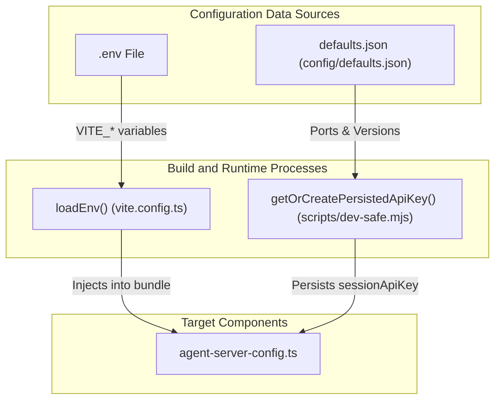
Sources: [config/defaults.json:1-45](), [scripts/dev-safe.mjs:123-180]()

For full details on `.env` variables, build-time `VITE_*` parameters, and runtime injection of `sessionApiKey` and `runtimeServicesInfo`, see [Configuration and Environment Variables](#2.2).

Sources: [config/defaults.json:1-45](), [scripts/dev-safe.mjs:123-180]()

---

## Deployment and Self-Hosting

For production and containerized deployments, Agent Canvas relies on an all-in-one Docker image orchestrated by `docker/entrypoint.sh`, a three-service topology behind an ingress proxy, and Helm charts (`helm/agent-canvas/Chart.yaml`) [helm/agent-canvas/Chart.yaml:1-6](). Security features include cryptographically secure key generation via `generateRandomApiKey()` persisted in `~/.openhands/agent-canvas/api-key.txt` [scripts/dev-safe.mjs:72-89]().

For a deep dive into container entrypoints, topology, and security guidelines, see [Self-Hosting and Docker Deployment](#2.3).

Sources: [helm/agent-canvas/Chart.yaml:1-6](), [scripts/dev-safe.mjs:72-89]()

---

## Code Quality and Testing Infrastructure

The repository enforces strict quality standards through linting, unit testing with Vitest, mutation testing with Stryker, and end-to-end suites [package.json:84-97]().

```bash
npm run lint           # Run typecheck, eslint, and prettier
npm run test           # Run unit tests via Vitest
npm run test:mutation  # Run mutation testing via Stryker
```

Sources: [package.json:84-97]()

---

# Page: Development Environment Setup

# Development Environment Setup

<details>
<summary>Relevant source files</summary>

The following files were used as context for generating this wiki page:

- [.github/workflows/desktop-windows.yml](.github/workflows/desktop-windows.yml)
- [.release-please-manifest.json](.release-please-manifest.json)
- [AGENTS.md](AGENTS.md)
- [README.md](README.md)
- [README.windows.md](README.windows.md)
- [__tests__/scripts/dev-extra-backend.test.ts](__tests__/scripts/dev-extra-backend.test.ts)
- [__tests__/scripts/dev-process-utils.test.ts](__tests__/scripts/dev-process-utils.test.ts)
- [__tests__/scripts/dev-safe.test.ts](__tests__/scripts/dev-safe.test.ts)
- [config/defaults.json](config/defaults.json)
- [helm/agent-canvas/Chart.yaml](helm/agent-canvas/Chart.yaml)
- [package-lock.json](package-lock.json)
- [package.json](package.json)
- [scripts/check-sdk-version-sync.mjs](scripts/check-sdk-version-sync.mjs)
- [scripts/dev-extra-backend.mjs](scripts/dev-extra-backend.mjs)
- [scripts/dev-process-utils.mjs](scripts/dev-process-utils.mjs)
- [scripts/dev-safe.mjs](scripts/dev-safe.mjs)
- [tests/e2e/mock-llm/conversations/mock-llm-conversation.spec.ts](tests/e2e/mock-llm/conversations/mock-llm-conversation.spec.ts)

</details>


This page details the local development environment setup for Agent Canvas, covering prerequisites, installation steps, development modes (`npm run dev`, `npm run dev:minimal`, `npm run dev:static`, `npm run dev:mock`), port allocation, state directory initialization, and the `dev-safe.mjs` isolation mechanism.

## Purpose and Prerequisites

Agent Canvas is a React/TypeScript frontend control center that interacts with agent-server and automation backends. Setting up the development environment requires Node.js for frontend compilation and `uv`/`uvx` for managing Python-based agent backends.

### System Requirements

*   **Node.js**: Version 24 or later (enforced via `engines` in `package.json` [package.json:19-21]()).
*   **npm**: The Node.js package manager.
*   **`uv` / `uvx`**: Python package runner used by `scripts/dev-safe.mjs` [scripts/dev-safe.mjs:1-182]() to launch `openhands-agent-server` [config/defaults.json:36]() and `openhands-automation` [config/defaults.json:37]() without manual virtual environment provisioning.

Sources: [package.json:19-21](), [config/defaults.json:36-37](), [scripts/dev-safe.mjs:1-182]()

### Installation Steps

1.  **Clone the repository**:
    ```bash
    git clone https://github.com/All-Hands-AI/OpenHands.git
    cd OpenHands
    ```
2.  **Install Node.js dependencies**:
    ```bash
    npm install
    ```
    This reads `package.json` [package.json:22-73]() and installs all workspace dependencies.
3.  **Ensure `uv` is available**:
    `uvx` must be present in the system `PATH` so that `scripts/dev-safe.mjs` can spawn Python-based backend servers using version pins defined in `config/defaults.json` [config/defaults.json:3-7]().

Sources: [package.json:22-73](), [config/defaults.json:3-7](), [scripts/dev-safe.mjs:1-182]()

---

## Development Modes

Development workflows are defined as npm scripts in `package.json` [package.json:74-80](). 

### Summary of Development Commands

| Script | Command | Description |
| :--- | :--- | :--- |
| `npm run dev` | `node --env-file-if-exists=.env scripts/dev-with-automation.mjs` | Full stack: Frontend + Agent Server + Automation backend orchestrated via ingress. |
| `npm run dev:minimal` | `node --env-file-if-exists=.env scripts/dev-safe.mjs` | Minimal stack: Frontend + Agent Server (managed via `dev-safe.mjs`). |
| `npm run dev:static` | `node --env-file-if-exists=.env scripts/dev-static.mjs` | Static build server combined with backend services. |
| `npm run dev:mock` | `npm run make-i18n && cross-env VITE_MOCK_API=true react-router dev` | Frontend running standalone with MSW mocking backend responses. |

Sources: [package.json:74-80]()

### `npm run dev` and `npm run dev:minimal` (Stack Orchestration)

The `dev-safe.mjs` script (`scripts/dev-safe.mjs`) builds the safe dev configuration using `buildSafeDevConfigAsync` [__tests__/scripts/dev-safe.test.ts:17-20](), checking free ports and setting up API keys.

Title: "Safe Dev Orchestration Data Flow"
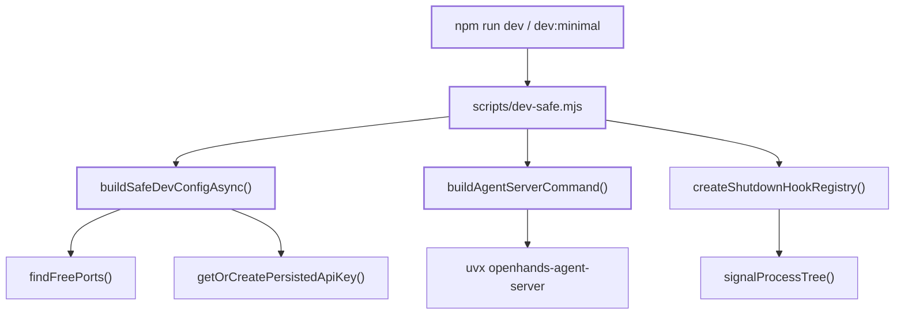
Sources: [scripts/dev-safe.mjs:1-182](), [__tests__/scripts/dev-safe.test.ts:17-20]()

### `npm run dev:mock` (Mock API Mode)

In mock mode (`VITE_MOCK_API=true`), Mock Service Worker (MSW) intercepts network requests at the browser layer, avoiding the need for a live Python backend. Translation files are generated via `scripts/make-i18n-translations.cjs` [package.json:80]() prior to starting the Vite development server.

Sources: [package.json:74-80]()

---

## Port Allocation and State Directory Initialization

### Port Allocation Mechanics
Port selection is handled by `findFreePort` and `findFreePorts` in `scripts/dev-safe.mjs`, backed by Node's `net` module [__tests__/scripts/dev-safe.test.ts:51-175](). If preferred ports (such as `18000` for the agent server or `3001` for Vite) are occupied, the allocator dynamically binds to OS-assigned free ports [__tests__/scripts/dev-safe.test.ts:68-91]().

Title: "Port Allocation Resolution Flow"
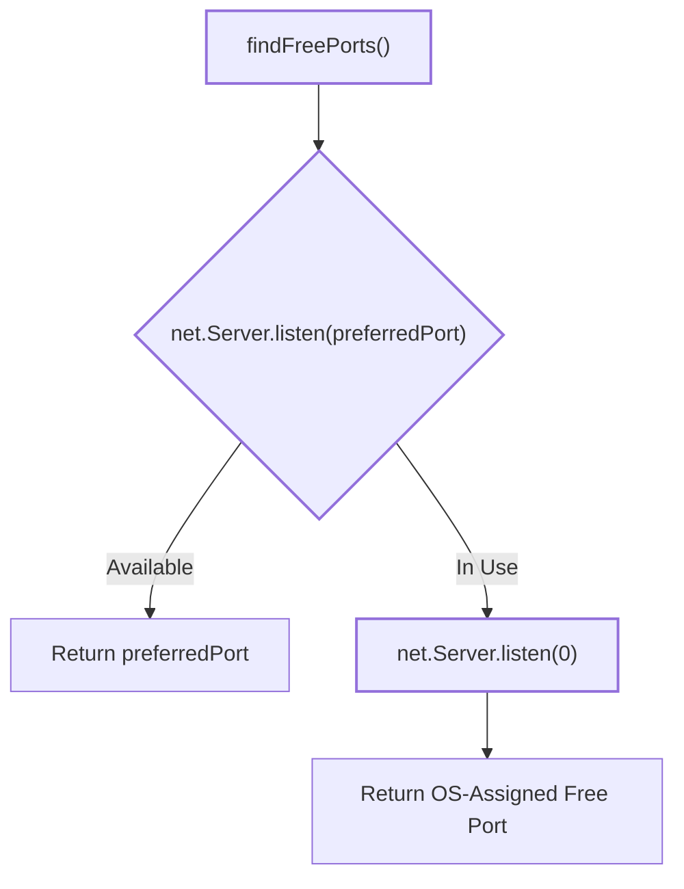
Sources: [__tests__/scripts/dev-safe.test.ts:51-175](), [scripts/dev-safe.mjs:1-182]()

### State Directory and Cryptographic Key Initialization
Agent Canvas initializes its state in `~/.openhands/agent-canvas/` [scripts/dev-safe.mjs:84-89](). 
*   **API Key (`api-key.txt`)**: Generated via `generateRandomApiKey()` (64-character hex string) and persisted with file mode `0o600` [scripts/dev-safe.mjs:72-172](). Loaded via `getOrCreatePersistedApiKey()` [scripts/dev-safe.mjs:148-180]() so that session keys remain stable across restarts.
*   **Secret Key (`secret-key.txt`)**: Stored in the same state directory to ensure development and Docker environments share consistent encryption keys [scripts/dev-safe.mjs:101-106]().

Sources: [scripts/dev-safe.mjs:72-180]()

---

## `dev-safe.mjs` Isolation Mechanism

The `scripts/dev-safe.mjs` orchestration script encapsulates lifecycle management, error handling, and clean shutdown procedures.

Title: "Code-Entity Space: dev-safe.mjs and Process Utilities"
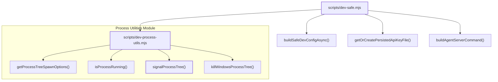
Sources: [scripts/dev-safe.mjs:1-182](), [scripts/dev-process-utils.mjs:1-150]()

### Process Tree Isolation and Cleanup
To prevent zombie Python processes and lingering server handles when terminating development tasks, `scripts/dev-process-utils.mjs` provides robust process group control [scripts/dev-process-utils.mjs:1-150]().
*   **POSIX Process Groups**: Spawns child services with `getProcessTreeSpawnOptions()` (`detached: true`) so they become process group leaders [scripts/dev-process-utils.mjs:34-40](). On `SIGINT`, `signalProcessTree()` sends the signal to `-pid`, terminating wrapper chains (`launcher -> uvx -> python`) [scripts/dev-process-utils.mjs:76-97]().
*   **Windows Process Trees**: Uses `killWindowsProcessTree()` invoking `taskkill /pid <pid> /t /f` to clean up child processes on Windows platforms where process groups are unsupported [scripts/dev-process-utils.mjs:118-129]().

Sources: [scripts/dev-safe.mjs:1-182](), [scripts/dev-process-utils.mjs:1-150]()

---

# Page: Configuration and Environment Variables

# Configuration and Environment Variables

<details>
<summary>Relevant source files</summary>

The following files were used as context for generating this wiki page:

- [.env.sample](.env.sample)
- [.github/pr-assets/pr-16605-test-results.png](.github/pr-assets/pr-16605-test-results.png)
- [__tests__/api/agent-server-adapter.test.ts](__tests__/api/agent-server-adapter.test.ts)
- [__tests__/api/agent-server-config.test.ts](__tests__/api/agent-server-config.test.ts)
- [__tests__/api/agent-server-conversation-service.test.ts](__tests__/api/agent-server-conversation-service.test.ts)
- [__tests__/api/hooks-service.test.ts](__tests__/api/hooks-service.test.ts)
- [__tests__/api/use-create-conversation-metadata.test.ts](__tests__/api/use-create-conversation-metadata.test.ts)
- [__tests__/components/features/chat/skill-install-restart-banner.test.tsx](__tests__/components/features/chat/skill-install-restart-banner.test.tsx)
- [__tests__/hooks/mutation/use-create-conversation.test.tsx](__tests__/hooks/mutation/use-create-conversation.test.tsx)
- [__tests__/scripts/dev-static.test.ts](__tests__/scripts/dev-static.test.ts)
- [__tests__/scripts/dev-with-automation.test.ts](__tests__/scripts/dev-with-automation.test.ts)
- [__tests__/scripts/static-server.test.ts](__tests__/scripts/static-server.test.ts)
- [docker/entrypoint.sh](docker/entrypoint.sh)
- [scripts/dev-static.mjs](scripts/dev-static.mjs)
- [scripts/dev-with-automation.mjs](scripts/dev-with-automation.mjs)
- [scripts/runtime-services-info.mjs](scripts/runtime-services-info.mjs)
- [scripts/static-server.mjs](scripts/static-server.mjs)
- [src/api/agent-server-adapter.test.ts](src/api/agent-server-adapter.test.ts)
- [src/api/agent-server-adapter.ts](src/api/agent-server-adapter.ts)
- [src/api/agent-server-config.ts](src/api/agent-server-config.ts)
- [src/api/conversation-service/agent-server-conversation-service.api.ts](src/api/conversation-service/agent-server-conversation-service.api.ts)
- [src/api/hooks-service.ts](src/api/hooks-service.ts)
- [src/hooks/mutation/use-create-conversation.ts](src/hooks/mutation/use-create-conversation.ts)
- [vite.config.ts](vite.config.ts)

</details>


## Purpose and Scope

Agent Canvas utilizes a multi-layered configuration system designed to support diverse deployment models—from local development via `uvx` to containerized Docker environments and Electron desktop applications. This system bridges build-time constants, centralized defaults, and dynamic runtime injection to ensure the frontend can discover and authenticate with backend services seamlessly.

This document details the configuration architecture of Agent Canvas, explaining how environment variables (`.env.sample`), centralized defaults (`config/defaults.json`), build-time flags (`VITE_*`), runtime injection (`sessionApiKey` and `runtimeServicesInfo`), and core configuration modules (`src/api/agent-server-config.ts`) interact during application startup and operation.

Sources: `[config/defaults.json:1-45]()`, `[src/api/agent-server-config.ts:1-213]()`

---

## Configuration Hierarchy and Data Flow

Configuration is resolved through a priority chain. Build-time variables (`VITE_*`) are baked into the application bundle by Vite, while runtime variables are injected into `index.html` at serve-time or resolved dynamically by the `src/api/agent-server-config.ts` module.

### Configuration Data Flow Diagram

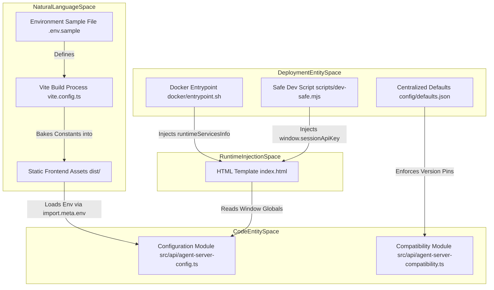

Sources: `[config/defaults.json:1-45]()`, `[src/api/agent-server-config.ts:1-132]()`, `[vite.config.ts:91-106]()`

---

## Centralized Defaults (`config/defaults.json`)

The `config/defaults.json` file is the single source of truth for version pins, ports, and paths shared across the monorepo. It is consumed by build scripts and deployment pipelines `[config/defaults.json:1-2]()`.

| Key | Purpose | Code Entity Reference |
| :--- | :--- | :--- |
| `versions.agentServer` | Pinned version of the agent-server SDK. | `DEFAULT_AGENT_SERVER_VERSION` `[config/defaults.json:4]()` |
| `compatibility.minimumAgentServer` | Minimum backend version required for the UI. | `SHARED_DEFAULTS.compatibility.minimumAgentServer` `[config/defaults.json:9]()` |
| `ports.agentServer` | Default port for the agent-server (18000). | `DEFAULT_BACKEND_PORT` `[config/defaults.json:20]()` |
| `ports.automation` | Default port for the automation service (18001). | `DEFAULT_AUTOMATION_PORT` `[config/defaults.json:21]()` |
| `paths.vscodeBasePath` | Prefix for the bundled editor (default `/vscode`). | `vscodeBasePath` `[config/defaults.json:33]()` |
| `telemetry.posthogApiKey` | Default PostHog key for telemetry. | `posthogApiKey` `[config/defaults.json:42]()` |
| `constraints.agentClientProtocol` | Version pin for the ACP dependency. | `agentClientProtocol` `[config/defaults.json:13]()` |

Sources: `[config/defaults.json:1-45]()`

---

## Environment Variables (`.env.sample`)

Agent Canvas uses `VITE_` prefixed variables for frontend configuration. These are defined in `.env.sample` and loaded during development via Vite configuration hooks `[vite.config.ts:91-106]()`.

### Core Connectivity
- `VITE_BACKEND_BASE_URL`: The full URL for the agent-server API. If omitted, the frontend defaults to the current window origin `[src/api/agent-server-config.ts:181-190]()`.
- `VITE_SESSION_API_KEY`: An optional static API key for backend authentication `[src/api/agent-server-config.ts:119-132]()`.

### Runtime Behavior
- `VITE_WORKING_DIR`: The default workspace path sent when starting conversations. Defaults to `workspace/project` `[src/api/agent-server-config.ts:1-201]()`.
- `VITE_ENABLE_BROWSER_TOOLS`: Controls whether `browser_tool_set` is requested in conversation payloads `[src/api/agent-server-adapter.ts:147-149]()`.
- `VITE_BASE_PATH`: The subpath for serving the SPA (e.g., `/canvas`) `[config/defaults.json:31]()`, normalized via `normalizeBasePath` `[vite.config.ts:28-34]()`.

Sources: `[config/defaults.json:31]()`, `[src/api/agent-server-config.ts:119-201]()`, `[src/api/agent-server-adapter.ts:147-149]()`, `[vite.config.ts:28-106]()`

---

## Runtime Variable Injection

To allow the frontend to adapt to dynamic environments without a re-build, variables are injected into `index.html` at serve time by servers like `scripts/static-server.mjs` or development orchestrators.

### `window.sessionApiKey`
The `scripts/dev-safe.mjs` utility generates a cryptographically secure random API key, persisting it to storage and injecting it into the frontend. This key is used as the `X-Session-API-Key` header for both `agent-server` and `automation` backends `[src/api/agent-server-config.ts:119-132]()`.

### `window.runtimeServicesInfo`
Modules generate a JSON structure describing available sidecar services, informing the UI about the automation backend's URL and status via `RuntimeServicesInfo` `[src/api/agent-server-adapter.ts:158-180]()`. In Vite dev mode, runtime services info is passed through `VITE_RUNTIME_SERVICES_INFO` `[vite.config.ts:100-106]()`.

Sources: `[src/api/agent-server-config.ts:119-132]()`, `[src/api/agent-server-adapter.ts:158-180]()`, `[vite.config.ts:100-106]()`, `[scripts/static-server.mjs:137-139]()`

---

## Configuration Module (`src/api/agent-server-config.ts`)

The `src/api/agent-server-config.ts` module is the central internal consumer for all configuration. It implements the resolution logic that prioritizes runtime injection over build-time environment variables.

### Configuration Resolution Diagram

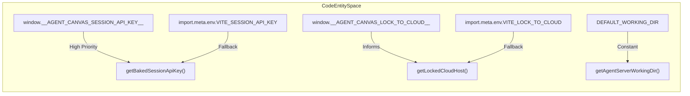

- `getBakedSessionApiKey()`: Resolves the key used for authenticated requests from `VITE_SESSION_API_KEY` or `window.__AGENT_CANVAS_SESSION_API_KEY__` `[src/api/agent-server-config.ts:119-132]()`.
- `DEFAULT_WORKING_DIR`: Exported as `workspace/project` `[src/api/agent-server-config.ts:1]()` and resolved via `getAgentServerWorkingDir()` `[src/api/agent-server-config.ts:196-201]`.
- `getAgentServerBaseUrl()`: Resolves the base URL for the `agent-server` with fallback to `window.location.origin` `[src/api/agent-server-config.ts:181-190]()`.

Sources: `[src/api/agent-server-config.ts:1-213]()`

---

## Compatibility and Versioning

The compatibility subsystem enforces version constraints and capability flags between the frontend and backend servers.

- **Minimum Version**: It reads `minimumAgentServer` from the bundled `config/defaults.json` `[config/defaults.json:9]()`.
- **Feature Detection**: The `isAgentServerToolAvailable` function checks if specific tools are supported by the current backend `[src/api/agent-server-adapter.ts:15-17]()`.
- **Runtime Info**: The `fetchBackendRuntimeServicesInfo` function retrieves and parses the `runtime_services` block from the backend's `/server_info` endpoint `[src/api/agent-server-adapter.ts:13-17]()`.

Sources: `[config/defaults.json:8-10]()`, `[src/api/agent-server-adapter.ts:13-17]()`

---

# Page: Self-Hosting and Docker Deployment

# Self-Hosting and Docker Deployment

<details>
<summary>Relevant source files</summary>

The following files were used as context for generating this wiki page:

- [.github/pr-assets/pr-16605-test-results.png](.github/pr-assets/pr-16605-test-results.png)
- [__tests__/scripts/acp-docker-env-sync.test.ts](__tests__/scripts/acp-docker-env-sync.test.ts)
- [__tests__/scripts/dev-static.test.ts](__tests__/scripts/dev-static.test.ts)
- [__tests__/scripts/dev-with-automation.test.ts](__tests__/scripts/dev-with-automation.test.ts)
- [__tests__/scripts/static-server.test.ts](__tests__/scripts/static-server.test.ts)
- [docker/entrypoint.sh](docker/entrypoint.sh)
- [docs/ACP_AGENTS.md](docs/ACP_AGENTS.md)
- [docs/README.md](docs/README.md)
- [docs/SELF_HOSTING.md](docs/SELF_HOSTING.md)
- [examples/acp-docker/.env.example](examples/acp-docker/.env.example)
- [examples/acp-docker/README.md](examples/acp-docker/README.md)
- [examples/acp-docker/docker-compose.yml](examples/acp-docker/docker-compose.yml)
- [scripts/dev-static.mjs](scripts/dev-static.mjs)
- [scripts/dev-with-automation.mjs](scripts/dev-with-automation.mjs)
- [scripts/gen-acp-docker-env.mjs](scripts/gen-acp-docker-env.mjs)
- [scripts/runtime-services-info.mjs](scripts/runtime-services-info.mjs)
- [scripts/static-server.mjs](scripts/static-server.mjs)
- [tests/e2e/live-acp/README.md](tests/e2e/live-acp/README.md)
- [tests/e2e/live-acp/acp-docker-e2e.mts](tests/e2e/live-acp/acp-docker-e2e.mts)
- [vite.config.ts](vite.config.ts)

</details>


This page explains the self-hosting architecture of OpenHands Agent Canvas, focusing on the all-in-one Docker image, the initialization logic in `docker/entrypoint.sh`, the three-service topology behind the ingress proxy, the Helm chart for Kubernetes orchestration, and core security guidelines for production deployments.

## All-in-One Docker Architecture and Entrypoint Initialization

The Docker deployment utilizes a multi-stage build process to package a unified runtime environment. At container startup, `docker/entrypoint.sh` coordinates the initialization of three core services (and optional sidecars) behind a single ingress proxy [docker/entrypoint.sh:1-56]().

### Service Components

1.  **Static Server / Ingress Proxy**: Serves the production build of the React/TypeScript frontend and reverse-proxies API requests and WebSockets to the respective backend services [scripts/static-server.mjs:1-44]().
2.  **Agent Server**: The core execution engine from the `software-agent-sdk`, responsible for managing agent sessions, tool execution, and the bundled `openvscode-server` instance [docker/entrypoint.sh:16-32]().
3.  **Automation Backend**: A Python-based service handling scheduled runs and event-driven automations [docker/entrypoint.sh:18-18]().

Sources: [docker/entrypoint.sh:1-56](), [scripts/static-server.mjs:1-44]()

## Component Topology and Ingress Routing

A Node.js-based static server and reverse proxy (`scripts/static-server.mjs`) unifies these services behind a single port (`8000` by default) [scripts/static-server.mjs:86-102](). It handles runtime injection of the session API key and runtime service metadata into the frontend bundle [scripts/static-server.mjs:134-140]().

| Path Prefix | Destination Service | Internal Port | Source Reference |
| :--- | :--- | :--- | :--- |
| `/api/automation/*` | Automation Backend | `18001` | [docker/entrypoint.sh:18-18]() |
| `/api/*`, `/sockets` | Agent Server | `18000` | [docker/entrypoint.sh:17-17]() |
| `/vscode` | Bundled Editor (`openvscode-server`) | `8001` | [docker/entrypoint.sh:20-20]() |
| `/*` (default) | Static Frontend SPA | N/A | [docker/entrypoint.sh:8-10]() |

Sources: [docker/entrypoint.sh:1-56](), [scripts/static-server.mjs:86-102]()

## Code Entity Maps

### Code Entity Map 1: Entrypoint Environment and Service Initialization

The following diagram bridges natural language configuration concepts to the underlying shell scripts and environment mappings executed during container startup.

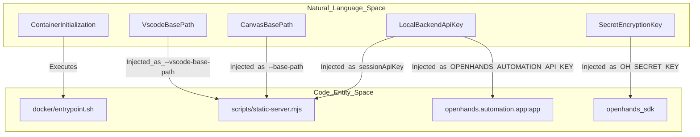

Sources: [docker/entrypoint.sh:33-56](), [scripts/static-server.mjs:134-155]()

### Code Entity Map 2: Ingress Proxy Routing

This diagram illustrates how client HTTP requests map from URL paths to internal proxy handler routes defined in `scripts/static-server.mjs` and `scripts/proxy-utils.mjs`.

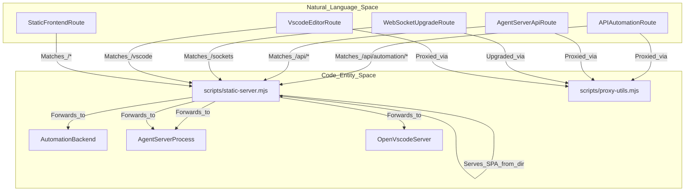

Sources: [scripts/static-server.mjs:30-44](), [docs/SELF_HOSTING.md:25-42]()

## Network Data Flow

The ingress proxy (`scripts/static-server.mjs`) acts as the central traffic controller, injecting configuration and forwarding requests to upstream local backends [scripts/static-server.mjs:1-44]().

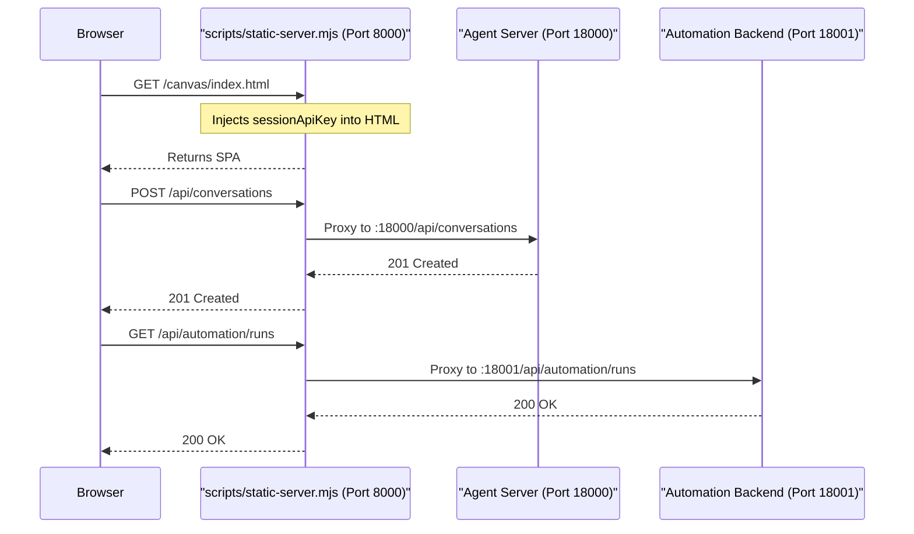

Sources: [scripts/static-server.mjs:1-44](), [docker/entrypoint.sh:1-56]()

## Kubernetes Deployment (Helm)

For cloud orchestration, Helm charts and templates are provided for cluster deployments.

*   **Topology**: Deploys workloads configured with persistent volume claims to ensure stable network identifiers and persistent storage for agent workspaces and conversation history.
*   **Version Pinning**: Container images reference release tags matching the application version specifications.
*   **Configuration**: Exposes parameters for customizing ports, replica counts, persistent volume storage classes, and ingress routes via Helm `values.yaml` configurations.

Sources: [docs/SELF_HOSTING.md:1-50]()

## Self-Hosting Security Guide

When deploying Agent Canvas in a production or self-hosted environment (such as a remote cloud VM), observe the following security practices [docs/SELF_HOSTING.md:1-178]():

1.  **API Key Management**: Always configure an explicit `LOCAL_BACKEND_API_KEY` to prevent reliance on auto-generated keys that can invalidate state if storage volumes are recreated. Both the agent server and automation service authenticate requests using the `X-Session-API-Key` header [docs/SELF_HOSTING.md:120-130]().
2.  **Secret Encryption**: Ensure `OH_SECRET_KEY` is persistently maintained. Loss of this key prevents decryption of stored provider credentials, API keys, and secure configuration settings [docs/SELF_HOSTING.md:35-36]().
3.  **Network Isolation**: Restrict container network access and firewalls (e.g., exposing only SSH and reverse-proxied HTTPS ports) when executing untrusted target repositories, as agents execute shell operations directly within the sandbox environment [docs/SELF_HOSTING.md:72-94]().
4.  **Telemetry Control**: Telemetry can be fully disabled using environment flags such as `AGENT_CANVAS_DISABLE_TELEMETRY=true` [scripts/static-server.mjs:101-102]().

Sources: [docs/SELF_HOSTING.md:1-178](), [scripts/static-server.mjs:101-102]()

---

# Page: Backend Registry and Multi-Backend Architecture

# Backend Registry and Multi-Backend Architecture

<details>
<summary>Relevant source files</summary>

The following files were used as context for generating this wiki page:

- [.screenshots/progress-event-fix.png](.screenshots/progress-event-fix.png)
- [__tests__/api/backend-registry/storage.test.ts](__tests__/api/backend-registry/storage.test.ts)
- [__tests__/api/to-app-conversation-session-key.test.ts](__tests__/api/to-app-conversation-session-key.test.ts)
- [__tests__/components/backends/add-backend-modal.test.tsx](__tests__/components/backends/add-backend-modal.test.tsx)
- [__tests__/components/backends/backend-form-modal.test.tsx](__tests__/components/backends/backend-form-modal.test.tsx)
- [__tests__/components/backends/manage-backends-modal.test.tsx](__tests__/components/backends/manage-backends-modal.test.tsx)
- [__tests__/contexts/active-backend-context.test.tsx](__tests__/contexts/active-backend-context.test.tsx)
- [__tests__/hooks/query/use-backends-health.test.tsx](__tests__/hooks/query/use-backends-health.test.tsx)
- [__tests__/root.test.tsx](__tests__/root.test.tsx)
- [__tests__/vitest-setup-progress-event.test.ts](__tests__/vitest-setup-progress-event.test.ts)
- [specs/backend-management.md](specs/backend-management.md)
- [src/api/backend-registry/auth.ts](src/api/backend-registry/auth.ts)
- [src/api/backend-registry/default-backend.ts](src/api/backend-registry/default-backend.ts)
- [src/api/backend-registry/storage.ts](src/api/backend-registry/storage.ts)
- [src/api/backend-registry/types.ts](src/api/backend-registry/types.ts)
- [src/components/features/backends/backend-form-modal.tsx](src/components/features/backends/backend-form-modal.tsx)
- [src/components/features/backends/backend-row.tsx](src/components/features/backends/backend-row.tsx)
- [src/components/features/backends/backend-version.tsx](src/components/features/backends/backend-version.tsx)
- [src/components/features/backends/manage-backends-modal.tsx](src/components/features/backends/manage-backends-modal.tsx)
- [src/contexts/active-backend-context.tsx](src/contexts/active-backend-context.tsx)
- [src/hooks/query/use-backends-health.ts](src/hooks/query/use-backends-health.ts)
- [src/hooks/query/use-cloud-current-user-id.ts](src/hooks/query/use-cloud-current-user-id.ts)
- [src/hooks/query/use-cloud-organizations.ts](src/hooks/query/use-cloud-organizations.ts)
- [src/i18n/translation.json](src/i18n/translation.json)
- [src/root.tsx](src/root.tsx)
- [vitest.setup.ts](vitest.setup.ts)

</details>


The Agent Canvas architecture is designed to be backend-agnostic, allowing users to connect to multiple `agent-server` instances simultaneously. These backends can be local instances running on a developer's machine or managed cloud instances [src/api/backend-registry/types.ts:1-23](). The **Backend Registry** acts as the central source of truth for managing these connections, handling persistence, credential storage, active backend selection, and continuous health monitoring [src/contexts/active-backend-context.tsx:31-69]().

### Multi-Backend Topology

Agent Canvas maintains a registered list of `Backend` entities. At any given time, exactly one backend is designated as the **Active** backend, dictating where API requests for conversations, settings, and automations are routed [src/api/backend-registry/types.ts:1-23]().

Title: Multi-Backend Architecture Code Mapping
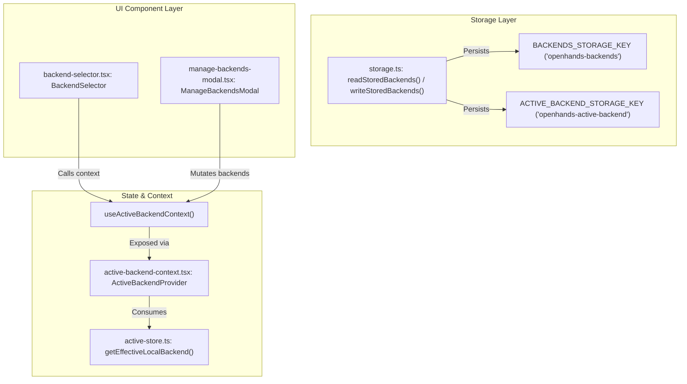

**Sources:**
- [src/api/backend-registry/types.ts:1-23]()
- [src/api/backend-registry/storage.ts:13-14]()
- [src/contexts/active-backend-context.tsx:31-69]()

---

### Backend Registry Internals

The backend-registry module (`storage.ts`, `active-store.ts`, `types.ts`, `auth.ts`, `default-backend.ts`) provides persistent configuration management across browser restarts [src/api/backend-registry/storage.ts:1-150](). It leverages `localStorage` for durable storage across tabs and `sessionStorage` for tab-scoped active selections [src/api/backend-registry/storage.ts:205-236](). On initial boot, the system seeds a default local backend if configuration environment variables like `VITE_BACKEND_BASE_URL` and `VITE_SESSION_API_KEY` are supplied [src/api/backend-registry/storage.test.ts:71-86]().

For deep technical details on storage schemas, seeding rules, active state management, and testing specs, see [Backend Registry Internals](#3.1).

**Sources:**
- [src/api/backend-registry/storage.ts:95-150]()
- [src/api/backend-registry/active-store.ts:1-50]()
- [__tests__/api/backend-registry/storage.test.ts:34-86]()

---

### ActiveBackendProvider Context

The `ActiveBackendProvider` component wraps the React tree and exposes registry operations via the `useActiveBackendContext` hook [src/contexts/active-backend-context.tsx:71-80](). It coordinates state synchronization and triggers React Query cache invalidation whenever the active backend or organization changes [src/contexts/active-backend-context.tsx:89-121]().

| Function | Role / Action |
| :--- | :--- |
| `setActive` | Switches the current backend or organization ID, triggering cache re-keying [src/contexts/active-backend-context.tsx:89-121]() |
| `addBackend` | Appends a new backend configuration and immediately switches to it [src/contexts/active-backend-context.tsx:123-139]() |
| `updateBackend` | Patches an existing backend entry, incrementing its `connectionRevision` to reset health checks [src/contexts/active-backend-context.tsx:141-182]() |
| `removeBackend` | Deletes a backend entry and safely falls back to the next available healthy instance [src/contexts/active-backend-context.tsx:184-206]() |

For further details on context implementation and state hooks, see [Backend Registry Internals](#3.1).

**Sources:**
- [src/contexts/active-backend-context.tsx:71-215]()
- [__tests__/contexts/active-backend-context.test.tsx:97-121]()

---

### Backend Selector and Switching UI

The UI layer provides visual components for switching environments, managing connections, and authenticating against cloud infrastructure [src/components/features/backends/manage-backends-modal.tsx:63-128](). When a user interacts with the `BackendSelector` or `ManageBackendsModal`, the application coordinates environment transition overlays to cleanly reset queries and cache states [src/components/features/backends/backend-form-modal.tsx:43-58](). Cloud integrations leverage OAuth device-flow authentication via `DeviceFlowAuth` [src/components/features/backends/backend-row.tsx:122-135]().

For detailed documentation on the BackendSelector, modal forms, device-flow login, and resizable layout panels, see [Backend Selector UI and Environment Switching](#3.2).

**Sources:**
- [src/components/features/backends/manage-backends-modal.tsx:63-128]()
- [src/components/features/backends/backend-form-modal.tsx:43-58]()
- [src/components/features/backends/backend-row.tsx:122-135]()

---

### Health Monitoring and Compatibility

Agent Canvas continuously monitors backend availability through background probes and checks version compatibility floors defined in `config/defaults.json` [src/api/agent-server-compatibility.ts:19-20]() via `useBackendsHealth` [src/hooks/query/use-backends-health.ts:29-30]().

Title: Health Probing and Version Enforcement Flow
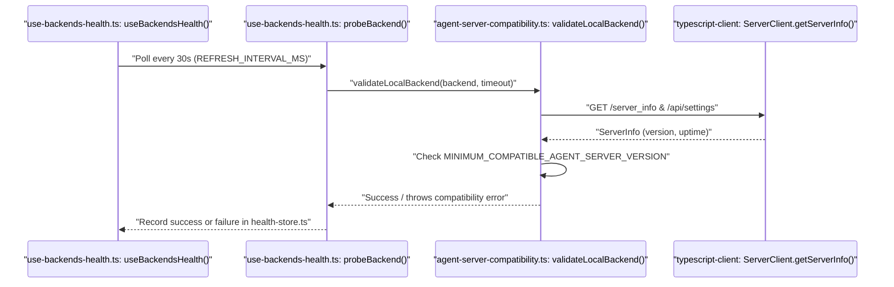

*   **Probing and Retries:** The system polls each backend every 30 seconds, executing quick internal retries (2 attempts with a 300ms delay) to prevent transient warmup errors from showing false disconnects [src/hooks/query/use-backends-health.ts:29-30]().
*   **Status Indicators:** Connectivity is rendered using `BackendStatusDot` [src/components/features/backends/backend-status-dot.tsx:1-20]() to indicate connected, disconnected, or missing API key states [src/components/features/backends/backend-row.tsx:41-62]().
*   **Version Enforcement:** The `agent-server-compatibility.ts` module enforces minimum version requirements, raising `AgentServerUnsupportedVersionError` when a server falls below the required threshold [src/api/agent-server-compatibility.ts:19-93]().

For deep technical details on version pins, feature detection, and compatibility warning banners, see [Agent Server Compatibility and Version Checks](#3.3).

**Sources:**
- [src/hooks/query/use-backends-health.ts:29-30]()
- [src/hooks/query/use-backends-health.ts:153-166]()
- [src/api/agent-server-compatibility.ts:19-93]()
- [__tests__/components/backends/manage-backends-modal.test.tsx:185-202]()

---

# Page: Backend Registry Internals

# Backend Registry Internals

<details>
<summary>Relevant source files</summary>

The following files were used as context for generating this wiki page:

- [.screenshots/progress-event-fix.png](.screenshots/progress-event-fix.png)
- [__tests__/api/backend-registry/active-store.test.ts](__tests__/api/backend-registry/active-store.test.ts)
- [__tests__/api/backend-registry/storage.test.ts](__tests__/api/backend-registry/storage.test.ts)
- [__tests__/api/backend-registry/url-selection.test.ts](__tests__/api/backend-registry/url-selection.test.ts)
- [__tests__/api/to-app-conversation-session-key.test.ts](__tests__/api/to-app-conversation-session-key.test.ts)
- [__tests__/components/shared/navigation-link.test.tsx](__tests__/components/shared/navigation-link.test.tsx)
- [__tests__/contexts/active-backend-context.test.tsx](__tests__/contexts/active-backend-context.test.tsx)
- [__tests__/hooks/use-backend-scoped-path.test.tsx](__tests__/hooks/use-backend-scoped-path.test.tsx)
- [__tests__/vitest-setup-progress-event.test.ts](__tests__/vitest-setup-progress-event.test.ts)
- [specs/backend-management.md](specs/backend-management.md)
- [src/api/backend-registry/active-store.ts](src/api/backend-registry/active-store.ts)
- [src/api/backend-registry/auth.ts](src/api/backend-registry/auth.ts)
- [src/api/backend-registry/default-backend.ts](src/api/backend-registry/default-backend.ts)
- [src/api/backend-registry/storage.ts](src/api/backend-registry/storage.ts)
- [src/api/backend-registry/types.ts](src/api/backend-registry/types.ts)
- [src/api/backend-registry/url-selection.ts](src/api/backend-registry/url-selection.ts)
- [src/api/conversation-service/agent-server-conversation-service.types.ts](src/api/conversation-service/agent-server-conversation-service.types.ts)
- [src/components/features/conversation-panel/compact-conversation-row.tsx](src/components/features/conversation-panel/compact-conversation-row.tsx)
- [src/components/shared/navigation-link.tsx](src/components/shared/navigation-link.tsx)
- [src/contexts/active-backend-context.tsx](src/contexts/active-backend-context.tsx)
- [src/hooks/query/use-cloud-current-user-id.ts](src/hooks/query/use-cloud-current-user-id.ts)
- [src/hooks/query/use-cloud-organizations.ts](src/hooks/query/use-cloud-organizations.ts)
- [vitest.setup.ts](vitest.setup.ts)

</details>


The `backend-registry` module is the core architectural component responsible for managing multiple agent-server backends. It handles persistence, active backend selection, health monitoring, protocol routing, and multi-tenant organization resolution for cloud environments across local and remote instances [src/api/backend-registry/storage.ts:1-15](), [src/api/backend-registry/active-store.ts:1-20]().

---

## Overview and Core Types

The registry relies on several foundational modules to define data contracts and fallback parameters:
- `types.ts`: Defines core interfaces including `Backend`, `BackendKind` (`"local"` | `"cloud"`), `BackendAuthMode` (`"api-key"` | `"cookie"`), `BackendSelection`, and `ResolvedActiveBackend` [src/api/backend-registry/storage.ts:6-11](), [src/api/backend-registry/active-store.ts:8-8]().
- `default-backend.ts`: Supplies factory functions `makeDefaultLocalBackend()` and `makeLockedCloudBackend()` used during initial boot sequences [src/api/backend-registry/storage.ts:1-5]().
- `auth.ts`: Manages authentication states and credential injection for registered backends [src/api/backend-registry/auth.ts:1-18]().

### Code Entity Relationship: Architecture & Types
The following diagram maps natural language concepts to their specific code implementations within the registry foundation.

**Entity Mapping: Registry Foundation to Code**
```mermaid
graph TD
    subgraph "NaturalLanguageSpace"["Natural Language Space"]
        A["Backend Data Model"]
        B["Default Seeding"]
        C["Cloud Locking"]
    end

    subgraph "CodeEntitySpace"["Code Entity Space"]
        A --> A1["types.ts::Backend"]
        A --> A2["types.ts::ResolvedActiveBackend"]
        B --> B1["default-backend.ts::makeDefaultLocalBackend()"]
        B --> B2["storage.ts::readStoredBackends()"]
        C --> C1["default-backend.ts::makeLockedCloudBackend()"]
        C --> C2["storage.ts::readStoredBackends()"]
    end
```
Sources: [src/api/backend-registry/storage.ts:1-11](), [src/api/backend-registry/storage.ts:104-149]()

---

## Storage and Persistence

Agent Canvas uses a hybrid storage approach managed in `storage.ts` to ensure that backend selection is both persistent across browser sessions and isolated across browser tabs [src/api/backend-registry/storage.ts:1-244]().

| Key | Storage Type | Purpose |
|:--- |:--- |:--- |
| `openhands-backends` | `localStorage` | The full list of registered `Backend` objects. [src/api/backend-registry/storage.ts:13-13]() |
| `openhands-active-backend` | `sessionStorage` | Tab-scoped active selection. Prevents Tab A from changing Tab B's backend. [src/api/backend-registry/storage.ts:208-214]() |
| `openhands-active-backend` | `localStorage` | Fallback for fresh tabs to inherit the last-used backend. [src/api/backend-registry/storage.ts:216-218]() |

### Default Backend Seeding and Cloud Locking
On first initialization, the registry reads or seeds backends using environment variables and default definitions (`default-backend.ts`). If valid configuration parameters (`VITE_BACKEND_BASE_URL` and `VITE_SESSION_API_KEY`) are present, `readStoredBackends()` generates a default local backend with the ID `default-local` [src/api/backend-registry/storage.ts:122-128](), [src/api/backend-registry/storage.ts:71-86]().

The `storage.ts` module also handles seeding a cookie-authenticated cloud backend if `window.__AGENT_CANVAS_LOCK_TO_CLOUD__` is set and matches the current origin [src/api/backend-registry/storage.ts:108-116]().

### URL Selection Override
A backend pinned in the URL via query parameters (`url-selection.ts`) wins over stored state, ensuring links opened in new tabs land on the correct backend [src/api/backend-registry/active-store.ts:104-114](), [src/api/backend-registry/url-selection.ts:17-18]().

Sources: [src/api/backend-registry/storage.ts:1-244](), [src/api/backend-registry/active-store.ts:104-114](), [src/api/backend-registry/url-selection.ts:1-83]()

---

## Active Backend Store and Context

The `ActiveBackendProvider` (`active-backend-context.tsx`) wraps the synchronous `active-store.ts` implementation using `useSyncExternalStore` [src/contexts/active-backend-context.tsx:71-80](), [src/api/backend-registry/active-store.ts:1-193]().

### Key Functions
- `setActive(backendId, orgId)`: Switches the current backend and clears telemetry cloud contexts [src/contexts/active-backend-context.tsx:89-121]().
- `addBackend(backend)`: Registers a new backend and automatically switches to it (**BM-001**) [src/contexts/active-backend-context.tsx:124-139]().
- `updateBackend(id, patch)`: Updates backend metadata, resetting health status and incrementing `connectionRevision` if the host or API key changes [src/contexts/active-backend-context.tsx:141-182]().
- `removeBackend(id)`: Removes a backend from the registry and drops its health history [src/contexts/active-backend-context.tsx:184-204]().

### Telemetry Boundaries
When switching between Local and Cloud backends, or between different Cloud backends, `applyTelemetrySelectionBoundary` invokes `setTelemetryCloudContext(null)` to prevent leaking analytics data across boundaries [src/contexts/active-backend-context.tsx:53-69]().

### Code Entity Relationship: Store and Context
**Entity Mapping: State Management to Code**
```mermaid
graph TD
    subgraph "NaturalLanguageSpace"["Natural Language Space"]
        A["External Store Subscription"]
        B["Active Backend Mutation"]
        C["Telemetry Context Isolation"]
    end

    subgraph "CodeEntitySpace"["Code Entity Space"]
        A --> A1["active-store.ts::subscribeActiveBackend()"]
        A --> A2["ActiveBackendProvider::useSyncExternalStore()"]
        B --> B1["active-store.ts::setActiveSelection()"]
        B --> B2["active-backend-context.tsx::setActive()"]
        C --> C1["active-backend-context.tsx::applyTelemetrySelectionBoundary()"]
        C --> C2["services/telemetry::setTelemetryCloudContext()"]
    end
```
Sources: [src/api/backend-registry/active-store.ts:158-185](), [src/contexts/active-backend-context.tsx:53-121]()

---

## Health Monitoring and Effective Local Backend

### Backend Health
Health states are tracked to determine backend availability and skip unreachable nodes via `pickFallbackBackend()` [src/api/backend-registry/active-store.ts:52-62](). Consecutive failures are recorded up to `MAX_CONSECUTIVE_FAILURES` [src/api/backend-registry/health-storage.ts:4-4]().

**Backend Health Monitoring Flow**
```mermaid
graph TD
    A["StartBackendHealthMonitoring"] --> B{"BackendType"}
    B -- "Local" --> C["CallApiSettingsAndServerInfo"]
    B -- "Cloud" --> D["CallApiKeysCurrentOrOrganizations"]
    C --> E{"ProbeSuccessful"}
    D --> E
    E -- "Yes" --> F["RecordSuccessInHealthStore"]
    E -- "No" --> G["RecordFailureInHealthStore"]
    G --> H{"ConsecutiveFailuresLessThanMax"}
    H -- "Yes" --> I["RetryProbeAfterDelay"]
    H -- "No" --> J["MarkBackendAsDisabled"]
    F --> K["UpdateUIWithConnectedStatus"]
    J --> K
    I --> C
    K --> L["ContinuePollingEvery30s"]
```
Sources: [src/api/backend-registry/active-store.ts:52-62](), [src/api/backend-registry/health-storage.ts:4-4]()

### Effective Local Backend Resolution
Most UI services (settings, conversation CRUD, skills, MCP) speak the local agent-server protocol. `getEffectiveLocalBackend()` ensures cloud selections do not improperly borrow local endpoints [src/api/backend-registry/active-store.ts:140-144]().

**Effective Backend Resolution**
```mermaid
graph TD
    subgraph "active-store.ts"
        A["getEffectiveLocalBackend()"] --> B{"IsActiveBackendLocal"}
        B -- "Yes" --> C["ReturnActiveBackend"]
        B -- "No" --> D["ReturnNull"]
    end
```
Sources: [src/api/backend-registry/active-store.ts:140-144]()

---

## Backend Management Specifications

The implementation adheres to specific requirements defined in the backend management specifications:

| Spec ID | Requirement | Implementation |
|:--- |:--- |:--- |
| **BM-001** | Auto-switch to newly connected backend | Handled in `addBackend` within `ActiveBackendProvider`. [src/contexts/active-backend-context.tsx:124-139]() |
| **BM-002** | Probing backends for health | Logic used by `pickFallbackBackend` to skip disabled backends. [src/api/backend-registry/active-store.ts:53-57]() |
| **BM-003** | Fallback on active backend removal | If the active backend is deleted, `pickFallbackBackend` selects the first healthy local backend or the first available entry. [src/api/backend-registry/active-store.ts:52-62](), [src/api/backend-registry/active-store.ts:82-86]() |

Sources: [src/api/backend-registry/active-store.ts:52-62](), [src/contexts/active-backend-context.tsx:124-139]()

---

# Page: Backend Selector UI and Environment Switching

# Backend Selector UI and Environment Switching

<details>
<summary>Relevant source files</summary>

The following files were used as context for generating this wiki page:

- [__tests__/components/backends/backend-selector.test.tsx](__tests__/components/backends/backend-selector.test.tsx)
- [__tests__/components/backends/environment-switch-overlay.test.tsx](__tests__/components/backends/environment-switch-overlay.test.tsx)
- [__tests__/components/features/conversation/conversation-main.test.tsx](__tests__/components/features/conversation/conversation-main.test.tsx)
- [__tests__/components/features/settings/cloud-settings-link.test.tsx](__tests__/components/features/settings/cloud-settings-link.test.tsx)
- [__tests__/components/features/sidebar/sidebar-cloud-settings.test.tsx](__tests__/components/features/sidebar/sidebar-cloud-settings.test.tsx)
- [__tests__/components/features/sidebar/sidebar.test.tsx](__tests__/components/features/sidebar/sidebar.test.tsx)
- [__tests__/components/settings/llm-profiles/delete-profile-modal.test.tsx](__tests__/components/settings/llm-profiles/delete-profile-modal.test.tsx)
- [__tests__/components/settings/llm-profiles/profile-name-input.test.tsx](__tests__/components/settings/llm-profiles/profile-name-input.test.tsx)
- [__tests__/components/settings/llm-profiles/rename-profile-modal.test.tsx](__tests__/components/settings/llm-profiles/rename-profile-modal.test.tsx)
- [__tests__/hooks/use-resizable-panels.test.ts](__tests__/hooks/use-resizable-panels.test.ts)
- [__tests__/routes/root-layout.test.tsx](__tests__/routes/root-layout.test.tsx)
- [src/components/features/backends/backend-selector.tsx](src/components/features/backends/backend-selector.tsx)
- [src/components/features/backends/device-flow-auth.tsx](src/components/features/backends/device-flow-auth.tsx)
- [src/components/features/backends/environment-switch-overlay.tsx](src/components/features/backends/environment-switch-overlay.tsx)
- [src/components/features/backends/environment-switch-store.ts](src/components/features/backends/environment-switch-store.ts)
- [src/components/features/files-tab/segmented-toggle.tsx](src/components/features/files-tab/segmented-toggle.tsx)
- [src/components/features/settings/api-key-modal-base.tsx](src/components/features/settings/api-key-modal-base.tsx)
- [src/components/features/settings/brand-button.tsx](src/components/features/settings/brand-button.tsx)
- [src/components/features/settings/cloud-settings-link.tsx](src/components/features/settings/cloud-settings-link.tsx)
- [src/components/features/settings/llm-profiles/delete-profile-modal.tsx](src/components/features/settings/llm-profiles/delete-profile-modal.tsx)
- [src/components/features/settings/llm-profiles/index.ts](src/components/features/settings/llm-profiles/index.ts)
- [src/components/features/settings/llm-profiles/profile-name-input.tsx](src/components/features/settings/llm-profiles/profile-name-input.tsx)
- [src/components/features/settings/llm-profiles/rename-profile-modal.tsx](src/components/features/settings/llm-profiles/rename-profile-modal.tsx)
- [src/components/features/settings/settings-input.tsx](src/components/features/settings/settings-input.tsx)
- [src/components/features/sidebar/sidebar-conversation-list.tsx](src/components/features/sidebar/sidebar-conversation-list.tsx)
- [src/components/features/sidebar/sidebar-rail-body.tsx](src/components/features/sidebar/sidebar-rail-body.tsx)
- [src/components/features/sidebar/sidebar.tsx](src/components/features/sidebar/sidebar.tsx)
- [src/hooks/use-filtered-events.ts](src/hooks/use-filtered-events.ts)
- [src/hooks/use-resizable-panels.ts](src/hooks/use-resizable-panels.ts)
- [src/index.css](src/index.css)
- [src/routes/root-layout.tsx](src/routes/root-layout.tsx)
- [src/routes/shared-conversation.tsx](src/routes/shared-conversation.tsx)

</details>


The Backend Selector system provides the user interface for managing multiple agent-server environments. It enables users to register local or cloud backends, monitor their health, and switch between them seamlessly using a specialized overlay that manages state transitions and split-pane layouts.

---

## 1. Purpose and Scope

This document details the frontend implementation of backend selection, authentication flows, and layout management within Agent Canvas. It covers component architectures for `BackendSelector` [src/components/features/backends/backend-selector.tsx:142-150](), backend management modals, OAuth 2.0 device flow authentication (`DeviceFlowAuth`) [src/components/features/backends/device-flow-auth.tsx:71-85](), the environment switching transition overlay (`EnvironmentSwitchOverlay`) [src/components/features/backends/environment-switch-overlay.tsx:1](), and split-pane sizing via `useResizablePanels` [src/hooks/use-resizable-panels.ts:1]().

Sources:
- [src/components/features/backends/backend-selector.tsx:142-150]()
- [src/components/features/backends/device-flow-auth.tsx:71-85]()
- [src/components/features/backends/environment-switch-overlay.tsx:1]()
- [src/hooks/use-resizable-panels.ts:1]()

---

## 2. Backend Selector UI Components

The primary entry point for backend management is the `BackendSelector` component [src/components/features/backends/backend-selector.tsx:142-150](), typically mounted inside the sidebar rail [src/components/features/sidebar/sidebar-rail-body.tsx:28]().

### BackendSelector Implementation
`BackendSelector` utilizes a custom `Dropdown` component [src/ui/dropdown/dropdown.tsx:1]() to render registered backends and cloud organizations [src/components/features/backends/backend-selector.tsx:62-113]().
- **Organization Expansion**: For cloud backends, it fetches organization hierarchies via `useAllCloudOrganizations` [src/components/features/backends/backend-selector.tsx:10]() and maps each entry to individual options [src/components/features/backends/backend-selector.tsx:82-110]().
- **Health Indicators**: It embeds `BackendStatusDot` [src/components/features/backends/backend-status-dot.tsx:1]() into each option prefix based on probes from `useBackendsHealth` [src/components/features/backends/backend-selector.tsx:13-15]().
- **Switching Trigger**: Option selection invokes `triggerEnvironmentSwitch` [src/components/features/backends/backend-selector.tsx:24]() to manage loading states prior to updating the active context [src/components/features/backends/backend-selector.tsx:216-224]().

### Modals: AddBackendModal and ManageBackendsModal
Backend creation and management modals are lifted into parent containers (such as `Sidebar` [src/components/features/sidebar/sidebar.tsx:23-35]()) to prevent state loss during collapsed popover unmounting.
- `ManageBackendsModal` [src/components/features/backends/manage-backends-modal.tsx:63]() displays registered servers, their connection states, and remote version evaluations via `BackendVersion` [src/components/features/backends/backend-version.tsx:1]().
- `AddBackendModal` [src/components/features/backends/add-backend-modal.tsx:1]() coordinates host inputs, API key validation, and connectivity handshakes.

```mermaid
graph TD
    subgraph "Code Entity Space"
        BackendSelector["backend-selector.tsx"] --> Dropdown["dropdown.tsx"]
        BackendSelector --> EnvironmentStore["environment-switch-store.ts"]
        Sidebar["sidebar.tsx"] --> AddBackendModal["add-backend-modal.tsx"]
        Sidebar --> ManageBackendsModal["manage-backends-modal.tsx"]
        ManageBackendsModal --> BackendVersion["backend-version.ts"]
    end
    subgraph "Natural Language Space"
        BackendSelector -->|"Renders options"| Dropdown
        BackendSelector -->|"Triggers switch"| EnvironmentStore
        Sidebar -->|"Lifts state"| AddBackendModal
        Sidebar -->|"Lifts state"| ManageBackendsModal
        ManageBackendsModal -->|"Validates version"| BackendVersion
    end
```

Sources:
- [src/components/features/backends/backend-selector.tsx:1-178]()
- [src/components/features/sidebar/sidebar.tsx:23-35]()
- [src/components/features/sidebar/sidebar-rail-body.tsx:28]()
- [src/components/features/backends/manage-backends-modal.tsx:63]()
- [src/components/features/backends/add-backend-modal.tsx:1]()
- [src/ui/dropdown/dropdown.tsx:1]()

---

## 3. Cloud Login and Device Flow

For cloud-backed deployments, `DeviceFlowAuth` [src/components/features/backends/device-flow-auth.tsx:71-85]() manages the OAuth 2.0 Device Authorization flow to acquire API tokens safely without raw text copying.

### DeviceFlowAuth Mechanics
1. **Initiation**: `handleStartAuth` opens a verification popup and invokes `deviceFlow.start()` [src/components/features/backends/device-flow-auth.tsx:136-167]().
2. **Polling & Verification**: The underlying hook (`useDeviceFlow`) polls the authorization server until the user completes sign-in in the external browser window [src/hooks/use-device-flow.ts]().
3. **Completion**: Upon receiving a valid token, `onSuccess` receives the `apiKey`, resetting the flow state and closing popup references [src/components/features/backends/device-flow-auth.tsx:125-134]().

```mermaid
sequenceDiagram
    participant User as "User"
    participant DeviceFlowAuth as "device-flow-auth.tsx"
    participant UseDeviceFlow as "use-device-flow.ts"
    participant ActiveContext as "active-backend-context.tsx"
    
    User->>DeviceFlowAuth: "Click 'Log in'"
    DeviceFlowAuth->>UseDeviceFlow: "deviceFlow.start(fullHost)"
    UseDeviceFlow-->>DeviceFlowAuth: "status: awaiting_authorization, user_code"
    DeviceFlowAuth->>User: "Open Popup / Display Verification"
    User->>User: "Authorize in Cloud UI"
    loop "Polling Interval"
        UseDeviceFlow->>UseDeviceFlow: "Poll Token Endpoint"
    end
    UseDeviceFlow-->>DeviceFlowAuth: "status: success, apiKey"
    DeviceFlowAuth->>ActiveContext: "onSuccess(apiKey)"
```

Sources:
- [src/components/features/backends/device-flow-auth.tsx:71-200]()
- [src/hooks/use-device-flow.ts]()

---

## 4. Environment Switching and Overlays

Switching environments resets active execution graphs to prevent cross-backend contamination.

### EnvironmentSwitchOverlay Implementation
Mounted globally in the root layout [src/routes/root-layout.tsx:29-31](), `EnvironmentSwitchOverlay` watches `useEnvironmentSwitchStore` [src/components/features/backends/environment-switch-store.ts](). When `isSwitching` is active, it renders a full-screen blocker.

```mermaid
graph TD
    subgraph "Code Entity Space"
        BackendSelector["backend-selector.tsx"] -->|triggerEnvironmentSwitch| EnvStore["environment-switch-store.ts"]
        RootLayout["root-layout.tsx"] -->|mounts| Overlay["environment-switch-overlay.tsx"]
        EnvStore -->|isSwitching = true| Overlay
        ActiveContext["active-backend-context.tsx"] -->|setActive / invalidateQueries| QueryClient["QueryClient"]
    end
    subgraph "Natural Language Space"
        BackendSelector -->|"Initiates switch transition"| EnvStore
        RootLayout -->|"Renders overlay globally"| Overlay
        EnvStore -->|"Locks interaction via store state"| Overlay
        ActiveContext -->|"Clears cache & switches context"| QueryClient
    end
```

Sources:
- [src/components/features/backends/environment-switch-overlay.tsx:1-20]()
- [src/routes/root-layout.tsx:29-31]()
- [src/components/features/backends/backend-selector.tsx:22-25]()
- [src/components/features/backends/environment-switch-store.ts:1-30]()

---

## 5. Split-Pane Layout Management

`useResizablePanels` manages split-pane dimensions across conversation views and tool outputs [src/hooks/use-resizable-panels.ts:1]().
- **Dimension Tracking**: Intercepts mouse coordinates during drag events to update split ratios dynamically.
- **Persistence**: Saves dimension offsets to `localStorage` using unique identifier keys [src/hooks/use-resizable-panels.ts:1]().

Sources:
- [src/hooks/use-resizable-panels.ts:1]()

---

# Page: Agent Server Compatibility and Version Checks

# Agent Server Compatibility and Version Checks

<details>
<summary>Relevant source files</summary>

The following files were used as context for generating this wiki page:

- [.github/workflows/sdk-version-sync.yml](.github/workflows/sdk-version-sync.yml)
- [__tests__/api/agent-server-compatibility-bundled-pin.test.ts](__tests__/api/agent-server-compatibility-bundled-pin.test.ts)
- [__tests__/api/option-service.test.ts](__tests__/api/option-service.test.ts)
- [__tests__/constants/acp-providers.test.ts](__tests__/constants/acp-providers.test.ts)
- [__tests__/scripts/check-sdk-version-sync.test.ts](__tests__/scripts/check-sdk-version-sync.test.ts)
- [__tests__/scripts/ingress.test.ts](__tests__/scripts/ingress.test.ts)
- [scripts/ingress.mjs](scripts/ingress.mjs)
- [scripts/proxy-utils.mjs](scripts/proxy-utils.mjs)
- [scripts/static-build.mjs](scripts/static-build.mjs)
- [src/api/agent-server-compatibility.ts](src/api/agent-server-compatibility.ts)
- [src/api/option-service/option-service.api.ts](src/api/option-service/option-service.api.ts)
- [src/constants/acp-providers.test.ts](src/constants/acp-providers.test.ts)
- [src/constants/acp-providers.ts](src/constants/acp-providers.ts)
- [src/hooks/query/use-config.ts](src/hooks/query/use-config.ts)

</details>


The `src/api/agent-server-compatibility.ts` module is the central authority for ensuring that the Agent Canvas frontend communicates with a supported version of the `agent-server` backend. It implements minimum version enforcement, feature detection through tool advertising, caching of server info, and structured error handling for version mismatches, connectivity issues, and authentication states.

## Version Enforcement Logic

Agent Canvas enforces a minimum required version for the `agent-server` to ensure that necessary APIs and tool sets are available. 

### Key Version Constants and Structures
*   **Minimum Version Floor**: The frontend reads `compatibility.minimumAgentServer` from `config/defaults.json` [src/api/agent-server-compatibility.ts:14-20](). This is exported as `MINIMUM_COMPATIBLE_AGENT_SERVER_VERSION` [src/api/agent-server-compatibility.ts:19-20]().
*   **Error Codes**: Version discrepancies yield specific error identifiers: `AGENT_SERVER_UNSUPPORTED_VERSION_ERROR_CODE` (`"AGENT_SERVER_UNSUPPORTED_VERSION"`) and `AGENT_SERVER_UNKNOWN_VERSION_ERROR_CODE` (`"AGENT_SERVER_UNKNOWN_VERSION"`) [src/api/agent-server-compatibility.ts:21-24]().
*   **Server Info Type**: The `AgentServerInfo` interface extends base server info to track `sdk_version`, `usable_tools`, and `runtime_services` [src/api/agent-server-compatibility.ts:34-38]().

Sources:
* [src/api/agent-server-compatibility.ts:14-38]()

## Implementation and Data Flow

Compatibility evaluation occurs when probing backend health or loading server configuration via the client layer.

### Caching and Lookup Flow
The module maintains module-level state for caching responses per host via `getCachedAgentServerInfo` and invalidates them using `clearCachedAgentServerInfo` [src/api/agent-server-compatibility.ts:40-41](), [src/api/agent-server-compatibility.ts:144-156]().

```mermaid
sequenceDiagram
    participant C as "Caller / useConfig"
    participant M as "agent-server-compatibility.ts"
    participant SC as "ServerClient"
    participant B as "agent-server backend"

    C->>M: "loadAgentServerInfo(options)"
    M->>M: "getCachedAgentServerInfo(options)"
    alt Cache Miss / Host Mismatch
        M->>SC: "getServerInfo()"
        SC->>B: "GET /server_info"
        B-->>SC: "ServerInfo Response"
        SC-->>M: "BaseServerInfo"
        M->>M: "Validate Version & Cache Info"
    else Cache Hit
        M-->>C: "Cached AgentServerInfo"
    end
```
Sources:
* [src/api/agent-server-compatibility.ts:40-48]()
* [src/api/agent-server-compatibility.ts:144-156]()
* [__tests__/api/agent-server-compatibility-bundled-pin.test.ts:70-96]()

## Feature Detection and Tool Advertising

Beyond version strings, the module inspects advertised capabilities to govern UI features conditionally.

*   **Advertised Tools**: `getAdvertisedTools` inspects `usable_tools` on the `AgentServerInfo` object [src/api/agent-server-compatibility.ts:43-48]().
*   **Tool Availability Check**: `isAgentServerToolAvailable` checks if a particular tool name exists within the advertised array or defaults to available if no tool constraints are reported [src/api/agent-server-compatibility.ts:158-164]().

### Natural Language to Code Entity Mapping
```mermaid
graph TD
    subgraph "Natural Language Space"
        NL1["Minimum Version Enforcement"]
        NL2["Tool Feature Detection"]
        NL3["Authentication Expiration Check"]
    end

    subgraph "Code Entity Space"
        CE1["MINIMUM_COMPATIBLE_AGENT_SERVER_VERSION"]
        CE2["AgentServerUnsupportedVersionError"]
        CE3["isAgentServerToolAvailable()"]
        CE4["AgentServerInfo.usable_tools"]
        CE5["isAgentServerAuthError()"]
        CE6["isSdkHttpStatusError()"]
    end

    NL1 --> CE1
    NL1 --> CE2
    NL2 --> CE3
    NL2 --> CE4
    NL3 --> CE5
    NL3 --> CE6
    CE1 -.-> CE2
    CE4 -.-> CE3
```
Sources:
* [src/api/agent-server-compatibility.ts:19-24]()
* [src/api/agent-server-compatibility.ts:43-48]()
* [src/api/agent-server-compatibility.ts:141-143]()
* [src/api/agent-server-compatibility.ts:158-164]()

## Error Handling and UI Feedback

The module defines a hierarchy of custom error classes extending `AgentServerUnavailableError` to supply contextual diagnostics.

| Error Class | Error Code | Trigger Condition | Code Reference |
| :--- | :--- | :--- | :--- |
| `AgentServerUnavailableError` | `N/A` | Server unreachable or registry empty | [src/api/agent-server-compatibility.ts:50-68]() |
| `AgentServerUnsupportedVersionError` | `AGENT_SERVER_UNSUPPORTED_VERSION` | Backend version below minimum requirement | [src/api/agent-server-compatibility.ts:81-93]() |
| `AgentServerUnknownVersionError` | `AGENT_SERVER_UNKNOWN_VERSION` | Missing or unparseable version string | [src/api/agent-server-compatibility.ts:95-112]() |

Sources:
* [src/api/agent-server-compatibility.ts:50-130]()

## Authentication Compatibility

Session token and API key validation are integrated into the compatibility layer via HTTP status inspection.

*   **Auth Error Detection**: `isAgentServerAuthError` evaluates whether an operation failed with an HTTP `401` status code while authentication is required (`isAuthRequired()`) [src/api/agent-server-compatibility.ts:141-143]().
*   **SDK Status Helpers**: `isSdkHttpError` and `isSdkHttpStatusError` inspect SDK-specific error objects to safely extract status codes without manual casting [src/api/agent-server-compatibility.ts:166-183]().

Sources:
* [src/api/agent-server-compatibility.ts:132-183]()

---

# Page: Conversation System

# Conversation System

<details>
<summary>Relevant source files</summary>

The following files were used as context for generating this wiki page:

- [.env.sample](.env.sample)
- [__tests__/api/agent-server-adapter.test.ts](__tests__/api/agent-server-adapter.test.ts)
- [__tests__/api/agent-server-config.test.ts](__tests__/api/agent-server-config.test.ts)
- [__tests__/api/agent-server-conversation-service.test.ts](__tests__/api/agent-server-conversation-service.test.ts)
- [__tests__/api/hooks-service.test.ts](__tests__/api/hooks-service.test.ts)
- [__tests__/api/use-create-conversation-metadata.test.ts](__tests__/api/use-create-conversation-metadata.test.ts)
- [__tests__/components/features/chat/skill-install-restart-banner.test.tsx](__tests__/components/features/chat/skill-install-restart-banner.test.tsx)
- [__tests__/components/features/conversation/conversation-mobile-panel-page.test.tsx](__tests__/components/features/conversation/conversation-mobile-panel-page.test.tsx)
- [__tests__/e2e/mock-llm-reporting.test.ts](__tests__/e2e/mock-llm-reporting.test.ts)
- [__tests__/hooks/mutation/use-create-conversation.test.tsx](__tests__/hooks/mutation/use-create-conversation.test.tsx)
- [__tests__/hooks/query/use-task-polling.test.tsx](__tests__/hooks/query/use-task-polling.test.tsx)
- [__tests__/hooks/query/use-user-conversation.test.tsx](__tests__/hooks/query/use-user-conversation.test.tsx)
- [__tests__/routes/conversation-backend-switch.test.tsx](__tests__/routes/conversation-backend-switch.test.tsx)
- [src/api/agent-server-adapter.test.ts](src/api/agent-server-adapter.test.ts)
- [src/api/agent-server-adapter.ts](src/api/agent-server-adapter.ts)
- [src/api/agent-server-config.ts](src/api/agent-server-config.ts)
- [src/api/conversation-service/agent-server-conversation-service.api.ts](src/api/conversation-service/agent-server-conversation-service.api.ts)
- [src/api/hooks-service.ts](src/api/hooks-service.ts)
- [src/components/features/conversation/conversation-main/conversation-mobile-panel-page.tsx](src/components/features/conversation/conversation-main/conversation-mobile-panel-page.tsx)
- [src/hooks/mutation/use-create-conversation.ts](src/hooks/mutation/use-create-conversation.ts)
- [src/hooks/query/use-sub-conversations.ts](src/hooks/query/use-sub-conversations.ts)
- [src/hooks/query/use-task-polling.ts](src/hooks/query/use-task-polling.ts)
- [src/hooks/query/use-user-conversation.ts](src/hooks/query/use-user-conversation.ts)
- [src/routes/conversation.tsx](src/routes/conversation.tsx)
- [tests/e2e/mock-llm/scripts/upsert-pr-comment.mjs](tests/e2e/mock-llm/scripts/upsert-pr-comment.mjs)

</details>


## Purpose and Scope

The Conversation System manages the lifecycle of agent sessions in Agent Canvas. It handles the creation of new sessions, retrieval of conversation history, real-time communication via WebSockets, and the persistence of session metadata. The system is designed to be backend-agnostic, supporting both local agent-server instances and cloud-based sandboxes.

**Key Responsibilities:**
- **Service Layer**: Provides a unified API for conversation CRUD operations and agent interactions via `AgentServerConversationService` [src/api/conversation-service/agent-server-conversation-service.api.ts:14-79]().
- **Protocol Translation**: Adapts frontend settings and UI models to the agent-server wire format using `agent-server-adapter` [src/api/agent-server-adapter.ts:63-134]().
- **Real-time Orchestration**: Manages WebSocket connections for streaming agent events and user messages via `ConversationWebSocketProvider` [src/routes/conversation.tsx:28]().
- **State Persistence**: Tracks conversation metadata (e.g., repository, branch, active LLM profiles) in local storage to maintain context across sessions [src/api/conversation-metadata-store.ts:58-64]().

**Sub-pages:**
- [Conversation Service and Agent Server Adapter](#4.1) — Detail `AgentServerConversationService`, the adapter translation layer, and the metadata store.
- [WebSocket Communication Layer](#4.2) — Explain dual-socket orchestration, event processing pipeline, idempotency, and the bash command runner.
- [Conversation Panel and Card UI](#4.3) — Document `ConversationPanel`, `ConversationCard`, `CompactConversationRow`, and sidebar preferences.
- [Conversation Tabs and Main Layout](#4.4) — Describe `ConversationTabs`, `ConversationMain` layout, and panel toggles.

Sources: [src/api/conversation-service/agent-server-conversation-service.api.ts:14-79](), [src/api/agent-server-adapter.ts:63-134](), [src/api/conversation-metadata-store.ts:58-64](), [src/routes/conversation.tsx:28]()

---

## Conversation Architecture Overview

The conversation system bridges the frontend UI with the remote agent-server runtime. It uses a combination of REST for management and WebSockets for execution.

Title: "Conversation System Architecture Data Flow"
```mermaid
graph TB
    subgraph UI_Layer["UI_Layer"]
        Tabs["ConversationTabs"]
        Main["ConversationMain"]
        Panel["ConversationPanel"]
    end
    
    subgraph State_And_Hooks["State_And_Hooks"]
        Store["useConversationStore"]
        ActiveHook["useActiveConversation"]
        WSContext["WebSocketProviderWrapper"]
    end
    subgraph Service_Layer["Service_Layer"]
        Service["AgentServerConversationService"]
        Adapter["agent-server-adapter"]
        MetaStore["conversation-metadata-store"]
    end
    
    subgraph Network_Layer["Network_Layer"]
        WS["ConversationWebSocketProvider"]
        Client["ConversationClient"]
    end
    
    subgraph Backend["Backend"]
        Server["Agent_Server_Sandbox"]
    end
    
    Tabs --> ActiveHook
    Main --> WS
    ActiveHook --> Service
    Service --> Adapter
    Service --> Client
    Service --> MetaStore
    WSContext --> WS
    Client --> Server
    WS --> Server
```

Sources: [src/api/conversation-service/agent-server-conversation-service.api.ts:1-79](), [src/routes/conversation.tsx:28](), [src/api/agent-server-adapter.ts:63-134]()

---

## Code Entity Mapping

This diagram maps high-level conversation concepts to the specific TypeScript classes and functions that implement them, bridging natural language requirements to precise code entities in the repository.

Title: "Creation and Transformation Pipeline Entity Mapping"
```mermaid
graph TB
    subgraph Creation_Logic["Creation_Logic"]
        StartReq["buildStartConversationRequest"]
        CreateConv["AgentServerConversationService.createConversation"]
        MutateHook["useCreateConversation"]
        Variables["CreateConversationVariables"]
    end
    
    subgraph Data_Models["Data_Models"]
        AppConv["AppConversation"]
        DirectInfo["DirectConversationInfo"]
        Metadata["ConversationMetadata"]
    end
    
    subgraph Runtime_Management["Runtime_Management"]
        WSProvider["ConversationWebSocketProvider"]
        Adapter["toAppConversation"]
        MetadataStore["setStoredConversationMetadata"]
    end
    
    MutateHook -->|"Uses"| CreateConv
    MutateHook -->|"Accepts"| Variables
    CreateConv -->|"Uses"| StartReq
    CreateConv -->|"Returns"| AppConv
    Adapter -->|"Transforms"| DirectInfo
    DirectInfo -->|"Into"| AppConv
    AppConv -->|"Triggers"| MetadataStore
    MetadataStore -->|"Writes_to"| Metadata
    WSProvider -->|"Manages"| AppConv
```

Sources: [src/api/agent-server-adapter.ts:63-134](), [src/api/conversation-service/agent-server-conversation-service.api.ts:39-49](), [src/hooks/mutation/use-create-conversation.ts:32-51](), [src/hooks/mutation/use-create-conversation.ts:80-176]()

---

## Key Components Overview

### Conversation Service and Adapter
`AgentServerConversationService` acts as the primary gateway for all conversation-related network requests. It utilizes the `@openhands/typescript-client` to communicate with the agent-server [src/api/conversation-service/agent-server-conversation-service.api.ts:7-13]().

- **`createConversation`**: Orchestrates the startup of a new session, resolving working directories and building request payloads [src/api/conversation-service/agent-server-conversation-service.api.ts:16-21](). The `useCreateConversation` hook wraps this call, handling telemetry tracking and metadata persistence [src/hooks/mutation/use-create-conversation.ts:62-176]().
- **`toAppConversation`**: Transforms raw backend `DirectConversationInfo` into the standardized `AppConversation` format used across UI components [src/api/agent-server-adapter.ts:63-134]().
- **Metadata Management**: `conversation-metadata-store` persists non-runtime configuration such as selected repositories, branches, and workspace modes [src/api/conversation-metadata-store.ts:58-64]().

For details, see [Conversation Service and Agent Server Adapter](#4.1).

Sources: [src/api/conversation-service/agent-server-conversation-service.api.ts:7-21](), [src/hooks/mutation/use-create-conversation.ts:62-176](), [src/api/agent-server-adapter.ts:63-134](), [src/api/conversation-metadata-store.ts:58-64]()

### WebSocket Communication Layer
Agent Canvas implements robust real-time communication handling via a dual-socket orchestration pattern, ensuring events are correctly synchronized between the frontend event store and active agent containers.

- **Dual-Socket Orchestration**: `ConversationWebSocketProvider` coordinates primary and auxiliary agent channels [src/routes/conversation.tsx:28]().
- **Event Processing**: Handles incoming events, validates message types, and updates the global event store [src/routes/conversation.tsx:28]().
- **Idempotency & Resilience**: Manages resend modes and deduplicates message streaming to maintain reliable UI state [src/routes/conversation.tsx:33-141]().

For details, see [WebSocket Communication Layer](#4.2).

Sources: [src/routes/conversation.tsx:28](), [src/routes/conversation.tsx:33-141]()

### Conversation Panel and Card UI
The sidebar and overview interfaces provide flexible navigation, filtering, and status tracking for all active or historical agent conversations.

- **`ConversationPanel` and `ConversationCard`**: Render session cards and list rows with budget progress bars, pinned states, and search filtering [src/routes/conversation.tsx:24-25]().
- **Compact Rows**: `CompactConversationRow` enables high-density session management within constrained sidebar layouts.

For details, see [Conversation Panel and Card UI](#4.3).

Sources: [src/routes/conversation.tsx:24-25]()

### Conversation Tabs and Main Layout
The main viewport organizes active sessions into browser-like tabs alongside a rich tool panel layout.

- **`ConversationTabs`**: Supports tab switching, context menus for renaming, and lifecycle actions [src/routes/conversation.tsx:24]().
- **`ConversationMain`**: Integrates the chat interface wrapper, event streams, file browsers, and terminal toggles into a unified layout [src/routes/conversation.tsx:24]().

For details, see [Conversation Tabs and Main Layout](#4.4).

Sources: [src/routes/conversation.tsx:24]()

---

# Page: Conversation Service and Agent Server Adapter

# Conversation Service and Agent Server Adapter

<details>
<summary>Relevant source files</summary>

The following files were used as context for generating this wiki page:

- [.env.sample](.env.sample)
- [__tests__/api/agent-server-adapter.test.ts](__tests__/api/agent-server-adapter.test.ts)
- [__tests__/api/agent-server-config.test.ts](__tests__/api/agent-server-config.test.ts)
- [__tests__/api/agent-server-conversation-service.test.ts](__tests__/api/agent-server-conversation-service.test.ts)
- [__tests__/api/cloud/sandbox-service.test.ts](__tests__/api/cloud/sandbox-service.test.ts)
- [__tests__/api/hooks-service.test.ts](__tests__/api/hooks-service.test.ts)
- [__tests__/api/use-create-conversation-metadata.test.ts](__tests__/api/use-create-conversation-metadata.test.ts)
- [__tests__/components/features/chat/skill-install-restart-banner.test.tsx](__tests__/components/features/chat/skill-install-restart-banner.test.tsx)
- [__tests__/hooks/mutation/use-create-conversation.test.tsx](__tests__/hooks/mutation/use-create-conversation.test.tsx)
- [__tests__/hooks/mutation/use-switch-llm-profile-and-log.test.tsx](__tests__/hooks/mutation/use-switch-llm-profile-and-log.test.tsx)
- [__tests__/hooks/mutation/use-switch-llm-profile.test.tsx](__tests__/hooks/mutation/use-switch-llm-profile.test.tsx)
- [__tests__/hooks/use-unified-vscode-url.test.tsx](__tests__/hooks/use-unified-vscode-url.test.tsx)
- [__tests__/scripts/docker-vscode-route-sync.test.ts](__tests__/scripts/docker-vscode-route-sync.test.ts)
- [__tests__/scripts/vscode-base-path-opt-in.test.ts](__tests__/scripts/vscode-base-path-opt-in.test.ts)
- [__tests__/utils/vscode-origin.test.ts](__tests__/utils/vscode-origin.test.ts)
- [src/api/agent-server-adapter.test.ts](src/api/agent-server-adapter.test.ts)
- [src/api/agent-server-adapter.ts](src/api/agent-server-adapter.ts)
- [src/api/agent-server-config.ts](src/api/agent-server-config.ts)
- [src/api/cloud/sandbox-service.api.ts](src/api/cloud/sandbox-service.api.ts)
- [src/api/cloud/sandbox-service.types.ts](src/api/cloud/sandbox-service.types.ts)
- [src/api/conversation-metadata-store.ts](src/api/conversation-metadata-store.ts)
- [src/api/conversation-service/agent-server-conversation-service.api.ts](src/api/conversation-service/agent-server-conversation-service.api.ts)
- [src/api/conversation-service/conversation-service.api.ts](src/api/conversation-service/conversation-service.api.ts)
- [src/api/hooks-service.ts](src/api/hooks-service.ts)
- [src/hooks/chat/record-model-switch-message.test.ts](src/hooks/chat/record-model-switch-message.test.ts)
- [src/hooks/chat/record-model-switch-message.ts](src/hooks/chat/record-model-switch-message.ts)
- [src/hooks/mutation/use-create-conversation.ts](src/hooks/mutation/use-create-conversation.ts)
- [src/hooks/mutation/use-switch-llm-profile-and-log.ts](src/hooks/mutation/use-switch-llm-profile-and-log.ts)
- [src/hooks/mutation/use-switch-llm-profile.ts](src/hooks/mutation/use-switch-llm-profile.ts)
- [src/hooks/query/use-cloud-sandbox.ts](src/hooks/query/use-cloud-sandbox.ts)
- [src/hooks/query/use-unified-vscode-url.ts](src/hooks/query/use-unified-vscode-url.ts)
- [src/stores/model-store.ts](src/stores/model-store.ts)

</details>


## Purpose and Scope

The Conversation Service and Agent Server Adapter form the core communication layer between the Agent Canvas frontend and the OpenHands agent-server backends. This layer handles conversation lifecycle management (`createConversation`, `sendMessage`, `switchProfile`, batch fetches), translates frontend configuration and settings into payloads required by the agent-server SDK via `agent-server-adapter.ts`, and manages local persistence of UI-specific conversation metadata through `conversation-metadata-store.ts`.

Sources: [src/api/conversation-service/agent-server-conversation-service.api.ts:1-80](), [src/api/agent-server-adapter.ts:1-38](), [src/api/conversation-metadata-store.ts:1-92]()

## AgentServerConversationService

`AgentServerConversationService` is the primary API entry point for managing agent sessions within `AgentServerConversationService` [src/api/conversation-service/agent-server-conversation-service.api.ts:1-80](). It abstracts differences between local backends and cloud-based agent-server instances, providing a unified interface for React hooks.

### Key Functions and Implementation

- **`createConversation`**: Orchestrates the startup of a new agent session. It resolves the working directory via `FileClient.getHome` [__tests__/api/agent-server-conversation-service.test.ts:177-178](), prepares the initial message, and constructs the `AppConversationStartRequest` [src/api/conversation-service/agent-server-conversation-service.api.ts:245-316](). It also handles the park-and-patch flow for cloud-based conversations [src/api/conversation-service/agent-server-conversation-service.api.ts:262-273]().
- **`sendMessage`**: Transmits user input to an active conversation through `ConversationClient.sendEvent` [src/api/conversation-service/agent-server-conversation-service.api.ts:430-456]().
- **`switchProfile`**: Modifies the LLM profile for an existing conversation using `ConversationClient.switchProfile`, ensuring the backend updates its runtime model configuration [src/api/conversation-service/agent-server-conversation-service.api.ts:517-536]().
- **Batch Fetches (`batchGetAppConversations`)**: Efficiently retrieves multiple conversation records from the backend in batch, normalizing varying wire shapes into the `AppConversation` structure [src/api/conversation-service/agent-server-conversation-service.api.ts:342-364]().
- **`readConversationFile`**: Downloads specific target files from the agent's working directory—such as `PLAN.md` inside `.agents_tmp`—using `FileClient.downloadTextFile` [src/api/conversation-service/agent-server-conversation-service.api.ts:468-502]().

Sources: [src/api/conversation-service/agent-server-conversation-service.api.ts:245-536](), [src/api/conversation-service/agent-server-conversation-service.api.ts:7-12]()

### Data Flow: Conversation Creation

**Conversation Creation Flow**
```mermaid
graph TD
    UI["useCreateConversation<br/>[src/hooks/mutation/use-create-conversation.ts]"]
    ASCS["AgentServerConversationService<br/>[src/api/conversation-service/agent-server-conversation-service.api.ts]"]
    CMS["ConversationMetadataStore<br/>[src/api/conversation-metadata-store.ts]"]
    ASA["agent-server-adapter<br/>[src/api/agent-server-adapter.ts]"]
    BSR["buildStartConversationRequest<br/>[src/api/agent-server-adapter.ts]"]
    SDK["ConversationClient<br/>(@openhands/typescript-client/clients)"]
    SRV["Agent Server API<br/>(/api/conversations)"]

    UI -->|"mutate"| ASCS
    ASCS -->|"calls"| BSR
    BSR -->|"translates Settings"| ASA
    ASA -->|"AppConversationStartRequest"| SDK
    SDK -->|"POST /api/conversations"| SRV
    ASCS -->|"persists UI metadata"| CMS
```
Sources: [src/api/conversation-service/agent-server-conversation-service.api.ts:245-316](), [src/api/agent-server-adapter.ts:243-382](), [src/api/conversation-metadata-store.ts:76-83](), [src/hooks/mutation/use-create-conversation.ts:80-175]()

## Agent Server Adapter Layer

The adapter module (`agent-server-adapter.ts`) acts as a translation bridge. It consumes frontend-internal `Settings` and `LLMConfig` structures and transforms them into the JSON schema expected by the underlying Python agent-server via the TypeScript client SDK [src/api/agent-server-adapter.ts:1-38]().

### Translation Logic

- **`buildStartConversationRequest`**: Assembles the `AppConversationStartRequest` payload. It merges user settings, determines whether the agent kind is standard OpenHands or an ACP subprocess via `ACPAgent` [src/api/agent-server-adapter.ts:89-107](), and injects bundled skills from `SKILLS_CATALOG` into `agent_context` [src/api/agent-server-adapter.ts:243-382](). ACP model selection is handled via `resolveEffectiveAcpModel` [src/api/agent-server-adapter.ts:9-12]().
- **`toAppConversation`**: Converts raw `DirectConversationInfo` payloads returned by the backend into a normalized `AppConversation` object [src/api/agent-server-adapter.ts:465-546](). It inspects the `kind` discriminator (e.g., `"ACPAgent"`) and extracts the `acp_server` identity from conversation tags [src/api/agent-server-adapter.ts:89-103]().
- **`buildRuntimeServicesSystemSuffix`**: Constructs a Markdown formatted block detailing reachable services (such as the automation backend) [src/api/agent-server-adapter.ts:201-241](). This text block is injected directly into the agent's system prompt via `AgentContext.system_message_suffix` [src/api/agent-server-adapter.ts:360-363]().

### Runtime Services Injection

The agent instance inside its isolated sandbox requires knowledge of frontend and automation service endpoints. This metadata is retrieved from the backend's `/server_info` endpoint using `fetchBackendRuntimeServicesInfo` [src/api/agent-server-adapter.ts:13-17](). The adapter parses the response into `RuntimeServicesInfo` [src/api/agent-server-adapter.ts:158-180]() for prompt injection.

Sources: [src/api/agent-server-adapter.ts:1-382](), [src/api/agent-server-adapter.ts:465-546]()

## Conversation Metadata Store

While the agent-server persists conversation logs, history, and workspace files, `conversation-metadata-store.ts` handles client-side persistence of UI-specific attributes inside the browser's `localStorage` [src/api/conversation-metadata-store.ts:1-92]().

### Metadata Structure

The `ConversationMetadata` interface tracks:
- **`selected_repository` / `selected_branch`**: Git coordinates picked during conversation creation [src/api/conversation-metadata-store.ts:9-19]().
- **`active_profile`**: The specific named LLM profile associated with the session [src/api/conversation-metadata-store.ts:31-37]().
- **`workspace_mode`**: Specifies whether the session runs in `local_repo` or `new_worktree` mode [src/api/conversation-metadata-store.ts:22-29]().
- **`plugins`**: Coordinates for installed plugins stored as `PluginSpec` references [src/api/conversation-metadata-store.ts:39-48]().

### Implementation Details

Metadata records are indexed by conversation ID. The store exposes core functions including `getStoredConversationMetadata`, `setStoredConversationMetadata`, and `removeStoredConversationMetadata` [src/api/conversation-metadata-store.ts:72-92]().

Sources: [src/api/conversation-metadata-store.ts:1-92]()

## Code Entity Mapping

**Code Entity Mapping**
```mermaid
graph LR
    CS["AgentServerConversationService<br/>[src/api/conversation-service/agent-server-conversation-service.api.ts]"]
    ASA["agent-server-adapter<br/>[src/api/agent-server-adapter.ts]"]
    CMS["ConversationMetadataStore<br/>[src/api/conversation-metadata-store.ts]"]
    CC["ConversationClient<br/>(@openhands/typescript-client/clients)"]
    FC["FileClient<br/>(@openhands/typescript-client/clients)"]
    PC["ProfilesClient<br/>(@openhands/typescript-client/clients)"]
    API["Agent Server REST API<br/>(/api/conversations)"]

    CS -->|"uses translation"| ASA
    CS -->|"calls client"| CC
    CS -->|"calls file system"| FC
    CS -->|"calls profiles"| PC
    CC -->|"HTTP requests"| API
    CS -->|"reads/writes localStorage"| CMS
```
Sources: [src/api/conversation-service/agent-server-conversation-service.api.ts:7-12](), [src/api/agent-server-adapter.ts:1-11](), [src/api/conversation-metadata-store.ts:72-83]()

---

# Page: WebSocket Communication Layer

# WebSocket Communication Layer

<details>
<summary>Relevant source files</summary>

The following files were used as context for generating this wiki page:

- [__tests__/api/bash-service.test.ts](__tests__/api/bash-service.test.ts)
- [__tests__/api/event-service.test.ts](__tests__/api/event-service.test.ts)
- [__tests__/api/runtime-service/agent-server-runtime-service.test.ts](__tests__/api/runtime-service/agent-server-runtime-service.test.ts)
- [__tests__/build-websocket-url.test.ts](__tests__/build-websocket-url.test.ts)
- [__tests__/contexts/conversation-websocket-context.test.tsx](__tests__/contexts/conversation-websocket-context.test.tsx)
- [__tests__/hooks/query/use-bash-command-logs-enabled.test.tsx](__tests__/hooks/query/use-bash-command-logs-enabled.test.tsx)
- [__tests__/hooks/query/use-bash-command-logs.test.tsx](__tests__/hooks/query/use-bash-command-logs.test.tsx)
- [__tests__/hooks/query/use-conversation-history.test.tsx](__tests__/hooks/query/use-conversation-history.test.tsx)
- [__tests__/hooks/use-bash-command-runner.test.ts](__tests__/hooks/use-bash-command-runner.test.ts)
- [__tests__/hooks/use-load-older-events.test.tsx](__tests__/hooks/use-load-older-events.test.tsx)
- [__tests__/hooks/use-websocket.test.ts](__tests__/hooks/use-websocket.test.ts)
- [__tests__/stores/use-event-store.test.ts](__tests__/stores/use-event-store.test.ts)
- [__tests__/utils/streaming-delta-batcher.test.ts](__tests__/utils/streaming-delta-batcher.test.ts)
- [__tests__/utils/websocket-url.test.ts](__tests__/utils/websocket-url.test.ts)
- [src/api/bash-service/bash-service.api.ts](src/api/bash-service/bash-service.api.ts)
- [src/api/event-service/event-service.api.ts](src/api/event-service/event-service.api.ts)
- [src/api/runtime-service/agent-server-runtime-service.ts](src/api/runtime-service/agent-server-runtime-service.ts)
- [src/contexts/conversation-websocket-context.tsx](src/contexts/conversation-websocket-context.tsx)
- [src/hooks/query/use-bash-command-logs.ts](src/hooks/query/use-bash-command-logs.ts)
- [src/hooks/query/use-conversation-history.ts](src/hooks/query/use-conversation-history.ts)
- [src/hooks/use-bash-command-runner.ts](src/hooks/use-bash-command-runner.ts)
- [src/hooks/use-load-older-events.ts](src/hooks/use-load-older-events.ts)
- [src/hooks/use-websocket.ts](src/hooks/use-websocket.ts)
- [src/stores/use-event-store.ts](src/stores/use-event-store.ts)
- [src/utils/streaming-delta-batcher.ts](src/utils/streaming-delta-batcher.ts)
- [src/utils/websocket-handshake.ts](src/utils/websocket-handshake.ts)
- [src/utils/websocket-url.ts](src/utils/websocket-url.ts)

</details>


## Purpose and Scope

This document explains the real-time communication architecture of OpenHands, focusing on the native WebSocket implementation (V1). The system orchestrates bidirectional communication between the Agent Canvas frontend and the agent-server, handling event streaming, state synchronization, and low-level bash interactions.

The core of this layer is the `ConversationWebSocketProvider` [src/contexts/conversation-websocket-context.tsx:124-138](), which manages the lifecycle of multiple WebSocket connections and integrates them with the application's global state stores.

Sources: [src/contexts/conversation-websocket-context.tsx:124-138]()

## Architecture Overview

The WebSocket layer uses a dual-socket orchestration to support parallel agentic workflows and a specialized sidecar socket for synchronous-like terminal interactions.

Title: WebSocket Communication Flow and Entity Mapping
```mermaid
graph TB
    subgraph "Frontend Contexts [src/contexts/]"
        Provider["ConversationWebSocketProvider"]
        WS_Hook["useWebSocket"]
        BashRunner["useBashCommandRunner"]
    end

    subgraph "Agent Server Sockets [/sockets/]"
        EventsWS["events/{conversationId}"]
        BashWS["bash-events"]
    end

    subgraph "State Management [src/stores/]"
        EventStore["useEventStore"]
        MsgStore["useOptimisticUserMessageStore"]
        CmdStore["useCommandStore"]
    end

    Provider -->|"orchestrates"| WS_Hook
    WS_Hook -->|"WS Connection"| EventsWS
    BashRunner -->|"FIFO Command Queue"| BashWS
    
    WS_Hook -- "AgentServerEvent" --> EventStore
    WS_Hook -- "Ack" --> MsgStore
    BashRunner -- "Terminal I/O" --> CmdStore
```

Sources: [src/contexts/conversation-websocket-context.tsx:124-138](), [src/hooks/use-websocket.ts:22-152](), [src/hooks/use-bash-command-runner.ts:61-65](), [src/utils/websocket-url.ts:89-135]()

## Conversation WebSocket Provider

The `ConversationWebSocketProvider` is the primary orchestrator for a conversation session. It manages two distinct connections to the agent-server to separate main agent activity from planning sub-tasks [src/contexts/conversation-websocket-context.tsx:140-143]():

1.  **Main Connection**: Handles the primary agent's event stream.
2.  **Planning Connection**: Dedicated to sub-conversations (e.g., a planning agent), allowing parallel execution without interleaving event streams [src/contexts/conversation-websocket-context.tsx:142-143]().

### Connection Lifecycle and Authentication
Connections are established using the `useWebSocket` hook [src/hooks/use-websocket.ts:22-152](). Authentication is handled post-connection via a specialized `"auth"` frame containing the `session_api_key` [src/utils/websocket-auth.ts:4-18](). This prevents leaking sensitive keys in URL query parameters [src/hooks/use-websocket.ts:68]().

URLs are constructed using `buildWebSocketUrl`, which dynamically selects between `ws://` and `wss://` based on the page's security context and the target host [src/utils/websocket-url.ts:109-135]().

### Event Processing Pipeline
Incoming messages are parsed and routed through a series of type guards [src/contexts/conversation-websocket-context.tsx:24-43]() to determine their impact on the application state:

*   **Event Storage**: Actions and observations are dispatched to `addEvent` or `addEvents` in the `useEventStore` [src/contexts/conversation-websocket-context.tsx:151-152](), [src/stores/use-event-store.ts:67-74]().
*   **Idempotency & Ack**: When a `MessageEvent` is echoed back from the server, the provider extracts the text using `extractMessageEventText` [src/contexts/conversation-websocket-context.tsx:113-122]() and calls `consumeMatchingPendingMessage` to remove the optimistic UI entry [src/contexts/conversation-websocket-context.tsx:158-160]().
*   **Streaming Optimization**: To prevent excessive re-renders, the provider uses `createStreamingDeltaBatcher` to coalesce streaming deltas to ≤1 store commit per frame [src/contexts/conversation-websocket-context.tsx:45-47, 167-180]().
*   **Model Switching**: If a `SwitchLLMObservationEvent` is detected, the provider records the model switch via `recordModelSwitchMessage` [src/contexts/conversation-websocket-context.tsx:39, 70-73](). It also persists state changes locally [src/contexts/conversation-websocket-context.tsx:68]().

Sources: [src/contexts/conversation-websocket-context.tsx:24-47, 68-73, 113-122, 140-180](), [src/hooks/use-websocket.ts:22-152](), [src/utils/websocket-auth.ts:4-18](), [src/utils/websocket-url.ts:109-135](), [src/stores/use-event-store.ts:67-74]()

## useWebSocket Hook

The `useWebSocket` hook provides a resilient wrapper around the native `WebSocket` API [src/hooks/use-websocket.ts:22]().

### Key Features
*   **Auto-Reconnect**: Implements an exponential backoff strategy (1s base delay, capped at 30s) with random jitter to prevent parallel sockets from retrying in lockstep [src/hooks/use-websocket.ts:19-20, 128-132]().
*   **Instance Tracking**: Uses a `WeakSet` (`allowedToReconnectRef`) to track which socket instances are active, preventing stale instances from triggering reconnection loops after unmount [src/hooks/use-websocket.ts:31, 59, 86]().
*   **Handshake Watchdog**: `startHandshakeWatchdog` is used to abort a WebSocket connection that gets stuck in the `CONNECTING` state, preventing it from holding Chrome's per-host handshake lock indefinitely [src/hooks/use-websocket.ts:64, 84]().
*   **State Synchronization**: Exposes `isConnected`, `isReconnecting`, and `error` as reactive states for UI components [src/hooks/use-websocket.ts:23-25]().

Sources: [src/hooks/use-websocket.ts:19-31, 59-66, 84-86, 128-132]()

## Event Resend Strategies

OpenHands supports two modes for synchronizing event history over WebSockets, controlled by query parameters:

1.  **`resend_mode=since`**: For the main conversation, the WebSocket connects with a timestamp of the latest cached event to replay only missed events [src/contexts/conversation-websocket-context.tsx:333-337]().
2.  **`resend_all=true`**: Used for planning agents. The server streams the entire event history upon connection [src/contexts/conversation-websocket-context.tsx:348-350]().

History is primarily loaded via REST using `useConversationHistory`, which fetches the tail of the conversation (default 50 events) sorted by `TIMESTAMP_DESC` [src/hooks/query/use-conversation-history.ts:10, 22-29, 52-55]().

Sources: [src/contexts/conversation-websocket-context.tsx:333-350](), [src/hooks/query/use-conversation-history.ts:10-55]()

## useBashCommandRunner

The `useBashCommandRunner` hook provides a synchronous-like interface for executing terminal commands over a dedicated WebSocket (`/sockets/bash-events`) [src/hooks/use-bash-command-runner.ts:61-65, 77]().

### Execution Flow
1.  **Command Queuing**: Commands are buffered in a `waitingQueueRef` until the socket is open and authenticated [src/hooks/use-bash-command-runner.ts:68, 190-196]().
2.  **FIFO Correlation**: The runner uses a FIFO `pendingQueueRef` to match sent commands with the server's `BashCommand` echo to retrieve a `command_id` [src/hooks/use-bash-command-runner.ts:70, 112-121]().
3.  **Output Accumulation**: As `BashOutput` frames arrive, `stdout` and `stderr` are buffered in a map (`activeCommandsRef`) keyed by `command_id` [src/hooks/use-bash-command-runner.ts:72, 122-126]().
4.  **Promise Resolution**: When a frame with a non-null `exit_code` is received, the corresponding promise is resolved with the aggregated output [src/hooks/use-bash-command-runner.ts:127-134]().

Title: Bash Command Execution Pipeline
```mermaid
sequenceDiagram
    participant UI as "useBashCommandRunner"
    participant WS as "WebSocket"
    participant SRV as "Agent Server"

    UI->>WS: "Send {command, cwd}"
    WS->>SRV: "Command Request"
    SRV-->>WS: "BashCommand {id: cmd_1}"
    WS-->>UI: "Correlation Echo (cmd_1)"
    SRV-->>WS: "BashOutput {command_id: cmd_1, stdout: ...}"
    WS-->>UI: "Chunk Delivery"
    SRV-->>WS: "BashOutput {command_id: cmd_1, exit_code: 0}"
    WS-->>UI: "Finalization"
    Note over UI: "Resolve Promise"
```

Sources: [src/hooks/use-bash-command-runner.ts:61-203](), [src/utils/websocket-url.ts:89-101]()

---

# Page: Conversation Panel and Card UI

# Conversation Panel and Card UI

<details>
<summary>Relevant source files</summary>

The following files were used as context for generating this wiki page:

- [__tests__/components/features/conversation-panel/conversation-card.test.tsx](__tests__/components/features/conversation-panel/conversation-card.test.tsx)
- [__tests__/components/features/conversation-panel/conversation-panel-list-helpers.test.ts](__tests__/components/features/conversation-panel/conversation-panel-list-helpers.test.ts)
- [__tests__/components/features/conversation-panel/conversation-panel.test.tsx](__tests__/components/features/conversation-panel/conversation-panel.test.tsx)
- [__tests__/components/features/conversation/conversation-name-with-status.test.tsx](__tests__/components/features/conversation/conversation-name-with-status.test.tsx)
- [__tests__/components/features/conversation/conversation-name.test.tsx](__tests__/components/features/conversation/conversation-name.test.tsx)
- [__tests__/hooks/query/concurrency-limiter.test.ts](__tests__/hooks/query/concurrency-limiter.test.ts)
- [__tests__/hooks/query/use-automation-run-summaries.test.tsx](__tests__/hooks/query/use-automation-run-summaries.test.tsx)
- [__tests__/hooks/query/use-latest-automation-runs.test.tsx](__tests__/hooks/query/use-latest-automation-runs.test.tsx)
- [__tests__/hooks/query/use-paginated-conversations.test.tsx](__tests__/hooks/query/use-paginated-conversations.test.tsx)
- [__tests__/hooks/use-click-outside-element.test.tsx](__tests__/hooks/use-click-outside-element.test.tsx)
- [__tests__/manifests/automation-interface.test.ts](__tests__/manifests/automation-interface.test.ts)
- [__tests__/stores/conversation-panel-preferences-store.test.ts](__tests__/stores/conversation-panel-preferences-store.test.ts)
- [__tests__/utils/hover-reveal-classes.test.ts](__tests__/utils/hover-reveal-classes.test.ts)
- [src/api/event-service/event-service.api.test.ts](src/api/event-service/event-service.api.test.ts)
- [src/api/event-service/event-service.types.ts](src/api/event-service/event-service.types.ts)
- [src/components/features/controls/server-status-context-menu.tsx](src/components/features/controls/server-status-context-menu.tsx)
- [src/components/features/conversation-panel/conversation-card/conversation-card-actions.tsx](src/components/features/conversation-panel/conversation-card/conversation-card-actions.tsx)
- [src/components/features/conversation-panel/conversation-card/conversation-card-context-menu.tsx](src/components/features/conversation-panel/conversation-card/conversation-card-context-menu.tsx)
- [src/components/features/conversation-panel/conversation-card/conversation-card-footer.tsx](src/components/features/conversation-panel/conversation-card/conversation-card-footer.tsx)
- [src/components/features/conversation-panel/conversation-card/conversation-card.tsx](src/components/features/conversation-panel/conversation-card/conversation-card.tsx)
- [src/components/features/conversation-panel/conversation-panel-list-helpers.ts](src/components/features/conversation-panel/conversation-panel-list-helpers.ts)
- [src/components/features/conversation-panel/conversation-panel.tsx](src/components/features/conversation-panel/conversation-panel.tsx)
- [src/components/features/conversation/conversation-name-context-menu.tsx](src/components/features/conversation/conversation-name-context-menu.tsx)
- [src/components/features/conversation/conversation-name-with-status.tsx](src/components/features/conversation/conversation-name-with-status.tsx)
- [src/components/features/conversation/conversation-name.tsx](src/components/features/conversation/conversation-name.tsx)
- [src/components/features/conversation/transcript-export-modal.tsx](src/components/features/conversation/transcript-export-modal.tsx)
- [src/hooks/query/concurrency-limiter.ts](src/hooks/query/concurrency-limiter.ts)
- [src/hooks/query/use-automation-run-summaries.ts](src/hooks/query/use-automation-run-summaries.ts)
- [src/hooks/query/use-latest-automation-runs.ts](src/hooks/query/use-latest-automation-runs.ts)
- [src/hooks/query/use-paginated-conversations.ts](src/hooks/query/use-paginated-conversations.ts)
- [src/hooks/use-conversation-name-context-menu.ts](src/hooks/use-conversation-name-context-menu.ts)
- [src/manifests/automation-interface.ts](src/manifests/automation-interface.ts)
- [src/stores/conversation-panel-preferences-store.ts](src/stores/conversation-panel-preferences-store.ts)
- [src/utils/transcript-export/__snapshots__/index.test.ts.snap](src/utils/transcript-export/__snapshots__/index.test.ts.snap)

</details>


The **Conversation Panel** is the primary interface for browsing, searching, and managing agent sessions (conversations) within Agent Canvas. It serves as a persistent sidebar in the desktop layout and a modal drawer on mobile, providing users with metadata-rich entry points into active and historical agent tasks.

## Overview and Purpose

The conversation management UI is designed to handle high-volume agent interactions. It supports:
- **Multi-Backend Filtering**: Automatically scopes the list to the active backend and organization [src/components/features/conversation-panel/conversation-panel.tsx:83-85]().
- **State Persistence**: User preferences for sorting, grouping, and metadata visibility are persisted via Zustand [src/stores/conversation-panel-preferences-store.ts:125-140]().
- **Rich Metadata Rendering**: Displays agent types (OpenHands vs. ACP), LLM models, git repository context, and custom tags [src/components/features/conversation-panel/conversation-card/conversation-card-footer.tsx:106-130]().
- **Pinned & Grouped Layouts**: Pinning priority conversations and organizing folders by repository or workspace [src/components/features/conversation-panel/conversation-panel.tsx:41-42]().

Sources: [src/components/features/conversation-panel/conversation-panel.tsx:83-85](), [src/stores/conversation-panel-preferences-store.ts:125-140](), [src/components/features/conversation-panel/conversation-card/conversation-card-footer.tsx:106-130]()

## Implementation Architecture

The UI is built as a hierarchy of components that transform raw API data into interactive cards.

### UI Component Hierarchy

| Component | Responsibility | Source Citing |
| :--- | :--- | :--- |
| `ConversationPanel` | The main controller for fetching, filtering, and sorting the conversation list. | [src/components/features/conversation-panel/conversation-panel.tsx:78]() |
| `ConversationCard` | The standard list item rendering title, status, and metadata. | [src/components/features/conversation-panel/conversation-card/conversation-card.tsx:71]() |
| `CompactConversationRow` | A minimal, icon-only variant used when the sidebar is collapsed. | [src/components/features/conversation-panel/conversation-panel.tsx:67-71]() |
| `ConversationLayoutsMenu` | A dropdown for toggling visibility of older threads, tags, and models. | [src/components/features/conversation-panel/conversation-layouts-menu.tsx:15]() |
| `ConversationGroupFolderList` | Handles folder-based grouping of conversations (e.g., by Workspace or Repository). | [src/components/features/conversation-panel/conversation-group-folder-list.tsx:1-41]() |

Sources: [src/components/features/conversation-panel/conversation-panel.tsx:31-78](), [src/components/features/conversation-panel/conversation-card/conversation-card.tsx:71]()

### Data Flow: From Server to UI

The following diagram bridges the natural language conceptual space of conversation data to the concrete code entities processing them.

**Conversation Data Transformation (Natural Language to Code Entity Space)**
```mermaid
graph TD
    subgraph "NaturalLanguageSpace"
        NL_CONV["RawConversationObject"]
        NL_STATUS["ExecutionStatusAndPausedState"]
        NL_TAGS["ServerSideCustomTags"]
        NL_MODEL["LLMModelAndACPProvider"]
    end

    subgraph "CodeEntitySpace"
        CE_SERV["AgentServerConversationService"] --> CE_QUERY["usePaginatedConversations"]
        CE_QUERY --> CE_PANEL["ConversationPanel"]
        CE_PANEL --> CE_CARD["ConversationCard"]
        
        CE_STATUS -- "isExecutionPaused()" --> CE_FOOTER["ConversationCardFooter"]
        CE_TAGS -- "getDisplayConversationTags()" --> CE_CHIPS["ConversationTagChips"]
        CE_MODEL -- "formatNativeModelName()" --> CE_BRAND["AgentBrandIcon"]
        
        CE_CHIPS --> CE_FOOTER
        CE_BRAND --> CE_FOOTER
        CE_FOOTER --> CE_CARD
    end

    subgraph "StateStoreSpace"
        Q["useConversationPanelPreferencesStore"] -.-> CE_CHIPS
        Q -.-> CE_BRAND
    end

    NL_CONV --> CE_SERV
    NL_STATUS --> CE_STATUS
    NL_TAGS --> CE_TAGS
    NL_MODEL --> CE_MODEL
```
Sources: [src/components/features/conversation-panel/conversation-card/conversation-card-footer.tsx:74-180](), [src/stores/conversation-panel-preferences-store.ts:31-50](), [src/hooks/query/use-paginated-conversations.ts:10-61]()

## Key Components

### ConversationPanel and Sidebar List
The `ConversationPanel` uses the `usePaginatedConversations` hook to fetch data [src/hooks/query/use-paginated-conversations.ts:10-61]() with a 30-second polling interval (paused on automation routes) [src/hooks/query/use-paginated-conversations.ts:54](). It applies several local filtering and partitioning strategies:
- **Older Conversation Cutoff**: Conversations updated before a specified interval can be partitioned and hidden via `partitionByCutoff` [src/components/features/conversation-panel/conversation-panel-list-helpers.ts:53-70]().
- **Pinned Section**: High-priority threads managed by `usePinnedConversationsStore` are rendered at the top via `ConversationPanelPinnedSection` [src/components/features/conversation-panel/conversation-panel.tsx:42]().
- **Automation Filtering**: Users can filter the list to show all threads, hide automations, or show specific automation runs via `applyAutomationConversationFilter` [src/components/features/conversation-panel/conversation-panel-list-helpers.ts:3-17]().

Sources: [src/components/features/conversation-panel/conversation-panel.tsx:35-60](), [src/components/features/conversation-panel/conversation-panel-list-helpers.ts:53-70](), [src/hooks/query/use-paginated-conversations.ts:10-61]()

### ConversationCard and Footer
The `ConversationCard` renders core metadata for a session, handling both native OpenHands agents and **ACP (Agent Client Protocol)** agents [src/components/features/conversation-panel/conversation-card/conversation-card.tsx:71]().

- **ACP Handling**: When `agentKind` is `"acp"`, the card resolves the provider brand via `getAcpProviderDisplayName` and `resolveAcpProviderIcon` [src/components/features/conversation-panel/conversation-card/conversation-card-footer.tsx:107-118]().
- **Tag Rendering**: Non-reserved tags render as chips, gated by `showTagsMetadata` [src/components/features/conversation-panel/conversation-card/conversation-card-footer.tsx:136-136]().
- **Repository Metadata**: Displays the git repository and branch using raised pill chips [__tests__/components/features/conversation-panel/conversation-card.test.tsx:137-159]().

Sources: [src/components/features/conversation-panel/conversation-card/conversation-card.tsx:71](), [src/components/features/conversation-panel/conversation-card/conversation-card-footer.tsx:107-136](), [__tests__/components/features/conversation-panel/conversation-card.test.tsx:137-159]()

### CompactConversationRow and Preview
When rendered with `compact=true` (e.g., in a collapsed sidebar), `ConversationPanel` renders minimal rows where each row displays a status indicator [src/components/features/conversation-panel/conversation-panel.tsx:67-71](). Hovering triggers a `ConversationCardPreview` containing full card content [src/components/features/conversation-panel/conversation-panel.tsx:31-32]().

Sources: [src/components/features/conversation-panel/conversation-panel.tsx:67-71]()

## State Management and Preferences

### conversation-panel-preferences-store
The `useConversationPanelPreferencesStore` Zustand store manages user toggles for sorting, grouping, metadata visibility, and active filters, persisting state to `localStorage` [src/stores/conversation-panel-preferences-store.ts:1-50]().

| State Property | Default | Description |
| :--- | :--- | :--- |
| `showOlderConversations` | `true` | Visibility of older threads [src/stores/conversation-panel-preferences-store.ts:32](). |
| `showArchivedConversations` | `false` | Visibility of archived conversations [src/stores/conversation-panel-preferences-store.ts:38](). |
| `showRepoBranchMetadata` | `false` | Visibility of repository and branch metadata [src/stores/conversation-panel-preferences-store.ts:39](). |
| `showLlmProfiles` | `false` | Visibility of the LLM model chip [src/stores/conversation-panel-preferences-store.ts:40](). |
| `showTagsMetadata` | `true` | Visibility of conversation tags [src/stores/conversation-panel-preferences-store.ts:41](). |
| `organizeMode` | `"chronological"` | List grouping style (chronological vs grouped) [src/stores/conversation-panel-preferences-store.ts:43](). |
| `conversationSort` | `"updated"` | Sorting field (updated vs created) [src/stores/conversation-panel-preferences-store.ts:44](). |
| `threadScope` | `"all"` | Scope of threads to display [src/stores/conversation-panel-preferences-store.ts:45](). |
| `automationFilterMode` | `"all"` | Filter mode for automation-born threads [src/stores/conversation-panel-preferences-store.ts:46](). |

Sources: [src/stores/conversation-panel-preferences-store.ts:31-50](), [__tests__/stores/conversation-panel-preferences-store.test.ts:11-24]()

## Visual Interaction Logic

The following diagram maps the structural transition between the expanded sidebar view and the collapsed compact representation.

**Sidebar State Transition**
```mermaid
graph TD
    subgraph "NavigationContext"
        S["useNavigation"]
        CP["ConversationPanel"]
    end

    subgraph "UIVariants"
        Full["ConversationCard"]
        Comp["CompactConversationRow"]
    end

    subgraph "InteractionHandlers"
        Preview["ConversationCardPreview"]
        Prefs["useConversationPanelPreferencesStore"]
    end

    S -- "compact=false" --> Full
    S -- "compact=true" --> Comp
    
    Comp -- "onMouseEnter" --> Preview
    Full -- "FilterMenus" --> Prefs
```
Sources: [src/components/features/conversation-panel/conversation-panel.tsx:64-81](), [src/stores/conversation-panel-preferences-store.ts:31-50]()

---

# Page: Conversation Tabs and Main Layout

# Conversation Tabs and Main Layout

<details>
<summary>Relevant source files</summary>

The following files were used as context for generating this wiki page:

- [__tests__/components/features/conversation/conversation-tab-content.test.tsx](__tests__/components/features/conversation/conversation-tab-content.test.tsx)
- [__tests__/components/features/conversation/conversation-tabs-context-menu.test.tsx](__tests__/components/features/conversation/conversation-tabs-context-menu.test.tsx)
- [__tests__/components/features/conversation/conversation-tabs.test.tsx](__tests__/components/features/conversation/conversation-tabs.test.tsx)
- [__tests__/components/features/conversation/right-panel-toggle.test.tsx](__tests__/components/features/conversation/right-panel-toggle.test.tsx)
- [__tests__/components/features/files-tab/file-tree-view.test.tsx](__tests__/components/features/files-tab/file-tree-view.test.tsx)
- [__tests__/conversation-local-storage.test.ts](__tests__/conversation-local-storage.test.ts)
- [__tests__/i18n/library-namespace.test.ts](__tests__/i18n/library-namespace.test.ts)
- [__tests__/utils/file-priority.test.ts](__tests__/utils/file-priority.test.ts)
- [src/components/features/conversation/conversation-main/chat-interface-wrapper.tsx](src/components/features/conversation/conversation-main/chat-interface-wrapper.tsx)
- [src/components/features/conversation/conversation-main/conversation-main.tsx](src/components/features/conversation/conversation-main/conversation-main.tsx)
- [src/components/features/conversation/conversation-tabs/conversation-tab-content/conversation-tab-content.tsx](src/components/features/conversation/conversation-tabs/conversation-tab-content/conversation-tab-content.tsx)
- [src/components/features/conversation/conversation-tabs/conversation-tab-content/tab-container.tsx](src/components/features/conversation/conversation-tabs/conversation-tab-content/tab-container.tsx)
- [src/components/features/conversation/conversation-tabs/conversation-tab-content/tab-content-area.tsx](src/components/features/conversation/conversation-tabs/conversation-tab-content/tab-content-area.tsx)
- [src/components/features/conversation/conversation-tabs/conversation-tab-nav.tsx](src/components/features/conversation/conversation-tabs/conversation-tab-nav.tsx)
- [src/components/features/conversation/conversation-tabs/conversation-tabs-context-menu.tsx](src/components/features/conversation/conversation-tabs/conversation-tabs-context-menu.tsx)
- [src/components/features/conversation/conversation-tabs/conversation-tabs.tsx](src/components/features/conversation/conversation-tabs/conversation-tabs.tsx)
- [src/components/features/conversation/right-panel-toggle.tsx](src/components/features/conversation/right-panel-toggle.tsx)
- [src/components/features/diff-viewer/editor-container.tsx](src/components/features/diff-viewer/editor-container.tsx)
- [src/components/features/files-tab/file-tree-view.tsx](src/components/features/files-tab/file-tree-view.tsx)
- [src/components/features/files-tab/tree-node.tsx](src/components/features/files-tab/tree-node.tsx)
- [src/stores/conversation-store.ts](src/stores/conversation-store.ts)
- [src/utils/conversation-local-storage.ts](src/utils/conversation-local-storage.ts)
- [src/utils/file-priority.ts](src/utils/file-priority.ts)
- [tests/e2e/mock-llm/files/mock-llm-files-and-git.spec.ts](tests/e2e/mock-llm/files/mock-llm-files-and-git.spec.ts)
- [tests/e2e/mock-llm/settings/mock-llm-acp-agent.spec.ts](tests/e2e/mock-llm/settings/mock-llm-acp-agent.spec.ts)

</details>


The **Conversation Tabs and Main Layout** system defines the primary workspace where users interact with AI agents. It orchestrates a dual-pane interface comprising a central chat area and a flexible right-hand panel for developer tools including Files, Terminal, Browser, and the Planner.

## ConversationMain Layout

`ConversationMain` is the top-level layout component for the active session. It manages the responsive split-pane view between the chat interface and the tool tabs [src/components/features/conversation/conversation-main/conversation-main.tsx:23-23]().

### Desktop vs. Mobile Rendering
- **Desktop**: Uses a resizable split-pane layout managed by the `useResizablePanels` hook [src/components/features/conversation/conversation-main/conversation-main.tsx:30-36](). The right panel can be toggled, triggering a CSS transition that adjusts the width of active panes [src/components/features/conversation/conversation-main/conversation-main.tsx:111-118]().
- **Mobile**: Switches to a vertical stack. The chat occupies the main screen [src/components/features/conversation/conversation-main/conversation-main.tsx:41-43](). Detailed tool panels are accessed via a dedicated mobile route (`/conversations/:conversationId/panel`), rendered by `ConversationMobilePanelPage` [src/routes/conversation.tsx:25-25]().

### Layout Components Hierarchy
| Component | Role |
| :--- | :--- |
| `ConversationMain` | Root layout orchestrator for the session [src/components/features/conversation/conversation-main/conversation-main.tsx:23-23](). |
| `ChatInterfaceWrapper` | A container that constrains the chat width to a maximum of `800px` for readability [src/components/features/conversation/conversation-main/chat-interface-wrapper.tsx:17-18](). |
| `ResizeHandle` | A draggable gripper that allows users to adjust the width ratio between chat and tools [src/components/features/conversation/conversation-main/conversation-main.tsx:104-106](). |
| `ConversationTabContent` | A dynamic container that renders the active tool based on the `selectedTab` state [src/components/features/conversation/conversation-tabs/conversation-tab-content/conversation-tab-content.tsx:34-34](). |
| `ConversationOverviewDrawer` | A secondary drawer for high-level conversation metadata and history [src/components/features/conversation/conversation-main/conversation-main.tsx:135-138](). |

**Sources:** [src/components/features/conversation/conversation-main/conversation-main.tsx:23-142](), [src/components/features/conversation/conversation-main/chat-interface-wrapper.tsx:14-19](), [src/routes/conversation.tsx:25-25]()

## Conversation Tabs System

The `ConversationTabs` component provides navigation for the right-hand panel. It supports pinning, unpinning, and dynamic tab availability based on the current workspace or task context [src/components/features/conversation/conversation-tabs/conversation-tabs.tsx:27-34]().

### Tab Availability and Persistence
Tabs are filtered based on environment and conversation state:
- **Planner**: Always available in current local/cloud configurations [src/components/features/conversation/conversation-tabs/conversation-tabs.tsx:106-113]().
- **Task List**: Injected dynamically if the conversation contains tasks, detected via the `useTaskList` hook [src/components/features/conversation/conversation-tabs/conversation-tabs.tsx:143-154]().
- **Persistence**: Tab selection and pin states are persisted in `localStorage` via `useConversationLocalStorageState`, keyed by `conversationId` [src/components/features/conversation/conversation-tabs/conversation-tabs.tsx:40-41]().
- **MRU Restoration**: The component restores the most-recently-used tab from `localStorage` on mount to maintain context across reloads [src/components/features/conversation/conversation-tabs/conversation-tabs.tsx:64-66]().

### Tab Context Menu
Users can access the `ConversationTabsContextMenu` to manage their workspace. This menu allows for:
- **Pinning/Unpinning**: Unpinned tabs are hidden from the main bar unless they are currently active [src/components/features/conversation/conversation-tabs/conversation-tabs-context-menu.tsx:136-154]().
- **Direct Navigation**: Clicking a tab label in the menu switches the view via `navigateToTab` [src/components/features/conversation/conversation-tabs/conversation-tabs-context-menu.tsx:120-126]().
- **Archive Safety**: Controls are disabled if the conversation is archived [src/components/features/conversation/conversation-tabs/conversation-tabs-context-menu.tsx:121-123]().

### Natural Language to Code Entity Mapping (Tabs)
"Natural Language Space" refers to the labels seen by the user, while "Code Entity Space" refers to the underlying `tabValue` identifiers and icon classes.

```mermaid
graph TD
    subgraph "Natural_Language_Space"
        L1["Files"]
        L2["Commits"]
        L3["Planner"]
        L4["Terminal"]
        L5["Browser"]
        L6["Usage"]
        L7["Task_List"]
    end

    subgraph "Code_Entity_Space"
        T1["files"]
        T2["commits"]
        T3["planner"]
        T4["terminal"]
        T5["browser"]
        T6["usage"]
        T7["tasklist"]
    end

    subgraph "Icon_Entities"
        I1["DocumentIcon"]
        I2["LuFileDiff"]
        I3["ListTodo"]
        I4["SquareChevronRight"]
        I5["Globe"]
        I6["Gauge"]
        I7["DoubleCheckIcon"]
    end

    L1 --- T1 --- I1
    L2 --- T2 --- I2
    L3 --- T3 --- I3
    L4 --- T4 --- I4
    L5 --- T5 --- I5
    L6 --- T6 --- I6
    L7 --- T7 --- I7
```
**Sources:** [src/components/features/conversation/conversation-tabs/conversation-tabs.tsx:85-141](), [src/components/features/conversation/conversation-tabs/conversation-tabs-context-menu.tsx:93-118](), [src/stores/conversation-store.ts:8-15]()

## Data Flow and State Management

The layout and tab system rely on a combination of URL parameters, Zustand stores, and React context hooks.

### Key Logic and Flow
1. **Responsive State**: `ConversationMain` uses the `useBreakpoint` hook to determine if it should render in mobile or desktop mode [src/components/features/conversation/conversation-main/conversation-main.tsx:24-25]().
2. **Resizing**: On desktop, the `useResizablePanels` hook manages the `leftWidth` and `rightWidth` percentages, persisting them to `localStorage` under the key `desktop-layout-panel-width` [src/components/features/conversation/conversation-main/conversation-main.tsx:30-36]().
3. **Panel Visibility**: The `useConversationStore` maintains `isRightPanelShown`. When toggled, `ConversationMain` triggers a CSS transition [src/components/features/conversation/conversation-main/conversation-main.tsx:111-118]().
4. **Layout Synchronization**: If the panel is opened but no tab is selected, it defaults to the `files` tab [src/components/features/conversation/conversation-tabs/conversation-tabs.tsx:69-80]().

### Tab Content Rendering
The `ConversationTabContent` component uses `React.lazy` to load tab implementations (e.g., `Terminal`, `BrowserTab`) on demand, optimizing the bundle size of the conversation route [src/components/features/conversation/conversation-tabs/conversation-tab-content/conversation-tab-content.tsx:12-28]().

```mermaid
sequenceDiagram
    participant U as "User"
    participant CT as "ConversationTabs"
    participant CS as "useConversationStore"
    participant CM as "ConversationMain"
    participant CTC as "ConversationTabContent"

    U->>CT: "ClickTerminalTab"
    CT->>CS: "setSelectedTab(terminal)"
    CS-->>CM: "StateUpdate(selectedTab)"
    CM->>CTC: "Re-render"
    CTC->>CTC: "LazyLoadTerminal"
    CTC->>U: "DisplayTerminalUI"
```
**Sources:** [src/components/features/conversation/conversation-main/conversation-main.tsx:26-36](), [src/components/features/conversation/conversation-tabs/conversation-tabs.tsx:64-80](), [src/components/features/conversation/conversation-tabs/conversation-tab-content/conversation-tab-content.tsx:30-61]()

## State Preservation and Constraints

### Session vs. Local Storage
- **`selectedTab`**: Persisted in `localStorage` so users return to their last active tool [src/utils/conversation-local-storage.ts:32-32]().
- **`isRightPanelShown`**: Intentionally **session-only** (Zustand state). It is not mirrored from `localStorage` to ensure a clean, focused chat view for fresh sessions [src/components/features/conversation/conversation-tabs/conversation-tabs.tsx:60-64]().
- **Task IDs**: Conversation IDs starting with `task-` bypass `localStorage` persistence to avoid polluting storage with transient IDs [__tests__/components/features/conversation/conversation-tabs.test.tsx:143-151]().

### RightPanelToggle Mechanics
The `RightPanelToggle` component provides an entry point in the chat header to explicitly reveal or hide the right side panel [src/components/features/conversation/right-panel-toggle.tsx:27-39](). On desktop, it updates the Zustand store and persists `rightPanelShown` into the conversation's storage record [src/components/features/conversation/right-panel-toggle.tsx:58-63](). On mobile viewports, it triggers a navigation event to `/conversations/:conversationId/panel` [src/components/features/conversation/right-panel-toggle.tsx:45-55]().

**Sources:** [src/stores/conversation-store.ts:115-146](), [src/components/features/conversation/right-panel-toggle.tsx:27-105](), [__tests__/components/features/conversation/conversation-tabs.test.tsx:143-151]()

---

# Page: Chat Interface

# Chat Interface

<details>
<summary>Relevant source files</summary>

The following files were used as context for generating this wiki page:

- [__tests__/components/chat/chat-interface.test.tsx](__tests__/components/chat/chat-interface.test.tsx)
- [__tests__/components/chat/message-display-continuity.test.tsx](__tests__/components/chat/message-display-continuity.test.tsx)
- [__tests__/components/features/chat/typing-indicator.test.ts](__tests__/components/features/chat/typing-indicator.test.ts)
- [src/components/conversation-events/chat/event-content-helpers/get-action-event-title.ts](src/components/conversation-events/chat/event-content-helpers/get-action-event-title.ts)
- [src/components/features/chat/chat-interface.tsx](src/components/features/chat/chat-interface.tsx)
- [src/components/features/chat/typing-indicator.tsx](src/components/features/chat/typing-indicator.tsx)

</details>


The **Chat Interface** is the primary communication hub between the user and the OpenHands agent. It manages the rendering of message history, provides real-time feedback on agent activity, and handles the optimistic lifecycle of user inputs. The system handles high-frequency streaming events from the `agent-server` while maintaining a responsive UI through local state management.

For detailed documentation, see the child pages:
- [Chat Interface Components](#5.1) — Documenting `ChatInterface`, `ChatMessage`, `UserMessageBody`, `PendingUserMessages`, `TypingIndicator`, `ErrorMessageBanner`, `error-message-store`, and optimistic message state.
- [Event Message System](#5.2) — Explaining how agent events are rendered: `handle-event-for-ui.ts`, `use-event-store`, `EventMessage`, `EventGroup`, event-content helpers, tool visualizers, and message streaming deduplication.
- [Chat Input and Controls](#5.3) — Documenting chat input components (`ChatInputActions`, `ChatInputModel`, profile picker, `SlashCommandMenu`), `useChatInputLogic`, draft persistence, attachments, resize hooks, git control bar, and context window meter.

---

### System Architecture and Data Flow

The chat system bridges the gap between raw WebSocket events and a human-readable conversation stream. It coordinates between `useEventStore` for historical events and `useOptimisticUserMessageStore` for messages currently in flight.

```mermaid
graph TD
    subgraph "Natural Language Space"
        Input["ChatInput (User Text)"]
        History["ChatInterface (Message History)"]
    end

    subgraph "Code Entity Space"
        Input -->|"1. enqueue"| OptStore["useOptimisticUserMessageStore"]
        OptStore -->|"2. render"| PendingUI["PendingUserMessages"]
        Input -->|"3. send"| WS["ConversationWebSocket"]
        WS -->|"4. receive event"| Handler["handleEventForUI"]
        Handler -->|"5. add"| EventStore["useEventStore"]
        EventStore -->|"6. consume matching"| OptStore
        EventStore -->|"7. render"| MsgList["Messages"]
    end
```
Sources: [src/components/features/chat/chat-interface.tsx:93-101](), [src/stores/optimistic-user-message-store.ts:1-20]()

---

### Core Components and Messaging

The interface is anchored by the `ChatInterface` component, which serves as the layout controller for the conversation stream.

*   **Message Rendering**: The system distinguishes between user messages and agent messages. The `Messages` component handles high-level iteration over `uiEvents`, folding consecutive tool calls into collapsible groups [src/components/features/chat/chat-interface.tsx:40](). For details, see [Event Message System](#5.2).
*   **Optimistic Updates**: To ensure zero-latency feedback, the `PendingUserMessages` component renders messages immediately after submission, showing a loading state until the server echoes a real `UserMessageEvent` [src/components/features/chat/chat-interface.tsx:41](). For details, see [Chat Interface Components](#5.1).
*   **Live Activity**: The `TypingIndicator` provides real-time feedback by deriving the agent's current task (e.g., executing a terminal command or thinking) from unresolved events in the store [src/components/features/chat/typing-indicator.tsx:130](). This derivation logic is encapsulated in `deriveLiveActivity` [src/components/features/chat/typing-indicator.tsx:71-124](). For details, see [Chat Interface Components](#5.1).
*   **Error Handling**: If a message fails to reach the server, `useErrorMessageStore` and `ErrorMessageBanner` surface the failure, while the optimistic store allows marking specific messages with errors [src/components/features/chat/chat-interface.tsx:33-36](). For details, see [Chat Interface Components](#5.1).

Sources: [src/components/features/chat/chat-interface.tsx:33-41](), [src/components/features/chat/typing-indicator.tsx:71-130]()

---

### Event Message System

Agent activity consists of `Action` and `Observation` events defined in the core protocol.

*   **Event Reconciliation**: The `handleEventForUI` utility processes raw server events into renderable UI objects. It handles the reconciliation of streaming delta events, ensuring intermediate tokens are merged and finalized messages replace their streamed counterparts.
*   **Reasoning and Thinking**: The system extracts reasoning from `reasoning_content` or `thinking_blocks` and renders it in collapsible containers.
*   **Action Event Titles**: The `getActionEventTitleDescriptor` function [src/components/conversation-events/chat/event-content-helpers/get-action-event-title.ts:29-147]() generates human-readable titles for agent actions, such as `ACTION_MESSAGE$RUN` for `TerminalAction` or `ACTION_MESSAGE$READ` for `FileEditorAction`.

For details on event processing, see **[Event Message System](#5.2)**.

Sources: [src/components/conversation-events/chat/event-content-helpers/get-action-event-title.ts:29-147]()

---

### Chat Input and Controls

The input area is a control center that manages text entry, file attachments, and agent state.

*   **Logic**: `ChatInterface` coordinates message sending via `useSendMessage` and tracks analytics through `useTracking` [src/components/features/chat/chat-interface.tsx:69-85]().
*   **Status & Banners**: The interface displays context-sensitive banners like `LlmNotConfiguredBanner` or `GoalStatusBanner` [src/components/features/chat/chat-interface.tsx:9](), [src/components/features/chat/chat-interface.tsx:38]().
*   **Agent State**: Input and action controls are contextually disabled when the agent is in a `RUNNING` or `LOADING` state [src/components/features/chat/chat-interface.tsx:135-137]().

For details on input mechanisms, see **[Chat Input and Controls](#5.3)**.

Sources: [src/components/features/chat/chat-interface.tsx:9-85](), [src/components/features/chat/chat-interface.tsx:135-137]()

---

### Component Relationships

| Component | Responsibility | State Source |
| :--- | :--- | :--- |
| `ChatInterface` | Main container, scroll management, and layout [src/components/features/chat/chat-interface.tsx:66]() | `useFilteredEvents` |
| `Messages` | Renders confirmed server events with grouping [src/components/features/chat/chat-interface.tsx:40]() | `useEventStore` |
| `PendingUserMessages` | Renders messages currently being sent [src/components/features/chat/chat-interface.tsx:41]() | `useOptimisticUserMessageStore` |
| `TypingIndicator` | Displays current live activity of the agent [src/components/features/chat/typing-indicator.tsx:130]() | `useFilteredEvents` |
| `InteractiveChatBox` | Orchestrates chat input and file uploads [src/components/features/chat/interactive-chat-box.tsx:27]() | `useConversationStore`, `useAgentState` |

Sources: [src/components/features/chat/chat-interface.tsx:40-66](), [src/components/features/chat/typing-indicator.tsx:130](), [src/components/features/chat/interactive-chat-box.tsx:27]()

---

# Page: Chat Interface Components

# Chat Interface Components

<details>
<summary>Relevant source files</summary>

The following files were used as context for generating this wiki page:

- [__tests__/components/chat-message.test.tsx](__tests__/components/chat-message.test.tsx)
- [__tests__/components/chat/chat-interface.test.tsx](__tests__/components/chat/chat-interface.test.tsx)
- [__tests__/components/chat/error-message-banner.test.tsx](__tests__/components/chat/error-message-banner.test.tsx)
- [__tests__/components/chat/message-display-continuity.test.tsx](__tests__/components/chat/message-display-continuity.test.tsx)
- [__tests__/components/features/chat/pending-user-messages.test.tsx](__tests__/components/features/chat/pending-user-messages.test.tsx)
- [__tests__/components/features/chat/typing-indicator.test.ts](__tests__/components/features/chat/typing-indicator.test.ts)
- [__tests__/components/shared/text-shimmer.test.tsx](__tests__/components/shared/text-shimmer.test.tsx)
- [__tests__/stores/error-message-store.test.ts](__tests__/stores/error-message-store.test.ts)
- [__tests__/utils/error-handler.test.ts](__tests__/utils/error-handler.test.ts)
- [src/components/conversation-events/chat/event-content-helpers/get-action-event-title.ts](src/components/conversation-events/chat/event-content-helpers/get-action-event-title.ts)
- [src/components/features/chat/chat-interface.tsx](src/components/features/chat/chat-interface.tsx)
- [src/components/features/chat/chat-message.tsx](src/components/features/chat/chat-message.tsx)
- [src/components/features/chat/error-message-banner.tsx](src/components/features/chat/error-message-banner.tsx)
- [src/components/features/chat/pending-user-messages.tsx](src/components/features/chat/pending-user-messages.tsx)
- [src/components/features/chat/typing-indicator.tsx](src/components/features/chat/typing-indicator.tsx)
- [src/components/features/chat/user-message-body.tsx](src/components/features/chat/user-message-body.tsx)
- [src/components/shared/buttons/conversation-confirmation-buttons.tsx](src/components/shared/buttons/conversation-confirmation-buttons.tsx)
- [src/components/shared/text-shimmer.tsx](src/components/shared/text-shimmer.tsx)
- [src/dev/seed-pending-chat-preview.ts](src/dev/seed-pending-chat-preview.ts)
- [src/hooks/chat/use-chat-input-logic.ts](src/hooks/chat/use-chat-input-logic.ts)
- [src/hooks/chat/use-draft-persistence.ts](src/hooks/chat/use-draft-persistence.ts)
- [src/icons/stop-circle.svg](src/icons/stop-circle.svg)
- [src/stores/error-message-store.ts](src/stores/error-message-store.ts)
- [src/utils/error-handler.ts](src/utils/error-handler.ts)
- [src/utils/transcript-export/index.ts](src/utils/transcript-export/index.ts)
- [src/utils/transcript-export/load-complete-events.ts](src/utils/transcript-export/load-complete-events.ts)

</details>


The Chat Interface is the primary interaction point for users within Agent Canvas. It manages the display of conversation history, real-time agent activity, and provides mechanisms for optimistic message handling and error reporting.

## Overview of ChatInterface

The `ChatInterface` component serves as the central orchestrator for the chat UI. It integrates event streaming, user input, and state-driven banners to provide a responsive agent interaction experience [src/components/features/chat/chat-interface.tsx:66-156]().

### Key Responsibilities
*   **Event Rendering**: Orchestrates the display of historical and live events using the `Messages` component [src/components/features/chat/chat-interface.tsx:40-40]().
*   **State Management**: Monitors the `AgentState` via `useAgentState` to toggle UI elements like the `TypingIndicator` and build buttons [src/components/features/chat/chat-interface.tsx:117-137]().
*   **Optimistic UI**: Coordinates with the `useOptimisticUserMessageStore` to show user messages immediately before server confirmation [src/components/features/chat/chat-interface.tsx:93-101]().
*   **Error Handling**: Displays global errors via `ErrorMessageBanner` and specific message failures within the chat bubble [src/components/features/chat/chat-interface.tsx:33-36]().
*   **Input Blocking**: Disables interaction if the LLM is not configured, if the conversation is archived, or if the sandbox status is invalid [src/components/features/chat/chat-interface.tsx:124-132]().

### Chat Interface Component Hierarchy
This diagram maps the high-level React components to their respective responsibilities in the UI.

"Chat Interface Component Tree"
```mermaid
graph TD
    subgraph "ChatInterface [src/components/features/chat/chat-interface.tsx]"
        CI["ChatInterface"] --> EMB["ErrorMessageBanner"]
        CI --> MSG["Messages (Event Stream)"]
        CI --> PUM["PendingUserMessages"]
        CI --> TI["TypingIndicator"]
        CI --> ICB["InteractiveChatBox"]
    end

    subgraph "Message Components"
        PUM --> CM["ChatMessage"]
        MSG --> CM
        CM --> UMB["UserMessageBody"]
    end

    subgraph "State Stores"
        EUMS["optimistic-user-message-store"] -.-> PUM
        EMS["error-message-store"] -.-> EMB
    end
```
Sources: [src/components/features/chat/chat-interface.tsx:33-41](), [src/components/features/chat/pending-user-messages.tsx:25-56](), [src/stores/error-message-store.ts:11-21](), [src/components/features/chat/chat-message.tsx:12-15]()

---

## Message Rendering

### ChatMessage
The `ChatMessage` component is a generic wrapper for both user and agent messages. It handles common UI concerns such as:
*   **Copy to Clipboard**: A hover-triggered action to copy message content [src/components/features/chat/chat-message.tsx:58-61]().
*   **Pending States**: Displays "sending" or "error" treatments for optimistic updates [src/components/features/chat/chat-message.tsx:77-79]().
*   **Stop/Retry Actions**: Provides controls for messages that are currently being transmitted or have failed. The "Stop" button allows users to cancel a pending send and restore the text to the input box [src/components/features/chat/chat-message.tsx:203-222]().

### UserMessageBody
Specialized for user-originated content, this component handles text truncation to prevent long messages from dominating the viewport [src/components/features/chat/user-message-body.tsx:21-31]().
*   **Truncation Logic**: Automatically applies a `line-clamp-5` if the message exceeds 5 lines, 360 characters, or contains many newlines [src/components/features/chat/user-message-body.tsx:8-10](), [src/components/features/chat/user-message-body.tsx:55-61]().
*   **View More**: Provides an expandable overlay that appears on hover when content is truncated [src/components/features/chat/user-message-body.tsx:95-112]().

Sources: [src/components/features/chat/chat-message.tsx:34-44](), [src/components/features/chat/user-message-body.tsx:40-72](), [src/components/features/chat/chat-message.tsx:203-222]()

---

## Optimistic State & Pending Messages

To ensure the UI feels instantaneous, Agent Canvas uses an **Optimistic Message Store**. When a user sends a message, it is immediately added to a local queue before the server acknowledges it.

### Data Flow: User Message Submission
This diagram illustrates how a user message moves from the input box to the server, and how the UI manages the intermediate "pending" state.

"User Message Optimistic Flow"
```mermaid
sequenceDiagram
    participant UI as "InteractiveChatBox"
    participant Store as "optimistic-user-message-store"
    participant Hook as "useSendMessage"
    participant API as "Agent Server"

    UI->>Store: enqueuePendingMessage(text)
    Note over Store: Status: "sending"
    UI->>Hook: send(payload)
    Hook->>API: WebSocket "message" action
    
    alt Success (Echo)
        API-->>Hook: UserMessageEvent
        Note over Hook: WS echo received
        Hook->>Store: removePendingMessage(id)
        Note over Store: Message removed from queue
    else API Rejection
        Hook->>Store: markPendingMessageError(id, error)
        Note over Store: Status: "error"
    end
```
Sources: [src/components/features/chat/pending-user-messages.tsx:58-85](), [src/components/features/chat/chat-interface.tsx:93-101](), [src/components/features/chat/pending-user-messages.tsx:108-134]()

### PendingUserMessages
This component renders the queue of messages from the `optimistic-user-message-store` that haven't been echoed back by the server yet [src/components/features/chat/pending-user-messages.tsx:25-56]().
*   **Filtering**: Only displays messages belonging to the current `conversationId` to prevent leakage between sessions [src/components/features/chat/pending-user-messages.tsx:45-56]().
*   **Retry/Dismiss**: Users can manually retry a failed message or dismiss it from the UI [src/components/features/chat/pending-user-messages.tsx:58-100]().

Sources: [src/components/features/chat/pending-user-messages.tsx:25-56](), [src/components/features/chat/pending-user-messages.tsx:58-100]()

---

## Real-time Feedback and Error Handling

### TypingIndicator
The `TypingIndicator` provides visual feedback when the agent is actively processing or "thinking". It is gated by the `curAgentState` provided by `useAgentState` [src/components/features/chat/chat-interface.tsx:117-137]().

Sources: [src/components/features/chat/chat-interface.tsx:20-20](), [src/components/features/chat/chat-interface.tsx:117-137]()

### ErrorMessageBanner
A global notification component for critical conversation errors, such as connection failures or ACP authentication requirements [src/components/features/chat/error-message-banner.tsx:24-31]().
*   **Header Resolution**: Uses `getAcpErrorHeaderKey` to show user-friendly titles based on structured error codes [src/components/features/chat/error-message-banner.tsx:33-33]().
*   **Copy & Expand**: Supports copying the full error stack to the clipboard and expanding long error messages [src/components/features/chat/error-message-banner.tsx:46-53](), [src/components/features/chat/error-message-banner.tsx:152-163]().
*   **Error Classification**: Displays different icons (error or warning) and potentially a re-authentication button based on the `ErrorClassification` provided [src/components/features/chat/error-message-banner.tsx:103-120](), [src/components/features/chat/error-message-banner.tsx:141-150]().

Sources: [src/components/features/chat/error-message-banner.tsx:96-211](), [src/stores/error-message-store.ts:11-21](), [src/components/features/chat/chat-interface.tsx:72-78]()

---

## State Stores

| Store | Purpose | File |
| :--- | :--- | :--- |
| `useErrorMessageStore` | Manages global error state and banner visibility. It distinguishes between "connection" errors (transient) and "conversation" errors (sticky) [src/stores/error-message-store.ts:9-10](). | [src/stores/error-message-store.ts]() |
| `useOptimisticUserMessageStore` | Tracks user messages that are in-flight or failed, allowing immediate UI updates. | [src/stores/optimistic-user-message-store.ts]() |
| `useConversationStore` | Manages UI-related conversation state like message drafts and input focus [src/components/features/chat/chat-interface.tsx:70-71](). | [src/stores/conversation-store.ts]() |
| `useEventStore` | The source of truth for all confirmed agent/user events received via WebSocket. | [src/stores/use-event-store.ts]() |

Sources: [src/stores/error-message-store.ts:44-66](), [src/components/features/chat/pending-user-messages.tsx:28-39](), [src/components/features/chat/chat-interface.tsx:70-78]()

---

# Page: Event Message System

# Event Message System

<details>
<summary>Relevant source files</summary>

The following files were used as context for generating this wiki page:

- [__tests__/components/conversation-events/chat/duplicate-streamed-message.test.tsx](__tests__/components/conversation-events/chat/duplicate-streamed-message.test.tsx)
- [__tests__/components/conversation-events/chat/event-content-helpers/get-invoke-skill-items.test.ts](__tests__/components/conversation-events/chat/event-content-helpers/get-invoke-skill-items.test.ts)
- [__tests__/components/conversation-events/chat/event-content-helpers/get-observation-result.test.ts](__tests__/components/conversation-events/chat/event-content-helpers/get-observation-result.test.ts)
- [__tests__/components/conversation-events/chat/event-content-helpers/should-render-event.test.ts](__tests__/components/conversation-events/chat/event-content-helpers/should-render-event.test.ts)
- [__tests__/components/conversation-events/chat/event-message-acp-tool-call.test.tsx](__tests__/components/conversation-events/chat/event-message-acp-tool-call.test.tsx)
- [__tests__/components/conversation-events/chat/event-message-components/event-group.test.tsx](__tests__/components/conversation-events/chat/event-message-components/event-group.test.tsx)
- [__tests__/components/conversation-events/chat/event-message-components/skill-ready-content-list.test.tsx](__tests__/components/conversation-events/chat/event-message-components/skill-ready-content-list.test.tsx)
- [__tests__/components/conversation-events/chat/messages-confirmation.test.tsx](__tests__/components/conversation-events/chat/messages-confirmation.test.tsx)
- [__tests__/components/conversation-events/get-event-content.test.tsx](__tests__/components/conversation-events/get-event-content.test.tsx)
- [__tests__/components/features/chat/chat-markdown-path-linking.test.tsx](__tests__/components/features/chat/chat-markdown-path-linking.test.tsx)
- [__tests__/components/features/chat/file-path-chip.test.tsx](__tests__/components/features/chat/file-path-chip.test.tsx)
- [__tests__/components/features/chat/path-component.test.tsx](__tests__/components/features/chat/path-component.test.tsx)
- [__tests__/components/features/chat/tool-visualizers/dispatcher.test.tsx](__tests__/components/features/chat/tool-visualizers/dispatcher.test.tsx)
- [__tests__/components/features/chat/tool-visualizers/file-editor/file-editor.test.tsx](__tests__/components/features/chat/tool-visualizers/file-editor/file-editor.test.tsx)
- [__tests__/services/canvas-ui.test.ts](__tests__/services/canvas-ui.test.ts)
- [__tests__/utils/format-event-timestamp.test.ts](__tests__/utils/format-event-timestamp.test.ts)
- [__tests__/utils/handle-event-for-ui.test.ts](__tests__/utils/handle-event-for-ui.test.ts)
- [__tests__/utils/path-utils.test.ts](__tests__/utils/path-utils.test.ts)
- [__tests__/utils/workspace-relative-path.test.ts](__tests__/utils/workspace-relative-path.test.ts)
- [src/components/conversation-events/chat/event-content-helpers/get-event-content.tsx](src/components/conversation-events/chat/event-content-helpers/get-event-content.tsx)
- [src/components/conversation-events/chat/event-content-helpers/get-observation-content.ts](src/components/conversation-events/chat/event-content-helpers/get-observation-content.ts)
- [src/components/conversation-events/chat/event-content-helpers/get-observation-result.ts](src/components/conversation-events/chat/event-content-helpers/get-observation-result.ts)
- [src/components/conversation-events/chat/event-content-helpers/should-render-event.ts](src/components/conversation-events/chat/event-content-helpers/should-render-event.ts)
- [src/components/conversation-events/chat/event-message-components/event-group.tsx](src/components/conversation-events/chat/event-message-components/event-group.tsx)
- [src/components/conversation-events/chat/event-message-components/finish-event-message.tsx](src/components/conversation-events/chat/event-message-components/finish-event-message.tsx)
- [src/components/conversation-events/chat/event-message-components/generic-event-message-wrapper.tsx](src/components/conversation-events/chat/event-message-components/generic-event-message-wrapper.tsx)
- [src/components/conversation-events/chat/event-message-components/thought-event-message.tsx](src/components/conversation-events/chat/event-message-components/thought-event-message.tsx)
- [src/components/conversation-events/chat/event-message-components/user-assistant-event-message.tsx](src/components/conversation-events/chat/event-message-components/user-assistant-event-message.tsx)
- [src/components/conversation-events/chat/event-message.tsx](src/components/conversation-events/chat/event-message.tsx)
- [src/components/conversation-events/chat/messages.tsx](src/components/conversation-events/chat/messages.tsx)
- [src/components/features/chat/chat-markdown-path-code.tsx](src/components/features/chat/chat-markdown-path-code.tsx)
- [src/components/features/chat/generic-event-message.tsx](src/components/features/chat/generic-event-message.tsx)
- [src/components/features/chat/path-component.tsx](src/components/features/chat/path-component.tsx)
- [src/components/features/chat/tool-visualizers/file-editor/file-editor.tsx](src/components/features/chat/tool-visualizers/file-editor/file-editor.tsx)
- [src/components/features/chat/tool-visualizers/primitives/file-path-chip.tsx](src/components/features/chat/tool-visualizers/primitives/file-path-chip.tsx)
- [src/components/shared/buttons/styled-tooltip.tsx](src/components/shared/buttons/styled-tooltip.tsx)
- [src/hooks/mutation/conversation-mutation-utils.test.ts](src/hooks/mutation/conversation-mutation-utils.test.ts)
- [src/hooks/mutation/conversation-mutation-utils.ts](src/hooks/mutation/conversation-mutation-utils.ts)
- [src/services/canvas-ui.ts](src/services/canvas-ui.ts)
- [src/types/agent-server/core/base/action.ts](src/types/agent-server/core/base/action.ts)
- [src/types/agent-server/core/base/base.ts](src/types/agent-server/core/base/base.ts)
- [src/types/agent-server/core/base/observation.ts](src/types/agent-server/core/base/observation.ts)
- [src/types/agent-server/core/events/acp-tool-call-event.ts](src/types/agent-server/core/events/acp-tool-call-event.ts)
- [src/types/agent-server/type-guards.ts](src/types/agent-server/type-guards.ts)
- [src/utils/handle-event-for-ui.ts](src/utils/handle-event-for-ui.ts)
- [src/utils/path-utils.ts](src/utils/path-utils.ts)
- [src/utils/workspace-relative-path.ts](src/utils/workspace-relative-path.ts)

</details>


The Event Message System processes, deduplicates, and renders the real-time stream of agent events (actions and observations) within the chat interface. It manages the translation from raw WebSocket events to a structured, user-friendly conversation history that supports streaming deltas, collapsible tool-call groups, and thought reconciliation.

Sources: [src/utils/handle-event-for-ui.ts:1-38]()

## 1. Overview and Data Flow

Events arrive via WebSockets and are stored in a centralized store (`useEventStore`). The system differentiates between **Raw Events** (the full history) and **UI Events** (a reduced set where actions are replaced by their corresponding observations to maintain a clean chat flow).

### Event Processing Pipeline

1. **Ingestion**: Events are added via `addEvent` or `addEvents` [src/stores/event-store.ts:67-74]().
2. **Streaming Deduplication**: Consecutive `StreamingDeltaEvent` objects from the same sender are merged using `mergeStreamingDeltaEvent` [src/utils/handle-event-for-ui.ts:20-29]().
3. **UI Transformation**: The `handleEventForUI` utility processes the event stream to replace `ActionEvent` with its matching `ObservationEvent` once the environment responds [src/utils/handle-event-for-ui.ts:246-258]().
4. **Grouping**: The `Messages` component uses `groupEvents` to fold consecutive tool calls into collapsible `EventGroup` components [src/components/conversation-events/chat/messages.tsx:58-61]().

### Code Entity Space Bridge: Agent Event Lifecycle

The following diagram maps the logical flow of an agent action through the system's key code entities.

**Agent Event Lifecycle Diagram**
```mermaid
graph TD
    WS["WebSocketMessage"] -- "Raw Event" --> Store["useEventStore.addEvent"]

    subgraph Processing ["Processing Logic"]
        Store -- "mergeStreamingDeltaEvent" --> Delta["StreamingDeltaEvent"]
        Store -- "handleEventForUI" --> UI["uiEventsArray"]
    end

    UI -- "groupEvents" --> Grouping["renderedItems"]

    subgraph Rendering ["React Components"]
        Grouping -- "kind:single" --> EM["EventMessage"]
        Grouping -- "kind:group" --> EG["EventGroup"]
        Grouping -- "kind:thought" --> TEM["ThoughtEventMessage"]
    end

    EM --> CM["ChatMessage"]
    EG --> CM
```
Sources: [src/stores/event-store.ts:92-124](), [src/utils/handle-event-for-ui.ts:20-29](), [src/components/conversation-events/chat/messages.tsx:58-126]()

---

## 2. Event Storage and Reconciliation

### use-event-store
The `useEventStore` Zustand store maintains the ground truth for the conversation. It handles:
* **Deduplication**: Ensures events with the same `id` are not added twice [src/stores/event-store.ts:94-97]().
* **Sorting**: Sorts events by ISO timestamp if they arrive out of order [src/stores/event-store.ts:24-35]().
* **Delta Merging**: Concatenates `content` and `reasoning_content` for streaming tokens from the same agent using `mergeStreamingDeltaEvent` and `isSameStreamingSender` [src/utils/handle-event-for-ui.ts:20-37]().

### handle-event-for-ui.ts
This utility core logic reconciles streaming output with finalized events, preventing message duplication (Issue #1534). When an agent streams text and then emits a finalized `ActionEvent` containing that same text in its `thought` field, `handleEventForUI` performs supersession:
1. It identifies trailing `StreamingDeltaEvent` objects that match the incoming finalized event's content via `getCurrentTurnContentDeltas` [src/utils/handle-event-for-ui.ts:84-98]().
2. If the finalized event contains the same text (determined via `matchStreamedSegments`), it strips the content from the deltas while preserving any unique `reasoning_content` using `supersedeStreamingContent` [src/utils/handle-event-for-ui.ts:150-169]().

Sources: [src/stores/event-store.ts:1-90](), [src/utils/handle-event-for-ui.ts:1-178](), [__tests__/utils/handle-event-for-ui.test.ts:130-144]()

---

## 3. Rendering Components

### Messages Component
The `Messages` component acts as the entry point for rendering the chat history, accepting `messages` (UI events) and `allEvents` (full history) as props [src/components/conversation-events/chat/messages.tsx:13-16]().
* Hoists agent thoughts into `ThoughtEventMessage` components so they appear as distinct bubbles even if the action itself is grouped [src/components/conversation-events/chat/messages.tsx:94-100]().
* Anchors `/model` commands to specific events using `useModelStore` and `maybeRenderModelMessages` [src/components/conversation-events/chat/messages.tsx:31-50]().
* Memoizes rendering output via a custom equality check comparing message lengths, last event IDs, and references [src/components/conversation-events/chat/messages.tsx:132-140]().

### EventGroup
Consecutive actions (such as `ls`, `cd`, `cat` runs) are wrapped in an `EventGroup` component [src/components/conversation-events/chat/event-message-components/event-group.tsx:39-40]().
* **Live Tail**: While the agent is working (`isFinalized=false`), the group displays the title of the latest action alongside a running status spinner and completion counters [src/components/conversation-events/chat/event-message-components/event-group.tsx:42-50]().
* **Finalized**: Once subsequent events are emitted (`isFinalized=true`), the group collapses to a compact count summary [src/components/conversation-events/chat/event-message-components/event-group.tsx:51-53]().

### EventMessage and Specialized Wrappers
`EventMessage` dispatches visual representations based on event type guards [src/components/conversation-events/chat/event-message.tsx:41-56]().
* `UserAssistantEventMessage`: Renders user prompts, assistant messages, image carousels, and branch-from-here actions (`useForkConversation`) [src/components/conversation-events/chat/event-message-components/user-assistant-event-message.tsx:26-112]().
* `GenericEventMessageWrapper`: Wraps tool observations and `SkillReadyEvent` items with expandable details via `GenericEventMessage` [src/components/conversation-events/chat/event-message-components/generic-event-message-wrapper.tsx:67-126]().

| Event Type | Logic / Handling |
| :--- | :--- |
| `StreamingDeltaEvent` | Routes inline `<think>` blocks to `CollapsibleThinking` and content to `ChatMessage` [src/utils/handle-event-for-ui.ts:20-29](). |
| `ObservationEvent` | Replaces the action in the UI event list via `handleEventForUI` [src/utils/handle-event-for-ui.ts:246-258](). |
| `MessageEvent` | Filters out internal goal loop re-prompts using `shouldRenderEvent` [src/components/conversation-events/chat/event-content-helpers/should-render-event.ts:110-112](). |
| `ACPToolCallEvent` | Renders tool call cards using `GenericEventMessageWrapper` [src/types/agent-server/type-guards.ts:35-35](). |

Sources: [src/components/conversation-events/chat/messages.tsx:1-140](), [src/components/conversation-events/chat/event-message.tsx:1-375](), [src/components/conversation-events/chat/event-message-components/event-group.tsx:59-169]()

---

## 4. Event Content Helpers

The `event-content-helpers` directory provides utilities for extracting and formatting event data.

### get-event-content.tsx
The `getEventContent` function acts as a central dispatcher determining titles and body content for any `OpenHandsEvent` [src/components/conversation-events/chat/event-content-helpers/get-event-content.tsx:131-220]().

### Code Entity Space Bridge: Event Content Resolution

**Event Content Resolution Diagram**
```mermaid
graph TD
    Event["OpenHandsEvent"] --> getEventContent["getEventContent(event, correspondingAction?)"]
    getEventContent --> isActionEvent["isActionEvent(event)"]
    getEventContent --> isObservationEvent["isObservationEvent(event)"]
    getEventContent --> isACPToolCallEvent["isACPToolCallEvent(event)"]
    getEventContent --> isCanvasUIActionEvent["isCanvasUIActionEvent(event)"]

    isActionEvent -- "getActionEventTitle" --> ActionTitle["ActionTitle"]
    isActionEvent -- "getActionContent" --> ActionBody["ActionBody"]

    isObservationEvent -- "getObservationEventTitle" --> ObservationTitle["ObservationTitle"]
    isObservationEvent -- "getObservationContent" --> ObservationBody["ObservationBody"]

    ActionTitle --> RenderedTitle["RenderedTitle"]
    ActionBody --> RenderedBody["RenderedBody"]
```
Sources: [src/components/conversation-events/chat/event-content-helpers/get-event-content.tsx:1-251](), [src/types/agent-server/type-guards.ts:67-215]()

### get-action-event-title.ts and should-render-event.ts
* `getActionEventTitleDescriptor(event)`: Returns a descriptor object for rendering titles using translation keys [src/components/conversation-events/chat/event-content-helpers/get-action-event-title.ts:100-102]().
* `getActionSummaryTitle(event)`: Provides a concise summary title for actions, used in `EventGroup` [src/components/conversation-events/chat/event-content-helpers/get-action-event-title.ts:104-106]().
* `shouldRenderEvent(event)`: Determines whether an `OpenHandsEvent` should be displayed in the chat UI, filtering out empty deltas or internal re-prompts [src/components/conversation-events/chat/event-content-helpers/should-render-event.ts:53-145]().

Sources: [src/components/conversation-events/chat/event-content-helpers/get-action-event-title.ts:1-110](), [src/components/conversation-events/chat/event-content-helpers/should-render-event.ts:1-145]()

---

## 5. Canvas UI Action Handling

The `handleCanvasUIAction` function processes agent-driven UI commands, such as navigating to files or switching tabs [src/services/canvas-ui.ts:53-89]().

* `navigate_to_file`: Switches the UI to the files tab and updates `FilesTabStore` with the target path [src/services/canvas-ui.ts:58-69]().
* `open_tab`: Programmatically switches between valid conversation tabs (`files`, `browser`, `terminal`, etc.) [src/services/canvas-ui.ts:71-87]().
* `PathComponent` & `FilePathChip`: Interactive elements rendered within event messages allowing users to deep-link straight into workspace files using `openWorkspaceFile` [src/components/features/chat/path-component.tsx:62-94](), [src/components/features/chat/tool-visualizers/primitives/file-path-chip.tsx:23-52]().

Sources: [src/services/canvas-ui.ts:1-89](), [src/components/features/chat/path-component.tsx:1-130](), [src/components/features/chat/tool-visualizers/primitives/file-path-chip.tsx:1-52]()

---

# Page: Chat Input and Controls

# Chat Input and Controls

<details>
<summary>Relevant source files</summary>

The following files were used as context for generating this wiki page:

- [.github/pr-assets/pr-16268-01-thumbnail-in-message.png](.github/pr-assets/pr-16268-01-thumbnail-in-message.png)
- [.github/pr-assets/pr-16268-02-lightbox-open.png](.github/pr-assets/pr-16268-02-lightbox-open.png)
- [.github/pr-assets/pr-16268-03-lightbox-closed.png](.github/pr-assets/pr-16268-03-lightbox-closed.png)
- [__tests__/api/agent-server-conversation-service-condense.test.ts](__tests__/api/agent-server-conversation-service-condense.test.ts)
- [__tests__/components/automations/detail/prompt-section.test.tsx](__tests__/components/automations/detail/prompt-section.test.tsx)
- [__tests__/components/features/chat/change-agent-context-menu.test.tsx](__tests__/components/features/chat/change-agent-context-menu.test.tsx)
- [__tests__/components/features/chat/components/chat-input-actions.test.tsx](__tests__/components/features/chat/components/chat-input-actions.test.tsx)
- [__tests__/components/features/chat/components/chat-input-model.test.tsx](__tests__/components/features/chat/components/chat-input-model.test.tsx)
- [__tests__/components/features/chat/components/context-window-meter.test.tsx](__tests__/components/features/chat/components/context-window-meter.test.tsx)
- [__tests__/components/features/chat/components/context-window-ring.test.tsx](__tests__/components/features/chat/components/context-window-ring.test.tsx)
- [__tests__/components/features/chat/git-control-bar-pull-button.test.tsx](__tests__/components/features/chat/git-control-bar-pull-button.test.tsx)
- [__tests__/components/features/chat/git-control-bar-repo-button.test.tsx](__tests__/components/features/chat/git-control-bar-repo-button.test.tsx)
- [__tests__/components/features/chat/git-control-bar.test.tsx](__tests__/components/features/chat/git-control-bar.test.tsx)
- [__tests__/components/features/chat/user-assistant-event-message.test.tsx](__tests__/components/features/chat/user-assistant-event-message.test.tsx)
- [__tests__/components/image-preview.test.tsx](__tests__/components/image-preview.test.tsx)
- [__tests__/hooks/use-auto-resize.test.tsx](__tests__/hooks/use-auto-resize.test.tsx)
- [__tests__/hooks/use-chat-input-model-state.test.tsx](__tests__/hooks/use-chat-input-model-state.test.tsx)
- [__tests__/hooks/use-context-window-usage.test.ts](__tests__/hooks/use-context-window-usage.test.ts)
- [__tests__/hooks/use-drag-resize.test.tsx](__tests__/hooks/use-drag-resize.test.tsx)
- [__tests__/hooks/use-live-conversation-metrics.test.ts](__tests__/hooks/use-live-conversation-metrics.test.ts)
- [__tests__/stores/conversation-store.test.ts](__tests__/stores/conversation-store.test.ts)
- [__tests__/utils/format-token-count.test.ts](__tests__/utils/format-token-count.test.ts)
- [src/components/features/chat/components/chat-input-actions.tsx](src/components/features/chat/components/chat-input-actions.tsx)
- [src/components/features/chat/components/chat-input-grip.tsx](src/components/features/chat/components/chat-input-grip.tsx)
- [src/components/features/chat/components/chat-input-model.tsx](src/components/features/chat/components/chat-input-model.tsx)
- [src/components/features/chat/components/context-window-meter.tsx](src/components/features/chat/components/context-window-meter.tsx)
- [src/components/features/chat/components/context-window-ring.tsx](src/components/features/chat/components/context-window-ring.tsx)
- [src/components/features/chat/custom-chat-input.tsx](src/components/features/chat/custom-chat-input.tsx)
- [src/components/features/chat/git-control-bar-pr-button.tsx](src/components/features/chat/git-control-bar-pr-button.tsx)
- [src/components/features/chat/git-control-bar-pull-button.tsx](src/components/features/chat/git-control-bar-pull-button.tsx)
- [src/components/features/chat/git-control-bar-push-button.tsx](src/components/features/chat/git-control-bar-push-button.tsx)
- [src/components/features/chat/git-control-bar-repo-button.tsx](src/components/features/chat/git-control-bar-repo-button.tsx)
- [src/components/features/chat/git-control-bar.tsx](src/components/features/chat/git-control-bar.tsx)
- [src/components/features/chat/interactive-chat-box.tsx](src/components/features/chat/interactive-chat-box.tsx)
- [src/components/features/chat/uploaded-files.tsx](src/components/features/chat/uploaded-files.tsx)
- [src/components/features/conversation-panel/conversation-card/conversation-status-badges.tsx](src/components/features/conversation-panel/conversation-card/conversation-status-badges.tsx)
- [src/components/features/images/image-lightbox.tsx](src/components/features/images/image-lightbox.tsx)
- [src/components/features/images/image-preview.tsx](src/components/features/images/image-preview.tsx)
- [src/components/shared/buttons/remove-button.tsx](src/components/shared/buttons/remove-button.tsx)
- [src/context/scroll-context.tsx](src/context/scroll-context.tsx)
- [src/hooks/chat/use-grip-resize.ts](src/hooks/chat/use-grip-resize.ts)
- [src/hooks/mutation/use-fork-conversation.ts](src/hooks/mutation/use-fork-conversation.ts)
- [src/hooks/use-acp-model-context.ts](src/hooks/use-acp-model-context.ts)
- [src/hooks/use-auto-resize.ts](src/hooks/use-auto-resize.ts)
- [src/hooks/use-chat-input-model-state.ts](src/hooks/use-chat-input-model-state.ts)
- [src/hooks/use-drag-resize.ts](src/hooks/use-drag-resize.ts)
- [src/utils/constants.ts](src/utils/constants.ts)

</details>


## Purpose and Scope
This page documents the chat input component architecture, hooks for text editing and attachment handling, resizing mechanics, draft persistence, model/profile pickers (`ChatInputActions`, `ChatInputModel`), the `/` slash command engine (`SlashCommandMenu`), repository controls (`GitControlBar`), and the context window meter.

---

## 1. Chat Input Components

The chat input is a modular system composed of specialized components and hooks that coordinate user interactions with the backend agent.

### ChatInputActions
`ChatInputActions` serves as the primary container for input-related controls. It dynamically adjusts its layout based on available width using a `ResizeObserver` to handle overflow by relocating controls into an overflow context menu when space is constrained [src/components/features/chat/components/chat-input-actions.tsx:110-159]().

Key capabilities include:
*   **LLM and Profile Selection**: Renders either `ChatInputLlmProfilePicker` for standard OpenHands agents or `ChatInputModel` for Agent Client Protocol (ACP) agents [src/components/features/chat/components/chat-input-actions.tsx:7-11]().
*   **Agent Status**: Displays the execution state via `AgentStatus` [src/components/features/chat/components/chat-input-actions.tsx:5]().
*   **Execution Controls**: Exposes actions to pause or resume conversations through unified pause and resume hooks [src/components/features/chat/components/chat-input-actions.tsx:63-65]().
*   **Tools Integration**: Houses context menus for agent-profile switching during pre-start conversation windows [src/components/features/chat/components/chat-input-actions.tsx:76-81]().

### ChatInputModel
`ChatInputModel` manages model selection for ACP-backed agents (such as Claude Code or Codex), which handle subprocess-level model configuration rather than OpenHands LLM profiles [src/hooks/use-chat-input-model-state.ts:74-83]().

*   **Model Label Resolution**: Truncates long strings for UI presentation and resolves human-readable provider labels (e.g., "Claude Sonnet") from `acp_server` and raw model identifiers [__tests__/components/features/chat/components/chat-input-model.test.tsx:99-101]().
*   **Live Switching**: Leverages `useSwitchAcpModel` to update the active subprocess model dynamically [src/hooks/mutation/use-switch-acp-model.ts:48-59]().
*   **Fallback Handling**: Falls back to user settings when no active conversation context exists [__tests__/components/features/chat/components/chat-input-model.test.tsx:128-143]().

### SlashCommandMenu
The slash command engine identifies `/` inputs and presents a dropdown of built-in commands (`/new`, `/btw`, `/model`, `/goal`, `/plan`, `/code`) and available skills [src/utils/constants.ts:54-119]().
*   **Trigger Detection**: The `useSlashCommand` hook tracks input content to filter command options dynamically [src/components/features/chat/custom-chat-input.tsx:145-153]().

Sources:
* [src/components/features/chat/components/chat-input-actions.tsx:1-160]()
* [src/hooks/use-chat-input-model-state.ts:74-83]()
* [src/hooks/mutation/use-switch-acp-model.ts:48-59]()
* [src/utils/constants.ts:54-119]()
* [src/components/features/chat/custom-chat-input.tsx:145-153]()

---

## 2. State Management and Input Logic

Input state and persistence are managed by dedicated hooks operating within `CustomChatInput` [src/components/features/chat/custom-chat-input.tsx:30-226]().

### useChatInputLogic and Draft Persistence
`useChatInputLogic` oversees the text editing lifecycle, including draft storage and content validation [src/components/features/chat/custom-chat-input.tsx:81-87]().
*   **Draft Persistence**: Implements `saveDraft` to capture unsent text in local storage or session state, mitigating data loss during navigation [src/components/features/chat/custom-chat-input.tsx:81-87]().
*   **Empty State Checks**: Provides `checkIsContentEmpty` to control placeholder visibility and send button activation [src/components/features/chat/custom-chat-input.tsx:84]().

### useChatInputModelState
This hook centralizes model resolution across conversations, settings, and provider defaults [src/hooks/use-chat-input-model-state.ts:30-121]().

| Property | Description |
| :--- | :--- |
| `isAcpContext` | Boolean indicating if the active agent is an ACP provider [src/hooks/use-chat-input-model-state.ts:20]() |
| `displayModel` | Human-readable label for the currently active model [src/hooks/use-chat-input-model-state.ts:95-98]() |
| `showAcpPicker` | Controls whether the ACP model dropdown is accessible [src/hooks/use-chat-input-model-state.ts:105-106]() |
| `switchConversationId` | Target identifier for runtime ACP model switches [src/hooks/use-chat-input-model-state.ts:107-109]() |

Sources:
* [src/components/features/chat/custom-chat-input.tsx:30-226]()
* [src/hooks/use-chat-input-model-state.ts:30-121]()

---

## 3. Resizing and Attachment Handling

### Resizing Hooks
The input box incorporates specialized hooks to handle height adjustments:
*   **`useAutoResize`**: Automatically scales the input element based on scroll height changes with debounced animation frames [__tests__/hooks/use-auto-resize.test.tsx:158-176]().
*   **`useGripResize`**: Coordinates manual resizing via a draggable grip element on the top edge of the chat input container [src/components/features/chat/custom-chat-input.tsx:106-120]().

### File and Image Attachments
*   **`useFileHandling`**: Manages drag-and-drop interactions, paste events, and file input changes [src/components/features/chat/custom-chat-input.tsx:95-104]().
*   **Partitioning**: Images and files are managed through `partitionImagesForUpload` to handle inline embedding versus file uploads separately [src/components/features/chat/interactive-chat-box.tsx:49-54]().

Sources:
* [src/components/features/chat/custom-chat-input.tsx:95-120]()
* [__tests__/hooks/use-auto-resize.test.tsx:158-176]()
* [src/components/features/chat/interactive-chat-box.tsx:46-55]()

---

## 4. Git Control Bar

The `GitControlBar` embeds repository and branch context directly into the chat interface [src/components/features/chat/git-control-bar.tsx:34-111]().

### Data Resolution Priority
1.  **Active Conversation**: Explicit metadata via `useActiveConversation` [src/components/features/chat/git-control-bar.tsx:76-81]().
2.  **Task Polling**: Runtime repository state from `useTaskPolling` [src/components/features/chat/git-control-bar.tsx:77-81]().
3.  **Local Git Discovery**: Fallback inspection via `useLocalGitInfo` [src/components/features/chat/git-control-bar.tsx:84-88]().

`GitControlBarRepoButton` renders external repository links or provides a "Connect Repository" call-to-action when unlinked [src/components/features/chat/git-control-bar-repo-button.tsx:35-48]().

Sources:
* [src/components/features/chat/git-control-bar.tsx:34-111]()
* [src/components/features/chat/git-control-bar-repo-button.tsx:35-111]()

---

## 5. Context Window Meter

The context window meter visually tracks token consumption relative to the LLM model's token limit. It uses `ContextWindowMeter` and `ContextWindowRing` components to render usage metrics and warn users when approaching capacity thresholds.

Sources:
* [src/components/features/chat/components/context-window-meter.tsx]()
* [src/components/features/chat/components/context-window-ring.tsx]()

---

## 6. System Architecture Diagrams

### Chat Input Logic Flow
```mermaid
graph TD
    UserInteraction["UserInteraction"] -->|"Clicks Model Pill"| ChatInputModel["ChatInputModel"]
    ChatInputModel -->|"Calls"| useChatInputModelState["useChatInputModelState"]
    
    subgraph LogicResolutionSpace
        useChatInputModelState -->|"Queries"| useActiveConversation["useActiveConversation"]
        useChatInputModelState -->|"Queries"| useAcpModelContext["useAcpModelContext"]
        useChatInputModelState -->|"Queries"| useActiveAcpProfileDetail["useActiveAcpProfileDetail"]
    end
    
    useChatInputModelState -->|"Returns"| ChatInputModelState["ChatInputModelState"]
    ChatInputModelState -->|"Includes"| displayModel["displayModel"]
    ChatInputModelState -->|"Includes"| showAcpPicker["showAcpPicker"]
    
    ChatInputModel -->|"Updates"| useSwitchAcpModel["useSwitchAcpModel"]
```

Sources:
* [src/hooks/use-chat-input-model-state.ts:30-121]()
* [src/components/features/chat/components/chat-input-model.tsx:53-64]()
* [src/hooks/mutation/use-switch-acp-model.ts:48-136]()

### Git Control Bar Data Resolution
```mermaid
graph LR
    subgraph DataSources
        useActiveConversation["useActiveConversation"]
        useTaskPolling["useTaskPolling"]
        useLocalGitInfo["useLocalGitInfo"]
        getStoredConversationMetadata["getStoredConversationMetadata"]
    end

    subgraph ResolutionLogic
        PriorityLogic["PriorityLogic"]
        useActiveConversation --> PriorityLogic
        useTaskPolling --> PriorityLogic
        useLocalGitInfo --> PriorityLogic
        getStoredConversationMetadata --> PriorityLogic
    end

    PriorityLogic -->|"Selected Repository"| GitControlBarRepoButton["GitControlBarRepoButton"]
    PriorityLogic -->|"Local Workspace Path"| workspaceName["workspaceName"]
    
    GitControlBarRepoButton -->|"Triggers"| useUpdateConversationRepository["useUpdateConversationRepository"]
```

Sources:
* [src/components/features/chat/git-control-bar.tsx:72-101]()
* [src/components/features/chat/git-control-bar-repo-button.tsx:20-111]()

---

# Page: Settings System

# Settings System

<details>
<summary>Relevant source files</summary>

The following files were used as context for generating this wiki page:

- [__tests__/components/features/settings/integrations-settings-link.test.tsx](__tests__/components/features/settings/integrations-settings-link.test.tsx)
- [__tests__/hooks/use-settings-nav-items.test.tsx](__tests__/hooks/use-settings-nav-items.test.tsx)
- [__tests__/routes/app-settings.test.tsx](__tests__/routes/app-settings.test.tsx)
- [__tests__/routes/settings-index.test.tsx](__tests__/routes/settings-index.test.tsx)
- [__tests__/routes/settings.test.tsx](__tests__/routes/settings.test.tsx)
- [src/components/features/settings/integrations-settings-link.tsx](src/components/features/settings/integrations-settings-link.tsx)
- [src/constants/settings-nav.tsx](src/constants/settings-nav.tsx)
- [src/hooks/use-settings-nav-items.ts](src/hooks/use-settings-nav-items.ts)
- [src/routes/app-settings.tsx](src/routes/app-settings.tsx)
- [src/routes/settings-index.tsx](src/routes/settings-index.tsx)
- [src/routes/settings.tsx](src/routes/settings.tsx)
- [src/utils/settings-utils.ts](src/utils/settings-utils.ts)

</details>


The Settings System in Agent Canvas provides a unified configuration hub for managing LLM profiles, agent settings, secrets, MCP servers, and application preferences. It supports both local `agent-server` backends and multi-tenant cloud environments [src/constants/settings-nav.tsx:7-68]().

## Purpose and Scope

The settings system manages the lifecycle of credentials, model parameters, tool integrations (MCP), and frontend-owned preferences. The UI is structured into distinct navigation domains [src/constants/settings-nav.tsx:15-68]():
- **Agent Profiles & Settings**: Management of agent kinds (`openhands`, `acp`) and execution profiles [src/constants/settings-nav.tsx:15-25]().
- **LLM Profiles**: Configuration of model providers, API keys, and inference parameters [src/constants/settings-nav.tsx:27-31]().
- **Condenser & Agent Context**: Context window management and persistent memory (`agent_context.load_memory`) [src/constants/settings-nav.tsx:33-49]().
- **Verification**: Critic and iterative refinement parameters [src/constants/settings-nav.tsx:50-55]().
- **Application Preferences**: Frontend-owned settings including UI language, sound notifications, git author details, and analytics consent [src/routes/app-settings.tsx:89-137]().
- **Secrets Management**: Secure storage and retrieval of provider tokens and API keys [src/constants/settings-nav.tsx:62-67]().

This is a PARENT page. For deep technical details on specific subsystems, refer to the child pages:
- [Settings Service and Data Flow](#6.1) — Detail `SettingsService` (local and cloud), the `X-Expose-Secrets` pattern, `settings-utils.ts`, and TanStack Query integration.
- [LLM Profiles Management](#6.2) — Explain `LlmSettingsLocalView`, `ProfileActionsMenu`, `ProfileRow`, `LlmProfilesManager`, provider connections, and config-service.
- [Agent Settings and ACP Providers](#6.3) — Document agent-settings route, ACP provider constants, `AgentProfilesManager`, and `sdk-settings-schema.ts`.
- [Secrets Management](#6.4) — Explain `SecretsService` (local/cloud), `secret-form.tsx`, `LookupSecret`, and `with-retry.ts`.
- [MCP Server Configuration](#6.5) — Document MCP settings UI components, `MCPConfig` types, `mcp-config.ts`, and installed servers.

Sources: [src/constants/settings-nav.tsx:7-68](), [src/routes/app-settings.tsx:89-137]()

---

## Settings Navigation and Layout

The settings interface is organized via `SettingsLayout` and managed by the router [src/routes/settings.tsx:42-107](). 

### Navigation Structure
Navigation items are defined in `OSS_NAV_ITEMS` and dynamically filtered by `useSettingsNavItems` based on feature flags, backend type (local vs cloud), and lock-to-cloud configurations [src/constants/settings-nav.tsx:15-68](), [src/hooks/use-settings-nav-items.ts:20-50]():
- `/settings/agents`: Agent profile library [src/constants/settings-nav.tsx:22-25]().
- `/settings/llm`: LLM profile management [src/constants/settings-nav.tsx:28-31]().
- `/settings/condenser`: Context condenser settings [src/constants/settings-nav.tsx:34-37]().
- `/settings/agent-context`: Persistent memory context [src/constants/settings-nav.tsx:46-49]().
- `/settings/verification`: Verification configuration [src/constants/settings-nav.tsx:52-55]().
- `/settings/app`: Application preferences (`AppSettingsScreen`) [src/routes/app-settings.tsx:30]().
- `/settings/secrets`: Credentials and lookup secrets [src/constants/settings-nav.tsx:64-67]().

### Route Guards and Index Redirects
The `clientLoader` in `src/routes/settings.tsx` checks feature flags (`hide_llm_settings`) and redirects users to available routes via `getFirstAvailablePath()` if a hidden page is accessed [src/routes/settings.tsx:20-40](), [src/utils/settings-utils.ts:60-78](). The `SettingsIndex` component handles mobile hub views or defaults desktop users to `/settings/agents` (or `/settings/app` when locked to a cloud host) [src/routes/settings-index.tsx:10-27]().

Sources: [src/constants/settings-nav.tsx:15-68](), [src/routes/settings.tsx:20-40](), [src/hooks/use-settings-nav-items.ts:20-50](), [src/routes/settings-index.tsx:10-27](), [src/utils/settings-utils.ts:60-78]()

---

## Application Settings and Preferences (`AppSettingsScreen`)

The application settings route (`/settings/app`) handled by `AppSettingsScreen` manages local user configuration [src/routes/app-settings.tsx:30-137]():
- **Language & Notifications**: Updates UI locale and sound notification triggers [src/routes/app-settings.tsx:90-101]().
- **Git Author**: Configures `git_user_name` and `git_user_email` used across agent workspaces [src/routes/app-settings.tsx:102-107]().
- **Analytics Consent**: Manages `user_consents_to_analytics` (automatically enabled and locked for cloud backends) [src/routes/app-settings.tsx:96-98]().
- **Title Generation LLM Profile**: Allows selecting a dedicated lightweight LLM profile for generating conversation titles [src/routes/app-settings.tsx:57-87]().

Sources: [src/routes/app-settings.tsx:30-137]()

---

## Code Entity Map

### Settings Routing and Navigation Resolution

```mermaid
graph TD
    SettingsRoute["SettingsScreen_[src/routes/settings.tsx]"] --> ClientLoader["clientLoader_[src/routes/settings.tsx]"]
    ClientLoader --> OptionService["OptionService.getConfig_[src/api/option-service/]"]
    ClientLoader --> SettingsUtils["isSettingsPageHidden_[src/utils/settings-utils.ts]"]
    SettingsRoute --> NavHook["useSettingsNavItems_[src/hooks/use-settings-nav-items.ts]"]
    NavHook --> OssNav["OSS_NAV_ITEMS_[src/constants/settings-nav.tsx]"]
    SettingsIndex["SettingsIndex_[src/routes/settings-index.tsx]"] --> FallbackPath["getFirstAvailablePath_[src/utils/settings-utils.ts]"]
```
Sources: [src/routes/settings.tsx:20-40](), [src/hooks/use-settings-nav-items.ts:20-50](), [src/constants/settings-nav.tsx:15-68](), [src/routes/settings-index.tsx:10-27](), [src/utils/settings-utils.ts:52-78]()

### Application Settings Form Data Flow

```mermaid
graph TD
    AppSettings["AppSettingsScreen_[src/routes/app-settings.tsx]"] --> SaveSettings["useSaveSettings_[src/hooks/mutation/use-save-settings.ts]"]
    AppSettings --> SettingsQuery["useSettings_[src/hooks/query/use-settings.ts]"]
    AppSettings --> LlmProfiles["useLlmProfiles_[src/hooks/query/use-llm-profiles.ts]"]
    SaveSettings --> SettingsServiceAPI["SettingsService.saveSettings_[src/api/settings-service/]"]
    SettingsQuery --> SettingsServiceAPI
```
Sources: [src/routes/app-settings.tsx:30-40](), [src/hooks/query/use-settings.ts:1-20](), [src/hooks/query/use-llm-profiles.ts:1-20]()

---

# Page: Settings Service and Data Flow

# Settings Service and Data Flow

<details>
<summary>Relevant source files</summary>

The following files were used as context for generating this wiki page:

- [__tests__/api/cloud/settings-service.test.ts](__tests__/api/cloud/settings-service.test.ts)
- [__tests__/api/llm-subscription-service.test.ts](__tests__/api/llm-subscription-service.test.ts)
- [__tests__/api/settings-service.test.ts](__tests__/api/settings-service.test.ts)
- [__tests__/components/features/settings/mcp-settings/mcp-server-form.validation.test.tsx](__tests__/components/features/settings/mcp-settings/mcp-server-form.validation.test.tsx)
- [__tests__/hooks/query/use-agent-settings-schema.test.tsx](__tests__/hooks/query/use-agent-settings-schema.test.tsx)
- [__tests__/utils/mcp-config.test.ts](__tests__/utils/mcp-config.test.ts)
- [eslint.config.js](eslint.config.js)
- [specs/llm-defaults.md](specs/llm-defaults.md)
- [src/api/cloud/settings-service.api.ts](src/api/cloud/settings-service.api.ts)
- [src/api/llm-balance-service.test.ts](src/api/llm-balance-service.test.ts)
- [src/api/llm-balance-service.ts](src/api/llm-balance-service.ts)
- [src/api/llm-subscription-service.ts](src/api/llm-subscription-service.ts)
- [src/api/no-direct-agent-server-calls.test.ts](src/api/no-direct-agent-server-calls.test.ts)
- [src/api/settings-service/settings-service.api.ts](src/api/settings-service/settings-service.api.ts)
- [src/components/features/onboarding/steps/setup-llm-step.tsx](src/components/features/onboarding/steps/setup-llm-step.tsx)
- [src/components/features/settings/mcp-settings/mcp-server-form.tsx](src/components/features/settings/mcp-settings/mcp-server-form.tsx)
- [src/hooks/mutation/use-add-mcp-server.ts](src/hooks/mutation/use-add-mcp-server.ts)
- [src/hooks/mutation/use-update-mcp-server.ts](src/hooks/mutation/use-update-mcp-server.ts)
- [src/mocks/settings-handlers.ts](src/mocks/settings-handlers.ts)
- [src/services/settings.ts](src/services/settings.ts)
- [src/types/mcp-server.ts](src/types/mcp-server.ts)
- [src/types/settings.ts](src/types/settings.ts)
- [src/utils/mcp-config.ts](src/utils/mcp-config.ts)
- [src/utils/mcp-installed-servers.ts](src/utils/mcp-installed-servers.ts)
- [src/utils/mcp-server-name.ts](src/utils/mcp-server-name.ts)
- [tests/e2e/mock-llm/mcp/mock-llm-mcp-github.spec.ts](tests/e2e/mock-llm/mcp/mock-llm-mcp-github.spec.ts)
- [tests/e2e/mock-llm/onboarding/mock-llm-onboarding-regressions.spec.ts](tests/e2e/mock-llm/onboarding/mock-llm-onboarding-regressions.spec.ts)
- [tests/e2e/support/onboarding-helpers.ts](tests/e2e/support/onboarding-helpers.ts)

</details>


## Purpose and Scope

The Settings System in OpenHands provides a unified interface for managing application preferences, LLM configurations, and sensitive credentials across both local and cloud backends. The architecture relies on `SettingsService` [src/api/settings-service/settings-service.api.ts:1]() that abstracts underlying API differences, a robust in-memory caching mechanism, secure secret handling via the `X-Expose-Secrets` header pattern, and seamless integration with TanStack Query hooks.

Sources: [src/api/settings-service/settings-service.api.ts:1-19]()

## Settings Architecture and Data Flow

The frontend interacts with settings primarily through `SettingsService`, which routes requests to either the local agent-server API client or the OpenHands Cloud API depending on the active backend registry state.

### Code Entity Space to System Flow

```mermaid
graph TD
    subgraph "Natural_Language_Space_Frontend_Controls"
        UI["SettingsScreen_src_routes_llm_settings_tsx"]
        QueryHook["useSettings_src_hooks_query_use_settings_ts"]
        MutationHook["useSaveSettings_src_hooks_mutation_use_save_settings_ts"]
    end

    subgraph "Code_Entity_Space_Service_Layer"
        SS["SettingsService_src_api_settings_service_settings_service_api_ts"]
        Cache["settingsCache_src_api_settings_service_settings_service_api_ts"]
    end

    subgraph "Backend_Transport_Adapters"
        LocalAPI["SettingsClient_typescript_client"]
        CloudAPI["fetchCloudSettings_src_api_cloud_settings_service_api_ts"]
    end

    UI -->|"invokes read"| QueryHook
    UI -->|"invokes write"| MutationHook
    QueryHook -->|"calls getSettings()"| SS
    MutationHook -->|"calls saveSettings()"| SS
    SS -->|"queries TTL buffer"| Cache
    SS -->|"backend.kind === 'local'"| LocalAPI
    SS -->|"backend.kind === 'cloud'"| CloudAPI
```
Sources: [src/api/settings-service/settings-service.api.ts:10-18](), [src/api/settings-service/settings-service.api.ts:165-176](), [src/api/cloud/settings-service.api.ts:13-17]()

## SettingsService Implementation

The `SettingsService` coordinator manages normalization of settings shapes, in-memory caching, and resilient retry logic using exponential backoff [src/api/settings-service/settings-service.api.ts:137-159](). It utilizes a singleton pattern to maintain cached payloads across the application lifecycle.

### Key Functions and Behavior

| Function | File | Description |
| :--- | :--- | :--- |
| `getSettings()` | [src/api/settings-service/settings-service.api.ts]() | Fetches settings with redacted secrets. Uses `settingsCache` if valid [src/api/settings-service/settings-service.api.ts:180](). |
| `saveSettings()` | [src/api/settings-service/settings-service.api.ts]() | Persists changes using partial diffs (`SettingsUpdateRequest`). Invalidates cache on success [src/api/settings-service/settings-service.api.ts:80](). |
| `getSettingsForConversation()` | [src/api/settings-service/settings-service.api.ts]() | Fetches settings with `X-Expose-Secrets: encrypted` for starting agent runs [__tests__/api/settings-service.test.ts:90-108](). |
| `withRetry()` | [src/api/settings-service/settings-service.api.ts:137-159]() | Exponential backoff wrapper for resilient network calls. |
| `invalidateCache()` | [src/api/settings-service/settings-service.api.ts:182-184]() | Manually clears the in-memory settings cache. |

Sources: [src/api/settings-service/settings-service.api.ts:137-184](), [__tests__/api/settings-service.test.ts:90-108]()

### The `X-Expose-Secrets` Pattern

To protect sensitive API keys and tokens in the UI while enabling the frontend to pass credentials back to the agent-server when launching conversations, the API relies on the `X-Expose-Secrets` header contract:

```mermaid
graph LR
    subgraph "Natural_Language_Space_Secret_Management"
        ConversationStart["getSettingsForConversation_src_api_settings_service_settings_service_api_ts"]
        HeaderInjector["X_Expose_Secrets_encrypted_src_api_settings_service_settings_service_api_ts"]
        BackendResponse["SettingsApiResponse_src_api_settings_service_settings_service_api_ts"]
        SecretValidator["hasRedactedMcpSecretLeaf_src_utils_mcp_config_ts"]
    end

    ConversationStart -->|"attaches header"| HeaderInjector
    HeaderInjector -->|"queries payload"| BackendResponse
    BackendResponse -->|"returns cipher payload"| SecretValidator
    SecretValidator -->|"round-trips ciphertext"| ConversationStart
```

- **Redacted (Default):** Omits the header; returns `"**********"` for sensitive fields.
- **Encrypted:** Sends `X-Expose-Secrets: encrypted`, returning cipher-encrypted values (prefixed with `gAAAAA_mock_encrypted_` in test mocks) that the frontend cannot plain-text read but can safely round-trip back to the server [src/api/settings-service/settings-service.api.ts:121-126](), [__tests__/api/settings-service.test.ts:90-108]().
- **Plaintext:** Returns raw secret values (restricted to internal backend administrative usage).

Sources: [src/api/settings-service/settings-service.api.ts:121-126](), [src/api/settings-service/settings-service.api.ts:314-334](), [src/utils/mcp-config.ts:44-51](), [__tests__/api/settings-service.test.ts:90-108]()

## Local vs. Cloud Data Flow

The data structures differ between local and cloud backends. `SettingsService` and `src/api/cloud/settings-service.api.ts` reconcile these representations into a unified `Settings` type [src/types/settings.ts:112-160]().

### Data Normalization

```mermaid
graph LR
    subgraph "Local_Backend_Model"
        Local["SettingsApiResponse_src_api_settings_service_settings_service_api_ts"]
    end

    subgraph "Cloud_Backend_Model"
        Cloud["CloudSettingsResponse_src_api_cloud_settings_service_api_ts"]
    end

    subgraph "Unified_Frontend_Model"
        SettingsModel["Settings_Type_src_types_settings_ts"]
    end

    Local --> SS["SettingsService"]
    Cloud --> DeriveA["deriveAgentSettings_src_api_cloud_settings_service_api_ts"]
    Cloud --> DeriveC["deriveConversationSettings_src_api_cloud_settings_service_api_ts"]
    DeriveA --> SS
    DeriveC --> SS
    SS --> SettingsModel
```

- **Local Backend:** Uses a nested structure mirroring the Python SDK `SettingsApiResponse` containing `agent_settings`, `conversation_settings`, and `misc_settings` blocks [src/api/settings-service/settings-service.api.ts:57-67]().
- **Cloud Backend:** Uses a flat structure for top-level properties (e.g., `llm_model`, `confirmation_mode`). The frontend transforms these using `deriveAgentSettings` and `deriveConversationSettings` into the nested format expected by UI components [src/api/cloud/settings-service.api.ts:71-123]().

Sources: [src/api/settings-service/settings-service.api.ts:57-67](), [src/api/cloud/settings-service.api.ts:23-123](), [src/types/settings.ts:112-160]()

## App Preferences and Misc Settings

Fields like `language`, `git_user_name`, and `disabled_skills` are categorized as "App Preferences". In local mode, these are stored under `misc_settings.app_preferences` [src/api/settings-service/settings-service.api.ts:25-35]().

### Saving App Preferences

When executing `saveSettings()`, the service extracts recognized app-preference keys from the flat UI patch and routes them into `misc_settings_diff.app_preferences` for local backends, or as flat top-level fields for cloud backends [src/api/settings-service/settings-service.api.ts:103-116](), [src/api/cloud/settings-service.api.ts:167-198]().

```typescript
// src/api/settings-service/settings-service.api.ts:26-35
export const APP_PREFERENCE_FIELDS = [
  "language",
  "user_consents_to_analytics",
  "enable_sound_notifications",
  "git_user_name",
  "git_user_email",
  "title_llm_profile",
  "disabled_skills",
  "enabled_skills",
] as const;
```

Sources: [src/api/settings-service/settings-service.api.ts:26-35](), [src/api/settings-service/settings-service.api.ts:103-116](), [__tests__/api/settings-service.test.ts:142-174]()

## LLM Defaults and Guardrails

The frontend enforces explicit LLM fallback values to avoid relying on backend SDK defaults:

- **`DEFAULT_SETTINGS`**: Defines `"openai/gpt-5.6-sol"` as the fallback model [src/services/settings.ts:5-8](). This is also referenced as `ONBOARDING_DEFAULT_LLM_MODEL` during onboarding initialization [src/components/features/onboarding/steps/setup-llm-step.tsx:28]().
- **Normalization**: `SettingsService.getSettings()` normalizes derived fields like `llm_model` and `confirmation_mode` for predictable consumption across UI components [__tests__/api/settings-service.test.ts:50-59]().
- **LLD-001**: The frontend guarantees that an explicit model string is always transmitted in conversation start payloads, even if the agent-server returns an absent or empty `llm.model` [specs/llm-defaults.md:5-9]().

Sources: [src/services/settings.ts:5-8](), [src/components/features/onboarding/steps/setup-llm-step.tsx:28](), [__tests__/api/settings-service.test.ts:50-59](), [specs/llm-defaults.md:5-9]()

---

# Page: LLM Profiles Management

# LLM Profiles Management

<details>
<summary>Relevant source files</summary>

The following files were used as context for generating this wiki page:

- [__tests__/api/cloud/provider-connections-service.test.ts](__tests__/api/cloud/provider-connections-service.test.ts)
- [__tests__/api/config-service.test.ts](__tests__/api/config-service.test.ts)
- [__tests__/components/features/chat/components/chat-input-llm-profile-picker.test.tsx](__tests__/components/features/chat/components/chat-input-llm-profile-picker.test.tsx)
- [__tests__/components/features/chat/model-messages.test.tsx](__tests__/components/features/chat/model-messages.test.tsx)
- [__tests__/components/features/settings/settings-dropdown-input.test.tsx](__tests__/components/features/settings/settings-dropdown-input.test.tsx)
- [__tests__/components/modals/settings/model-selector-openhands.test.tsx](__tests__/components/modals/settings/model-selector-openhands.test.tsx)
- [__tests__/components/settings/agent-profiles/agent-profiles-manager.test.tsx](__tests__/components/settings/agent-profiles/agent-profiles-manager.test.tsx)
- [__tests__/components/settings/llm-profiles/llm-profiles-manager.test.tsx](__tests__/components/settings/llm-profiles/llm-profiles-manager.test.tsx)
- [__tests__/components/settings/llm-profiles/llm-settings-local-view.test.tsx](__tests__/components/settings/llm-profiles/llm-settings-local-view.test.tsx)
- [__tests__/components/settings/llm-profiles/profile-actions-menu.test.tsx](__tests__/components/settings/llm-profiles/profile-actions-menu.test.tsx)
- [__tests__/components/settings/llm-profiles/profile-row.test.tsx](__tests__/components/settings/llm-profiles/profile-row.test.tsx)
- [__tests__/components/settings/llm-profiles/profiles-body.test.tsx](__tests__/components/settings/llm-profiles/profiles-body.test.tsx)
- [__tests__/components/shared/modals/settings/settings-form.test.tsx](__tests__/components/shared/modals/settings/settings-form.test.tsx)
- [__tests__/hooks/chat/use-slash-command.test.ts](__tests__/hooks/chat/use-slash-command.test.ts)
- [__tests__/hooks/query/use-search-providers.test.tsx](__tests__/hooks/query/use-search-providers.test.tsx)
- [__tests__/routes/llm-settings.test.tsx](__tests__/routes/llm-settings.test.tsx)
- [__tests__/utils/format-model-name.test.ts](__tests__/utils/format-model-name.test.ts)
- [hero.ts](hero.ts)
- [src/api/cloud/provider-connections-service.api.ts](src/api/cloud/provider-connections-service.api.ts)
- [src/api/config-service/config-service.api.ts](src/api/config-service/config-service.api.ts)
- [src/api/provider-connections-service/provider-connections-service.api.ts](src/api/provider-connections-service/provider-connections-service.api.ts)
- [src/components/features/chat/components/chat-input-llm-profile-picker.tsx](src/components/features/chat/components/chat-input-llm-profile-picker.tsx)
- [src/components/features/chat/model-messages.tsx](src/components/features/chat/model-messages.tsx)
- [src/components/features/settings/agent-profiles/agent-profile-actions-menu.tsx](src/components/features/settings/agent-profiles/agent-profile-actions-menu.tsx)
- [src/components/features/settings/agent-profiles/agent-profile-row.tsx](src/components/features/settings/agent-profiles/agent-profile-row.tsx)
- [src/components/features/settings/llm-profiles/llm-profiles-manager.tsx](src/components/features/settings/llm-profiles/llm-profiles-manager.tsx)
- [src/components/features/settings/llm-profiles/llm-settings-local-view.tsx](src/components/features/settings/llm-profiles/llm-settings-local-view.tsx)
- [src/components/features/settings/llm-profiles/profile-actions-menu.tsx](src/components/features/settings/llm-profiles/profile-actions-menu.tsx)
- [src/components/features/settings/llm-profiles/profile-row.tsx](src/components/features/settings/llm-profiles/profile-row.tsx)
- [src/components/features/settings/llm-profiles/profiles-body.tsx](src/components/features/settings/llm-profiles/profiles-body.tsx)
- [src/components/features/settings/llm-profiles/provider-connection-modal.tsx](src/components/features/settings/llm-profiles/provider-connection-modal.tsx)
- [src/components/features/settings/llm-profiles/provider-connections-manager.test.tsx](src/components/features/settings/llm-profiles/provider-connections-manager.test.tsx)
- [src/components/features/settings/settings-dropdown-input.tsx](src/components/features/settings/settings-dropdown-input.tsx)
- [src/components/shared/modals/settings/model-selector.tsx](src/components/shared/modals/settings/model-selector.tsx)
- [src/components/shared/modals/settings/settings-form.tsx](src/components/shared/modals/settings/settings-form.tsx)
- [src/hooks/chat/use-slash-command.ts](src/hooks/chat/use-slash-command.ts)
- [src/hooks/query/use-provider-connections.ts](src/hooks/query/use-provider-connections.ts)
- [src/hooks/query/use-provider-models.ts](src/hooks/query/use-provider-models.ts)
- [src/hooks/query/use-search-providers.ts](src/hooks/query/use-search-providers.ts)
- [src/hooks/query/use-verified-models.ts](src/hooks/query/use-verified-models.ts)
- [src/routes/llm-settings.tsx](src/routes/llm-settings.tsx)
- [src/tailwind.css](src/tailwind.css)
- [src/utils/format-model-name.ts](src/utils/format-model-name.ts)
- [tailwind.config.js](tailwind.config.js)
- [tests/e2e/mock-llm/settings/mock-llm-cloud-providers-pagination.spec.ts](tests/e2e/mock-llm/settings/mock-llm-cloud-providers-pagination.spec.ts)
- [tests/e2e/mock-llm/settings/mock-llm-provider-connection-selector.spec.ts](tests/e2e/mock-llm/settings/mock-llm-provider-connection-selector.spec.ts)

</details>


This page documents the technical architecture and implementation of the LLM profiles management system in Agent Canvas. The system provides an integrated mechanism for defining, editing, persisting, and switching between multiple named LLM configurations (encompassing models, API keys, base URLs, and advanced hyperparameters) either globally or per-conversation.

## Overview and Core Architecture

The LLM profiles architecture bridges low-level SDK `LLM` configuration objects with a user-facing profile manager. It coordinates state via TanStack Query hooks, React Context (`ActiveBackendContext`), and local component orchestration.

Key components in the management subsystem include:
- `LlmSettingsLocalView`: Root state coordinator handling list, create, and edit modes for local agent-server setups [src/components/features/settings/llm-profiles/llm-settings-local-view.tsx:88-95]().
- `LlmProfilesManager`: Renders the sorted list of profiles and entry points for creating new ones.
- `ProfileRow`: Displays summary details (name, model, active badge) and hosts the actions dropdown [__tests__/components/settings/llm-profiles/profile-row.tsx:51-105]().
- `ProfileActionsMenu`: A portaled popup menu offering Edit, Rename, Duplicate, Set Default, and Delete actions [src/components/features/settings/llm-profiles/profile-actions-menu.tsx:37-47]().
- `LlmSettingsScreen`: The underlying form renderer driven by `SdkSectionPage` [src/routes/llm-settings.tsx:124-156]().

### Profile Management Architecture

```mermaid
graph TD
    subgraph "UI_Layer"
        LlmSettingsLocalView["LlmSettingsLocalView"]
        LlmProfilesManager["LlmProfilesManager"]
        ProfileRow["ProfileRow"]
        ProfileActionsMenu["ProfileActionsMenu"]
        LlmSettingsScreen["LlmSettingsScreen"]
    end

    subgraph "Service_Layer"
        ProfilesService["ProfilesService"]
        SettingsService["SettingsService"]
        ConfigService["ConfigService"]
    end

    subgraph "State_Hooks"
        useLlmProfiles["useLlmProfiles"]
        useSaveLlmProfile["useSaveLlmProfile"]
        useActivateLlmProfile["useActivateLlmProfile"]
        useSwitchLlmProfile["useSwitchLlmProfile"]
    end

    LlmSettingsLocalView --> LlmProfilesManager
    LlmProfilesManager --> ProfileRow
    ProfileRow --> ProfileActionsMenu
    LlmSettingsLocalView --> LlmSettingsScreen
    
    ProfileActionsMenu --> useSwitchLlmProfile
    ProfileActionsMenu --> useActivateLlmProfile
    LlmSettingsLocalView --> useSaveLlmProfile
    
    useLlmProfiles -->|"GET /api/v1/settings/profiles"| ProfilesService
    useActivateLlmProfile -->|"POST /api/v1/settings/profiles/{name}/activate"| ProfilesService
    useSaveLlmProfile -->|"POST /api/v1/settings/profiles"| ProfilesService

    classDef default fill:#fff,stroke:#000,stroke-width:1px;
```
Sources: [src/components/features/settings/llm-profiles/llm-settings-local-view.tsx:88-95](), [src/components/features/settings/llm-profiles/profile-actions-menu.tsx:37-47](), [__tests__/components/settings/llm-profiles/profile-row.tsx:51-105]()

## Model Selection, Discovery, and Verification

The `ModelSelector` component provides a robust search interface for picking providers and model identifiers, drawing directly from backend configuration discovery services [src/components/shared/modals/settings/model-selector.tsx:36-43]().

### Discovery Pipeline
- **Providers Search**: `useSearchProviders` queries `ConfigService.searchProviders`, handling multi-page pagination cursor walks for cloud backends up to a depth limit of 10 pages [src/hooks/query/use-search-providers.ts:19-56]().
- **Verified Models**: `use-verified-models` fetches a map of verified models grouped by provider to prioritize standard options in the UI [src/hooks/query/use-search-providers.ts:74-78]().
- **Free Model Identification**: The system parses the backend-provided `free` flag on model payloads (`LLMModel`), rendering a "Free" badge and companion notes for qualifying OpenHands routes [src/components/shared/modals/settings/model-selector.tsx:75-84](), [src/utils/format-model-name.ts:37-39]().

### Model Selector Data Flow

```mermaid
graph TD
    subgraph "ModelSelector_UI"
        ModelSelector["ModelSelector"]
    end

    subgraph "Query_Hooks"
        useSearchProviders["useSearchProviders"]
        useVerifiedModels["useVerifiedModels"]
        useProviderModels["useProviderModels"]
    end

    subgraph "API_Layer"
        ConfigService["ConfigService"]
    end

    ModelSelector --> useSearchProviders
    ModelSelector --> useProviderModels
    useSearchProviders --> useVerifiedModels
    useVerifiedModels -->|"GET /api/llm/models/verified"| ConfigService
    useSearchProviders -->|"GET /api/v1/config/providers/search"| ConfigService
    useProviderModels -->|"GET /api/v1/config/providers/{provider}/models"| ConfigService

    classDef default fill:#fff,stroke:#000,stroke-width:1px;
```
Sources: [src/components/shared/modals/settings/model-selector.tsx:36-84](), [src/hooks/query/use-search-providers.ts:19-86](), [src/hooks/query/use-verified-models.ts:1-22]()

## Provider Connections

Shared provider connections allow multiple LLM profiles to share a single API key and base URL resource. This is managed via `ProviderConnectionsManager` and `ProviderConnectionModal`.

### Provider Connection Workflow
- **Creation**: `useCreateProviderConnection` triggers an endpoint call to `ProviderConnectionsService.create`.
- **Editing**: `useUpdateProviderConnection` dispatches a PATCH request to `ProviderConnectionsService.update`. Blank API keys on edit follow an "unchanged" convention and are omitted from the update payload.
- **Linking**: When creating or editing an LLM profile in local view, if connections exist, users can bind the profile to a shared connection via `LLM_PROVIDER_CONNECTION_KEY` (`llm.provider_connection_id`) [src/routes/llm-settings.tsx:44-45]().

Sources: [src/api/provider-connections-service/provider-connections-service.api.ts:1-30](), [src/routes/llm-settings.tsx:44-45]()

## Profile Switching

The `useSwitchLlmProfile` mutation coordinates active profile transitions. It operates in two modes depending on context:

1. **Conversation Mode**: When passed a `conversationId`, it invokes `AgentServerConversationService.switchProfile`, changing the runtime model for that session without modifying global settings [src/hooks/mutation/use-switch-llm-profile.ts:57-58](). It then stamps the active profile name into the `conversation-metadata-store` [src/hooks/mutation/use-switch-llm-profile.ts:83-91]().
2. **Global Mode**: When `conversationId` is null, it activates the profile globally across the agent server and invalidates `SettingsService` caches.

### Profile Switch Sequence

```mermaid
sequenceDiagram
    participant UI as "ProfileActionsMenu / Picker"
    participant Mut as "useSwitchLlmProfile"
    participant ConvSvc as "AgentServerConversationService"
    participant MetaStore as "conversation-metadata-store"

    UI->>Mut: mutate({ conversationId, profileName })
    Mut->>ConvSvc: switchProfile(conversationId, profileName)
    ConvSvc-->>Mut: Success
    alt conversationId is present
        Mut->>MetaStore: stampActiveLlmProfile(conversationId, profileName)
        Mut->>MetaStore: recordModelSwitchMessage(conversationId, profileName)
    else conversationId is null
        Mut->>Mut: invalidate personal settings queries
    end
    Mut-->>UI: Complete
```
Sources: [src/hooks/mutation/use-switch-llm-profile.ts:51-95](), [src/api/conversation-metadata-store.ts:108-118]()

## Implementation Details

### Base Config Merge on Save
When editing existing profiles, `LlmSettingsLocalView` fetches the full encrypted profile config (`ProfilesService.getProfile`) [src/components/features/settings/llm-profiles/llm-settings-local-view.tsx:165-168](). Upon saving, user changes are merged against this `baseConfig` to ensure hidden or inactive tab fields are preserved rather than reset to default values [src/components/features/settings/llm-profiles/llm-settings-local-view.tsx:61-70]().

### Modal Portaling
`ProfileActionsMenu` anchors against its triggering element, measuring its bounding rectangle via `useLayoutEffect` and rendering into a document portal (`ReactDOM.createPortal`) with fixed positioning. This design prevents clipping by parent containers with `overflow: auto` or `hidden` [src/components/features/settings/llm-profiles/profile-actions-menu.tsx:33-78](), [src/components/features/settings/llm-profiles/profile-actions-menu.tsx:200-209]().

Sources: [src/components/features/settings/llm-profiles/llm-settings-local-view.tsx:61-70](), [src/components/features/settings/llm-profiles/profile-actions-menu.tsx:33-78](), [src/components/features/settings/llm-profiles/profile-actions-menu.tsx:200-209]()

---

# Page: Agent Settings and ACP Providers

# Agent Settings and ACP Providers

<details>
<summary>Relevant source files</summary>

The following files were used as context for generating this wiki page:

- [__tests__/api/agent-profiles-service/profile-field-support.test.ts](__tests__/api/agent-profiles-service/profile-field-support.test.ts)
- [__tests__/components/features/settings/sdk-settings/sdk-section-page.test.tsx](__tests__/components/features/settings/sdk-settings/sdk-section-page.test.tsx)
- [__tests__/components/features/settings/secrets-settings/secret-form.test.tsx](__tests__/components/features/settings/secrets-settings/secret-form.test.tsx)
- [__tests__/components/home/llm-not-configured-banner.test.tsx](__tests__/components/home/llm-not-configured-banner.test.tsx)
- [__tests__/components/settings/agent-profiles/agent-profiles-local-view.test.tsx](__tests__/components/settings/agent-profiles/agent-profiles-local-view.test.tsx)
- [__tests__/components/settings/agent-profiles/merge-agent-profile-save-input.test.ts](__tests__/components/settings/agent-profiles/merge-agent-profile-save-input.test.ts)
- [__tests__/constants/profile-scope.test.ts](__tests__/constants/profile-scope.test.ts)
- [__tests__/routes/agent-settings.test.tsx](__tests__/routes/agent-settings.test.tsx)
- [__tests__/routes/build-agent-profile-fields.test.ts](__tests__/routes/build-agent-profile-fields.test.ts)
- [__tests__/routes/secrets-settings.test.tsx](__tests__/routes/secrets-settings.test.tsx)
- [__tests__/utils/sdk-settings-schema.test.ts](__tests__/utils/sdk-settings-schema.test.ts)
- [src/api/agent-profiles-service/profile-field-support.ts](src/api/agent-profiles-service/profile-field-support.ts)
- [src/components/features/settings/agent-profiles/agent-profiles-local-view.tsx](src/components/features/settings/agent-profiles/agent-profiles-local-view.tsx)
- [src/components/features/settings/agent-profiles/profile-scope-list.tsx](src/components/features/settings/agent-profiles/profile-scope-list.tsx)
- [src/components/features/settings/sdk-settings/sdk-section-page.tsx](src/components/features/settings/sdk-settings/sdk-section-page.tsx)
- [src/components/features/settings/secrets-settings/secret-form.tsx](src/components/features/settings/secrets-settings/secret-form.tsx)
- [src/constants/profile-scope.ts](src/constants/profile-scope.ts)
- [src/mocks/agent-profiles-handlers.ts](src/mocks/agent-profiles-handlers.ts)
- [src/mocks/handlers.ts](src/mocks/handlers.ts)
- [src/routes/agent-settings.tsx](src/routes/agent-settings.tsx)
- [src/utils/sdk-settings-schema.ts](src/utils/sdk-settings-schema.ts)

</details>


## Purpose and Scope

This wiki page documents the agent settings architecture in Agent Canvas, covering the `/settings/agent` route (`src/routes/agent-settings.tsx`), ACP provider constants (`src/constants/acp-providers.ts`), agent profile management (`src/components/features/settings/agent-profiles/agent-profiles-local-view.tsx`), the SDK-driven settings component (`src/components/features/settings/sdk-settings/sdk-section-page.tsx`), the settings schema validation layer (`src/utils/sdk-settings-schema.ts`), and agent-context settings integration.

---

## 1. Overview and Data Flow

The settings architecture bridges the frontend UI and the Python SDK configuration requirements. It handles two primary agent classifications:
1. **OpenHands Native**: Managed through SDK settings such as `enable_sub_agents` and `tool_concurrency_limit` [src/routes/agent-settings.tsx:63-67]().
2. **ACP (Agent Client Protocol)**: Drives external coding agents (Claude Code, Codex, Gemini CLI) by managing launch commands, model selection, and subprocess credentials [src/constants/acp-providers.ts:76-114]().

### Configuration Data Flow
The following diagram maps out how settings move from the React UI components through schema-driven validation to backend persistence.

**Settings Persistence Flow**
```mermaid
graph TD
    subgraph "Frontend Code Space"
        A["AgentSettingsScreen"] -- "Form State" --> B["buildAgentProfileFields"]
        B -- "Coerced Draft" --> C["SettingsService.saveSettings"]
    end

    subgraph "Validation Layer Space"
        D["coerceFieldValue"] -- "Type Casting" --> B
        E["normalizeFieldValue"] -- "UI Formatting" --> A
    end

    subgraph "Backend API Space"
        C -- "agent_settings_diff" --> F["Python SDK"]
        F -- "SettingsSchema" --> G["/api/settings/agent-schema"]
    end

    G -- "JSON Schema" --> H["useAgentSettingsSchema"]
    H --> A
```
**Sources:** [src/routes/agent-settings.tsx:171-183](), [src/utils/sdk-settings-schema.ts:241-260](), [src/components/features/settings/sdk-settings/sdk-section-page.tsx:8-10]()

---

## 2. Agent Profiles Management & Persistence

The `AgentProfilesManager` and `AgentProfilesLocalView` components allow users to manage multiple named agent configurations (profiles) on local backends [src/components/features/settings/agent-profiles/agent-profiles-local-view.tsx:3](). Users can create, edit, and activate different agent profiles, each associated with specific agent types and LLM profiles.

### Profile Merging and Persistence Rules
When saving a profile, the system performs a whole-profile overwrite. To avoid losing fields unmanaged by the form (such as `condenser` or `verification` settings), the `mergeAgentProfileSaveInput` utility is invoked [src/components/features/settings/agent-profiles/agent-profiles-local-view.tsx:4]().

* **Identity Stripping**: Managed identifiers like `id`, `name`, and `revision` are stripped before submission so the server controls versioning [src/components/features/settings/agent-profiles/agent-profiles-local-view.tsx:198-202]().
* **Encrypted Exposure**: Profiles are requested with the `encrypted` flag so that MCP tool secrets arrive as Fernet tokens instead of masked strings, permitting safe round-tripping during saves [src/components/features/settings/agent-profiles/agent-profiles-local-view.tsx:140-146]().

**Sources:** [src/components/features/settings/agent-profiles/agent-profiles-local-view.tsx:3-4](), [src/components/features/settings/agent-profiles/agent-profiles-local-view.tsx:140-146](), [src/components/features/settings/agent-profiles/agent-profiles-local-view.tsx:198-202]()

---

## 3. ACP Provider Registry

The `acp-providers.ts` module serves as the single source of truth for external agent integrations, enriching the SDK provider list with UI metadata like icons and i18n keys [src/constants/acp-providers.ts:129-145]().

### Key Constants and Functions
| Entity Name | Code Role & Description |
| :--- | :--- |
| `ACP_PROVIDERS` | Registry of supported ACP agents (Claude Code, Codex, Gemini CLI) enriched with frontend metadata [src/constants/acp-providers.ts:129-145](). |
| `resolveEffectiveAcpModel` | Prioritizes runtime values over configured defaults when resolving model strings [src/constants/acp-providers.ts:48-65](). |
| `ACP_MANAGED_SENTINEL` | Sentinel value (`acp-managed`) utilized by legacy SDKs to indicate that the ACP server manages its own model [src/constants/acp-providers.ts:20](). |
| `getAcpProviderSecrets` | Returns required environment variables (`ANTHROPIC_API_KEY`, `CODEX_AUTH_JSON`, etc.) for specific providers [src/constants/acp-providers.ts:208-230](). |
| `resolveCodexDefaultCommand` | Overrides the `codex` launch command temporarily to ensure compatibility with `gpt-6-astra` [src/constants/acp-providers.ts:166-169](). |

**Sources:** [src/constants/acp-providers.ts:20-65](), [src/constants/acp-providers.ts:129-145](), [src/constants/acp-providers.ts:166-169](), [src/constants/acp-providers.ts:208-230]()

---

## 4. SDK-Driven Settings (`SdkSectionPage`)

The `SdkSectionPage` component is a schema-driven form renderer that consumes `SettingsSchema` definitions provided by the backend [src/components/features/settings/sdk-settings/sdk-section-page.tsx:186-203]().

### Prominence Tiers and Views
Settings fields carry prominence levels (`critical`, `major`, `minor`). The `ViewToggle` component allows filtering fields across three detail tiers [src/components/features/settings/sdk-settings/sdk-section-page.tsx:40]():
* **Basic**: Restricts display to `critical` fields (e.g., primary API keys) [src/utils/sdk-settings-schema.ts:34]().
* **Advanced**: Includes `critical` and `major` fields [src/utils/sdk-settings-schema.ts:35]().
* **All**: Renders all defined fields including `minor` configurations [src/utils/sdk-settings-schema.ts:36]().

### Settings Architecture Entity Map
```mermaid
classDiagram
    class SdkSectionPage {
        +SettingsSourceConfig[] settingsSources
        +save()
        +getDirtyPayload()
    }
    class SettingsSchema {
        +string model_name
        +SettingsSectionSchema[] sections
    }
    class SettingsSectionSchema {
        +string key
        +string label
        +SettingsFieldSchema[] fields
    }
    class SettingsFieldSchema {
        +string key
        +string value_type
        +string prominence
        +any default
    }

    SdkSectionPage --> SettingsSchema : "consumes via useAgentSettingsSchema"
    SettingsSchema *-- SettingsSectionSchema
    SettingsSectionSchema *-- SettingsFieldSchema
```
**Sources:** [src/components/features/settings/sdk-settings/sdk-section-page.tsx:186-203](), [src/utils/sdk-settings-schema.ts:1-8](), [src/utils/sdk-settings-schema.ts:34-36]()

---

## 5. Route Implementations and Agent Context

### Agent Settings (`/settings/agent`)
The `AgentSettingsScreen` component coordinates high-level agent configurations across variants:
* **OpenHands Branch**: Renders sub-agent toggles and concurrency limits, using `buildAgentProfileFields` to coerce numeric inputs such as `tool_concurrency_limit` [src/routes/agent-settings.tsx:171-183]().
* **ACP Branch**: Renders `AcpCredentialsSection` alongside provider-specific command and model selectors, inferring presets from command token signatures [src/routes/agent-settings.tsx:82-93]().
* **LLM Tool Support**: The `enable_switch_llm_tool` field is guarded by `agentProfileSupportsSwitchLlmTool` to ensure backend compatibility before payload construction [src/routes/agent-settings.tsx:50](), [__tests__/routes/agent-settings.test.tsx:25-28]().

### Agent Context Settings (`/settings/agent-context`)
A specialized deployment of `SdkSectionPage` targeting the `agent_context` schema bucket. This interface manages features such as persistent memory (`agent_context.load_memory`) [tests/e2e/mock-llm/automations/mock-llm-automation.spec.ts:100-102]().

**Sources:** [src/routes/agent-settings.tsx:45-183](), [src/routes/agent-settings.tsx:50](), [src/routes/agent-settings.tsx:82-93](), [src/routes/agent-settings.tsx:171-183](), [__tests__/routes/agent-settings.test.tsx:25-28](), [tests/e2e/mock-llm/automations/mock-llm-automation.spec.ts:100-102]()

---

## 6. Technical Utilities and Schema Helpers

### `sdk-settings-schema.ts`
* `coerceFieldValue`: Converts form strings back to native numeric, boolean, or structured JSON values [src/utils/sdk-settings-schema.ts:241-260]().
* `isValidSettingsSchema`: Guard function preventing frontend exceptions if backends return malformed schema objects [src/utils/sdk-settings-schema.ts:51-55]().
* `normalizeFieldValue`: Prepares raw backend settings values for rendering in form controls [src/utils/sdk-settings-schema.ts:134-159]().
* `normalizeComparableValue`: Establishes stable scalar or structured representations of settings values to guarantee accurate dirty-state tracking [src/utils/sdk-settings-schema.ts:183-221]().

**Sources:** [src/utils/sdk-settings-schema.ts:51-260](), [src/utils/sdk-settings-schema.ts:134-159](), [src/utils/sdk-settings-schema.ts:183-221]()

---

# Page: Secrets Management

# Secrets Management

<details>
<summary>Relevant source files</summary>

The following files were used as context for generating this wiki page:

- [__tests__/api/cloud/secrets-service.test.ts](__tests__/api/cloud/secrets-service.test.ts)
- [__tests__/api/secrets-service.test.ts](__tests__/api/secrets-service.test.ts)
- [__tests__/utils/responder-deployment.test.ts](__tests__/utils/responder-deployment.test.ts)
- [src/api/cloud/secrets-service.api.ts](src/api/cloud/secrets-service.api.ts)
- [src/api/secrets-service.ts](src/api/secrets-service.ts)
- [src/api/with-retry.ts](src/api/with-retry.ts)
- [src/components/features/automations/responder-deployment-modal.tsx](src/components/features/automations/responder-deployment-modal.tsx)
- [src/hooks/mutation/use-update-secret.ts](src/hooks/mutation/use-update-secret.ts)
- [src/hooks/use-responder-url-secret.ts](src/hooks/use-responder-url-secret.ts)
- [src/utils/responder-deployment.ts](src/utils/responder-deployment.ts)
- [tests/e2e/mock-llm/automations/mock-llm-preset-automation.spec.ts](tests/e2e/mock-llm/automations/mock-llm-preset-automation.spec.ts)
- [tests/e2e/mock-llm/regressions/mock-llm-ui-regressions.spec.ts](tests/e2e/mock-llm/regressions/mock-llm-ui-regressions.spec.ts)

</details>


The Secrets Management system in OpenHands provides a secure mechanism for storing and managing sensitive credentials (e.g., API keys for LLM providers or ACP agents) required by the agent-server. The architecture is designed to prevent exposing secret values within the frontend state or local storage, utilizing a "LookupSecret" pattern where the frontend only handles secret metadata (names and descriptions) while the actual values are securely transmitted to and stored by the backend.

## Architecture and Data Flow

The system distinguishes between **Local** backends (self-hosted agent-server) and **Cloud** backends (managed OpenHands environment). The `SecretsService` acts as a unified interface that routes requests based on active backend types defined in `src/api/backend-registry/active-store.ts` [src/api/secrets-service.ts:3-16]().

### Secret Lifecycle Diagram
The following diagram illustrates the flow of creating and updating secrets, highlighting the separation between metadata and values while mapping natural language concepts to concrete code entities.

**Secret Management Flow**
```mermaid
graph TD
    subgraph "Frontend Space"
        SecretForm[""src/components/features/settings/secrets-settings/secret-form.tsx""] -- "onSubmit" --> useCreateSecret_useUpdateSecret[""useCreateSecret / useUpdateSecret""]
        useCreateSecret_useUpdateSecret -- "mutate" --> SecretsService[""SecretsService (src/api/secrets-service.ts)""]
    end

    subgraph "Service Layer Space"
        SecretsService -- "kind === 'local'" --> SettingsClient[""SettingsClient (@openhands/typescript-client)""]
        SecretsService -- "kind === 'cloud'" --> CloudSecretsAPI[""fetchCloudSecrets / saveCloudSecret (src/api/cloud/secrets-service.api.ts)""]
        SettingsClient -- "retries" --> withRetry[""withRetry (src/api/with-retry.ts)""]
        CloudSecretsAPI -- "retries" --> withRetry
    end

    subgraph "Backend Space"
        SettingsClient -- "PUT /api/settings/secrets" --> LocalAgentServer["Local Agent Server"]
        CloudSecretsAPI -- "POST /api/v1/secrets" --> CloudProxy["Cloud Proxy"]
    end

    LocalAgentServer -- "Stores Value" --> SecureStorage["Secure Storage"]
    CloudProxy -- "Proxies to Cloud API" --> CloudVault["Cloud Vault"]
```
Sources: [src/api/secrets-service.ts:13-24](), [src/api/cloud/secrets-service.api.ts:80-85](), [src/api/with-retry.ts:4-8]()

## Key Components

### SecretsService
The `SecretsService` class is the central coordinator for secret operations (`src/api/secrets-service.ts`). It handles the logic for fetching, creating, updating, and deleting secrets across different backend types.

*   **`getSecrets()`**: Fetches a list of `CustomSecretWithoutValue`. It explicitly maps backend responses to ensure secret values are never included in the returned array [src/api/secrets-service.ts:20-41]().
*   **`createSecret()`**: Performs an upsert. For local backends, it uses the `SettingsClient.upsertSecret` method [src/api/secrets-service.ts:60-76](). For cloud backends, it calls `saveCloudSecret` [src/api/secrets-service.ts:65-67]().
*   **`updateSecret()`**: Handles complex updates including renames. Because the local backend typically uses upsert logic, renaming a secret involves fetching the existing value (if not provided), upserting it under the new name, and deleting the old entry [src/api/secrets-service.ts:90-121](). For cloud backends, it calls `saveCloudSecret` with `previousName` [src/api/secrets-service.ts:97-102]().
*   **`deleteSecret()`**: Removes a secret by name. It includes specialized error handling to treat `404 Not Found` as a successful deletion [src/api/secrets-service.ts:130-155](). For cloud backends, it calls `deleteCloudSecret` [src/api/secrets-service.ts:132-134]().

Sources: [src/api/secrets-service.ts:26-156](), [src/api/cloud/secrets-service.api.ts:80-118]()

### Secret-Form Component
The `SecretForm` component (`src/components/features/settings/secrets-settings/secret-form.tsx`) provides the UI for adding and editing secrets. It enforces naming conventions and validation rules before delegating to mutation hooks like `useCreateSecret` and `useUpdateSecret` [src/hooks/mutation/use-update-secret.ts:4-17]().

| Feature | Behavior |
| :--- | :--- |
| **Add Mode** | Requires both a Name and a Value. |
| **Edit Mode** | Allows leaving the Value field blank to preserve the existing stored value. |
| **Validation** | Checks for duplicate names within the current local state before submission. |

Sources: [src/hooks/mutation/use-update-secret.ts:4-17]()

## Implementation Details

### Cloud vs. Local Handling
The implementation differs significantly based on the `BackendKind`:

1.  **Local Backend**: Communicates directly with the `SettingsClient` from the `@openhands/typescript-client` [src/api/secrets-service.ts:18-19](). It relies on standard REST endpoints like `GET /api/settings/secrets` [src/api/secrets-service.ts:29]().
2.  **Cloud Backend**: Uses a proxy-based approach (`callCloudProxy`) [src/api/cloud/secrets-service.api.ts:37-41](). The cloud implementation handles pagination via `fetchCloudSecrets`, walking through pages using `next_page_id` until all metadata is retrieved [src/api/cloud/secrets-service.api.ts:27-48](). For saving, it coordinates between `PUT /api/v1/secrets/{name}` (for metadata/renames) and `POST /api/v1/secrets` (for value updates) [src/api/cloud/secrets-service.api.ts:80-109]().

Sources: [src/api/secrets-service.ts:14-16](), [src/api/cloud/secrets-service.api.ts:27-48](), [src/api/cloud/secrets-service.api.ts:80-109]()

### The LookupSecret Mechanism
To maintain security, the frontend operates on `CustomSecretWithoutValue` [src/api/secrets-service.types.ts:10]().
*   When listing secrets, the backend returns only the `name` and `description` [src/api/secrets-service.ts:20-23]().
*   When the agent needs a secret (e.g., an LLM API key), it references the secret by its `name`. The `agent-server` then retrieves the actual `value` from its internal secure store before making the external request.
*   The `useResponderUrlSecret` hook [src/hooks/use-responder-url-secret.ts:17-60]() is an example of this pattern, ensuring the `OPENHANDS_URL` secret is present for the active backend without exposing its value in the frontend. It checks for the existence of the secret and creates it if missing, using `window.location.origin` as the value [src/hooks/use-responder-url-secret.ts:38-46]().

Sources: [src/api/secrets-service.ts:20-23](), [src/hooks/use-responder-url-secret.ts:17-60]()

### Resilience with `withRetry`
All secret operations are wrapped in the `withRetry` utility (`src/api/with-retry.ts`) to handle transient network issues. This utility implements an exponential backoff strategy:
*   **Default Retries**: 3 attempts [src/api/with-retry.ts:6]().
*   **Backoff Formula**: `baseDelayMs * 2 ** attempt` [src/api/with-retry.ts:17]().

Sources: [src/api/with-retry.ts:4-26](), [src/api/secrets-service.ts:15-17]()

## Data Models

### Entity Mapping
The following diagram maps the high-level secret concepts to their specific TypeScript implementations and classes.

**Code Entity Mapping**
```mermaid
classDiagram
    class CustomSecretWithoutValue {
        +string name
        +string description
    }
    class SaveCloudSecretOptions {
        +string name
        +string value?
        +string description?
        +string previousName?
    }
    class SecretsService {
        +getSecrets()
        +createSecret()
        +updateSecret()
        +deleteSecret()
    }
    class SettingsClient {
        +listSecrets()
        +upsertSecret()
        +getSecret()
        +deleteSecret()
    }

    SecretsService ..> CustomSecretWithoutValue : "returns"
    SecretsService ..> SettingsClient : "uses (Local)"
    SecretsService ..> SaveCloudSecretOptions : "uses (Cloud)"
```
Sources: [src/api/secrets-service.ts:26-156](), [src/api/cloud/secrets-service.api.ts:50-58]()

### Update Logic Matrix
When `SecretsService.updateSecret` is called, the system behaves as follows:

| Scenario | Value Provided? | Action |
| :--- | :--- | :--- |
| **Rename** | No | 1. `getSecret(old)` <br> 2. `upsertSecret(new, old_value)` <br> 3. `deleteSecret(old)` [src/api/secrets-service.ts:90-121]() |
| **Rename** | Yes | 1. `upsertSecret(new, new_value)` <br> 2. `deleteSecret(old)` [src/api/secrets-service.ts:90-121]() |
| **Metadata Update** | No | 1. `getSecret(name)` <br> 2. `upsertSecret(name, old_value, new_desc)` [src/api/secrets-service.ts:90-121]() |

Sources: [src/api/secrets-service.ts:90-121](), [__tests__/api/secrets-service.test.ts:114-134]()

---

# Page: MCP Server Configuration

# MCP Server Configuration

<details>
<summary>Relevant source files</summary>

The following files were used as context for generating this wiki page:

- [__tests__/api/mcp-service/mcp-service.api.test.ts](__tests__/api/mcp-service/mcp-service.api.test.ts)
- [__tests__/components/automations/recommended-automations.test.tsx](__tests__/components/automations/recommended-automations.test.tsx)
- [__tests__/components/features/mcp-page/custom-server-editor.test.tsx](__tests__/components/features/mcp-page/custom-server-editor.test.tsx)
- [__tests__/components/features/mcp-page/install-server-modal.test.tsx](__tests__/components/features/mcp-page/install-server-modal.test.tsx)
- [__tests__/components/features/settings/mcp-settings/mcp-server-form.validation.test.tsx](__tests__/components/features/settings/mcp-settings/mcp-server-form.validation.test.tsx)
- [__tests__/constants/extensions-catalogs.test.ts](__tests__/constants/extensions-catalogs.test.ts)
- [__tests__/routes/mcp-page.test.tsx](__tests__/routes/mcp-page.test.tsx)
- [__tests__/utils/mcp-config.test.ts](__tests__/utils/mcp-config.test.ts)
- [__tests__/utils/mcp-marketplace-utils.test.ts](__tests__/utils/mcp-marketplace-utils.test.ts)
- [src/api/mcp-service/mcp-service.api.ts](src/api/mcp-service/mcp-service.api.ts)
- [src/components/features/automations/recommended-automations-launcher.tsx](src/components/features/automations/recommended-automations-launcher.tsx)
- [src/components/features/automations/recommended-automations-section.tsx](src/components/features/automations/recommended-automations-section.tsx)
- [src/components/features/mcp-logo-badge.tsx](src/components/features/mcp-logo-badge.tsx)
- [src/components/features/mcp-page/custom-server-editor.tsx](src/components/features/mcp-page/custom-server-editor.tsx)
- [src/components/features/mcp-page/install-server-modal.tsx](src/components/features/mcp-page/install-server-modal.tsx)
- [src/components/features/mcp-page/installed-server-card.tsx](src/components/features/mcp-page/installed-server-card.tsx)
- [src/components/features/mcp-page/installed-servers-section.tsx](src/components/features/mcp-page/installed-servers-section.tsx)
- [src/components/features/mcp-page/marketplace-card.tsx](src/components/features/mcp-page/marketplace-card.tsx)
- [src/components/features/mcp-page/marketplace-section.tsx](src/components/features/mcp-page/marketplace-section.tsx)
- [src/components/features/mcp-page/mcp-logo-stack-badge.tsx](src/components/features/mcp-page/mcp-logo-stack-badge.tsx)
- [src/components/features/settings/mcp-settings/mcp-server-form.tsx](src/components/features/settings/mcp-settings/mcp-server-form.tsx)
- [src/hooks/mutation/use-add-mcp-server.ts](src/hooks/mutation/use-add-mcp-server.ts)
- [src/hooks/mutation/use-update-mcp-server.ts](src/hooks/mutation/use-update-mcp-server.ts)
- [src/routes/mcp.tsx](src/routes/mcp.tsx)
- [src/types/mcp-server.ts](src/types/mcp-server.ts)
- [src/types/settings.ts](src/types/settings.ts)
- [src/utils/mcp-config.ts](src/utils/mcp-config.ts)
- [src/utils/mcp-installed-servers.ts](src/utils/mcp-installed-servers.ts)
- [src/utils/mcp-marketplace-utils.ts](src/utils/mcp-marketplace-utils.ts)
- [src/utils/mcp-server-name.ts](src/utils/mcp-server-name.ts)
- [tests/e2e/mock-llm/mcp/mock-llm-mcp-github.spec.ts](tests/e2e/mock-llm/mcp/mock-llm-mcp-github.spec.ts)

</details>


This leaf page details the Model Context Protocol (MCP) configuration subsystem in OpenHands. It covers the MCP settings user interface (`mcp-server-form`, `install-server-modal`, `custom-server-editor`, `marketplace-card`), `MCPConfig` types, configuration serialization utilities (`mcp-config.ts`), installed server flattening utilities (`mcp-installed-servers.ts`), and the integrated marketplace catalog.

---

## MCP Configuration Models and Types

OpenHands supports three primary transport types of MCP servers. Configurations are stored within the `agent_settings.mcp_config` field of application settings [src/types/settings.ts:141-153]() and conform to the `MCPConfig` type imported from `@openhands/typescript-client` [src/types/settings.ts:1-2]().

| Type | Description | Key Attributes |
| :--- | :--- | :--- |
| **SSE** | Server-Sent Events for remote tool streaming. | `url`, `headers`, `auth`, `sse_read_timeout` [__tests__/utils/mcp-config.test.ts:17-51]() |
| **Stdio** | Local servers running via standard input/output. | `command`, `args`, `env`, `cwd` [__tests__/utils/mcp-config.test.ts:17-51]() |
| **SHTTP** | Stateless HTTP transport (labeled as `http` in the SDK). | `url`, `headers`, `auth`, `timeout` [__tests__/utils/mcp-config.test.ts:111-118]() |

### Authentication Strategies
MCP servers support multiple authentication methods via the `MCPAuthCredential` type [src/types/mcp-server.ts:9]().
- **API Key**: Token-based auth via a specific header (e.g., `X-API-Key`).
- **Bearer**: Standard `Authorization: Bearer <token>` header.
- **Basic**: Username and password combination.
- **Header**: Arbitrary key-value pairs for custom headers [__tests__/utils/mcp-config.test.ts:188-195]().
- **OAuth2**: Managed OAuth flow including client authentication methods and token states [__tests__/utils/mcp-config.test.ts:53-70]().

Sources: [src/types/settings.ts:1-153](), [src/types/mcp-server.ts:1-20](), [__tests__/utils/mcp-config.test.ts:17-212]()

---

## Configuration Utilities and Serialization (`mcp-config.ts` & `mcp-installed-servers.ts`)

The `mcp-config.ts` and `mcp-installed-servers.ts` modules manage transformation between UI state, wire format, and flattened list representations.

### Normalization and Redaction
- **Stable Identities**: The `parseMcpConfig` utility ensures map keys in `mcp_config` remain stable persistence identities across transport grouping or reordering [__tests__/utils/mcp-config.test.ts:17-51]().
- **Redaction Safety**: The `hasRedactedMcpSecretLeaf` utility detects configurations containing `REDACTED_MCP_SECRET_VALUE` [__tests__/utils/mcp-config.test.ts:111-118](). `buildMcpServerPatch` uses this to omit unchanged redacted credentials during updates, preventing frontend overwrites [__tests__/utils/mcp-config.test.ts:121-134]().
- **Enabled State**: Servers can be explicitly disabled via an `enabled: false` flag, withholding them from agents while preserving secrets [__tests__/utils/mcp-config.test.ts:91-107]().
- **Server Flattening**: `flattenMcpConfig` transforms nested `MCPConfig` maps into arrays of `MCPServerConfig` objects suitable for rendering in UI tables [src/components/features/automations/recommended-automations-launcher.tsx:105-112](), [src/routes/mcp.tsx:52-55]().

### Natural Language to Code: MCP Configuration Mapping
The following diagram maps natural language configuration concepts to their concrete code entities.

Title: "MCP Configuration Entity Mapping"
```mermaid
graph TD
    subgraph "NaturalLanguageSpace" ["Natural Language Space"]
        NL_Marketplace["Marketplace Entry"]
        NL_Auth["Auth Strategy"]
        NL_Local["Local Tool Stdio"]
        NL_Remote["Remote Tool SSE SHTTP"]
        NL_Redaction["Secret Redaction"]
        NL_StableID["Stable Server ID"]
    end

    subgraph "CodeEntitySpace" ["Code Entity Space"]
        MarketplaceEntry["IntegrationCatalogEntry src/utils/mcp-marketplace-utils.ts"]
        MCPAuthCredential["MCPAuthCredential src/types/mcp-auth.ts"]
        MCPServerConfig["MCPServerConfig src/types/mcp-server.ts"]
        parseMcpConfig["parseMcpConfig src/utils/mcp-config.ts"]
        buildMcpServerPatch["buildMcpServerPatch src/utils/mcp-config.ts"]
        REDACTED_MCP_SECRET_VALUE["REDACTED_MCP_SECRET_VALUE src/utils/mcp-config.ts"]
        flattenMcpConfig["flattenMcpConfig src/utils/mcp-installed-servers.ts"]
    end

    NL_Marketplace --> MarketplaceEntry
    NL_Auth --> MCPAuthCredential
    NL_Local --> MCPServerConfig
    NL_Remote --> MCPServerConfig
    NL_Redaction --> REDACTED_MCP_SECRET_VALUE
    NL_StableID --> parseMcpConfig
    NL_StableID --> flattenMcpConfig

    MCPServerConfig -->|"transformed by"| parseMcpConfig
    MCPServerConfig -->|"patched by"| buildMcpServerPatch
    REDACTED_MCP_SECRET_VALUE -->|"used in"| buildMcpServerPatch
```
Sources: [src/utils/mcp-marketplace-utils.ts:1-14](), [src/types/mcp-server.ts:1-20](), [src/utils/mcp-config.ts:1-12](), [src/utils/mcp-installed-servers.ts:1-10](), [__tests__/utils/mcp-config.test.ts:1-134]()

---

## MCP Marketplace and Discovery

OpenHands provides an integrated marketplace catalog hydrated from `@openhands/extensions/integrations` [src/routes/mcp.tsx:19-21]().

### Catalog Filtering and Integration
- **`getMcpMarketplaceCatalog`**: Filters the global integration catalog to include only entries providing valid local/remote MCP connection options [src/utils/mcp-marketplace-utils.ts:110-114]().
- **Marketplace Cards (`marketplace-card`)**: Renders marketplace tiles with logos, descriptions, keywords, and installed badges [__tests__/routes/mcp-page.test.tsx:70-84]().

### Installation Logic (`install-server-modal.tsx`)
The `InstallServerModal` handles one-click and templated installations of marketplace servers:
1. **Option Selection**: Identifies locally installable connection options (e.g., Stdio/API key fallbacks) [src/utils/mcp-marketplace-utils.ts:66-70]().
2. **Pre-flight Testing**: Calls `McpService.testServer` to verify endpoint connectivity before persisting [src/components/features/mcp-page/install-server-modal.tsx:157]().
3. **Health Seeding**: Seeds test results into the `mcp-health-store` via `seedMcpServerHealth` so the UI immediately renders a healthy status [src/components/features/mcp-page/install-server-modal.tsx:17]().
4. **Secret Management**: Toggles sensitive credential fields to be saved as OpenHands secrets instead of plain text settings [src/components/features/mcp-page/install-server-modal.tsx:8]().

Sources: [src/routes/mcp.tsx:19-21](), [src/utils/mcp-marketplace-utils.ts:66-114](), [src/components/features/mcp-page/install-server-modal.tsx:1-163](), [__tests__/routes/mcp-page.test.tsx:70-84]()

---

## MCP Settings UI Components

The MCP settings route (`src/routes/mcp.tsx`) integrates toolbar controls, installed server lists, and custom server editors.

### Key UI Modules
- **`installed-servers-section.tsx`**: Displays active servers with toggle controls, search filtering, and edit actions [src/routes/mcp.tsx:150-156]().
- **`custom-server-editor.tsx`**: Provides form inputs for adding or editing custom (non-marketplace) Stdio, SSE, or SHTTP servers [src/routes/mcp.tsx:179-183]().
- **`mcp-server-form.tsx`**: Enforces strict validation rules (e.g., name patterns matching `^[a-zA-Z0-9_-]+$`, non-empty Stdio commands, valid URLs for SSE/SHTTP) [__tests__/components/features/settings/mcp-settings/mcp-server-form.validation.test.tsx:1]().

### Natural Language to Code: UI Component Mapping
The following diagram maps user-facing settings actions to their corresponding UI components and API mutation hooks.

Title: "MCP UI Component and Mutation Data Flow"
```mermaid
graph TD
    subgraph "NaturalLanguageSpaceUI" ["Natural Language Space UI"]
        NL_AddCustom["Add Custom Server"]
        NL_InstallMarketplace["Install Marketplace Entry"]
        NL_EditServer["Edit Installed Server"]
        NL_ToggleServer["Toggle Server Status"]
    end

    subgraph "CodeEntitySpaceUI" ["Code Entity Space UI"]
        MCPPage["MCPPage src/routes/mcp.tsx"]
        CustomServerEditor["CustomServerEditor src/components/features/mcp-page/custom-server-editor.tsx"]
        InstallServerModal["InstallServerModal src/components/features/mcp-page/install-server-modal.tsx"]
        InstalledServersSection["InstalledServersSection src/components/features/mcp-page/installed-servers-section.tsx"]
        useAddMcpServer["useAddMcpServer src/hooks/mutation/use-add-mcp-server.ts"]
        useUpdateMcpServer["useUpdateMcpServer src/hooks/mutation/use-update-mcp-server.ts"]
    end

    NL_AddCustom --> MCPPage
    NL_InstallMarketplace --> InstallServerModal
    NL_EditServer --> CustomServerEditor
    NL_ToggleServer --> InstalledServersSection

    MCPPage -->|"renders"| CustomServerEditor
    MCPPage -->|"renders"| InstallServerModal
    MCPPage -->|"renders"| InstalledServersSection
    InstallServerModal -->|"dispatches"| useAddMcpServer
    CustomServerEditor -->|"dispatches"| useAddMcpServer
    InstalledServersSection -->|"dispatches"| useUpdateMcpServer
```
Sources: [src/routes/mcp.tsx:39-189](), [src/components/features/mcp-page/install-server-modal.tsx:1-185](), [src/hooks/mutation/use-add-mcp-server.ts:1-25](), [src/hooks/mutation/use-update-mcp-server.ts:1-25]()

---

## Testing and Connectivity Data Flow

Connectivity verification is managed via `McpService` and exposed through `useTestMcpServer`.

### Execution Flow
1. **Credential Substitution**: `substituteRedactedMcpCredentials` retrieves raw secrets from `SecretsService` when configurations contain redacted placeholders [src/api/mcp-service/mcp-service.api.ts:54]().
2. **Backend Probe**: The `testServer` method dispatches connectivity requests to the agent-server endpoint via `MCPClient` [src/api/mcp-service/mcp-service.api.ts:198-203]().
3. **Cloud Short-circuit**: Cloud backends bypass local testing (returning synthetic success) because sandbox execution requires active conversation sessions [src/api/mcp-service/mcp-service.api.ts:193-195]().
4. **Response Finalization**: `finalizeMcpTestResponse` evaluates tool responses against catalog validation criteria [src/api/mcp-service/mcp-service.api.ts:100-122]().

Title: "MCP Test and Save Data Flow"
```mermaid
graph TD
    subgraph "UIComponents" ["UI Components"]
        Editor["CustomServerEditor src/components/features/mcp-page/custom-server-editor.tsx"]
        Form["MCPServerForm src/components/features/settings/mcp-settings/mcp-server-form.tsx"]
    end

    subgraph "Services" ["Services"]
        McpService["McpService src/api/mcp-service/mcp-service.api.ts"]
        useTestMcpServer["useTestMcpServer src/hooks/mutation/use-test-mcp-server.ts"]
        substituteRedactedMcpCredentials["substituteRedactedMcpCredentials src/api/mcp-service/mcp-redacted-credentials.ts"]
        MCPClient["MCPClient openhands/typescript-client/clients"]
    end

    Editor -->|"1. handleSubmit"| Form
    Form -->|"2. onTest optional"| Editor
    Editor -->|"3. testServer"| useTestMcpServer
    useTestMcpServer -->|"4. testServer"| McpService
    McpService -->|"5. lookup secrets"| substituteRedactedMcpCredentials
    McpService -->|"6. create client"| MCPClient
    MCPClient -->|"7. testServer API call"| AgentServer["Agent Server /api/mcp/test"]
    AgentServer -->|"8. result"| McpService
    McpService -->|"9. finalize response"| useTestMcpServer
    useTestMcpServer -->|"10. result"| Editor
```
Sources: [src/api/mcp-service/mcp-service.api.ts:50-210](), [src/hooks/mutation/use-test-mcp-server.ts:1-9]()

---

# Page: Automations System

# Automations System

<details>
<summary>Relevant source files</summary>

The following files were used as context for generating this wiki page:

- [__tests__/components/automations/add-automation-modal.test.tsx](__tests__/components/automations/add-automation-modal.test.tsx)
- [__tests__/components/automations/automation-card.test.tsx](__tests__/components/automations/automation-card.test.tsx)
- [__tests__/components/automations/automation-list-row.test.tsx](__tests__/components/automations/automation-list-row.test.tsx)
- [__tests__/components/automations/create-instructions.test.tsx](__tests__/components/automations/create-instructions.test.tsx)
- [__tests__/hooks/query/use-automations-backend-switch.test.tsx](__tests__/hooks/query/use-automations-backend-switch.test.tsx)
- [__tests__/manifests/automation-insights.test.ts](__tests__/manifests/automation-insights.test.ts)
- [src/components/features/automations/automation-card.tsx](src/components/features/automations/automation-card.tsx)
- [src/components/features/automations/automation-list-row.tsx](src/components/features/automations/automation-list-row.tsx)
- [src/components/features/automations/create-instructions.tsx](src/components/features/automations/create-instructions.tsx)
- [src/hooks/query/use-automation-detail.ts](src/hooks/query/use-automation-detail.ts)
- [src/hooks/query/use-automations.ts](src/hooks/query/use-automations.ts)
- [src/manifests/automation-insights.ts](src/manifests/automation-insights.ts)
- [src/mocks/automation-handlers.ts](src/mocks/automation-handlers.ts)
- [src/mocks/automations.mock.ts](src/mocks/automations.mock.ts)
- [src/types/automation.ts](src/types/automation.ts)

</details>


The Automations system in OpenHands enables scheduled and event-driven agent runs, allowing agents to perform tasks autonomously (e.g., daily repository maintenance, PR summaries, or periodic code audits). The feature consists of a frontend management interface, a manifest-driven setup process, and a backend sidecar service that handles scheduling and execution.

### Automation Lifecycle

Automations transition through several states: from creation via natural language in a conversation, to management in the UI, and finally execution (either via schedule or manual dispatch).

1.  **Creation**: Users can create automations by instructing the agent in a standard chat session or via the "park-and-patch" strategy in the `AutomationService` which creates an inert record before applying final triggers [src/types/automation.ts:24-82]().
2.  **Management**: Automations are listed and managed via the `AutomationCard` [src/components/features/automations/automation-card.tsx:57-66]() and `AutomationListRow` [src/components/features/automations/automation-list-row.tsx:53-62](). These components provide toggles for enabling/disabling and access to menus for editing and exporting.
3.  **Execution**: The system dispatches runs which are tracked as `AutomationRun` entities [src/types/automation.ts:149-189](). Runs track `status` (PENDING, RUNNING, COMPLETED, FAILED), LLM `cost`, and provide links to sandbox logs via `bash_command_id` [src/types/automation.ts:154-160]().

Sources: [src/types/automation.ts:24-82](), [src/components/features/automations/automation-card.tsx:57-66](), [src/components/features/automations/automation-list-row.tsx:53-62](), [src/types/automation.ts:149-189]()

### High-Level Architecture

The following diagram illustrates the flow from a user's natural language intent to the underlying code entities that manage the automation lifecycle.

**Natural Language to Code Entity Mapping**
```mermaid
graph TD
    subgraph "Natural Language Space"
        A["'Create a daily PR summary automation'"]
        B["'Run this automation now'"]
        C["'Edit automation configuration'"]
    end

    subgraph "Code Entity Space (Agent Canvas)"
        direction TB
        D["useImportAutomation()"]
        E["AutomationCard (onRunNow)"]
        F["useUpdateAutomation()"]
        G["AutomationService"]
        H["useDispatchAutomation()"]
        I["AutomationService.updateAutomation()"]
    end

    A --> D
    B --> E
    C --> F
    
    D -.-> G
    E --> H
    F --> I
    
    H -.-> J["AutomationBackendSidecar"]
    I -.-> J
```
Sources: [src/hooks/query/use-automations.ts:52-64](), [src/components/features/automations/automation-card.tsx:57-164](), [src/hooks/query/use-automations.ts:66-79](), [src/hooks/query/use-automations.ts:94-113]()

### System Components

| Component | Description |
| :--- | :--- |
| **Automation Service** | The API layer managing communication with the automation backend. Handles local vs cloud routing and request dispatching [src/types/automation.ts:24-106](). |
| **Automations UI** | The React-based interface for listing and viewing details. Uses `AutomationCard` for grid views [src/components/features/automations/automation-card.tsx:57]() and `AutomationListRow` for list views [src/components/features/automations/automation-list-row.tsx:53](). |
| **Automation Hooks** | TanStack Query hooks like `useAutomations`, `useDispatchAutomation`, and `useToggleAutomation` managing server state [src/hooks/query/use-automations.ts:19-131](). |

Sources: [src/types/automation.ts:24-106](), [src/components/features/automations/automation-card.tsx:57-66](), [src/components/features/automations/automation-list-row.tsx:53-62](), [src/hooks/query/use-automations.ts:19-131]()

### Data Flow and Service Interaction

The `AutomationService` acts as the central hub for interacting with the backend automation API endpoints.

**Automation Execution Flow**
```mermaid
sequenceDiagram
    participant UI as "AutomationCard"
    participant Hook as "useDispatchAutomation()"
    participant Svc as "AutomationService"
    participant Backend as "AutomationBackend"

    UI->>Hook: mutate(id)
    Hook->>Svc: dispatchAutomation(id)
    Svc->>Backend: POST /api/automation/v1/dispatch/{id}
    Backend-->>Svc: AutomationRun (PENDING)
    Svc-->>Hook: Return AutomationRun
    Hook-->>UI: Invalidate Queries
    
    loop Polling (via useAutomationRuns)
        UI->>Svc: getAutomationRuns(id)
        Svc->>Backend: GET /api/automation/v1/{id}/runs
        Backend-->>UI: AutomationRunsResponse
    end
```
Sources: [src/hooks/query/use-automations.ts:94-113](), [src/types/automation.ts:149-189](), [__tests__/hooks/query/use-automations-backend-switch.test.tsx:179-190]()

---

### Feature Modules

#### 7.1. Automation Service and API
For details, see [Automation Service and API](#7.1). This sub-topic details the `AutomationService` class, the "park-and-patch" strategy for creation, and how the system handles telemetry consent and capabilities detection across different backend kinds.
*   **Key Files**: `src/api/automation-service/automation-service.api.ts`, `src/types/automation.ts`

#### 7.2. Automations UI
For details, see [Automations UI](#7.2). This sub-topic covers the component structure for the Automations dashboard, including `AutomationCard` [src/components/features/automations/automation-card.tsx:57-66]() and `AutomationListRow` [src/components/features/automations/automation-list-row.tsx:53-62](), display status, triggers, and health indicators.
*   **Key Files**: `src/components/features/automations/automation-card.tsx`, `src/components/features/automations/automation-list-row.tsx`, `src/components/features/automations/create-instructions.tsx`

#### 7.3. Automation Setup Manifests
For details, see [Automation Setup Manifests](#7.3). This sub-topic explains the manifest system used to provide guided setup flows and recommended automation templates.
*   **Key Files**: `src/manifests/automation-insights.ts`, `src/types/automation.ts`

Sources: [src/components/features/automations/automation-card.tsx:57-66](), [src/components/features/automations/automation-list-row.tsx:53-62](), [src/types/automation.ts:24-106]()

---

# Page: Automation Service and API

# Automation Service and API

<details>
<summary>Relevant source files</summary>

The following files were used as context for generating this wiki page:

- [.github/pr-assets/pr-16982-validation.png](.github/pr-assets/pr-16982-validation.png)
- [__tests__/api/automation-service.test.ts](__tests__/api/automation-service.test.ts)
- [__tests__/api/cloud/organization-service.test.ts](__tests__/api/cloud/organization-service.test.ts)
- [__tests__/api/cloud/proxy.test.ts](__tests__/api/cloud/proxy.test.ts)
- [__tests__/components/automations/add-automation-modal.test.tsx](__tests__/components/automations/add-automation-modal.test.tsx)
- [__tests__/components/automations/create-instructions.test.tsx](__tests__/components/automations/create-instructions.test.tsx)
- [__tests__/components/automations/detail/configuration-section.test.tsx](__tests__/components/automations/detail/configuration-section.test.tsx)
- [__tests__/hooks/query/use-automation-sdk-version.test.tsx](__tests__/hooks/query/use-automation-sdk-version.test.tsx)
- [__tests__/hooks/query/use-automations-backend-switch.test.tsx](__tests__/hooks/query/use-automations-backend-switch.test.tsx)
- [__tests__/hooks/query/use-git-sync.test.tsx](__tests__/hooks/query/use-git-sync.test.tsx)
- [__tests__/routes/automation-git-sync.test.tsx](__tests__/routes/automation-git-sync.test.tsx)
- [src/api/README.md](src/api/README.md)
- [src/api/automation-service/automation-service.api.ts](src/api/automation-service/automation-service.api.ts)
- [src/api/cloud/organization-service.api.ts](src/api/cloud/organization-service.api.ts)
- [src/api/cloud/proxy.ts](src/api/cloud/proxy.ts)
- [src/components/features/automations/create-instructions.tsx](src/components/features/automations/create-instructions.tsx)
- [src/components/features/automations/detail/configuration-section.tsx](src/components/features/automations/detail/configuration-section.tsx)
- [src/components/features/automations/git-sync/git-sync-activity-row.test.tsx](src/components/features/automations/git-sync/git-sync-activity-row.test.tsx)
- [src/components/features/automations/git-sync/git-sync-activity-row.tsx](src/components/features/automations/git-sync/git-sync-activity-row.tsx)
- [src/components/features/automations/git-sync/git-sync-config-form.test.tsx](src/components/features/automations/git-sync/git-sync-config-form.test.tsx)
- [src/components/features/automations/git-sync/git-sync-config-form.tsx](src/components/features/automations/git-sync/git-sync-config-form.tsx)
- [src/hooks/query/use-automation-detail.ts](src/hooks/query/use-automation-detail.ts)
- [src/hooks/query/use-automation-sdk-version.ts](src/hooks/query/use-automation-sdk-version.ts)
- [src/hooks/query/use-automations.ts](src/hooks/query/use-automations.ts)
- [src/hooks/query/use-cloud-org-member.ts](src/hooks/query/use-cloud-org-member.ts)

</details>


The Automation System in Agent Canvas enables scheduled and event-driven agent workflows. The `AutomationService` acts as the primary interface for managing these automations, providing a unified API that abstracts the differences between local sidecar execution and cloud-hosted environments [src/api/automation-service/automation-service.api.ts:1-48]().

## Architecture and Routing

Agent Canvas uses a dual-routing strategy for automation requests. Requests are routed either to a local automation sidecar or to a cloud proxy based on the active backend configuration [src/api/automation-service/automation-service.api.ts:64-68](), [src/api/automation-service/automation-service.api.ts:44-44]().

### Local vs. Cloud Routing
*   **Local Routing**: Uses `localAutomationAxios`, an Axios instance configured with request interceptors to target the local automation sidecar mounted behind the local agent-server [src/api/automation-service/automation-service.api.ts:64-68]().
*   **Cloud Routing**: Uses the `callCloudProxy` function from the `src/api/cloud/proxy.ts` module to dispatch requests to remote OpenHands cloud services [src/api/automation-service/automation-service.api.ts:44-44](), [src/api/cloud/proxy.ts:18-39]().

### Request Interception and Headers
The `localAutomationAxios` instance uses an interceptor to dynamically resolve the active local backend and inject security headers [src/api/automation-service/automation-service.api.ts:83-111]():
*   **X-Session-API-Key**: Derived from the backend registry (`getEffectiveLocalBackend()`) to ensure consistency with the agent-server session [src/api/automation-service/automation-service.api.ts:101-109]().
*   **X-OpenHands-Client**: Set via `AGENT_CANVAS_CLIENT_HEADERS` [src/api/automation-service/automation-service.api.ts:46-48](), [src/api/automation-service/automation-service.api.ts:75-75]().
*   **X-OpenHands-Telemetry-Distinct-Id**: Injects the PostHog distinct ID to correlate frontend actions with backend automation logs [src/api/automation-service/automation-service.api.ts:47-48](), [src/api/automation-service/automation-service.api.ts:76-78]() via `buildAutomationRequestHeaders` [src/api/automation-service/automation-service.api.ts:70-81]().

### Data Flow Diagram: Automation Service Routing Logic
This diagram associates natural language system operations with code entities in `src/api/automation-service/automation-service.api.ts` and `src/api/cloud/proxy.ts`.

Title: "Automation Service Routing Logic"
```mermaid
graph TD
    UIComponents["UIComponents"] --> AutomationService["AutomationService.api.ts"]
    AutomationService --> getActiveBackend["getActiveBackend()"]

    getActiveBackend -- "kind:local" --> localAutomationAxios["localAutomationAxios"]
    getActiveBackend -- "kind:cloud" --> callCloudProxy["callCloudProxy()"]

    localAutomationAxios --> LocalAutomationSidecar["LocalAutomationSidecar"]
    callCloudProxy --> CloudAutomationService["CloudAutomationService"]

    localAutomationAxios -.-> RequestInterceptor["RequestInterceptor"]
    RequestInterceptor -- "Injects" --> X_Session_API_Key["X-Session-API-Key"]
    callCloudProxy -.-> CloudProxyModule["proxy.ts"]
    CloudProxyModule -- "Injects" --> X_Org_Id["X-Org-Id"]
```
Sources: [src/api/automation-service/automation-service.api.ts:40-44](), [src/api/automation-service/automation-service.api.ts:64-111](), [src/api/cloud/proxy.ts:18-39]()

## Key Service Functions

### 1. `listAutomations`
Fetches a paginated list of automations. It supports `limit` and `offset` parameters for efficient data retrieval [src/api/automation-service/automation-service.api.ts:131-136](). The `useAutomations` hook [src/hooks/query/use-automations.ts:19-33]() utilizes this function and automatically refetches when the active backend changes [__tests__/hooks/query/use-automations-backend-switch.test.tsx:145-163]().

### 2. `createAutomation` (Park-and-Patch Strategy)
The service implements a "park-and-patch" strategy when importing or creating automations from manifests to ensure atomicity and safety [src/api/automation-service/automation-service.api.ts:184-207]():
1.  **Park**: Creates a "preset" automation (prompt or plugin-based) using a unique, inert event trigger (`pending.[UUID]`) [src/api/automation-service/automation-service.api.ts:155-163](), [src/api/automation-service/automation-service.api.ts:191-198](). This prevents the automation from firing immediately upon creation. The `generatePendingImportEvent` function creates this unique event name [src/api/automation-service/automation-service.api.ts:155-163]().
2.  **Patch**: Immediately follows up with an update call to apply the actual user-defined trigger (cron or real event) and set the desired enabled state.

### 3. `syncTelemetryConsent`
Synchronizes the user's telemetry consent from the frontend to the automation backend. This ensures that the automation sidecar respects the same privacy settings as the UI [src/api/automation-service/automation-service.api.ts:1-8](). For local backends, it uses `getTelemetryDistinctIdForConsentSync` to identify the user [src/api/automation-service/automation-service.api.ts:6-6]().

### 4. `dispatchAutomation`
Manually triggers an execution of an existing automation [src/hooks/query/use-automations.ts:94-113](). This supports the manual execution features exposed in the automation dashboard [src/hooks/query/use-automations.ts:98-112]().

### 5. `getCapabilities`
Retrieves `DeploymentCapabilities` of the current backend [src/api/automation-service/automation-service.api.ts:33-37](). This metadata informs the UI about which triggers (cron vs event) and providers are supported by the active environment.

### Diagram: Park-and-Patch Import Flow
This sequence illustrates the entity lifecycle inside `createAutomation`.

Title: "Park-and-Patch Import Flow"
```mermaid
graph TD
    AutomationSpec["AutomationSpec"] --> buildCreateAutomationRequest["buildCreateAutomationRequest()"]
    buildCreateAutomationRequest --> GenerateUUID["generatePendingImportEvent()"]
    GenerateUUID --> ParkStep["POST Parked Automation with pending trigger"]
    ParkStep --> PatchStep["PATCH Apply Real Trigger & Enabled State"]
    PatchStep --> CompletedAutomation["Active Automation Record"]
```
Sources: [src/api/automation-service/automation-service.api.ts:138-207](), [src/hooks/query/use-automations.ts:52-64]()

Sources: [src/api/automation-service/automation-service.api.ts:1-48](), [src/api/automation-service/automation-service.api.ts:131-207](), [src/hooks/query/use-automations.ts:19-113](), [__tests__/hooks/query/use-automations-backend-switch.test.tsx:145-163]()

## Git-Sync and SDK Version Hooks

### SDK Version Hook (`useAutomationSdkVersion`)
The `useAutomationSdkVersion` hook queries the automation backend for its SDK version [src/hooks/query/use-automation-sdk-version.ts:23-51]() using `AutomationService.getSdkVersion` [src/hooks/query/use-automation-sdk-version.ts:17-17](). 
*   It caches the version using `AUTOMATION_SDK_VERSION_CACHE_NAMESPACE` [src/hooks/query/use-automation-sdk-version.ts:8-8] with a stale time of one hour [src/hooks/query/use-automation-sdk-version.ts:10-10]().
*   Failing lookups settle safely as a `null` result without breaking UI rendering [__tests__/hooks/query/use-automation-sdk-version.test.tsx:63-78]().
*   It re-runs when the active backend changes (`backend.id`, `backend.kind`, `backend.host`, `orgId`) [src/hooks/query/use-automation-sdk-version.ts:32-38]().

### Git-Sync Configuration
Automation specs support git repository binding (`repository`, `branch`), enabling automations to execute against specific code versions and pull requests [src/api/automation-service/automation-service.api.ts:171-182](). Git-sync status responses and configuration update requests are managed via dedicated types [src/api/automation-service/automation-service.api.ts:18-22]().

Sources: [src/api/automation-service/automation-service.api.ts:18-22](), [src/api/automation-service/automation-service.api.ts:171-182](), [src/hooks/query/use-automation-sdk-version.ts:1-51](), [__tests__/hooks/query/use-automation-sdk-version.test.tsx:63-78]()

## Cloud Proxy Implementation

The `src/api/cloud/proxy.ts` module provides a standardized interface to communicate with cloud-specific automation endpoints [src/api/cloud/proxy.ts:18-39]().

| Function / Type | Description |
| :--- | :--- |
| `callCloudProxy` | Dispatches a `CloudProxyRequest`. Selects the appropriate client based on `hostOverride` [src/api/cloud/proxy.ts:18-24](). |
| `createCloudClient` | Factory for the HTTP client used in standard cloud communication [src/api/cloud/proxy.ts:3-3](), [src/api/cloud/proxy.ts:23-23](). |
| `CloudProxyRequest` | Interface defining method, path, body, headers, timeout, hostOverride, and authMode [src/api/cloud/proxy.ts:5-16](). |

For automation requests, `callCloudProxy` routes requests directly to the cloud host using the configured API key, bypassing proxy envelopes when appropriate [__tests__/api/cloud/proxy.test.ts:155-186]().

Sources: [src/api/cloud/proxy.ts:1-39](), [__tests__/api/cloud/proxy.test.ts:155-186]()

---

# Page: Automations UI

# Automations UI

<details>
<summary>Relevant source files</summary>

The following files were used as context for generating this wiki page:

- [__tests__/components/automations/automation-view-toggle.test.tsx](__tests__/components/automations/automation-view-toggle.test.tsx)
- [__tests__/components/automations/detail/activity-log-item.test.tsx](__tests__/components/automations/detail/activity-log-item.test.tsx)
- [__tests__/components/automations/detail/activity-log-section.test.tsx](__tests__/components/automations/detail/activity-log-section.test.tsx)
- [__tests__/components/automations/detail/disabled-reason-banner.test.tsx](__tests__/components/automations/detail/disabled-reason-banner.test.tsx)
- [__tests__/components/automations/detail/edit-automation-modal.test.tsx](__tests__/components/automations/detail/edit-automation-modal.test.tsx)
- [__tests__/components/automations/detail/run-logs-modal.test.tsx](__tests__/components/automations/detail/run-logs-modal.test.tsx)
- [__tests__/components/automations/detail/run-status-badge.test.tsx](__tests__/components/automations/detail/run-status-badge.test.tsx)
- [__tests__/components/automations/kebab-menu.test.tsx](__tests__/components/automations/kebab-menu.test.tsx)
- [__tests__/components/features/home/build-pinned-automation-menu-items.test.ts](__tests__/components/features/home/build-pinned-automation-menu-items.test.ts)
- [__tests__/components/features/home/featured-automations-section.test.tsx](__tests__/components/features/home/featured-automations-section.test.tsx)
- [__tests__/components/features/home/home-automation-run-tooltip.test.tsx](__tests__/components/features/home/home-automation-run-tooltip.test.tsx)
- [__tests__/routes/automation-detail.test.tsx](__tests__/routes/automation-detail.test.tsx)
- [__tests__/routes/automations-list.test.tsx](__tests__/routes/automations-list.test.tsx)
- [__tests__/utils/automation-activity-log-export.test.ts](__tests__/utils/automation-activity-log-export.test.ts)
- [__tests__/utils/automation-disabled-reason.test.ts](__tests__/utils/automation-disabled-reason.test.ts)
- [__tests__/utils/automation-schedule.test.ts](__tests__/utils/automation-schedule.test.ts)
- [__tests__/utils/automation-timeout.test.ts](__tests__/utils/automation-timeout.test.ts)
- [src/components/features/automations/add-automation-modal.tsx](src/components/features/automations/add-automation-modal.tsx)
- [src/components/features/automations/automation-view-toggle.tsx](src/components/features/automations/automation-view-toggle.tsx)
- [src/components/features/automations/detail/active-status-badge.tsx](src/components/features/automations/detail/active-status-badge.tsx)
- [src/components/features/automations/detail/activity-log-item.tsx](src/components/features/automations/detail/activity-log-item.tsx)
- [src/components/features/automations/detail/activity-log-section.tsx](src/components/features/automations/detail/activity-log-section.tsx)
- [src/components/features/automations/detail/detail-header.tsx](src/components/features/automations/detail/detail-header.tsx)
- [src/components/features/automations/detail/detail-skeleton.tsx](src/components/features/automations/detail/detail-skeleton.tsx)
- [src/components/features/automations/detail/disabled-reason-banner.tsx](src/components/features/automations/detail/disabled-reason-banner.tsx)
- [src/components/features/automations/detail/edit-automation-modal.tsx](src/components/features/automations/detail/edit-automation-modal.tsx)
- [src/components/features/automations/detail/run-logs-modal.tsx](src/components/features/automations/detail/run-logs-modal.tsx)
- [src/components/features/automations/detail/run-status-badge.tsx](src/components/features/automations/detail/run-status-badge.tsx)
- [src/components/features/automations/kebab-menu-item-content.tsx](src/components/features/automations/kebab-menu-item-content.tsx)
- [src/components/features/automations/kebab-menu.tsx](src/components/features/automations/kebab-menu.tsx)
- [src/components/features/automations/toggle-switch.tsx](src/components/features/automations/toggle-switch.tsx)
- [src/components/features/automations/view-menu-item-content.tsx](src/components/features/automations/view-menu-item-content.tsx)
- [src/components/features/chat/chat-messages-skeleton.tsx](src/components/features/chat/chat-messages-skeleton.tsx)
- [src/components/features/conversation-panel/budget-progress-bar.tsx](src/components/features/conversation-panel/budget-progress-bar.tsx)
- [src/components/features/home/featured-automations/build-home-automation-menu-items.tsx](src/components/features/home/featured-automations/build-home-automation-menu-items.tsx)
- [src/components/features/home/featured-automations/build-pinned-automation-menu-items.tsx](src/components/features/home/featured-automations/build-pinned-automation-menu-items.tsx)
- [src/components/features/home/featured-automations/home-automation-run-tooltip.tsx](src/components/features/home/featured-automations/home-automation-run-tooltip.tsx)
- [src/components/features/home/featured-automations/pinned-automation-card.tsx](src/components/features/home/featured-automations/pinned-automation-card.tsx)
- [src/components/features/home/featured-automations/running-automations-list.tsx](src/components/features/home/featured-automations/running-automations-list.tsx)
- [src/components/features/skills/add-skill-modal.tsx](src/components/features/skills/add-skill-modal.tsx)
- [src/hooks/query/use-manifest-capabilities.ts](src/hooks/query/use-manifest-capabilities.ts)
- [src/hooks/use-home-automation-actions.ts](src/hooks/use-home-automation-actions.ts)
- [src/mocks/automation-runs.mock.ts](src/mocks/automation-runs.mock.ts)
- [src/routes/automation-detail.tsx](src/routes/automation-detail.tsx)
- [src/routes/automations-list.tsx](src/routes/automations-list.tsx)
- [src/utils/automation-activity-log-export.ts](src/utils/automation-activity-log-export.ts)
- [src/utils/automation-disabled-reason.ts](src/utils/automation-disabled-reason.ts)
- [src/utils/automation-schedule.ts](src/utils/automation-schedule.ts)
- [src/utils/automation-timeout.ts](src/utils/automation-timeout.ts)

</details>


The Automations UI provides a management interface for scheduled and event-driven agent tasks. It allows users to monitor automation health, configure triggers (cron or events), view execution history, and export/import automation specifications. The system is designed with a "local-first" editing model where advanced configuration is primarily available for local backends.

## Navigation and Routing

The automations interface is divided into two primary routes:

*   **`automations-list` route**: A dashboard for viewing all configured automations, supporting both grid (card) and list (table) views [src/routes/automations-list.tsx:106-108]().
*   **`automation-detail` route**: A deep-dive view into a specific automation's configuration, prompt, and activity logs [src/routes/automation-detail.tsx:57-200]().

### Data Flow and Guarding
The `AutomationDetail` component implements a **backend-change guard**. Since automation IDs are specific to a backend, if the user switches the active backend while viewing a detail page, the component prevents further fetches using a `useRef` to track the `mountedBackendId` [src/routes/automation-detail.tsx:99-101]().

Sources: [src/routes/automations-list.tsx:87-108](), [src/routes/automation-detail.tsx:57-101]()

## Automations List View

The `AutomationsList` component [src/routes/automations-list.tsx:87-182]() is the main entry point for displaying and managing automations. It fetches automations using `useAutomations` [src/routes/automations-list.tsx:134-138]() and their run summaries via `useAutomationRunSummaries` [src/routes/automations-list.tsx:140-142](). The list supports filtering by search query, status, and trigger type, and sorting by various criteria [src/routes/automations-list.tsx:99-105]().

### View Modes and Components
Users can toggle between two visual representations, persisted in `localStorage` via `readStoredAutomationViewMode` [src/routes/automations-list.tsx:106-108]():

| Component | Role | File |
| :--- | :--- | :--- |
| `AutomationCard` | Grid-based summary showing name, prompt, and schedule pills. | [src/components/features/automations/automation-card.tsx:54-63]() |
| `AutomationListRow` | Compact table-row format for dense information display. | [src/components/features/automations/automation-list-row.tsx:53-62]() |
| `AutomationGroup` | Container that renders a set of automations using the selected `viewMode`. | [src/components/features/automations/automation-group.tsx]() |

The `AutomationViewToggle` component [src/routes/automations-list.tsx:23]() allows switching between these modes, and the selected mode is stored using `writeStoredAutomationViewMode` [src/routes/automations-list.tsx:26]().

### Components Interaction Diagram

```mermaid
graph TD
    subgraph "ListRoute"
        AutomationsList[AutomationsList] --> AutomationViewToggle[AutomationViewToggle]
        AutomationsList --> AutomationGroupActive["AutomationGroup (Active)"]
        AutomationsList --> AutomationGroupInactive["AutomationGroup (Inactive)"]
        AutomationsList --> ImportAutomationModal[ImportAutomationModal]
        AutomationsList --> EditAutomationModal[EditAutomationModal]
        AutomationsList --> DeleteConfirmationModal[DeleteConfirmationModal]
        AutomationsList --> AddAutomationModal[AddAutomationModal]
    end

    subgraph "AutomationGroup"
        AutomationGroupActive --> AutomationCard["AutomationCard"]
        AutomationGroupActive --> AutomationListRow["AutomationListRow"]
    end

    subgraph "Actions"
        AutomationCard --> KebabMenu[KebabMenu]
        AutomationListRow --> KebabMenu
        KebabMenu --> EditAutomationModal
        KebabMenu --> SerializeAutomation["serializeAutomation"]
        KebabMenu --> DeleteConfirmationModal
    end

    subgraph "DataFlow"
        AutomationsList --> useAutomations[useAutomations]
        AutomationsList --> useAutomationRunSummaries[useAutomationRunSummaries]
        useAutomations --> GetAutomations["AutomationService.getAutomations"]
        useAutomationRunSummaries --> GetAutomationRuns["AutomationService.getAutomationRuns"]
    end
```

Sources: [src/routes/automations-list.tsx:87-182](), [src/components/features/automations/automation-card.tsx:54-63](), [src/hooks/query/use-automations.ts:19-113](), [src/components/features/automations/automation-list-row.tsx:53-62]()

## Automation Detail and Activity

The detail page (`AutomationDetail`) provides a comprehensive view of an automation's state and history.

### Detail Components
*   **`DetailHeader`**: Displays the automation name, an `ActiveStatusBadge`, and a `ToggleSwitch` for enabling/disabling the task [src/components/features/automations/detail/detail-header.tsx:33-44](). It houses the primary `Run Now` action [src/routes/automation-detail.tsx:121]() and `KebabMenu` [src/components/features/automations/detail/detail-header.tsx:125]().
*   **`ActivityLogSection`**: Renders a list of recent executions, supporting pagination and deep-linking to specific runs via `highlightedRunId` [src/routes/automation-detail.tsx:83](). It uses `useAutomationRuns` to fetch run data.
*   **`ActivityLogItem`**: Represents a single `AutomationRun`. It links to the resulting conversation if successful [src/components/features/automations/detail/activity-log-item.tsx:152-166](). It handles LLM cost rendering via `formatRunCost` [src/components/features/automations/detail/activity-log-item.tsx:46-49](). The component includes logic to display a "Conversation not created" label only when a run has reached a terminal status without a conversation [src/components/features/automations/detail/activity-log-item.tsx:61-66]().
*   **`ConfigurationSection`**: Displays the automation's configuration details such as repository, trigger type, model, and timeout.

### Run Logs and Status
The execution state is visualized using the `RunStatusBadge`, which maps the `AutomationRunStatus` enum (PENDING, RUNNING, COMPLETED, FAILED, CANCELLED, SKIPPED) to UI indicators [src/components/features/automations/detail/run-status-badge.tsx]() via `getAutomationRunDisplay` [src/components/features/automations/detail/activity-log-item.tsx:82]().

If a run has a `bash_command_id`, the `ActivityLogItem` provides a button to open the `RunLogsModal` [src/components/features/automations/detail/activity-log-item.tsx:96-108](). This modal allows users to view raw terminal output from the automation's execution environment by fetching logs from the bash event stream.

Sources: [src/components/features/automations/detail/activity-log-item.tsx:51-180](), [src/components/features/automations/detail/run-status-badge.tsx](), [src/routes/automation-detail.tsx:83-121](), [src/components/features/automations/detail/run-logs-modal.tsx]()

## Kebab Menus and Actions

The `KebabMenu` component [src/components/features/automations/kebab-menu.tsx:24-143]() provides contextual action menus for automation cards, list rows, and the detail header. 

### Positioning and Portal Architecture
*   `KebabMenu` uses `ReactDOM.createPortal` to render the popup menu into `document.body` [src/components/features/automations/kebab-menu.tsx:135-140]().
*   It uses a `useLayoutEffect` hook with `getBoundingClientRect()` to compute target coordinates and automatically flips the menu upward if it overflows below the viewport [src/components/features/automations/kebab-menu.tsx:31-67]().
*   Global `mousedown` and `Escape` key listeners handle outside-click dismissal and keyboard navigation [src/components/features/automations/kebab-menu.tsx:69-95]().

Sources: [src/components/features/automations/kebab-menu.tsx:24-143]()

## Configuration and Editing

The `EditAutomationModal` handles updates to automation metadata and triggers using a `FormState` object [src/components/features/automations/detail/edit-automation-modal.tsx:66-76]().

### Form State and Validation
The modal manages fields including `name`, `prompt`, `model`, and trigger settings.
*   **Local vs Cloud Backends**: Editing is restricted based on backend permissions. The `canManage` flag determines if write actions are permitted [src/routes/automations-list.tsx:126]().
*   **Cron Parsing**: Triggers are converted between human-readable form state and cron expressions using `parseCronSchedule` [src/components/features/automations/detail/edit-automation-modal.tsx:93-121]().
*   **Timeout Enforcement**: Timeouts are validated against deployment capabilities (e.g., `maxAutomationTimeoutSeconds`) via `validateAutomationTimeout` [src/components/features/automations/detail/edit-automation-modal.tsx:27-29]().

Sources: [src/routes/automations-list.tsx:126](), [src/components/features/automations/detail/edit-automation-modal.tsx:66-121](), [src/utils/automation-timeout.ts:25-33]()

## Utilities and Export

The system supports portability through automation and activity log export utilities.

### Automation Export
*   **`serializeAutomation`**: Strips runtime-specific IDs and timestamps to create an `AutomationSpec` suitable for sharing [src/routes/automation-detail.tsx:48]().
*   **`getAutomationExportFilename`**: Generates a slugified filename based on the automation name [src/routes/automation-detail.tsx:47]().
*   `downloadBlob` utility triggers file downloads in the browser [src/routes/automation-detail.tsx:50]().

### Activity Log Export
The activity log export utilities allow users to download execution history in structured formats [src/utils/automation-activity-log-export.ts]() by mapping `AutomationRun` entities into flat rows.

### UI-Code Entity Mapping

```mermaid
graph LR
    subgraph "NaturalLanguageSpace"
        ExportAction["Export Automation Action"]
        LogExportAction["Export Activity Log Action"]
        LogView["View Run Logs"]
        StatusBadge["Run Status Badge"]
        EditModal["Edit Automation Modal"]
    end

    subgraph "CodeEntitySpace"
        ExportAction --> serializeAutomation["serializeAutomation"]
        LogView --> RunLogsModal["RunLogsModal"]
        StatusBadge --> RunStatusBadge["RunStatusBadge"]
        EditModal --> EditAutomationModal["EditAutomationModal"]
        EditAutomationModal --> useUpdateAutomation["useUpdateAutomation"]
        RunStatusBadge --> AutomationRunStatus["AutomationRunStatus"]
    end
```

Sources: [src/utils/automation-export.ts:1-25](), [src/utils/automation-activity-log-export.ts:1-138](), [src/types/automation.ts:22-35](), [src/hooks/query/use-automations.ts:66-79]()

---

# Page: Automation Setup Manifests

# Automation Setup Manifests

<details>
<summary>Relevant source files</summary>

The following files were used as context for generating this wiki page:

- [__tests__/components/automations/recommended-automations-rail.test.tsx](__tests__/components/automations/recommended-automations-rail.test.tsx)
- [__tests__/components/automations/recommended-automations.test.tsx](__tests__/components/automations/recommended-automations.test.tsx)
- [__tests__/components/features/mcp-page/install-server-modal.test.tsx](__tests__/components/features/mcp-page/install-server-modal.test.tsx)
- [__tests__/components/manifest/manifest-setup-dialog.test.tsx](__tests__/components/manifest/manifest-setup-dialog.test.tsx)
- [__tests__/constants/extensions-catalogs.test.ts](__tests__/constants/extensions-catalogs.test.ts)
- [__tests__/manifests/automation-setup.test.ts](__tests__/manifests/automation-setup.test.ts)
- [__tests__/manifests/manifest-validation.test.ts](__tests__/manifests/manifest-validation.test.ts)
- [__tests__/routes/mcp-page.test.tsx](__tests__/routes/mcp-page.test.tsx)
- [__tests__/utils/mcp-marketplace-utils.test.ts](__tests__/utils/mcp-marketplace-utils.test.ts)
- [__tests__/utils/recommended-automation-rail.test.ts](__tests__/utils/recommended-automation-rail.test.ts)
- [src/components/features/automations/recommended-automations-launcher.tsx](src/components/features/automations/recommended-automations-launcher.tsx)
- [src/components/features/automations/recommended-automations-rail.tsx](src/components/features/automations/recommended-automations-rail.tsx)
- [src/components/features/automations/recommended-automations-section.tsx](src/components/features/automations/recommended-automations-section.tsx)
- [src/components/features/mcp-logo-badge.tsx](src/components/features/mcp-logo-badge.tsx)
- [src/components/features/mcp-page/install-server-modal.tsx](src/components/features/mcp-page/install-server-modal.tsx)
- [src/components/features/mcp-page/installed-server-card.tsx](src/components/features/mcp-page/installed-server-card.tsx)
- [src/components/features/mcp-page/installed-servers-section.tsx](src/components/features/mcp-page/installed-servers-section.tsx)
- [src/components/features/mcp-page/marketplace-card.tsx](src/components/features/mcp-page/marketplace-card.tsx)
- [src/components/features/mcp-page/marketplace-section.tsx](src/components/features/mcp-page/marketplace-section.tsx)
- [src/components/features/mcp-page/mcp-logo-stack-badge.tsx](src/components/features/mcp-page/mcp-logo-stack-badge.tsx)
- [src/hooks/use-drag-scroll.ts](src/hooks/use-drag-scroll.ts)
- [src/manifests/automation-setup.ts](src/manifests/automation-setup.ts)
- [src/manifests/manifest-validation.ts](src/manifests/manifest-validation.ts)
- [src/manifests/types.ts](src/manifests/types.ts)
- [src/routes/mcp.tsx](src/routes/mcp.tsx)
- [src/utils/mcp-marketplace-utils.ts](src/utils/mcp-marketplace-utils.ts)
- [src/utils/recommended-automation-rail.ts](src/utils/recommended-automation-rail.ts)

</details>


The **Automation Setup Manifest System** provides a guided, form-based onboarding experience for complex automations. While simple automations can be launched via chat prompts, sophisticated ones (e.g., PR Reviewers, Repo Monitors) require specific configurations, repository access, and external integrations like Slack or GitHub.

This system centralizes the definitions of these requirements, providing validation, capability checks, and automated form generation to ensure an automation is correctly configured before deployment.

## System Architecture

The manifest system bridges the gap between the static **Automation Catalog** (defined in `@openhands/extensions`) and the runtime environment of the **Automation Backend**.

### Data Flow Overview

The following diagram illustrates how a manifest moves from the registry to a live automation, bridging natural language intent to code entities.

**Automation Setup Data Flow**
```mermaid
graph TD
    subgraph "Natural Language Space"
        User["UserIntent"] -- "Selects Recommendation" --> RecCard["RecommendedAutomationCard"]
    end

    subgraph "Code Entity Space"
        Catalog["AUTOMATION_CATALOG (@openhands/extensions)"]
        Registry["SETUP_REGISTRY (manifest-sources.ts)"]
        Launcher["RecommendedAutomationsLauncher (recommended-automations-launcher.tsx)"]
        UI["Automation Setup Route (automation-setup-route.tsx)"]
        Service["AutomationService (automation-service.api.ts)"]
        Backend["Automation Backend Sidecar"]

        Catalog -- "id match" --> Registry
        Registry -- "SetupEntry" --> Launcher
        Launcher -- "automationSetupPath(automation.id)" --> UI
        UI -- "validate endpoint" --> Service
        Service -- "/v1/validate" --> Backend
        UI -- "createPlugin endpoint" --> Service
        Service -- "/v1/preset/plugin" --> Backend
    end
```
Sources: [src/components/features/automations/recommended-automations-section.tsx:54-54](), [src/manifests/manifest-sources.ts:27-27](), [src/components/features/automations/recommended-automations-launcher.tsx:128-130](), [src/manifests/types.ts:218-221]()

## Setup Registry and Admission

The `SETUP_REGISTRY` [src/manifests/manifest-sources.ts:27-27]() is the central authority for all guided automation setups. It manages `SetupEntry` objects, which define the UI and validation logic for a specific automation ID.

### SetupEntry Types
A `SetupEntry` consists of:
*   **Requirements (`requires`)**: Features and Integrations (e.g., `github`) needed for the automation to function.
*   **Setup Configuration (`setup`)**: Defines the `SetupMode` ("direct" or "assisted") and the form schema.
*   **Form Definition**: A schema of `SetupFormFields` including types like `cron`, `repo-picker`, `timezone`, and `select`.

### Admission Validation
The `SetupValidationResult` [src/manifests/manifest-validation.ts:73-76]() is generated by the `SetupChecker` class [src/manifests/manifest-validation.ts:99-105](), which enforces strict security and structural policies:
*   **Markup Protection**: Copy must not contain HTML markup [src/manifests/manifest-validation.ts:108-110]().
*   **Placeholder Safety**: Only known namespaces like `form` or `automation` are allowed in templates [src/manifests/manifest-validation.ts:118-120]().
*   **Field Constraints**: Validates `minLength`, `maxLength`, and specific formats like `safeExpressionLiteral`.

Sources: [src/manifests/types.ts:201-212](), [src/manifests/manifest-validation.ts:1-17](), [src/manifests/manifest-validation.ts:99-145]()

## Manifest Capabilities

Before showing a setup form, the system performs a **Capability Assessment**. This checks the `requires` field of a manifest against the `DeploymentCapabilities` reported by the automation backend.

| Capability Field | Description |
| :--- | :--- |
| `maxAutomationTimeoutSeconds` | Absolute timeout ceiling enforced by the deployment. |
| `triggerKinds` | Support for `cron` schedules or `event` (webhook) triggers. |
| `eventSources` | List of supported event providers (e.g., "github"). |
| `features` | Array of strings representing specific backend capabilities. |

### Assessment Logic
The system uses these capabilities to gate specific features. For example, helper utilities are used by hooks like `usePaginatedConversations` to pause polling when the user is within the automation dashboard.

Sources: [src/manifests/types.ts:191-204](), [src/manifests/automation-interface.ts:133-137](), [src/hooks/query/use-paginated-conversations.ts:54-54]()

## Validation and Error Mapping

The system employs a three-tier validation strategy:

1.  **Local Validation**: The `SetupChecker` ensures the manifest itself is valid before admission into the `SETUP_REGISTRY` [src/manifests/manifest-validation.ts:99-105](). The `validateFormValues` function performs client-side validation of user input against the `SetupFormField` constraints [src/manifests/manifest-local-validation.ts:1-10]().
2.  **Preflight (Remote Validation)**: The UI calls the `validate` endpoint [src/manifests/types.ts:218-218](). The response returns specific `DraftValidationError` objects.
3.  **Error Mapping**: The validation error includes a `field` (dotted path) and a `code`, allowing the UI to highlight the specific input causing the error. Helper functions translate these backend errors into a format usable by the frontend forms [src/manifests/manifest-error-map.ts:1-15](), [src/manifests/automation-setup.ts:10-10]().

Sources: [src/manifests/manifest-validation.ts:1-17](), [src/manifests/types.ts:206-230](), [src/manifests/manifest-local-validation.ts:1-10](), [src/manifests/manifest-error-map.ts:1-15](), [src/manifests/automation-setup.ts:10-10]()

## Recommended Automations UI

Discovery of these manifests happens through two primary UI components: the `RecommendedAutomationsSection` (full catalog) and the `RecommendedAutomationsRail` (compact discovery).

### Popularity and Grouping
Automations are sorted by `popularityRank` using `getAutomationsByPopularity` [src/components/features/automations/recommended-automations-section.tsx:54-54](). Proven automations (featured) are rendered before Beta ones [src/components/features/automations/recommended-automations-section.tsx:58-64](). The `RecommendedAutomationsRail` specifically filters for "proven" workflows and conversation-launchable extras to keep the rail focused [src/utils/recommended-automation-rail.ts:37-53]().

### Integration Status
The UI indicates if required MCP servers are connected. The `buildRecommendedAutomationPills` function uses `findInstalledEntryMatch` to check if the user has already configured the necessary integrations [src/components/features/automations/recommended-automations-section.tsx:122-132](). If integrations are missing, the `RecommendedAutomationsLauncher` may queue an `InstallServerModal` [src/components/features/mcp-page/install-server-modal.tsx:1-1](), [src/components/features/automations/recommended-automations-launcher.tsx:189-193]().

Sources: [src/components/features/automations/recommended-automations-section.tsx:54-64](), [src/components/features/automations/recommended-automations-section.tsx:114-171](), [src/utils/recommended-automation-rail.ts:37-53](), [src/components/features/mcp-page/install-server-modal.tsx:1-1](), [src/components/features/automations/recommended-automations-launcher.tsx:189-193]()

## Key Implementation Components

The following class diagram bridges conceptual manifest structures to concrete code entities in the codebase.

**Manifest System Class Diagram**
```mermaid
classDiagram
    class SetupRegistry {
        +entries: SetupEntry[]
        +findById(id) SetupEntry
    }
    class SetupEntry {
        +id: string
        +requires: SetupPrerequisites
        +setup: SetupBlock
    }
    class SetupBlock {
        +mode: SetupMode
        +form: SetupForm
        +prompt: string
        +bundle: SetupBundle
    }
    class SetupForm {
        +triggers: Record~SetupTriggerKind, SetupFormFields~
        +args: SetupFormFields
    }
    class SetupFormField {
        +type: SetupFieldType
        +label: string
        +help: string
        +required: boolean
        +constraints: SetupFieldConstraints
    }
    class SetupBundle {
        +version: string
        +entrypoint: string
        +setupScript: string
        +timeout: number
        +files: Record~string, string~
        +config: Record~string, SetupBundleConfigValue~
    }
    class AutomationInterface {
        +getAttributeSpec(name) AttributeSpec
        +getInterfaceCopy() InterfaceCopy
    }
    class RecommendedAutomationsLauncher {
        -launchAutomation(automation)
        -getMissingEntries(automation)
        -setInstallQueue(entries)
    }
    class RecommendedAutomationsSection {
        +getAutomationsByPopularity()
        +isProvenAutomation(automation)
        +getIntegrationEntries(automation)
    }

    SetupRegistry "1" o-- "*" SetupEntry : contains
    SetupEntry "1" o-- "1" SetupBlock : defines
    SetupBlock "1" o-- "1" SetupForm : configures
    SetupForm "1" o-- "*" SetupFormField : has
    SetupBlock "1" o-- "0..1" SetupBundle : may contain
    RecommendedAutomationsLauncher "1" --> "1" SetupRegistry : uses
    RecommendedAutomationsLauncher "1" --> "1" RecommendedAutomationsSection : renders
    RecommendedAutomationsSection "1" --> "1" SetupRegistry : uses
```
Sources: [src/manifests/types.ts:68-166](), [src/manifests/automation-interface.ts:167-179](), [src/manifests/manifest-sources.ts:27-27](), [src/components/features/automations/recommended-automations-launcher.tsx:72-173](), [src/components/features/automations/recommended-automations-launcher.tsx:175-181](), [src/components/features/automations/recommended-automations-launcher.tsx:93-93](), [src/components/features/automations/recommended-automations-section.tsx:52-52](), [src/components/features/automations/recommended-automations-section.tsx:60-62](), [src/components/features/automations/recommended-automations-section.tsx:80-91]()

### Interface and Routing
The `automation-interface.ts` module provides the mapping between the manifest and the host's route registrations [src/manifests/automation-interface.ts:38-43]().
*   `automationListPath()`: `/automations` [src/manifests/automation-interface.ts:112-114]().
*   `automationSetupPath(id)`: `/automations/new/:automationId` [src/manifests/automation-interface.ts:116-118]().
*   `automationDetailPath(id)`: `/automations/:automationId` [src/manifests/automation-interface.ts:120-122]().

The `getInterfaceCopy()` function extracts user-visible strings (e.g., `sidebarLabel`, `listTitle`) defined in the interface manifest, ensuring the host remains agnostic to the specific wording used for automations [src/manifests/automation-interface.ts:167-179]().

Sources: [src/manifests/automation-interface.ts:38-43](), [src/manifests/automation-interface.ts:112-122](), [src/manifests/automation-interface.ts:167-179]()

---

# Page: Skills, Plugins and Extensions

# Skills, Plugins and Extensions

<details>
<summary>Relevant source files</summary>

The following files were used as context for generating this wiki page:

- [__tests__/components/features/skills/extensions-mobile-hub.test.tsx](__tests__/components/features/skills/extensions-mobile-hub.test.tsx)
- [__tests__/components/features/skills/extensions-navigation.test.tsx](__tests__/components/features/skills/extensions-navigation.test.tsx)
- [__tests__/routes/extensions-hub.test.tsx](__tests__/routes/extensions-hub.test.tsx)
- [__tests__/utils/mobile-section-nav.test.ts](__tests__/utils/mobile-section-nav.test.ts)
- [src/components/features/skills/extensions-mobile-hub.tsx](src/components/features/skills/extensions-mobile-hub.tsx)
- [src/components/features/skills/extensions-navigation.tsx](src/components/features/skills/extensions-navigation.tsx)
- [src/components/shared/modals/confirmation-modal.tsx](src/components/shared/modals/confirmation-modal.tsx)
- [src/routes.ts](src/routes.ts)
- [src/routes/extensions-hub.tsx](src/routes/extensions-hub.tsx)
- [src/utils/mobile-section-nav.ts](src/utils/mobile-section-nav.ts)

</details>


The **Skills, Plugins and Extensions** system in Agent Canvas provides a mechanism for extending agent capabilities through specialized knowledge, repository-specific instructions, and toolsets. This system allows the agent to adapt to different coding environments, follow project-specific conventions, and utilize external tools efficiently.

OpenHands manages agent capabilities through three primary extension categories: **MCP Servers** (Model Context Protocol for external tools), **Skills** (specialized knowledge and triggers), and **Plugins / Canvas Extensions** (agent-server side capabilities and applications).

Sources: [src/routes.ts:19-23](), [src/components/features/skills/extensions-navigation.tsx:73-165]()

## System Overview

The system is designed around discovery and management. The Agent Canvas frontend provides a dedicated UI for browsing, searching, and configuring these extensions, which are then synchronized with the backend to guide agent behavior.

### Core Components

*   **`skills` route**: The primary route for managing skills, handling faceted search, filtering, and skill detail views [src/routes.ts:19]().
*   **`plugins` route**: The primary route for managing plugins, handling search, filtering, and lifecycle operations [src/routes.ts:20]().
*   **`apps` route**: The primary route for managing Canvas Extensions (Apps) [src/routes.ts:21]().
*   **`ExtensionsNavigation`**: A sidebar component that facilitates switching between MCP Servers, Skills, Plugins, and Apps [src/components/features/skills/extensions-navigation.tsx:73-165]().
*   **`SkillsService`**: Manages the discovery of public, user, and project-specific skills [src/api/skills-service.ts:39-77]().
*   **`CanvasExtensionsService`**: Manages the lifecycle (install, uninstall, enable) of Canvas Extensions (Apps) on the agent-server [src/api/canvas-extensions-service.ts:121-190]().

### Extension Discovery and UI Mapping

The following diagram bridges the user-facing UI components to the underlying code entities responsible for managing extensions.

**Extensions UI and Service Architecture**
```mermaid
graph TD
    subgraph "Natural Language Space"
        UserSearch["Search & Facets"]
        FilterType["Extension Type Filter"]
        ToggleState["Enable/Disable Toggle"]
    end

    subgraph "Code Entity Space"
        SkillsRoute["routes/skills-settings.tsx"]
        PluginsRoute["routes/skills-plugins.tsx"]
        AppsRoute["routes/canvas-extensions.tsx"]
        ExtensionsNav["ExtensionsNavigation (src/components/features/skills/extensions-navigation.tsx)"]
        ExtensionsMobileHub["ExtensionsMobileHub (src/components/features/skills/extensions-mobile-hub.tsx)"]
        SkillsToolbar["SkillsToolbar"]
        PluginsToolbar["PluginsToolbar"]
        SkillCard["SkillCard"]
        PluginCard["PluginCard"]
        CanvasExtensionCard["CanvasExtensionCard (src/components/features/canvas-extensions/canvas-extension-card.tsx)"]
        SkillsSvc["SkillsService (src/api/skills-service.ts)"]
        PluginsSvc["PluginsService"]
        PluginsMgmtSvc["PluginsManagementService"]
        CanvasExtensionsSvc["CanvasExtensionsService (src/api/canvas-extensions-service.ts)"]
    end

    UserSearch -->|Updates State| SkillsToolbar
    UserSearch -->|Updates State| PluginsToolbar
    SkillsToolbar -->|Filters| SkillsRoute
    PluginsToolbar -->|Filters| PluginsRoute
    SkillsRoute -->|Renders| SkillCard
    PluginsRoute -->|Renders| PluginCard
    AppsRoute -->|Renders| CanvasExtensionCard
    CanvasExtensionCard -->|Toggle/Uninstall| CanvasExtensionsSvc
    SkillCard -->|Fetch Details| SkillsSvc
    PluginCard -->|Install/Uninstall| PluginsMgmtSvc
    ExtensionsNav -->|Routes to| SkillsRoute
    ExtensionsNav -->|Routes to| PluginsRoute
    ExtensionsNav -->|Routes to| AppsRoute
    ExtensionsMobileHub -->|Routes to| SkillsRoute
    ExtensionsMobileHub -->|Routes to| PluginsRoute
    ExtensionsMobileHub -->|Routes to| AppsRoute
```
Sources: [src/routes.ts:19-21](), [src/components/features/skills/extensions-navigation.tsx:73-165](), [src/components/features/skills/extensions-mobile-hub.tsx:23-83](), [src/api/skills-service.ts:39-77](), [src/api/canvas-extensions-service.ts:121-190](), [src/components/features/canvas-extensions/canvas-extension-card.tsx:18-124]()

## Skills Settings and Navigation

Agent Canvas provides a unified navigation hub for customizing the agent's environment via the `ExtensionsNavigation` component [src/components/features/skills/extensions-navigation.tsx:73-165](). This component dynamically renders navigation links for "MCP Servers", "Skills", "Plugins", and "Apps" based on the active backend type. For cloud backends, "Skills" links to an external cloud-hosted page, while "Plugins" and "Apps" are hidden [src/components/features/skills/extensions-navigation.tsx:17-19](). The `ExtensionsMobileHub` component provides similar navigation for mobile viewports [src/components/features/skills/extensions-mobile-hub.tsx:23-83]().

The skills system supports faceted filtering by type (e.g., "knowledge"), status, and triggers. It utilizes a debounced URL synchronization mechanism to ensure search queries are reflected in the browser history. The `SkillsService` distinguishes between public skills bundled with `@openhands/extensions` and local skills fetched from the agent-server [src/api/skills-service.ts:30-37]().

For details on UI components like `SkillsToolbar`, `SkillCard`, `SkillTypeBadge`, `SkillsModal`, and `SkillsService`, see [Skills Settings and Navigation](#8.1).

Sources: [src/components/features/skills/extensions-navigation.tsx:17-19](), [src/components/features/skills/extensions-navigation.tsx:73-165](), [src/components/features/skills/extensions-mobile-hub.tsx:23-83](), [src/api/skills-service.ts:30-37]()

## Plugins System

Plugins represent lower-level extensions managed at the agent-server level. Unlike Skills, which are often knowledge-based, Plugins can include bundled tools, files, and complex logic. The `plugins` route [src/routes.ts:20]() is responsible for displaying and managing these plugins.

The `CanvasExtensionsService` handles the installation, enabling/disabling, and uninstallation of Canvas Extensions (Apps) [src/api/canvas-extensions-service.ts:121-190](). These operations are exposed via TanStack Query mutations like `useInstallCanvasExtension`, `useSetCanvasExtensionEnabled`, and `useUninstallCanvasExtension` [src/hooks/mutation/use-manage-canvas-extensions.ts:22-65](). The `CanvasExtensionCard` component displays individual installed extensions and provides controls for their management [src/components/features/canvas-extensions/canvas-extension-card.tsx:18-124]().

For details on the plugin architecture, query hooks, `PluginDetailModal`, and view models, see [Plugins System](#8.2).

Sources: [src/routes.ts:20](), [src/api/canvas-extensions-service.ts:121-190](), [src/hooks/mutation/use-manage-canvas-extensions.ts:22-65](), [src/components/features/canvas-extensions/canvas-extension-card.tsx:18-124]()

## Canvas Extensions Subsystem

Canvas extensions build on top of the base extension platform by introducing isolated UI views and service handlers located under `src/extensions/` and `src/fixtures/canvas-extensions`. They are managed via dedicated services and hooks such as `canvas-extensions-service.ts` and `use-manage-canvas-extensions` [src/api/canvas-extensions-service.ts]().

For specifications, testing guides, and component wiring (`CanvasExtensionCard`, `AddCanvasExtensionModal`), see [Canvas Extensions](#8.3).

Sources: [src/api/canvas-extensions-service.ts]()

## Integration Logic

| Component | Role | File Reference |
| :--- | :--- | :--- |
| `skills` route | Main route for skill discovery and filtering | [src/routes.ts:19]() |
| `plugins` route | Main route for plugin management | [src/routes.ts:20]() |
| `apps` route | Main route for Canvas Extension (App) management | [src/routes.ts:21]() |
| `ExtensionsNavigation` | Sidebar navigation for extensions | [src/components/features/skills/extensions-navigation.tsx:73-165]() |
| `ExtensionsMobileHub` | Mobile navigation for extensions | [src/components/features/skills/extensions-mobile-hub.tsx:23-83]() |
| `SkillsService` | Fetches skills from public catalog and agent-server | [src/api/skills-service.ts:39-77]() |
| `CanvasExtensionsService` | Manages Canvas Extensions (Apps) lifecycle | [src/api/canvas-extensions-service.ts:121-190]() |
| `useInstallCanvasExtension` | Hook for installing Canvas Extensions | [src/hooks/mutation/use-manage-canvas-extensions.ts:22-43]() |
| `useSetCanvasExtensionEnabled` | Hook for enabling/disabling Canvas Extensions | [src/hooks/mutation/use-manage-canvas-extensions.ts:46-52]() |
| `useUninstallCanvasExtension` | Hook for uninstalling Canvas Extensions | [src/hooks/mutation/use-manage-canvas-extensions.ts:55-65]() |
| `CanvasExtensionCard` | UI component for displaying and managing an installed Canvas Extension | [src/components/features/canvas-extensions/canvas-extension-card.tsx:18-124]() |

Sources: [src/routes.ts:19-21](), [src/components/features/skills/extensions-navigation.tsx:73-165](), [src/components/features/skills/extensions-mobile-hub.tsx:23-83](), [src/api/skills-service.ts:39-77](), [src/api/canvas-extensions-service.ts:121-190](), [src/hooks/mutation/use-manage-canvas-extensions.ts:22-65](), [src/components/features/canvas-extensions/canvas-extension-card.tsx:18-124]()

## Child Pages
*   **[Skills Settings and Navigation](#8.1)**: Documentation for the `skills-settings` route, `SkillsToolbar`, `SkillCard`, `SkillTypeBadge`, `ExtensionsNavigation`, `ExtensionsMobileHub`, `SkillsModal`, and `SkillsService`.
*   **[Plugins System](#8.2)**: Overview of the `plugins-page` route, `PluginDetailModal`, `PluginsToolbar`, `PluginCard`, `PluginFilesSection`, `PluginsService`, `PluginsManagementService`, and view models.
*   **[Canvas Extensions](#8.3)**: Documentation for `canvas-extensions-service.ts`, `use-manage-canvas-extensions`, `CanvasExtensionCard`, `AddCanvasExtensionModal`, and testing guides.

---

# Page: Skills Settings and Navigation

# Skills Settings and Navigation

<details>
<summary>Relevant source files</summary>

The following files were used as context for generating this wiki page:

- [__tests__/api/cloud/skills-service.test.ts](__tests__/api/cloud/skills-service.test.ts)
- [__tests__/api/skills-service.test.ts](__tests__/api/skills-service.test.ts)
- [__tests__/components/features/skills/extensions-mobile-hub.test.tsx](__tests__/components/features/skills/extensions-mobile-hub.test.tsx)
- [__tests__/components/features/skills/extensions-navigation.test.tsx](__tests__/components/features/skills/extensions-navigation.test.tsx)
- [__tests__/components/modals/skills/skill-modal.test.tsx](__tests__/components/modals/skills/skill-modal.test.tsx)
- [__tests__/hooks/query/use-conversation-skills.test.tsx](__tests__/hooks/query/use-conversation-skills.test.tsx)
- [__tests__/routes/extensions-hub.test.tsx](__tests__/routes/extensions-hub.test.tsx)
- [__tests__/routes/skills-settings.test.tsx](__tests__/routes/skills-settings.test.tsx)
- [__tests__/utils/mobile-section-nav.test.ts](__tests__/utils/mobile-section-nav.test.ts)
- [__tests__/utils/skill-scope.test.ts](__tests__/utils/skill-scope.test.ts)
- [src/api/cloud/skills-service.api.ts](src/api/cloud/skills-service.api.ts)
- [src/api/skills-service.ts](src/api/skills-service.ts)
- [src/components/features/conversation-panel/skill-content.tsx](src/components/features/conversation-panel/skill-content.tsx)
- [src/components/features/conversation-panel/skill-item.tsx](src/components/features/conversation-panel/skill-item.tsx)
- [src/components/features/conversation-panel/skill-triggers.tsx](src/components/features/conversation-panel/skill-triggers.tsx)
- [src/components/features/conversation-panel/skills-modal-section.tsx](src/components/features/conversation-panel/skills-modal-section.tsx)
- [src/components/features/conversation-panel/skills-modal.tsx](src/components/features/conversation-panel/skills-modal.tsx)
- [src/components/features/skills/extensions-mobile-hub.tsx](src/components/features/skills/extensions-mobile-hub.tsx)
- [src/components/features/skills/extensions-navigation.tsx](src/components/features/skills/extensions-navigation.tsx)
- [src/components/features/skills/skill-card.tsx](src/components/features/skills/skill-card.tsx)
- [src/components/features/skills/skill-type-badge.tsx](src/components/features/skills/skill-type-badge.tsx)
- [src/components/features/skills/skills-toolbar.tsx](src/components/features/skills/skills-toolbar.tsx)
- [src/components/shared/modals/confirmation-modal.tsx](src/components/shared/modals/confirmation-modal.tsx)
- [src/hooks/query/use-conversation-skills.ts](src/hooks/query/use-conversation-skills.ts)
- [src/routes.ts](src/routes.ts)
- [src/routes/extensions-hub.tsx](src/routes/extensions-hub.tsx)
- [src/routes/skills-settings.tsx](src/routes/skills-settings.tsx)
- [src/utils/mobile-section-nav.ts](src/utils/mobile-section-nav.ts)

</details>


This page documents the technical implementation of the skills management interface, navigation components, and the underlying service layer in Agent Canvas. The skills system allows users to discover, filter, and manage specialized agent capabilities (Knowledge, Repo, and AgentSkills) across different backend environments.

## Overview and Navigation

The skills system is accessible via the `/skills` route [src/routes.ts:19]() and is integrated into the primary sidebar and mobile navigation hubs.

### Extensions Navigation
The `ExtensionsNavigation` component provides the desktop sidebar links for customizing the agent experience. It includes links to **MCP Servers**, **Skills**, **Plugins**, and **Apps** [src/components/features/skills/extensions-navigation.tsx:29-71](). The order of these items is "MCP Servers", "Skills", "Plugins", then "Apps" [__tests__/components/features/skills/extensions-navigation.test.tsx:97-103]().

*   **Cloud Backend Handling**: When connected to an OpenHands Cloud backend, the "Plugins" and "Apps" links are hidden [src/components/features/skills/extensions-navigation.tsx:18-19]() [__tests__/components/features/skills/extensions-navigation.test.tsx:130-143](). The "Skills" link is transformed into an external `<a>` tag pointing to the cloud provider's hosted settings page (e.g., `{cloudHost}/settings/skills`) [src/components/features/skills/extensions-navigation.tsx:112-135]() [__tests__/components/features/skills/extensions-navigation.test.tsx:127-146](). The "MCP Servers" item remains an in-app link [__tests__/components/features/skills/extensions-navigation.test.tsx:163-173]().
*   **Responsive Behavior**: The navigation remains visible at tablet widths (e.g., iPad portrait) even when the primary sidebar is expanded to ensure users can switch between extension categories [__tests__/components/features/skills/extensions-navigation.test.tsx:176-183]().

### Mobile Integration
The `ExtensionsMobileHub` mirrors this logic for small viewports, rendering a vertical list of navigation items within the mobile menu [src/components/features/skills/extensions-mobile-hub.tsx:30-84](). The `ExtensionsHub` route component uses breakpoint detection to determine whether to render the `ExtensionsMobileHub` or redirect desktop users to `/mcp` [src/routes/extensions-hub.tsx:5-13]().

Sources: [src/components/features/skills/extensions-navigation.tsx:18-135](), [__tests__/components/features/skills/extensions-navigation.test.tsx:97-103](), [__tests__/components/features/skills/extensions-navigation.test.tsx:127-146](), [__tests__/components/features/skills/extensions-navigation.test.tsx:130-143](), [__tests__/components/features/skills/extensions-navigation.test.tsx:163-173](), [__tests__/components/features/skills/extensions-navigation.test.tsx:176-183](), [src/components/features/skills/extensions-mobile-hub.tsx:30-84](), [src/routes/extensions-hub.tsx:5-13]()

---

## Skills Settings Route

The `SkillsSettingsScreen` serves as the primary management interface for skills [src/routes/skills-settings.tsx:39]().

### Data Flow and State Management
1.  **Hydration**: On mount, the component fetches global settings via `useSettings` and the available skills catalog via `useSkills` [src/routes/skills-settings.tsx:42-43]().
2.  **Enablement**: The `useSkillEnablement` hook manages the set of active skills [src/routes/skills-settings.tsx:44]().
3.  **URL Sync**: The search query is synchronized with the URL using `useSearchParams`. The component uses a debounced effect (300ms) to update the URL `q` parameter without flooding history entries [src/routes/skills-settings.tsx:88-109]().
4.  **Filtering**: Skills are filtered and faceted using utilities like `applySkillFilters` and `buildSkillFacetGroups` [src/routes/skills-settings.tsx:67-75]().

### UI Components
*   **SkillsToolbar**: Provides a search input, a clear button, and a filter button for mobile users to open the `SkillFiltersModal` [src/components/features/skills/skills-toolbar.tsx:13-81]().
*   **SkillCard**: Displays individual skill metadata, including name, type badge, description, and source path. It handles copying the source path to the clipboard via `navigator.clipboard.writeText` [__tests__/routes/skills-settings.test.tsx:172-187](). If a skill's `description` is omitted, the card will attempt to extract a description from the skill's `content` YAML frontmatter [__tests__/routes/skills-settings.test.tsx:127-149]().
*   **SkillTypeBadge**: A visual indicator of the skill category (e.g., Knowledge vs. Repo).
*   **SkillFacetRail**: Desktop-only sidebar for filtering skills by category, scope, and status.

Sources: [src/routes/skills-settings.tsx:39-126](), [src/components/features/skills/skills-toolbar.tsx:13-81](), [__tests__/routes/skills-settings.test.tsx:172-187](), [__tests__/routes/skills-settings.test.tsx:127-149]()

---

## Skills Service Layer

The `SkillsService` abstracts the retrieval of skills from various sources depending on the active backend kind [src/api/skills-service.ts:39]().

### Retrieval Logic
*   **Cloud Backends**: Redirects to `fetchCloudSkills()` [src/api/skills-service.ts:40-41](). This function paginates the `/api/v1/skills/search` endpoint to retrieve the full list of skills [src/api/cloud/skills-service.api.ts:28-49]().
*   **Local Backends**:
    1.  **Public Skills**: Loads an immutable build-time snapshot from the `@openhands/extensions` npm package [src/api/skills-service.ts:36-37]().
    2.  **Custom Skills**: Queries the `agent-server` via `SkillsClient` from the `@openhands/typescript-client` to load user-level and project-level content [src/api/skills-service.ts:48-57](). It explicitly disables `load_public` in the request to avoid duplication with the bundled catalog [src/api/skills-service.ts:51]().

### Architecture Diagram: Skill Discovery (Natural Language to Code Entity)
This diagram bridges user queries regarding available capabilities to the concrete classes and functions executing the request.

```mermaid
graph TD
    subgraph "Natural Language Space"
        User[""User asks: What skills are available?""]
        FS["".agents/skills/deploy.md on disk""]
        NPM[""@openhands/extensions npm package""]
    end

    subgraph "Code Entity Space"
        SS[""SkillsService.getSkills()""-src/api/skills-service.ts]
        SC[""SkillsClient (typescript-client)""]
        AS[""Agent Server /api/skills""]
        PS[""PUBLIC_SKILLS Static Catalog""]
        FCS[""fetchCloudSkills()""]
        CB[""Cloud Backend Endpoint""]
    end

    User --> SS
    SS -- "backend.kind === 'local'" --> SC
    SS -- "backend.kind === 'cloud'" --> FCS
    SS -- "always merges" --> PS
    SC -- "HTTP GET" --> AS
    AS -- "reads filesystem" --> FS
    PS -- "imported from" --> NPM
    FCS -- "paginates /api/v1/skills/search" --> CB
    SS -- "returns SkillInfo[]" --> UI["SkillsSettingsScreen"]
```
Sources: [src/api/skills-service.ts:12-64](), [src/routes/skills-settings.tsx:43](), [src/api/cloud/skills-service.api.ts:28-49]()

---

## Conversation Skills Modal

The `SkillsModal` is a specialized view within the `ConversationPanel` that shows skills currently active for the *specific* workspace attached to a conversation [src/components/features/conversation-panel/skills-modal.tsx:30]().

### Modal Components
*   **SkillsModalHeader**: Contains the title, a refresh button that triggers `refetch` from TanStack Query, and a close button [src/components/features/conversation-panel/skills-modal.tsx:73-78](). The refresh button is an icon-only control with an accessible label [__tests__/components/modals/skills/skill-modal.test.tsx:77-84]().
*   **SkillsModalSection**: Groups skills by scope: `project`, `personal`, and `public` [src/components/features/conversation-panel/skills-modal.tsx:95-113]().
*   **SkillItem**: A collapsible row showing the skill name and a toggle for details [src/components/features/conversation-panel/skill-item.tsx]().
    *   **SkillContent**: Displays the skill's detailed content, often Markdown [src/components/features/conversation-panel/skill-content.tsx]().
    *   **SkillTriggers**: Lists the keywords or phrases that activate the skill [src/components/features/conversation-panel/skill-triggers.tsx]().

### Scoping and Enablement Logic
The modal uses `useConversationSkills` to fetch skills available for the session's workspace [src/components/features/conversation-panel/skills-modal.tsx:38-44](). This hook intelligently fetches skills based on the backend type and conversation status [src/hooks/query/use-conversation-skills.ts:22-39](). For cloud backends, it calls `SkillsService.getConversationSkills` which fetches from the conversation-specific endpoint `/api/v1/app-conversations/{conversationId}/skills` [src/hooks/query/use-conversation-skills.ts:37-38](), [src/api/cloud/skills-service.api.ts:71-83](). It then applies `useSkillEnabledFilter` to ensure only skills explicitly allowed by the user are displayed [src/components/features/conversation-panel/skills-modal.tsx:45-52](). Skills are grouped using `groupSkillsByScope` based on their file paths relative to the agent server working directory [src/components/features/conversation-panel/skills-modal.tsx:54-57]().

Sources: [src/components/features/conversation-panel/skills-modal.tsx:30-122](), [__tests__/components/modals/skills/skill-modal.test.tsx:77-84](), [src/api/skills-service.ts:55](), [src/components/features/conversation-panel/skill-content.tsx](), [src/components/features/conversation-panel/skill-triggers.tsx](), [src/hooks/query/use-conversation-skills.ts:22-39](), [src/api/cloud/skills-service.api.ts:71-83]()

---

## Architecture Diagram: Conversation Skills Data Flow (Natural Language to Code Entity)
This diagram maps user navigation and inspection actions within the conversation panel to the underlying hooks and component tree.

```mermaid
graph LR
    subgraph "Natural Language Space"
        UQuery[""User inspects loaded session skills""]
        UContent[""User reads skill markdown & triggers""]
    end

    subgraph "Code Entity Space"
        Svc[""SkillsService""]
        UCS[""useConversationSkills()""-src/hooks/query/use-conversation-skills.ts]
        SM[""SkillsModal""-src/components/features/conversation-panel/skills-modal.tsx]
        SI[""SkillItem""-src/components/features/conversation-panel/skill-item.tsx]
        SCT[""SkillContent""-src/components/features/conversation-panel/skill-content.tsx]
        STR[""SkillTriggers""-src/components/features/conversation-panel/skill-triggers.tsx]
    end

    UQuery --> SM
    SM --> UCS
    UCS --> Svc
    Svc --> UCS
    UCS --> SM
    SM --> SI
    SI --> SCT
    SI --> STR
    SCT --> UContent
    STR --> UContent
```
Sources: [src/api/skills-service.ts:36-65](), [src/components/features/conversation-panel/skills-modal.tsx:38-44](), [src/hooks/query/use-conversation-skills.ts:22-44](), [src/components/features/conversation-panel/skill-item.tsx](), [src/components/features/conversation-panel/skill-content.tsx](), [src/components/features/conversation-panel/skill-triggers.tsx]()

---

# Page: Plugins System

# Plugins System

<details>
<summary>Relevant source files</summary>

The following files were used as context for generating this wiki page:

- [__tests__/components/features/plugins/build-plugins-view-model.test.ts](__tests__/components/features/plugins/build-plugins-view-model.test.ts)
- [__tests__/components/features/plugins/plugin-files-section.test.tsx](__tests__/components/features/plugins/plugin-files-section.test.tsx)
- [__tests__/routes/plugins-page.test.tsx](__tests__/routes/plugins-page.test.tsx)
- [src/api/plugins-management-service.ts](src/api/plugins-management-service.ts)
- [src/api/plugins-service.test.ts](src/api/plugins-service.test.ts)
- [src/api/plugins-service.ts](src/api/plugins-service.ts)
- [src/components/features/plugins/build-plugins-view-model.ts](src/components/features/plugins/build-plugins-view-model.ts)
- [src/components/features/plugins/plugin-card.tsx](src/components/features/plugins/plugin-card.tsx)
- [src/components/features/plugins/plugin-detail-modal.tsx](src/components/features/plugins/plugin-detail-modal.tsx)
- [src/components/features/plugins/plugin-files-section.tsx](src/components/features/plugins/plugin-files-section.tsx)
- [src/components/features/plugins/plugins-toolbar.tsx](src/components/features/plugins/plugins-toolbar.tsx)
- [src/hooks/query/query-keys.ts](src/hooks/query/query-keys.ts)
- [src/routes/skills-plugins.tsx](src/routes/skills-plugins.tsx)

</details>


The Plugins System in Agent Canvas provides a technical control center for discovering, installing, configuring, and inspecting agent plugins and extensions. It bridges the dynamic marketplace catalog, locally installed package management, ambient local plugins, and individual plugin file inspection.

## Purpose and Scope

The plugins subsystem enables users to extend agent capabilities via structured packages containing bundled skills and asset files. It operates primarily against local agent-server runtimes (`ActiveBackendProvider` kind `"local"`), managing persistence via local storage directories and REST/WebSocket clients from `@openhands/typescript-client`.

Sources: [src/routes/skills-plugins.tsx:35-40](), [src/api/plugins-service.ts:76-79]()

## Plugins-Page Route and View Model Transformation

The primary interface is hosted at `SkillsPluginsScreen` (`src/routes/skills-plugins.tsx`), which renders within the settings layout context alongside extensions navigation [src/routes/skills-plugins.tsx:35-128](). It coordinates data from three separate sources and merges them via `buildPluginsViewModel` [src/components/features/plugins/build-plugins-view-model.ts:51-130]().

### Data Reconciliation Architecture

```mermaid
graph TD
    subgraph "CodeEntitySpace"
        SPS["SkillsPluginsScreen"]
        BVM["buildPluginsViewModel"]
        PM["usePluginsMarketplace"]
        PI["usePlugins"]
        PL["useLocalPlugins"]
    end

    subgraph "NaturalLanguageSpace"
        MarketplaceCatalog["Dynamic Marketplace Catalog"]
        InstalledStore["Locally Installed Plugins"]
        AmbientDirectory["Ambient Local Plugins (~/.agents/plugins)"]
    end

    MarketplaceCatalog --> PM
    InstalledStore --> PI
    AmbientDirectory --> PL

    PM -->|"MarketplacePlugin[]"| BVM
    PI -->|"InstalledPluginInfo[]"| BVM
    PL -->|"LocalPlugin[]"| BVM

    BVM -->|"PluginViewModel[]"| SPS
    SPS -->|"Filter & Search"| FilteredList["Filtered Plugins UI"]
```
Sources: [src/routes/skills-plugins.tsx:41-60](), [src/components/features/plugins/build-plugins-view-model.ts:51-130]()

`buildPluginsViewModel` reconciles `MarketplacePlugin`, `InstalledPluginInfo`, and `LocalPlugin` entries into a normalized `PluginViewModel` array [src/components/features/plugins/build-plugins-view-model.ts:14-130](). Installed entries take precedence for configuration state (`enabled`, `version`, `install_path`), while marketplace entries supply remote git source coordinates. Ambient local plugins are appended as read-only items if their names do not collide with managed installations [src/components/features/plugins/build-plugins-view-model.ts:98-119]().

Sources: [src/components/features/plugins/build-plugins-view-model.ts:14-130]()

## Service Layer: PluginsService and PluginsManagementService

The API layer is partitioned into read-only discovery (`PluginsService`) and mutation management (`PluginsManagementService`).

### PluginsService (`src/api/plugins-service.ts`)
*   `getPluginsMarketplace()`: Queries `PluginsClient.getPluginsMarketplace()` to fetch remote registry listings. Returns an empty array on cloud backends or failure [src/api/plugins-service.ts:76-91]().
*   `getLocalPlugins()`: Calls `PluginsClient.getPlugins({ load_user: true, load_project: false })` to discover ambient user-level plugins [src/api/plugins-service.ts:104-117]().
*   `getPluginFileContent(basePath, relativePath)`: Downloads individual plugin files using `FileClient.downloadFile` and applies binary heuristic checks via `isLikelyBinary` [src/api/plugins-service.ts:56-65](), [src/api/plugins-service.ts:127-147]().

Sources: [src/api/plugins-service.ts:67-147]()

### PluginsManagementService (`src/api/plugins-management-service.ts`)
*   `listInstalledPlugins()`: Retrieves installed packages from the agent-server [src/api/plugins-management-service.ts:76-90]().
*   `installPlugin(request)`: Submits an `InstallPluginRequest` containing `source`, `ref`, and `repo_path` [src/api/plugins-management-service.ts:92-101]().
*   `setPluginEnabled(name, enabled)`: Toggles active auto-load status [src/api/plugins-management-service.ts:103-113]().
*   `uninstallPlugin(name)`: Removes an installed plugin [src/api/plugins-management-service.ts:115-122]().
*   `refreshPlugin(name)`: Synchronizes an installed plugin with its upstream source [src/api/plugins-management-service.ts:124-133]().

Sources: [src/api/plugins-management-service.ts:76-134]()

## Core UI Components

### PluginsToolbar
`PluginsToolbar` renders the search input with clear controls and status filter tabs (`all`, `installed`, `available`, `local`) [src/components/features/plugins/plugins-toolbar.tsx:24-94](). It interacts with `matchesPluginSearch` and `matchesPluginStatus` to scope view models [src/routes/skills-plugins.tsx:62-70]().

Sources: [src/components/features/plugins/plugins-toolbar.tsx:24-94](), [src/components/features/plugins/build-plugins-view-model.ts:133-161]()

### PluginCard
`PluginCard` displays summary details for a single plugin, including name, source, description, version badges, and an interactive `CirclePlusCheckToggle` for installed status or a `BrandButton` for installation [src/components/features/plugins/plugin-card.tsx:25-131]().

Sources: [src/components/features/plugins/plugin-card.tsx:25-131]()

### PluginDetailModal
`PluginDetailModal` provides a deep inspection modal when a plugin card is selected [src/components/features/plugins/plugin-detail-modal.tsx:26-141](). It renders:
*   Metadata pills (`isLocal`, `version`, `ref`, `repoPath`) [src/components/features/plugins/plugin-detail-modal.tsx:68-91]().
*   An active toggle (`SettingsSwitch`) for installed packages [src/components/features/plugins/plugin-detail-modal.tsx:93-107]().
*   Bundled skills using `SkillIconBadge` [src/components/features/plugins/plugin-detail-modal.tsx:109-136]().
*   The `PluginFilesSection` for exploring files inside the bundle [src/components/features/plugins/plugin-detail-modal.tsx:138-140]().

Sources: [src/components/features/plugins/plugin-detail-modal.tsx:26-141]()

### PluginFilesSection
`PluginFilesSection` mounts a file tree view over `plugin.path` and `plugin.files`, fetching file contents on-demand via `PluginsService.getPluginFileContent` [src/api/plugins-service.ts:127-147](). It handles text decoding or displays binary fallback notices [__tests__/components/features/plugins/plugin-files-section.test.tsx:27-85]().

Sources: [src/components/features/plugins/plugin-files-section.tsx](), [src/api/plugins-service.ts:127-147]()

## Plugin Query Hooks and Cache Keys

TanStack Query manages caching and invalidation for all plugin data structures using keys defined in `PLUGINS_QUERY_KEYS` [src/hooks/query/query-keys.ts:48-55]().

| Query Key Constant | Value Definition | Purpose |
| :--- | :--- | :--- |
| `PLUGINS_QUERY_KEYS.marketplace` | `["plugins-marketplace"]` | Dynamic marketplace catalog [src/hooks/query/query-keys.ts:50-50]() |
| `PLUGINS_QUERY_KEYS.installed` | `["plugins-installed"]` | Locally installed plugin states [src/hooks/query/query-keys.ts:52-52]() |
| `PLUGINS_QUERY_KEYS.local` | `["plugins-local"]` | Ambient local directory plugins [src/hooks/query/query-keys.ts:54-54]() |

Sources: [src/hooks/query/query-keys.ts:48-55]()

### Plugin Management Data Flow

```mermaid
graph TD
    subgraph "CodeEntitySpace"
        UI["SkillsPluginsScreen / PluginCard"]
        Mut_Install["useInstallPlugin"]
        Mut_Toggle["useSetPluginEnabled"]
        Mut_Uninstall["useUninstallPlugin"]
        PMS["PluginsManagementService"]
        Client["PluginsClient"]
    end

    subgraph "AgentServer"
        API["REST Endpoints (/api/plugins/*)"]
    end

    UI -->|"mutate()"| Mut_Install
    UI -->|"mutate()"| Mut_Toggle
    UI -->|"mutate()"| Mut_Uninstall

    Mut_Install --> PMS
    Mut_Toggle --> PMS
    Mut_Uninstall --> PMS

    PMS --> Client
    Client -->|"HTTP Request"| API
    API -->|"Response"| Client
    Client --> PMS
    PMS -->|"Invalidate Queries"| UI
```
Sources: [src/routes/skills-plugins.tsx:46-49](), [src/api/plugins-management-service.ts:92-122]()

---

# Page: Canvas Extensions

# Canvas Extensions

<details>
<summary>Relevant source files</summary>

The following files were used as context for generating this wiki page:

- [__tests__/hooks/mutation/use-install-canvas-extension.test.ts](__tests__/hooks/mutation/use-install-canvas-extension.test.ts)
- [docs/CANVAS_EXTENSIONS_TESTING.md](docs/CANVAS_EXTENSIONS_TESTING.md)
- [specs/canvas-extensions.md](specs/canvas-extensions.md)
- [src/api/canvas-extensions-service.test.ts](src/api/canvas-extensions-service.test.ts)
- [src/api/canvas-extensions-service.ts](src/api/canvas-extensions-service.ts)
- [src/components/features/canvas-extensions/add-canvas-extension-modal.tsx](src/components/features/canvas-extensions/add-canvas-extension-modal.tsx)
- [src/components/features/canvas-extensions/canvas-extension-card.tsx](src/components/features/canvas-extensions/canvas-extension-card.tsx)
- [src/hooks/mutation/use-manage-canvas-extensions.ts](src/hooks/mutation/use-manage-canvas-extensions.ts)

</details>


The Canvas Extensions subsystem provides an extensible architecture for Agent Canvas, allowing installable packages to dynamically modify the frontend control center itself (contributing custom routed pages, UI panels, renderers, and themes). Unlike skills and plugins—which modify the behavior of the agent—Canvas Extensions modify the application experience. 

---

## 1. Architecture and Backend Service Layer

The active Agent Server owns extensions [specs/canvas-extensions.md:21-25](). Extensions are installed on the machine or container running the Agent Server, where their source, resolved revision, files, manifest, and enabled state reside. The frontend discovers and loads extensions exclusively from the active backend via `CanvasExtensionsService` (`[src/api/canvas-extensions-service.ts:121-190]()`).

```mermaid
graph TD
    subgraph "Natural Language Space"
      A["Active Backend Registry"] --> B["Canvas Extensions Service"]
      B --> C["Install / List / Toggle / Uninstall"]
      C --> D["Agent Server Client"]
    end
    subgraph "Code Entity Space"
      E["getActiveBackend()"] --> F["CanvasExtensionsService"]
      F --> G["listInstalled() / install() / setEnabled() / uninstall()"]
      G --> H["AgentServerClient"]
    end
```
*Sources: [specs/canvas-extensions.md:21-25](), [src/api/canvas-extensions-service.ts:5-65]()*, [src/api/canvas-extensions-service.ts:121-190]()

### `CanvasExtensionsService` API

`CanvasExtensionsService` handles communication with the backend agent server for extension lifecycle management:
- `listInstalled()`: Fetches installed extensions and parsed manifests from `[src/api/canvas-extensions-service.ts:122-130]()`.
- `install(request)`: Posts a new installation request (normalized via `normalizeInstallRequest`) to `[src/api/canvas-extensions-service.ts:132-142]()`.
- `setEnabled(name, enabled)`: Updates the enabled state of a specific installed extension via `[src/api/canvas-extensions-service.ts:144-155]()`.
- `uninstall(name)`: Removes an extension via `[src/api/canvas-extensions-service.ts:157-162]()`.
- `fetchBundle(name, backend)`: Retrieves the compiled entrypoint bundle as text via `[src/api/canvas-extensions-service.ts:164-171]()`.
- `requestAgentServer(request, backend)`: Proxies authenticated root-relative requests to the agent server via `[src/api/canvas-extensions-service.ts:173-189]()`.

Unsupported backends (such as cloud backends or older agent server instances missing the router) throw a `CanvasExtensionsUnsupportedError` with reasons like `"no-backend"`, `"cloud-backend"`, or `"missing-api"` (`[src/api/canvas-extensions-service.ts:19-38]()`).

*Sources: [src/api/canvas-extensions-service.ts:19-190]()*

---

## 2. Mutation Hooks and React Query Integration

State mutations and cache invalidation are managed by React Query hooks defined in `[src/hooks/mutation/use-manage-canvas-extensions.ts:1-65]()`.

```mermaid
sequenceDiagram
    participant UI as "AddCanvasExtensionModal"
    participant Mutation as "useInstallCanvasExtension()"
    participant Service as "CanvasExtensionsService"
    participant RQ as "QueryClient"

    UI->>Mutation: "mutate(request)"
    Mutation->>Service: "install(request)"
    Service-->>Mutation: "InstalledCanvasExtensionInfo"
    Mutation->>RQ: "invalidateQueries(CANVAS_EXTENSIONS_QUERY_KEYS.all)"
    Mutation-->>UI: "onSuccess / Error Toast"
```
*Sources: [src/hooks/mutation/use-manage-canvas-extensions.ts:1-65]()*, [src/api/canvas-extensions-service.ts:132-142]()

### Hook Inventory
- `useInstallCanvasExtension()`: Handles extension installation, handles error extraction using `getApiErrorBody` / `retrieveAxiosErrorMessage`, fires success/error toasts, and invalidates queries (`[src/hooks/mutation/use-manage-canvas-extensions.ts:22-44]()`).
- `useSetCanvasExtensionEnabled()`: Toggles extension enablement (`[src/hooks/mutation/use-manage-canvas-extensions.ts:46-53]()`).
- `useUninstallCanvasExtension()`: Uninstalls an extension and invalidates the query cache (`[src/hooks/mutation/use-manage-canvas-extensions.ts:55-65]()`).

*Sources: [src/hooks/mutation/use-manage-canvas-extensions.ts:1-65]()*

---

## 3. UI Components: Cards and Modals

User management of extensions occurs within the Customize view using dedicated React components.

### `CanvasExtensionCard`
Rendered in `[src/components/features/canvas-extensions/canvas-extension-card.tsx:18-124]()`, this card displays metadata for an installed extension (display name, source, description, version, contributed pages, resolved revision, and repo path). It provides a toggle switch to enable/disable the extension and a delete button to uninstall it.

### `AddCanvasExtensionModal`
Rendered in `[src/components/features/canvas-extensions/add-canvas-extension-modal.tsx:16-115]()`, this modal provides a form to input source coordinates (`source`, `ref`, and `repo_path`) to install new extensions.

```mermaid
graph TD
    subgraph "Component Space"
      A["Extensions View"] --> B["CanvasExtensionCard"]
      A --> C["AddCanvasExtensionModal"]
      B --> D["ToggleSwitch"]
      B --> E["BrandButton (Uninstall)"]
      C --> F["SettingsInput (Source/Ref/Path)"]
    end
    subgraph "Code Entity Space"
      G["canvas-extension-card.tsx"] --> H["CanvasExtensionCard()"]
      I["add-canvas-extension-modal.tsx"] --> J["AddCanvasExtensionModal()"]
    end
```
*Sources: [src/components/features/canvas-extensions/canvas-extension-card.tsx:18-124](), [src/components/features/canvas-extensions/add-canvas-extension-modal.tsx:16-115]()*

---

## 4. Package Contract, Manifests, and Fixtures

As specified in `[specs/canvas-extensions.md:64-113]()`, Canvas Extensions adhere to a strict package contract centered around a manifest file named `canvas-extension.json`.

### Manifest Structure
```json
{
  "schema_version": 1,
  "name": "example-dashboard",
  "display_name": "Example dashboard",
  "version": "0.1.0",
  "description": "A backend-specific project dashboard.",
  "entrypoint": "dist/extension.js",
  "contributes": {
    "pages": [
      {
        "id": "dashboard",
        "title": "Dashboard",
        "path": "/dashboard",
        "nav_label": "Dashboard"
      }
    ]
  }
}
```

### Trust and Lifecycle Model
1. **Trusted Code**: Extension code runs in the same realm with ambient browser authority (`[specs/canvas-extensions.md:26-29]()`).
2. **Install vs. Enable**: Installation always yields a disabled extension. Enablement is explicit and hot-loaded (`[specs/canvas-extensions.md:30-39]()`).
3. **Fixtures**: Local development and mock environments utilize test fixtures located under `src/fixtures/canvas-extensions` (`[docs/CANVAS_EXTENSIONS_TESTING.md:40-48]()`).

*Sources: [specs/canvas-extensions.md:64-113](), [docs/CANVAS_EXTENSIONS_TESTING.md:1-93]()*

---

## 5. Extensions Testing Guide

Developers can exercise canvas extensions locally prior to full backend integration by launching the MSW mock frontend (`[docs/CANVAS_EXTENSIONS_TESTING.md:1-93]()`).

### Local Mock Execution
```sh
VITE_FRONTEND_PORT=3102 \
VITE_BACKEND_BASE_URL=http://127.0.0.1:8000 \
VITE_SESSION_API_KEY=canvas-extension-dev \
npm run dev:mock
```
*Sources: [docs/CANVAS_EXTENSIONS_TESTING.md:13-23]()*

### Verification Steps
1. Navigate to `http://localhost:3102/extensions`.
2. Add the fixture source: `src/fixtures/canvas-extensions/demo-page`.
3. Verify that installation leaves the extension disabled without executing its bundle.
4. Enable the extension and confirm its navigation entry and rendered views operate correctly.

*Sources: [docs/CANVAS_EXTENSIONS_TESTING.md:38-67]()*

---

# Page: Workspace and File Management

# Workspace and File Management

<details>
<summary>Relevant source files</summary>

The following files were used as context for generating this wiki page:

- [__tests__/api/workspaces-service.test.ts](__tests__/api/workspaces-service.test.ts)
- [__tests__/components/features/home/workspace-selection-form.test.tsx](__tests__/components/features/home/workspace-selection-form.test.tsx)
- [src/api/workspaces-service/workspaces-service.api.ts](src/api/workspaces-service/workspaces-service.api.ts)
- [src/components/features/conversation-panel/local-new-conversation-menu.tsx](src/components/features/conversation-panel/local-new-conversation-menu.tsx)
- [src/components/features/home/repo-selection-form.tsx](src/components/features/home/repo-selection-form.tsx)
- [src/components/features/home/workspace-dropdown/folder-browser-modal.tsx](src/components/features/home/workspace-dropdown/folder-browser-modal.tsx)
- [src/components/features/home/workspace-dropdown/manage-workspaces-modal.tsx](src/components/features/home/workspace-dropdown/manage-workspaces-modal.tsx)
- [src/components/features/home/workspace-dropdown/workspace-dropdown.tsx](src/components/features/home/workspace-dropdown/workspace-dropdown.tsx)
- [src/components/features/home/workspace-selection-form.tsx](src/components/features/home/workspace-selection-form.tsx)
- [src/hooks/query/use-local-workspaces.ts](src/hooks/query/use-local-workspaces.ts)
- [src/hooks/query/use-resolved-workspaces.ts](src/hooks/query/use-resolved-workspaces.ts)
- [src/hooks/query/use-search-subdirs.ts](src/hooks/query/use-search-subdirs.ts)
- [src/mocks/file-service-handlers.ts](src/mocks/file-service-handlers.ts)

</details>


Workspace and file management in OpenHands bridges the agent's execution environment and the user's local or cloud-hosted project files. The system handles directory discovery, file content inspection, and deep git integration to visualize changes made by the agent.

## System Overview

The workspace architecture is divided into three primary functional areas:
1. **Workspace Selection**: Mechanisms for identifying and mounting project directories into the agent's runtime [src/components/features/home/workspace-selection-form.tsx:67-90]().
2. **File Browsing**: A tree-based explorer for navigating the active workspace and viewing file contents [src/hooks/query/use-resolved-workspaces.ts:52-136]().
3. **Git Integration**: Real-time tracking of file modifications, diffing, and commit history visualization.

### Natural Language to Code Entity Mapping

The following diagram illustrates how user-facing workspace concepts map to specific code entities and service layers.

```mermaid
graph TD
    subgraph "Natural Language Space"
        A["'Open a project folder'"]
        B["'Browse my files'"]
        C["'What did the agent change?'"]
    end

    subgraph "Code Entity Space"
        A --> WS["WorkspaceSelectionForm"]
        WS --> WSS["WorkspacesService"]
        WSS --> URW["useResolvedWorkspaces"]

        B --> FT["FilesTab"]
        FT --> WFC["useWorkspaceFileContent"]
        WFC --> FC["FileClient"]

        C --> CT["ChangesTab"]
        CT --> UGD["useUnifiedGitDiff"]
        UGD --> ASGS["AgentServerGitService"]
    end

    subgraph "Backend Infrastructure"
        FC --> AS["agent-server /api/workspace"]
        ASGS --> AS_GIT["agent-server /api/git"]
    end
```
Sources: [src/components/features/home/workspace-selection-form.tsx:67-90](), [src/hooks/query/use-resolved-workspaces.ts:52-136](), [src/api/workspaces-service/workspaces-service.api.ts:1-20]()

## Workspace Selection and Management

The workspace selection system allows users to pick specific directories for the agent to operate within. It distinguishes between static workspaces and parent workspaces that automatically index their subdirectories [src/hooks/query/use-resolved-workspaces.ts:41-51]().

For details on `WorkspaceSelectionForm`, `WorkspaceDropdown`, `FolderBrowserModal`, `ManageWorkspacesModal`, `useResolvedWorkspaces`, pagination in `searchAllSubdirectories`, `WorkspacesService`, and workspace upload path resolution, see [Workspace Selection and Management](#9.1).

Sources: [src/hooks/query/use-resolved-workspaces.ts:9-136](), [src/components/features/home/workspace-selection-form.tsx:37-65](), [src/components/features/home/workspace-dropdown/workspace-dropdown.tsx:98-150]()

## Files Tab and Diff Viewer

Once a workspace is active, the files tab provides a dual-mode interface for interacting with the file system, viewing file trees, inspecting file contents, and monitoring git diffs and commits.

### Git Diff Mapping

```mermaid
graph TD
    subgraph "Natural Language Space"
        N1["'Show me file changes'"]
        N2["'View commit history'"]
    end

    subgraph "Code Entity Space"
        N1 --> D1["FileDiffViewer"]
        D1 --> D2["useUnifiedGitDiff"]
        N2 --> C1["CommitList"]
        C1 --> C2["CommitRow"]
    end

    subgraph "Backend Infrastructure"
        D2 --> B1["agent-server /api/git/diff"]
        C1 --> B2["agent-server /api/git/commits"]
    end
```
Sources: [src/api/workspaces-service/workspaces-service.api.ts:1-20]()

For details on the `files-tab` route, `file-tree-view`, `tree-node`, `file-content-viewer`, `agent-server-git-service`, `FileDiffViewer`, `CommitRow`, `CommitList`, `use-unified-git-diff`, auto-refresh on edit, changes/commits routes, and local git info hooks, see [Files Tab and Diff Viewer](#9.2).

Sources: [src/routes/files-tab.tsx:43-172](), [__tests__/routes/files-tab.test.tsx:59-227](), [src/hooks/query/use-search-subdirs.ts:53-62]()

## Home Screen and Conversation Launcher

The home route serves as the entry point for starting new agent sessions, integrating workspace selection, repository pickers, and conversation launcher dialogs.

For details on the `home` route, `HomeChatLauncher`, `RepoSelectionForm` dropdowns, `LocalNewConversationMenu`, `CloudNewConversationMenu`, the `launch` route, the sidebar onboarding checklist, `LlmNotConfiguredBanner`, and the command menu, see [Home Screen and Conversation Launcher](#9.3).

Sources: [src/components/features/home/workspace-selection-form.tsx:67-170](), [src/components/features/home/repo-selection-form.tsx:176-200](), [src/components/features/home/workspace-dropdown/folder-browser-modal.tsx:119-227]()

---

# Page: Workspace Selection and Management

# Workspace Selection and Management

<details>
<summary>Relevant source files</summary>

The following files were used as context for generating this wiki page:

- [__tests__/api/conversation-file-upload.test.ts](__tests__/api/conversation-file-upload.test.ts)
- [__tests__/api/conversation-service.test.ts](__tests__/api/conversation-service.test.ts)
- [__tests__/api/workspace-upload-path.test.ts](__tests__/api/workspace-upload-path.test.ts)
- [__tests__/api/workspaces-service.test.ts](__tests__/api/workspaces-service.test.ts)
- [__tests__/components/features/home/workspace-selection-form.test.tsx](__tests__/components/features/home/workspace-selection-form.test.tsx)
- [specs/workspace-upload-path.md](specs/workspace-upload-path.md)
- [src/api/agent-server-home.ts](src/api/agent-server-home.ts)
- [src/api/conversation-file-upload.api.ts](src/api/conversation-file-upload.api.ts)
- [src/api/workspace-path-resolution.test.ts](src/api/workspace-path-resolution.test.ts)
- [src/api/workspace-upload-path.ts](src/api/workspace-upload-path.ts)
- [src/api/workspaces-service/workspaces-service.api.ts](src/api/workspaces-service/workspaces-service.api.ts)
- [src/components/features/conversation-panel/local-new-conversation-menu.tsx](src/components/features/conversation-panel/local-new-conversation-menu.tsx)
- [src/components/features/home/repo-selection-form.tsx](src/components/features/home/repo-selection-form.tsx)
- [src/components/features/home/workspace-dropdown/folder-browser-modal.tsx](src/components/features/home/workspace-dropdown/folder-browser-modal.tsx)
- [src/components/features/home/workspace-dropdown/manage-workspaces-modal.tsx](src/components/features/home/workspace-dropdown/manage-workspaces-modal.tsx)
- [src/components/features/home/workspace-dropdown/workspace-dropdown.tsx](src/components/features/home/workspace-dropdown/workspace-dropdown.tsx)
- [src/components/features/home/workspace-selection-form.tsx](src/components/features/home/workspace-selection-form.tsx)
- [src/hooks/query/use-local-workspaces.ts](src/hooks/query/use-local-workspaces.ts)
- [src/hooks/query/use-resolved-workspaces.ts](src/hooks/query/use-resolved-workspaces.ts)
- [src/hooks/query/use-search-subdirs.ts](src/hooks/query/use-search-subdirs.ts)
- [src/mocks/file-service-handlers.ts](src/mocks/file-service-handlers.ts)

</details>


The Workspace Selection system provides the interface and logic for defining the agent's working directory. It bridges the gap between the local filesystem (or containerized environment) and the OpenHands agent-server, allowing users to select individual repositories or entire parent directories for the agent to operate within, while handling path resolution and workspace uploads.

## Overview and Data Flow

Workspace management is centered around the `WorkspaceSelectionForm`, which coordinates between persistent storage (via `WorkspacesService`) and dynamic discovery of subdirectories on the agent-server.

### System Architecture Diagram

"Workspace Management Component Interaction"
```mermaid
graph TD
    subgraph "UI Components"
        WSF["WorkspaceSelectionForm"]
        WD["WorkspaceDropdown"]
        FBM["FolderBrowserModal"]
        MWM["ManageWorkspacesModal"]
    end

    subgraph "Hooks & Logic"
        URW["useResolvedWorkspaces"]
        ULW["useLocalWorkspaces"]
        USS["searchAllSubdirectories"]
        UHD["useHomeDirectory"]
    end

    subgraph "Services & API"
        WS["WorkspacesService"]
        SDK_WC["WorkspacesClient (SDK)"]
        SDK_FC["FileClient (SDK)"]
        AS["Agent Server"]
    end

    WSF --> WD
    WSF --> FBM
    WSF --> MWM
    
    WD --> URW
    URW --> ULW
    URW --> USS
    
    FBM --> UHD
    FBM --> USS
    
    ULW --> WS
    WS --> SDK_WC
    USS --> SDK_FC
    SDK_WC --> AS
    SDK_FC --> AS
```
Sources: [src/components/features/home/workspace-selection-form.tsx:7-14](), [src/hooks/query/use-resolved-workspaces.ts:5-7](), [src/hooks/query/use-search-subdirs.ts:1-4](), [src/api/workspaces-service/workspaces-service.api.ts:41-67]()

## Key Components

### WorkspaceSelectionForm
The primary entry point for workspace selection (`src/components/features/home/workspace-selection-form.tsx`). It manages the state of the selected workspace and persists the choice in `sessionStorage` under the key `HOME_SELECTED_WORKSPACE_PATH_KEY` [src/components/features/home/workspace-selection-form.tsx:37-38](). When a workspace is selected and the user clicks "Launch", it triggers `createConversation` with the `workingDir` set to the workspace path [src/components/features/home/workspace-selection-form.tsx:163-169]().

### WorkspaceDropdown
A combobox component (built with `downshift`) that lists available workspaces (`src/components/features/home/workspace-dropdown/workspace-dropdown.tsx`) [src/components/features/home/workspace-dropdown/workspace-dropdown.tsx:176-179](). It organizes workspaces into two categories:
1.  **Static Workspaces:** Individual paths explicitly added by the user.
2.  **Parent-Derived Workspaces:** Subdirectories found within "Workspace Parents".

The dropdown groups items by their `parentPath`. If a workspace has no parent, it is placed in a sentinel group `STATIC_GROUP_KEY` (`__ungrouped__`) [src/components/features/home/workspace-dropdown/workspace-dropdown.tsx:24-24]() labeled as "Other" [src/components/features/home/workspace-dropdown/workspace-dropdown.tsx:130-131]().

### FolderBrowserModal
A filesystem navigation interface (`src/components/features/home/workspace-dropdown/folder-browser-modal.tsx`) that allows users to pick a directory from the agent-server. It provides:
*   **Sidebar Navigation:** Quick access to "Home", "Favorites", and "Locations" fetched via `useHomeDirectory` [src/components/features/home/workspace-dropdown/folder-browser-modal.tsx:156-176]().
*   **Path Traversal:** Ability to move into subdirectories or go up to parent directories using `getParentPath` [src/components/features/home/workspace-dropdown/folder-browser-modal.tsx:84-98]().
*   **Selection Modes:** Users can either add the current directory as a single workspace (`onAdd`) or add it as a "Workspace Parent" (`onAddParent`) to automatically track all its subdirectories [src/components/features/home/workspace-dropdown/folder-browser-modal.tsx:204-225]().

### ManageWorkspacesModal
Provides a management interface for existing workspaces and parents (`src/components/features/home/workspace-dropdown/manage-workspaces-modal.tsx`). It allows users to remove individual static workspaces or unregister parent directories that were previously added via the `FolderBrowserModal`. It utilizes `useRemoveWorkspace` and `useRemoveWorkspaceParent` mutations [src/components/features/home/workspace-selection-form.tsx:77-79]().

Sources: [src/components/features/home/workspace-selection-form.tsx:67-170](), [src/components/features/home/workspace-dropdown/workspace-dropdown.tsx:54-150](), [src/components/features/home/workspace-dropdown/folder-browser-modal.tsx:119-226]()

## Workspace Resolution Logic

The `useResolvedWorkspaces` hook (`src/hooks/query/use-resolved-workspaces.ts`) is responsible for merging different workspace sources into a single unified list.

### Static vs. Parent Workspaces
*   **Static Workspaces:** Persisted on the agent-server via `WorkspacesService` [src/api/workspaces-service/workspaces-service.api.ts:46-50](). They have a fixed name and path.
*   **Workspace Parents:** Directories whose immediate subdirectories are dynamically scanned and treated as individual workspaces.
*   **Implicit Parents:** In development mode (`import.meta.env.DEV`), the directory `/projects` is automatically added as a parent to facilitate easy access to local dev repos [src/hooks/query/use-resolved-workspaces.ts:35-39]().

### Conflict Resolution
If a dynamic subdirectory (from a parent) has the same path as a static workspace, the static workspace takes precedence to ensure user-defined names/IDs are preserved [src/hooks/query/use-resolved-workspaces.ts:121-124]().

### Subdirectory Discovery & Pagination
The `searchAllSubdirectories` function (`src/hooks/query/use-search-subdirs.ts`) handles recursive fetching of subdirectories from the `FileClient`. It continues requesting pages using `next_page_id` until all items are retrieved, preventing UI freezes on large directories while ensuring a complete list is available for the dropdown [src/hooks/query/use-search-subdirs.ts:26-51]().

"Workspace Resolution Data Flow"
```mermaid
sequenceDiagram
    participant URW as "useResolvedWorkspaces"
    participant ULW as "useLocalWorkspaces"
    participant SAS as "searchAllSubdirectories"
    participant AS as "Agent Server"

    URW->>ULW: Fetch stored workspaces & parents
    ULW-->>URW: { workspaces: [...], workspaceParents: [...] }
    
    loop For each parent path
        URW->>SAS: Request subdirectories
        SAS->>AS: GET /api/files/search (page 1)
        AS-->>SAS: { items: [...], next_page_id: "p2" }
        SAS->>AS: GET /api/files/search (page 2)
        AS-->>SAS: { items: [...], next_page_id: null }
        SAS-->>URW: Combined items list
    end
    
    Note over URW: Merge & Deduplicate (Static wins)
    URW-->>WSF: Unified Workspace List
```
Sources: [src/hooks/query/use-resolved-workspaces.ts:52-136](), [src/hooks/query/use-search-subdirs.ts:26-51]()

## API, Services and Upload Path Resolution

### WorkspacesService
A service layer (`src/api/workspaces-service/workspaces-service.api.ts`) that communicates with the agent-server's `/api/workspaces` endpoints via the SDK's `WorkspacesClient` [src/api/workspaces-service/workspaces-service.api.ts:11-14](). It persists the user's saved workspaces and workspace parents in the server-side `workspaces.json` file [src/api/workspaces-service/workspaces-service.api.ts:1-5]().

### Workspace Upload Path Resolution
When handling file uploads or containerized absolute paths, working directories must be normalized. This is managed via `src/api/workspace-upload-path.ts` and `src/api/agent-server-home.ts`:
*   **`resolveAbsoluteWorkspacePath` / `resolveAbsoluteAgentServerPath`**: Resolves relative working dirs (such as the default fallback `workspace/project`) against the agent-server's home directory (`GET /api/file/home`) rather than the container's filesystem root, avoiding read-only file system errors [specs/workspace-upload-path.md:5-15](). Absolute paths (POSIX, Windows drive letters) pass through unchanged [src/api/workspace-upload-path.ts:31-36]().
*   **Caching**: Home directory lookups are cached per backend host so concurrent requests share a single in-flight round-trip [specs/workspace-upload-path.md:9-10](), [__tests__/api/workspace-upload-path.test.ts:73-77]().
*   **`buildWorkspaceUploadPath`**: Combines absolute working directory paths with sanitized leaf file names (stripping traversal segments via `getSafeUploadFileName`) to build destination paths for file uploads [src/api/workspace-upload-path.ts:42-50]().

Sources: [src/api/workspaces-service/workspaces-service.api.ts:41-67](), [src/api/workspace-upload-path.ts:15-50](), [specs/workspace-upload-path.md:1-16](), [__tests__/api/workspace-upload-path.test.ts:48-96]()

---

# Page: Files Tab and Diff Viewer

# Files Tab and Diff Viewer

<details>
<summary>Relevant source files</summary>

The following files were used as context for generating this wiki page:

- [__tests__/api/cloud/conversation-title.test.ts](__tests__/api/cloud/conversation-title.test.ts)
- [__tests__/api/git-service.test.ts](__tests__/api/git-service.test.ts)
- [__tests__/api/mock-conversation-handlers.test.ts](__tests__/api/mock-conversation-handlers.test.ts)
- [__tests__/components/features/diff-viewer/file-diff-viewer.test.tsx](__tests__/components/features/diff-viewer/file-diff-viewer.test.tsx)
- [__tests__/components/features/files-tab/file-content-viewer.test.tsx](__tests__/components/features/files-tab/file-content-viewer.test.tsx)
- [__tests__/components/features/files-tab/workspace-path.test.tsx](__tests__/components/features/files-tab/workspace-path.test.tsx)
- [__tests__/components/features/home/use-url-search.test.tsx](__tests__/components/features/home/use-url-search.test.tsx)
- [__tests__/hooks/query/use-has-git-commits.test.tsx](__tests__/hooks/query/use-has-git-commits.test.tsx)
- [__tests__/hooks/query/use-local-git-info.test.tsx](__tests__/hooks/query/use-local-git-info.test.tsx)
- [__tests__/hooks/query/use-workspace-file-content.test.tsx](__tests__/hooks/query/use-workspace-file-content.test.tsx)
- [__tests__/hooks/query/use-workspace-files.test.tsx](__tests__/hooks/query/use-workspace-files.test.tsx)
- [__tests__/hooks/query/use-workspace-session.test.tsx](__tests__/hooks/query/use-workspace-session.test.tsx)
- [__tests__/routes/commits-tab.test.tsx](__tests__/routes/commits-tab.test.tsx)
- [__tests__/routes/files-tab.test.tsx](__tests__/routes/files-tab.test.tsx)
- [__tests__/utils/azure-devops-remote-links.test.ts](__tests__/utils/azure-devops-remote-links.test.ts)
- [__tests__/utils/get-git-path.test.ts](__tests__/utils/get-git-path.test.ts)
- [__tests__/utils/parse-git-remote-url.test.ts](__tests__/utils/parse-git-remote-url.test.ts)
- [src/api/cloud/conversation-service.api.ts](src/api/cloud/conversation-service.api.ts)
- [src/api/git-service/git-service.api.ts](src/api/git-service/git-service.api.ts)
- [src/components/features/automations/git-sync/git-sync-overview-section.test.tsx](src/components/features/automations/git-sync/git-sync-overview-section.test.tsx)
- [src/components/features/chat/git-control-bar-branch-button.tsx](src/components/features/chat/git-control-bar-branch-button.tsx)
- [src/components/features/diff-viewer/commit-list.tsx](src/components/features/diff-viewer/commit-list.tsx)
- [src/components/features/diff-viewer/commit-row.tsx](src/components/features/diff-viewer/commit-row.tsx)
- [src/components/features/diff-viewer/file-diff-viewer.tsx](src/components/features/diff-viewer/file-diff-viewer.tsx)
- [src/components/features/files-tab/file-content-viewer.tsx](src/components/features/files-tab/file-content-viewer.tsx)
- [src/components/features/files-tab/workspace-path.tsx](src/components/features/files-tab/workspace-path.tsx)
- [src/components/features/home/git-repo-dropdown/use-url-search.tsx](src/components/features/home/git-repo-dropdown/use-url-search.tsx)
- [src/hooks/query/use-has-git-commits.ts](src/hooks/query/use-has-git-commits.ts)
- [src/hooks/query/use-local-git-info.ts](src/hooks/query/use-local-git-info.ts)
- [src/hooks/query/use-unified-get-git-changes.ts](src/hooks/query/use-unified-get-git-changes.ts)
- [src/hooks/query/use-unified-git-diff.ts](src/hooks/query/use-unified-git-diff.ts)
- [src/hooks/query/use-workspace-file-content.ts](src/hooks/query/use-workspace-file-content.ts)
- [src/hooks/query/use-workspace-files.ts](src/hooks/query/use-workspace-files.ts)
- [src/hooks/query/use-workspace-session.ts](src/hooks/query/use-workspace-session.ts)
- [src/mocks/git-repository-handlers.ts](src/mocks/git-repository-handlers.ts)
- [src/routes/commits-tab.tsx](src/routes/commits-tab.tsx)
- [src/routes/files-tab.tsx](src/routes/files-tab.tsx)
- [src/stores/files-tab-store.ts](src/stores/files-tab-store.ts)
- [src/stores/use-workspace-mutation-counter.ts](src/stores/use-workspace-mutation-counter.ts)
- [src/utils/get-git-path.ts](src/utils/get-git-path.ts)
- [src/utils/parse-git-remote-url.ts](src/utils/parse-git-remote-url.ts)

</details>


The Files Tab is a central workspace management interface in Agent Canvas that provides a multi-view experience for exploring project files, reviewing agent-generated changes (diffs), and inspecting the commit history. It integrates directly with the agent-server’s runtime to provide real-time updates as the agent modifies the environment. This page explains the implementation and data flow of the Files Tab and Diff Viewer, covering the key React components, hooks, and services involved.

---

## Overview and Routing

The Files Tab is implemented primarily in the `files-tab` route and provides three main UI modes:

- **Files View**: Traditional file explorer with a tree view and a content viewer, enabling file browsing and editing.
- **Changes View**: Shows uncommitted or pending git changes in a diff interface.
- **Commits View**: Displays commit history for the conversation’s workspace.

Currently, the `files-tab` route focuses on the file tree and file content views, while the changes and commits views are implemented in sibling routes `changes-tab` and `commits-tab` respectively [src/routes/files-tab.tsx:39-42]().

The UI state for the Files Tab, including open files, selected file path, tree visibility, and content view mode (`rich` or `plain`), is persisted on a per-conversation basis via local storage, using the `useConversationLocalStorageState` hook [src/routes/files-tab.tsx:53-57](), [src/stores/files-tab-store.ts:1-80]().

Sources:
- [src/routes/files-tab.tsx:39-62]()
- [src/stores/files-tab-store.ts:1-80]()

---

## System Architecture and Data Flow

This section illustrates the key components and data flow involved in the Files Tab and Diff Viewer features.

```mermaid
graph TD
    subgraph "UI_Layer"
        FT["FilesTab_Route (src/routes/files-tab.tsx)"]
        FTV["FileTreeView (src/components/features/files-tab/file-tree-view.tsx)"]
        TN["TreeNode (src/components/features/files-tab/tree-node.tsx)"]
        FCV["FileContentViewer (src/components/features/files-tab/file-content-viewer.tsx)"]
        FDV["FileDiffViewer (src/components/features/diff-viewer/file-diff-viewer.tsx)"]
        CR["CommitRow (src/components/features/diff-viewer/commit-row.tsx)"]
        CL["CommitList (src/components/features/diff-viewer/commit-list.tsx)"]
    end

    subgraph "State_and_Hooks"
        FTS["FilesTabStore_Zustand (src/stores/files-tab-store.ts)"]
        UAFFOE["useAutoRefreshFilesOnEdit (src/hooks/use-auto-refresh-files-on-edit.ts)"]
        UUGD["useUnifiedGitDiff (src/hooks/query/use-unified-git-diff.ts)"]
        UUGC["useUnifiedGitCommits (src/hooks/query/use-unified-get-git-changes.ts)"]
        UWF["useWorkspaceFiles (src/hooks/query/use-workspace-files.ts)"]
        UWFC["useWorkspaceFileContent (src/hooks/query/use-workspace-file-content.ts)"]
        ULGI["useLocalGitInfo (src/hooks/query/use-local-git-info.ts)"]
    end

    subgraph "Services"
        ASGS["AgentServerGitService (src/api/git-service/agent-server-git-service.api.ts)"]
        ASRS["AgentServerRuntimeService (src/api/runtime-service/agent-server-runtime-service.ts)"]
    end

    subgraph "Backend_Abstraction"
        RW["RemoteWorkspace_SDK (@openhands/typescript-client/workspace/remote-workspace)"]
        CP["CloudProxy_API (src/api/cloud/proxy.ts)"]
    end

    FT --> FTS
    FT --> FTV
    FT --> FCV
    FT --> UAFFOE
    FTV --> TN
    FCV --> UWFC
    FDV --> UUGD
    CL --> UUGC
    UUGD --> ASGS
    UUGC --> ASGS
    UWF --> ASRS
    UWFC --> ASRS
    ULGI --> ASRS
    ASGS --> RW
    ASGS --> CP
    UAFFOE -- "invalidates" --> UUGD
    UAFFOE -- "invalidates" --> UWF
    UAFFOE -- "invalidates" --> UWFC
    FTS -- "manages state for" --> FT
```

Sources:
- [src/routes/files-tab.tsx:1-256]()
- [src/hooks/use-auto-refresh-files-on-edit.ts:1-151]()
- [src/hooks/query/use-unified-git-diff.ts:1-79]()
- [src/api/git-service/agent-server-git-service.api.ts:1-282]()
- [src/hooks/query/use-local-git-info.ts:1-163]()
- [src/hooks/query/use-workspace-files.ts:1-197]()
- [src/hooks/query/use-workspace-file-content.ts:1-303]()

---

## Files Tab Route and State Management

### `FilesTab` Component

Defined in `src/routes/files-tab.tsx`, the `FilesTab` route component coordinates rendering the file tree, file tabs and content viewers, and manages state restoration and UI preferences.

Key points:

- Uses `useFilesTabStore` Zustand store to track which files are open (`openPaths`), current selected file, and conversation scoping to avoid path leakage [src/routes/files-tab.tsx:82-91]().
- Restores tabs and selections from conversation-scoped local storage to survive page reloads via `useConversationLocalStorageState` hooks [src/routes/files-tab.tsx:53-57, 120-132]().
- A resizable drawer (`useResizableDrawerWidth`) controls the width of the file tree pane, with persistent width stored under key `FILES_TAB_TREE_WIDTH_STORAGE_KEY` [src/routes/files-tab.tsx:64-77]().
- Refresh button invalidates queries for workspace files and file contents to forcibly update the UI reads from the agent server workspace [src/routes/files-tab.tsx:134-146]().
- Integrates `useAutoRefreshFilesOnEdit` to keep workspace files updated on agent output [src/routes/files-tab.tsx:46-47]().

Sources:
- [src/routes/files-tab.tsx:39-146]()
- [src/stores/files-tab-store.ts:1-80]()

### `useFilesTabStore`

A Zustand store managing:

- `selectedPath`: The currently selected file path scoped by conversation ID.
- `openPaths`: The list of open files shown as tabs.
- Methods like `setSelectedPath(path, conversationId)`, `closeOpenPath(path)` to update these states.

This store guarantees that file tabs do not leak state between conversations by maintaining separate selected/open paths per conversation.

Sources:
- [src/stores/files-tab-store.ts:1-80]()

---

## File Tree View and `TreeNode`

The `FileTreeView` component renders the file and folder hierarchy inside the workspace using a nested tree structure. It uses the `TreeNode` component recursively.

- `FileTreeView` fetches the workspace file list via `useWorkspaceFiles` hook, which shells out a `find` command against the backend local workspace (local mode) or requests file lists over API (cloud mode) [src/hooks/query/use-workspace-files.ts:55-165]().
- `TreeNode` renders either a folder or file; folders can be expanded/collapsed and contain child `TreeNode` recursive items.
- Clicking a file calls `handleSelectFile` which sets the path in the `useFilesTabStore` and opens a tab [src/routes/files-tab.tsx:103-106]().

The tree supports toggling visibility with persistence to local storage [src/routes/files-tab.tsx:59-62]().

Sources:
- [src/routes/files-tab.tsx:59-106]()
- [src/hooks/query/use-workspace-files.ts:55-197]()

---

## File Content Viewer

The `FileContentViewer` component renders the contents of the selected file path.

- Uses `useWorkspaceFileContent` hook to fetch file data including text, static URL, mime type, and kind (`text`, `image`, `pdf`, `binary`) [src/hooks/query/use-workspace-file-content.ts:31-47]().
- Supports different rendering modes (`rich` or `plain`):
  - Rich mode renders inline previews for images, PDFs, Markdown, and HTML using safe elements like `img` and `iframe` [src/components/features/files-tab/file-content-viewer.tsx:69-180]().
  - Plain mode shows raw text or a binary fallback placeholder [src/components/features/files-tab/file-content-viewer.tsx:111-122]().
- Cache-busters via `useWorkspaceMutationCounter` help refresh files on edits [src/components/features/files-tab/file-content-viewer.tsx:76-76]().
- Minting static sessions uses `useWorkspaceSession` to exchange keys for workspace session cookies [src/hooks/query/use-workspace-session.ts:18-45]().

Sources:
- [src/components/features/files-tab/file-content-viewer.tsx:1-230]()
- [src/hooks/query/use-workspace-file-content.ts:1-303]()
- [src/hooks/query/use-workspace-session.ts:1-116]()

---

## Git Integration Service: `AgentServerGitService`

This service abstracts the git operations necessary for displaying changes and commits related to the current conversation's workspace.

- Supports both local mode (calling the RemoteWorkspace SDK directly) and cloud mode (calling proxied backend API endpoints) [src/api/git-service/agent-server-git-service.api.ts:45-95]().
  
Key methods:

| Method | Functionality |
|--------|---------------|
| `getGitChanges(conversationId: string)` | Lists current changed files with statuses in the workspace [src/api/git-service/agent-server-git-service.api.ts:112-165](). |
| `getGitChangeDiff(conversationId, path)` | Fetches diff content for a given file; supports commit-specific diffs [src/api/git-service/agent-server-git-service.api.ts:242-282](). |
| `getGitCommits(conversationUrl, sessionApiKey, path)` | Lists recent commits from the conversation's workspace, returns `null` if unsupported [src/api/git-service/agent-server-git-service.api.ts:171-239](). |

It handles path normalization such as converting relative paths to absolute for cloud runtime compatibility [src/api/git-service/agent-server-git-service.api.ts:55-57, 122-122]().

Sources:
- [src/api/git-service/agent-server-git-service.api.ts:45-282]()

---

## Diff Viewer and Hooks

### `useUnifiedGitDiff` Hook

This hook fetches the unified diff for a given file path and change type (e.g., Added, Modified, Deleted).

- It builds the absolute file path for the git workspace using `getGitPath` [src/hooks/query/use-unified-git-diff.ts:29-32]().
- Skips fetching diffs for deleted files in working-tree mode to avoid errors; enables diffs for deleted files in commit mode [src/hooks/query/use-unified-git-diff.ts:35-39, 75-75]().
- Caches diffs with query keys that include commit SHA if provided, otherwise uses working-tree diff cache [src/hooks/query/use-unified-git-diff.ts:45-60]().

Sources:
- [src/hooks/query/use-unified-git-diff.ts:1-79]()

### `FileDiffViewer` Component

This component uses Monaco Editor’s diff editor to render side-by-side diffs of file changes.

- Supports viewing the whole diff, old content only, or new content only (`diff`, `old`, `new` modes) [src/components/features/diff-viewer/file-diff-viewer.tsx:26-32]().
- Adjusts editor height dynamically to limit max size for usability [src/components/features/diff-viewer/file-diff-viewer.tsx:44-48, 147-161]().
- Indicates change status visually (`added`, `deleted`, `modified`, etc.) with icons [src/components/features/diff-viewer/file-diff-viewer.tsx:50-56, 193-199]().
- Expands/collapses diff content with accordion UI [src/components/features/diff-viewer/file-diff-viewer.tsx:107-116]().

Sources:
- [src/components/features/diff-viewer/file-diff-viewer.tsx:1-357]()

---

## Commit List and Commit Row

- `CommitList` renders a scrollable list of recent commits obtained from the agent-server [src/components/features/diff-viewer/commit-list.tsx](). It uses `useUnifiedGitCommits` to fetch the commit data.
- Each commit is displayed using `CommitRow`, showing metadata like short SHA, author, message subject, and timestamp [src/components/features/diff-viewer/commit-row.tsx]().

Sources:
- [src/components/features/diff-viewer/commit-list.tsx]()
- [src/components/features/diff-viewer/commit-row.tsx]()

---

## Workspace Git Info Hook: `useLocalGitInfo`

`useLocalGitInfo` probes git metadata for the local backend workspace by running a consolidated shell script over a persistent bash WebSocket connection via `useBashCommandRunner` [src/hooks/query/use-local-git-info.ts:38-50, 122-126]().

- The probe script fetches the remote URL and current branch at the workspace root, falling back to nested git repositories if needed [src/hooks/query/use-local-git-info.ts:38-50]().
- Parses remote URLs using `parseGitRemoteUrl` to extract providers (GitHub, GitLab, Bitbucket, Azure DevOps) and repositories [src/utils/parse-git-remote-url.ts:93-121]().
- This hook only runs in local backend mode and when the active conversation lacks complete git metadata [src/hooks/query/use-local-git-info.ts:110-117]().
- Polls every 10 seconds to detect updates in branch or remote URL automatically [src/hooks/query/use-local-git-info.ts:157-158]().

Sources:
- [src/hooks/query/use-local-git-info.ts:38-163]()
- [src/utils/parse-git-remote-url.ts:1-121]()

---

## Auto-Refresh on File Edits

`useAutoRefreshFilesOnEdit` hook tracks agent observations indicating filesystem mutations (file edits or terminal execution) from the event store and invalidates related query caches:

- On detection of relevant mutating events, triggers invalidation of queries:
  - `workspace-files`
  - `workspace-file-content`
  - `file_changes`
  - `file_diff`
- Increments a mutation counter used for cache busting static file URLs to update iframes or images [src/hooks/use-auto-refresh-files-on-edit.ts:1-151]().

Sources:
- [src/hooks/use-auto-refresh-files-on-edit.ts:1-151]()

---

## Natural Language to Code Entity Mapping

```mermaid
graph LR
    subgraph "Natural_Language_Concepts"
        C_FileList["File List"]
        C_FileContent["File Content Viewer"]
        C_FileDiffs["Git Diffs & Changes"]
        C_CommitHistory["Commit History"]
        C_AutoRefresh["Auto Update on File Edit"]
        C_BackendGitService["Agent Server Git Service"]
        C_LocalGitProbe["Local Git Metadata Probe"]
    end

    subgraph "Code_Entities"
        E_FilesTab["FilesTab (src/routes/files-tab.tsx)"]
        E_FileTreeView["FileTreeView (src/components/features/files-tab/file-tree-view.tsx)"]
        E_FileContentViewer["FileContentViewer (src/components/features/files-tab/file-content-viewer.tsx)"]
        E_FileDiffViewer["FileDiffViewer (src/components/features/diff-viewer/file-diff-viewer.tsx)"]
        E_CommitList["CommitList (src/components/features/diff-viewer/commit-list.tsx)"]
        E_CommitRow["CommitRow (src/components/features/diff-viewer/commit-row.tsx)"]
        E_FilesTabStore["useFilesTabStore (src/stores/files-tab-store.ts)"]
        E_UseAutoRefresh["useAutoRefreshFilesOnEdit (src/hooks/use-auto-refresh-files-on-edit.ts)"]
        E_UseUnifiedGitDiff["useUnifiedGitDiff (src/hooks/query/use-unified-git-diff.ts)"]
        E_UseUnifiedGitCommits["useUnifiedGitCommits (src/hooks/query/use-unified-get-git-changes.ts)"]
        E_UseLocalGitInfo["useLocalGitInfo (src/hooks/query/use-local-git-info.ts)"]
        E_AgentServerGitService["AgentServerGitService (src/api/git-service/agent-server-git-service.api.ts)"]
    end

    C_FileList --> E_FileTreeView
    C_FileContent --> E_FileContentViewer
    C_FileDiffs --> E_FileDiffViewer
    C_CommitHistory --> E_CommitList
    C_CommitHistory --> E_CommitRow
    C_AutoRefresh --> E_UseAutoRefresh
    C_BackendGitService --> E_AgentServerGitService
    C_LocalGitProbe --> E_UseLocalGitInfo

    E_FilesTab --> E_FilesTabStore
    E_FilesTab --> E_FileTreeView
    E_FilesTab --> E_FileContentViewer
    E_FileDiffViewer --> E_UseUnifiedGitDiff
    E_UseUnifiedGitDiff --> E_AgentServerGitService
    E_CommitList --> E_UseUnifiedGitCommits
    E_UseUnifiedGitCommits --> E_AgentServerGitService
```

Sources:
- [src/routes/files-tab.tsx]()
- [src/components/features/files-tab/file-tree-view.tsx]()
- [src/components/features/files-tab/file-content-viewer.tsx]()
- [src/components/features/diff-viewer/file-diff-viewer.tsx]()
- [src/components/features/diff-viewer/commit-list.tsx]()
- [src/components/features/diff-viewer/commit-row.tsx]()
- [src/stores/files-tab-store.ts]()
- [src/hooks/use-auto-refresh-files-on-edit.ts]()
- [src/hooks/query/use-unified-git-diff.ts]()
- [src/hooks/query/use-unified-get-git-changes.ts]()
- [src/hooks/query/use-local-git-info.ts]()
- [src/api/git-service/agent-server-git-service.api.ts]()

---

# Summary

The Files Tab and Diff Viewer in Agent Canvas form a tightly integrated system that provides rich file browsing, content viewing, and git integration directly tied to the active conversation’s workspace. The architecture cleanly separates UI components, state stores, data-fetch hooks, and backend service APIs.

- The main `FilesTab` route manages state and layout [src/routes/files-tab.tsx:39-146]().
- File trees are rendered by `FileTreeView` and recursive `TreeNode` components [src/hooks/query/use-workspace-files.ts:55-165]().
- File contents are shown with rich previews or plain text in `FileContentViewer` [src/components/features/files-tab/file-content-viewer.tsx:69-180]().
- Diffs are rendered by the `FileDiffViewer` component using Monaco Editor, backed by `useUnifiedGitDiff` fetching unified diffs from `AgentServerGitService` [src/api/git-service/agent-server-git-service.api.ts:242-282](), [src/hooks/query/use-unified-git-diff.ts:1-79]().
- Commit histories are displayed as lists of `CommitRow` components in `CommitList` [src/components/features/diff-viewer/commit-list.tsx](), [src/components/features/diff-viewer/commit-row.tsx]().
- `useAutoRefreshFilesOnEdit` ensures the UI reacts in near real-time as the agent writes files [src/hooks/use-auto-refresh-files-on-edit.ts:1-151]().
- Local git metadata is probed periodically via `useLocalGitInfo` using persistent websocket bash command execution [src/hooks/query/use-local-git-info.ts:38-163]().

This modular design tightly couples the frontend Files Tab experience with the agent-server backend runtime, enabling an interactive, real-time developer experience for AI-assisted coding workflows.

---

# References

- `src/routes/files-tab.tsx` [1-257]()
- `src/components/features/files-tab/file-tree-view.tsx`
- `src/components/features/files-tab/tree-node.tsx`
- `src/components/features/files-tab/file-content-viewer.tsx` [1-231]()
- `src/hooks/use-auto-refresh-files-on-edit.ts` [1-151]()
- `src/hooks/query/use-unified-git-diff.ts` [1-79]()
- `src/api/git-service/agent-server-git-service.api.ts` [1-282]()
- `src/hooks/query/use-local-git-info.ts` [1-163]()
- `src/components/features/diff-viewer/file-diff-viewer.tsx` [1-358]()
- `src/components/features/diff-viewer/commit-list.tsx`
- `src/components/features/diff-viewer/commit-row.tsx`
- `src/hooks/query/use-workspace-files.ts` [1-198]()
- `src/hooks/query/use-workspace-file-content.ts` [1-304]()
- `src/utils/parse-git-remote-url.ts` [1-122]()

---

**End of Section 9.2**

---

# Page: Home Screen and Conversation Launcher

# Home Screen and Conversation Launcher

<details>
<summary>Relevant source files</summary>

The following files were used as context for generating this wiki page:

- [.github/pr-assets/pr-16676-01-list.png](.github/pr-assets/pr-16676-01-list.png)
- [.github/pr-assets/pr-16676-02-templates.png](.github/pr-assets/pr-16676-02-templates.png)
- [.github/pr-assets/pr-16676-03-detail.png](.github/pr-assets/pr-16676-03-detail.png)
- [.github/pr-assets/pr-16676-04-edit-modal.png](.github/pr-assets/pr-16676-04-edit-modal.png)
- [.github/pr-assets/pr-16676-05-no-manifest-sidebar.png](.github/pr-assets/pr-16676-05-no-manifest-sidebar.png)
- [.github/pr-assets/pr-16676-06-no-manifest-404.png](.github/pr-assets/pr-16676-06-no-manifest-404.png)
- [__tests__/api/cloud/conversation-create.test.ts](__tests__/api/cloud/conversation-create.test.ts)
- [__tests__/components/automations/detail/debug-automation-button.test.tsx](__tests__/components/automations/detail/debug-automation-button.test.tsx)
- [__tests__/components/features/command-menu/command-menu-items.test.tsx](__tests__/components/features/command-menu/command-menu-items.test.tsx)
- [__tests__/components/features/command-menu/command-menu.test.tsx](__tests__/components/features/command-menu/command-menu.test.tsx)
- [__tests__/components/features/conversation-panel/budget-display.test.tsx](__tests__/components/features/conversation-panel/budget-display.test.tsx)
- [__tests__/components/features/conversation-panel/local-new-conversation-menu.test.tsx](__tests__/components/features/conversation-panel/local-new-conversation-menu.test.tsx)
- [__tests__/components/features/home/home-chat-launcher.test.tsx](__tests__/components/features/home/home-chat-launcher.test.tsx)
- [__tests__/components/features/settings/settings-layout.test.tsx](__tests__/components/features/settings/settings-layout.test.tsx)
- [__tests__/components/features/settings/settings-navigation.test.tsx](__tests__/components/features/settings/settings-navigation.test.tsx)
- [__tests__/components/features/sidebar/sidebar-onboarding-checklist-item-preview.test.tsx](__tests__/components/features/sidebar/sidebar-onboarding-checklist-item-preview.test.tsx)
- [__tests__/components/features/sidebar/sidebar-onboarding-checklist-llm-complete.test.ts](__tests__/components/features/sidebar/sidebar-onboarding-checklist-llm-complete.test.ts)
- [__tests__/components/features/sidebar/sidebar-onboarding-checklist.test.tsx](__tests__/components/features/sidebar/sidebar-onboarding-checklist.test.tsx)
- [__tests__/components/settings/app-settings/getting-started-checklist-switch.test.tsx](__tests__/components/settings/app-settings/getting-started-checklist-switch.test.tsx)
- [__tests__/hooks/mutation/use-new-conversation-command.test.tsx](__tests__/hooks/mutation/use-new-conversation-command.test.tsx)
- [__tests__/hooks/use-pinned-home-route.test.ts](__tests__/hooks/use-pinned-home-route.test.ts)
- [__tests__/hooks/use-tracking.test.ts](__tests__/hooks/use-tracking.test.ts)
- [__tests__/routes/index-home-pinned-route.test.ts](__tests__/routes/index-home-pinned-route.test.ts)
- [__tests__/routes/mcp.test.tsx](__tests__/routes/mcp.test.tsx)
- [__tests__/services/child-conversation-launch.test.ts](__tests__/services/child-conversation-launch.test.ts)
- [src/components/features/automations/detail/back-link.tsx](src/components/features/automations/detail/back-link.tsx)
- [src/components/features/command-menu/command-menu-items.tsx](src/components/features/command-menu/command-menu-items.tsx)
- [src/components/features/command-menu/command-menu.tsx](src/components/features/command-menu/command-menu.tsx)
- [src/components/features/conversation-panel/budget-display.tsx](src/components/features/conversation-panel/budget-display.tsx)
- [src/components/features/home/git-branch-dropdown/git-branch-dropdown.tsx](src/components/features/home/git-branch-dropdown/git-branch-dropdown.tsx)
- [src/components/features/home/git-provider-dropdown/git-provider-dropdown.tsx](src/components/features/home/git-provider-dropdown/git-provider-dropdown.tsx)
- [src/components/features/home/git-repo-dropdown/git-repo-dropdown.tsx](src/components/features/home/git-repo-dropdown/git-repo-dropdown.tsx)
- [src/components/features/home/git-repo-dropdown/use-repository-data.tsx](src/components/features/home/git-repo-dropdown/use-repository-data.tsx)
- [src/components/features/home/home-chat-launcher.tsx](src/components/features/home/home-chat-launcher.tsx)
- [src/components/features/markdown/remark-github-alerts.ts](src/components/features/markdown/remark-github-alerts.ts)
- [src/components/features/settings/app-settings/getting-started-checklist-switch.tsx](src/components/features/settings/app-settings/getting-started-checklist-switch.tsx)
- [src/components/features/settings/settings-layout.tsx](src/components/features/settings/settings-layout.tsx)
- [src/components/features/settings/settings-nav-link.tsx](src/components/features/settings/settings-nav-link.tsx)
- [src/components/features/settings/settings-navigation.tsx](src/components/features/settings/settings-navigation.tsx)
- [src/components/features/sidebar/sidebar-nav-link.tsx](src/components/features/sidebar/sidebar-nav-link.tsx)
- [src/components/features/sidebar/sidebar-onboarding-checklist-item-icon.tsx](src/components/features/sidebar/sidebar-onboarding-checklist-item-icon.tsx)
- [src/components/features/sidebar/sidebar-onboarding-checklist-item-preview.tsx](src/components/features/sidebar/sidebar-onboarding-checklist-item-preview.tsx)
- [src/components/features/sidebar/sidebar-onboarding-checklist-llm-complete.ts](src/components/features/sidebar/sidebar-onboarding-checklist-llm-complete.ts)
- [src/components/features/sidebar/sidebar-onboarding-checklist.constants.ts](src/components/features/sidebar/sidebar-onboarding-checklist.constants.ts)
- [src/components/features/sidebar/sidebar-onboarding-checklist.tsx](src/components/features/sidebar/sidebar-onboarding-checklist.tsx)
- [src/hooks/mutation/use-new-conversation-command.ts](src/hooks/mutation/use-new-conversation-command.ts)
- [src/hooks/use-pinned-home-route.ts](src/hooks/use-pinned-home-route.ts)
- [src/hooks/use-tracking.ts](src/hooks/use-tracking.ts)
- [src/routes/index-home.tsx](src/routes/index-home.tsx)
- [src/services/child-conversation-launch.ts](src/services/child-conversation-launch.ts)
- [src/utils/workspace-mode.ts](src/utils/workspace-mode.ts)

</details>


## Purpose and Scope
This page documents the architecture and implementation of the Home Screen and Conversation Launcher subystems in Agent Canvas (`src/routes/index-home.tsx`, `src/routes/launch.tsx`). This includes the primary home route, `HomeChatLauncher`, workspace/repository selection forms, conversation menus (`LocalNewConversationMenu`, `CloudNewConversationMenu`), LLM configuration enforcement banners, the command palette (`CommandMenu`), and the sidebar onboarding checklist.

---

## 1. Overview and Home Route

The `HomeScreen` component is defined in `src/routes/index-home.tsx` and functions as the default landing view when no conversation is active. It coordinates diagnostic banners, conversation entry points, and onboarding workflows.

### Component Composition
- **`LlmNotConfiguredBanner`**: Evaluates LLM status and presents a configuration warning and direct link if credentials or active profiles are missing [src/routes/index-home.tsx:17]().
- **`HomeChatLauncher`**: The main interactive interface for configuring and initiating new sessions [src/routes/index-home.tsx:17]().
- **`OnboardingHost`**: Orchestrates the multi-step onboarding modal for initializing user state [src/routes/index-home.tsx:17]().

Sources: [src/routes/index-home.tsx:1-17]()

---

## 2. HomeChatLauncher and Data Flow

The `HomeChatLauncher` component (`src/components/features/home/home-chat-launcher.tsx`) manages the state required to start a new session. It executes the transition from **Natural Language Space** (user prompt / intent) to **Code Entity Space** (provisioned agent runtime with context directories or remote repositories).

### Launch Logic
1. **Local Mode**: Users pick a `LocalWorkspace` via workspace selection forms [src/components/features/home/home-chat-launcher.tsx:114-119]().
2. **Cloud Mode**: Users pick a `GitRepository`, `Branch`, and `Provider` via `RepoSelectionForm` [src/components/features/home/home-chat-launcher.tsx:120-129]().

When submitted, `HomeChatLauncher` executes the `useCreateConversation` mutation, optionally passing additive `PluginSpec` parameters [src/components/features/home/home-chat-launcher.tsx:134-136](). If file attachments are present, it invokes `sendMessageWithAttachments`, or `enqueueHomeTaskPendingMessage` if the sandbox provisions asynchronously in cloud environments [src/components/features/home/home-chat-launcher.tsx:157-160]().

### Natural Language Space to Code Entity Space Bridge
```mermaid
graph TD
    subgraph "NaturalLanguageSpace ["User Intent & Prompt"]"
        UserInput["UserInputMessage ('Fix the auth bug')"]
        Attachments["OptionalFilesAndImages"]
    end

    subgraph "LauncherOrchestration ["HomeChatLauncher"]"
        HCL["HomeChatLauncher.handleSubmit"]
        Plugins["SelectedPluginSpecs"]
    end

    subgraph "CodeEntitySpace ["Provisioned Agent Session"]"
        UCC["useCreateConversation Mutation"]
        ASCS["AgentServerConversationService.createConversation"]
        Sandbox["RemoteSandboxOrLocalWorkspace"]
        RouteNav["navigate('/conversations/:id')"]
    end

    UserInput --> HCL
    Attachments --> HCL
    Plugins --> HCL
    HCL --> UCC
    UCC --> ASCS
    ASCS --> Sandbox
    Sandbox --> RouteNav
```
Sources: [src/components/features/home/home-chat-launcher.tsx:44-162](), [src/hooks/query/use-resolved-workspaces.ts:52-136]()

---

## 3. Workspace Selection and Resolution

### WorkspaceSelectionForm
Local workspace selection uses `useResolvedWorkspaces` to merge three directory sources:
- Explicitly tracked `LocalWorkspace` items [src/hooks/query/use-resolved-workspaces.ts:60-60]().
- Immediate subdirectories of saved workspace parent roots [src/hooks/query/use-resolved-workspaces.ts:61-61]().
- Built-in implicit directories like `/projects` in development mode [src/hooks/query/use-resolved-workspaces.ts:35-39]().

The `WorkspaceDropdown` component groups workspaces by parent paths using `STATIC_GROUP_KEY` [src/components/features/home/workspace-dropdown/workspace-dropdown.tsx:24-66]().

### Folder Browsing
The `FolderBrowserModal` supports file system traversal through `useSearchSubdirs` [src/components/features/home/workspace-dropdown/folder-browser-modal.tsx:154-174](). It utilizes `searchAllSubdirectories` to recursively fetch paginated directory listings [src/hooks/query/use-search-subdirs.ts:26-51]().

Sources: [src/components/features/home/workspace-selection-form.tsx:67-170](), [src/hooks/query/use-resolved-workspaces.ts:1-136](), [src/components/features/home/workspace-dropdown/folder-browser-modal.tsx:113-227]()

---

## 4. RepoSelectionForm

The `RepositorySelectionForm` component (`src/components/features/home/repo-selection-form.tsx`) is utilized in cloud environments to bind a conversation to a remote repository. It combines:
- **`GitProviderDropdown`**: Provider selector (e.g., GitHub).
- **`GitRepoDropdown`**: Repository listing for the chosen provider.
- **`GitBranchDropdown`**: Branch selector for the chosen repository.

State persistence is handled via `useHomeStore` for recent repositories and providers [src/components/features/home/repo-selection-form.tsx:57-61](). URL parsing is guarded against null provider states via `useUrlSearch` [src/components/features/home/git-repo-dropdown/use-url-search.tsx:17-20]().

Sources: [src/components/features/home/repo-selection-form.tsx:41-175](), [src/components/features/home/git-repo-dropdown/use-url-search.tsx:1-53]()

---

## 5. New Conversation Menus and Launch Route

### Conversation Menus
- **`LocalNewConversationMenu`**: Local backend menu option for clearing context and starting new sessions [src/components/features/conversation-panel/local-new-conversation-menu.tsx:1-10]().
- **`CloudNewConversationMenu`**: Cloud backend menu equivalent [src/components/features/conversation-panel/cloud-new-conversation-menu.tsx:1-10]().

### Launch Route (`src/routes/launch.tsx`)
The `/launch` route handles external deep-linking and integration requests by parsing URL parameters (`q`, `repo`, `branch`) and immediately dispatching the `createConversation` mutation [src/routes/launch.tsx:47-64]().

Sources: [src/components/features/conversation-panel/local-new-conversation-menu.tsx:1-10](), [src/routes/launch.tsx:1-80]()

---

## 6. LLM Configuration Enforcement

To prevent runtime failure from unconfigured models, conversation creation is blocked when no active LLM profile is present.

- **`LlmNotConfiguredBanner`**: Rendered when `useLlmConfigured` returns false [src/routes/index-home.tsx:17]().
- **Submission Blocking**: `HomeChatLauncher` disables execution and submission routines if `llmBlocked` is true [src/components/features/home/home-chat-launcher.tsx:67-97]().

### LLM Validation Logic
```mermaid
graph TD
    subgraph "ConfigDataSources ["Service Layer"]"
        LPS["ProfilesService.listProfiles"]
        ASPS["AgentProfilesService.listProfiles"]
        US["useSettings"]
        UC["useConfig"]
    end

    subgraph "ValidationHooks ["LLM State Hooks"]"
        ULC["useLlmConfigured"]
        UACP["useActiveAgentProfile"]
        ULLMP["useLlmProfiles"]
    end

    subgraph "UISurface ["Components"]"
        LNCB["LlmNotConfiguredBanner"]
        HCL["HomeChatLauncher"]
        CIU["CustomChatInput"]
    end

    LPS --> ULLMP
    ASPS --> UACP
    US --> ULC
    UC --> ULC
    ULLMP --> ULC
    UACP --> ULC

    ULC -->|isConfigured: false| LNCB
    ULC -->|isConfigured: false| HCL
    HCL -->|disabled: true| CIU
```
Sources: [src/routes/index-home.tsx:17](), [src/components/features/home/home-chat-launcher.tsx:67-71](), [src/hooks/use-llm-configured.ts:40-142]()

---

## 7. Command Menu (`CommandMenu`)

The global command palette (`src/components/features/command-menu/command-menu.tsx`) allows users to search and execute navigation routes or actions via keyboard shortcuts (`Cmd+K` or `Ctrl+K`).

### Implementation and Filtering
- **`useCommandMenuStore`**: Manages modal open/close state.
- **`createCommandMenuItems`**: Defines registered items grouped under navigation, settings, and actions (`src/components/features/command-menu/command-menu-items.tsx`).
- **`matchesQuery`**: Parses search terms and validates query matches across titles, descriptions, and keywords [src/components/features/command-menu/command-menu.tsx:34-58]().

Sources: [src/components/features/command-menu/command-menu.tsx:1-151](), [src/components/features/command-menu/command-menu-items.tsx:97-205]()

---

## 8. Sidebar Onboarding Checklist

The `SidebarOnboardingChecklist` component (`src/components/features/sidebar/sidebar-onboarding-checklist.tsx`) provides a step-by-step onboarding widget for new users.

### Checklist State & Constants
- Items are defined in `SIDEBAR_ONBOARDING_CHECKLIST_ITEM_IDS` [src/components/features/sidebar/sidebar-onboarding-checklist.constants.ts:28-35]().
- Completion and state tracking are handled via `useSidebarOnboardingChecklist` and localStorage persistence keys [src/components/features/sidebar/sidebar-onboarding-checklist.constants.ts:13-35]().
- `getSidebarOnboardingChecklistHref` resolves item actions to internal routes or external documentation links [src/components/features/sidebar/sidebar-onboarding-checklist.constants.ts:87-95]().

### Checklist Architecture
```mermaid
graph TD
    SOCC["SidebarOnboardingChecklist"]
    USOC["useSidebarOnboardingChecklist"]
    SOCCIC["SidebarOnboardingChecklistItem"]
    SOCCIP["SidebarOnboardingChecklistItemPreview"]

    SOCC --> USOC
    SOCC --> SOCCIC
    SOCCIC --> SOCCIP

    subgraph "ChecklistExecution ["State & Navigation"]"
        USOC -->|isComplete| SOCCIC
        USOC -->|isVisible| SOCC
        USOC -->|isMinimized| SOCC
        SOCCIC -->|href| SOCCIP
        SOCCIC -->|onActivate| USOC
        SOCCIP -->|onActionClick| SOCCIC
        SOCCIP -->|onDocsClick| SOCCIC
    end

    subgraph "ExternalStorageAndHooks ["Data Sources"]"
        LLM_CONFIG["useLlmConfigured"]
        CONV_LIST["usePaginatedConversations"]
        AUTOMATIONS["useAutomations"]
        SETTINGS["useSettings"]
        SLACK_STORAGE["localStorage (SIDEBAR_ONBOARDING_CHECKLIST_SLACK_JOINED_STORAGE_KEY)"]
    end

    LLM_CONFIG --> USOC
    CONV_LIST --> USOC
    AUTOMATIONS --> USOC
    SETTINGS --> USOC
    SLACK_STORAGE --> USOC
```
Sources: [src/components/features/sidebar/sidebar-onboarding-checklist.tsx:1-237](), [src/components/features/sidebar/sidebar-onboarding-checklist.constants.ts:1-150]()

---

# Page: ACP Agent Integration

# ACP Agent Integration

<details>
<summary>Relevant source files</summary>

The following files were used as context for generating this wiki page:

- [.github/workflows/sdk-version-sync.yml](.github/workflows/sdk-version-sync.yml)
- [__tests__/constants/acp-providers.test.ts](__tests__/constants/acp-providers.test.ts)
- [__tests__/scripts/check-sdk-version-sync.test.ts](__tests__/scripts/check-sdk-version-sync.test.ts)
- [src/constants/acp-providers.test.ts](src/constants/acp-providers.test.ts)
- [src/constants/acp-providers.ts](src/constants/acp-providers.ts)

</details>


The Agent Client Protocol (ACP) integration allows Agent Canvas to drive external coding agents—such as **Claude Code**, **Codex**, and **Gemini CLI**—instead of the default OpenHands agent. This is achieved via a subprocess model where the `agent-server` spawns the agent's CLI and communicates using JSON-RPC over stdio [docs/ACP_AGENTS.md:8-15]().

## Architectural Overview

In the ACP model, the `agent-server` acts as a relay. Agent Canvas sends conversation turns to the server, which in turn manages the lifecycle of the ACP subprocess [docs/ACP_AGENTS.md:17-27]().

### ACP Subprocess Model
```mermaid
graph TD
    subgraph "Frontend_Space" ["Frontend Space (React)"]
        UI["Agent Canvas UI"]
        Adapter["agent-server-adapter.ts"]
    end

    subgraph "Backend_Space" ["Backend Space (Python Subprocess)"]
        Server["Agent Server"]
        ACPSub["ACP Subprocess (e.g. claude-agent-acp)"]
    end

    subgraph "External_Space" ["External Space"]
        LLM["LLM Provider (Anthropic / OpenAI / Google)"]
    end

    UI -- "PATCH /api/settings<br/>(agent_kind, acp_*)" --> Server
    UI -- "conversation turns" --> Adapter
    Adapter -- "POST /api/conversations (acp_server, acp_model)" --> Server
    Server -- "spawn + JSON-RPC (stdio)" --> ACPSub
    ACPSub -- "API calls" --> LLM
```
Sources: [docs/ACP_AGENTS.md:17-27]()

## Provider Registry and Discovery

The list of supported ACP providers is defined upstream in the OpenHands SDK and mirrored in the frontend via `@openhands/typescript-client` [src/constants/acp-providers.ts:1-1](). Agent Canvas enriches this registry with UI-specific metadata, such as brand icons and internationalized descriptions [src/constants/acp-providers.ts:123-145](). The `ACP_PROVIDERS` constant holds the enriched configuration for each provider [__tests__/constants/acp-providers.test.ts:50-74]().

### Built-in Providers
| Provider | Default Command | SDK Key |
| :--- | :--- | :--- |
| **Claude Code** | `npx -y @agentclientprotocol/claude-agent-acp` | `claude-code` |
| **Codex** | `npx -y @agentclientprotocol/codex-acp` | `codex` |
| **Gemini CLI** | `npx -y @google/gemini-cli --acp` | `gemini-cli` |

Sources: [src/constants/acp-providers.ts:76-114](), [docs/ACP_AGENTS.md:41-45]()

## Conversation and Settings Integration

ACP agents are integrated into the standard conversation flow. The `ChooseAgentStep` component handles the selection of an ACP agent during onboarding, which then persists the `agent_kind` and `acp_server` settings. The `ACP_PROVIDERS` constant [__tests__/constants/acp-providers.test.ts:50-74]() defines the available ACP agents and their associated metadata.

The `resolveEffectiveAcpModel` function [src/constants/acp-providers.ts:48-65]() is crucial for determining the model string to display for an ACP conversation or settings context. It prioritizes runtime fields, user-configured `acp_model`, and legacy `agent.llm.model`, falling back to a provider default if no concrete model is found [src/constants/acp-providers.ts:48-65](). This function also handles the `ACP_MANAGED_SENTINEL` placeholder, which is suppressed to ensure only real model strings are surfaced [src/constants/acp-providers.ts:20-33]().

### Data Mapping to Code Entities
The following diagram bridges the natural language concepts of "ACP Agents" to the specific fields and classes used in the configuration and communication layer.

```mermaid
classDiagram
    class OnboardingAgentId {
        +string "openhands"
        +string "claude-code"
        +string "codex"
        +string "gemini-cli"
    }
    class ChooseAgentStep {
        +OnboardingAgentId selectedAgentId
        +function onSelect(agentId)
        +function onNext()
    }
    class ACPProviderConfig {
        +string key
        +string display_name
        +string[] default_command
        +ACPModelOption[] available_models
        +I18nKey description_key
        +ACPProviderIcon icon
    }
    class SettingsService {
        +function saveSettings(diff)
    }
    class resolveEffectiveAcpModel {
        +string runtimeName
        +string runtimeId
        +string configured
        +string sdkLlm
        +string providerDefault
        +string return
    }

    OnboardingAgentId --|> ChooseAgentStep : "selectedAgentId"
    ChooseAgentStep ..> ACPProviderConfig : "getAgentOptions() uses ACP_PROVIDERS"
    ChooseAgentStep ..> SettingsService : "handleNext() calls saveSettings()"
    ACPProviderConfig --> resolveEffectiveAcpModel : "default_model, available_models"
```
Sources: [src/constants/acp-providers.ts:76-114](), [src/constants/acp-providers.ts:48-65]()

## Configuration and Credentials

ACP agents require authentication, which can be handled via:
1.  **Subscription/OAuth Login:** Reusing existing host credentials (e.g., macOS Keychain for Claude Code or `~/.codex/auth.json` for Codex) [docs/ACP_AGENTS.md:60-72]().
2.  **API Keys:** Configured as environment variables (e.g., `ANTHROPIC_API_KEY`, `OPENAI_API_KEY`) exported to the subprocess via the `ACPProviderSecretField` definition [__tests__/constants/acp-providers.test.ts:164-169](), [docs/ACP_AGENTS.md:126-131]().

The onboarding flow includes a "Set up credentials" step where users can provide these secrets [docs/ACP_AGENTS.md:103-111](). These credentials are saved as global secrets, whose names directly correspond to the environment variables the Agent Server exports to the ACP subprocess [docs/ACP_AGENTS.md:126-131](). The `getAcpProviderSecrets` function [__tests__/constants/acp-providers.test.ts:120-153]() defines the specific credential fields required for each provider, ensuring that the correct environment variables are collected and rendered in the UI.

For detailed information on configuring these providers, including the OAuth device flow, see [ACP Provider Configuration](#10.1).

## Containerized Execution (Docker)

Running ACP agents inside Docker containers requires explicit credential injection because the container lacks access to the host's interactive login sessions [docs/ACP_AGENTS.md:133-139]().

The codebase provides a reference implementation in `examples/acp-docker/` that demonstrates how to:
*   Inject `CODEX_AUTH_JSON` or `CLAUDE_CODE_OAUTH_TOKEN` via the UI [docs/ACP_AGENTS.md:105-108]().
*   Pin versions using `gen-acp-docker-env.mjs` [scripts/gen-acp-docker-env.mjs:1-21]().
*   Persist data and credentials using volumes in the `docker-compose.yml` [examples/acp-docker/docker-compose.yml:65-67]().

For a step-by-step guide on setting up a containerized ACP environment, see [ACP Docker Example](#10.2).

## Child Pages
- [ACP Provider Configuration](#10.1) — Detailed breakdown of `acp-providers.ts` constants, the ACP discriminator in `agent-server-adapter`, `acp-credentials-section`, `setup-acp-secrets-step`, `use-acp-auth-status`, ACP model switching, and device-verify OAuth.
- [ACP Docker Example](#10.2) — Documentation for the `examples/acp-docker` setup, `docker-compose.yml`, `.env.example`, running a containerized `agent-server` with ACP agents, credential injection, and version-pinned env generation scripts.

Sources: [docs/README.md:6]()

---

# Page: ACP Provider Configuration

# ACP Provider Configuration

<details>
<summary>Relevant source files</summary>

The following files were used as context for generating this wiki page:

- [.github/workflows/sdk-version-sync.yml](.github/workflows/sdk-version-sync.yml)
- [__tests__/components/onboarding/setup-acp-secrets-step.test.tsx](__tests__/components/onboarding/setup-acp-secrets-step.test.tsx)
- [__tests__/components/settings/acp-auth-status-banner.test.tsx](__tests__/components/settings/acp-auth-status-banner.test.tsx)
- [__tests__/components/settings/acp-credentials-section-cloud.test.tsx](__tests__/components/settings/acp-credentials-section-cloud.test.tsx)
- [__tests__/components/settings/acp-credentials-section.test.tsx](__tests__/components/settings/acp-credentials-section.test.tsx)
- [__tests__/constants/acp-providers.test.ts](__tests__/constants/acp-providers.test.ts)
- [__tests__/hooks/query/use-acp-auth-status.test.tsx](__tests__/hooks/query/use-acp-auth-status.test.tsx)
- [__tests__/scripts/check-sdk-version-sync.test.ts](__tests__/scripts/check-sdk-version-sync.test.ts)
- [__tests__/utils/acp-auth-display.test.ts](__tests__/utils/acp-auth-display.test.ts)
- [src/components/features/onboarding/steps/setup-acp-secrets-step.tsx](src/components/features/onboarding/steps/setup-acp-secrets-step.tsx)
- [src/components/features/settings/acp-auth-status-banner.tsx](src/components/features/settings/acp-auth-status-banner.tsx)
- [src/components/features/settings/acp-credentials-section.tsx](src/components/features/settings/acp-credentials-section.tsx)
- [src/constants/acp-providers.test.ts](src/constants/acp-providers.test.ts)
- [src/constants/acp-providers.ts](src/constants/acp-providers.ts)
- [src/hooks/use-acp-credential-form.ts](src/hooks/use-acp-credential-form.ts)

</details>


The Agent Client Protocol (ACP) integration allows Agent Canvas to drive external coding agents—such as **Claude Code**, **Codex**, and **Gemini CLI**—via the `agent-server` subprocess model. This architecture enables OpenHands to act as a sophisticated frontend for specialized CLI-based agents while providing a unified interface for credential management and session control.

## ACP Provider Registry

The configuration for ACP providers is centralized in `acp-providers.ts`. This module serves as the bridge between the Python SDK's source of truth and the Canvas UI requirements.

### Data Sourcing and Constants
Canvas consumes built-in provider data (display names, launch commands, and model pickers) from the `@openhands/typescript-client` registry, which is a generated mirror of the Python `openhands.sdk.settings.acp_providers` [src/constants/acp-providers.ts:68-74]().

Key constants include:
*   **`ACP_PROVIDERS`**: An array of `ACPProviderConfig` objects enriched with Canvas-specific UI metadata like brand icons and onboarding descriptions [src/constants/acp-providers.ts:166-174]().
*   **`ACP_MANAGED_SENTINEL`**: A value (`"acp-managed"`) used by older SDKs to indicate the agent is managing its own model, suppressed in favor of real model IDs [src/constants/acp-providers.ts:20-33]().
*   **`ACP_CUSTOM_PRESET_KEY`**: A sentinel value (`"custom"`) allowing users to provide arbitrary shell commands for unlisted ACP servers [__tests__/constants/acp-providers.test.ts:5]().

### Model Resolution
The `resolveEffectiveAcpModel` function determines the display string for the active model by following a strict precedence:
1.  SDK runtime fields (provided by the active subprocess).
2.  User-configured `acp_model` in settings.
3.  Legacy `agent.llm.model` sentinel.
4.  Provider default (fallback).
[src/constants/acp-providers.ts:48-65]()

### Entity Relationship Diagram: Provider Registry
This diagram illustrates how the frontend `ACP_PROVIDERS` registry maps to the SDK and UI entities.

```mermaid
graph TD
    subgraph "SDK_Space_(@openhands/typescript-client)"
        SDK_REG["@openhands/typescript-client"] -- "getClientAcpProvider(key)" --> SDK_DATA["ACP Provider Data"]
    end

    subgraph "Canvas_Code_Entity_Space"
        ACP_UI["ACP_PROVIDER_UI (src/constants/acp-providers.ts)"] -- "UI metadata" --> ACP_PROVIDERS["ACP_PROVIDERS (src/constants/acp-providers.ts)"]
        SDK_DATA -- "Commands/Models" --> ACP_PROVIDERS
        RES_MOD["resolveEffectiveAcpModel()"] -- "Determines display model" --> DISPLAY_MODEL["Effective ACP Model String"]
    end

    subgraph "UI_Component_Space"
        ACP_PROVIDERS --> SetupAcpSecretsStep["SetupAcpSecretsStep (onboarding)"]
        ACP_PROVIDERS --> AcpCredentialsSection["AcpCredentialsSection (settings)"]
        DISPLAY_MODEL --> ChatInputModel["ChatInputModel (chat UI)"]
    end
```
Sources: [src/constants/acp-providers.ts:166-174](), [src/constants/acp-providers.ts:48-65](), [src/components/features/settings/acp-credentials-section.tsx:19-25]()

## ACP Credentials Management

ACP agents often require specific environment variables (API keys, OAuth tokens, or Service Account JSONs) to function within the `agent-server` subprocess.

### Credential Field Definitions
Credential fields are defined for each provider to ensure they can function in isolated environments like Docker containers [__tests__/constants/acp-providers.test.ts:120-124]().

| Provider | Secret Names (Env Vars) | Type |
| :--- | :--- | :--- |
| **Claude Code** | `CLAUDE_CODE_OAUTH_TOKEN`, `ANTHROPIC_API_KEY`, `ANTHROPIC_BASE_URL` | Text / Password |
| **Codex** | `CODEX_AUTH_JSON`, `OPENAI_API_KEY`, `OPENAI_BASE_URL` | Multiline (JSON) / Password |
| **Gemini CLI** | `GOOGLE_APPLICATION_CREDENTIALS_JSON`, `GOOGLE_CLOUD_PROJECT`, `GOOGLE_CLOUD_LOCATION`, `GOOGLE_GENAI_USE_VERTEXAI`, `GEMINI_API_KEY`, `GEMINI_BASE_URL` | Multiline (JSON) / Text |

Sources: [__tests__/constants/acp-providers.test.ts:125-131](), [__tests__/constants/acp-providers.test.ts:133-137](), [__tests__/constants/acp-providers.test.ts:139-145]()

### Form State and Validation
The `useAcpCredentialForm` hook manages the shared state for ACP credential forms, consumed by both the onboarding flow and the settings page [src/hooks/use-acp-credential-form.ts:49-51]().
*   **Conflict Detection**: `getAcpCredentialConflicts` identifies mutually exclusive credentials, such as an OAuth token and a Base URL for Claude [src/hooks/use-acp-credential-form.ts:100](), [__tests__/components/settings/acp-credentials-section.test.tsx:80-98]().
*   **File Materialization**: The hook tracks `consumesFileCredentials` to determine if the backend can handle `multiline` JSON blobs [src/hooks/use-acp-credential-form.ts:65-69]().
*   **Existing Secret Lookup**: It uses `useSearchSecrets` to detect if a field is already populated on the backend, displaying a placeholder in the UI instead of the raw value [src/hooks/use-acp-credential-form.ts:75-84]().
Sources: [src/hooks/use-acp-credential-form.ts:49-114](), [src/constants/acp-providers.ts:8]()

## UI Components and Integration

### ACP Credentials Section
The `AcpCredentialsSection` component renders the credential fields within the Agent Settings route [src/components/features/settings/acp-credentials-section.tsx:19-25]().
*   **Auth Status Banner**: Renders the `AcpAuthStatusBanner` to show real-time login status [src/components/features/settings/acp-credentials-section.tsx:51-57]().
*   **Dynamic Fields**: Maps over `form.fields` to render `AcpSecretField` components (textareas for multiline, password inputs for keys) [src/components/features/settings/acp-credentials-section.tsx:60-71]().
Sources: [src/components/features/settings/acp-credentials-section.tsx:35-76]()

### Onboarding Step: SetupAcpSecretsStep
During onboarding, the `SetupAcpSecretsStep` is shown if an ACP agent is selected [src/components/features/onboarding/steps/setup-acp-secrets-step.tsx:58-63]().
*   **Login Probing**: Uses `useAcpAuthStatus` to check if the user is already authenticated (e.g., via a host-level login) [src/components/features/onboarding/steps/setup-acp-secrets-step.tsx:68-71]().
*   **Requirement Logic**: `backendRequiresAcpCredentials` determines if the step is mandatory based on backend kind and auth status [src/components/features/onboarding/steps/setup-acp-secrets-step.tsx:93-97]().
*   **Profile Application**: On success, `useApplyOnboardingAgentProfile` updates the active agent profile with the selected ACP server and preferred default model [src/components/features/onboarding/steps/setup-acp-secrets-step.tsx:126-132]().
Sources: [src/components/features/onboarding/steps/setup-acp-secrets-step.tsx:58-135]()

### Authentication Flow: Data and Logic
```mermaid
sequenceDiagram
    participant UI as "SetupAcpSecretsStep"
    participant Hook as "useAcpAuthStatus"
    participant API as "AcpService (via agent-server)"
    participant Sub as "ACP Subprocess"

    UI->>Hook: "isActive: true"
    Hook->>API: "checkAuthStatus(providerKey)"
    API->>Sub: "Executes status command"
    Sub-->>API: "Exit code / Output"
    API-->>Hook: "'authenticated' | 'unauthenticated' | 'unknown'"
    Hook-->>UI: "status, isChecking"
    Note over UI: UI enables "Next" if satisfied by<br/>login OR typed secrets.
```
Sources: [src/components/features/onboarding/steps/setup-acp-secrets-step.tsx:68-117](), [src/hooks/use-acp-credential-form.ts:105-107]()

## ACP Model Switching

Agent Canvas provides a mechanism to switch ACP models dynamically within a conversation or when starting a new one.

### `useChatInputModelState` Hook
The `useChatInputModelState` hook determines the current model, available models for switching, and whether the model picker should be shown [src/hooks/use-chat-input-model-state.ts:30-121]().
*   **Contextual Model Resolution**: It resolves the `currentModelId` based on whether the context is an active ACP conversation, the home page with an ACP agent selected, or a non-ACP context [src/hooks/use-chat-input-model-state.ts:74-93]().
*   **Display Label**: The `displayModel` is a human-readable label, resolved using `labelForAcpModel` from the ACP provider registry [src/constants/acp-providers.ts:14](), [src/hooks/use-chat-input-model-state.ts:95-97]().
*   **Model Picker Visibility**: The `showAcpPicker` flag is set if the context is ACP, there are available models, and the user has permission to persist changes (especially for organization-owned profiles in cloud environments) [src/hooks/use-chat-input-model-state.ts:100-104]().

### Model Switching Logic
The `useSwitchAcpModel` mutation hook handles the actual model change [src/hooks/mutation/use-switch-acp-model.ts:12-20]().
*   **Conversation-scoped Switch**: If `conversationId` is provided, the model change applies to the specific conversation by calling `AgentServerConversationService.switchAcpModel` [src/hooks/mutation/use-switch-acp-model.ts:54-58]().
*   **Global Settings Switch**: If no conversation ID is provided (e.g., on the home page), the model change updates the global agent settings. This involves either updating the active ACP `AgentProfile` or, as a fallback, modifying `agent_settings_diff` in the user's settings [src/hooks/mutation/use-switch-acp-model.ts:61-110]().

### ACP Model Switching Flow
```mermaid
graph TD
    A[ChatInputModel Component] --> B{useChatInputModelState Hook};
    B --> C{Is ACP Context?};
    C -- Yes --> D{Resolve currentModelId, availableAcpModels};
    C -- No --> E{Resolve llm_model from conversation/settings};
    D --> F{showAcpPicker?};
    E --> G[Display Model Label];
    F -- Yes --> H[Model Picker UI];
    F -- No --> G;
    H --> I[User Selects New Model];
    I --> J[useSwitchAcpModel Mutation];
    J --> K{Update Conversation or Global Settings};
    K --> L[Agent Server Adapter];
    L --> M[ACP Subprocess];
```
Sources: [src/hooks/use-chat-input-model-state.ts:30-121](), [src/hooks/mutation/use-switch-acp-model.ts:12-20](), [__tests__/components/features/chat/components/chat-input-model.test.tsx:86-107]()

## ACP Discriminator in `agent-server-adapter`

The `agent-server-adapter` acts as a translation layer between the Canvas frontend and the `agent-server` backend. For ACP agents, it plays a crucial role in distinguishing ACP conversations and routing requests appropriately.

*   **`agent_kind: "acp"`**: When an ACP agent is selected, the `agent_kind` field in the conversation metadata is set to `"acp"` [__tests__/components/features/chat/components/chat-input-model.test.tsx:90](). This discriminator is used throughout the system to identify ACP-driven conversations.
*   **`acp_server`**: The `acp_server` field stores the key of the specific ACP provider (e.g., `"claude-code"`) [__tests__/components/features/chat/components/chat-input-model.test.tsx:91](). This allows the `agent-server` to launch the correct ACP subprocess.
*   **`acp_model`**: The `acp_model` field stores the specific model ID chosen for the ACP agent, which is then passed to the ACP subprocess [__tests__/components/onboarding/setup-acp-secrets-step.test.tsx:130]().

This clear distinction ensures that ACP-specific logic, such as credential injection and model selection, is applied only when relevant, while standard OpenHands agent logic is used otherwise.

Sources: [__tests__/components/features/chat/components/chat-input-model.test.tsx:90-93](), [src/components/features/onboarding/steps/setup-acp-secrets-step.tsx:130]()

## Device-Verify OAuth Flow

For certain ACP providers, such as Claude Code, authentication involves an OAuth device flow. This is handled by the `useAcpAuthStatus` hook and the `AcpAuthStatusBanner` component.

*   **`useAcpAuthStatus`**: This hook initiates a check for the authentication status of a given ACP provider. If the provider supports OAuth and is not authenticated, it can trigger the device flow [src/hooks/query/use-acp-auth-status.test.tsx:48-56]().
*   **`AcpAuthStatusBanner`**: This component displays the current authentication status and provides UI elements for the user to interact with the OAuth flow.
    *   **`status: "unauthenticated"`**: If the user is not authenticated, a "Sign In" button is displayed. Clicking this button initiates the device flow [src/components/features/settings/acp-auth-status-banner.tsx:100-104]().
    *   **Device Code Display**: The banner will display the device code and verification URL, prompting the user to complete the authentication on an external device [src/components/features/settings/acp-auth-status-banner.tsx:109]().
    *   **Polling**: The system polls the `agent-server` to detect when the user has successfully completed the OAuth flow [src/hooks/query/use-acp-auth-status.test.tsx:48-56]().
    *   **`status: "authenticated"`**: Once authenticated, a success message is displayed, and the "Sign Out" option becomes available [src/components/features/settings/acp-auth-status-banner.tsx:109]().

### Device-Verify OAuth Flow Diagram
```mermaid
sequenceDiagram
    participant User
    participant CanvasUI as "Canvas UI (AcpAuthStatusBanner)"
    participant Hook as "useAcpAuthStatus"
    participant AgentServer as "Agent Server"
    participant AcpSubprocess as "ACP Subprocess"
    participant OAuthProvider as "OAuth Provider"

    User->>CanvasUI: Clicks "Sign In" for ACP Provider
    CanvasUI->>Hook: Calls `signIn()`
    Hook->>AgentServer: `acpService.signIn(providerKey)`
    AgentServer->>AcpSubprocess: Launches ACP with `auth` command
    AcpSubprocess->>OAuthProvider: Requests device code
    OAuthProvider-->>AcpSubprocess: Returns device code & verification URL
    AcpSubprocess-->>AgentServer: Returns device code & verification URL
    AgentServer-->>Hook: Returns device code & verification URL
    Hook-->>CanvasUI: Displays device code & URL
    User->>User: Navigates to URL, enters code, authorizes
    CanvasUI->>Hook: Starts polling `checkAuthStatus()`
    Hook->>AgentServer: `acpService.checkAuthStatus(providerKey)`
    AgentServer->>AcpSubprocess: Launches ACP with `status` command
    AcpSubprocess->>OAuthProvider: Checks authentication status
    OAuthProvider-->>AcpSubprocess: Returns authentication status
    AcpSubprocess-->>AgentServer: Returns authentication status
    AgentServer-->>Hook: Returns "authenticated"
    Hook-->>CanvasUI: Updates status to "authenticated"
    CanvasUI->>User: Displays "Authenticated" message
```
Sources: [src/hooks/query/use-acp-auth-status.test.tsx:48-56](), [src/components/features/settings/acp-auth-status-banner.tsx:100-109]()

---

# Page: ACP Docker Example

# ACP Docker Example

<details>
<summary>Relevant source files</summary>

The following files were used as context for generating this wiki page:

- [__tests__/scripts/acp-docker-env-sync.test.ts](__tests__/scripts/acp-docker-env-sync.test.ts)
- [docs/ACP_AGENTS.md](docs/ACP_AGENTS.md)
- [docs/README.md](docs/README.md)
- [docs/SELF_HOSTING.md](docs/SELF_HOSTING.md)
- [examples/acp-docker/.env.example](examples/acp-docker/.env.example)
- [examples/acp-docker/README.md](examples/acp-docker/README.md)
- [examples/acp-docker/docker-compose.yml](examples/acp-docker/docker-compose.yml)
- [scripts/gen-acp-docker-env.mjs](scripts/gen-acp-docker-env.mjs)
- [tests/e2e/live-acp/README.md](tests/e2e/live-acp/README.md)
- [tests/e2e/live-acp/acp-docker-e2e.mts](tests/e2e/live-acp/acp-docker-e2e.mts)

</details>


The `examples/acp-docker` setup provides a containerized environment for running the **OpenHands Agent Server** alongside external **Agent Client Protocol (ACP)** agents like Claude Code, Codex, and Gemini CLI [docs/ACP_AGENTS.md:2-3](). This configuration serves as a local-Docker counterpart to cloud sandboxes, where credentials must be explicitly provided because the container lacks the host's CLI login sessions [docs/ACP_AGENTS.md:133-139]().

## System Architecture and Data Flow

In this setup, Agent Canvas (the UI) communicates with a containerized Agent Server. The server manages the lifecycle of ACP agents as subprocesses, while the UI handles credential injection and session monitoring [docs/ACP_AGENTS.md:17-27]().

### ACP Container Interaction
The following diagram illustrates how the UI drives an ACP agent within the Docker context, utilizing the `SecretsService` for credential delivery and the `buildStartConversationRequest` for session initialization.

**ACP Container Interaction**
```mermaid
flowchart TD
    subgraph "Host Browser"
        Canvas["Agent Canvas UI"]
        ASAdapter["agent-server-adapter.ts"]
        SecSvc["SecretsService"]
    end

    subgraph "Docker Container (oh-acp)"
        Server["Agent Server (Python)"]
        SecretStore["Secret Store"]
        ACP_Sub["ACP Subprocess<br/>(e.g., claude-agent-acp)"]
        WorkDir["/workspace<br/>(Persistent Volume)"]
    end

    Canvas -- "SecSvc.createSecret()" --> Server
    Server -- "Save" --> SecretStore
    Canvas -- "buildStartConversationRequest()" --> ASAdapter
    ASAdapter -- "POST /api/conversations<br/>(LookupSecret)" --> Server
    Server -- "Resolve Secrets" --> SecretStore
    Server -- "spawn subprocess" --> ACP_Sub
    ACP_Sub -- "Read/Write" --> WorkDir
    ACP_Sub -- "API Calls" --> LLM["LLM Provider"]
```
Sources: [docs/ACP_AGENTS.md:17-27]()

## Docker Configuration

The environment is defined by a `docker-compose.yml` file that pulls the `agent-server` image and configures the necessary runtime parameters [examples/acp-docker/docker-compose.yml:1-73]().

### Service Specification
*   **Image**: Uses `ghcr.io/openhands/agent-server:latest-python` by default, which includes pre-installed ACP CLI wrappers. The image can be pinned to a specific version using the `AGENT_SERVER_IMAGE` environment variable [examples/acp-docker/docker-compose.yml:27-28]().
*   **Ports**: Maps host port `8010` to container port `8000`. Agent Canvas must be pointed at `http://localhost:8010` [examples/acp-docker/docker-compose.yml:30-31]().
*   **Volumes**:
    *   `acp-data`: Persists conversations and materialized credential files (e.g., `auth.json` for Codex, ADC/SA JSON for Gemini) across restarts [examples/acp-docker/docker-compose.yml:67-68]().
    *   `/canvas-tools`: Mounts the `tools` directory from the host, which contains the legacy `canvas_ui` module. This is used only when restoring pre-`client_tools` conversation states [examples/acp-docker/docker-compose.yml:69-70]().
*   **Environment Variables**:
    *   `OH_EXTRA_PYTHON_PATH`: Set to `/canvas-tools` to ensure the Python interpreter can find the `canvas_ui` module for event restoration [examples/acp-docker/docker-compose.yml:34-37]().
    *   `ANTHROPIC_API_KEY`, `OPENAI_API_KEY`, etc.: These are optional variables that can be passed through from the host's `.env` file to bake credentials directly into the container [examples/acp-docker/docker-compose.yml:54-60]().
    *   `OH_SECRET_KEY`: An optional cipher key for persisting saved secrets and enabling encrypted settings for non-ACP conversations [examples/acp-docker/docker-compose.yml:38-45]().
    *   `SESSION_API_KEY`: An optional session key to require authentication, which can be mirrored into Canvas via `VITE_SESSION_API_KEY` [examples/acp-docker/docker-compose.yml:61-63]().

Sources: [examples/acp-docker/docker-compose.yml:1-73]()

## Credential Injection and Secrets

Because a fresh container has no host login (e.g., no macOS Keychain access), credentials must be supplied through the Canvas UI [docs/ACP_AGENTS.md:133-139]().

### Credential Types by Provider
| Provider | UI Field / Secret Name | Description |
| :--- | :--- | :--- |
| **Claude Code** | `CLAUDE_CODE_OAUTH_TOKEN` | Your Pro/Max OAuth token. |
| **Codex** | `CODEX_AUTH_JSON` | The full contents of `~/.codex/auth.json`. |
| **Gemini CLI** | `GOOGLE_APPLICATION_CREDENTIALS_JSON` | Vertex Service Account (SA) or Application Default Credentials (ADC) JSON. |
| | `GOOGLE_CLOUD_PROJECT` | The Google Cloud project ID. |
| | `GOOGLE_CLOUD_LOCATION` | The Google Cloud region, e.g., `us-central1`. |
| | `GOOGLE_GENAI_USE_VERTEXAI` | Set to `true` to use Vertex AI. |

### Data Flow for Secrets
1.  **UI Entry**: User enters credentials in the "Set up credentials" onboarding step [docs/ACP_AGENTS.md:102-111]().
2.  **Storage**: The frontend calls `SecretsService.createSecret` [tests/e2e/live-acp/acp-docker-e2e.mts:99]() to save them to the agent-server's persistent secret store.
3.  **Conversation Start**: The `buildStartConversationRequest` function [tests/e2e/live-acp/acp-docker-e2e.mts:31]() generates a payload where secrets are referenced as `LookupSecret` objects [tests/e2e/live-acp/acp-docker-e2e.mts:105-106]().
4.  **Resolution**: At spawn time, the Agent Server resolves these `LookupSecret` names to their stored values. It then materializes JSON blobs (like `CODEX_AUTH_JSON` or `GOOGLE_APPLICATION_CREDENTIALS_JSON`) to disk within the container's workspace and sets the appropriate environment variables for the ACP subprocess [tests/e2e/live-acp/README.md:49-52]().

Sources: [docs/ACP_AGENTS.md:102-132](), [tests/e2e/live-acp/acp-docker-e2e.mts:31](), [tests/e2e/live-acp/acp-docker-e2e.mts:99](), [tests/e2e/live-acp/acp-docker-e2e.mts:105-106](), [tests/e2e/live-acp/README.md:49-52]()

## Version Pinning with `gen-acp-docker-env.mjs`

To prevent version drift between Agent Canvas and the Agent Server, the project includes a utility script to pin the Docker image version. This ensures that the `examples/acp-docker` setup uses an `agent-server` image that is compatible with the current Agent Canvas build, avoiding "Disconnected" states due to version mismatches [scripts/gen-acp-docker-env.mjs:3-10]().

### Version Synchronization Flow
The script `scripts/gen-acp-docker-env.mjs` reads the single source of truth for version pins from `config/defaults.json` and generates or updates the `AGENT_SERVER_IMAGE` line in the `examples/acp-docker/.env` file [scripts/gen-acp-docker-env.mjs:3-10]().

**ACP Docker Environment Synchronization**
```mermaid
flowchart LR
    SoT["config/defaults.json<br/>(versions.agentServer)"]
    Script["scripts/gen-acp-docker-env.mjs"]
    EnvFile[".env<br/>(examples/acp-docker/.env)"]
    Compose["docker-compose.yml<br/>(image: ${AGENT_SERVER_IMAGE:-...})"]
    
    SoT -- "Reads agentServer version" --> Script
    Script -- "Writes AGENT_SERVER_IMAGE=<pinned_image>" --> EnvFile
    EnvFile -- "Used by" --> Compose
```
Sources: [scripts/gen-acp-docker-env.mjs:3-10]()

### Key Functions
*   `computeAgentServerImage(config)`: Constructs the full Docker image tag by combining `config.images.agentServer` with `config.versions.agentServer` and appending `-python` [scripts/gen-acp-docker-env.mjs:33-35]().
*   `renderEnvLine(config)`: Formats the output of `computeAgentServerImage` into an environment variable assignment string, such as `AGENT_SERVER_IMAGE=ghcr.io/openhands/agent-server:1.28.1-python` [scripts/gen-acp-docker-env.mjs:41-43]().
*   `upsertEnvLine(existing, line)`: An idempotent utility function that updates or appends a specific environment variable line within a given `.env` file content. It ensures that if `AGENT_SERVER_IMAGE` already exists, its value is updated; otherwise, the new line is added [scripts/gen-acp-docker-env.mjs:51-73]().

Sources: [scripts/gen-acp-docker-env.mjs:33-35](), [scripts/gen-acp-docker-env.mjs:41-43](), [scripts/gen-acp-docker-env.mjs:51-73]()

## Running the Example

### 1. Initialize Environment
To ensure a reproducible and version-pinned environment, run the `gen-acp-docker-env.mjs` script from the repository root.
```bash
npm run example:acp-docker:env
```
Sources: [examples/acp-docker/README.md:29]()

### 2. Start the Server
Navigate to the `examples/acp-docker` directory and bring up the Docker Compose services.
```bash
cd examples/acp-docker
docker compose up
```
Sources: [examples/acp-docker/README.md:14-15]()

### 3. Launch Canvas
From the repository root, launch Agent Canvas, pointing its `VITE_BACKEND_BASE_URL` to the running Docker container.
```bash
cd ../..                      # repo root
VITE_BACKEND_BASE_URL=http://localhost:8010 npm run dev:frontend
```
Sources: [examples/acp-docker/README.md:52-54]()

### 4. Onboard with Credentials
Once Agent Canvas is running, select an ACP provider during the onboarding process and provide the necessary credentials in the "Set up credentials" step [docs/ACP_AGENTS.md:102-111]().

### Tear Down
To stop the Docker container and optionally remove its persistent data:
```bash
docker compose down           # keeps the volume
docker compose down -v        # also drops credentials/conversations
```
Sources: [examples/acp-docker/README.md:96-98]()

---

# Page: Onboarding Flow

# Onboarding Flow

<details>
<summary>Relevant source files</summary>

The following files were used as context for generating this wiki page:

- [__tests__/components/onboarding/choose-agent-step.test.tsx](__tests__/components/onboarding/choose-agent-step.test.tsx)
- [__tests__/components/onboarding/onboarding-host.test.tsx](__tests__/components/onboarding/onboarding-host.test.tsx)
- [__tests__/components/onboarding/onboarding-modal.test.tsx](__tests__/components/onboarding/onboarding-modal.test.tsx)
- [__tests__/components/onboarding/onboarding-progress-bar.test.tsx](__tests__/components/onboarding/onboarding-progress-bar.test.tsx)
- [__tests__/components/onboarding/use-onboarding-completion.test.tsx](__tests__/components/onboarding/use-onboarding-completion.test.tsx)
- [src/components/features/onboarding/onboarding-host.tsx](src/components/features/onboarding/onboarding-host.tsx)
- [src/components/features/onboarding/onboarding-modal.tsx](src/components/features/onboarding/onboarding-modal.tsx)
- [src/components/features/onboarding/onboarding-progress-bar.tsx](src/components/features/onboarding/onboarding-progress-bar.tsx)
- [src/components/features/onboarding/steps/check-backend-step.tsx](src/components/features/onboarding/steps/check-backend-step.tsx)
- [src/components/features/onboarding/steps/choose-agent-step.tsx](src/components/features/onboarding/steps/choose-agent-step.tsx)
- [src/components/features/onboarding/steps/say-hello-step.tsx](src/components/features/onboarding/steps/say-hello-step.tsx)

</details>


The **Onboarding Flow** is a multi-step guided experience designed to ensure new users have a functional environment before starting their first conversation. It manages backend connectivity, agent selection (OpenHands vs. ACP), LLM configuration, and credential setup.

The entry point for this flow is the `OnboardingHost`, which automatically mounts the `OnboardingModal` when a user lacks a completion marker in `localStorage` [src/components/features/onboarding/onboarding-host.tsx:43-44]().

## System Architecture

The onboarding system is built as a state-driven carousel. Instead of numeric indices, it uses logical `OnboardingPhase` keys (`backend`, `agent`, `setup`, `hello`) to manage step sequencing [src/components/features/onboarding/onboarding-modal.tsx:36-40](). This prevents navigation errors if steps (like the backend check) are dynamically skipped when a healthy backend is already present [src/components/features/onboarding/onboarding-modal.tsx:172-175]().

### Onboarding Flow Logic
```mermaid
graph TD
    UserLandsOnApp["User Lands on App"] --> OnboardingHost["OnboardingHost (src/components/features/onboarding/onboarding-host.tsx)"]
    OnboardingHost --> CheckLocalStorage["Check localStorage for ONBOARDING_COMPLETED_STORAGE_KEY"]
    CheckLocalStorage -- "isCompleted? Yes" --> AppHome["App Home"]
    CheckLocalStorage -- "isCompleted? No" --> OnboardingModal["OnboardingModal (src/components/features/onboarding/onboarding-modal.tsx)"]
    
    subgraph "OnboardingModalRail"
        CheckBackendStep["CheckBackendStep (src/components/features/onboarding/steps/check-backend-step.tsx)"]
        ChooseAgentStep["ChooseAgentStep (src/components/features/onboarding/steps/choose-agent-step.tsx)"]
        SetupLlmStep["SetupLlmStep (src/components/features/onboarding/steps/setup-llm-step.tsx)"]
        SetupAcpSecretsStep["SetupAcpSecretsStep (src/components/features/onboarding/steps/setup-acp-secrets-step.tsx)"]
        SayHelloStep["SayHelloStep (src/components/features/onboarding/steps/say-hello-step.tsx)"]

        CheckBackendStep -- "Backend Healthy" --> ChooseAgentStep
        ChooseAgentStep -- "Select OpenHands" --> SetupLlmStep
        ChooseAgentStep -- "Select ACP Agent" --> SetupAcpSecretsStep
        SetupLlmStep --> SayHelloStep
        SetupAcpSecretsStep --> SayHelloStep
    end
    
    SayHelloStep -- "Launch Conversation" --> MarkCompletedNavigate["Mark Completed & Navigate to Conversation"]
```
Sources: [src/components/features/onboarding/onboarding-host.tsx:39-72](), [src/components/features/onboarding/onboarding-modal.tsx:135-181]()

## Key Components

| Component | Responsibility |
| :--- | :--- |
| `OnboardingHost` | Logic gate that decides whether to show the modal based on `localStorage` and backend state [src/components/features/onboarding/onboarding-host.tsx:39-72](). |
| `OnboardingModal` | The container providing the slide-rail animation and phase management [src/components/features/onboarding/onboarding-modal.tsx:135-181](). |
| `OnboardingProgressBar` | Visual indicator of progress through the `OnboardingPhase` sequence [src/components/features/onboarding/onboarding-progress-bar.tsx:16-20](). |
| `Slide` | A wrapper for step panels that handles horizontal translation and visibility [src/components/features/onboarding/onboarding-modal.tsx:83-104](). |

Sources: [src/components/features/onboarding/onboarding-host.tsx](), [src/components/features/onboarding/onboarding-modal.tsx](), [src/components/features/onboarding/onboarding-progress-bar.tsx]()

## Step Definitions

For detailed technical implementation of each step, see [Onboarding Modal and Steps](#11.1).

### 1. Backend Connectivity (`CheckBackendStep`)
Ensures the frontend can communicate with an `agent-server`. If the default backend is unreachable, it prompts the user to configure a local or cloud connection [src/components/features/onboarding/steps/check-backend-step.tsx:116-120](). It uses `useBackendsHealth` to monitor connection status in real-time [src/components/features/onboarding/steps/check-backend-step.tsx:154-156](). The `useBackendsHealth` hook probes the backend, retrying transient failures before reporting a disconnected state [src/components/features/onboarding/onboarding-modal.tsx:150-154]().

Sources: [src/components/features/onboarding/steps/check-backend-step.tsx](), [src/components/features/onboarding/onboarding-modal.tsx:150-154]()

### 2. Agent Selection (`ChooseAgentStep`)
Allows users to choose between the native **OpenHands** agent or **ACP (Agent Client Protocol)** agents like Claude Code, Codex, or Gemini CLI [src/components/features/onboarding/steps/choose-agent-step.tsx:24-28](). Selecting an agent updates the `agent_settings` via `useSaveSettings` [src/components/features/onboarding/steps/choose-agent-step.tsx:105-132](). The available ACP providers are enriched from the SDK registry [src/components/features/onboarding/steps/choose-agent-step.tsx:83-87]().

Sources: [src/components/features/onboarding/steps/choose-agent-step.tsx]()

### 3. LLM Configuration (`SetupLlmStep`)
This step presents an embedded view of the `LlmSettingsScreen`. It pre-fills default LLM models and ensures the active agent profile is configured with the selected LLM [src/components/features/onboarding/onboarding-modal.tsx:26]().

For details on how the system detects missing LLMs outside of onboarding, see [LLM Configuration Check](#11.2).

Sources: [src/components/features/onboarding/onboarding-modal.tsx:26]()

### 4. ACP Secrets (`SetupAcpSecretsStep`)
This step is conditionally displayed if an ACP agent was selected. It configures credentials (API keys, base URLs, or service account JSONs) required for ACP agents [src/components/features/onboarding/onboarding-modal.tsx:27](). It performs a "login probe" using `useAcpAuthStatus` to check if the agent is already authenticated on the host [__tests__/components/onboarding/onboarding-modal.test.tsx:141-146]().

Sources: [src/components/features/onboarding/onboarding-modal.tsx:27](), [__tests__/components/onboarding/onboarding-modal.test.tsx:141-146]()

### 5. Finalization (`SayHelloStep`)
The final slide where users can send their first message. It calls `useCreateConversation` with the `onboarding_say_hello` entry point and navigates the user to the chat interface [src/components/features/onboarding/steps/say-hello-step.tsx:50-68](). For local backends, it also offers recommended automations [src/components/features/onboarding/steps/say-hello-step.tsx:123-146]().

Sources: [src/components/features/onboarding/steps/say-hello-step.tsx]()

## Code Mapping: Onboarding Logic

This diagram maps the natural language steps to the React hooks and API services that execute them.

```mermaid
graph TD
    subgraph "Natural Language Space"
        SelectAgent["Select Agent"]
        ConfigureLLM["Configure LLM"]
        ConfigureACPCredentials["Configure ACP Credentials"]
    end

    subgraph "Code Entity Space"
        ChooseAgentStep["ChooseAgentStep (src/components/features/onboarding/steps/choose-agent-step.tsx)"]
        useSaveSettings["useSaveSettings (src/hooks/mutation/use-save-settings.ts)"]
        SettingsService_saveSettings["SettingsService.saveSettings (src/api/settings-service/settings-service.api.ts)"]
        
        SetupLlmStep["SetupLlmStep (src/components/features/onboarding/steps/setup-llm-step.tsx)"]
        LlmSettingsScreen["LlmSettingsScreen (src/routes/llm-settings.tsx)"]
        
        SetupAcpSecretsStep["SetupAcpSecretsStep (src/components/features/onboarding/steps/setup-acp-secrets-step.tsx)"]
        useAcpAuthStatus["useAcpAuthStatus (src/hooks/query/use-acp-auth-status.ts)"]
        SecretsService_saveSecret["SecretsService.saveSecret (src/api/secrets-service/secrets-service.api.ts)"]

        SelectAgent --> ChooseAgentStep
        ChooseAgentStep --> useSaveSettings
        useSaveSettings --> SettingsService_saveSettings
        
        ConfigureLLM --> SetupLlmStep
        SetupLlmStep --> LlmSettingsScreen
        
        ConfigureACPCredentials --> SetupAcpSecretsStep
        SetupAcpSecretsStep --> useAcpAuthStatus
        SetupAcpSecretsStep --> SecretsService_saveSecret
    end
```
Sources: [src/components/features/onboarding/steps/choose-agent-step.tsx:105-132](), [src/components/features/onboarding/onboarding-modal.tsx:26-27](), [__tests__/components/onboarding/onboarding-modal.test.tsx:141-146]()

## Testing Infrastructure

The onboarding flow is heavily tested using:
*   **Vitest**: Unit tests for slide transitions and phase logic (e.g., `onboarding-modal.test.tsx` [__tests__/components/onboarding/onboarding-modal.test.tsx:1]()).
*   **Playwright**: E2E tests that simulate first-run scenarios, verifying backend health checks and step skipping [__tests__/components/onboarding/onboarding-modal.test.tsx:149-164]().

Sources: [__tests__/components/onboarding/onboarding-modal.test.tsx]()

---

# Page: Onboarding Modal and Steps

# Onboarding Modal and Steps

<details>
<summary>Relevant source files</summary>

The following files were used as context for generating this wiki page:

- [__tests__/api/cloud/settings-service.test.ts](__tests__/api/cloud/settings-service.test.ts)
- [__tests__/api/settings-service.test.ts](__tests__/api/settings-service.test.ts)
- [__tests__/components/onboarding/choose-agent-step.test.tsx](__tests__/components/onboarding/choose-agent-step.test.tsx)
- [__tests__/components/onboarding/onboarding-host.test.tsx](__tests__/components/onboarding/onboarding-host.test.tsx)
- [__tests__/components/onboarding/onboarding-modal.test.tsx](__tests__/components/onboarding/onboarding-modal.test.tsx)
- [__tests__/components/onboarding/onboarding-progress-bar.test.tsx](__tests__/components/onboarding/onboarding-progress-bar.test.tsx)
- [__tests__/components/onboarding/use-onboarding-completion.test.tsx](__tests__/components/onboarding/use-onboarding-completion.test.tsx)
- [specs/llm-defaults.md](specs/llm-defaults.md)
- [src/api/cloud/settings-service.api.ts](src/api/cloud/settings-service.api.ts)
- [src/api/settings-service/settings-service.api.ts](src/api/settings-service/settings-service.api.ts)
- [src/components/features/onboarding/onboarding-host.tsx](src/components/features/onboarding/onboarding-host.tsx)
- [src/components/features/onboarding/onboarding-modal.tsx](src/components/features/onboarding/onboarding-modal.tsx)
- [src/components/features/onboarding/onboarding-progress-bar.tsx](src/components/features/onboarding/onboarding-progress-bar.tsx)
- [src/components/features/onboarding/steps/check-backend-step.tsx](src/components/features/onboarding/steps/check-backend-step.tsx)
- [src/components/features/onboarding/steps/choose-agent-step.tsx](src/components/features/onboarding/steps/choose-agent-step.tsx)
- [src/components/features/onboarding/steps/say-hello-step.tsx](src/components/features/onboarding/steps/say-hello-step.tsx)
- [src/components/features/onboarding/steps/setup-llm-step.tsx](src/components/features/onboarding/steps/setup-llm-step.tsx)
- [src/mocks/settings-handlers.ts](src/mocks/settings-handlers.ts)
- [src/services/settings.ts](src/services/settings.ts)
- [tests/e2e/mock-llm/onboarding/mock-llm-onboarding-regressions.spec.ts](tests/e2e/mock-llm/onboarding/mock-llm-onboarding-regressions.spec.ts)
- [tests/e2e/support/onboarding-helpers.ts](tests/e2e/support/onboarding-helpers.ts)

</details>


The Onboarding Flow is a multi-step guided experience designed to ensure new users have a functional connection to an agent-server backend, a selected agent, and valid LLM or ACP credentials before their first conversation. It utilizes a carousel-style modal with dynamic step sequencing based on the health and configuration of the active backend.

## Architecture Overview

The onboarding system is hosted by the `OnboardingHost`, which manages the visibility of the `OnboardingModal` based on the user's completion status and the presence of usable credentials.

### Key Components

| Component | Responsibility |
| :--- | :--- |
| `OnboardingHost` | Mounts the modal if onboarding is not completed and no usable LLM/ACP config is detected [src/components/features/onboarding/onboarding-host.tsx:39-68](). |
| `OnboardingModal` | The top-level container managing the slide rail, phase transitions, and analytics [src/components/features/onboarding/onboarding-modal.tsx:135-139](). |
| `OnboardingProgressBar` | Visual indicator of progress through the logical phases [src/components/features/onboarding/onboarding-progress-bar.tsx:1-30](). |
| `Slide` | A wrapper for individual steps that handles horizontal translation animations and accessibility [src/components/features/onboarding/onboarding-modal.tsx:83-104]().

### Logical Phases vs. Numeric Steps
The system tracks progress using an `OnboardingPhase` type (`backend`, `agent`, `setup`, `hello`) rather than raw numeric indices [src/components/features/onboarding/onboarding-modal.tsx:40-40](). This prevents state synchronization issues when the `CheckBackendStep` is skipped, which would otherwise shift the numeric index of subsequent steps [src/components/features/onboarding/onboarding-modal.tsx:30-39]().

Sources: [src/components/features/onboarding/onboarding-host.tsx:1-68](), [src/components/features/onboarding/onboarding-modal.tsx:1-139](), [src/components/features/onboarding/onboarding-progress-bar.tsx:1-30]()

## Step Sequencing Logic

The sequence of steps is determined at runtime based on the `ActiveBackendContext` and the health of the current connection.

### Onboarding Flow Diagram
This diagram illustrates the transition logic between system states and the React components managing them.

```mermaid
graph TD
    subgraph "Logic Space"
        START["OnboardingHost Check"]
        SKIP_BACKEND{"Is Backend Healthy and Locked Cloud Host (if applicable)?"}
        AGENT_TYPE{"Agent Selected?"}
    end

    subgraph "Code Entity Space (Components)"
        M_HOST["OnboardingHost"]
        M_MODAL["OnboardingModal"]
        S_BACKEND["CheckBackendStep"]
        S_AGENT["ChooseAgentStep"]
        S_LLM["SetupLlmStep"]
        S_ACP["SetupAcpSecretsStep"]
        S_HELLO["SayHelloStep"]
    end

    START --> M_HOST
    M_HOST -- "isCompleted=false" --> M_MODAL
    M_MODAL --> SKIP_BACKEND
    
    SKIP_BACKEND -- "No/Unhealthy/Mismatch" --> S_BACKEND
    S_BACKEND -- "onNext()" --> S_AGENT
    
    SKIP_BACKEND -- "Yes" --> S_AGENT
    
    S_AGENT -- "onNext()" --> AGENT_TYPE
    
    AGENT_TYPE -- "OpenHands" --> S_LLM
    AGENT_TYPE -- "ACP (Claude/Codex/Gemini)" --> S_ACP
    
    S_LLM -- "onNext()" --> S_HELLO
    S_ACP -- "onNext()" --> S_HELLO
    
    S_HELLO -- "onLaunched()" --> FINISH["markCompleted()"]
```
Sources: [src/components/features/onboarding/onboarding-modal.tsx:151-181](), [src/components/features/onboarding/onboarding-host.tsx:39-68]()

## Step Implementation Details

### 1. CheckBackendStep
This step ensures the frontend can communicate with an agent-server.
- **Health Checks:** Uses `useBackendsHealth` to probe the current backend [src/components/features/onboarding/onboarding-modal.tsx:152-154](). The `probeBackendWithQuickRetry` function handles transient network issues by retrying failed probes a few times before reporting a definitive failure [src/hooks/query/use-backends-health.ts:153-166]().
- **Auto-Skip:** If the backend is healthy and matches requirements (e.g., `VITE_LOCK_TO_CLOUD`), the `OnboardingModal` skips this slide [src/components/features/onboarding/onboarding-modal.tsx:167-170]().
- **Backend Switching:** Allows users to log into OpenHands Cloud or configure a local host via `BackendConnectionOptions`.
- **Locked Cloud Host Handling:** In locked-to-Cloud mode, if the active backend is not the configured locked Cloud host, the backend slide remains visible so the user can log into Cloud [src/components/features/onboarding/onboarding-modal.tsx:155-166]().

Sources: [src/components/features/onboarding/onboarding-modal.tsx:152-170](), [src/components/features/onboarding/steps/check-backend-step.tsx:1-193](), [src/hooks/query/use-backends-health.ts:153-166]()

### 2. ChooseAgentStep
Users select their primary agent interface.
- **Options:** Derived from `ACP_PROVIDERS` registry plus a synthetic "OpenHands" option [src/components/features/onboarding/steps/choose-agent-step.tsx:76-89](). ACP provider icons and descriptions are sourced from the `ACP_PROVIDERS` configuration [src/constants/acp-providers.ts:151-167]().
- **Persistence:** Selecting an agent and clicking "Next" triggers settings updates. For ACP agents, it configures the specific provider key and default command [src/components/features/onboarding/steps/choose-agent-step.tsx:107-132]().

Sources: [src/components/features/onboarding/steps/choose-agent-step.tsx:76-132](), [src/constants/acp-providers.ts:151-167]()

### 3. SetupLlmStep (OpenHands Agent)
Configures the LLM for the native OpenHands agent.
- **Embedded Form:** Renders `LlmSettingsScreen` in `embedded` mode, hiding the default save bar [src/components/features/onboarding/steps/setup-llm-step.tsx:151-161]().
- **Profile Creation:** On local backends, saving the LLM config also creates and activates a named LLM profile via `useSaveLlmProfile` and `useActivateLlmProfile` [src/components/features/onboarding/steps/setup-llm-step.tsx:54-93]().
- **Defaults:** Pre-fills `openai/gpt-5.6-sol` as the suggested model [src/components/features/onboarding/steps/setup-llm-step.tsx:24-24](), matching `DEFAULT_SETTINGS.llm_model` [src/services/settings.ts:6-6]().

Sources: [src/components/features/onboarding/steps/setup-llm-step.tsx:24-161](), [src/services/settings.ts:6-6](), [specs/llm-defaults.md:5-10]()

### 4. SetupAcpSecretsStep (ACP Agents)
Collects credentials for subprocess-based agents (Claude Code, Codex, Gemini CLI).
- **Subprocess Probing:** Uses `useAcpAuthStatus` to run a login check via the agent-server to see if the user is already authenticated on the host machine.
- **Secret Persistence:** Maps input fields to global secrets. Built-in ACP providers define their required secret fields in the `ACP_PROVIDERS` registry [src/constants/acp-providers.ts:178-183]().

Sources: [src/components/features/onboarding/steps/setup-acp-secrets-step.tsx:1-170](), [src/constants/acp-providers.ts:178-183]()

### 5. SayHelloStep
The final step to verify the end-to-end configuration.
- **Conversation Creation:** Calls `useCreateConversation` with a "hello" message [src/components/features/onboarding/steps/say-hello-step.tsx:50-68]().
- **Navigation:** On success, navigates the user to the new conversation and closes the modal [src/components/features/onboarding/steps/say-hello-step.tsx:60-62]().
- **Recommended Automations:** For local backends, provides a launcher for suggested automations [src/components/features/onboarding/steps/say-hello-step.tsx:123-146]().

Sources: [src/components/features/onboarding/steps/say-hello-step.tsx:50-146]()

## Data Flow: Onboarding to Settings

This diagram shows how user input in the onboarding steps propagates to the `SettingsService` and `ActiveBackendContext`.

```mermaid
sequenceDiagram
    participant U as User
    participant CB as CheckBackendStep
    participant AS as ChooseAgentStep
    participant LS as SetupLlmStep
    participant SS as SettingsService
    participant BC as ActiveBackendContext

    U->>CB: Provide Host/API Key
    CB->>BC: addBackend() / updateBackend()
    BC->>BC: Persist to localStorage

    U->>AS: Select "Claude Code"
    AS->>SS: saveSettings({ agent_settings_diff: { agent_kind: "acp", acp_server: "claude-code" } })
    Note over SS: This call is handled by `SettingsService.saveSettings` [src/api/settings-service/settings-service.api.ts:79-87]() which routes to local or cloud settings API.

    U->>LS: Configure LLM
    LS->>SS: saveSettings({ llm: { ... } })
    LS->>SS: saveLlmProfile(name)
    LS->>BC: applyAgentProfile({ llm_profile_ref: name })
    Note over LS: `persistAsProfile` [src/components/features/onboarding/steps/setup-llm-step.tsx:67-100]() handles saving the LLM profile and activating it.
```
Sources: [src/components/features/onboarding/steps/setup-llm-step.tsx:95-122](), [src/api/settings-service/settings-service.api.ts:79-87](), [src/api/backend-registry/active-store.ts:1-100](), [src/components/features/onboarding/steps/setup-llm-step.tsx:67-100]()

## E2E Testing Helpers

The `onboarding-helpers.ts` file provides utilities for Playwright tests to navigate and validate the onboarding flow.

- `showOnboarding(page, options)`: Seeds `localStorage` to ensure the modal appears and mocks the LLM catalog [tests/e2e/support/onboarding-helpers.ts:62-99]().
- `waitForOnboardingStep(page, step)`: Asserts the slide rail is at the expected index [tests/e2e/support/onboarding-helpers.ts:101-106]().
- `getOnboardingStepLayout(page)`: Determines if the backend step is present or skipped based on connection health [tests/e2e/support/onboarding-helpers.ts:135-173]().
- `advanceOnboardingToLlmStep(page)`: Automates the flow through backend and agent selection to reach LLM setup [tests/e2e/support/onboarding-helpers.ts:175-196]().

Sources: [tests/e2e/support/onboarding-helpers.ts:1-196](), [__tests__/components/onboarding/onboarding-modal.test.tsx:136-164]()

---

# Page: LLM Configuration Check

# LLM Configuration Check

<details>
<summary>Relevant source files</summary>

The following files were used as context for generating this wiki page:

- [__tests__/components/backends/environment-switch-overlay.test.tsx](__tests__/components/backends/environment-switch-overlay.test.tsx)
- [__tests__/components/features/conversation/conversation-main.test.tsx](__tests__/components/features/conversation/conversation-main.test.tsx)
- [__tests__/hooks/use-llm-configured.test.tsx](__tests__/hooks/use-llm-configured.test.tsx)
- [__tests__/hooks/use-resizable-panels.test.ts](__tests__/hooks/use-resizable-panels.test.ts)
- [__tests__/routes/root-layout.test.tsx](__tests__/routes/root-layout.test.tsx)
- [src/components/features/backends/environment-switch-overlay.tsx](src/components/features/backends/environment-switch-overlay.tsx)
- [src/components/features/backends/environment-switch-store.ts](src/components/features/backends/environment-switch-store.ts)
- [src/hooks/use-filtered-events.ts](src/hooks/use-filtered-events.ts)
- [src/hooks/use-llm-configured.test.tsx](src/hooks/use-llm-configured.test.tsx)
- [src/hooks/use-llm-configured.ts](src/hooks/use-llm-configured.ts)
- [src/hooks/use-resizable-panels.ts](src/hooks/use-resizable-panels.ts)
- [src/index.css](src/index.css)
- [src/routes/root-layout.tsx](src/routes/root-layout.tsx)
- [src/routes/shared-conversation.tsx](src/routes/shared-conversation.tsx)

</details>


The LLM Configuration Check system ensures that an agent session is never initiated without a valid, authenticated Large Language Model (LLM). It acts as a safety gate for the "Skip for now" onboarding path, preventing users from reaching a broken state where the agent fails silently or with cryptic errors due to missing credentials.

## Overview and Purpose

OpenHands supports multiple agent types and backend configurations, each with different LLM requirements. The configuration check system abstracts this complexity into a unified "configured" signal used to toggle UI elements like the chat composer, the `LlmNotConfiguredBanner`, and the **Sidebar Onboarding Checklist**.

### Key Logic Gates
*   **ACP Agents:** Agents using the Agent Client Protocol (e.g., Claude Code) manage their own LLM via a subprocess and are always considered "configured" [src/hooks/use-llm-configured.ts:67-68]().
*   **OpenHands Agents (Local):** Require a valid LLM Profile. This profile must either have an API key set or be a valid subscription-based profile [src/hooks/use-llm-configured.ts:139-141]().
*   **OpenHands Agents (Cloud):** Rely on the global `llm_api_key_set` flag from settings [src/hooks/use-llm-configured.ts:141]().
*   **Feature Flags:** If the LLM settings page is hidden via feature flags, the system treats the LLM as configured to avoid showing an unresolvable warning [src/hooks/use-llm-configured.ts:127-130]().
*   **Onboarding Checklist Integration:** The `isConfigureLlmChecklistItemComplete` function determines if the "Configure LLM" step in the sidebar checklist should be marked as done, checking both `useLlmConfigured` state and raw settings/profiles data [src/components/features/sidebar/sidebar-onboarding-checklist-llm-complete.ts:26-50]().

## System Architecture and Data Flow

The system relies on the `useLlmConfigured` hook, which orchestrates data from settings, client configuration, and LLM profiles to determine readiness.

### Data Flow Diagram
"Natural Language Space" (Requirements) to "Code Entity Space" (Implementation)

```mermaid
graph TD
    subgraph Requirements ["Natural Language Space"]
        R1["Is the agent an ACP agent?"]
        R2["Is the LLM settings page hidden?"]
        R3["Does the local profile have a key?"]
        R4["Is it a cloud backend with a key?"]
        R5["Sidebar Checklist Completion"]
        R6["Ensure Active LLM Profile"]
    end

    subgraph Entities ["Code Entity Space"]
        H1["useLlmConfigured()"]
        S1["useSettings()"]
        C1["useConfig()"]
        P1["useLlmProfiles()"]
        A1["useActiveAgentProfile()"]
        B1["LlmNotConfiguredBanner"]
        CHK["isConfigureLlmChecklistItemComplete()"]
        SID["SidebarOnboardingChecklist"]
        EAP["useEnsureActiveProfile()"]
        RL["root-layout.tsx"]
    end

    S1 -- "agent_settings / llm_api_key_set" --> H1
    C1 -- "feature_flags" --> H1
    P1 -- "profiles list / active_profile" --> H1
    A1 -- "agent_kind / llm_profile_ref" --> H1
    
    H1 -- "isConfigured: boolean" --> B1
    H1 -- "isLlmConfigured" --> CHK
    S1 -- "settings" --> CHK
    P1 -- "profilesData" --> CHK
    CHK -- "isComplete" --> SID
    
    RL -- "calls" --> EAP
    EAP -- "ensures active profile" --> P1
    
    R1 -.-> A1
    R2 -.-> C1
    R3 -.-> P1
    R4 -.-> S1
    R5 -.-> CHK
    R6 -.-> EAP

    style H1 stroke-width:4px
    style CHK stroke-width:4px
    style EAP stroke-width:4px
    style RL stroke-width:4px
```
Sources: [src/hooks/use-llm-configured.ts:40-160](), [src/components/features/sidebar/sidebar-onboarding-checklist-llm-complete.ts:26-50](), [src/routes/root-layout.tsx:87]()

## Implementation Details

### `useLlmConfigured` Hook
The core logic resides in `useLlmConfigured`. It handles complex fallback logic to match the behavior of `useCreateConversation`, ensuring the UI (banner/composer) and the action (launching a conversation) are always in sync [src/hooks/use-llm-configured.ts:90-96]().

| Logic Step | Implementation | Source |
| :--- | :--- | :--- |
| **ACP Check** | Checks if `activeAgentKind` or `settings.agent_settings.agent_kind` is `"acp"`. | [src/hooks/use-llm-configured.ts:66-68]() |
| **Profile Fallback** | If an agent profile references a stale or missing LLM profile, it falls back to the globally active LLM profile. | [src/hooks/use-llm-configured.ts:97-101]() |
| **Subscription Check** | For subscription-based models, it fetches profile details to verify the `auth_type`. | [src/hooks/use-llm-configured.ts:122-126]() |
| **Indeterminate State** | Returns `isLoading: true` while any dependent query is loading to prevent UI flickering. | [src/hooks/use-llm-configured.ts:150-151]() |

Sources: [src/hooks/use-llm-configured.ts:40-160]()

### `useEnsureActiveProfile` Enforcement
The `useEnsureActiveProfile` hook is called in the `MainApp` component, which serves as the root layout for the application [src/routes/root-layout.tsx:76, 87](). This hook is crucial for local-mode policy, ensuring that a usable LLM is always selected. It prevents scenarios where a user might inadvertently end up without an active LLM profile, which would hinder agent functionality.

The hook's primary responsibility is to check if an active LLM profile exists and, if not, to activate a default or suitable profile. This ensures a consistent user experience, especially for new users or after profile deletions.

Sources: [src/routes/root-layout.tsx:87](), [src/hooks/use-ensure-active-profile.ts:1-40]()

### Sidebar Onboarding Checklist
The `SidebarOnboardingChecklist` component provides a persistent visual indicator of setup progress in the sidebar [src/components/features/sidebar/sidebar-onboarding-checklist.tsx:141-152](). The "Configure LLM" item relies on `isConfigureLlmChecklistItemComplete` to determine its completion status, which is indicated by a `ChecklistStatusIcon` and a line-through style on the label [src/components/features/sidebar/sidebar-onboarding-checklist.tsx:31-45](), [src/components/features/sidebar/sidebar-onboarding-checklist.tsx:84-97]().

Users can toggle the visibility of this checklist in the App Settings via the `GettingStartedChecklistSwitch`, which persists the dismissed state to `localStorage` [src/components/features/settings/app-settings/getting-started-checklist-switch.tsx:7-24]().

### `LlmNotConfiguredBanner` Logic
This component renders a warning on the home screen when `isConfigured` is false.

```mermaid
sequenceDiagram
    participant U as User
    participant B as LlmNotConfiguredBanner
    participant H as useLlmConfigured
    participant S as SettingsService
    participant P as ProfilesService

    Note over B, P: On Home Screen Mount
    H->>S: getSettings()
    H->>P: listProfiles()
    S-->>H: { llm_api_key_set: false }
    P-->>H: { profiles: [], active_profile: null }
    H-->>B: { isConfigured: false, isLoading: false }
    B->>U: Show "LLM not configured" Alert
    U->>B: Click "Configure LLM"
    B->>B: navigate("/settings/llm")
```
Sources: [src/hooks/use-llm-configured.ts:40-60](), [src/components/features/sidebar/sidebar-onboarding-checklist.constants.ts:45-54](), [__tests__/components/home/llm-not-configured-banner.test.tsx:92-105]()

## Profile and Agent Resolution
The system distinguishes between the **Active LLM Profile** (the one selected in settings) and the **Active Agent Profile** (the persona/agent currently selected).

1.  **Reference Logic:** If an Agent Profile has a `llm_profile_ref`, that specific LLM profile is checked for configuration [src/hooks/use-llm-configured.ts:84-88]().
2.  **Default Exception:** The local seeded `default` agent profile is an exception; it launches using the active LLM profile regardless of its reference to avoid blocking valid configurations [src/hooks/use-llm-configured.ts:76-81]().
3.  **Stale References:** If a reference exists but the target profile was deleted, the check falls back to the globally active LLM profile to match the conversation launch behavior [src/hooks/use-llm-configured.ts:97-101]().

Sources: [src/hooks/use-llm-configured.ts:70-101](), [__tests__/hooks/use-llm-configured.test.tsx:107-127]()

## Error Handling and Loading States
To avoid "flashing" warnings during transitions or transient network errors:
*   **Indeterminate States:** If settings or config queries fail without returning cached data, `isLoading` remains true [src/hooks/use-llm-configured.ts:150-151]().
*   **Settings 404:** A 404 error from the settings service is explicitly treated as "unconfigured" rather than "loading," as this represents the genuine state of a new user who has skipped onboarding [src/hooks/use-llm-configured.ts:146-149]().
*   **Checklist Loading:** The checklist completion check returns `false` while readiness is indeterminate to avoid marking items as complete prematurely [src/components/features/sidebar/sidebar-onboarding-checklist-llm-complete.ts:45-49]().

Sources: [src/hooks/use-llm-configured.ts:143-160](), [src/components/features/sidebar/sidebar-onboarding-checklist-llm-complete.ts:45-49]()

---

# Page: Telemetry and Analytics

# Telemetry and Analytics

<details>
<summary>Relevant source files</summary>

The following files were used as context for generating this wiki page:

- [__tests__/hooks/use-sync-automation-telemetry-consent.test.ts](__tests__/hooks/use-sync-automation-telemetry-consent.test.ts)
- [__tests__/hooks/use-telemetry-identity.test.ts](__tests__/hooks/use-telemetry-identity.test.ts)
- [__tests__/services/telemetry-bootstrap.test.ts](__tests__/services/telemetry-bootstrap.test.ts)
- [__tests__/services/telemetry.test.ts](__tests__/services/telemetry.test.ts)
- [src/api/automation-service/automation-service.api.test.ts](src/api/automation-service/automation-service.api.test.ts)
- [src/hooks/use-sync-automation-telemetry-consent.ts](src/hooks/use-sync-automation-telemetry-consent.ts)
- [src/hooks/use-telemetry-identity.ts](src/hooks/use-telemetry-identity.ts)
- [src/services/telemetry-context.ts](src/services/telemetry-context.ts)
- [src/services/telemetry.ts](src/services/telemetry.ts)

</details>


The telemetry system in OpenHands Agent Canvas provides anonymous usage tracking and analytics to improve the platform. It is built on **PostHog** and designed with a "consent-first" philosophy, ensuring that no personally identifiable information (PII) or session data is collected without explicit user permission [src/services/telemetry.ts:8-13]().

The system is partitioned into a core service layer for event delivery, a consent management framework, and a set of hooks for capturing high-level application lifecycle events.

## System Architecture

The telemetry architecture bridges the frontend application with both the OpenHands analytics infrastructure and the local/cloud automation backends.

### Telemetry Identity Flow
The following diagram illustrates how user identity and backend context are resolved and injected into the PostHog event stream.

```mermaid
graph TD
    subgraph "Natural Language Space"
        User["End User"]
        Consent["User Consent State"]
    end

    subgraph "Code Entity Space: src/services/telemetry.ts"
        PH[("posthog-js SDK Client")]
        Init["initializePostHogClient()"]
        Track["trackEvent()"]
        SetConsent["setTelemetryConsent()"]
        SetIdentity["setTelemetryIdentity()"]
        SetBackendCtx["setTelemetryBackendContext()"]
        SetCloudCtx["setTelemetryCloudContext()"]
    end

    subgraph "Identity & Context Providers"
        UseIdentity["useTelemetryIdentity hook"]
        UseTracking["useTracking hook"]
        GetBackendProps["getBackendTelemetryProperties()"]
        GetCloudProps["getCloudTelemetryProperties()"]
    end

    User --> Consent
    User --> UseIdentity
    Consent --> SetConsent
    UseIdentity -- "userId/email" --> SetIdentity
    UseTracking -- "backendKind/version" --> SetBackendCtx
    UseIdentity -- "cloudUserId/email/orgId" --> SetCloudCtx

    SetConsent --> PH
    SetIdentity --> PH
    SetBackendCtx --> PH
    SetCloudCtx --> PH
    Track --> PH
    Init --> PH
```
**Sources:** [src/services/telemetry.ts:1-27](), [src/hooks/use-telemetry-identity.ts:54-110](), [src/services/telemetry.ts:151-165](), [src/services/telemetry.ts:139-149]()

## Core Service and Consent Management

The core of the system is `telemetry.ts`, which manages the `posthog-js` instance. It handles:
- **Initialization:** Configuring the client with API keys and hosts [src/services/telemetry.ts:78-85](). It supports runtime configuration via `configureTelemetry` for library consumers [__tests__/services/telemetry.test.ts:103-107]().
- **Ad-Blocker Bypass:** By default, telemetry is routed through a reverse proxy at `z.openhands.dev` to ensure delivery [src/services/telemetry.ts:70-71]().
- **Consent Lifecycle:** Managing the state machine between `pending`, `granted`, and `denied`. Consent is persisted in `localStorage` via `TELEMETRY_CONSENT_KEY` [src/services/telemetry.ts:50-55]().
- **Install Tracking:** An anonymous `canvas_install` event is sent immediately on first use to track reach, regardless of general analytics consent, provided `VITE_DO_NOT_TRACK` is not set [src/services/telemetry.ts:9-10]().

For details on the service implementation and the consent banner UI, see [Telemetry Service and Consent](#12.1).

**Sources:** [src/services/telemetry.ts:50-115](), [__tests__/services/telemetry.test.ts:103-107](), [src/services/telemetry.ts:375-395]()

## Tracking Hooks and Identity

Higher-level components interact with telemetry through specialized hooks that automatically inject context:
- **`useTracking`**: Provides methods like `trackConversationCreated`, `trackAutomationSetupCreated`, and `trackSettingsSaved`. It automatically attaches backend metadata (e.g., `agentServerVersion`) using `setTelemetryBackendContext` [src/services/telemetry.ts:139-142]().
- **`useTelemetryIdentity`**: Manages the identity lifecycle, particularly for Cloud users. It resolves the `userId` and `email` from `useCloudCurrentUserId` and `useSettings` and ensures the PostHog client is correctly identified via `setTelemetryIdentity` [src/hooks/use-telemetry-identity.ts:54-110](), [__tests__/services/telemetry.test.ts:183-207]().

For details on specific tracking events and identity resolution, see [Tracking Hooks and Identity](#12.2).

**Sources:** [src/hooks/use-telemetry-identity.ts:54-110](), [__tests__/services/telemetry.test.ts:183-207]()

## Automation Telemetry Sync

When using the Automations system, the frontend acts as a bridge to sync the user's telemetry preferences to the automation sidecar. This ensures that background tasks respect the same privacy settings configured in the UI. The `useSyncAutomationTelemetryConsent` hook is responsible for this synchronization, listening to changes in telemetry consent and pushing them to the active local backend [src/hooks/use-sync-automation-telemetry-consent.ts:10-38]().

### Consent Sync Pipeline
The diagram below shows how `AutomationService` synchronizes the `frontend_distinct_id` to the backend for unified tracking.

```mermaid
sequenceDiagram
    participant UI as "TelemetryConsentBanner"
    participant TS as "telemetry.ts"
    participant AS as "AutomationService (API)"
    participant BE as "Automation Backend"

    UI->>TS: "setTelemetryConsent('granted')"
    TS->>TS: "initializePostHogClient()"
    AS->>TS: "getTelemetryDistinctIdForConsentSync()"
    TS-->>AS: "ph-distinct-id-123"
    AS->>BE: "POST /api/automation/v1/telemetry/consent"
    Note over BE: "Stores consent & frontend_distinct_id"
```
**Sources:** [src/api/automation-service/automation-service.api.test.ts:157-167](), [src/services/telemetry.ts:314-325]()

## Telemetry Context Schema

The system uses a standardized context schema defined in `telemetry-context.ts` to ensure consistency across events. These properties are injected into every event via the `addCanvasEventProperties` helper [src/services/telemetry.ts:151-165]().

| Property | Code Reference | Description |
| :--- | :--- | :--- |
| `backend_kind` | `BackendTelemetryContextInput` | Indicates if the backend is `local` or `cloud` [src/services/telemetry-context.ts:50](). |
| `agent_server_version` | `getBackendTelemetryProperties` | The version of the connected agent-server [src/services/telemetry-context.ts:51](). |
| `automation_sdk_version` | `getBackendTelemetryProperties` | The version of the automation sidecar SDK [src/services/telemetry-context.ts:52](). |
| `cloud_user_id` | `CloudTelemetryContextInput` | The obfuscated ID of the user (Cloud only) [src/services/telemetry-context.ts:62](). |
| `client_source` | `CANVAS_EVENT_PROPERTIES` | Fixed value from `AGENT_CANVAS_CLIENT_SOURCE` [src/services/telemetry.ts:130](). |

**Sources:** [src/services/telemetry-context.ts:7-19](), [src/services/telemetry.ts:129-134](), [src/services/telemetry-context.ts:33-56]()

---

# Page: Telemetry Service and Consent

# Telemetry Service and Consent

<details>
<summary>Relevant source files</summary>

The following files were used as context for generating this wiki page:

- [__tests__/components/analytics/telemetry-consent-banner.test.tsx](__tests__/components/analytics/telemetry-consent-banner.test.tsx)
- [__tests__/components/onboarding/onboarding-preview.test.ts](__tests__/components/onboarding/onboarding-preview.test.ts)
- [__tests__/components/shared/modals/modal-backdrop.test.tsx](__tests__/components/shared/modals/modal-backdrop.test.tsx)
- [__tests__/hooks/use-sync-automation-telemetry-consent.test.ts](__tests__/hooks/use-sync-automation-telemetry-consent.test.ts)
- [__tests__/hooks/use-sync-telemetry-consent.test.ts](__tests__/hooks/use-sync-telemetry-consent.test.ts)
- [__tests__/hooks/use-telemetry-identity.test.ts](__tests__/hooks/use-telemetry-identity.test.ts)
- [__tests__/hooks/use-telemetry.test.tsx](__tests__/hooks/use-telemetry.test.tsx)
- [__tests__/services/telemetry-bootstrap.test.ts](__tests__/services/telemetry-bootstrap.test.ts)
- [__tests__/services/telemetry.test.ts](__tests__/services/telemetry.test.ts)
- [src/api/automation-service/automation-service.api.test.ts](src/api/automation-service/automation-service.api.test.ts)
- [src/components/features/analytics/telemetry-consent-banner.tsx](src/components/features/analytics/telemetry-consent-banner.tsx)
- [src/components/features/onboarding/onboarding-preview.ts](src/components/features/onboarding/onboarding-preview.ts)
- [src/components/shared/modals/modal-backdrop.tsx](src/components/shared/modals/modal-backdrop.tsx)
- [src/hooks/use-sync-automation-telemetry-consent.ts](src/hooks/use-sync-automation-telemetry-consent.ts)
- [src/hooks/use-sync-telemetry-consent.ts](src/hooks/use-sync-telemetry-consent.ts)
- [src/hooks/use-telemetry-identity.ts](src/hooks/use-telemetry-identity.ts)
- [src/hooks/use-telemetry.ts](src/hooks/use-telemetry.ts)
- [src/lib/index.ts](src/lib/index.ts)
- [src/services/telemetry-context.ts](src/services/telemetry-context.ts)
- [src/services/telemetry.ts](src/services/telemetry.ts)
- [tests/e2e/live/utils/agent-server-conversation.ts](tests/e2e/live/utils/agent-server-conversation.ts)
- [tests/e2e/mock-llm/backends/mock-llm-auth-modes.spec.ts](tests/e2e/mock-llm/backends/mock-llm-auth-modes.spec.ts)
- [tests/e2e/mock-llm/backends/mock-llm-cross-connect.spec.ts](tests/e2e/mock-llm/backends/mock-llm-cross-connect.spec.ts)

</details>


The telemetry system in OpenHands Agent Canvas provides anonymous usage insights while strictly adhering to user privacy and consent. It utilizes the PostHog SDK for reliable event delivery with batching, retry logic, and offline support [src/services/telemetry.ts:4-7]().

## Telemetry Philosophy and Scope

The system operates under a multi-tiered tracking philosophy:
1.  **Install Tracking**: A `canvas_install` event is sent immediately upon first use to track unique installations anonymously [src/services/telemetry.ts:9-11](). This is anonymous and contains no PII - just basic browser info and a random ID.
2.  **Consent-Gated Events**: Session and custom events (e.g., conversation creation, settings updates) are only transmitted after a user explicitly grants consent via the UI [src/services/telemetry.ts:11-12]().
3.  **Ad-Blocker Bypass**: By default, telemetry is routed through the `z.openhands.dev` reverse proxy to prevent blocking by browser extensions [src/services/telemetry.ts:15-18](), [src/services/telemetry.ts:70-71]().

### Telemetry Configuration State Machine

The telemetry state is managed via a combination of local storage keys and a runtime `posthogInstance`.

| State | Description | Persistence Key |
| :--- | :--- | :--- |
| `pending` | Initial state; user has not seen the consent banner. | `openhands-telemetry-consent` [src/services/telemetry.ts:50]() |
| `granted` | User opted-in; PostHog captures events. | `openhands-telemetry-consent` [src/services/telemetry.ts:50]() |
| `denied` | User opted-out; PostHog `opt_out_capturing` is called. | `openhands-telemetry-consent` [src/services/telemetry.ts:50]()

**Sources:** [src/services/telemetry.ts:50-89](), [src/services/telemetry.ts:167-173]()

## Core Service Implementation

The `telemetry.ts` service acts as the central orchestrator for the PostHog client lifecycle.

### Key Functions

*   `configureTelemetry(config)`: Allows library consumers to override the default API key and host at runtime [src/services/telemetry.ts:78-85]().
*   `initializePostHogClient()`: Lazily initializes the PostHog instance. It enforces a single named instance `agent-canvas` to avoid collisions with host applications [src/services/telemetry.ts:258-301](), [src/services/telemetry.ts:58]().
*   `setTelemetryConsent(consent)`: Updates the canonical consent state, persists it to `localStorage`, and triggers the PostHog `opt_in_capturing()` or `opt_out_capturing()` methods [src/services/telemetry.ts:456-493]().
*   `trackEvent(event, properties)`: The primary interface for recording actions. It automatically injects `CANVAS_EVENT_PROPERTIES` (versioning) and backend/cloud context [src/services/telemetry.ts:554-568]().
*   `trackInstall()`: Records the one-time installation event using a persistent `openhands-telemetry-first-use` flag to ensure it only fires once per device [src/services/telemetry.ts:523-545]().

### Context Injection

The service maintains global context objects that are merged into every event via the `addCanvasEventProperties` helper [src/services/telemetry.ts:151-165]():
1.  **Backend Context**: Includes `backend_kind`, `agent_server_version`, and `automation_sdk_version` [src/services/telemetry-context.ts:33-56]().
2.  **Cloud Context**: Includes `cloud_user_id`, `cloud_user_email`, and `cloud_org_id` when connected to a cloud provider [src/services/telemetry-context.ts:58-66]().

**Sources:** [src/services/telemetry.ts:139-165](), [src/services/telemetry-context.ts:1-66]()

## Data Flow and Code Entity Mapping

The following diagrams illustrate how user actions trigger telemetry events through the service layers and how consent is synchronized.

### Telemetry Event Flow
```mermaid
graph TD
    subgraph "UI Layer"
        TelemetryConsentBanner["TelemetryConsentBanner"] --> |"setTelemetryConsent()"| TelemetryService["telemetry.ts"]
        ChatInterface["ChatInterface"] --> |"useTracking().trackEvent()"| UseTrackingHook["useTracking.ts"]
    end

    subgraph "Service Layer: telemetry.ts"
        UseTrackingHook --> |"trackEvent()"| TrackEventFn["trackEvent()"]
        TrackEventFn --> AddCanvasEventProperties["addCanvasEventProperties()"]
        AddCanvasEventProperties --> PostHogClient["PostHog Instance ('agent-canvas')"]
    end

    subgraph "External"
        PostHogClient --> TelemetryProxy["z.openhands.dev (Telemetry Proxy)"]
        TelemetryProxy --> PostHogCloud["PostHog Cloud"]
    end
```
**Sources:** [src/services/telemetry.ts:151-165](), [src/hooks/use-telemetry.ts:48-81](), [src/components/features/analytics/telemetry-consent-banner.tsx:70-71]()

### Consent Synchronization Logic
```mermaid
sequenceDiagram
    participant User
    participant TelemetryConsentBanner
    participant useSaveSettings["useSaveSettings"]
    participant TelemetryService as telemetry.ts
    participant AutomationService
    participant LocalBackend as Local Agent-Server Backend

    User->>TelemetryConsentBanner: Clicks "Confirm preferences"
    TelemetryConsentBanner->>useSaveSettings: mutateAsync({user_consents_to_analytics})
    TelemetryConsentBanner->>TelemetryService: setTelemetryConsent(granted/denied)
    TelemetryService->>TelemetryService: Persist consent to localStorage
    TelemetryService->>TelemetryService: Call PostHog.opt_in_capturing() / PostHog.opt_out_capturing()
    TelemetryConsentBanner->>AutomationService: syncTelemetryConsent()
    AutomationService->>LocalBackend: POST /api/automation/v1/telemetry/consent
```
**Sources:** [src/components/features/analytics/telemetry-consent-banner.tsx:58-72](), [src/api/automation-service/automation-service.api.test.ts:157-167]()

## Consent Management

### TelemetryConsentBanner
The `TelemetryConsentBanner` component is responsible for collecting user permission. It only displays if:
1.  The active backend is `local` [src/components/features/analytics/telemetry-consent-banner.tsx:125]().
2.  The `user_consents_to_analytics` setting in `SettingsService` is `null` (unanswered) [src/components/features/analytics/telemetry-consent-banner.tsx:46]().
3.  The backend is connected and settings have successfully loaded [src/components/features/analytics/telemetry-consent-banner.tsx:44-45]().

**Sources:** [src/components/features/analytics/telemetry-consent-banner.tsx:24-74]()

### useSyncTelemetryConsent
The `useSyncTelemetryConsent` hook ensures that the frontend's telemetry state is synchronized with the backend settings. If the backend reports a consent value that differs from the frontend's `localStorage`, the hook updates the local service to match the user's remote preference [src/hooks/use-sync-telemetry-consent.ts:25-36](). This ensures consistency across different browser sessions connecting to the same backend.

**Sources:** [src/hooks/use-sync-telemetry-consent.ts:1-40]()

### Automation Telemetry Sync
Because OpenHands often runs an automation sidecar, consent must be propagated to the automation backend. `AutomationService.syncTelemetryConsent` sends the `consent_granted` boolean and the `frontend_distinct_id` to the local automation server to ensure tracking consistency across the stack [src/api/automation-service/automation-service.api.test.ts:157-167]().

**Sources:** [src/api/automation-service/automation-service.api.test.ts:157-167](), [src/components/features/analytics/telemetry-consent-banner.tsx:70-71]()

## Tracking Hooks

### useTracking
A high-level hook that provides semantic tracking functions. It automatically captures the `current_url` and updates the `telemetryBackendContext` before every event [src/hooks/use-telemetry.ts:48-81]().

Key tracking methods:
*   `trackConversationCreated`: Captures metadata about new sessions, including repository status, agent type, and entry point [src/hooks/use-telemetry.ts:87-114]().
*   `trackAutomationSetupCreated`: Records the successful configuration of an automation [src/hooks/use-telemetry.ts:114]().
*   `trackSettingsSaved`: Logs which settings were updated, anonymizing sensitive keys by tracking only their presence (`SET`/`UNSET`) [src/hooks/use-telemetry.ts:114]().

**Sources:** [src/hooks/use-telemetry.ts:48-114]()

### useTelemetryIdentity
This hook manages the PostHog identity lifecycle for Cloud users. It monitors the active backend and:
1.  Resolves the `userId` for the current cloud session using `useCloudCurrentUserId` [src/hooks/use-telemetry-identity.ts:59-62]().
2.  Calls `setTelemetryIdentity(userId, { email })` to link events to a specific user [src/hooks/use-telemetry-identity.ts:85]().
3.  Resets the identity on logout or backend switch to prevent data cross-contamination [src/hooks/use-telemetry-identity.ts:71-81]().
4.  Tracks the addition of cookie-authenticated cloud backends, ensuring this event is only tracked once per session [src/hooks/use-telemetry-identity.ts:87-99]().

**Sources:** [src/hooks/use-telemetry-identity.ts:54-110]()

---

# Page: Tracking Hooks and Identity

# Tracking Hooks and Identity

<details>
<summary>Relevant source files</summary>

The following files were used as context for generating this wiki page:

- [__tests__/api/cloud/conversation-create.test.ts](__tests__/api/cloud/conversation-create.test.ts)
- [__tests__/components/automations/detail/debug-automation-button.test.tsx](__tests__/components/automations/detail/debug-automation-button.test.tsx)
- [__tests__/components/features/conversation-panel/local-new-conversation-menu.test.tsx](__tests__/components/features/conversation-panel/local-new-conversation-menu.test.tsx)
- [__tests__/hooks/mutation/use-new-conversation-command.test.tsx](__tests__/hooks/mutation/use-new-conversation-command.test.tsx)
- [__tests__/hooks/use-sync-automation-telemetry-consent.test.ts](__tests__/hooks/use-sync-automation-telemetry-consent.test.ts)
- [__tests__/hooks/use-telemetry-identity.test.ts](__tests__/hooks/use-telemetry-identity.test.ts)
- [__tests__/hooks/use-tracking.test.ts](__tests__/hooks/use-tracking.test.ts)
- [__tests__/services/child-conversation-launch.test.ts](__tests__/services/child-conversation-launch.test.ts)
- [__tests__/services/telemetry-bootstrap.test.ts](__tests__/services/telemetry-bootstrap.test.ts)
- [__tests__/services/telemetry.test.ts](__tests__/services/telemetry.test.ts)
- [src/api/automation-service/automation-service.api.test.ts](src/api/automation-service/automation-service.api.test.ts)
- [src/hooks/mutation/use-new-conversation-command.ts](src/hooks/mutation/use-new-conversation-command.ts)
- [src/hooks/use-sync-automation-telemetry-consent.ts](src/hooks/use-sync-automation-telemetry-consent.ts)
- [src/hooks/use-telemetry-identity.ts](src/hooks/use-telemetry-identity.ts)
- [src/hooks/use-tracking.ts](src/hooks/use-tracking.ts)
- [src/services/child-conversation-launch.ts](src/services/child-conversation-launch.ts)
- [src/services/telemetry-context.ts](src/services/telemetry-context.ts)
- [src/services/telemetry.ts](src/services/telemetry.ts)

</details>


The tracking system in Agent Canvas provides a high-level abstraction for capturing user interactions and system events while maintaining strict identity resolution across local and cloud backends. It integrates with the core `telemetry.ts` service to ensure that data collection only occurs after explicit user consent, while automatically enriching events with backend-specific metadata and cloud user identities.

## Tracking Architecture

The tracking lifecycle is managed through a combination of React hooks and service-layer context injectors. This architecture ensures that telemetry events are consistent regardless of whether the user is interacting with a local agent-server or a cloud-hosted environment.

### Data Flow Diagram

The following diagram illustrates how telemetry data flows from UI components through the tracking hooks and into the PostHog-backed telemetry service.

Title: Telemetry Data Flow and Context Injection
```mermaid
graph TD
    subgraph "UI Layer"
        [Component] -- "calls" --> [useTracking]
        [AppRoot] -- "mounts" --> [useTelemetryIdentity]
    end

    subgraph "Hooks & Logic"
        [useTracking] -- "trackEvent(name, props)" --> [telemetry.ts]
        [useTelemetryIdentity] -- "setTelemetryIdentity(userId)" --> [telemetry.ts]
        [useTelemetryIdentity] -- "setTelemetryCloudContext(context)" --> [telemetry.ts]
        [useActiveBackend] -- "provides host/kind" --> [useTracking]
    end

    subgraph "Service Layer"
        [telemetry.ts] -- "enrich with" --> [telemetry-context.ts]
        [telemetry-context.ts] -- "getBackendTelemetryProperties" --> [telemetry.ts]
        [telemetry.ts] -- "capture" --> [PostHog_SDK]
    end

    subgraph "External Systems"
        [PostHog_SDK] -- "HTTPS POST" --> [z.openhands.dev_Proxy]
        [z.openhands.dev_Proxy] -- "forward" --> [PostHog_Cloud]
    end
```
Sources: [src/hooks/use-tracking.ts:48-81](), [src/services/telemetry.ts:139-165](), [src/hooks/use-telemetry-identity.ts:54-110]().

## useTracking Hook

The `useTracking` hook is the primary interface for functional components to record analytics. It automatically injects "Common Properties" such as the current URL and backend-specific versions into every event.

### Key Tracking Functions

| Function | Purpose | Data Captured |
| :--- | :--- | :--- |
| `trackConversationCreated` | Logs the start of a new agent session. | `conversation_id`, `task_id`, `has_repository`, `agent_type`, `workspace_mode`. |
| `trackAutomationSetupCreated` | Records successful completion of an automation manifest. | `automation_id`, `setup_mode`. |
| `trackBackendAdded` | Tracks when a user connects a new agent-server. | `backendKind`, `connectionMethod`, `source`. |
| `trackSettingsSaved` | Logs changes to LLM or Search configurations. | `llmModel`, `llmApiKeySet`, `searchApiKeySet`. |
| `trackUserMessageSent` | Monitors chat engagement levels. | `session_message_count`, `current_message_length`. |

### Backend Context Injection
The hook uses `setTelemetryBackendContext` to ensure the telemetry service has the latest backend metadata before any event is dispatched. This includes the `backendKind`, `agentServerVersion` (retrieved via `getCachedAgentServerVersion`), and the `automationSdkVersion` [src/hooks/use-tracking.ts:52-66](). The `track` function within `useTracking` explicitly calls `setTelemetryBackendContext` before `trackEvent` to ensure the context is always up-to-date [src/hooks/use-tracking.ts:78-80]().

Sources: [src/hooks/use-tracking.ts:87-240](), [src/hooks/use-tracking.ts:52-66](), [src/hooks/use-tracking.ts:78-80](), [__tests__/hooks/use-tracking.test.ts:151-193]().

## Telemetry Identity and Cloud Lifecycle

The `useTelemetryIdentity` hook manages the lifecycle of user identification, particularly in Cloud environments. It ensures that the PostHog `distinct_id` is aligned with the authenticated Cloud user ID.

### Identity Resolution Logic
1.  **Cloud Detection**: If the active backend is `cloud`, it fetches the `userId` from the `useCloudCurrentUserId` hook [src/hooks/use-telemetry-identity.ts:60-62]().
2.  **Context Alignment**: It calls `setTelemetryCloudContext` to store the `userId`, `email`, and `orgId` in the service-level context [src/hooks/use-telemetry-identity.ts:84-85](). The email is derived from `useSettings` data, falling back to `git_user_email` if `email` is not present [src/hooks/use-telemetry-identity.ts:63-64](), [__tests__/hooks/use-telemetry-identity.test.ts:73-91]().
3.  **PostHog Identification**: It invokes `setTelemetryIdentity(userId, email ? { email } : {})` to link the anonymous session to a specific user [src/hooks/use-telemetry-identity.ts:85](). This identification is deferred until the identity query settles to avoid premature identification or resets [__tests__/hooks/use-telemetry-identity.test.ts:93-112]().
4.  **Local Fallback**: If the backend is `local`, it clears the cloud context by calling `setTelemetryCloudContext(null)` [src/hooks/use-telemetry-identity.ts:71-74]().

### Automatic Cloud Connection Tracking
When a user is automatically connected via `cloud_cookie`, the hook detects if this is the first time the backend was added in the current session using `sessionStorage` and `trackedCloudCookieBackendAddedSessionKeys` (a local `Set` fallback) to trigger `trackBackendAdded` [src/hooks/use-telemetry-identity.ts:87-99](). This tracking is also deferred until an email address is resolved for the user [__tests__/hooks/use-telemetry-identity.test.ts:187-205]().

Sources: [src/hooks/use-telemetry-identity.ts:11-51](), [src/hooks/use-telemetry-identity.ts:54-110](), [src/services/telemetry.ts:175-188](), [__tests__/hooks/use-telemetry-identity.test.ts:60-141]().

## Telemetry Context and Funnel Analytics

The `telemetry-context.ts` module defines the schema for metadata enrichment, while `cloud-funnel-analytics.ts` provides specialized tracking for the cloud onboarding flow.

### Context Normalization
`getBackendTelemetryProperties` and `getCloudTelemetryProperties` transform raw inputs into standardized properties. Version strings are normalized using `normalizeTelemetryVersion`, which defaults to `"unknown"` if the value is missing [src/services/telemetry-context.ts:21-66](). These functions ensure that telemetry events consistently include `client_source`, `client_version`, `package_name`, and `package_version` [src/services/telemetry.ts:129-134](), and dynamically inject backend and cloud-specific properties [src/services/telemetry.ts:159-163]().

### Cloud Funnel Events
The system tracks the "Device Authorization" flow used for cloud logins:
*   `trackCloudDeviceAuthorizationStarted`: Triggered when the OAuth flow begins [src/services/cloud-funnel-analytics.ts:33-41]().
*   `trackCloudDeviceAuthorizationSucceeded`: Triggered upon successful token exchange [src/services/cloud-funnel-analytics.ts:43-51]().
*   `trackCloudConversationReady`: Triggered when a cloud sandbox is fully provisioned, using a unique `$insert_id` to prevent deduplication of the ready state [src/services/cloud-funnel-analytics.ts:53-63]().

Title: Identity and Context Association
```mermaid
classDiagram
    class TelemetryService {
        +setTelemetryBackendContext(context)
        +setTelemetryCloudContext(context)
        +setTelemetryIdentity(userId, props)
        +trackEvent(name, props)
    }
    class useTelemetryIdentity {
        <<hook>>
        +userId: string
        +orgId: string
        +email: string
    }
    class useTracking {
        <<hook>>
        +trackConversationCreated()
        +trackSettingsSaved()
    }
    class BackendTelemetryContextInput {
        +backendKind: BackendKind
        +agentServerVersion: string
        +automationSdkVersion: string
        +connectionMethod: string
    }

    useTelemetryIdentity ..> TelemetryService : "updates Identity"
    useTracking ..> TelemetryService : "dispatches Events"
    TelemetryService ..> BackendTelemetryContextInput : "normalizes"
```
Sources: [src/services/telemetry-context.ts:7-19](), [src/services/cloud-funnel-analytics.ts:13-63](), [src/services/telemetry.ts:139-150](), [src/services/telemetry.ts:159-163]().

## Automation Telemetry Sync

For local backends, Agent Canvas synchronizes the user's telemetry consent with the automation sidecar backend.

### syncTelemetryConsent
The `AutomationService.syncTelemetryConsent` function posts the frontend's PostHog `distinct_id` and the current consent status to the `/api/automation/v1/telemetry/consent` endpoint [src/api/automation-service/automation-service.api.test.ts:157-168](). This ensures the automation sidecar respects the user's privacy choices made in the UI. This synchronization is skipped for cloud backends, as cloud consent is handled through authentication mechanisms [src/api/automation-service/automation-service.api.test.ts:188-195]().

### Local Revocation
If a user revokes consent, the system identifies the distinct ID associated with the revocation via `getPendingLocalTelemetryRevocationId()` and ensures the backend is updated accordingly [src/api/automation-service/automation-service.api.test.ts:170-186]().

Sources: [src/api/automation-service/automation-service.api.test.ts:142-196](), [src/services/telemetry.ts:41-55]().

---

# Page: Build System and CI/CD

# Build System and CI/CD

<details>
<summary>Relevant source files</summary>

The following files were used as context for generating this wiki page:

- [.github/pr-assets/pr-16970-terminal-verification.svg](.github/pr-assets/pr-16970-terminal-verification.svg)
- [.github/workflows/ci.yml](.github/workflows/ci.yml)
- [.github/workflows/docker.yml](.github/workflows/docker.yml)
- [.github/workflows/mock-llm-docker-e2e.yml](.github/workflows/mock-llm-docker-e2e.yml)
- [.github/workflows/mock-llm-e2e.yml](.github/workflows/mock-llm-e2e.yml)
- [.github/workflows/npm-publish.yml](.github/workflows/npm-publish.yml)
- [docker/Dockerfile](docker/Dockerfile)
- [playwright.mock-llm-docker.config.ts](playwright.mock-llm-docker.config.ts)
- [playwright.mock-llm.config.ts](playwright.mock-llm.config.ts)
- [scripts/docker-build.mjs](scripts/docker-build.mjs)
- [tests/e2e/mock-llm/automations/mock-llm-automation.spec.ts](tests/e2e/mock-llm/automations/mock-llm-automation.spec.ts)
- [tests/e2e/mock-llm/reporters/done-marker-reporter.ts](tests/e2e/mock-llm/reporters/done-marker-reporter.ts)
- [tests/e2e/mock-llm/scripts/mock-llm-server.py](tests/e2e/mock-llm/scripts/mock-llm-server.py)
- [tests/e2e/mock-llm/scripts/render-mock-llm-report.mjs](tests/e2e/mock-llm/scripts/render-mock-llm-report.mjs)
- [tests/e2e/mock-llm/settings/mock-llm-profile-management.spec.ts](tests/e2e/mock-llm/settings/mock-llm-profile-management.spec.ts)
- [tests/e2e/mock-llm/utils/mock-llm-helpers.ts](tests/e2e/mock-llm/utils/mock-llm-helpers.ts)

</details>


This page provides an overview of the OpenHands build pipeline, continuous integration (CI) workflows, release process, and code quality tooling. The system is designed to support a multi-platform React/TypeScript frontend, a Python-based agent-server SDK, and containerized deployments.

---

## Overview

The OpenHands build system is centered around `npm` for the frontend and `uv` for Python backend components. It automates the lifecycle from local development to multi-arch Docker images and npm package distribution.

*   **Frontend**: Built with Vite and React Router, targeting both a standalone SPA and an Electron desktop application [electron/electron-builder.config.mjs:1-10]().
*   **Docker**: Produces all-in-one images combining the frontend, agent-server, and automation sidecar [docker/Dockerfile:4-16]().
*   **CI/CD**: Powered by GitHub Actions, featuring automated testing, trunk-based releases via `release-please`, and OIDC-trusted publishing to npm [.github/workflows/npm-publish.yml:1-148]().

---

## CI/CD Workflow Architecture

The following diagram maps the CI/CD pipeline from code commit to artifact distribution, highlighting the specific GitHub Action workflows and their outputs.

### Pipeline Entity Mapping
```mermaid
graph TB
    subgraph "Triggers"
        PR["Pull Request"]
        PushMain["Push to main"]
        TagPush["Tag v*"]
        RepoDispatch["repository_dispatch<br/>(sdk-version-check)"]
        WorkflowDispatch["workflow_dispatch<br/>(manual trigger)"]
        Schedule["schedule<br/>(cron)"]
        WorkflowRun["workflow_run<br/>(Docker workflow completed)"]
    end

    subgraph "CI Workflows"
        CI_YML[".github/workflows/ci.yml<br/>(Lint/Test/Build)"]
        MOCK_E2E[".github/workflows/mock-llm-e2e.yml<br/>(Playwright + Mock LLM)"]
        DOCKER_E2E[".github/workflows/mock-llm-docker-e2e.yml<br/>(Image Validation)"]
        SDK_SYNC[".github/workflows/sdk-version-sync.yml<br/>(SDK Consistency)"]
        PR_ARTIFACTS[".github/workflows/pr-artifacts.yml<br/>(PR Artifacts)"]
        LIVE_E2E["ci.yml (live-e2e)<br/>(Live E2E Tests)"]
    end

    subgraph "Release & Publish"
        RELEASE_YML[".github/workflows/release.yml<br/>(release-please)"]
        NPM_PUB[".github/workflows/npm-publish.yml<br/>(OIDC Trusted)"]
        DOCKER_YML[".github/workflows/docker.yml<br/>(Multi-arch GHCR)"]
    end

    subgraph "Artifacts"
        NPM_PKG["@openhands/agent-canvas<br/>(npm)"]
        GHCR_IMG["ghcr.io/openhands/agent-canvas<br/>(Docker)"]
        MAC_DMG["macOS DMG<br/>(Electron)"]
        PR_REPORT["PR E2E Report"]
    end

    PR --> CI_YML
    PR --> MOCK_E2E
    PR --> SDK_SYNC
    PR --> PR_ARTIFACTS
    PushMain --> CI_YML
    PushMain --> RELEASE_YML
    PushMain --> SDK_SYNC
    PushMain --> LIVE_E2E
    TagPush --> NPM_PUB
    TagPush --> DOCKER_YML
    RepoDispatch --> SDK_SYNC
    WorkflowDispatch --> SDK_SYNC
    WorkflowDispatch --> LIVE_E2E
    WorkflowDispatch --> DOCKER_E2E
    Schedule --> SDK_SYNC
    WorkflowRun --> DOCKER_E2E

    CI_YML --> MAC_DMG
    NPM_PUB --> NPM_PKG
    DOCKER_YML --> GHCR_IMG
    PR_ARTIFACTS --> PR_REPORT
    LIVE_E2E --> PR_REPORT
    DOCKER_E2E --> PR_REPORT
    MOCK_E2E --> PR_REPORT
```

**Sources:** [.github/workflows/ci.yml:1-15](), [.github/workflows/npm-publish.yml:1-13](), [.github/workflows/docker.yml:2-13](), [.github/workflows/sdk-version-sync.yml:1-39](), [.github/workflows/release.yml:1-12](), [.github/workflows/mock-llm-e2e.yml:1-7](), [.github/workflows/mock-llm-docker-e2e.yml:1-16]()

For details, see [GitHub Actions CI/CD Workflows](#13.1).

---

## Release Process

OpenHands follows a trunk-based release strategy. The process is driven by **Conventional Commits**, which automatically determine the next version bump (major, minor, or patch) and generate the changelog.

### Release Lifecycle
1.  **Conventional Commits**: PRs are merged with Conventional Commit titles (e.g., `feat:`, `fix:`) which are linted by the `pr.yml` workflow and used by `release-please` to determine version bumps and release notes [.agents/skills/release.md:18-20](), [.github/workflows/pr.yml:1-12]().
2.  **Draft Release PR**: The `release.yml` workflow, powered by `release-please`, maintains a draft release PR on `main` that accumulates changes since the last release [.agents/skills/release.md:21-22](), [.github/workflows/release.yml:1-12]().
3.  **Version Surfaces**: The release PR automatically updates version strings in `package.json`, `package-lock.json`, `config/defaults.json` (`versions.agentCanvas`), `README.md`, and `README.windows.md` [.agents/skills/release.md:23-24](), [release-please-config.json:11-24]().
4.  **Release-Ready Gate**: Marking the draft release PR as "Ready for review" triggers the `release-ready.yml` workflow, which labels the PR `release: ready` and sends a Slack notification, signaling the intent to cut a release [.agents/skills/release.md:25-26]().
5.  **Publishing**: Merging the release PR causes `release-please` to push a `vX.Y.Z` tag. This tag push then triggers `npm-publish.yml` for npm package publication and `docker.yml` for multi-architecture Docker image builds and pushes to GHCR [.agents/skills/release.md:27-28](), [.github/workflows/npm-publish.yml:4-6](), [.github/workflows/docker.yml:4-8]().

**Sources:** [.agents/skills/release.md:15-28](), [release-please-config.json:1-27](), [.github/workflows/release.yml:1-12](), [.github/workflows/npm-publish.yml:90-114](), [.github/workflows/docker.yml:86-100](), [.github/workflows/pr.yml:1-12]()

For details, see [Release Process](#13.2).

---

## Electron and Desktop Packaging

The application is packaged for desktop use using Electron. The build process involves bundling the static frontend assets and managing child processes for the backends.

*   **Packaging**: The CI pipeline handles building the app and library targets [.github/workflows/ci.yml:72-78](). The `dist-electron/` directory is ignored from version control, indicating it's a build output.
*   **Dependency Management**: `uv` is used to manage the Python environment for the backends [.github/workflows/mock-llm-e2e.yml:70-73](). The `resources/bin/` and `resources/node/` directories are ignored, suggesting they contain downloaded binaries for the Electron app.
*   **Process Management**: The system uses specialized utilities to ensure child processes (like the agent-server) are correctly managed and terminated during the app lifecycle.

For details, see [Electron Desktop App](#13.3).

---

## Code Quality and Testing Infrastructure

The codebase maintains high standards through a multi-layered testing and linting strategy.

### Code Quality Entity Mapping
```mermaid
graph LR
    subgraph "Linting"
        ESL[".eslintrc.cjs<br/>(ESLint)"]
        TSC["tsconfig.json<br/>(TypeScript)"]
        PRET[".prettierrc.cjs<br/>(Prettier)"]
    end

    subgraph "Testing"
        VIT["vitest.config.ts<br/>(Vitest Unit/Integration)"]
        PW_MOCK_LLM["playwright.mock-llm.config.ts<br/>(Playwright E2E Mock LLM)"]
        PW_MOCK_LLM_DOCKER["playwright.mock-llm-docker.config.ts<br/>(Playwright E2E Mock LLM Docker)"]
        PW_LIVE["playwright.live.config.ts<br/>(Playwright E2E Live)"]
        STRY["stryker.conf.json<br/>(Stryker Mutation)"]
    end

    subgraph "Mocking"
        MSW["public/mockServiceWorker.js<br/>(MSW Frontend API)"]
        MOCK_LLM_SERVER["tests/e2e/mock-llm/scripts/mock-llm-server.py<br/>(LLM Inference)"]
    end

    ESL --> CI_YML[".github/workflows/ci.yml"]
    TSC --> CI_YML
    VIT --> CI_YML
    PW_MOCK_LLM --> MOCK_E2E[".github/workflows/mock-llm-e2e.yml"]
    PW_MOCK_LLM_DOCKER --> DOCKER_E2E[".github/workflows/mock-llm-docker-e2e.yml"]
    PW_LIVE --> LIVE_E2E[".github/workflows/ci.yml (live-e2e)"]
    MOCK_LLM_SERVER --> PW_MOCK_LLM
    MOCK_LLM_SERVER --> PW_MOCK_LLM_DOCKER
```

*   **Unit Testing**: Vitest is used for fast, isolated tests of frontend logic and stores [.github/workflows/ci.yml:68-70]().
*   **E2E Testing**: Playwright runs against a specialized `mock-llm-server.py` to simulate agent interactions without incurring LLM costs or latency [.github/workflows/mock-llm-e2e.yml:130-148](). Test results and reports are ignored from version control.
*   **Docker Validation**: The `mock-llm-docker-e2e.yml` workflow validates the all-in-one image by running the full E2E suite against the containerized stack [.github/workflows/mock-llm-docker-e2e.yml:3-15]().
*   **Live E2E Testing**: The `ci.yml` workflow includes a `live-e2e` job that runs Playwright tests against a live LLM backend, triggered on `main` pushes or manually via `workflow_dispatch` [.github/workflows/ci.yml:83-104]().
*   **SDK Sync**: A dedicated `sdk-version-sync.yml` workflow ensures consistency between the frontend's expected SDK version and upstream releases. It triggers on changes to version-related files, repository dispatches, or a schedule [.github/workflows/sdk-version-sync.yml:1-39]().
*   **PR Quality**: Automated checks validate PR descriptions and ensure that frontend changes are accompanied by visual evidence.

**Sources:** [.github/workflows/ci.yml:64-70](), [.github/workflows/mock-llm-e2e.yml:130-148](), [.github/workflows/mock-llm-docker-e2e.yml:1-42](), [.github/workflows/sdk-version-sync.yml:1-39](), [.github/workflows/ci.yml:83-104](), [playwright.mock-llm.config.ts:1-198](), [playwright.mock-llm-docker.config.ts:1-146](), [tests/e2e/mock-llm/scripts/mock-llm-server.py:1-173]()

For details, see [Code Quality and Testing Infrastructure](#13.4).

---

## Repository Governance Automation

The repository leverages GitHub Actions and custom scripts to automate various governance tasks, ensuring consistency, quality, and maintainability.

### Governance Automation Flow
```mermaid
graph TD
    subgraph "Event Triggers"
        PR_Open["PR Opened/Edited/Sync"]
        Issue_Open["Issue Opened"]
        Dependabot_PR["Dependabot PR"]
    end

    subgraph "Automation Workflows/Scripts"
        PR_TITLE_CHECK["pr.yml<br/>(PR Title Check)"]
        PR_DESC_CHECK["check_pr_description.py<br/>(PR Description Check)"]
        ISSUE_READINESS["check_issue_readiness.py<br/>(Issue Readiness)"]
        POST_READINESS["post-readiness-comment.mjs<br/>(Post Readiness Comment)"]
        DUPLICATE_ISSUE["duplicate-issue.yml<br/>(Duplicate Issue Labeling)"]
        DEPENDABOT_CONFIG[".github/dependabot.yml<br/>(Dependabot Configuration)"]
    end

    subgraph "Outcomes"
        PR_LABELS["PR Labels<br/>(e.g., type: feat)"]
        PR_STATUS["PR Status Check"]
        ISSUE_LABELS["Issue Labels<br/>(e.g., ready-for-dev)"]
        ISSUE_COMMENTS["Issue Comments"]
        DEPENDABOT_UPDATES["Dependency Updates"]
    end

    PR_Open --> PR_TITLE_CHECK
    PR_Open --> PR_DESC_CHECK
    Issue_Open --> ISSUE_READINESS
    Issue_Open --> POST_READINESS
    Issue_Open --> DUPLICATE_ISSUE
    Dependabot_PR --> DEPENDABOT_CONFIG

    PR_TITLE_CHECK --> PR_LABELS
    PR_DESC_CHECK --> PR_STATUS
    ISSUE_READINESS --> ISSUE_LABELS
    POST_READINESS --> ISSUE_COMMENTS
```

*   **PR Title Validation**: The `pr.yml` workflow uses `OpenHands/release-actions/.github/workflows/pr-title.yml` to lint PR titles against Conventional Commit standards and apply corresponding `type:` labels [.github/workflows/pr.yml:1-12]().
*   **PR Description Enforcement**: The `check_pr_description.py` script ensures PRs include mandatory sections like "Why", "Summary", and "How to Test" [.github/pr-assets/pr-16970-terminal-verification.svg]().
*   **Issue Readiness**: The `check_issue_readiness.py` script and `post-readiness-comment.mjs` work together to evaluate if an issue is ready for development and add appropriate labels and comments.
*   **Duplicate Issue Management**: Workflows are in place to automatically identify and label duplicate issues.
*   **Dependabot Configuration**: The `.github/dependabot.yml` file configures Dependabot to automate dependency updates, ensuring the project stays secure and up-to-date.

**Sources:** [.github/workflows/pr.yml:1-12](), [.github/pr-assets/pr-16970-terminal-verification.svg](), [.github/dependabot.yml]()

For details, see [Repository Governance Automation](#13.5).

---

# Page: GitHub Actions CI/CD Workflows

# GitHub Actions CI/CD Workflows

<details>
<summary>Relevant source files</summary>

The following files were used as context for generating this wiki page:

- [.github/pr-assets/pr-16970-terminal-verification.svg](.github/pr-assets/pr-16970-terminal-verification.svg)
- [.github/workflows/ci.yml](.github/workflows/ci.yml)
- [.github/workflows/docker.yml](.github/workflows/docker.yml)
- [.github/workflows/mock-llm-docker-e2e.yml](.github/workflows/mock-llm-docker-e2e.yml)
- [.github/workflows/mock-llm-e2e.yml](.github/workflows/mock-llm-e2e.yml)
- [.github/workflows/npm-publish.yml](.github/workflows/npm-publish.yml)
- [.github/workflows/sdk-version-sync.yml](.github/workflows/sdk-version-sync.yml)
- [__tests__/constants/acp-providers.test.ts](__tests__/constants/acp-providers.test.ts)
- [__tests__/scripts/check-sdk-version-sync.test.ts](__tests__/scripts/check-sdk-version-sync.test.ts)
- [docker/Dockerfile](docker/Dockerfile)
- [playwright.mock-llm-docker.config.ts](playwright.mock-llm-docker.config.ts)
- [playwright.mock-llm.config.ts](playwright.mock-llm.config.ts)
- [scripts/docker-build.mjs](scripts/docker-build.mjs)
- [src/constants/acp-providers.test.ts](src/constants/acp-providers.test.ts)
- [src/constants/acp-providers.ts](src/constants/acp-providers.ts)
- [tests/e2e/mock-llm/automations/mock-llm-automation.spec.ts](tests/e2e/mock-llm/automations/mock-llm-automation.spec.ts)
- [tests/e2e/mock-llm/reporters/done-marker-reporter.ts](tests/e2e/mock-llm/reporters/done-marker-reporter.ts)
- [tests/e2e/mock-llm/scripts/mock-llm-server.py](tests/e2e/mock-llm/scripts/mock-llm-server.py)
- [tests/e2e/mock-llm/scripts/render-mock-llm-report.mjs](tests/e2e/mock-llm/scripts/render-mock-llm-report.mjs)
- [tests/e2e/mock-llm/settings/mock-llm-profile-management.spec.ts](tests/e2e/mock-llm/settings/mock-llm-profile-management.spec.ts)
- [tests/e2e/mock-llm/utils/mock-llm-helpers.ts](tests/e2e/mock-llm/utils/mock-llm-helpers.ts)

</details>


This document describes the GitHub Actions-based continuous integration and deployment system for Agent Canvas. The workflows automatically build Docker images, run linting checks, execute unit and end-to-end tests, and publish artifacts to GitHub Container Registry (GHCR) and npm.

## Workflow Overview

Agent Canvas uses several primary GitHub Actions workflows to maintain code quality and automate deployments:

| Workflow | File | Purpose | Trigger Events |
|----------|------|---------|----------------|
| CI | [.github/workflows/ci.yml]() | Main lint/test/build pipeline for app and library | PR, Push to main, Manual |
| Docker | [.github/workflows/docker.yml]() | Build multi-arch GHCR images (All-in-one stack) | Push to main/tags, PR, Manual |
| Publish to npm | [.github/workflows/npm-publish.yml]() | Trusted publishing to npm registry with OIDC | Tag push (v*), Manual |
| Mock-LLM E2E | [.github/workflows/mock-llm-e2e.yml]() | Browser-based E2E tests against mock LLM | Push to main, Manual |
| Mock-LLM Docker E2E | [.github/workflows/mock-llm-docker-e2e.yml]() | E2E tests against the built Docker image | Workflow run (Docker), Manual |
| PR Artifacts | [.github/workflows/pr-artifacts.yml]() | Manages and cleans up PR-specific commit artifacts | PR Review, PR Close |
| SDK Version Sync | [.github/workflows/sdk-version-sync.yml]() | Validates SDK version pins across the repo | Schedule, Repo Dispatch, PR |

**Sources:** [.github/workflows/ci.yml:1-10](), [.github/workflows/docker.yml:2-11](), [.github/workflows/npm-publish.yml:1-12](), [.github/workflows/mock-llm-e2e.yml:1-7](), [.github/workflows/mock-llm-docker-e2e.yml:17-29](), [.github/workflows/sdk-version-sync.yml:1-39]()

## Main CI Pipeline (ci.yml)

The `CI` workflow is the primary gatekeeper for code quality. It utilizes a matrix strategy to ensure compatibility across different operating systems.

### Build and Test Matrix
The workflow dynamically prepares a test matrix via the `prepare-test-matrix` job, typically targeting `ubuntu-24.04` for full checks and `windows-latest` for basic build verification [[.github/workflows/ci.yml:28-37]]().

1.  **Linting**: Executes `npm run lint` on the Ubuntu runner if `full_checks` is enabled [[.github/workflows/ci.yml:64-66]]().
2.  **Unit Testing**: Runs `npm test` [[.github/workflows/ci.yml:68-70]]().
3.  **App Build**: Builds the production SPA via `npm run build` [[.github/workflows/ci.yml:72-73]]().
4.  **Library Build**: Builds the `@openhands/agent-canvas` library package via `npm run build:lib` [[.github/workflows/ci.yml:75-77]]().
5.  **Package Verification**: Runs `npm pack --dry-run` to ensure the package structure is valid [[.github/workflows/ci.yml:79-81]]().

**Title: CI Job Concurrency and Permissions**
```mermaid
graph TD
    "CI_Trigger"["Push / PR Event"] --> "Concurrency_Group"["ci-workflow-ref"]
    "Concurrency_Group" --> "Cancel_In_Progress"["Cancel if PR, Keep if Push"]
    "Cancel_In_Progress" --> "Prepare_Matrix"["prepare-test-matrix"]
    "Prepare_Matrix" --> "Test_Build"["test-and-build (ubuntu/windows)"]
    "Test_Build" --> "Live_E2E"["live-e2e (Manual/Main Push)"]
```
**Sources:** [.github/workflows/ci.yml:16-22](), [.github/workflows/ci.yml:28-46](), [.github/workflows/ci.yml:64-81]()

### Live E2E Testing
For high-confidence QA, the `live-e2e` job runs against real LLM providers. It is triggered manually via `workflow_dispatch` or on `push` to `main` [[.github/workflows/ci.yml:83-88]](). To protect secrets, this job is automatically skipped for fork PRs [[.github/workflows/ci.yml:149-151]](). It uses `LIVE_E2E_LLM_BASE_URL` and `LIVE_E2E_LLM_MODEL` variables to configure the agent's environment [[.github/workflows/ci.yml:97-98]](). The workflow resolves the source context (PR number, head SHA, etc.) to check out the correct commit for testing [[.github/workflows/ci.yml:106-147]]().

**Sources:** [.github/workflows/ci.yml:83-88](), [.github/workflows/ci.yml:97-98](), [.github/workflows/ci.yml:106-147](), [.github/workflows/ci.yml:149-151]()

## Docker Image Pipeline (docker.yml)

The Docker workflow builds the "all-in-one" image defined in `docker/Dockerfile`.

### Multi-Architecture Builds
The workflow uses native runners (`ubuntu-24.04` for amd64 and `ubuntu-24.04-arm` for arm64) to build and push arch-suffixed tags to GHCR [[.github/workflows/docker.yml:53-63]]().

1.  **Version Resolution**: It reads version pins for `agent-server` and `automation` directly from `config/defaults.json` and the package version from `package.json` [[.github/workflows/docker.yml:87-99]]().
2.  **PostHog Configuration**: Injects `POSTHOG_PROD_KEY` for tagged releases (v*) and `POSTHOG_STAGING_KEY` for other builds [[.github/workflows/docker.yml:108-109](), [.github/workflows/docker.yml:174-175]]().
3.  **Manifest Creation**: A final `merge-manifests` job creates a single multi-arch manifest for the target tag (e.g., `latest` or a version number) [[.github/workflows/docker.yml:267-270]]().

**Title: Docker Build Entity Mapping**
```mermaid
graph TD
    subgraph "CI Space"
        docker_yml[".github/workflows/docker.yml"]
        config_defaults["config/defaults.json"]
        package_json["package.json"]
    end

    subgraph "Code Space"
        dockerfile["docker/Dockerfile"]
        entrypoint_sh["docker/entrypoint.sh"]
        static_server_mjs["scripts/static-server.mjs"]
        proxy_utils_mjs["scripts/proxy-utils.mjs"]
        runtime_services_info_mjs["scripts/runtime-services-info.mjs"]
    end

    docker_yml -- "Reads versions" --> config_defaults
    docker_yml -- "Reads version" --> package_json
    docker_yml -- "Builds image with ARGs" --> dockerfile
    dockerfile -- "Copies" --> entrypoint_sh
    dockerfile -- "Copies" --> static_server_mjs
    dockerfile -- "Copies" --> proxy_utils_mjs
    dockerfile -- "Copies" --> runtime_services_info_mjs
```
**Sources:** [.github/workflows/docker.yml:87-99](), [.github/workflows/docker.yml:108-109](), [.github/workflows/docker.yml:174-175](), [.github/workflows/docker.yml:267-270](), [docker/Dockerfile:1-16](), [docker/Dockerfile:122-144]()

## Trusted npm Publishing (npm-publish.yml)

Agent Canvas uses **OIDC Trusted Publishing** to eliminate the need for long-lived npm tokens.

1.  **OIDC Authentication**: The job requests `id-token: write` permissions to authenticate with the npm registry via GitHub [[.github/workflows/npm-publish.yml:18-20]]().
2.  **Version Validation**: Ensures the `package.json` version matches the Git release tag or manual input [[.github/workflows/npm-publish.yml:93-112]]().
3.  **Dist-tag Resolution**: Automatically determines if the package should be tagged as `latest`, `alpha`, `beta`, or `rc` based on the version string and whether a stable release already exists [[.github/workflows/npm-publish.yml:123-145]]().
    -   If no stable release has been published, all releases use the `latest` dist-tag.
    -   Once a stable version exists, pre-release versions (e.g., `-alpha`, `-beta`, `-rc`) use their respective dist-tags, while stable versions continue to use `latest`.
    -   This logic is implemented in the `Resolve npm dist-tag` step [[.github/workflows/npm-publish.yml:123-145]]().
4.  **Provenance**: Publishes with the `--provenance` flag to provide a verifiable link back to the source code and build process [[.github/workflows/npm-publish.yml:147-148]]().

**Title: npm Dist-Tag Resolution Logic**
```mermaid
graph TD
    A[Start] --> B{Is version a pre-release?};
    B -- "No (stable)" --> C{Has a stable release ever been published?};
    B -- "Yes (alpha, beta, rc)" --> D{Version contains -alpha?};
    D -- "Yes" --> E[Set dist-tag: alpha];
    D -- "No" --> F{Version contains -beta?};
    F -- "Yes" --> G[Set dist-tag: beta];
    F -- "No" --> H{Version contains -rc?};
    H -- "Yes" --> I[Set dist-tag: rc];
    H -- "No" --> J[Set dist-tag: latest];
    C -- "No" --> J;
    C -- "Yes" --> J;
    J --> K[Publish with --tag <dist-tag>];
    E --> K;
    G --> K;
    I --> K;
```
**Sources:** [.github/workflows/npm-publish.yml:18-20](), [.github/workflows/npm-publish.yml:123-148]()

## End-to-End Testing Infrastructure

### Mock-LLM E2E (mock-llm-e2e.yml)
This workflow runs browser tests against a simulated environment.
-   **Mock LLM Server**: Starts `tests/e2e/mock-llm/scripts/mock-llm-server.py` [[.github/workflows/mock-llm-e2e.yml:97-114]](). The Python binary used for the mock server can be configured via `MOCK_LLM_PYTHON` environment variable, defaulting to `python3` [[playwright.mock-llm.config.ts:62]]().
-   **Dependency Isolation**: Installs `openhands-sdk` and `acp` into a private venv `.mock-llm-venv` [[.github/workflows/mock-llm-e2e.yml:83-85]](). The `acp_constraint` is read from `config/defaults.json` to ensure compatibility [[.github/workflows/mock-llm-e2e.yml:37]]().
-   **Pre-warm Automation Backend**: Pre-installs `openhands-automation` into the `uvx` cache to prevent timeouts during Playwright's `webServer` startup [[.github/workflows/mock-llm-e2e.yml:87-94]]().
-   **Playwright Configuration**: The `playwright.mock-llm.config.ts` file defines the test environment, including port allocation, session API key generation, and state directory management [[playwright.mock-llm.config.ts:25-52]](). It also sets up two `webServer` instances: one for the mock LLM and another for the full `agent-canvas` stack via `bin/agent-canvas.mjs` [[playwright.mock-llm.config.ts:116-155]]().

**Sources:** [.github/workflows/mock-llm-e2e.yml:37](), [.github/workflows/mock-llm-e2e.yml:83-85](), [.github/workflows/mock-llm-e2e.yml:87-94](), [.github/workflows/mock-llm-e2e.yml:97-114](), [playwright.mock-llm.config.ts:25-52](), [playwright.mock-llm.config.ts:62](), [playwright.mock-llm.config.ts:116-155]()

### Mock-LLM Docker E2E (mock-llm-docker-e2e.yml)
Validates the Docker image by running the same test suite against the containerized stack.
-   **Docker Image**: The `docker_image` input can specify the Docker image to test, otherwise it defaults to `ghcr.io/openhands/agent-canvas:sha-<short-sha>-amd64` based on the commit SHA [[.github/workflows/mock-llm-docker-e2e.yml:84-94]]().
-   **Networking**: Uses `--network host` on Linux for the Docker container to share the host's network stack, allowing the agent-server inside Docker to reach the host-side mock LLM server at `127.0.0.1:<port>` [[playwright.mock-llm-docker.config.ts:16-18]](). For macOS/Windows, `MOCK_LLM_AGENT_URL` can be set to `http://host.docker.internal:<port>` [[tests/e2e/mock-llm/utils/mock-llm-helpers.ts:39-41]]().
-   **Volume Mounts**: For skill and folder-workspace tests, host directories are volume-mounted into the container to allow the agent-server to access test-generated files [[playwright.mock-llm-docker.config.ts:90-117]]().
-   **Mock ACP Server**: The mock ACP server script is also volume-mounted into the container for ACP integration tests [[playwright.mock-llm-docker.config.ts:119-130]]().

**Title: E2E Test Data Flow**
```mermaid
graph LR
    subgraph "Test Runner"
        Playwright[Playwright]
        Mock_LLM_Server[mock-llm-server.py]
    end

    subgraph "Target Environment"
        Agent_Canvas[agent-canvas (Binary/Docker)]
        Mock_LLM_Helpers[mock-llm-helpers.ts]
    end

    Playwright -- "Simulate Interaction" --> Agent_Canvas
    Agent_Canvas -- "X-Session-API-Key" --> Mock_LLM_Helpers
    Mock_LLM_Helpers -- "Seed State" --> Agent_Canvas
    Agent_Canvas -- "Inference Request" --> Mock_LLM_Server
```
**Sources:** [.github/workflows/mock-llm-e2e.yml:97-114](), [.github/workflows/mock-llm-docker-e2e.yml:1-29](), [.github/workflows/mock-llm-docker-e2e.yml:84-94](), [playwright.mock-llm.config.ts:116-155](), [playwright.mock-llm-docker.config.ts:16-18](), [playwright.mock-llm-docker.config.ts:90-117](), [playwright.mock-llm-docker.config.ts:119-130](), [tests/e2e/mock-llm/utils/mock-llm-helpers.ts:39-41]()

## PR Maintenance and Quality Gates

### PR Artifact Cleanup (pr-artifacts.yml)
Manages the `.pr/` directory used for automated commit artifacts (like E2E reports).
-   **Cleanup on Approval**: Automatically removes the `.pr/` directory when a PR is approved to ensure it is not merged into `main` [[.github/workflows/ci.yml:400-409]]().
-   **Notice**: Posts a comment on PRs containing a `.pr/` directory to notify contributors of the automatic cleanup behavior [[.github/workflows/ci.yml:411-421]]().

**Sources:** [.github/workflows/ci.yml:400-409](), [.github/workflows/ci.yml:411-421]()

### SDK Version Sync (sdk-version-sync.yml)
Ensures the repository is pinned to the correct `agent-server` version.
-   **Trigger Conditions**: This workflow is triggered by changes to version-related files (`config/defaults.json`, `scripts/dev-safe.mjs`, etc.), pushes to `main`, `repository_dispatch` events (e.g., from `OpenHands/automation`), `workflow_dispatch` (manual trigger), and a daily schedule [[.github/workflows/sdk-version-sync.yml:4-39]]().
-   **Validation**: The `check-sdk-versions` job executes `node scripts/check-sdk-version-sync.mjs` to validate `config/defaults.json` version pins against upstream requirements or an `EXPECTED_SDK_VERSION` provided by the trigger [[.github/workflows/sdk-version-sync.yml:48-84]]().
-   **Automated Updates**: Can be triggered by `repository_dispatch` to sync versions across the OpenHands ecosystem [[.github/workflows/sdk-version-sync.yml:22-26]]().

**Sources:** [.github/workflows/sdk-version-sync.yml:4-39](), [.github/workflows/sdk-version-sync.yml:48-83]()

## Release Process Automation

Releases are trunk-based and managed by `release-please`.

1.  **Conventional Commits**: PRs must use conventional commit titles (e.g., `feat:`, `fix:`) [[.agents/skills/custom-codereview-guide.md:19]]().
2.  **Draft Release PR**: On every push to `main`, a draft PR is maintained containing version bumps for `package.json`, `config/defaults.json` (`versions.agentCanvas`), and `README.md` / `README.windows.md` (Docker image pins) [[.agents/skills/custom-codereview-guide.md:20-21]](), configured via `release-please-config.json` [[release-please-config.json:11-24]]().
3.  **Release Gate**: Marking the PR "Ready for review" triggers Slack notifications and labels [[.agents/skills/custom-codereview-guide.md:22]]().
4.  **Publishing**: Merging the release PR pushes a `v*` tag, which triggers `npm-publish.yml` and `docker.yml` [[.agents/skills/custom-codereview-guide.md:23]]().

**Sources:** [.agents/skills/custom-codereview-guide.md:19](), [.agents/skills/custom-codereview-guide.md:20-21](), [.agents/skills/custom-codereview-guide.md:22](), [.agents/skills/custom-codereview-guide.md:23](), [release-please-config.json:11-24]()

---

# Page: Release Process

# Release Process

<details>
<summary>Relevant source files</summary>

The following files were used as context for generating this wiki page:

- [.agents/skills/release.md](.agents/skills/release.md)
- [.github/release.yml](.github/release.yml)
- [.github/workflows/pr.yml](.github/workflows/pr.yml)
- [.github/workflows/release.yml](.github/workflows/release.yml)
- [release-please-config.json](release-please-config.json)
- [scripts/check-translation-completeness.cjs](scripts/check-translation-completeness.cjs)
- [src/api/agent-canvas-updates.test.ts](src/api/agent-canvas-updates.test.ts)
- [src/components/features/settings/agent-canvas-update-card.test.tsx](src/components/features/settings/agent-canvas-update-card.test.tsx)
- [src/components/features/settings/agent-canvas-update-card.tsx](src/components/features/settings/agent-canvas-update-card.tsx)
- [src/components/features/settings/agent-canvas-version-modal.tsx](src/components/features/settings/agent-canvas-version-modal.tsx)
- [src/components/features/settings/agent-canvas-version-tile.tsx](src/components/features/settings/agent-canvas-version-tile.tsx)
- [src/components/features/settings/settings-desktop-sidebar.tsx](src/components/features/settings/settings-desktop-sidebar.tsx)
- [src/components/features/settings/settings-mobile-drawer.tsx](src/components/features/settings/settings-mobile-drawer.tsx)
- [src/components/features/settings/settings-mobile-hub.tsx](src/components/features/settings/settings-mobile-hub.tsx)
- [src/hooks/query/use-latest-agent-canvas-version.ts](src/hooks/query/use-latest-agent-canvas-version.ts)
- [src/icons/docker.svg](src/icons/docker.svg)

</details>


The OpenHands Agent Canvas follows a **trunk-based release-please automation** strategy. This process automates versioning, changelog generation, and multi-platform publishing (npm and Docker) based on Conventional Commits merged into the `main` branch.

## Trunk-Based Automation Lifecycle

The release lifecycle is managed by `release-please` and orchestrated via GitHub Actions. It transitions from individual feature/fix PRs to a unified draft release PR, and finally to a tagged release that triggers the publishing pipeline.

### 1. Conventional Commits
All changes merged into `main` must use **Conventional Commit** titles (e.g., `feat:`, `fix:`, `perf:`, `docs:`, `chore:`, `build:`, `ci:`, `refactor:`, `style:`, `test:`, `revert:`). The PR title is linted by `.github/workflows/pr.yml` [`.github/workflows/pr.yml:1-21`]() and is used as the commit message upon squash-merging [`.agents/skills/release.md:19-19`]().

### 2. The Draft Release PR
On every push to `main` (or maintenance `release/**` branches), `.github/workflows/release.yml` triggers `release-please` to maintain a persistent **draft release PR** titled `chore(main): release X.Y.Z` [`.agents/skills/release.md:20-20`](). This PR:
*   Accumulates all changes merged since the last release.
*   Calculates the next version: `fix` triggers a patch, `feat` a minor, and any `!` suffix or `BREAKING CHANGE` footer triggers a major version bump [`.agents/skills/release.md:25-25`]().
*   Stages version updates across multiple files defined in `release-please-config.json` [`release-please-config.json:6-27`]().

### 3. Release-Ready Gate
The release process includes an explicit human gate. When the draft PR is marked **"Ready for review"**, a release-ready workflow executes:
*   Sends a notification to the `#proj-agent-canvas` Slack channel [`.agents/skills/release.md:22-22`]().
*   Applies the `release: ready` label to the PR [`.agents/skills/release.md:22-22`]().

### 4. Tagging and Publishing
Merging the release PR triggers the final stage. The workflow `release.yml` includes a job `await-required-checks` that waits for the `test-and-build (ubuntu)` check to pass on the release commit to avoid racing CI rulesets [`.github/workflows/release.yml:21-77`](). Once checks pass:
*   `release-please` creates a GitHub Release and pushes a git tag (e.g., `v1.2.3`) [`.agents/skills/release.md:23-23`]().
*   The tag push triggers the **npm-publish** and **Docker** workflows [`.agents/skills/release.md:23-23`]().

### Release Data Flow
The following diagram illustrates how a commit leads to a multi-platform release.

**Release Pipeline Data Flow**
```mermaid
graph TD
    subgraph "Main_Branch"
        C["Conventional Commit"] --> RPR["Draft Release PR"]
    end

    subgraph "Release_Gate"
        RPR -- "Mark Ready" --> SLK["Slack Notification"]
        SLK -- "Merge PR" --> WAIT["await-required-checks"]
        WAIT -- "Success" --> TAG["Git Tag (vX.Y.Z)"]
    end

    subgraph "Publishing_Pipeline"
        TAG --> NPM["npm-publish.yml"]
        TAG --> DKR["docker.yml"]
    end

    NPM --> NPM_REG["npm Registry"]
    DKR --> GHCR["GitHub Container Registry"]
```
Sources: [`.agents/skills/release.md:16-25`](), [`.github/workflows/release.yml:21-77`](), [`.github/workflows/pr.yml:1-21`]()

---

## Version Bump Surfaces

Version consistency is maintained by `release-please` across the following surfaces, ensuring the frontend, library, and deployment manifests remain in sync:

| File Path | Target Field / Annotation | Purpose |
| :--- | :--- | :--- |
| `package.json` | `version` | Primary npm package version. |
| `config/defaults.json` | `$.versions.agentCanvas` | Runtime version reported by the app. |
| `helm/agent-canvas/Chart.yaml` | `appVersion` | Kubernetes Helm chart application version (generic updater). |
| `README.md` | `# x-release-please-version` | Docker image tags in documentation. |
| `README.windows.md` | `# x-release-please-version` | Windows-specific deployment docs. |

Sources: [`release-please-config.json:6-27`]()

---

## Publishing Pipelines

### npm Publish Pipeline
The `npm-publish.yml` workflow handles the distribution of the `@openhands/agent-canvas` package.

*   **Telemetry Baking:** It injects the production PostHog API key (`POSTHOG_PROD_KEY`) from GitHub variables into `config/defaults.json` for the CLI launcher and `VITE_POSTHOG_API_KEY` for the app and library builds.
*   **Verification:** It ensures the package metadata points to the canonical repository `https://github.com/OpenHands/OpenHands`.
*   **Dist-tag Resolution:** It determines the appropriate npm `dist-tag` (`latest`, `alpha`, `beta`, `rc`) based on the version and whether a stable release has ever been published, ensuring `npm install @openhands/agent-canvas` resolves correctly.
*   **Provenance:** The publish step includes `--provenance` for supply chain security.

### Docker Pipeline
The `docker.yml` workflow builds multi-architecture images for the GitHub Container Registry (GHCR).

*   **Build Arguments:** It passes `AGENT_SERVER_IMAGE`, `AUTOMATION_VERSION`, `VITE_POSTHOG_API_KEY`, and `VITE_BASE_PATH` as build arguments to `docker/Dockerfile`.
*   **Dockerfile Stages:** The `docker/Dockerfile` uses a multi-stage build: `frontend-build` for the React app, `config-gen` to extract `config/defaults.json` values into a shell-sourceable `.env` file, and `final` to combine the agent-server base image with the built frontend and automation server.
*   **Image Metadata:** The final Docker image includes Open Container Initiative (OCI) labels for title, description, source, version, and revision.

**Code Entity Mapping: Publish Logic**
```mermaid
graph TD
    subgraph "npm-publish.yml Workflow"
        CheckoutNPM[("actions/checkout@v7")]
        SetupNode[("actions/setup-node@v7")]
        VerifyNPM[("Verify npm version")]
        InstallDepsNPM[("npm ci")]
        BuildAppNPM[("npm run build")]
        BuildLibNPM[("npm run build:lib")]
        BakeTelemetry[("Bake package telemetry defaults")]
        VerifyPackage[("npm pack --dry-run")]
        ValidateVersion[("Validate package version")]
        ResolveDistTag[("Resolve npm dist-tag")]
        PublishNPM[("npm publish --provenance")]

        CheckoutNPM --> SetupNode
        SetupNode --> VerifyNPM
        VerifyNPM --> InstallDepsNPM
        InstallDepsNPM --> BuildAppNPM
        InstallDepsNPM --> BuildLibNPM
        BakeTelemetry --> VerifyPackage
        VerifyPackage --> ValidateVersion
        ValidateVersion --> ResolveDistTag
        ResolveDistTag --> PublishNPM
    end

    subgraph "docker.yml Workflow"
        CheckoutDocker[("actions/checkout@v7")]
        SetupBuildx[("docker/setup-buildx-action@v4")]
        LoginGHCR[("docker/login-action@v4.6.0")]
        ReadDefaults[("Read defaults from config/defaults.json")]
        ComputeMetadata[("Compute metadata and tags")]
        DockerBuild[("docker build")]
        DockerPush[("docker push")]

        CheckoutDocker --> SetupBuildx
        SetupBuildx --> LoginGHCR
        LoginGHCR --> ReadDefaults
        ReadDefaults --> ComputeMetadata
        ComputeMetadata --> DockerBuild
        DockerBuild --> DockerPush
    end

    subgraph "docker/Dockerfile"
        FrontendBuild[("FROM node:24-slim AS frontend-build")]
        ConfigGen[("FROM node:24-slim AS config-gen")]
        FinalImage[("FROM ${AGENT_SERVER_IMAGE} AS final")]

        FrontendBuild -- "COPY --from=frontend-build /build/build" --> FinalImage
        ConfigGen -- "COPY --from=config-gen /tmp/defaults.env" --> FinalImage
        FinalImage -- "ARG VITE_POSTHOG_API_KEY" --> DockerBuild
        FinalImage -- "ARG AGENT_CANVAS_VERSION" --> DockerBuild
    end

    PublishNPM --> NPMRegistry["npm Registry"]
    DockerPush --> GHCRRegistry["GitHub Container Registry"]
```
Sources: [`src/components/features/settings/agent-canvas-update-card.tsx:1-363`](), [`src/components/features/settings/agent-canvas-update-card.test.tsx:1-195`](), [`src/components/features/settings/settings-desktop-sidebar.tsx:1-64`](), [`src/components/features/settings/settings-mobile-drawer.tsx:1-106`](), [`src/components/features/settings/settings-mobile-hub.tsx:1-50`]()

---

## Maintenance and Overrides

### Forcing a Version
If the calculated version is incorrect (e.g., a breaking change was missed in a commit title), developers can force a specific version by merging a commit to `main` with a `Release-As: X.Y.Z` footer [`.agents/skills/release.md:51-51`]().

### Maintenance Branches
Releases for older major/minor versions are handled via `release/**` branches. The `release.yml` workflow is configured to trigger on these branches to maintain separate release PRs [`.github/workflows/release.yml:8-9`]().

### Helm Chart Updates
The Helm chart `appVersion` in `helm/agent-canvas/Chart.yaml` is updated automatically by `release-please` using a `generic` updater to preserve comments in the YAML file [`release-please-config.json:18-21`](). The chart's own `version` is managed by a separate workflow, `bump-chart.yml`, which triggers on changes to the `helm/agent-canvas` directory.
Sources: [`.agents/skills/release.md:51-51`](), [`.github/workflows/release.yml:8-9`](), [`release-please-config.json:18-21`]()

---

# Page: Electron Desktop App

# Electron Desktop App

<details>
<summary>Relevant source files</summary>

The following files were used as context for generating this wiki page:

- [.github/workflows/desktop-linux.yml](.github/workflows/desktop-linux.yml)
- [.github/workflows/desktop-macos.yml](.github/workflows/desktop-macos.yml)
- [.github/workflows/desktop-windows.yml](.github/workflows/desktop-windows.yml)
- [.github/workflows/release-ready.yml](.github/workflows/release-ready.yml)
- [__tests__/scripts/dev-extra-backend.test.ts](__tests__/scripts/dev-extra-backend.test.ts)
- [__tests__/scripts/dev-process-utils.test.ts](__tests__/scripts/dev-process-utils.test.ts)
- [__tests__/scripts/electron-builder-config.test.ts](__tests__/scripts/electron-builder-config.test.ts)
- [electron-builder.config.mjs](electron-builder.config.mjs)
- [electron/lib/window-url-policy.mjs](electron/lib/window-url-policy.mjs)
- [electron/lib/window-url-policy.test.mjs](electron/lib/window-url-policy.test.mjs)
- [electron/loading.html](electron/loading.html)
- [electron/main.mjs](electron/main.mjs)
- [electron/package.json](electron/package.json)
- [electron/preload.cjs](electron/preload.cjs)
- [scripts/brand-dev-electron.mjs](scripts/brand-dev-electron.mjs)
- [scripts/dev-extra-backend.mjs](scripts/dev-extra-backend.mjs)
- [scripts/dev-process-utils.mjs](scripts/dev-process-utils.mjs)
- [scripts/download-uv.mjs](scripts/download-uv.mjs)
- [tests/e2e/mock-llm/conversations/mock-llm-conversation.spec.ts](tests/e2e/mock-llm/conversations/mock-llm-conversation.spec.ts)

</details>


The Agent Canvas desktop application is a cross-platform Electron-based wrapper that bundles the full OpenHands stack into a single executable. It packages the React frontend, the `agent-server` (via Python/uv), the automation sidecar, and a specialized ingress proxy to provide a native-like experience without requiring users to manually manage Docker or Python environments [electron/main.mjs:1-7]().

## System Architecture

The desktop application operates by launching several background services and coordinating them through a central Electron main process.

### Process Topology

When the application starts, the `main.mjs` process initializes a "loading" window and then spawns the following stack:
1.  **Ingress Proxy**: Orchestrated via `scripts/ingress.mjs`, it routes traffic between the frontend and backends [electron/main.mjs:4-6]().
2.  **Static Frontend Server**: Spawns `scripts/static-server.mjs` to serve compiled React assets [electron/main.mjs:144-145]().
3.  **Python Backends**: Runs `openhands-agent-server` and the automation backend using a bundled `uv` binary [electron/main.mjs:89-91]().

### Data Flow and Initialization

The startup sequence is managed by `electron/main.mjs`, which utilizes a specialized loading splash screen (`electron/loading.html`) to provide real-time feedback during backend initialization [electron/main.mjs:6-7]().

#### Startup Sequence Diagram
Title: Desktop App Startup and Process Management
```mermaid
sequenceDiagram
    participant OS as "Operating System"
    participant Main as "electron/main.mjs"
    participant Splash as "electron/loading.html"
    participant UV as "bundled/bin/uv"
    participant Node as "bundled/node"
    participant Proxy as "scripts/ingress.mjs"
    participant UI as "BrowserWindow (Frontend)"

    OS->>Main: "Launch Application"
    Main->>Main: "injectBundledUv()"
    Main->>Main: "injectBundledNode()"
    Main->>Splash: "Show Loading Window"
    Main->>UV: "spawn(uvx openhands-agent-server)"
    Main->>Node: "spawn(node scripts/ingress.mjs)"

    loop Health Check
        Main->>Proxy: "Poll http://localhost:8000"
    end

    Proxy-->>Main: "200 OK (Ready)"
    Main->>Splash: "Close"
    Main->>UI: "Load http://localhost:8000"
```
**Sources:** [electron/main.mjs:94-124](), [electron/main.mjs:137-162](), [electron/main.mjs:4-7]()

## Implementation Details

### Bundled Binaries and PATH Injection
To ensure the app is self-contained, it bundles specific runtimes that are typically absent or version-mismatched on user machines:

*   **uv/uvx**: Downloaded via `scripts/download-uv.mjs` into `resources/bin/`. The script detects the platform and architecture to fetch the correct binary from GitHub [scripts/download-uv.mjs:38-66](). On startup, `injectBundledUv` prepends this directory to `process.env.PATH` and ensures the execute bit is set on Unix platforms [electron/main.mjs:94-124]().
*   **Node.js**: Bundled into `resources/node/`. This ensures that `npx` (used for MCP servers) and internal scripts like `ingress.mjs` have a reliable runtime regardless of the user's system PATH [electron/main.mjs:137-162]().

### Child Process Management
The application uses `scripts/dev-process-utils.mjs` to handle the lifecycle of background services. Key utilities include:
*   **`signalProcessTree`**: On POSIX, it uses process groups (`-pid`) to ensure that if a wrapper (like `uvx`) is killed, its children (the Python server) are also terminated [scripts/dev-process-utils.mjs:85-98]().
*   **`killWindowsProcessTree`**: On Windows, it utilizes `taskkill /pid [pid] /t /f` to walk the process tree, as Windows lacks POSIX process groups. This is invoked via `spawnSync` with `windowsHide: true` to avoid console flashes [scripts/dev-process-utils.mjs:118-125]().
*   **`resolveWindowsCommand`**: Resolves bare commands (like `uvx`) to absolute paths using `where.exe` to avoid shell parsing issues with special characters (e.g., `<` in version constraints) [scripts/dev-process-utils.mjs:54-66]().

**Sources:** [scripts/dev-process-utils.mjs:13-15](), [scripts/dev-process-utils.mjs:85-105](), [scripts/dev-process-utils.mjs:118-129]()

## Packaging and Build Pipeline

Packaging is handled by `electron-builder` with a custom configuration in `electron-builder.config.mjs`.

### The `afterPack` Hook and Node Modules
A significant optimization in the build process is the `stripBundledNodeModules` function. Electron-builder by default copies the entire hoisted `node_modules` tree (approx. 600MB). The `afterPack` hook:
1.  Deletes the massive `node_modules` directory [electron-builder.config.mjs:116-136]().
2.  Restores only the `RUNTIME_PACKAGES` (`sirv`, `httpxy`) and their dependency closure [electron-builder.config.mjs:72-72](), [electron-builder.config.mjs:152-162]().
3.  Reduces the final artifact size significantly [electron-builder.config.mjs:30-34]().

### Platform Workflows
| Platform | Workflow File | Key Artifact | Tooling |
| :--- | :--- | :--- | :--- |
| **macOS** | `.github/workflows/desktop-macos.yml` | `.dmg` | electron-builder (Apple Silicon) [ .github/workflows/desktop-macos.yml:55-65]() |
| **Windows** | `.github/workflows/desktop-windows.yml` | `.exe` (NSIS) | electron-builder + `taskkill` [ .github/workflows/desktop-windows.yml:53-64]() |
| **Linux** | `.github/workflows/desktop-linux.yml` | `.AppImage` / `.deb` | electron-builder |

**Sources:** [electron-builder.config.mjs:8-34](), [electron-builder.config.mjs:105-108](), [.github/workflows/desktop-windows.yml:1-12](), [.github/workflows/desktop-macos.yml:1-12]()

## Code Entity Mapping

The following diagram maps high-level desktop functionality to the specific code entities responsible for implementation.

Title: Desktop Feature to Code Entity Mapping
```mermaid
graph TD
    subgraph "Main Process (electron/main.mjs)"
        Init["App Entry"] --> UV_Inject["injectBundledUv()"]
        Init --> Node_Inject["injectBundledNode()"]
        Init --> Splash["Loading Window"]
    end

    subgraph "Process Utilities (scripts/dev-process-utils.mjs)"
        UV_Inject -.-> ResWin["resolveWindowsCommand()"]
        Cleanup["Shutdown"] --> SigTree["signalProcessTree()"]
        SigTree --> WinKill["killWindowsProcessTree()"]
    end

    subgraph "Packaging (electron-builder.config.mjs)"
        Build["npm run build:desktop"] --> AfterPack["afterPack hook"]
        AfterPack --> Strip["stripBundledNodeModules()"]
        AfterPack --> Restore["restoreRuntimeNodeModules()"]
    end

    subgraph "Resources"
        UV_Bin["resources/bin/uv"]
        Node_Bin["resources/node/bin/node"]
    end

    UV_Inject --> UV_Bin
    Node_Inject --> Node_Bin
```
**Sources:** [electron/main.mjs:94-124](), [electron/main.mjs:137-162](), [scripts/dev-process-utils.mjs:54-58](), [electron-builder.config.mjs:105-108]()

## UI Communication (Preload)
The `electron/preload.cjs` script bridges the isolated renderer process of the loading screen to the main process. It exposes a `desktopBoot` API to the `window` object, allowing the loading HTML to:
*   Receive batched log lines via `onLogBatch` [electron/preload.cjs:15-18]().
*   Handle fatal errors via `onFatal` [electron/preload.cjs:20-23]().
*   Trigger window expansions (`setDetailsExpanded`) or app quitting [electron/preload.cjs:25-30]().

**Sources:** [electron/preload.cjs:1-11](), [electron/preload.cjs:13-31]()

## Window URL Policy
The `electron/lib/window-url-policy.mjs` module defines rules for how URLs are handled within the Electron application, particularly for `window.open()` and popup navigation. This is crucial for security, preventing untrusted content from being opened in native windows or being passed to OS protocol handlers inappropriately.

*   **`isLoopbackAppUrl(rawUrl)`**: This function determines if a given URL is a safe loopback application URL. It checks if the protocol is `http:` or `https:` and if the hostname is one of the allowed loopback hostnames (`localhost`, `127.0.0.1`, `::1`, `[::1]`). Only URLs satisfying this condition are allowed to open inside an Electron window [electron/lib/window-url-policy.mjs:32-42]().
*   **`isExternalBrowsableUrl(rawUrl)`**: This function identifies URLs that are safe to be opened externally by the operating system via `shell.openExternal`. It checks if the URL's protocol is within a predefined allowlist (`http:`, `https:`, `mailto:`, `tel:`). Other schemes (like `file:`, `smb:`, or custom schemes) are denied to prevent potential security vulnerabilities [electron/lib/window-url-policy.mjs:49-55]().

This policy is essential because the renderer process can display untrusted links (e.g., from chat or agent markdown). Without proper validation, an attacker could craft a URL that appears to be an internal application link but actually points to malicious external content, which could then be opened in a chromeless native window, making it appear as part of the application [electron/lib/window-url-policy.mjs:7-15]().

Title: Window URL Policy Flow
```mermaid
graph TD
    A[Untrusted URL from Renderer] --> B{Parse URL};
    B --> C{Is Loopback App URL?};
    C -- Yes --> D[Open in Electron Window];
    C -- No --> E{Is External Browsable URL?};
    E -- Yes --> F[Open via shell.openExternal (OS)];
    E -- No --> G[Deny/Block URL];

    style A fill:#f9f,stroke:#333,stroke-width:2px
    style D fill:#afa,stroke:#333,stroke-width:2px
    style F fill:#afa,stroke:#333,stroke-width:2px
    style G fill:#faa,stroke:#333,stroke-width:2px
```
**Sources:** [electron/lib/window-url-policy.mjs:1-15](), [electron/lib/window-url-policy.mjs:32-42](), [electron/lib/window-url-policy.mjs:49-55]()

---

# Page: Code Quality and Testing Infrastructure

# Code Quality and Testing Infrastructure

<details>
<summary>Relevant source files</summary>

The following files were used as context for generating this wiki page:

- [.agents/skills/custom-codereview-guide.md](.agents/skills/custom-codereview-guide.md)
- [.github/pr-assets/issue-17168-oh-git-ref-default-evidence.png](.github/pr-assets/issue-17168-oh-git-ref-default-evidence.png)
- [.screenshots/progress-event-fix.png](.screenshots/progress-event-fix.png)
- [__tests__/api/agent-profiles-service/profile-field-support.test.ts](__tests__/api/agent-profiles-service/profile-field-support.test.ts)
- [__tests__/api/backend-registry/storage.test.ts](__tests__/api/backend-registry/storage.test.ts)
- [__tests__/api/llm-subscription-service.test.ts](__tests__/api/llm-subscription-service.test.ts)
- [__tests__/api/to-app-conversation-session-key.test.ts](__tests__/api/to-app-conversation-session-key.test.ts)
- [__tests__/components/home/llm-not-configured-banner.test.tsx](__tests__/components/home/llm-not-configured-banner.test.tsx)
- [__tests__/components/settings/agent-profiles/merge-agent-profile-save-input.test.ts](__tests__/components/settings/agent-profiles/merge-agent-profile-save-input.test.ts)
- [__tests__/contexts/active-backend-context.test.tsx](__tests__/contexts/active-backend-context.test.tsx)
- [__tests__/e2e/resolve-affected-tests.test.ts](__tests__/e2e/resolve-affected-tests.test.ts)
- [__tests__/hooks/query/use-agent-settings-schema.test.tsx](__tests__/hooks/query/use-agent-settings-schema.test.tsx)
- [__tests__/scripts/stryker-diff.test.ts](__tests__/scripts/stryker-diff.test.ts)
- [__tests__/scripts/stryker-setup.test.ts](__tests__/scripts/stryker-setup.test.ts)
- [__tests__/vite-config.test.ts](__tests__/vite-config.test.ts)
- [__tests__/vitest-setup-progress-event.test.ts](__tests__/vitest-setup-progress-event.test.ts)
- [docs/DEVELOPMENT.md](docs/DEVELOPMENT.md)
- [docs/DefenseClaw.md](docs/DefenseClaw.md)
- [eslint.config.js](eslint.config.js)
- [public/mockServiceWorker.js](public/mockServiceWorker.js)
- [scripts/stryker-diff.mjs](scripts/stryker-diff.mjs)
- [specs/backend-management.md](specs/backend-management.md)
- [src/api/agent-profiles-service/profile-field-support.ts](src/api/agent-profiles-service/profile-field-support.ts)
- [src/api/backend-registry/auth.ts](src/api/backend-registry/auth.ts)
- [src/api/backend-registry/default-backend.ts](src/api/backend-registry/default-backend.ts)
- [src/api/backend-registry/storage.ts](src/api/backend-registry/storage.ts)
- [src/api/backend-registry/types.ts](src/api/backend-registry/types.ts)
- [src/api/llm-balance-service.test.ts](src/api/llm-balance-service.test.ts)
- [src/api/llm-balance-service.ts](src/api/llm-balance-service.ts)
- [src/api/llm-subscription-service.ts](src/api/llm-subscription-service.ts)
- [src/api/no-direct-agent-server-calls.test.ts](src/api/no-direct-agent-server-calls.test.ts)
- [src/contexts/active-backend-context.tsx](src/contexts/active-backend-context.tsx)
- [src/hooks/query/use-cloud-current-user-id.ts](src/hooks/query/use-cloud-current-user-id.ts)
- [src/hooks/query/use-cloud-organizations.ts](src/hooks/query/use-cloud-organizations.ts)
- [src/mocks/agent-profiles-handlers.ts](src/mocks/agent-profiles-handlers.ts)
- [src/mocks/handlers.ts](src/mocks/handlers.ts)
- [src/stores/btw-store.ts](src/stores/btw-store.ts)
- [stryker.config.mjs](stryker.config.mjs)
- [vitest.setup.ts](vitest.setup.ts)

</details>


This document describes the code quality enforcement and testing infrastructure for the OpenHands Agent Canvas. It covers linting, unit testing with Vitest, mutation testing with Stryker, network mocking with MSW, and internationalization validation.

---

## Overview

The OpenHands Agent Canvas maintains high code quality through a multi-layered verification pipeline. This includes static analysis (ESLint, TypeScript), dynamic unit testing (Vitest), and resilience verification (Stryker Mutation Testing). The infrastructure is designed to support both standalone development and library-mode embedding.

### System Architecture: Quality & Testing

The following diagram maps quality tools to the code entities they govern.

**Diagram: Testing and Quality Infrastructure Mapping**
```mermaid
graph TD
    subgraph "Static_Analysis"
        ESLint["ESLint (eslint.config.js)"] -- "rules" --> TS_Source["src/**/*.{ts,tsx}"]
        Prettier["Prettier"] -- "formatting" --> TS_Source
        TSC["TypeScript Compiler"] -- "type_safety" --> TS_Source
    end

    subgraph "Testing_Frameworks"
        Vitest["Vitest"] -- "executes" --> Unit_Tests["**/*.test.tsx"]
        Stryker["Stryker Mutator"] -- "mutates" --> TS_Source
        Stryker_Diff["stryker-diff.mjs"] -- "filters" --> Git_Diff["git diff"]
    end

    subgraph "Mocking_Layer"
        MSW["MSW (mockServiceWorker.js)"] -- "intercepts" --> Browser_Fetch["window.fetch"]
        Handlers["handlers.ts"] -- "defines" --> Mock_Responses["MOCK_DATA"]
    end

    subgraph "I18n_Validation"
        CheckI18n["check-translation-completeness.cjs"] -- "validates" --> TransJSON["translation.json"]
    end

    TS_Source -- "imports" --> MSW
    Unit_Tests -- "asserts" --> TS_Source
    Stryker -- "uses" --> Vitest
    Stryker_Diff -- "triggers" --> Stryker
    CheckI18n -- "verifies" --> TS_Source
```
**Sources**: [scripts/stryker-diff.mjs:1-20](), [stryker.config.mjs:1-20](), [public/mockServiceWorker.js:91-117](), [scripts/check-translation-completeness.cjs:1-7]()

---

## Static Analysis and Linting

The project uses a modern ESLint flat configuration (ESLint 9+) via `eslint.config.js` [eslint.config.js:1-5](). This configuration drops legacy Airbnb presets in favor of explicit, maintainable rules and native flat-config plugins like `eslint-plugin-import-x` [eslint.config.js:6-15]().

### Key Linting Rules
- **Direct API Call Prevention**: A custom local rule `no-direct-agent-server-fetch` forbids raw `fetch` calls to `/api/...` paths, forcing developers to use the typed `@openhands/typescript-client` [eslint.config.js:56-95]().
- **Unused Directives**: The linter warns on unused `eslint-disable` comments to keep the codebase clean [eslint.config.js:135-137]().
- **PostHog & TanStack**: Specific plugins ensure correct usage of `@tanstack/query` and React hooks [eslint.config.js:152-162]().

### Automated Enforcement
A specialized test `src/api/no-direct-agent-server-calls.test.ts` scans the entire `src/` directory to ensure no files (outside of a small allowlist) use `axios` or `fetch` directly for agent-server communication [src/api/no-direct-agent-server-calls.test.ts:32-80](). The script `collectSourceFiles` recursively walks the source tree while respecting `EXCLUDED_SEGMENTS` like `mocks` and generated route trees [src/api/no-direct-agent-server-calls.test.ts:13-30]().

**Sources**: [eslint.config.js:1-171](), [src/api/no-direct-agent-server-calls.test.ts:1-80]()

---

## Unit Testing with Vitest

Vitest is the primary unit testing runner, configured to handle React components, hooks, and browser APIs.

### Test Implementation Patterns
Tests utilize `QueryClientProvider` to wrap components that rely on TanStack Query hooks, ensuring a clean cache for every test case [__tests__/components/home/llm-not-configured-banner.test.tsx:35-38]().

- **Global Mocks**: `vitest.setup.ts` provides global mocks for browser APIs like `HTMLCanvasElement.prototype.getContext` [vitest.setup.ts:11-13](), `HTMLElement.prototype.scrollTo` [vitest.setup.ts:15-17](), `window.scrollTo` [vitest.setup.ts:25-25](), `localStorage` [vitest.setup.ts:30-50](), and `requestAnimationFrame` [vitest.setup.ts:53-60](). It also includes a fallback for `ProgressEvent` to prevent issues with MSW's XMLHttpRequest interceptor during test teardown [vitest.setup.ts:62-125]().
- **Module Mocks**: Tests use `vi.mock` to isolate UI from network logic. For example, `HomeChatLauncher` tests mock `sendMessageWithAttachments` and `enqueueHomeTaskPendingMessage` [__tests__/components/home/llm-not-configured-banner.test.tsx:12-15]().
- **Environment Variables**: `vitest.setup.ts` stubs `VITE_SESSION_API_KEY` to `test-session-key` before each test to ensure consistent environment variable access [vitest.setup.ts:9-9]().

**Sources**: [vitest.setup.ts:1-184](), [__tests__/components/home/llm-not-configured-banner.test.tsx:1-196]()

---

## Mutation Testing with Stryker

Mutation testing measures test suite effectiveness by introducing "mutants" (bugs) into the source code and checking if tests fail (kill the mutant).

### Incremental and Diff Runs
Because full mutation runs are expensive, the project uses `scripts/stryker-diff.mjs` to target only changed files [docs/DEVELOPMENT.md:136-158]().
- **`stryker-diff.mjs`**: This script calculates a `git diff` against a base branch (defaulting to `main`), filters for production TypeScript files, and passes them to Stryker's `--mutate` flag [scripts/stryker-diff.mjs:66-117]().
- **Exclusion Logic**: The script automatically ignores test files, mocks, fixtures, and generated code to avoid wasting resources on non-production logic [scripts/stryker-diff.mjs:7-18]().
- **Configuration**: `stryker.config.mjs` specifies Vitest as the test runner and enables `related: true` to run only tests affected by the mutated file [stryker.config.mjs:1-22]().

**Sources**: [scripts/stryker-diff.mjs:1-127](), [stryker.config.mjs:1-22](), [docs/DEVELOPMENT.md:136-158]()

---

## API Mocking with MSW

Mock Service Worker (MSW) provides a network-level interceptor for both development and testing.

### Mock Infrastructure
- **Service Worker**: `public/mockServiceWorker.js` intercepts browser `fetch` requests and routes them to defined handlers [public/mockServiceWorker.js:91-117](). It uses a `handleRequest` function to resolve the main client and send response clones for lifecycle events [public/mockServiceWorker.js:124-179]().
- **Client Management**: The worker tracks active client IDs to ensure it only handles requests from windows that have registered the mocking layer [public/mockServiceWorker.js:59-72]().
- **Mock Mode**: `npm run dev:mock` enables these handlers in the browser, allowing the frontend to run without a live backend [docs/DEVELOPMENT.md:114-120]().
- **Centralized Handlers**: `src/mocks/handlers.ts` aggregates all mock handlers from various modules (e.g., `FILE_SERVICE_HANDLERS`, `SECRETS_HANDLERS`, `AGENT_PROFILES_HANDLERS`) into a single array for MSW to use [src/mocks/handlers.ts:1-46]().
- **Agent Profile Handlers**: `src/mocks/agent-profiles-handlers.ts` defines mock HTTP handlers for the agent-server `/api/agent-profiles` endpoints, including listing, fetching, renaming, and activating profiles. It uses an in-memory store (`profiles` Map) and provides `resetMockAgentProfiles` and `seedMockAgentProfiles` functions for test setup [src/mocks/agent-profiles-handlers.ts:1-245]().
- **Test Verification**: Tests like `__tests__/components/home/llm-not-configured-banner.test.tsx` use `vi.spyOn` to mock service API calls (e.g., `OptionService.getConfig`, `ProfilesService.listProfiles`, `AgentProfilesService.listProfiles`) to control the state of the application under test [__tests__/components/home/llm-not-configured-banner.test.tsx:85-89]().

**Sources**: [public/mockServiceWorker.js:1-179](), [docs/DEVELOPMENT.md:114-120](), [src/mocks/handlers.ts:1-60](), [src/mocks/agent-profiles-handlers.ts:1-245](), [__tests__/components/home/llm-not-configured-banner.test.tsx:1-196]()

---

## Translation and i18n Validation

The `scripts/check-translation-completeness.cjs` script ensures internationalization integrity by verifying `translation.json`.

### Validation Logic
- **Completeness**: The `checkTranslations` function ensures all translation keys have entries for all supported languages extracted from the i18n index [scripts/check-translation-completeness.cjs:73-136]().
- **Untranslated Key Detection**: Flags keys where every non-English value is identical to the English value, suggesting a missing translation [scripts/check-translation-completeness.cjs:121-132]().
- **Allowlist**: Brands and technical terms (e.g., `BRANDING$OPENHANDS`, `SETTINGS$MCP_SERVER_TYPE_SSE`, `CONVERSATION$OVERVIEW_GIT`) are exempted via `IDENTICAL_VALUE_ALLOWLIST` [scripts/check-translation-completeness.cjs:15-70]().

**Sources**: [scripts/check-translation-completeness.cjs:1-192]()

---

## Data Flow: Component Testing and Service Mocking

**Diagram: Test Execution and API Interaction**
```mermaid
sequenceDiagram
    participant Test as "Vitest (home-chat-launcher.test.tsx)"
    participant Comp as "HomeChatLauncher"
    participant Hook as "useCreateConversation"
    participant Service as "AgentServerConversationService"
    participant MSW as "MSW (handlers.ts)"
    participant Store as "conversation-store"
    participant Toast as "react-hot-toast"

    Test->>Test: vi.mock("#/utils/send-message-with-attachments")
    Test->>Test: vi.mock("#/utils/enqueue-home-task-pending-message")
    Test->>Test: vi.mock("#/stores/conversation-store")
    Test->>Test: vi.mock("#/contexts/active-backend-context")
    Test->>Test: vi.mock("#/hooks/use-llm-configured")
    Test->>Comp: render(<HomeChatLauncher />)
    Comp->>Hook: useCreateConversation()
    Comp->>Store: useConversationStore()
    Comp->>Toast: toast.loading()
    Comp->>Comp: handleSubmit("hello world")
    Comp->>Hook: createConversation(variables)
    Hook->>Service: createConversation(payload)
    Service->>MSW: HTTP POST /api/conversations
    MSW-->>Service: Mocked response (conversationId)
    Service-->>Hook: conversationId
    Hook-->>Comp: conversationId
    Comp->>Toast: toast.dismiss(toastId)
    Comp->>Store: clearAllFiles()
    Comp->>Comp: navigate("/conversations/:id")
```
**Sources**: [__tests__/components/home/llm-not-configured-banner.test.tsx:1-196](), [src/components/features/home/home-chat-launcher.tsx:1-149](), [src/mocks/handlers.ts:1-46]()

---

# Page: Repository Governance Automation

# Repository Governance Automation

<details>
<summary>Relevant source files</summary>

The following files were used as context for generating this wiki page:

- [.dockerignore](.dockerignore)
- [.github/ISSUE_TEMPLATE/bug_report.yml](.github/ISSUE_TEMPLATE/bug_report.yml)
- [.github/ISSUE_TEMPLATE/feature_request.yml](.github/ISSUE_TEMPLATE/feature_request.yml)
- [.github/dependabot.yml](.github/dependabot.yml)
- [.github/pull_request_template.md](.github/pull_request_template.md)
- [.github/scripts/check_issue_readiness.py](.github/scripts/check_issue_readiness.py)
- [.github/scripts/check_pr_description.py](.github/scripts/check_pr_description.py)
- [.github/scripts/markdown_sections.py](.github/scripts/markdown_sections.py)
- [.github/scripts/post-readiness-comment.mjs](.github/scripts/post-readiness-comment.mjs)
- [.github/scripts/tests/__init__.py](.github/scripts/tests/__init__.py)
- [.github/scripts/tests/test_issue_readiness.py](.github/scripts/tests/test_issue_readiness.py)
- [.github/scripts/tests/test_markdown_sections.py](.github/scripts/tests/test_markdown_sections.py)
- [.github/scripts/tests/test_pr_description.py](.github/scripts/tests/test_pr_description.py)
- [.github/workflows/ci-script-tests.yml](.github/workflows/ci-script-tests.yml)
- [.github/workflows/issue-duplicate-checker.yml](.github/workflows/issue-duplicate-checker.yml)
- [.github/workflows/issue-readiness-check.yml](.github/workflows/issue-readiness-check.yml)
- [.github/workflows/pr-artifacts.yml](.github/workflows/pr-artifacts.yml)
- [.github/workflows/pr-description-check.yml](.github/workflows/pr-description-check.yml)
- [.github/workflows/remove-duplicate-candidate-label.yml](.github/workflows/remove-duplicate-candidate-label.yml)
- [.gitignore](.gitignore)
- [__tests__/bin/agent-canvas.test.ts](__tests__/bin/agent-canvas.test.ts)
- [bin/agent-canvas.mjs](bin/agent-canvas.mjs)

</details>


This page details the automated governance mechanisms implemented in the OpenHands repository. These mechanisms leverage GitHub Actions and custom Python/JavaScript scripts to enforce quality standards, streamline development workflows, and maintain a consistent contributor experience. The automation covers pull request validation, issue readiness checks, duplicate issue detection, and dependency management.

## Pull Request Description Validation

The `PR Description Check` workflow [.github/workflows/pr-description-check.yml]() ensures that pull requests adhere to a predefined structure and content requirements, especially for human and AI agent contributions. This helps maintain high-quality documentation and provides necessary context for reviewers.

### Workflow Trigger and Permissions

The workflow is triggered on various `pull_request_target` events, including `opened`, `edited`, `reopened`, `ready_for_review`, and `synchronize` [.github/workflows/pr-description-check.yml:8-9](). This ensures that PR descriptions are validated throughout their lifecycle. It runs with `contents: read`, `pull-requests: read`, and `issues: read` permissions [.github/workflows/pr-description-check.yml:11-13]().

### Validation Logic

The core validation is performed by the `check_pr_description.py` script [.github/scripts/check_pr_description.py](). This script checks several criteria:

1.  **Required Template Fields**: Ensures that the "Why", "Summary", and "How to Test" sections are present and contain content [.github/scripts/check_pr_description.py:39-40]().
2.  **Human Note Check**: If a "HUMAN:" section is present, it verifies that a human-written note of at least 20 characters is provided [.github/scripts/check_pr_description.py:39,146-163]().
3.  **Frontend Evidence**: If the PR touches frontend code (determined by file paths or extensions like `.tsx`, `.jsx`, `.css`, etc. [.github/scripts/check_pr_description.py:48-68]()), the description must include a screenshot or video [.github/scripts/check_pr_description.py:8-9]().
4.  **Bug Fix Evidence**: For PRs marked as "Bug fix", a screenshot or video showing reproduction evidence is mandatory, regardless of whether frontend code was touched [.github/scripts/check_pr_description.py:10-12]().
5.  **Linked Issue Readiness**: The PR must reference at least one issue (e.g., `Fixes #123`) [.github/scripts/check_pr_description.py:13-15](). At least one of these linked issues must carry the `ready-for-dev` label [.github/scripts/check_pr_description.py:15-16]().
6.  **PR Type vs. Issue Label Consistency**: The selected PR type (e.g., "Bug fix", "Feature") must align with the labels of the linked issue (e.g., "bug", "enhancement") [.github/scripts/check_pr_description.py:17-19]().

The script uses regular expressions to parse the PR body and extract relevant sections and checkboxes [.github/scripts/check_pr_description.py:42-115](). The `visible_text` function [.github/scripts/check_pr_description.py:118-125]() filters out HTML comments and placeholder text. The `extract_sections` function [.github/scripts/check_pr_description.py:136-143]() uses `markdown_sections.find_headings` to parse the markdown structure.

### Data Flow

```mermaid
graph TD
    A[GitHub PR Event] --> B{PR Description Check Workflow};
    B --> C[Checkout trusted workflow scripts];
    C --> D[Fetch changed file paths];
    D -- pr-files.txt --> E[check_pr_description.py];
    E -- GITHUB_TOKEN, PR Body --> F{Validate PR Description};
    F -- Issue Numbers --> G[Fetch Issue Labels (GitHub API)];
    G -- Issue Labels --> F;
    F -- Validation Results --> H{Workflow Status (Pass/Fail)};
```

**Diagram: PR Description Validation Data Flow**

Sources:
- .github/workflows/pr-description-check.yml
- .github/scripts/check_pr_description.py

## Issue Readiness Automation

The `Issue Readiness Check` workflow [.github/workflows/issue-readiness-check.yml]() automates the management of the `ready-for-dev` label on issues. This label signifies that an issue has met specific criteria, making it ready for development.

### Workflow Trigger and Permissions

This workflow is triggered on `issues` events (`opened`, `edited`, `reopened`, `labeled`, `unlabeled`) [.github/workflows/issue-readiness-check.yml:26-27](). It requires `issues: write` and `contents: read` permissions [.github/workflows/issue-readiness-check.yml:29-30](). The `concurrency` setting ensures that only one check runs per issue at a time [.github/workflows/issue-readiness-check.yml:33-35]().

### Readiness Criteria

The `check_issue_readiness.py` script [.github/scripts/check_issue_readiness.py]() defines the readiness criteria, which are type-specific:

*   **Bug Reports** (inferred from sections like `Steps to Reproduce` or `Actual Behavior`):
    *   `Steps to Reproduce` section must reference a supported run method (`agent-canvas`, `npm run`, or `app.all-hands.dev/canvas`) [.github/scripts/check_issue_readiness.py:5-7,178-191]().
    *   `Actual Behavior` section must embed a screenshot or video [.github/scripts/check_issue_readiness.py:7-8,192-196]().
    *   `Acceptance Criteria` section must be non-empty and contain at least one checklist item [.github/scripts/check_issue_readiness.py:8-9,197-201]().
*   **Enhancements** (inferred from a `Desired Behavior` section):
    *   `Desired Behavior` section must be non-empty [.github/scripts/check_issue_readiness.py:11-12,206-210]().
    *   `Acceptance Criteria` section must be non-empty and contain at least one checklist item [.github/scripts/check_issue_readiness.py:12-13,211-215]().

The script uses `markdown_sections.find_headings` to parse issue sections [.github/scripts/check_issue_readiness.py:117-142]() and helper functions like `has_screenshot_or_video` [.github/scripts/check_issue_readiness.py:153-166](), `references_run_method` [.github/scripts/check_issue_readiness.py:178-179](), and `has_checklist_item` [.github/scripts/check_issue_readiness.py:173]() to evaluate the content.

### Label Management and Feedback

Based on the readiness evaluation, the workflow adds or removes the `ready-for-dev` label [.github/workflows/issue-readiness-check.yml:60-88](). It also posts or updates a feedback comment using `post-readiness-comment.mjs` [.github/scripts/post-readiness-comment.mjs]() in specific scenarios:
*   When an issue is opened or reopened.
*   When the `ready-for-dev` label is added (issue becomes ready).
*   When the `ready-for-dev` label is removed (issue was ready but no longer is) [.github/workflows/issue-readiness-check.yml:90-96]().

This ensures contributors receive clear, automated feedback on their issue's readiness status.

### Issue Readiness Automation Flow

```mermaid
graph TD
    A[GitHub Issue Event] --> B{Issue Readiness Check Workflow};
    B -- Issue Body, Labels --> C[check_issue_readiness.py];
    C -- ReadinessResult (ready, reasons) --> D{Evaluate Readiness};
    D -- ready = true --> E[Add 'ready-for-dev' label];
    D -- ready = false AND 'ready-for-dev' present --> F[Remove 'ready-for-dev' label];
    D -- Trigger conditions met --> G[post-readiness-comment.mjs];
    G -- Comment Text --> H[Post/Update GitHub Comment];
```

**Diagram: Issue Readiness Automation Flow**

Sources:
- .github/workflows/issue-readiness-check.yml
- .github/scripts/check_issue_readiness.py
- .github/scripts/post-readiness-comment.mjs

## Markdown Section Parsing Utility

The `markdown_sections.py` script [.github/scripts/markdown_sections.py]() is a utility used by both `check_pr_description.py` and `check_issue_readiness.py` to parse markdown content.

### Key Functions

*   `find_headings(text: str, heading_re: re.Pattern) -> list[re.Match]`: This function takes markdown text and a regular expression for headings, returning a list of regex matches for each heading found. It's crucial for breaking down PR descriptions and issue bodies into logical sections.
*   `without_fenced_code_blocks(text: str) -> str`: This function removes content within markdown fenced code blocks (```) from the input text. This is important for validation scripts to ignore code examples or template snippets that might contain keywords or structures that would otherwise trigger false positives in checks. For example, a `## How to Test` heading inside a code block should not be treated as a real section heading [test_pr_description.py:26-35]().

Sources:
- .github/scripts/markdown_sections.py
- .github/scripts/tests/test_pr_description.py

## Duplicate Issue Labeling Workflows

The repository employs workflows to detect and manage duplicate issues, helping to keep the issue tracker clean and focused.

### `Issue Duplicate Check via OpenHands Cloud`

This workflow [.github/workflows/issue-duplicate-checker.yml]() uses an external `OpenHands/extensions/plugins/issue-duplicate-checker` action to identify potential duplicate issues.

*   **Trigger**: It runs when new issues are `opened` [.github/workflows/issue-duplicate-checker.yml:5-6]() and on a `weekly schedule` [.github/workflows/issue-duplicate-checker.yml:8](). It can also be triggered manually via `workflow_dispatch` [.github/workflows/issue-duplicate-checker.yml:9-29]().
*   **Functionality**:
    *   `issue-duplicate-check` job: When an issue is opened or manually triggered, this job runs the duplicate checker plugin. It uses the `OPENHANDS_API_KEY` and `github.token` to interact with the OpenHands Cloud service and GitHub API [.github/workflows/issue-duplicate-checker.yml:57-74]().
    *   `auto-close-duplicates` job: This job runs on a schedule or manual trigger to automatically close issues that have been labeled `duplicate-candidate` for a specified number of days [.github/workflows/issue-duplicate-checker.yml:77-92]().

### `Remove duplicate candidate label on activity`

This workflow [.github/workflows/remove-duplicate-candidate-label.yml]() prevents issues from being automatically closed if there's recent human activity.

*   **Trigger**: It's triggered when a new `issue_comment` is `created` [.github/workflows/remove-duplicate-candidate-label.yml:5-6]().
*   **Functionality**: If an issue has the `duplicate-candidate` label and a non-bot user comments on it (excluding specific bot comments), this workflow removes the `duplicate-candidate` label [.github/workflows/remove-duplicate-candidate-label.yml:17-23,27-31](). This indicates that the issue is still active and should not be automatically closed.

Sources:
- .github/workflows/issue-duplicate-checker.yml
- .github/workflows/remove-duplicate-candidate-label.yml

## Issue and Pull Request Templates

The repository provides standardized templates for issues and pull requests to guide contributors in providing necessary information.

### Pull Request Template

The `.github/pull_request_template.md` file [.github/pull_request_template.md]() defines the structure for all new pull requests. It includes sections for:

*   **HUMAN:** A short note from human contributors about testing [.github/pull_request_template.md:3-6]().
*   **AGENT:** Instructions for AI/LLM agents to summarize changes, link artifacts, and provide evidence of end-to-end testing [.github/pull_request_template.md:9-19]().
*   **Why:** Motivation and problem description [.github/pull_request_template.md:21-23]().
*   **Summary:** 1-3 bullet points describing changes [.github/pull_request_template.md:25-28]().
*   **Issue Number:** Required link to a `ready-for-dev` labeled issue [.github/pull_request_template.md:30-35]().
*   **How to Test:** Required steps for reviewers to test the PR [.github/pull_request_template.md:37-43]().
*   **Video/Screenshots:** Required visual evidence of testing or bug reproduction [.github/pull_request_template.md:45-53]().
*   **Type:** Checkboxes for Bug fix, Feature, Refactor, Breaking change, Docs / chore [.github/pull_request_template.md:55-61]().
*   **Notes:** Optional section for additional context [.github/pull_request_template.md:63-65]().

This template is enforced by the `PR Description Check` workflow.

### Issue Templates

The repository uses GitHub Issue Forms for structured issue reporting.

*   **Bug Report:** The `.github/ISSUE_TEMPLATE/bug_report.yml` file [.github/ISSUE_TEMPLATE/bug_report.yml]() defines the template for bug reports. It collects information such as:
    *   Operating System, Installation Method, Agent Canvas Version [.github/ISSUE_TEMPLATE/bug_report.yml:11-43]().
    *   Bug Description, Steps to Reproduce (with specific requirements for `ready-for-dev` label) [.github/ISSUE_TEMPLATE/bug_report.yml:45-71]().
    *   Actual Behavior (requiring screenshot/video for `ready-for-dev`), Expected Behavior [.github/ISSUE_TEMPLATE/bug_report.yml:73-97]().
    *   Relevant Logs, Acceptance Criteria (required for `ready-for-dev` with checklist items), Screenshots, Additional Context [.github/ISSUE_TEMPLATE/bug_report.yml:99-135]().
*   **Feature Request:** The `.github/ISSUE_TEMPLATE/feature_request.yml` file (not fully shown but implied by context) would define a similar structured form for feature requests, likely including sections for desired behavior and acceptance criteria.

These templates are enforced by the `Issue Readiness Check` workflow.

Sources:
- .github/pull_request_template.md
- .github/ISSUE_TEMPLATE/bug_report.yml
- .github/ISSUE_TEMPLATE/feature_request.yml

## Dependabot Configuration

The `.github/dependabot.yml` file [.github/dependabot.yml]() configures Dependabot to automate dependency updates for `npm` packages and `GitHub Actions`.

### npm Package Updates

*   **Ecosystem**: `npm` [.github/dependabot.yml:3]().
*   **Directory**: Root directory (`/`) [.github/dependabot.yml:4]().
*   **Schedule**: Weekly on Monday at 09:00 UTC [.github/dependabot.yml:5-9]().
*   **Cooldown**: 7 days [.github/dependabot.yml:10-11]().
*   **Versioning Strategy**: `increase` [.github/dependabot.yml:12]().
*   **PR Limit**: 10 open pull requests [.github/dependabot.yml:13]().
*   **Commit Message**: Prefixed with `chore` and includes scope [.github/dependabot.yml:14-16]().
*   **Labels**: `dependencies`, `npm` [.github/dependabot.yml:17-18]().
*   **Grouping**: Related packages are grouped into single PRs (e.g., `tailwind`, `tanstack`, `i18next`, `react`, `react-router`, `testing`, `eslint`, `monaco`, `xterm`, `types`) [.github/dependabot.yml:20-89](). This reduces PR noise for minor updates. High-impact dependencies are not grouped and get their own PRs.

### GitHub Actions Updates

*   **Ecosystem**: `github-actions` [.github/dependabot.yml:91]().
*   **Directory**: Root directory (`/`) [.github/dependabot.yml:92]().
*   **Schedule**: Weekly on Monday at 09:00 UTC [.github/dependabot.yml:93-97]().
*   **Cooldown**: 7 days [.github/dependabot.yml:98-99]().
*   **PR Limit**: 5 open pull requests [.github/dependabot.yml:100]().
*   **Commit Message**: Prefixed with `ci` and includes scope [.github/dependabot.yml:101-103]().
*   **Labels**: `dependencies`, `github-actions` [.github/dependabot.yml:104-106]().
*   **Grouping**: All GitHub Actions are grouped into a single PR labeled `actions` [.github/dependabot.yml:107-110]().

Sources:
- .github/dependabot.yml

## .gitignore Conventions

The `.gitignore` file [.gitignore]() specifies intentionally untracked files that Git should ignore. This is crucial for maintaining a clean repository, preventing sensitive information from being committed, and avoiding unnecessary build artifacts in version control.

Key categories of ignored files include:

*   **Build and Compilation Artifacts**:
    *   `public/locales/**/*`, `src/i18n/declaration.ts`: Generated i18n translation files [.gitignore:1-2]().
    *   `node_modules/`: Directory for npm dependencies [.gitignore:6]().
    *   `build/`, `dist/`: Output directories for compiled code [.gitignore:7,14]().
    *   `__pycache__`: Python bytecode cache files [.gitignore:15]().
    *   `build-fresh/`: Local runtime artifacts [.gitignore:38]().
*   **Local Development and Environment Files**:
    *   `.env`, `.envrc`: Environment variable files, often containing sensitive keys [.gitignore:4-5]().
    *   `logs/`: Log files generated during development or runtime [.gitignore:8]().
    *   `workspace/`: Local runtime artifacts produced by `static-server` / `agent-server` runs [.gitignore:37]().
*   **Testing Artifacts**:
    *   `.tmp/`, `/.tmp/live-e2e-state/`: Scratch space for local E2E runs, including mock-LLM state and unignored `secrets.json` [.gitignore:9-13]().
    *   `/test-results/`, `/test-results-live/`, `/test-results-mock-llm/`, `/test-results-mock-llm-docker/`: Directories for test reports [.gitignore:18-21]().
    *   `/.mock-llm-markers/`: Mock LLM markers [.gitignore:22]().
    *   `/playwright-report/`, `/playwright-report-live/`, `/playwright-report-mock-llm/`, `/playwright-report-mock-llm-docker/`: Playwright test reports [.gitignore:23-26]().
    *   `/blob-report/`: Blob reports [.gitignore:27]().
    *   `/playwright/.cache/`: Playwright cache [.gitignore:28]().
    *   `/.stryker-tmp/`: Stryker mutation testing temporary files [.gitignore:29]().
    *   `/reports/`: General reports directory [.gitignore:30]().
*   **IDE and Tooling Specific Files**:
    *   `.react-router/`: React Router specific files [.gitignore:31]().
    *   `ralph/`: (Context-specific, likely a tool or local setup) [.gitignore:32]().
    *   `.vercel`: Vercel deployment configuration/cache [.gitignore:33]().
*   **Distribution and Packaging**:
    *   `*.tgz`: Tarball archives, typically for npm packages [.gitignore:34]().
    *   `/dist-electron/`: Electron desktop build outputs [.gitignore:41]().
    *   `/resources/bin/`, `/resources/node/`: Downloaded UV binary and Node.js distribution for Electron packaging [.gitignore:43-45]().

These conventions ensure that only relevant source code and configuration files are tracked in the repository, improving collaboration and security.

Sources:
- .gitignore

---

# Page: End-to-End Testing

# End-to-End Testing

<details>
<summary>Relevant source files</summary>

The following files were used as context for generating this wiki page:

- [.github/pr-assets/pr-16970-terminal-verification.svg](.github/pr-assets/pr-16970-terminal-verification.svg)
- [.github/workflows/ci.yml](.github/workflows/ci.yml)
- [.github/workflows/docker.yml](.github/workflows/docker.yml)
- [.github/workflows/mock-llm-docker-e2e.yml](.github/workflows/mock-llm-docker-e2e.yml)
- [.github/workflows/mock-llm-e2e.yml](.github/workflows/mock-llm-e2e.yml)
- [.github/workflows/npm-publish.yml](.github/workflows/npm-publish.yml)
- [docker/Dockerfile](docker/Dockerfile)
- [playwright.mock-llm-docker.config.ts](playwright.mock-llm-docker.config.ts)
- [playwright.mock-llm.config.ts](playwright.mock-llm.config.ts)
- [scripts/docker-build.mjs](scripts/docker-build.mjs)
- [tests/e2e/mock-llm/automations/mock-llm-automation.spec.ts](tests/e2e/mock-llm/automations/mock-llm-automation.spec.ts)
- [tests/e2e/mock-llm/reporters/done-marker-reporter.ts](tests/e2e/mock-llm/reporters/done-marker-reporter.ts)
- [tests/e2e/mock-llm/scripts/mock-llm-server.py](tests/e2e/mock-llm/scripts/mock-llm-server.py)
- [tests/e2e/mock-llm/scripts/render-mock-llm-report.mjs](tests/e2e/mock-llm/scripts/render-mock-llm-report.mjs)
- [tests/e2e/mock-llm/settings/mock-llm-profile-management.spec.ts](tests/e2e/mock-llm/settings/mock-llm-profile-management.spec.ts)
- [tests/e2e/mock-llm/utils/mock-llm-helpers.ts](tests/e2e/mock-llm/utils/mock-llm-helpers.ts)

</details>


OpenHands employs a multi-layered End-to-End (E2E) testing strategy designed to validate the full integration of the Agent Canvas frontend, the `agent-server` backend, and the automation sidecar. The strategy is split between **Mock-LLM tests** for fast, deterministic CI validation and **Live/ACP tests** for verifying real-world agent behavior and external protocol integrations.

## Testing Architecture

The E2E suite utilizes Playwright to drive a headless browser through the Agent Canvas UI. The system supports testing against both the local npm development stack and the containerized Docker distribution.

### Ingress and Process Orchestration
In the E2E environment, the system mirrors the production topology by using an ingress proxy to unify services. This ensures that the frontend and backend share the same origin, preventing CORS issues and accurately testing the routing logic. The `playwright.mock-llm.config.ts` manages the lifecycle of these processes [playwright.mock-llm.config.ts:116-165]().

| Service | Responsibility | E2E Port (Default) |
| :--- | :--- | :--- |
| **Ingress Proxy** | Routes `/api/*` to backend and `/*` to frontend | `18300` |
| **Mock LLM Server** | Python server using `openhands-sdk` TestLLM | `9999` |
| **Public Mode Server** | Secondary frontend instance with `--auth-required` | `18301` |

### System Integration Diagram

The following diagram illustrates how Playwright interacts with the unified stack during an E2E run, associating system roles with specific entrypoint scripts.

"E2E System Topology"
```mermaid
graph TD
    subgraph "Playwright_Test_Runner"
        A["Playwright Specs"]
        B["mock-llm-helpers.ts"]
    end

    subgraph "Unified_Stack_bin/agent-canvas.mjs"
        C["Ingress Proxy (:18300)"]
        D["Static Frontend"]
        E["agent-server (uvx)"]
        F["automation-backend (uvx)"]
    end

    G["mock-llm-server.py (:9999)"]

    A -->|"HTTPS / WS"| C
    C -->|"Route /*"| D
    C -->|"Route /api/*"| E
    C -->|"Route /api/automation/*"| F
    E -->|"Inference API"| G
    B -->|"seedLocalStorage"| D
```
Sources: [playwright.mock-llm.config.ts:25-40](), [playwright.mock-llm.config.ts:116-126](), [tests/e2e/mock-llm/utils/mock-llm-helpers.ts:31-47]()

## Mock-LLM E2E Framework

The Mock-LLM framework is the primary gatekeeper for CI. It uses a specialized Python server (`mock-llm-server.py`) to provide deterministic, instant responses to agent requests [playwright.mock-llm.config.ts:117-125](). This allows the suite to test complex "trajectories" (sequences of agent actions and observations) without incurring LLM costs or latency.

### Key Capabilities
- **Deterministic Trajectories**: Pre-defined agent behaviors are registered using tokens like `BASH_TOKEN` and `REPLY_TOKEN` to test specific UI flows [tests/e2e/mock-llm/utils/mock-llm-helpers.ts:11-18]().
- **Auth Mode Validation**: Validates session-key injection and "Public Mode" behavior where `X-Session-API-Key` is required [playwright.mock-llm.config.ts:36-46](), [tests/e2e/mock-llm/utils/mock-llm-helpers.ts:121-133]().
- **State Seeding**: Uses `seedLocalStorage` and `seedBackendAnalyticsConsent` to bypass onboarding and telemetry modals [tests/e2e/mock-llm/utils/mock-llm-helpers.ts:73-119]().
- **Automation Lifecycle**: Validates the full automation flow, including cron creation and run status polling against the real automation backend [playwright.mock-llm.config.ts:156-164](). For example, the `mock-llm-automation.spec.ts` test creates and dispatches an automation run, then verifies its completion and conversation link [tests/e2e/mock-llm/automations/mock-llm-automation.spec.ts:27-37]().
- **Profile Management**: Tests scenarios like active profile deletion and reconciliation, and ensures correct profile identity when multiple profiles share the same model [tests/e2e/mock-llm/settings/mock-llm-profile-management.spec.ts:6-24]().

For implementation details on the `mock-llm-server.py` and Playwright configuration, see **[Mock-LLM E2E Framework](#14.1)**.

Sources: [tests/e2e/mock-llm/utils/mock-llm-helpers.ts:73-119](), [playwright.mock-llm.config.ts:117-125](), [playwright.mock-llm.config.ts:156-164](), [tests/e2e/mock-llm/automations/mock-llm-automation.spec.ts:27-37](), [tests/e2e/mock-llm/settings/mock-llm-profile-management.spec.ts:6-24]()

## Live and ACP E2E Tests

While Mock-LLM tests verify the UI and plumbing, Live and ACP tests verify the actual intelligence and protocol compliance of the agents.

### Live Suite
The Live suite runs against real LLM providers. These tests are triggered on specific PR labels (`live-e2e`) or via manual dispatch to avoid excessive costs [.github/workflows/ci.yml:83-88](). The `seedBackendAnalyticsConsent` helper is used to ensure the environment is ready for real interaction without blocking on modals [tests/e2e/mock-llm/utils/mock-llm-helpers.ts:73-94]().

### ACP (Agent Client Protocol)
The ACP tests validate the integration with external agents like Claude Code. These tests verify the `agent-server` subprocess model and credential injection through the Agent Canvas UI. The Docker E2E suite specifically mounts `mock-acp-server.py` into the container to test these flows in a containerized environment [playwright.mock-llm-docker.config.ts:118-130](). The `AgentSettingsScreen` component handles the configuration of ACP agents, including parsing and formatting commands [src/routes/agent-settings.tsx:39-40](), [src/routes/agent-settings.tsx:82-84](). The `AgentProfilesLocalView` component also manages ACP profiles, ensuring that `llm_profile_ref` is not included for ACP agents during save operations [src/components/features/settings/agent-profiles/agent-profiles-local-view.tsx:157-162](), [__tests__/components/settings/agent-profiles/agent-profiles-local-view.test.tsx:157-187]().

For details on the live test utilities and ACP-specific spec files, see **[Live and ACP E2E Tests](#14.2)**.

Sources: [.github/workflows/ci.yml:83-88](), [tests/e2e/mock-llm/utils/mock-llm-helpers.ts:73-94](), [playwright.mock-llm-docker.config.ts:118-130](), [src/routes/agent-settings.tsx:39-40](), [src/routes/agent-settings.tsx:82-84](), [src/components/features/settings/agent-profiles/agent-profiles-local-view.tsx:157-162](), [__tests__/components/settings/agent-profiles/agent-profiles-local-view.test.tsx:157-187]()

## CI/CD Integration

The E2E tests are integrated into the GitHub Actions pipeline via several specialized workflows that target different build artifacts. The `done-marker-reporter.ts` is used to signal completion in specific environments [playwright.mock-llm.config.ts:101-101]().

| Workflow | Purpose |
| :--- | :--- |
| **Mock-LLM E2E** | Runs the core suite against the npm/binary build path using `bin/agent-canvas.mjs` [.github/workflows/mock-llm-e2e.yml:1-6](). This workflow includes steps for setting up Node.js, installing npm dependencies, installing `uv`, and pre-warming the automation backend cache [.github/workflows/mock-llm-e2e.yml:73-129]().
| **Docker E2E** | Validates the final Docker image produced by the build pipeline against the same mock-LLM specs [.github/workflows/mock-llm-docker-e2e.yml:1-15](). This workflow uses `playwright.mock-llm-docker.config.ts` [playwright.mock-llm-docker.config.ts:1-146]() and includes logic to detect PR changes relevant to Docker E2E tests [.github/workflows/mock-llm-docker-e2e.yml:51-82]().
| **Live E2E** | Runs expensive tests against real LLM backends using real API keys [.github/workflows/ci.yml:83-106]().
| **Mock-LLM E2E: Post PR Comment** | Posts the Mock-LLM E2E test report as a PR comment, especially for fork PRs where the `pull_request` token is read-only [.github/workflows/mock-llm-e2e-comment.yml:1-11]().

### Code Entity Association Diagram

This diagram maps the CI workflow components to the specific scripts and configurations they execute in the codebase.

"CI to Code Mapping"
```mermaid
graph LR
    subgraph "GitHub_Actions"
        W1["mock-llm-e2e.yml"]
        W2["mock-llm-docker-e2e.yml"]
        W3["mock-llm-e2e-comment.yml"]
    end

    subgraph "Scripts_and_Configs"
        S1["mock-llm-server.py"]
        C1["playwright.mock-llm.config.ts"]
        C2["playwright.mock-llm-docker.config.ts"]
        B1["bin/agent-canvas.mjs"]
        R1["done-marker-reporter.ts"]
        U1["upsert-pr-comment.mjs"]
        U2["render-mock-llm-report.mjs"]
    end

    W1 --> C1
    W1 --> S1
    W1 --> B1
    W1 --> R1
    W2 --> C2
    W2 --> S1
    W3 --> U1
    W3 --> U2
```
Sources: [playwright.mock-llm.config.ts:101-101](), [playwright.mock-llm.config.ts:117-125](), [playwright.mock-llm.config.ts:126-154](), [tests/e2e/mock-llm/reporters/done-marker-reporter.ts](), [.github/workflows/mock-llm-e2e.yml:1-6](), [.github/workflows/mock-llm-docker-e2e.yml:1-15](), [.github/workflows/mock-llm-e2e-comment.yml:1-11](), [tests/e2e/mock-llm/scripts/render-mock-llm-report.mjs](), [tests/e2e/mock-llm/scripts/upsert-pr-comment.mjs]()

---

# Page: Mock-LLM E2E Framework

# Mock-LLM E2E Framework

<details>
<summary>Relevant source files</summary>

The following files were used as context for generating this wiki page:

- [.github/pr-assets/pr-16970-terminal-verification.svg](.github/pr-assets/pr-16970-terminal-verification.svg)
- [.github/workflows/ci.yml](.github/workflows/ci.yml)
- [.github/workflows/docker.yml](.github/workflows/docker.yml)
- [.github/workflows/mock-llm-docker-e2e.yml](.github/workflows/mock-llm-docker-e2e.yml)
- [.github/workflows/mock-llm-e2e.yml](.github/workflows/mock-llm-e2e.yml)
- [.github/workflows/npm-publish.yml](.github/workflows/npm-publish.yml)
- [__tests__/components/features/conversation/conversation-mobile-panel-page.test.tsx](__tests__/components/features/conversation/conversation-mobile-panel-page.test.tsx)
- [__tests__/e2e/mock-llm-reporting.test.ts](__tests__/e2e/mock-llm-reporting.test.ts)
- [__tests__/hooks/query/use-task-polling.test.tsx](__tests__/hooks/query/use-task-polling.test.tsx)
- [__tests__/hooks/query/use-user-conversation.test.tsx](__tests__/hooks/query/use-user-conversation.test.tsx)
- [__tests__/routes/conversation-backend-switch.test.tsx](__tests__/routes/conversation-backend-switch.test.tsx)
- [docker/Dockerfile](docker/Dockerfile)
- [playwright.mock-llm-docker.config.ts](playwright.mock-llm-docker.config.ts)
- [playwright.mock-llm.config.ts](playwright.mock-llm.config.ts)
- [scripts/docker-build.mjs](scripts/docker-build.mjs)
- [src/components/features/conversation/conversation-main/conversation-mobile-panel-page.tsx](src/components/features/conversation/conversation-main/conversation-mobile-panel-page.tsx)
- [src/hooks/query/use-sub-conversations.ts](src/hooks/query/use-sub-conversations.ts)
- [src/hooks/query/use-task-polling.ts](src/hooks/query/use-task-polling.ts)
- [src/hooks/query/use-user-conversation.ts](src/hooks/query/use-user-conversation.ts)
- [src/routes/conversation.tsx](src/routes/conversation.tsx)
- [tests/e2e/mock-llm/automations/mock-llm-automation.spec.ts](tests/e2e/mock-llm/automations/mock-llm-automation.spec.ts)
- [tests/e2e/mock-llm/reporters/done-marker-reporter.ts](tests/e2e/mock-llm/reporters/done-marker-reporter.ts)
- [tests/e2e/mock-llm/scripts/mock-llm-server.py](tests/e2e/mock-llm/scripts/mock-llm-server.py)
- [tests/e2e/mock-llm/scripts/render-mock-llm-report.mjs](tests/e2e/mock-llm/scripts/render-mock-llm-report.mjs)
- [tests/e2e/mock-llm/scripts/upsert-pr-comment.mjs](tests/e2e/mock-llm/scripts/upsert-pr-comment.mjs)
- [tests/e2e/mock-llm/settings/mock-llm-profile-management.spec.ts](tests/e2e/mock-llm/settings/mock-llm-profile-management.spec.ts)
- [tests/e2e/mock-llm/utils/mock-llm-helpers.ts](tests/e2e/mock-llm/utils/mock-llm-helpers.ts)

</details>


The Mock-LLM E2E Framework provides a deterministic, cost-effective, and fast environment for testing the OpenHands Agent Canvas stack. It replaces real LLM providers with a local Python-based server that simulates agent trajectories, allowing for full end-to-end validation of the frontend, agent-server, and automation backend without incurring API costs or latency.

## Architecture Overview

The framework orchestrates three primary components:
1.  **Mock LLM Server**: A Python process (`mock-llm-server.py`) simulating an OpenAI-compatible API using `openhands-sdk` [tests/e2e/mock-llm/scripts/mock-llm-server.py:1-50]().
2.  **Agent Canvas Stack**: The production-ready entrypoint (`bin/agent-canvas.mjs`) including the `ingress.mjs` proxy, `static-server.mjs`, agent-server, and automation backend [playwright.mock-llm.config.ts:116-145]().
3.  **Playwright Test Runner**: Drives the browser and manages the lifecycle of the services via `playwright.mock-llm.config.ts` [playwright.mock-llm.config.ts:1-160]().

### Data Flow Diagram

The following diagram illustrates how a test interaction flows from the Playwright spec through the UI to the mock backend.

**Mock-LLM Request Pipeline**
```mermaid
graph TD
    subgraph "TestRunner [Node.js]"
        A["Playwright Spec"] -- "registerTrajectory()" --> B["mock-llm-server.py"]
        A -- "browser.click()" --> C["ChatInterface"]
    end

    subgraph "AgentCanvasStack [bin/agent-canvas.mjs]"
        C -- "WebSocket/HTTP" --> D["ingress.mjs [Proxy]"]
        D -- "/api/*" --> E["AgentServer [Python]"]
        E -- "HTTP Post" --> B
    end

    subgraph "MockLLMServer [mock-llm-server.py]"
        B -- "Lookup Trajectory" --> F["Trajectory Store"]
        F -- "JSON Response" --> B
    end

    B -- "Inference Result" --> E
    E -- "Event Stream" --> C
    C -- "Assert UI State" --> A
```
Sources: [playwright.mock-llm.config.ts:106-156](), [tests/e2e/mock-llm/utils/mock-llm-helpers.ts:31-44](), [docker/Dockerfile:11-16]()

## Mock LLM Server (`mock-llm-server.py`)

The server is a Flask-based application that implements a subset of the OpenAI Chat Completions API. It uses `openhands-sdk`'s `TestLLM` logic to handle requests.

### Key Capabilities
*   **Trajectory Registration**: Tests can POST a sequence of "steps" (messages or tool calls) to `/register_trajectory` that the LLM will follow in order [tests/e2e/mock-llm/utils/mock-llm-helpers.ts:246-261]().
*   **State Reset**: The `/reset` endpoint clears all registered trajectories and history between test runs [tests/e2e/mock-llm/utils/mock-llm-helpers.ts:236-244]().
*   **Token-based Responses**: Common tokens like `MOCK_LLM_E2E_BASH_OK` and `MOCK_LLM_E2E_REPLY_OK` are used to trigger specific agent behaviors, such as successful command execution or text replies [tests/e2e/mock-llm/utils/mock-llm-helpers.ts:11-15]().

Sources: [tests/e2e/mock-llm/utils/mock-llm-helpers.ts:11-27](), [.github/workflows/mock-llm-e2e.yml:130-147](), [tests/e2e/mock-llm/scripts/mock-llm-server.py:1-50]()

## Test Helpers (`mock-llm-helpers.ts`)

A suite of TypeScript utilities provides the bridge between Playwright and the Mock-LLM administrative API.

| Function | Purpose |
| :--- | :--- |
| `registerTrajectory` | Sends a named sequence of LLM responses to the mock server [tests/e2e/mock-llm/utils/mock-llm-helpers.ts:246-261](). |
| `seedLocalStorage` | Pre-populates `localStorage` with `openhands-onboarded` and `openhands-backends` to skip onboarding and telemetry modals [tests/e2e/mock-llm/utils/mock-llm-helpers.ts:96-119](). |
| `ensureMockLLMProfile` | Uses the UI to create an LLM profile pointing to `MOCK_LLM_AGENT_URL` [tests/e2e/mock-llm/utils/mock-llm-helpers.ts:321-360](). |
| `waitForNonUserMessageText` | Polls the chat interface until a message from the agent contains specific text [tests/e2e/mock-llm/utils/mock-llm-helpers.ts:203-219](). |
| `routeSessionApiKey` | Intercepts Playwright requests to inject the `X-Session-API-Key` header for backend auth [tests/e2e/mock-llm/utils/mock-llm-helpers.ts:122-133](). |

Sources: [tests/e2e/mock-llm/utils/mock-llm-helpers.ts:1-360]()

## Playwright Configuration

The framework uses specialized configurations to mirror different deployment models.

### `playwright.mock-llm.config.ts`
This config targets the **npm-published binary** path. It uses `bin/agent-canvas.mjs` to launch the stack, which spawns the agent-server and automation backend via `uvx` [playwright.mock-llm.config.ts:116-145]().
*   **Isolation**: Uses a unique `STATE_DIR` (`.tmp/mock-llm-state`) and `AUTOMATION_DB_DIR` to prevent interference with local dev data [playwright.mock-llm.config.ts:48-53]().
*   **Wait Strategy**: Probes `http://localhost:${INGRESS_PORT}/api/automation/v1` to ensure the full stack, including the slow-starting automation backend, is ready [playwright.mock-llm.config.ts:146-155]().

### `playwright.mock-llm-docker.config.ts`
This config targets the **All-in-one Docker image**. It validates the containerized `entrypoint.sh`, ingress proxy, and service orchestration.
*   **Networking**: Configures `MOCK_LLM_AGENT_URL` to `http://host.docker.internal` so the container can reach the mock LLM server running on the CI host [tests/e2e/mock-llm/utils/mock-llm-helpers.ts:39-42]().
*   **Volume Mounts**: Mounts host directories for skills and workspaces into the container to allow the agent-server to interact with test fixtures [playwright.mock-llm-docker.config.ts:91-116]().

Sources: [playwright.mock-llm.config.ts:25-160](), [tests/e2e/mock-llm/utils/mock-llm-helpers.ts:31-56](), [docker/Dockerfile:142-144](), [playwright.mock-llm-docker.config.ts:1-150]()

## Reporting and CI Integration

### Done-Marker Reporter
The `done-marker-reporter.ts` is a custom Playwright reporter registered in the config [playwright.mock-llm.config.ts:91](). It writes a specific file to disk upon suite completion, acting as a synchronization primitive for CI workflows [tests/e2e/mock-llm/reporters/done-marker-reporter.ts:1-20]().

### CI Workflows
*   **`mock-llm-e2e.yml`**: Runs on `push` to `main` and `workflow_dispatch`. It builds the frontend (`npm run build:app`), sets up a Python venv (`.mock-llm-venv`) for the mock server, and executes the suite against the Node.js binary [ .github/workflows/mock-llm-e2e.yml:48-154]().
*   **`mock-llm-docker-e2e.yml`**: Triggered by `workflow_run` after the `Docker` workflow completes on `main` or `workflow_dispatch`. It pulls the GHCR image and runs tests in a containerized environment [ .github/workflows/mock-llm-docker-e2e.yml:17-42]().

### Selective E2E (`test-mapping.json`)
The `resolve-affected-tests.mjs` script uses `test-mapping.json` to perform selective testing. It maps source file changes to specific spec files, reducing CI time by only running relevant tests [ .github/workflows/mock-llm-e2e.yml:156-175]().

**CI Entity Relationship**
```mermaid
graph LR
    subgraph "GitHubActions [.github/workflows/]"
        W1["mock-llm-e2e.yml"]
        W2["mock-llm-docker-e2e.yml"]
    end

    subgraph "Logic [scripts/]"
        R1["resolve-affected-tests.mjs"]
        M1["test-mapping.json"]
    end

    subgraph "Artifacts [test-results/]"
        REP["DoneMarkerReporter"]
        RES["results.json"]
    end

    W1 -- "uses" --> R1
    R1 -- "reads" --> M1
    W1 -- "produces" --> REP
    W1 -- "produces" --> RES
```
Sources: [ .github/workflows/mock-llm-e2e.yml:1-175](), [playwright.mock-llm.config.ts:87-92](), [.github/workflows/mock-llm-docker-e2e.yml:1-102](), [tests/e2e/mock-llm/reporters/done-marker-reporter.ts:1-20]()

---

# Page: Live and ACP E2E Tests

# Live and ACP E2E Tests

<details>
<summary>Relevant source files</summary>

The following files were used as context for generating this wiki page:

- [__tests__/components/analytics/telemetry-consent-banner.test.tsx](__tests__/components/analytics/telemetry-consent-banner.test.tsx)
- [__tests__/components/features/conversation/right-panel-toggle.test.tsx](__tests__/components/features/conversation/right-panel-toggle.test.tsx)
- [__tests__/components/features/files-tab/file-tree-view.test.tsx](__tests__/components/features/files-tab/file-tree-view.test.tsx)
- [__tests__/hooks/use-sync-telemetry-consent.test.ts](__tests__/hooks/use-sync-telemetry-consent.test.ts)
- [__tests__/scripts/acp-docker-env-sync.test.ts](__tests__/scripts/acp-docker-env-sync.test.ts)
- [docs/ACP_AGENTS.md](docs/ACP_AGENTS.md)
- [docs/README.md](docs/README.md)
- [docs/SELF_HOSTING.md](docs/SELF_HOSTING.md)
- [examples/acp-docker/.env.example](examples/acp-docker/.env.example)
- [examples/acp-docker/README.md](examples/acp-docker/README.md)
- [examples/acp-docker/docker-compose.yml](examples/acp-docker/docker-compose.yml)
- [scripts/gen-acp-docker-env.mjs](scripts/gen-acp-docker-env.mjs)
- [src/components/features/conversation/right-panel-toggle.tsx](src/components/features/conversation/right-panel-toggle.tsx)
- [src/components/features/files-tab/file-tree-view.tsx](src/components/features/files-tab/file-tree-view.tsx)
- [src/components/features/files-tab/tree-node.tsx](src/components/features/files-tab/tree-node.tsx)
- [src/hooks/use-sync-telemetry-consent.ts](src/hooks/use-sync-telemetry-consent.ts)
- [tests/e2e/live-acp/README.md](tests/e2e/live-acp/README.md)
- [tests/e2e/live-acp/acp-docker-e2e.mts](tests/e2e/live-acp/acp-docker-e2e.mts)
- [tests/e2e/live/utils/agent-server-conversation.ts](tests/e2e/live/utils/agent-server-conversation.ts)
- [tests/e2e/mock-llm/backends/mock-llm-auth-modes.spec.ts](tests/e2e/mock-llm/backends/mock-llm-auth-modes.spec.ts)
- [tests/e2e/mock-llm/backends/mock-llm-cross-connect.spec.ts](tests/e2e/mock-llm/backends/mock-llm-cross-connect.spec.ts)
- [tests/e2e/mock-llm/files/mock-llm-files-and-git.spec.ts](tests/e2e/mock-llm/files/mock-llm-files-and-git.spec.ts)
- [tests/e2e/mock-llm/settings/mock-llm-acp-agent.spec.ts](tests/e2e/mock-llm/settings/mock-llm-acp-agent.spec.ts)

</details>


This page documents the end-to-end (E2E) testing strategy for Agent Canvas when interacting with real or containerized backends. This includes the live test suite for verifying production-like environments, specialized ACP (Agent Client Protocol) tests for external coding agents, and the mock-LLM trajectory framework for regression testing.

## Live E2E Test Suite

The live E2E suite, located in `tests/e2e/live/`, is designed to verify the integration between Agent Canvas and a real `agent-server` instance using actual LLM providers [tests/e2e/live/utils/agent-server-conversation.ts:1-7](). These tests ensure that the frontend correctly handles the end-to-end lifecycle of a conversation, including tool calls and environment setup.

### Agent Server Conversation Utility

The `agent-server-conversation.ts` utility provides the backbone for live testing by managing environment configuration and session lifecycle [tests/e2e/live/utils/agent-server-conversation.ts:10-58]().

| Variable / Function | Role |
|:---|:---|
| `BACKEND_URL` | The target `agent-server` URL (defaults to `18100`) [tests/e2e/live/utils/agent-server-conversation.ts:10-11](). |
| `llmApiKey` | Resolves keys from `LIVE_E2E_LLM_API_KEY`, `OPENAI_API_KEY`, `ANTHROPIC_API_KEY`, or `LLM_API_KEY` [tests/e2e/live/utils/agent-server-conversation.ts:22-31](). |
| `routeBackendSessionApiKey` | Intercepts Playwright requests to inject the `X-Session-API-Key` header [tests/e2e/live/utils/agent-server-conversation.ts:73-86](). |
| `configureLiveAgentServer` | Patches backend settings to disable confirmation mode and set iteration limits [tests/e2e/live/utils/agent-server-conversation.ts:104-139](). |
| `ensureLiveLlmProfile` | Creates and activates a dedicated E2E LLM profile on the backend [tests/e2e/live/utils/agent-server-conversation.ts:141-171](). |

**Sources:** [tests/e2e/live/utils/agent-server-conversation.ts:1-220]()

## ACP E2E and Docker Tests

ACP (Agent Client Protocol) tests verify the integration with external agents like Claude Code, Codex, and Gemini CLI [docs/ACP_AGENTS.md:8-15](). These agents run as subprocesses of the `agent-server` via JSON-RPC over stdio [docs/ACP_AGENTS.md:17-27]().

### ACP Docker Integration

The `tests/e2e/live-acp/acp-docker-e2e.mts` suite specifically tests the containerized deployment model [tests/e2e/live-acp/acp-docker-e2e.mts](). This verifies that:
1. The `agent-server` can spawn ACP agents within a Docker environment [docs/ACP_AGENTS.md:133-136]().
2. Credentials (e.g., `ANTHROPIC_API_KEY`, `CODEX_AUTH_JSON`) provided in the UI are correctly relayed to the subprocess [docs/ACP_AGENTS.md:103-111]().
3. OAuth device flows (e.g., Gemini/Claude subscription logins) are correctly handled [docs/ACP_AGENTS.md:50-72]().

### ACP Environment Sync

The `scripts/gen-acp-docker-env.mjs` script is used to synchronize environment variables and version pins for the Dockerized ACP testing environment, ensuring the `examples/acp-docker/` setup matches the current build [scripts/gen-acp-docker-env.mjs](), [examples/acp-docker/docker-compose.yml]().

**Sources:** [docs/ACP_AGENTS.md:1-136](), [tests/e2e/live-acp/acp-docker-e2e.mts](), [scripts/gen-acp-docker-env.mjs](), [examples/acp-docker/docker-compose.yml]()

## Mock-LLM Spec Files

For scenarios where live LLM costs or latency are prohibitive, the `tests/e2e/mock-llm/` directory contains specialized specs that use a scripted trajectory to simulate agent behavior [tests/e2e/mock-llm/files/mock-llm-files-and-git.spec.ts:1-12]().

### Automations Lifecycle

The `mock-llm-automation.spec.ts` exercises the full automation lifecycle by hitting the real automation backend while using a mock LLM for agent responses.
*   **Trajectory Registration**: Scripted responses include terminal commands to create and dispatch cron automations via `AUTOMATION_API_BASE`.
*   **Verification**: The test polls `listAutomationRuns` until the status reaches `COMPLETED`.

### Cross-Connect and Auth Modes

*   **Cross-Connect**: Verifies that a frontend-only build can connect to separate standalone backend instances via the `Manage Backends` modal [tests/e2e/mock-llm/backends/mock-llm-cross-connect.spec.ts:1-23](). It uses `spawnAgentCanvas` with specific `PORT` and `OH_CANVAS_SAFE_STATE_DIR` values to isolate instances [tests/e2e/mock-llm/backends/mock-llm-cross-connect.spec.ts:50-97]().
*   **Auth Modes**: Tests fresh installs, key rotation (recovering from stale `localStorage` keys via `syncLauncherDefaultLocalBackend`), and public-mode auth gates (`ApiKeyEntryScreen`) [tests/e2e/mock-llm/backends/mock-llm-auth-modes.spec.ts:1-27](). It specifically verifies that the static-server's `__AGENT_CANVAS_SESSION_API_KEY__` injection works correctly [tests/e2e/mock-llm/backends/mock-llm-auth-modes.spec.ts:102-109]().

### MCP (Multi-Agent Coordination Protocol)

The `mock-llm-mcp-github.spec.ts` tests the installation and management of MCP servers, specifically focusing on the GitHub marketplace integration.
*   **Marketplace Card Visibility**: Ensures the GitHub marketplace card is visible on the MCP page.
*   **Install Modal**: Verifies that clicking the add control opens the install modal with correct fields, including the hosted endpoint and PAT field.
*   **Installation Flow**: Simulates filling in the PAT and submitting, intercepting the `POST /api/mcp/test` endpoint to mock a successful response.
*   **Persistence and Deletion**: Confirms the installed server appears in the list and can be deleted via the UI. The `useAddMcpServer` and `useUpdateMcpServer` hooks handle the API interactions for adding and updating MCP server configurations, ensuring sparse mutations preserve sibling servers.

### Files and Git Integration

The `mock-llm-files-and-git.spec.ts` covers the files tab, conversation overview git information, and browser tab functionality [tests/e2e/mock-llm/files/mock-llm-files-and-git.spec.ts:1-12]().
*   **Workspace Attachment**: Seeds `selected_workspace` into conversation metadata via `seedWorkspaceMetadata` to simulate an attached workspace [tests/e2e/mock-llm/files/mock-llm-files-and-git.spec.ts:39-66]().
*   **Git Remote Setup**: Registers a trajectory that bootstraps a git repository and adds a remote, ensuring the conversation overview displays the correct repo slug [tests/e2e/mock-llm/files/mock-llm-files-and-git.spec.ts:114-136]().
*   **File Tree View**: Verifies the file tree view (`TreeNode`) and diff viewer functionality when a workspace is attached [src/components/features/files-tab/tree-node.tsx:16-92]().

### Profile Management

The `mock-llm-profile-management.spec.ts` covers regressions in LLM profile handling:
1.  **Active Profile Deletion**: Verifies that deleting the active profile triggers reconciliation, promoting a remaining profile to active.
2.  **Profile Identity**: Ensures that when two profiles share the same model, the chat header displays the correct profile name by stamping metadata at creation.
3.  **Data Preservation**: Verifies that `base_url` values are preserved when switching between Basic and Advanced views in the UI.

**Sources:** [tests/e2e/mock-llm/backends/mock-llm-cross-connect.spec.ts:1-92](), [tests/e2e/mock-llm/backends/mock-llm-auth-modes.spec.ts:1-109](), [tests/e2e/mock-llm/files/mock-llm-files-and-git.spec.ts:1-190](), [src/components/features/files-tab/tree-node.tsx:16-92]()

## Telemetry Verification

The E2E environment also validates the telemetry consent flow. The `TelemetryConsentBanner` uses `ModalBackdrop` with an `elevated` prop to ensure it stacks above the onboarding modal. The `useSyncTelemetryConsent` hook handles the reconciliation of browser-side consent state with the backend settings, ensuring consistency across different backend types (local vs. cloud) and preventing stale values from overwriting user choices.

*   **Layering**: `elevated` modals use `z-[70]`, while default modals use `z-60`.
*   **State Persistence**: Consent choices are saved via `saveSettings` and `setTelemetryConsent`.

**Sources:** [src/hooks/use-sync-telemetry-consent.ts]()

## Implementation Diagrams

### Data Flow: Live E2E Initialization

This diagram shows how the `agent-server-conversation` utility prepares the environment for a live test.

```mermaid
sequenceDiagram
    participant Test as "Playwright Test"
    participant Util as "agent-server-conversation.ts"
    participant API as "Agent Server API"
    
    Test->>Util: "configureLiveAgentServer()"
    Util->>Util: "buildLiveLlmSettings()"
    Util->>API: "POST /api/profiles/{name}"
    Note over API: [tests/e2e/live/utils/agent-server-conversation.ts:149-158]()
    Util->>API: "POST /api/profiles/{name}/activate"
    Util->>API: "PATCH /api/settings (agent_settings_diff)"
    Note over API: [tests/e2e/live/utils/agent-server-conversation.ts:114-134]()
    Util-->>Test: Ready to start conversation
```
**Sources:** [tests/e2e/live/utils/agent-server-conversation.ts:104-171]()

### Code Entity Mapping: Auth and Connectivity

Associates UI screens and logic with the underlying test specs and backend configurations.

```mermaid
graph TD
    subgraph "Natural Language Space"
        A["Fresh Install"]
        B["Key Rotation"]
        C["Public Auth"]
        D["Multi-Backend"]
        E["Automation Lifecycle"]
        F["MCP GitHub Install"]
        G["Files & Git"]
        H["Profile Management"]
        I["Telemetry Consent Sync"]
    end

    subgraph "Code Entity Space"
        spec1["mock-llm-auth-modes.spec.ts"]
        spec2["mock-llm-cross-connect.spec.ts"]
        spec3["mock-llm-automation.spec.ts"]
        spec4["mock-llm-mcp-github.spec.ts"]
        spec5["mock-llm-files-and-git.spec.ts"]
        spec6["mock-llm-profile-management.spec.ts"]
        spec7["mock-llm-acp-agent.spec.ts"]
        comp1["ApiKeyEntryScreen"]
        comp2["ManageBackendsModal"]
        comp3["mcp-install-modal"]
        comp4["FileTreeView"]
        comp5["TelemetryConsentBanner"]
        logic1["syncLauncherDefaultLocalBackend()"]
        func1["listAutomationRuns"]
        func2["useAddMcpServer()"]
        func3["useUpdateMcpServer()"]
        func4["seedWorkspaceMetadata()"]
        func5["useSyncTelemetryConsent()"]
        inject["__AGENT_CANVAS_SESSION_API_KEY__"]
    end

    A --- spec1
    A --- inject
    B --- logic1
    C --- comp1
    D --- spec2
    D --- comp2
    E --- spec3
    E --- func1
    F --- spec4
    F --- comp3
    F --- func2
    F --- func3
    G --- spec5
    G --- comp4
    G --- func4
    H --- spec6
    I --- comp5
    I --- func5
    spec1 --- logic1
```
**Sources:** [tests/e2e/mock-llm/backends/mock-llm-auth-modes.spec.ts:1-27](), [tests/e2e/mock-llm/backends/mock-llm-cross-connect.spec.ts:1-17](), [tests/e2e/mock-llm/files/mock-llm-files-and-git.spec.ts:1-190](), [src/components/features/files-tab/file-tree-view.tsx](), [tests/e2e/mock-llm/settings/mock-llm-profile-management.spec.ts](), [src/hooks/use-sync-telemetry-consent.ts]()

---

# Page: Internationalization (i18n)

# Internationalization (i18n)

<details>
<summary>Relevant source files</summary>

The following files were used as context for generating this wiki page:

- [__tests__/components/backends/add-backend-modal.test.tsx](__tests__/components/backends/add-backend-modal.test.tsx)
- [__tests__/components/backends/backend-form-modal.test.tsx](__tests__/components/backends/backend-form-modal.test.tsx)
- [__tests__/components/backends/manage-backends-modal.test.tsx](__tests__/components/backends/manage-backends-modal.test.tsx)
- [__tests__/hooks/query/use-backends-health.test.tsx](__tests__/hooks/query/use-backends-health.test.tsx)
- [__tests__/root.test.tsx](__tests__/root.test.tsx)
- [src/components/features/backends/backend-form-modal.tsx](src/components/features/backends/backend-form-modal.tsx)
- [src/components/features/backends/backend-row.tsx](src/components/features/backends/backend-row.tsx)
- [src/components/features/backends/backend-version.tsx](src/components/features/backends/backend-version.tsx)
- [src/components/features/backends/manage-backends-modal.tsx](src/components/features/backends/manage-backends-modal.tsx)
- [src/hooks/query/use-backends-health.ts](src/hooks/query/use-backends-health.ts)
- [src/i18n/translation.json](src/i18n/translation.json)
- [src/root.tsx](src/root.tsx)

</details>


The internationalization (i18n) system in OpenHands provides multi-language support across 15 locales through a centralized translation management system. It utilizes `react-i18next` for runtime translation combined with compile-time type safety via auto-generated TypeScript enums.

---

## System Architecture

The i18n system follows a structured pipeline from translation source files to runtime translation lookups, with type safety enforced at compile time.

**Internationalization Data Flow**

```mermaid
graph TB
    subgraph "NaturalLanguageSpace" ["Natural Language Space"]
        TransJSON["translation.json<br/>(src/i18n/translation.json)"]
    end

    subgraph "CodeEntitySpace" ["Code Entity Space"]
        CheckScript["check-translation-completeness.cjs<br/>(scripts/check-translation-completeness.cjs)"]
        Declaration["I18nKey enum<br/>(src/i18n/declaration.ts)"]
        I18next["i18n instance<br/>(src/i18n/index.ts)"]
        
        Component["BackendRow"]
        UseTranslation["useTranslation() hook"]
        TFunction["t(I18nKey) function"]
    end
    
    TransJSON -->|"Validated by"| CheckScript
    TransJSON -->|"Defines"| Declaration
    
    Component -->|"Calls"| UseTranslation
    UseTranslation -->|"Returns"| TFunction
    TFunction -->|"References"| Declaration
    TFunction -->|"Queries"| I18next
    I18next -->|"Loads"| TransJSON
    
    Declaration -.->|"Type safety"| TFunction
```

**Sources:** [src/i18n/translation.json:1-18]()

---

## Translation Resources and Type Safety

All translations are stored in a centralized JSON structure where each key maps to supported language codes. To prevent runtime errors, the system uses a TypeScript enum (`I18nKey`) to reference these strings.

### Key Structure and Enums
Translation keys often use a `$` separator to denote namespaces (e.g., `COMMON$PATTERN`, `OBSERVATION$EXIT_CODE`) [src/i18n/translation.json:2-18](), [src/i18n/translation.json:87-102](). The `I18nKey` enum ensures that developers only use keys that actually exist in the resource file [src/components/features/backends/backend-form-modal.tsx:29]().

### Validation Script
The `check-translation-completeness.cjs` script acts as a quality gate. It ensures:
- All keys have entries for all supported languages.
- Values aren't just English copies (unless allow-listed in `IDENTICAL_VALUE_ALLOWLIST`).
- No unsupported language codes are present.

For details, see [Translation Resources and Type Safety](#15.1).

**Sources:** [src/i18n/translation.json:2-18](), [src/components/features/backends/backend-form-modal.tsx:29](), [src/i18n/translation.json:87-102]()

---

## React Integration

Components utilize the `useTranslation` hook from `react-i18next` to retrieve the `t` function.

### UI Localization Examples
- **Backend Management:** Components like `BackendFormModal` [src/components/features/backends/backend-form-modal.tsx:3]() and `ManageBackendsModal` [src/components/features/backends/manage-backends-modal.tsx:2]() use `useTranslation` to localize various UI elements. For instance, `BackendRow` uses `I18nKey.BACKEND$LOGGED_OUT` [src/components/features/backends/backend-row.tsx:53]() and `I18nKey.BACKEND$KIND_CLOUD` [src/components/features/backends/backend-row.tsx:116]() for status and kind labels.
- **Parameter Interpolation:** The system supports dynamic values within translations using the `{{variable}}` syntax, such as `COMMON$RESULTS` which takes a `count` [src/i18n/translation.json:40-40]() or `OBSERVATION$EXIT_CODE` which interpolates a numeric `code` [src/i18n/translation.json:87-91]().

**Sources:** [src/i18n/translation.json:40-40](), [src/i18n/translation.json:87-91](), [src/components/features/backends/backend-form-modal.tsx:3](), [src/components/features/backends/manage-backends-modal.tsx:2](), [src/components/features/backends/backend-row.tsx:53](), [src/components/features/backends/backend-row.tsx:116]()

---

## Network Routing and Ingress

While primarily a frontend concern, the i18n system's availability in different deployment environments is supported by the ingress proxy. The proxy handles routing for the frontend assets and API requests, ensuring that the correct translation bundles are served regardless of the deployment model.

**Ingress Proxy Mapping**

```mermaid
graph LR
    Client["Browser / Client"]
    Proxy["ingress.mjs<br/>(Polka + Httpxy)"]
    
    subgraph "InternalServices" ["Internal Services"]
        Frontend["Static Server<br/>(Frontend + i18n JSON)"]
        AgentServer["Agent Server<br/>(/api/*)"]
        Automation["Automation Backend<br/>(/api/automation/*)"]
    end

    Client --> Proxy
    Proxy -->|"/api/automation/*"| Automation
    Proxy -->|"/api/*"| AgentServer
    Proxy -->|"/* (Default)"| Frontend
```

For details, see [Ingress Proxy and Network Routing](#15.2).

**Sources:** [src/root.tsx:1-398]()

---

## Testing and Quality Assurance

The i18n system is verified through both static analysis and functional tests:
- **Unit Tests:** The `ManageBackendsModal` test suite verifies that the modal correctly renders localized status messages, including `BACKEND$STATUS_DISCONNECTED_CHECK_API_KEY` [__tests__/components/backends/manage-backends-modal.test.tsx:178-179]() and `BACKEND$LOGGED_OUT` [__tests__/root.test.tsx:26](). The `AddBackendModal` tests confirm that backend options are rendered with correct descriptions using `I18nKey` [__tests__/components/backends/add-backend-modal.test.tsx:124-127]().
- **Completeness Checks:** The `check-translation-completeness.cjs` script is run as part of the CI/CD pipeline to prevent merging missing translations.
- **Integration Tests:** The `root.test.tsx` verifies that the application correctly displays localized messages for backend status, such as `BACKEND$MANAGE_TITLE` and `BACKEND$RECONNECT_CLOUD_TITLE` [__tests__/root.test.tsx:20-21]().

**Sources:** [__tests__/components/backends/manage-backends-modal.test.tsx:178-179](), [__tests__/components/backends/add-backend-modal.test.tsx:124-127](), [__tests__/root.test.tsx:20-21](), [__tests__/root.test.tsx:26]()

---

# Page: Translation Resources and Type Safety

# Translation Resources and Type Safety

<details>
<summary>Relevant source files</summary>

The following files were used as context for generating this wiki page:

- [__tests__/components/backends/add-backend-modal.test.tsx](__tests__/components/backends/add-backend-modal.test.tsx)
- [__tests__/components/backends/backend-form-modal.test.tsx](__tests__/components/backends/backend-form-modal.test.tsx)
- [__tests__/components/backends/manage-backends-modal.test.tsx](__tests__/components/backends/manage-backends-modal.test.tsx)
- [__tests__/hooks/query/use-backends-health.test.tsx](__tests__/hooks/query/use-backends-health.test.tsx)
- [__tests__/package-library.test.ts](__tests__/package-library.test.ts)
- [__tests__/root.test.tsx](__tests__/root.test.tsx)
- [scripts/check-translation-completeness.cjs](scripts/check-translation-completeness.cjs)
- [src/api/agent-canvas-updates.test.ts](src/api/agent-canvas-updates.test.ts)
- [src/components/features/backends/backend-form-modal.tsx](src/components/features/backends/backend-form-modal.tsx)
- [src/components/features/backends/backend-row.tsx](src/components/features/backends/backend-row.tsx)
- [src/components/features/backends/backend-version.tsx](src/components/features/backends/backend-version.tsx)
- [src/components/features/backends/manage-backends-modal.tsx](src/components/features/backends/manage-backends-modal.tsx)
- [src/components/features/settings/agent-canvas-update-card.test.tsx](src/components/features/settings/agent-canvas-update-card.test.tsx)
- [src/components/features/settings/agent-canvas-update-card.tsx](src/components/features/settings/agent-canvas-update-card.tsx)
- [src/components/features/settings/agent-canvas-version-modal.tsx](src/components/features/settings/agent-canvas-version-modal.tsx)
- [src/components/features/settings/agent-canvas-version-tile.tsx](src/components/features/settings/agent-canvas-version-tile.tsx)
- [src/components/features/settings/settings-desktop-sidebar.tsx](src/components/features/settings/settings-desktop-sidebar.tsx)
- [src/components/features/settings/settings-mobile-drawer.tsx](src/components/features/settings/settings-mobile-drawer.tsx)
- [src/components/features/settings/settings-mobile-hub.tsx](src/components/features/settings/settings-mobile-hub.tsx)
- [src/hooks/query/use-backends-health.ts](src/hooks/query/use-backends-health.ts)
- [src/hooks/query/use-latest-agent-canvas-version.ts](src/hooks/query/use-latest-agent-canvas-version.ts)
- [src/i18n/translation.json](src/i18n/translation.json)
- [src/icons/docker.svg](src/icons/docker.svg)
- [src/root.tsx](src/root.tsx)

</details>


Agent Canvas employs a type-safe internationalization (i18n) architecture built on top of `react-i18next`. The system ensures that translation keys used in the TypeScript codebase exist in the resource files and that all supported languages have complete coverage through automated validation.

## Translation Resource Structure

The primary source of truth for translations is `src/i18n/translation.json`. Unlike standard i18n setups where each language has its own file, Agent Canvas uses a **key-centric** structure where each key contains an object mapping language codes to their respective translations [src/i18n/translation.json:1-17]().

### Key Conventions
Keys are typically structured using a `$` delimiter to denote namespaces (e.g., `COMMON$PATTERN`, `OBSERVATION$EXIT_CODE`, `ACTION_MESSAGE$TASK`) [src/i18n/translation.json:2-120]().

| Feature | Implementation |
| :--- | :--- |
| **Interpolation** | Uses double curly braces, e.g., `{{count}}`, `{{name}}`, or `{{code}}` [src/i18n/translation.json:37-102](). |
| **HTML Support** | Supports inline tags like `<cmd>` for specific styling in the UI [src/i18n/translation.json:105-119]().
| **Language Codes** | Supports standard codes (e.g., `en`, `ja`, `fr`) and region-specific codes (e.g., `ko-KR`, `zh-TW`) [src/i18n/translation.json:11-17]().

Sources: [src/i18n/translation.json:1-220]()

## Type-Safe Translation Keys

To prevent runtime errors caused by missing or misspelled keys, the project uses a TypeScript enum called `I18nKey`.

### The `I18nKey` Enum
The `I18nKey` enum serves as the central registry for all valid translation keys. Components import this enum from `#/i18n/declaration` to reference strings, ensuring that any removal or renaming of a key in the resources is caught at compile time [src/components/features/backends/backend-form-modal.tsx:29](), [src/components/features/settings/settings-desktop-sidebar.tsx:4]().

### Data Flow: Translation to UI
The following diagram illustrates how a raw key in the JSON file becomes a type-safe string in a React component, specifically within the Onboarding Modal.

**Translation Key Data Flow (Onboarding Modal)**
```mermaid
graph TD
    subgraph "Natural_Language_Space_(JSON)"
        translation_json["src/i18n/translation.json"]
        translation_json -- "Defines 'COMMON$PATTERN'" --> KeyCentricMap["Key-Centric Map"]
    end

    subgraph "Code_Entity_Space_(TypeScript)"
        I18nKeyEnum["I18nKey enum (src/i18n/declaration.ts)"]
        I18nKeyEnum -- "Manual Entry" --> I18nKeyCommonPattern["I18nKey.COMMON$PATTERN"]
        useTranslationHook["useTranslation hook (react-i18next)"]
        I18nKeyCommonPattern --> useTranslationHook
        useTranslationHook -- "t(I18nKey.COMMON$PATTERN)" --> BackendFormModal["BackendFormModal component (src/components/features/backends/backend-form-modal.tsx)"]
    end

    KeyCentricMap -. "scripts/check-translation-completeness.cjs" .-> I18nKeyEnum
```
Sources: [src/i18n/translation.json:1-220](), [src/components/features/backends/backend-form-modal.tsx:29](), [src/components/features/settings/settings-desktop-sidebar.tsx:4]()

## Implementation in Components

Components utilize the `useTranslation` hook from `react-i18next`. By passing `I18nKey` values to the `t` function, developers receive IDE autocomplete and compile-time validation.

### Example Usage
In `SettingsDesktopSidebar`, labels for navigation items are resolved using `I18nKey` [src/components/features/settings/settings-desktop-sidebar.tsx:46]():
```typescript
label={t(renderedItem.item.text as I18nKey)}
```
Similarly, the `BackendFormModal` uses `I18nKey` for its various messages [src/components/features/backends/backend-form-modal.tsx:3]():
```typescript
const { t } = useTranslation("openhands");
```

### Complex Interpolation and Formatting
When translations require dynamic data, such as a host URL or a version number, the values are passed as the second argument to the `t` function. For example, `translation.json` defines `OBSERVATION$EXIT_CODE` with `{{code}}` [src/i18n/translation.json:87-102]().

Sources: [src/components/features/settings/settings-desktop-sidebar.tsx:46](), [src/components/features/backends/backend-form-modal.tsx:3](), [src/i18n/translation.json:87-102]()

## Validation and Completeness

To maintain high quality across all supported languages, Agent Canvas uses a validation script: `scripts/check-translation-completeness.cjs`.

### `check-translation-completeness.cjs`
This script ensures the integrity of the translation layer [scripts/check-translation-completeness.cjs:4-7]().

1.  **Missing Languages**: Checks every key in `translation.json` against the `SupportedLanguageCodes` extracted from the i18n index [scripts/check-translation-completeness.cjs:104-110]().
2.  **Untranslated Value Detection**: Flags keys where the English value has been copied verbatim to all other languages, signaling a lack of actual translation [scripts/check-translation-completeness.cjs:121-132]().
3.  **Allowlist**: Certain keys (e.g., `BRANDING$OPENHANDS`, `BACKEND$VERSION_LABEL`) are exempt from the "identical value" check via the `IDENTICAL_VALUE_ALLOWLIST` [scripts/check-translation-completeness.cjs:15-70]().

**Validation Logic Flow**
```mermaid
graph TD
    translation_json["src/i18n/translation.json"]
    i18n_index_ts["src/i18n/index.ts"]
    check_script["scripts/check-translation-completeness.cjs"]

    translation_json --> check_script
    i18n_index_ts -- "getSupportedLanguageCodes()" --> check_script
    
    check_script --> CheckMissingLangs["Check Missing Languages"]
    check_script --> CheckExtraLangs["Check Extra Languages"]
    check_script --> CheckUntranslatedValues["Check Untranslated Values"]
    
    CheckUntranslatedValues -- "Excludes keys in" --> IDENTICAL_VALUE_ALLOWLIST["IDENTICAL_VALUE_ALLOWLIST (scripts/check-translation-completeness.cjs)"]
    
    CheckMissingLangs -- "If errors" --> ProcessExit1["process.exit(1)"]
    CheckExtraLangs -- "If errors" --> ProcessExit1
    CheckUntranslatedValues -- "If errors" --> ProcessExit1
```
Sources: [scripts/check-translation-completeness.cjs:90-155](), [src/i18n/translation.json:1-220]()

## i18n Library Entrypoint

For host applications or embedded scenarios, the i18n system provides a centralized configuration. Components across different features (Settings, Backends, etc.) share the same `openhands` namespace to ensure consistency [src/components/features/backends/backend-form-modal.tsx:3](). The `package.json` defines an explicit export for the i18n module at `./i18n` [__tests__/package-library.test.ts:55-59]().

### Integration with UI Modals
The translation system is heavily used in critical setup flows. For instance, the `ManageBackendsModal` and `BackendFormModal` extensively use `I18nKey` for titles, labels, and various messages [src/components/features/backends/manage-backends-modal.tsx:2](), [src/components/features/backends/backend-form-modal.tsx:3]().

**Backend Management Translation Usage**
```mermaid
graph TD
    ManageBackendsModal["ManageBackendsModal (src/components/features/backends/manage-backends-modal.tsx)"]
    BackendFormModal["BackendFormModal (src/components/features/backends/backend-form-modal.tsx)"]
    BackendRow["BackendRow (src/components/features/backends/backend-row.tsx)"]
    SettingsDesktopSidebar["SettingsDesktopSidebar (src/components/features/settings/settings-desktop-sidebar.tsx)"]
    SettingsMobileDrawer["SettingsMobileDrawer (src/components/features/settings/settings-mobile-drawer.tsx)"]

    I18nKeyEnum["I18nKey enum (src/i18n/declaration.ts)"]

    ManageBackendsModal -- "t(I18nKey.BACKEND$MANAGE_TITLE)" --> I18nKeyEnum
    BackendFormModal -- "t(I18nKey.BACKEND$CLOUD_OPTION_DESCRIPTION)" --> I18nKeyEnum
    BackendRow -- "t(I18nKey.BACKEND$KIND_CLOUD)" --> I18nKeyEnum
    SettingsDesktopSidebar -- "t(I18nKey.SETTINGS$TITLE)" --> I18nKeyEnum
    SettingsMobileDrawer -- "t(I18nKey.SETTINGS$TITLE)" --> I18nKeyEnum
```
Sources: [src/components/features/backends/manage-backends-modal.tsx:2](), [src/components/features/backends/backend-form-modal.tsx:3](), [src/components/features/backends/backend-row.tsx:1](), [src/components/features/settings/settings-desktop-sidebar.tsx:1](), [src/components/features/settings/settings-mobile-drawer.tsx](), [__tests__/package-library.test.ts:55-59]()

## Adding New Translation Keys

To add a new translation:
1.  **Update JSON**: Add the key and its translations for all languages in `src/i18n/translation.json`. Ensure the key uses the `NAMESPACE$KEY_NAME` convention [src/i18n/translation.json:1-18]().
2.  **Update Declaration**: Add the new key to the `I18nKey` enum in `src/i18n/declaration.ts`.
3.  **Run Validation**: Execute `node scripts/check-translation-completeness.cjs` to ensure all languages are covered [scripts/check-translation-completeness.cjs:144-150]().
4.  **Use in Code**: Reference the key via `t(I18nKey.YOUR_NEW_KEY)` in your component.

Sources: [src/i18n/translation.json:1-18](), [scripts/check-translation-completeness.cjs:158-190]()

---

# Page: Ingress Proxy and Network Routing

# Ingress Proxy and Network Routing

<details>
<summary>Relevant source files</summary>

The following files were used as context for generating this wiki page:

- [.github/pr-assets/pr-16605-test-results.png](.github/pr-assets/pr-16605-test-results.png)
- [__tests__/api/agent-server-compatibility-bundled-pin.test.ts](__tests__/api/agent-server-compatibility-bundled-pin.test.ts)
- [__tests__/api/option-service.test.ts](__tests__/api/option-service.test.ts)
- [__tests__/scripts/dev-static.test.ts](__tests__/scripts/dev-static.test.ts)
- [__tests__/scripts/dev-with-automation.test.ts](__tests__/scripts/dev-with-automation.test.ts)
- [__tests__/scripts/ingress.test.ts](__tests__/scripts/ingress.test.ts)
- [__tests__/scripts/static-server.test.ts](__tests__/scripts/static-server.test.ts)
- [__tests__/vite-config.test.ts](__tests__/vite-config.test.ts)
- [docker/entrypoint.sh](docker/entrypoint.sh)
- [public/mockServiceWorker.js](public/mockServiceWorker.js)
- [scripts/dev-static.mjs](scripts/dev-static.mjs)
- [scripts/dev-with-automation.mjs](scripts/dev-with-automation.mjs)
- [scripts/ingress.mjs](scripts/ingress.mjs)
- [scripts/proxy-utils.mjs](scripts/proxy-utils.mjs)
- [scripts/runtime-services-info.mjs](scripts/runtime-services-info.mjs)
- [scripts/static-build.mjs](scripts/static-build.mjs)
- [scripts/static-server.mjs](scripts/static-server.mjs)
- [src/api/agent-server-compatibility.ts](src/api/agent-server-compatibility.ts)
- [src/api/option-service/option-service.api.ts](src/api/option-service/option-service.api.ts)
- [src/hooks/query/use-config.ts](src/hooks/query/use-config.ts)
- [src/stores/btw-store.ts](src/stores/btw-store.ts)
- [vite.config.ts](vite.config.ts)

</details>


The OpenHands Agent Canvas employs a unified ingress strategy to present multiple independent backend services as a single origin to the frontend application. This architecture simplifies cross-origin resource sharing (CORS) management, provides a consistent endpoint for WebSocket connections, and enables flexible deployment models ranging from local development to multi-container Docker environments.

## Architecture Overview

The ingress system acts as a Layer 7 reverse proxy that routes traffic based on URL path prefixes. It is primarily implemented using a combination of `node:http` and `httpxy` to handle both standard HTTP requests and WebSocket upgrades.

### Network Topology

The following diagram illustrates the routing logic used in both development and production (Docker) environments:

**Unified Ingress Routing Flow**
```mermaid
graph TD
    Client["Client (Browser)"] -- "http://localhost:8000" --> IngressProxy["Ingress Proxy (ingress.mjs / static-server.mjs)"]
    
    subgraph "Routing Logic"
        IngressProxy -- "/api/automation/*" --> AutomationBackend["Automation Backend (:18001)"]
        IngressProxy -- "/api/*" --> AgentServer["Agent Server (:18000)"]
        IngressProxy -- "/sockets" --> AgentServerWS["Agent Server WS (:18000)"]
        IngressProxy -- "/* (Default)" --> FrontendServer["Frontend Server (:3001)"]
    end

    FrontendServer -- "Static Files / Vite" --> Client
```

Sources: [scripts/dev-with-automation.mjs:9-22](), [scripts/ingress.mjs:118-123](), [scripts/static-server.mjs:21-27]()

## Core Components

### 1. `scripts/ingress.mjs`
A standalone, implementation-independent reverse proxy used during development when running the full stack with automation. It uses `createRouter` to match the longest path prefix first, ensuring that specific routes like `/api/automation` take precedence over generic ones like `/api` [scripts/ingress.mjs:19-22]().

**Key Functions:**
- `startIngress(config)`: Initializes the HTTP server and attaches proxy handlers for both standard requests and WebSocket upgrades [scripts/ingress.mjs:164-198]().
- `server.on("upgrade", ...)`: Intercepts `UPGRADE` headers to facilitate bi-directional communication for agent sessions by routing to the appropriate backend [scripts/ingress.mjs:201-208]().

Sources: [scripts/ingress.mjs:19-22](), [scripts/ingress.mjs:164-198](), [scripts/ingress.mjs:201-208]()

### 2. `scripts/proxy-utils.mjs`
A utility module providing the shared logic for routing and proxying. It abstracts the complexities of `httpxy` and provides consistent behavior across different ingress entry points [scripts/proxy-utils.mjs:1-5]().

- **`createRouter(routes, defaultBackend)`**: Returns a routing function that performs prefix matching. It sorts routes by length (longest first) to ensure correct specificity [scripts/proxy-utils.mjs:22-35]().
- **`createProxyHandlers(options)`**: Returns an object containing `proxyHttp` and `proxyWebSocket`. It manages active request counters and handles "benign" socket errors (like `ECONNRESET`) to prevent process crashes [scripts/proxy-utils.mjs:206-285]().
- **`isBenignSocketError(err)`**: Filters out common network interruptions that do not require high-level error logging [scripts/proxy-utils.mjs:37-39]().
- **`proxyServerInfoRequest`**: A specialized handler that intercepts requests to `/server_info` to inject `runtime_services` metadata from the ingress layer into the JSON response [scripts/proxy-utils.mjs:69-185]().

Sources: [scripts/proxy-utils.mjs:1-5](), [scripts/proxy-utils.mjs:22-35](), [scripts/proxy-utils.mjs:37-39](), [scripts/proxy-utils.mjs:69-185](), [scripts/proxy-utils.mjs:206-285]()

### 3. `scripts/static-server.mjs`
In Docker and static deployment modes, this script replaces the Vite dev server. It combines `sirv` for serving static frontend assets with the proxy logic from `proxy-utils.mjs` [scripts/static-server.mjs:1-19]().

It is responsible for:
- Serving the React application from the configured `--dir` (usually `build/`) [scripts/static-server.mjs:300]().
- Injecting runtime configuration (like `sessionApiKey` and `runtimeServicesInfo`) into `index.html` at request time via `transformIndexHtml`, allowing the same static build to be used with different credentials [scripts/static-server.mjs:233-247]().
- Routing API and Socket requests to the appropriate backend using `createProxyHandlers` [scripts/static-server.mjs:37-43]().

Sources: [scripts/static-server.mjs:1-19](), [scripts/static-server.mjs:37-43](), [scripts/static-server.mjs:233-247](), [scripts/static-server.mjs:300]()

## Data Flow and Implementation

### Request Lifecycle
When a request hits the ingress port (default `8000`):
1. The `route(url)` function identifies the target backend URL by comparing the request path against configured prefixes [scripts/proxy-utils.mjs:27-34]().
2. If the request is for `/server_info`, the proxy intercepts the response from the backend to merge in `runtimeServicesInfo` metadata [scripts/ingress.mjs:189-194](), [scripts/static-server.mjs:292-297]().
3. For standard HTTP requests, `proxyHttp` uses `httpxy` to pipe the request to the target and return the response [scripts/proxy-utils.mjs:239-260]().
4. For WebSockets, `proxyWebSocket` handles the handshake and tunnels the duplex stream [scripts/proxy-utils.mjs:262-284]().

Sources: [scripts/proxy-utils.mjs:27-34](), [scripts/proxy-utils.mjs:239-260](), [scripts/proxy-utils.mjs:262-284](), [scripts/ingress.mjs:189-194](), [scripts/static-server.mjs:292-297]()

### Code Entity Mapping
The following diagram maps the logical network roles to the specific code entities responsible for their execution.

**Code Entity to Network Role Mapping**
```mermaid
classDiagram
    class IngressProxy {
        <<Script>>
        "scripts/ingress.mjs"
        "scripts/static-server.mjs"
    }
    class ProxyLogic {
        <<Module>>
        "scripts/proxy-utils.mjs"
        "createRouter()"
        "createProxyHandlers()"
        "proxyServerInfoRequest()"
    }
    class Backends {
        <<External>>
        "agent-server (:18000)"
        "automation (:18001)"
    }

    IngressProxy ..> ProxyLogic : "uses"
    ProxyLogic --> Backends : "forwards to"
    IngressProxy --|> httpxy : "wraps via createProxyHandlers"
```

Sources: [scripts/ingress.mjs:28-35](), [scripts/proxy-utils.mjs:3-35](), [scripts/static-server.mjs:37-43]()

## Deployment Integration

### Docker Entrypoint
In the all-in-one Docker image, `docker/entrypoint.sh` orchestrates the startup of the Agent Server, the Automation backend, and the `static-server.mjs` ingress [docker/entrypoint.sh:5-10]().

- **Port Mapping**: The ingress port (default `8000`) is the primary entry point [docker/entrypoint.sh:69]().
- **Internal Routing**: The `static-server.mjs` is invoked with `--route` flags that point to `127.0.0.1` at the internal ports for the backends [docker/entrypoint.sh:220-228]().
- **Config Injection**: It injects the `sessionApiKey` (derived from `OH_SECRET_KEY`) and `runtimeServicesInfo` to ensure the frontend can discover and authenticate with the sidecar services [docker/entrypoint.sh:196-207]().
- **VSCode Route Sync**: The entrypoint normalizes `VSCODE_BASE_PATH` and `AGENT_CANVAS_BASE_PATH` to prevent routing collisions where the editor might overwrite the SPA mount [docker/entrypoint.sh:89-120]().

Sources: [docker/entrypoint.sh:5-10](), [docker/entrypoint.sh:69](), [docker/entrypoint.sh:89-120](), [docker/entrypoint.sh:196-207](), [docker/entrypoint.sh:220-228]()

### Development Modes
- **`dev-with-automation.mjs`**: Spawns a standalone `ingress.mjs` process to bridge the Vite dev server (:3001) and the Python backends [scripts/dev-with-automation.mjs:10-22]().
- **`dev-static.mjs`**: Uses `static-server.mjs` directly as the ingress to serve the production `build/` directory while proxying to the backends [scripts/dev-static.mjs:12-17]().

| Feature | `ingress.mjs` | `static-server.mjs` |
| :--- | :--- | :--- |
| **Primary Use** | `npm run dev` | `Docker` / `npm run dev:static` |
| **Frontend Source** | Proxies to Vite (:3001) | Serves `build/` directory |
| **WebSocket Support** | Yes [scripts/ingress.mjs:201]() | Yes [scripts/static-server.mjs:319]() |
| **Config Injection** | No | Yes (via `index.html` transform) [scripts/static-server.mjs:233]() |
| **Metadata Injection**| Yes (via `/server_info`) [scripts/ingress.mjs:193]() | Yes (via `/server_info`) [scripts/static-server.mjs:292]() |

Sources: [scripts/dev-with-automation.mjs:10-22](), [scripts/dev-static.mjs:12-17](), [scripts/ingress.mjs:193](), [scripts/ingress.mjs:201](), [scripts/static-server.mjs:233](), [scripts/static-server.mjs:292](), [scripts/static-server.mjs:319]()

---

# Page: State Management

# State Management

<details>
<summary>Relevant source files</summary>

The following files were used as context for generating this wiki page:

- [__tests__/hooks/chat/use-model-interceptor.test.tsx](__tests__/hooks/chat/use-model-interceptor.test.tsx)
- [__tests__/stores/btw-store.test.ts](__tests__/stores/btw-store.test.ts)
- [__tests__/stores/model-store.test.ts](__tests__/stores/model-store.test.ts)
- [__tests__/stores/pinned-conversations-store.test.ts](__tests__/stores/pinned-conversations-store.test.ts)
- [src/components/features/conversation-panel/conversation-card/conversation-card-title.tsx](src/components/features/conversation-panel/conversation-card/conversation-card-title.tsx)
- [src/hooks/chat/use-model-interceptor.ts](src/hooks/chat/use-model-interceptor.ts)

</details>


Agent Canvas utilizes a dual-layered state management architecture to handle the complexities of real-time AI interactions, multi-backend synchronization, and persistent UI state. The system distinguishes between **Server State** (handled by TanStack Query) and **Client/UI State** (handled by Zustand).

## Architectural Overview

The application follows a strict separation of concerns regarding how data is fetched, cached, and shared across components.

*   **Server State (TanStack Query):** Manages all asynchronous data fetched from the `agent-server` or external registries (e.g., NPM for updates). It handles caching, deduplication of requests, background refetching, and loading/error states.
*   **Client State (Zustand):** Manages local-only UI state that needs to be shared across the component tree but does not originate from a server API (e.g., sidebar collapse state, browser tool visibility, and real-time event accumulation).

### State Interaction Diagram

The following diagram illustrates how the different state layers interact with the UI and the communication layer.

```mermaid
graph TD
    subgraph "Server Space (agent-server / Cloud)"
        AS_API["Agent Server REST API"] -- "REST Endpoints"
        AS_WS["Agent Server WebSocket"] -- "WebSocket Events"
    end

    subgraph "Data Management Layer"
        TQ_Cache["TanStack Query Cache"] -- "Cached Data"
        Z_Stores["Zustand Stores"] -- "Client State"
        AB_Context["ActiveBackendContext"] -- "Active Backend Info"
    end

    subgraph "UI Space"
        RC["React Components"] -- "Render UI"
        O_UI["Optimistic UI State"] -- "User Input"
    end

    AS_API <--> TQ_Cache
    AS_WS --> Z_Stores
    TQ_Cache --> RC
    Z_Stores --> RC
    AB_Context --> TQ_Cache
    RC --> O_UI
    O_UI --> Z_Stores

    style TQ_Cache stroke-width:2px
    style Z_Stores stroke-width:2px
```
Sources: [src/contexts/conversation-websocket-context.tsx:144-180](), [src/hooks/query/use-conversation-history.ts:1-98]().

## TanStack Query Configuration

Agent Canvas uses a centralized `QueryClient` to manage server data. Key features include:

*   **Centralized Key Management:** All query keys are defined in a factory pattern to prevent collision and ensure cache invalidation works predictably [src/hooks/query/query-keys.ts:8-81]().
*   **Historical Synchronization:** The `useConversationHistory` hook fetches historical events via REST, which are then merged into the real-time event store [src/hooks/query/use-conversation-history.ts:12-45]().
*   **Cache Strategy:** Global configuration sets `staleTime` and `gcTime` for configuration data to minimize redundant network traffic [src/hooks/query/query-keys.ts:92-95]().

### Query Key Conventions

To prevent typos and ensure cache consistency, query keys are centralized in `src/hooks/query/query-keys.ts`.

| Domain | Key Factory / Constant | Purpose |
| :--- | :--- | :--- |
| **Settings** | `SETTINGS_QUERY_KEYS` | Fetches personal or global settings [src/hooks/query/query-keys.ts:15-19]() |
| **LLM Profiles** | `LLM_PROFILES_QUERY_KEYS` | Manages available LLM configurations [src/hooks/query/query-keys.ts:21-23]() |
| **Plugins** | `PLUGINS_QUERY_KEYS` | Tracks marketplace, installed, and local plugins [src/hooks/query/query-keys.ts:48-55]() |
| **Canvas Extensions** | `CANVAS_EXTENSIONS_QUERY_KEYS` | Manages installed Canvas extensions [src/hooks/query/query-keys.ts:57-70]() |
| **Workspaces**| `LOCAL_WORKSPACES_QUERY_KEYS` | Manages local workspace directories [src/hooks/query/query-keys.ts:44-46]() |
| **App Updates** | `APP_UPDATE_QUERY_KEYS` | Checks for the latest published Agent Canvas version [src/hooks/query/query-keys.ts:78-80]() |

For details on caching strategies and key factories, see [TanStack Query Configuration and Conventions](#16.2).

Sources: [src/hooks/query/query-keys.ts:1-97](), [src/hooks/query/use-conversation-history.ts:12-45]().

## Zustand Store Architecture

Zustand is used for high-frequency updates and complex UI state, particularly for real-time event streams where a React state write per frame would be inefficient.

### The Conversation Store (`useConversationStore`)

The `useConversationStore` manages the state related to the active conversation, including the visibility of UI panels, selected tabs, and user input. It also handles the temporary storage of files and images for messages. The right-side drawer's open/closed state (`isRightPanelShown`, `hasRightPanelToggled`) is session-only, meaning it resets on app load but persists across in-app navigation [src/stores/conversation-store.ts:120-128]().

The store also manages the currently selected tab within the conversation panel, such as "files", "commits", "browser", "terminal", "planner", "tasklist", and "usage" [src/stores/conversation-store.ts:8-15](). This selection can be persisted to local storage for a given conversation ID [src/components/features/conversation/conversation-tabs/conversation-tabs.tsx:66-67]().

### The Event Store (`useEventStore`)

The `useEventStore` is the primary store for conversation events. It handles:
*   **Deduplication:** Prevents duplicate events from appearing in the UI by tracking IDs in a `Set` [src/stores/use-event-store.ts:99-107]().
*   **Chronological Sorting:** Ensures events are displayed in order, even when paginated history is loaded out of sequence [src/stores/use-event-store.ts:131-135]().
*   **Streaming Compaction:** Merges consecutive `StreamingDeltaEvent` frames from the same sender into a single event to prevent the store from growing quadratically [src/stores/use-event-store.ts:111-121]().

### The Model Store (`useModelStore`)

The `useModelStore` manages the display of LLM profile information and profile switches within a conversation. It stores entries scoped to specific conversations, allowing for inline display of available profiles and recording when a profile switch occurs [__tests__/stores/model-store.test.ts:26-37](). It also handles optimistic updates for active profiles [__tests__/stores/model-store.test.ts:54-58](). The store provides methods to `show` profiles, `recordSwitch`, `clearActiveProfile`, `clear` entries for a conversation, `clearAll` entries, and `seedSwitches` for historical data [__tests__/stores/model-store.test.ts:27-132](). This store is integrated with the `/model` command interception logic [src/hooks/chat/use-model-interceptor.ts:10-10]().

### The BTW Store (`useBtwStore`)

The `useBtwStore` manages "By The Way" (BTW) entries, which are typically questions or prompts from the user that are pending a response from the agent. These entries are scoped to specific conversations and can have statuses like "pending", "done", or "error" [__tests__/stores/btw-store.test.ts:16-40](). It provides methods to `addPending` entries, `resolve` them with a response, `fail` them with an error, and `dismiss` them [__tests__/stores/btw-store.test.ts:16-56]().

### The Pinned Conversations Store (`usePinnedConversationsStore`)

The `usePinnedConversationsStore` manages conversations that users have explicitly pinned. It stores pinned conversation IDs per backend and persists this state to `localStorage` [__tests__/stores/pinned-conversations-store.test.ts:4-5](). It provides methods to `pinConversation`, `unpinConversation`, `togglePin`, and `pruneMissingConversations` to keep the list synchronized with available conversations [__tests__/stores/pinned-conversations-store.test.ts:13-79]().

### Optimistic Updates

The `useOptimisticUserMessageStore` manages messages that the user has sent but the server has not yet echoed back. The `ConversationWebSocketProvider` reconciles these by consuming matching pending messages when the server echo arrives [src/contexts/conversation-websocket-context.tsx:152-154]().

For a full catalog of stores and their responsibilities, see [Zustand Stores](#16.1).

Sources: [src/stores/use-event-store.ts:1-208](), [src/contexts/conversation-websocket-context.tsx:144-180](), [src/stores/conversation-store.ts:1-396](), [src/components/features/conversation-panel/conversation-card/conversation-card-title.tsx:1-59](), [src/components/features/conversation/conversation-tabs/conversation-tabs.tsx:15-153](), [src/components/features/conversation/conversation-tabs/conversation-tabs-context-menu.tsx:8-118](), [src/components/features/conversation/conversation-main/conversation-main.tsx:8-129](), [src/components/features/conversation/conversation-main/chat-interface-wrapper.tsx:5-27](), [src/components/features/conversation/conversation-tabs/conversation-tab-content/conversation-tab-content.tsx:6-38](), [__tests__/stores/model-store.test.ts:1-207](), [src/hooks/chat/use-model-interceptor.ts:1-92](), [__tests__/stores/btw-store.test.ts:1-118](), [__tests__/stores/pinned-conversations-store.test.ts:1-130]().

## WebSocket and Sync Logic

Real-time state is synchronized via specialized hooks that bridge the WebSocket transport to the Zustand stores.

*   **`useWebSocket`**: A low-level hook that manages connection lifecycle, exponential backoff with jitter, and authentication handshakes [src/hooks/use-websocket.ts:22-152]().
*   **`useBashCommandRunner`**: Orchestrates a persistent WebSocket to the `/sockets/bash-events` endpoint, providing a Promise-based interface for synchronous-like bash interactions [src/hooks/use-bash-command-runner.ts:61-206]().
*   **`StreamingDeltaBatcher`**: Coalesces high-frequency streaming tokens to ensure store commits occur at most once per animation frame [src/contexts/conversation-websocket-context.tsx:164-180]().

### Communication Logic Flow

```mermaid
sequenceDiagram
    participant UI as "React Components"
    participant Store as "Zustand Store (e.g., useEventStore)"
    participant Batcher as "StreamingDeltaBatcher"
    participant WS as "useWebSocket Hook"
    participant Srv as "Agent Server"

    UI->>WS: "sendMessage()"
    Srv-->>WS: "StreamingDeltaEvent (Token 1)"
    WS->>Batcher: "push(Token 1)"
    Srv-->>WS: "StreamingDeltaEvent (Token 2)"
    WS->>Batcher: "push(Token 2)"
    Note over Batcher: "Wait for next animation frame"
    Batcher->>Store: "addEvent(Merged Tokens)"
    Store->>UI: "Trigger Re-render"
```
Sources: [src/contexts/conversation-websocket-context.tsx:161-177](), [src/utils/streaming-delta-batcher.ts:1-50]().

Sources: [src/hooks/use-websocket.ts:1-184](), [src/hooks/use-bash-command-runner.ts:1-206](), [src/contexts/conversation-websocket-context.tsx:164-180]().

## Child Pages
- [Zustand Stores](#16.1) — Catalog of all stores (event-store, browser-store, metrics-store, etc.), their responsibilities, and cross-store interaction patterns.
- [TanStack Query Configuration and Conventions](#16.2) — Detailed look at query-client setup, centralized `query-keys.ts`, and the hooks directory conventions.

---

# Page: Zustand Stores

# Zustand Stores

<details>
<summary>Relevant source files</summary>

The following files were used as context for generating this wiki page:

- [__tests__/components/chat/error-message-banner.test.tsx](__tests__/components/chat/error-message-banner.test.tsx)
- [__tests__/components/features/conversation-panel/start-task-status-badge.test.tsx](__tests__/components/features/conversation-panel/start-task-status-badge.test.tsx)
- [__tests__/hooks/chat/use-model-interceptor.test.tsx](__tests__/hooks/chat/use-model-interceptor.test.tsx)
- [__tests__/stores/btw-store.test.ts](__tests__/stores/btw-store.test.ts)
- [__tests__/stores/error-message-store.test.ts](__tests__/stores/error-message-store.test.ts)
- [__tests__/stores/model-store.test.ts](__tests__/stores/model-store.test.ts)
- [__tests__/stores/pinned-conversations-store.test.ts](__tests__/stores/pinned-conversations-store.test.ts)
- [__tests__/utils/error-handler.test.ts](__tests__/utils/error-handler.test.ts)
- [__tests__/utils/status.test.ts](__tests__/utils/status.test.ts)
- [__tests__/utils/utils.test.ts](__tests__/utils/utils.test.ts)
- [src/components/features/chat/error-message-banner.tsx](src/components/features/chat/error-message-banner.tsx)
- [src/components/features/conversation-panel/conversation-card/conversation-card-title.tsx](src/components/features/conversation-panel/conversation-card/conversation-card-title.tsx)
- [src/components/features/conversation-panel/start-task-card/start-task-status-badge.tsx](src/components/features/conversation-panel/start-task-card/start-task-status-badge.tsx)
- [src/components/shared/buttons/conversation-confirmation-buttons.tsx](src/components/shared/buttons/conversation-confirmation-buttons.tsx)
- [src/hooks/chat/use-chat-input-events.ts](src/hooks/chat/use-chat-input-events.ts)
- [src/hooks/chat/use-model-interceptor.ts](src/hooks/chat/use-model-interceptor.ts)
- [src/stores/error-message-store.ts](src/stores/error-message-store.ts)
- [src/utils/error-handler.ts](src/utils/error-handler.ts)
- [src/utils/status.ts](src/utils/status.ts)
- [src/utils/transcript-export/index.ts](src/utils/transcript-export/index.ts)
- [src/utils/transcript-export/load-complete-events.ts](src/utils/transcript-export/load-complete-events.ts)
- [src/utils/utils.ts](src/utils/utils.ts)

</details>


Agent Canvas utilizes **Zustand** for lightweight, performant state management. Stores are primarily used for UI-driven state that needs to be shared across deep component trees, persisted to `localStorage`, or used to manage complex event pipelines that fall outside the typical request/response cycle of TanStack Query.

## Architecture Overview

The application follows a pattern where stores are defined in `src/stores/` and consumed via React hooks. For data that requires persistence (like user preferences or workspace history), the `zustand/middleware` `persist` is used to synchronize state with `localStorage` [src/stores/pinned-conversations-store.ts:25-27]().

### Data Flow and Store Interaction

The following diagram illustrates how different stores interact during a typical agent session, bridging user intent to code entities:

**Store Interaction Flow**
```mermaid
graph TD
    subgraph "Natural Language Space"
        UserAction["User types message / attaches files"]
        ErrorEvent["Connection drops / Auth fails"]
        PrefChange["User toggles 'Show Archived'"]
        ModelSwitch["User switches LLM profile"]
        BTWQuestion["User asks 'BTW' question"]
    end

    subgraph "Code Entity Space"
        subgraph "Input & Pipeline"
            ConvStore["useConversationStore"]
            OptStore["useOptimisticUserMessageStore"]
            EventStore["useEventStore"]
        end
        
        subgraph "UI & Feedback"
            ErrStore["useErrorMessageStore"]
            PrefStore["useConversationPanelPreferencesStore"]
            ModelStore["useModelStore"]
            BTWStore["useBtwStore"]
        end

        UserAction -- "setMessageToSend" --> ConvStore
        ConvStore -- "enqueuePendingMessage" --> OptStore
        OptStore -- "Echo Matching" --> EventStore
        ErrorEvent -- "setErrorMessage" --> ErrStore
        PrefChange -- "toggleShowArchived" --> PrefStore
        ModelSwitch -- "setActiveModel" --> ModelStore
        BTWQuestion -- "addPending" --> BTWStore
    end

    style UserAction stroke-dasharray: 5 5
    style ErrorEvent stroke-dasharray: 5 5
    style PrefChange stroke-dasharray: 5 5
    style ModelSwitch stroke-dasharray: 5 5
    style BTWQuestion stroke-dasharray: 5 5
```
**Sources:** [src/stores/conversation-store.ts:23-44](), [src/stores/optimistic-user-message-store.ts:16-37](), [src/stores/error-message-store.ts:8-19](), [src/stores/conversation-panel-preferences-store.ts:38-48](), [src/stores/model-store.ts:12-23](), [src/stores/btw-store.ts:12-23]()

---

## Catalog of Core Stores

### 1. Conversation Store (`useConversationStore`)
Manages the interactive state of the chat input and the right-hand side panels.

*   **Responsibility:** Tracks draft messages, file attachments (images and documents), panel visibility, and the current conversation mode (`code` or `plan`) [src/stores/conversation-store.ts:23-44]().
*   **Session-Only State:** The drawer's open/closed state (`isRightPanelShown`) is session-only, while the `selectedTab` is restored from `localStorage` via the `useConversationLocalStorageState` hook to ensure users don't lose their context across reloads [src/components/features/conversation/conversation-tabs/conversation-tabs.tsx:57-66]().
*   **Key Functions:** `setSelectedTab` and `setPlanContent` are used to coordinate the planning agent's output with the UI [src/components/features/conversation/conversation-tabs/conversation-tabs.tsx:36-37]().
Sources: [src/stores/conversation-store.ts:23-44](), [src/components/features/conversation/conversation-tabs/conversation-tabs.tsx:57-66](), [src/components/features/conversation/conversation-tabs/conversation-tabs.tsx:36-37]()

### 2. Optimistic User Message Store (`useOptimisticUserMessageStore`)
Handles the "immediate feedback" loop to prevent UI lag during WebSocket communication.

*   **Responsibility:** Stores messages sent by the user that have not yet been acknowledged by the server.
*   **Consumption Logic:** The `ConversationWebSocketProvider` uses `consumeMatchingPendingMessage` to pop the correct optimistic bubble when a `UserMessageEvent` returns from the server [src/contexts/conversation-websocket-context.tsx:155-157]().
*   **Text Matching:** It matches server echoes by concatenating `text` fields from the server's `llm_message.content` to reconstruct the original prompt [src/contexts/conversation-websocket-context.tsx:110-119]().
Sources: [src/contexts/conversation-websocket-context.tsx:155-157](), [src/contexts/conversation-websocket-context.tsx:110-119]()

### 3. Event Store (`useEventStore`)
The primary repository for all agent actions and observations within a session.

*   **Responsibility:** Aggregates events from the WebSocket and REST history. It supports streaming deltas via a batching mechanism to prevent excessive re-renders [src/contexts/conversation-websocket-context.tsx:162-180]().
*   **State Management:** Provides `addEvent`, `addEvents`, and `clearEventsForConversation` to manage the event timeline [src/contexts/conversation-websocket-context.tsx:148-152]().
*   **Sorting & Deduplication:** Newly-added events are de-duped against existing `eventIds` (a `Set` for O(1) lookup) and re-sorted by timestamp [src/stores/use-event-store.ts:99-107](), [src/stores/use-event-store.ts:159-208]().
Sources: [src/contexts/conversation-websocket-context.tsx:162-180](), [src/contexts/conversation-websocket-context.tsx:148-152](), [src/stores/use-event-store.ts:99-107](), [src/stores/use-event-store.ts:159-208]()

### 4. Conversation Panel Preferences Store (`useConversationPanelPreferencesStore`)
Persists user UI choices for the sidebar and conversation list.

*   **Responsibility:** Tracks visibility of older/archived conversations, repository metadata, LLM profiles, and tags [src/stores/conversation-panel-preferences-store.ts:38-48]().
*   **Persistence:** Uses `zustand/persist` with `localStorage` to ensure the sidebar configuration (like `organizeMode` or `conversationSort`) survives full application reloads [src/stores/conversation-panel-preferences-store.ts:124-126]().
*   **Logic:** Includes togglers like `toggleShowArchivedConversations` and `toggleShowOlderConversations` [src/stores/conversation-panel-preferences-store.ts:78-81](), [src/stores/conversation-panel-preferences-store.ts:82-85]().
Sources: [src/stores/conversation-panel-preferences-store.ts:38-48](), [src/stores/conversation-panel-preferences-store.ts:124-126](), [src/stores/conversation-panel-preferences-store.ts:78-81](), [src/stores/conversation-panel-preferences-store.ts:82-85]()

### 5. Model Store (`useModelStore`)
Manages the currently active LLM profile and model.

*   **Responsibility:** Stores the `activeModel` and `activeLlmProfileId` for the current conversation. This is crucial for displaying the correct model in the UI and for agent interactions [src/stores/model-store.ts:12-23](). It also stores a history of model changes within a conversation, anchored to specific events [__tests__/stores/model-store.test.ts:27-36]().
*   **Interaction:** The `useSwitchLlmProfile` hook updates this store when a user changes their LLM profile [src/hooks/mutation/use-switch-llm-profile.ts:20-21](). The `recordModelSwitchMessage` utility also interacts with this store to log model changes in the conversation [src/hooks/chat/record-model-switch-message.ts:10-11](). The `/model` command handler in `useModelInterceptor` uses this store to display available profiles or switch the active one [src/hooks/chat/use-model-interceptor.ts:27-79]().
Sources: [src/stores/model-store.ts:12-23](), [src/hooks/mutation/use-switch-llm-profile.ts:20-21](), [src/hooks/chat/record-model-switch-message.ts:10-11](), [__tests__/stores/model-store.test.ts:27-36](), [src/hooks/chat/use-model-interceptor.ts:27-79]()

### 6. Error Message Store (`useErrorMessageStore`)
Manages global error state.

*   **Responsibility:** Stores an `errorMessage` string, an `errorType` (either "connection" or "conversation"), an optional `errorCode`, and an `errorClassification` [src/stores/error-message-store.ts:8-21](). "Connection" errors are transient and auto-clear, while "conversation" errors are sticky [src/stores/error-message-store.ts:8-9]().
*   **Interaction:** The WebSocket provider calls `clearConnectionError` upon receiving successful deltas, signaling recovered connectivity [src/contexts/conversation-websocket-context.tsx:169-178](). The `ErrorMessageBanner` component consumes this store to display relevant error messages, including code-specific headers and recovery actions [src/components/features/chat/error-message-banner.tsx:14-15](), [src/components/features/chat/error-message-banner.tsx:122-127]().
Sources: [src/stores/error-message-store.ts:8-21](), [src/contexts/conversation-websocket-context.tsx:169-178](), [src/components/features/chat/error-message-banner.tsx:14-15](), [src/components/features/chat/error-message-banner.tsx:122-127](), [src/stores/error-message-store.ts:8-9]()

### 7. Browser Store (`useBrowserStore`)
Tracks the state of the agent's internal browser.

*   **Responsibility:** Stores the current `url`, `screenshot`, and `content` of the browser, along with its `status` [src/stores/browser-store.ts:12-23]().
*   **Interaction:** It is reset whenever a new conversation session begins [src/contexts/conversation-websocket-context.tsx:160]().

Sources: [src/stores/browser-store.ts:12-23](), [src/contexts/conversation-websocket-context.tsx:160]()

### 8. Command Store (`useCommandStore`)
Manages the terminal command history and output buffers.

*   **Responsibility:** Stores `commandHistory` and `commandOutput` for the terminal tab [src/stores/command-store.ts:12-23]().
*   **Interaction:** The `ConversationWebSocketProvider` updates this store with new command outputs [src/contexts/conversation-websocket-context.tsx:159]().

Sources: [src/stores/command-store.ts:12-23](), [src/contexts/conversation-websocket-context.tsx:159]()

### 9. Metrics Store (`useMetricsStore`)
Tracks token usage and execution statistics for the active session.

*   **Responsibility:** Stores `tokenUsage`, `cost`, and `executionStats` for the current conversation [src/stores/metrics-store.ts:12-23]().
*   **Interaction:** The `ConversationWebSocketProvider` updates this store with `isStatsUpdate` events [src/contexts/conversation-websocket-context.tsx:66]().

Sources: [src/stores/metrics-store.ts:12-23](), [src/contexts/conversation-websocket-context.tsx:66]()

### 10. Sidebar Store (`useSidebarStore`)
Manages the state of the main application sidebar.

*   **Responsibility:** Controls the `isCollapsed` state of the sidebar and the `activeTab` within it [src/stores/sidebar-store.ts:12-23]().
*   **Persistence:** Uses `zustand/persist` to remember the collapsed state across sessions.

Sources: [src/stores/sidebar-store.ts:12-23]()

### 11. Files Tab Store (`useFilesTabStore`)
Manages the state of the files tab within a conversation.

*   **Responsibility:** Tracks the `selectedFile` and `selectedCommit` in the files tab [src/stores/files-tab-store.ts:12-23]().
*   **Interaction:** Used by components within the files tab to display file content and commit details.

Sources: [src/stores/files-tab-store.ts:12-23]()

### 12. Pinned Conversations Store (`usePinnedConversationsStore`)
Manages user-pinned conversations.

*   **Responsibility:** Stores a map of `pinsByBackendId` to conversation IDs, allowing users to pin conversations for quick access [src/stores/pinned-conversations-store.ts:12-23]().
*   **Persistence:** Uses `zustand/persist` to save pinned conversations to `localStorage` [src/stores/pinned-conversations-store.ts:25-27]().
*   **Interaction:** The `ConversationCard` component interacts with this store to toggle pin status [src/components/features/conversation-panel/conversation-card/conversation-card.tsx:99-100](), [src/components/features/conversation-panel/conversation-card/conversation-card.tsx:205-210](). It also includes logic to prune missing conversations from the pinned list [__tests__/stores/pinned-conversations-store.test.ts:60-79]().

Sources: [src/stores/pinned-conversations-store.ts:12-23](), [src/stores/pinned-conversations-store.ts:25-27](), [src/components/features/conversation-panel/conversation-card/conversation-card.tsx:99-100](), [src/components/features/conversation-panel/conversation-card/conversation-card.tsx:205-210](), [__tests__/stores/pinned-conversations-store.test.ts:60-79]()

### 13. Archived Conversations Store (`useArchivedConversationsStore`)
Manages user-archived conversations.

*   **Responsibility:** Stores a map of `archivesByBackendId` to conversation IDs, allowing users to archive conversations [src/stores/archived-conversations-store.ts:12-23]().
*   **Persistence:** Uses `zustand/persist` to save archived conversations to `localStorage` [src/stores/archived-conversations-store.ts:25-27]().
*   **Interaction:** The `ConversationCard` component interacts with this store to archive/unarchive conversations [src/components/features/conversation-panel/conversation-card/conversation-card.tsx:74-75](), [src/components/features/conversation-panel/conversation-card/conversation-card.tsx:133-138]().

Sources: [src/stores/archived-conversations-store.ts:12-23](), [src/stores/archived-conversations-store.ts:25-27](), [src/components/features/conversation-panel/conversation-card/conversation-card.tsx:74-75](), [src/components/features/conversation-panel/conversation-card/conversation-card.tsx:133-138]()

### 14. Environment Switch Store (`useEnvironmentSwitchStore`)
Manages the state of the environment switch overlay.

*   **Responsibility:** Tracks whether the environment switch overlay is `isOpen` [src/stores/environment-switch-store.ts:12-23]().
*   **Interaction:** Used to control the visibility of the backend selection UI.

Sources: [src/stores/environment-switch-store.ts:12-23]()

### 15. BTW Store (`useBtwStore`)
Manages the "By The Way" (BTW) feature, which provides contextual information or suggestions.

*   **Responsibility:** Stores a map of `entriesByConversation` for BTW questions, each with an `id`, `question`, `status` (pending, done, error), and `response` [src/stores/btw-store.ts:12-23](), [__tests__/stores/btw-store.test.ts:15-20]().
*   **Interaction:** Provides functions to `addPending`, `resolve`, `fail`, and `dismiss` BTW entries, scoped to a specific conversation [__tests__/stores/btw-store.test.ts:23-56]().

Sources: [src/stores/btw-store.ts:12-23](), [__tests__/stores/btw-store.test.ts:15-20](), [__tests__/stores/btw-store.test.ts:23-56]()

---

## Implementation Details

### WebSocket and Store Synchronization
The `ConversationWebSocketProvider` acts as the central orchestrator, routing incoming WebSocket data into various Zustand stores. It uses `createStreamingDeltaBatcher` to coalesce streaming deltas into a single store commit per frame [src/contexts/conversation-websocket-context.tsx:162-177]().

**WebSocket to Store Data Flow**
```mermaid
sequenceDiagram
    participant WS as WebSocket (Main/Planning)
    participant B as StreamingDeltaBatcher
    participant ES as useEventStore
    participant EMS as useErrorMessageStore
    participant MS as useMetricsStore
    participant BS as useBrowserStore
    participant CS as useCommandStore

    WS->>B: onMessage(delta)
    B->>ES: addEvent(delta)
    B->>EMS: clearConnectionError()
    WS->>MS: isStatsUpdate ? setMetrics(stats)
    WS->>BS: isBrowserUpdate ? setBrowserState(state)
    WS->>CS: isCommandUpdate ? setCommandOutput(output)
```
**Sources:** [src/contexts/conversation-websocket-context.tsx:162-180](), [src/contexts/conversation-websocket-context.tsx:298-310](), [src/contexts/conversation-websocket-context.tsx:159-160]()

### Store Catalog Table

| Store Name | File Path | Primary Responsibility | Persistence |
| :--- | :--- | :--- | :--- |
| `useConversationStore` | `src/stores/conversation-store.ts` | Input drafts, panel toggles, file loading | None (Session) |
| `useEventStore` | `src/stores/use-event-store.ts` | Action/Observation history, streaming deltas | None (In-memory) |
| `useConversationPanelPreferencesStore` | `src/stores/conversation-panel-preferences-store.ts` | Sidebar filters, sort order, metadata visibility | `localStorage` |
| `useOptimisticUserMessageStore` | `src/stores/optimistic-user-message-store.ts` | Immediate UI feedback for sent messages | None |
| `useErrorMessageStore` | `src/stores/error-message-store.ts` | Connection and conversation error states | None |
| `useBrowserStore` | `src/stores/browser-store.ts` | Agent browser state (URL, screenshots) | None |
| `useMetricsStore` | `src/stores/metrics-store.ts` | Token usage, cost, and execution stats | None |
| `useModelStore` | `src/stores/model-store.ts` | Active LLM profile and model | None |
| `useSidebarStore` | `src/stores/sidebar-store.ts` | Sidebar collapsed state and active tab | `localStorage` |
| `useFilesTabStore` | `src/stores/files-tab-store.ts` | Selected file/commit in files tab | None |
| `usePinnedConversationsStore` | `src/stores/pinned-conversations-store.ts` | User-pinned conversations | `localStorage` |
| `useArchivedConversationsStore` | `src/stores/archived-conversations-store.ts` | User-archived conversations | `localStorage` |
| `useEnvironmentSwitchStore` | `src/stores/environment-switch-store.ts` | Environment switch overlay visibility | None |
| `useBtwStore` | `src/stores/btw-store.ts` | "By The Way" contextual messages | None |

**Sources:** [src/stores/conversation-store.ts:23-44](), [src/stores/conversation-panel-preferences-store.ts:124-126](), [src/contexts/conversation-websocket-context.tsx:148-160](), [src/stores/use-event-store.ts:153-157](), [src/stores/model-store.ts:12-23](), [src/stores/error-message-store.ts:8-19](), [src/stores/browser-store.ts:12-23](), [src/stores/command-store.ts:12-23](), [src/stores/metrics-store.ts:12-23](), [src/stores/sidebar-store.ts:12-23](), [src/stores/files-tab-store.ts:12-23](), [src/stores/pinned-conversations-store.ts:12-23](), [src/stores/archived-conversations-store.ts:12-23](), [src/stores/environment-switch-store.ts:12-23](), [src/stores/btw-store.ts:12-23]()

---

# Page: TanStack Query Configuration and Conventions

# TanStack Query Configuration and Conventions

<details>
<summary>Relevant source files</summary>

The following files were used as context for generating this wiki page:

- [__tests__/components/features/plugins/build-plugins-view-model.test.ts](__tests__/components/features/plugins/build-plugins-view-model.test.ts)
- [__tests__/components/features/plugins/plugin-files-section.test.tsx](__tests__/components/features/plugins/plugin-files-section.test.tsx)
- [__tests__/hooks/query/concurrency-limiter.test.ts](__tests__/hooks/query/concurrency-limiter.test.ts)
- [__tests__/hooks/query/use-automation-run-summaries.test.tsx](__tests__/hooks/query/use-automation-run-summaries.test.tsx)
- [__tests__/hooks/query/use-latest-automation-runs.test.tsx](__tests__/hooks/query/use-latest-automation-runs.test.tsx)
- [__tests__/hooks/query/use-paginated-conversations.test.tsx](__tests__/hooks/query/use-paginated-conversations.test.tsx)
- [__tests__/manifests/automation-interface.test.ts](__tests__/manifests/automation-interface.test.ts)
- [__tests__/routes/plugins-page.test.tsx](__tests__/routes/plugins-page.test.tsx)
- [src/api/plugins-management-service.ts](src/api/plugins-management-service.ts)
- [src/api/plugins-service.test.ts](src/api/plugins-service.test.ts)
- [src/api/plugins-service.ts](src/api/plugins-service.ts)
- [src/components/features/plugins/build-plugins-view-model.ts](src/components/features/plugins/build-plugins-view-model.ts)
- [src/components/features/plugins/plugin-card.tsx](src/components/features/plugins/plugin-card.tsx)
- [src/components/features/plugins/plugin-detail-modal.tsx](src/components/features/plugins/plugin-detail-modal.tsx)
- [src/components/features/plugins/plugin-files-section.tsx](src/components/features/plugins/plugin-files-section.tsx)
- [src/components/features/plugins/plugins-toolbar.tsx](src/components/features/plugins/plugins-toolbar.tsx)
- [src/hooks/query/concurrency-limiter.ts](src/hooks/query/concurrency-limiter.ts)
- [src/hooks/query/query-keys.ts](src/hooks/query/query-keys.ts)
- [src/hooks/query/use-automation-run-summaries.ts](src/hooks/query/use-automation-run-summaries.ts)
- [src/hooks/query/use-latest-automation-runs.ts](src/hooks/query/use-latest-automation-runs.ts)
- [src/hooks/query/use-paginated-conversations.ts](src/hooks/query/use-paginated-conversations.ts)
- [src/manifests/automation-interface.ts](src/manifests/automation-interface.ts)
- [src/routes/skills-plugins.tsx](src/routes/skills-plugins.tsx)

</details>


This page details the implementation of **TanStack Query** (formerly React Query) in OpenHands. The architecture focuses on centralized cache management, type-safe query keys, and robust error handling tailored for multi-backend environments.

## Query Client Configuration

The `QueryClient` is initialized via a factory pattern to ensure consistent behavior across the application, including shared error handling and backend health tracking.

### Implementation Details
The `createAgentServerQueryClient` function configures global `QueryCache` and `MutationCache` behaviors [src/query-client-config.ts:31-81]().

*   **Global Error Handling**: Errors (primarily `AxiosError`) are processed by `handle401Error`, which invalidates authentication queries if a 401 status is detected [src/query-client-config.ts:10-14]().
*   **Toast Suppression**: The client respects a `disableToast` flag in the query/mutation `meta` object to prevent UI noise for background or information-only checks [src/query-client-config.ts:48-62]().
*   **Backend Health Integration**: Successful queries record success in the `health-store` if a `backendId` is provided in the query metadata [src/query-client-config.ts:34-40]().
*   **Deduplication**: Error toasts for the same message are throttled using a `shownErrors` Set with a 3-second cooldown [src/query-client-config.ts:54-61]().
*   **Cloud Auth Filtering**: `isActiveCloudBackendAuthError` prevents showing generic error toasts for 401 errors originating from a cloud backend, as these are typically handled by the `ActiveBackendContext` or specific auth flows [src/query-client-config.ts:16-27]().

### Diagram: Query Error Flow
This diagram shows how a failed network request transitions from the service layer through the TanStack Query cache to the UI.

```mermaid
graph TD
    subgraph "Natural Language Space"
        A["Network Error"]
        B["Error Message Toast"]
    end

    subgraph "Code Entity Space"
        Service["AgentServerConversationService"]
        Axios["AxiosError"]
        QC["QueryCache.onError"]
        Handle401["handle401Error"]
        CloudCheck["isActiveCloudBackendAuthError"]
        Toast["displayErrorToast"]
        Meta["query.meta.disableToast"]
    end

    A --> Service
    Service --> Axios
    Axios --> QC
    QC --> Meta
    QC --> Handle401
    QC --> CloudCheck
    Handle401 -.-> |"if 401"| QC
    Meta --> |"if false"| CloudCheck
    CloudCheck --> |"if not cloud auth error"| Toast
    Toast --> B
```
**Sources:** [src/query-client-config.ts:10-78](), [src/utils/custom-toast-handlers.ts]()

## Centralized Query Keys

OpenHands uses a centralized key factory in `query-keys.ts` to prevent typos and ensure cache consistency.

### Key Structure
Keys are defined as `const` objects with `as const` assertions for maximum type safety [src/hooks/query/query-keys.ts:8-81]().

| Key Factory | Scope | Purpose |
| :--- | :--- | :--- |
| `QUERY_KEYS` | Global | Core config and auth status [src/hooks/query/query-keys.ts:8-13](). |
| `SETTINGS_QUERY_KEYS` | Settings | Hierarchical keys for personal vs. global settings [src/hooks/query/query-keys.ts:15-19](). |
| `LLM_PROFILES_QUERY_KEYS` | LLM | Management of LLM configuration profiles [src/hooks/query/query-keys.ts:21-23](). |
| `AGENT_PROFILES_QUERY_KEYS`| Agents | Backend agent profiles with specific retry logic [src/hooks/query/query-keys.ts:25-27](). |
| `PLUGINS_QUERY_KEYS` | Extensions | Marketplace, installed, and local plugins [src/hooks/query/query-keys.ts:48-55](). |
| `CANVAS_EXTENSIONS_QUERY_KEYS`| Canvas | Installed extensions per backend and org [src/hooks/query/query-keys.ts:57-71](). |
| `APP_UPDATE_QUERY_KEYS` | Updates | Tracking latest Agent Canvas version [src/hooks/query/query-keys.ts:78-81](). |

### Cache Configurations
Common cache durations are standardized in `CONFIG_CACHE_OPTIONS` [src/hooks/query/query-keys.ts:91-94]():
*   `staleTime`: 5 minutes.
*   `gcTime` (Garbage Collection): 15 minutes.

**Sources:** [src/hooks/query/query-keys.ts:1-97]()

## Directory Conventions

The codebase follows a strict separation between data fetching (queries) and data modification (mutations).

*   **`src/hooks/query/`**: Contains hooks using `useQuery`, `useInfiniteQuery`, or `useQueries`. These are read-only operations. Examples include `usePlugins` [src/routes/skills-plugins.tsx:17]() and `useAutomationRunSummaries` [src/hooks/query/use-automation-run-summaries.ts:46]().
*   **`src/hooks/mutation/`**: Contains hooks using `useMutation`. These are operations that change state on the server (e.g., `useInstallPlugin` [src/routes/skills-plugins.tsx:46](), `useSetPluginEnabled` [src/routes/skills-plugins.tsx:47](), or `useUninstallPlugin` [src/routes/skills-plugins.tsx:48]()).

## Paginated Conversations Pattern

The `usePaginatedConversations` hook implements an infinite loading pattern for the conversation sidebar [src/hooks/query/use-paginated-conversations.ts:10-61]().

### Implementation Highlights
*   **Multi-Backend Isolation**: The `queryKey` includes `active.backend.id` and `active.orgId`. This ensures that switching backends automatically triggers a fresh fetch and prevents "bleeding" data from one backend into another's UI [src/hooks/query/use-paginated-conversations.ts:21-28]().
*   **Conditional Polling**: A `refetchInterval` of 30 seconds is used, but it is paused when the user is on automation routes to prevent unnecessary background traffic [src/hooks/query/use-paginated-conversations.ts:54](). The `isAutomationsRoute` utility [src/manifests/automation-interface.ts:133-136]() determines if the current path is an automation route.
*   **Health Signal**: It passes `backendId` in the `meta` object. Every successful page fetch re-arms the success status for that specific backend [src/hooks/query/use-paginated-conversations.ts:59]().

### Diagram: Paginated Data Flow
```mermaid
graph LR
    subgraph "UI Component"
        List["SidebarConversationList"]
    end

    subgraph "TanStack Hook"
        Hook["usePaginatedConversations"]
        Key["QueryKey: [user, conversations, paginated, limit, backendId, orgId]"]
    end

    subgraph "API Layer"
        Service["AgentServerConversationService"]
        Fetch["searchConversations"]
    end

    List --> Hook
    Hook --> Key
    Key --> Service
    Service --> Fetch
    Fetch -- "AppConversationPage" --> Hook
    Hook -- "infinite data" --> List
```
**Sources:** [src/hooks/query/use-paginated-conversations.ts:10-61](), [src/api/conversation-service/agent-server-conversation-service.api.ts](), [src/manifests/automation-interface.ts:133-136]()

## Automation Fan-out Pattern

For the automations dashboard, the app uses a fan-out pattern to fetch run summaries for multiple automations simultaneously.

### Concurrency Management
To prevent overwhelming the server during a fan-out, the `automationRunRequestsLimiter` is used to bound the number of concurrent requests [src/hooks/query/concurrency-limiter.ts:1-10]().

*   **`useAutomationRunSummaries`**: Issues one query per listed automation using `useQueries` [src/hooks/query/use-automation-run-summaries.ts:53-94]().
*   **Dynamic Polling**: The `refetchInterval` is dynamic; it polls every 15 seconds only if the latest run is in a non-terminal state (Pending or Running) [src/hooks/query/use-automation-run-summaries.ts:82-93]().

**Sources:** [src/hooks/query/use-automation-run-summaries.ts:1-108](), [src/hooks/query/use-latest-automation-runs.ts:43-86](), [src/hooks/query/concurrency-limiter.ts:1-10]()

## Plugin Management Pattern

The plugin system utilizes multiple queries and mutations to reconcile the dynamic marketplace with local installations [src/routes/skills-plugins.tsx:41-49]().

### Multi-Source Reconciliation
The `buildPluginsViewModel` utility merges data from three distinct query sources into a unified view model [src/components/features/plugins/build-plugins-view-model.ts:51-130]():
1.  `usePluginsMarketplace`: The dynamic catalog from the server [src/api/plugins-service.ts:68-90]().
2.  `usePlugins`: The list of installed plugins [src/api/plugins-management-service.ts:10-12]().
3.  `useLocalPlugins`: Ambient plugins discovered in local directories [src/api/plugins-service.ts:104-117]().

### Diagram: Plugin State Reconciliation
This diagram associates UI states with the underlying TanStack Query entities and services.

```mermaid
graph TD
    subgraph "Natural Language Space"
        UI["Skills & Plugins Screen"]
        Catalog["Marketplace Catalog"]
        Installed["Installed Plugins"]
        Local["Local Ambient Plugins"]
    end

    subgraph "Code Entity Space"
        VM["buildPluginsViewModel"]
        MktQuery["usePluginsMarketplace"]
        InstQuery["usePlugins"]
        LocalQuery["useLocalPlugins"]
        InstMut["useInstallPlugin"]
        MgmtService["PluginsManagementService"]
    end

    UI --> MktQuery
    UI --> InstQuery
    UI --> LocalQuery
    MktQuery --> VM
    InstQuery --> VM
    LocalQuery --> VM
    UI --> InstMut
    InstMut --> MgmtService
    VM --> UI
```
**Sources:** [src/routes/skills-plugins.tsx:35-123](), [src/components/features/plugins/build-plugins-view-model.ts:51-130](), [src/api/plugins-management-service.ts](), [src/api/plugins-service.ts:68-90](), [src/api/plugins-service.ts:104-117]()

### Mutation Handling
Mutations like `useInstallPlugin`, `useSetPluginEnabled`, `useUninstallPlugin`, and `useRefreshPlugin` are used to manage the lifecycle of a plugin [src/routes/skills-plugins.tsx:46-49](). The UI tracks `isPending` states across multiple mutations to determine if a specific plugin card is "busy" [src/routes/skills-plugins.tsx:86-89]().

**Sources:** [src/routes/skills-plugins.tsx:78-113](), [src/hooks/mutation/use-install-plugin.ts](), [src/hooks/mutation/use-set-plugin-enabled.ts](), [src/hooks/mutation/use-uninstall-plugin.ts](), [src/hooks/mutation/use-refresh-plugin.ts]()

---

# Page: Glossary

# Glossary

<details>
<summary>Relevant source files</summary>

The following files were used as context for generating this wiki page:

- [.env.sample](.env.sample)
- [.release-please-manifest.json](.release-please-manifest.json)
- [AGENTS.md](AGENTS.md)
- [README.md](README.md)
- [README.windows.md](README.windows.md)
- [__tests__/api/agent-server-adapter.test.ts](__tests__/api/agent-server-adapter.test.ts)
- [__tests__/api/agent-server-config.test.ts](__tests__/api/agent-server-config.test.ts)
- [__tests__/api/agent-server-conversation-service.test.ts](__tests__/api/agent-server-conversation-service.test.ts)
- [__tests__/api/hooks-service.test.ts](__tests__/api/hooks-service.test.ts)
- [__tests__/api/use-create-conversation-metadata.test.ts](__tests__/api/use-create-conversation-metadata.test.ts)
- [__tests__/components/features/chat/skill-install-restart-banner.test.tsx](__tests__/components/features/chat/skill-install-restart-banner.test.tsx)
- [__tests__/hooks/mutation/use-create-conversation.test.tsx](__tests__/hooks/mutation/use-create-conversation.test.tsx)
- [__tests__/scripts/dev-safe.test.ts](__tests__/scripts/dev-safe.test.ts)
- [config/defaults.json](config/defaults.json)
- [helm/agent-canvas/Chart.yaml](helm/agent-canvas/Chart.yaml)
- [package-lock.json](package-lock.json)
- [package.json](package.json)
- [scripts/check-sdk-version-sync.mjs](scripts/check-sdk-version-sync.mjs)
- [scripts/dev-safe.mjs](scripts/dev-safe.mjs)
- [src/api/agent-server-adapter.test.ts](src/api/agent-server-adapter.test.ts)
- [src/api/agent-server-adapter.ts](src/api/agent-server-adapter.ts)
- [src/api/agent-server-config.ts](src/api/agent-server-config.ts)
- [src/api/conversation-service/agent-server-conversation-service.api.ts](src/api/conversation-service/agent-server-conversation-service.api.ts)
- [src/api/hooks-service.ts](src/api/hooks-service.ts)
- [src/hooks/mutation/use-create-conversation.ts](src/hooks/mutation/use-create-conversation.ts)

</details>


This page defines codebase-specific terms, jargon, and domain concepts used throughout the OpenHands project, specifically focusing on the **Agent Canvas** frontend and its integration with the **agent-server**. It serves as a technical reference for onboarding engineers to understand the internal language of the system, bridging natural language concepts to their implementation in code.

## Core System Concepts

### Agent
An autonomous entity capable of perceiving its environment through observations and taking actions.
- **OpenHands Agent**: The default coding agent driven by the `CodeActAgent` logic on the backend [__tests__/api/agent-server-adapter.test.ts:164-164]().
- **ACP Agent**: An agent implementing the **Agent Client Protocol (ACP)**. Agent Canvas supports driving external agents like Claude Code, Codex, or Gemini CLI via the agent-server subprocess model [src/api/agent-server-adapter.ts:90-107](). These are identified by the `kind: "ACPAgent"` discriminator [src/api/agent-server-adapter.ts:90-94]().
- **Agent Profile**: A saved configuration of an agent, including its model, system prompt, and tools [src/api/agent-server-adapter.ts:122-125]().

### Backend
A service instance that hosts the agent execution environment. Agent Canvas supports a multi-backend architecture [AGENTS.md:59-62]().
- **Local Backend**: An `agent-server` running on the user's machine (often via `uvx` or Docker) [README.md:68-73]().
- **Cloud Backend**: A remote agent-server hosted by OpenHands Cloud, accessed via a proxy and authenticated using the **Device Flow** [AGENTS.md:18-18]().
- **Backend Registry**: The frontend module responsible for persisting and switching between different backends using `localStorage` [src/api/backend-registry/active-store.ts:18-18]().

### Runtime Services Info
A metadata block rendered into the agent's system prompt to inform it about reachable services (like the automation backend or the frontend itself) from within its sandbox [src/api/agent-server-adapter.ts:158-180]().
- It is derived from the backend's `/server_info` endpoint and identifies the deployment mode (e.g., `docker`, `dev:automation`) [src/api/agent-server-adapter.ts:158-180]().

## Architectural Components

### Agent-Server
The primary backend service that manages agent sessions, tool execution (terminal, file editor), and WebSocket communication. It is typically pinned to a specific version in the frontend config [config/defaults.json:4-4]().

### Automation Backend
A sidecar service (default port `18001`) that handles scheduled tasks and event-driven workflows [config/defaults.json:21-21](). It uses a separate database for persistence [config/defaults.json:30-30]().

### Ingress Proxy
A local proxy (typically running on port `8000`) that routes traffic between the static frontend, the agent-server, and the automation backend [config/defaults.json:22-22](). Implementation logic is referenced in [scripts/dev-with-automation.mjs:9-15]() and [scripts/dev-safe.mjs:39-47]().

## Data Entities and Implementation

| Term | Definition | Code Pointer |
| :--- | :--- | :--- |
| **AppConversation** | The frontend representation of an agent session, including metadata and execution status. | [src/api/conversation-service/agent-server-conversation-service.types.ts:23-23]() |
| **LLM Profile** | A named configuration for a Language Model (provider, model name, API key). | [src/types/settings.ts:6-7]() |
| **Skill** | A specialized tool or set of instructions. Canvas loads a `SKILLS_CATALOG` from `@openhands/extensions`. | [src/api/agent-server-adapter.ts:4-4]() |
| **MCP** | Model Context Protocol. A standard for LLMs to interact with external tools and data sources. | [src/utils/mcp-config.ts:1-20]() |
| **LookupSecret** | A mechanism for agents to securely access sensitive information (e.g., API keys) without exposing them directly in prompts or logs. The frontend manages these secrets via the `SecretsService` [src/api/secrets-service.ts](). | [src/api/secrets-service.ts]() |
| **Manifest** | A declarative configuration file used for guided automation setup, defining capabilities and validation rules [src/types/automation.ts:1-10](). | [src/types/automation.ts:1-10]() |
| **Session API Key** | A cryptographically secure random API key generated and persisted locally for authentication between the frontend, agent-server, and automation backend in development environments [scripts/dev-safe.mjs:71-73](). It's stored in `~/.openhands/agent-canvas/api-key.txt` [scripts/dev-safe.mjs:87-89](). | [scripts/dev-safe.mjs:71-73]() |

## Natural Language to Code Entity Mapping

### Multi-Backend Orchestration
This diagram shows how the frontend manages connections to different agent environments.

```mermaid
graph TD
    User["'Switch to Cloud'"] --> BSelector["BackendSelector (src/components/features/backend-selector/backend-selector.tsx)"]
    BSelector --> AStore["ActiveBackendStore (src/api/backend-registry/active-store.ts)"]
    AStore --> Registry["BackendRegistry (src/api/backend-registry/storage.ts)"]
    Registry -->|Loads| LStore["localStorage ('openhands-backends')"]
    AStore -->|Updates| Provider["ActiveBackendProvider (src/contexts/active-backend-context.tsx)"]
    Provider -->|Signals| WS["ConversationWebSocketProvider (src/contexts/conversation-websocket-context.tsx)"]
```
Sources: [src/api/backend-registry/active-store.ts:18-18](), [AGENTS.md:18-18](), [src/contexts/conversation-websocket-context.tsx:1-20]()

### Conversation Initialization Flow
Mapping of the "Start Chat" action to the internal request adaptation layer.

```mermaid
graph TD
    UI["'Send Message'"] --> Logic["useChatInputLogic (src/hooks/use-chat-input-logic.ts)"]
    Logic --> CService["AgentServerConversationService (src/api/conversation-service/agent-server-conversation-service.api.ts)"]
    CService --> Adapter["agent-server-adapter.ts (src/api/agent-server-adapter.ts)"]
    Adapter -->|Builds| Req["buildStartConversationRequest (src/api/agent-server-adapter.ts:140-140)"]
    Req -->|Injects| RSI["buildRuntimeServicesSystemSuffix (src/api/agent-server-adapter.ts:10-10)"]
    Req -->|Translates| ACP["resolveEffectiveAcpModel (src/api/agent-server-adapter.ts:11-11)"]
    Adapter -->|Sends to| Client["@openhands/typescript-client"]
```
Sources: [src/api/agent-server-adapter.ts:8-17](), [src/hooks/mutation/use-create-conversation.ts:1-10]()

## Technology Stack Jargon

- **uv / uvx**: The Python package installer and runner used to bootstrap the `agent-server` in local development modes [scripts/dev-safe.mjs:56-65]().
- **Zustand**: The state management library used for stores like `conversation-store`, `event-store`, and `model-store` [package.json:72-72]().
- **TanStack Query**: Used for server-state synchronization and caching of settings and conversations [package.json:31-31]().
- **PostHog**: The telemetry and analytics platform used to track app usage, gated by user consent [config/defaults.json:41-44]().

## Abbreviations

- **ACP**: Agent Client Protocol.
- **MCP**: Model Context Protocol.
- **RSI**: Runtime Services Info.
- **SDK**: Software Agent SDK (specifically the `@openhands/typescript-client`).
- **OH_SECRET_KEY**: A 256-bit encryption key used to protect secrets in the local state directory [scripts/dev-safe.mjs:94-106]().

Sources: [src/api/agent-server-adapter.ts:1-207](), [config/defaults.json:1-45](), [scripts/dev-safe.mjs:30-106](), [README.md:33-46](), [AGENTS.md:32-45](), [package.json:22-73](), [__tests__/api/agent-server-adapter.test.ts:164-164]()