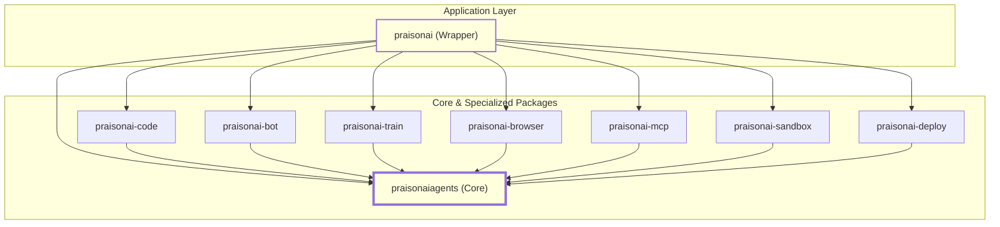

<!-- source: DeepWiki mcp.deepwiki.com · repo MervinPraison/PraisonAI · page 1 Overview · fetched 2026-10-26 -->

# Overview

<details>
<summary>Relevant source files</summary>

The following files were used as context for generating this wiki page:

- [README.md](README.md)
- [api.md](api.md)
- [docker/Dockerfile](docker/Dockerfile)
- [docker/Dockerfile.chat](docker/Dockerfile.chat)
- [docker/Dockerfile.dev](docker/Dockerfile.dev)
- [docker/Dockerfile.ui](docker/Dockerfile.ui)
- [docker/README.md](docker/README.md)
- [src/praisonai-agents/pyproject.toml](src/praisonai-agents/pyproject.toml)
- [src/praisonai-agents/uv.lock](src/praisonai-agents/uv.lock)
- [src/praisonai/README.md](src/praisonai/README.md)
- [src/praisonai/praisonai.rb](src/praisonai/praisonai.rb)
- [src/praisonai/praisonai/cli/main.py](src/praisonai/praisonai/cli/main.py)
- [src/praisonai/praisonai/version.py](src/praisonai/praisonai/version.py)
- [src/praisonai/pyproject.toml](src/praisonai/pyproject.toml)
- [src/praisonai/uv.lock](src/praisonai/uv.lock)

</details>


## Purpose and Scope

This document provides a high-level introduction to PraisonAI, covering its purpose, architecture, core packages, and installation. It serves as the entry point for understanding the system before diving into specific subsystems.

For detailed information about specific components:
- Package architecture and internal structure → [Architecture Overview](#1.1)
- Core concepts (Agents, Tasks, Tools, Memory, Knowledge) → [Key Concepts](#1.2)
- Installation procedures → [Installation](#1.3)

## What is PraisonAI

PraisonAI is a production-ready Multi-AI Agents framework with self-reflection, designed to create AI Agents to automate and solve problems ranging from simple tasks to complex challenges. It provides a low-code solution to streamline the building and management of multi-agent LLM systems, emphasizing:

1. **Simplicity**: Low-code interfaces (CLI, YAML) alongside programmatic Python/JavaScript/Rust SDKs.
2. **Customization**: Support for 100+ LLM providers, multiple memory backends, and extensible tool systems.
3. **Human-Agent Collaboration**: Built-in approval workflows, guardrails, policy engines, and interactive modes.

The framework is organized into a tiered nine-package architecture, with two primary entry points:
- `praisonaiagents`: Core agent framework library for programmatic usage [src/praisonai-agents/pyproject.toml:6-8]().
- `praisonai`: Application wrapper layer with CLI, deployment tools, and framework integrations [src/praisonai/pyproject.toml:2-4]().

**Key Features:**
- **Performance**: Fastest agent instantiation at 3.77 μs (see Performance section).
- **Self-Reflection**: Built-in reflection capabilities for agent self-assessment [README.md:131-131]().
- **Multi-Framework Support**: Native PraisonAI execution plus AutoGen and CrewAI integration [src/praisonai/pyproject.toml:39-43]().
- **Protocol Support**: MCP (Model Context Protocol) [src/praisonai-agents/pyproject.toml:24-29]() and A2A (Agent-to-Agent) protocols [src/praisonai-agents/pyproject.toml:110-113]().
- **Safety Controls**: Guardrails, human approval gates, policy engine, and hooks system.

**Sources:** [README.md:26-26](), [README.md:128-140](), [src/praisonai/pyproject.toml:2-4](), [src/praisonai-agents/pyproject.toml:2-8]()

## Tiered Architecture

PraisonAI uses a modular nine-package design to separate concerns, ranging from core agent logic to specialized training and deployment modules.

### The Nine-Package Model

| Package | Role | Key Code Entities |
|---------|------|-------------------|
| `praisonaiagents` | Core Agent System | `Agent`, `Task`, `AgentTeam`, `Workflow` |
| `praisonai-code` | Code Intelligence | `CodeAgent`, Repository indexing |
| `praisonai-bot` | Messaging & Gateway | `WebSocketGateway`, `BotOutboundMessenger` |
| `praisonai-train` | LLM & Agent Training | `AgentTrainer`, `LLMTrainer` |
| `praisonai-browser` | Browser Automation | `CDPAgent`, `PlaywrightAgent` |
| `praisonai-mcp` | MCP Protocol | `MCPServer`, `agent_adapter` |
| `praisonai-sandbox` | Remote Execution | `SandboxManager`, Docker/E2B backends |
| `praisonai-deploy` | Cloud Infrastructure | `Deploy`, `DeployConfig` |
| `praisonai` | Wrapper & CLI | `PraisonAI`, `AgentsGenerator` |

**Sources:** [src/praisonai/pyproject.toml:15-22](), [src/praisonai-agents/pyproject.toml:133-135]()

### Dependency and Import Direction



**Sources:** [src/praisonai/pyproject.toml:15-22](), [src/praisonai/pyproject.toml:120-123]()

## Key Concepts

PraisonAI is built on a **Five-Layer Agent Stack** that structures how agents interact with the world:

1.  **Prompt**: The basic instructions and roles (e.g., `role`, `goal`, `backstory`).
2.  **Context**: The information available to the agent (e.g., `memory`, `knowledge`, `handoff`).
3.  **Harness**: The capabilities and safety gates (e.g., `tools`, `MCP`, `guardrails`, `approval`).
4.  **Loop**: The execution logic and termination conditions (e.g., `reflection`, `autonomy`, `doom-loop detection`).
5.  **Graph**: The orchestration of multiple agents (e.g., `AgentFlow`, `route`, `parallel`).

**Sources:** [README.md:99-134](), [api.md:10-27]()

## Installation

PraisonAI supports multiple installation variants depending on the required feature set. The `praisonai` package acts as a comprehensive wrapper, while `praisonaiagents` provides a lightweight core.

### Quick Start
```bash
pip install praisonaiagents
```

### Full Installation
```bash
pip install praisonai[all]
```

### Specialized Extras
- **UI & Chat**: `pip install praisonai[ui,chat]` [src/praisonai/pyproject.toml:45-74]()
- **Training**: `pip install praisonai[train]` [src/praisonai/pyproject.toml:121-121]()
- **Browser**: `pip install praisonai[browser]` [src/praisonai/pyproject.toml:122-122]()
- **Deployment**: `pip install praisonai[deploy]` [src/praisonai/pyproject.toml:85-87]()

For detailed setup, including Docker and environment variables, see [Installation](#1.3).

**Sources:** [src/praisonai/pyproject.toml:44-206](), [src/praisonai-agents/pyproject.toml:23-131]()

## Deployment and Infrastructure

PraisonAI supports local, containerized, and cloud-native deployments.

### Docker Services
The repository provides multiple `Dockerfile` variants for different workloads:
- `Dockerfile.ui`: Chainlit-based web interface [docker/Dockerfile.ui:1-33]().
- `Dockerfile.chat`: RAG-enabled chat interface [docker/Dockerfile.chat:1-33]().
- `Dockerfile.dev`: Full development environment with Jupyter and testing tools [docker/Dockerfile.dev:1-47]().

### Cloud Deployment
The `praisonai-deploy` package facilitates multi-cloud deployment (AWS, Azure, GCP, Fly, Railway) using the `Deploy` class and `DeployConfig`.

**Sources:** [docker/Dockerfile.dev:1-47](), [src/praisonai/pyproject.toml:22-22](), [src/praisonai/pyproject.toml:85-87]()

## Performance Characteristics

PraisonAI is optimized for speed and minimal overhead.

| Metric | PraisonAI | Competitor Avg |
|--------|-----------|----------------|
| **Agent Instantiation** | **3.77 μs** | ~200-4,500 μs |
| **Startup (Lazy Loading)** | **~20 ms** | ~400+ ms |

Lazy loading is achieved through the `_lazy.py` mechanism and `__getattr__` exports in package roots, ensuring heavy dependencies like `litellm` or `fastapi` are only loaded when required.

**Sources:** [README.md:128-149](), [src/praisonai-agents/pyproject.toml:15-21]()

---

