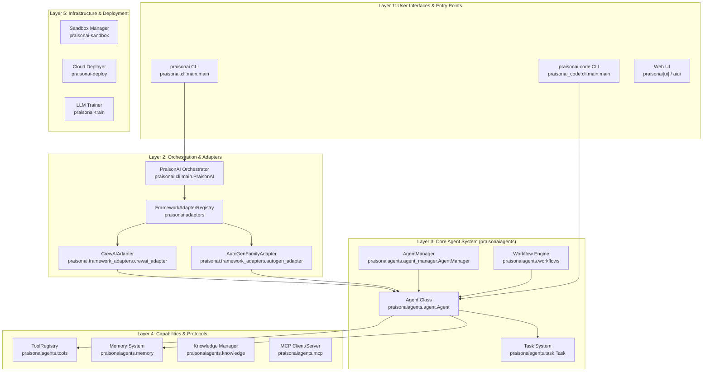
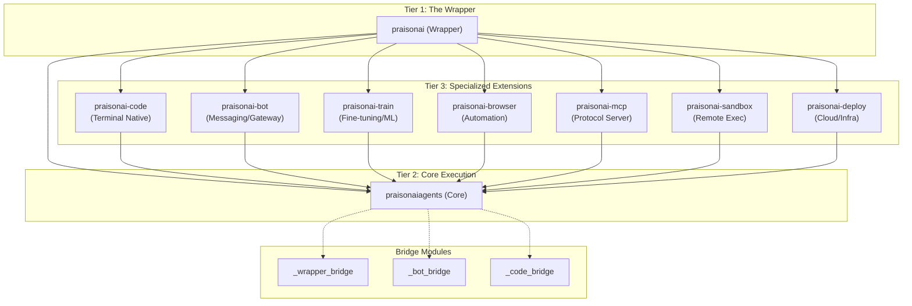
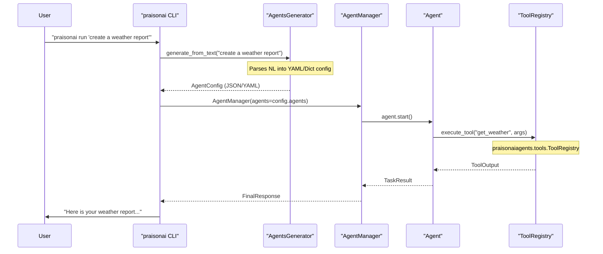

<!-- source: DeepWiki mcp.deepwiki.com · repo MervinPraison/PraisonAI · page 1.1 Architecture Overview · fetched 2026-10-26 -->

# Architecture Overview

Relevant source files

The following files were used as context for generating this wiki page:

- [.github/actions/install-monorepo-packages/action.yml](.github/actions/install-monorepo-packages/action.yml)
- [docker/Dockerfile](docker/Dockerfile)
- [docker/Dockerfile.chat](docker/Dockerfile.chat)
- [docker/Dockerfile.dev](docker/Dockerfile.dev)
- [docker/Dockerfile.ui](docker/Dockerfile.ui)
- [docker/README.md](docker/README.md)
- [src/praisonai-agents/pyproject.toml](src/praisonai-agents/pyproject.toml)
- [src/praisonai-agents/uv.lock](src/praisonai-agents/uv.lock)
- [src/praisonai-bot/praisonai_bot/_version.py](src/praisonai-bot/praisonai_bot/_version.py)
- [src/praisonai-bot/pyproject.toml](src/praisonai-bot/pyproject.toml)
- [src/praisonai-bot/tests/unit/bots/test_agentmail_parity.py](src/praisonai-bot/tests/unit/bots/test_agentmail_parity.py)
- [src/praisonai-bot/tests/unit/test_gateway_tools.py](src/praisonai-bot/tests/unit/test_gateway_tools.py)
- [src/praisonai-bot/uv.lock](src/praisonai-bot/uv.lock)
- [src/praisonai-code/README.md](src/praisonai-code/README.md)
- [src/praisonai-code/praisonai_code/__init__.py](src/praisonai-code/praisonai_code/__init__.py)
- [src/praisonai-code/praisonai_code/_framework_availability.py](src/praisonai-code/praisonai_code/_framework_availability.py)
- [src/praisonai-code/praisonai_code/_safe_loader.py](src/praisonai-code/praisonai_code/_safe_loader.py)
- [src/praisonai-code/praisonai_code/cli/commands/serve.py](src/praisonai-code/praisonai_code/cli/commands/serve.py)
- [src/praisonai-code/praisonai_code/cli/features/_approval_bridge.py](src/praisonai-code/praisonai_code/cli/features/_approval_bridge.py)
- [src/praisonai-code/praisonai_code/cli/main.py](src/praisonai-code/praisonai_code/cli/main.py)
- [src/praisonai-code/praisonai_code/tool_registry.py](src/praisonai-code/praisonai_code/tool_registry.py)
- [src/praisonai-code/praisonai_code/tool_resolver.py](src/praisonai-code/praisonai_code/tool_resolver.py)
- [src/praisonai-code/pyproject.toml](src/praisonai-code/pyproject.toml)
- [src/praisonai-code/tests/unit/test_run_standalone_wrapper_gate.py](src/praisonai-code/tests/unit/test_run_standalone_wrapper_gate.py)
- [src/praisonai-code/uv.lock](src/praisonai-code/uv.lock)
- [src/praisonai-train/praisonai_train/_version.py](src/praisonai-train/praisonai_train/_version.py)
- [src/praisonai-train/praisonai_train/cli/app.py](src/praisonai-train/praisonai_train/cli/app.py)
- [src/praisonai-train/praisonai_train/cli/commands/serve.py](src/praisonai-train/praisonai_train/cli/commands/serve.py)
- [src/praisonai-train/praisonai_train/cli/commands/train.py](src/praisonai-train/praisonai_train/cli/commands/train.py)
- [src/praisonai-train/praisonai_train/setup/config.yaml](src/praisonai-train/praisonai_train/setup/config.yaml)
- [src/praisonai-train/praisonai_train/setup/setup_conda_env.sh](src/praisonai-train/praisonai_train/setup/setup_conda_env.sh)
- [src/praisonai-train/praisonai_train/train/_llamacpp.py](src/praisonai-train/praisonai_train/train/_llamacpp.py)
- [src/praisonai-train/praisonai_train/train/_mtp.py](src/praisonai-train/praisonai_train/train/_mtp.py)
- [src/praisonai-train/praisonai_train/train/_ollama.py](src/praisonai-train/praisonai_train/train/_ollama.py)
- [src/praisonai-train/praisonai_train/train/agents/hook.py](src/praisonai-train/praisonai_train/train/agents/hook.py)
- [src/praisonai-train/praisonai_train/train/agents/storage.py](src/praisonai-train/praisonai_train/train/agents/storage.py)
- [src/praisonai-train/praisonai_train/train/llm/trainer.py](src/praisonai-train/praisonai_train/train/llm/trainer.py)
- [src/praisonai-train/pyproject.toml](src/praisonai-train/pyproject.toml)
- [src/praisonai-train/tests/unit/train/test_mtp.py](src/praisonai-train/tests/unit/train/test_mtp.py)
- [src/praisonai-train/tests/unit/train/test_robustness.py](src/praisonai-train/tests/unit/train/test_robustness.py)
- [src/praisonai-train/tests/unit/train/test_storage.py](src/praisonai-train/tests/unit/train/test_storage.py)
- [src/praisonai-train/uv.lock](src/praisonai-train/uv.lock)
- [src/praisonai/praisonai.rb](src/praisonai/praisonai.rb)
- [src/praisonai/praisonai/_bootstrap.py](src/praisonai/praisonai/_bootstrap.py)
- [src/praisonai/praisonai/adapters/__init__.py](src/praisonai/praisonai/adapters/__init__.py)
- [src/praisonai/praisonai/adapters/readers.py](src/praisonai/praisonai/adapters/readers.py)
- [src/praisonai/praisonai/adapters/rerankers.py](src/praisonai/praisonai/adapters/rerankers.py)
- [src/praisonai/praisonai/adapters/retrievers.py](src/praisonai/praisonai/adapters/retrievers.py)
- [src/praisonai/praisonai/cli/main.py](src/praisonai/praisonai/cli/main.py)
- [src/praisonai/praisonai/version.py](src/praisonai/praisonai/version.py)
- [src/praisonai/pyproject.toml](src/praisonai/pyproject.toml)
- [src/praisonai/scripts/_release_lib.py](src/praisonai/scripts/_release_lib.py)
- [src/praisonai/scripts/publish_all.py](src/praisonai/scripts/publish_all.py)
- [src/praisonai/tests/C7_VERIFICATION.md](src/praisonai/tests/C7_VERIFICATION.md)
- [src/praisonai/tests/PRAISONAI_BOT_MANIFEST.md](src/praisonai/tests/PRAISONAI_BOT_MANIFEST.md)
- [src/praisonai/uv.lock](src/praisonai/uv.lock)

## Purpose and Scope

This document provides a high-level architectural overview of the PraisonAI system, describing the major components, their interactions, and the overall system structure. It serves as an entry point for understanding how PraisonAI orchestrates multi-agent AI systems across different frameworks and deployment targets.

For detailed information about specific subsystems:
- Agent execution and lifecycle → [Agent Class](#2.1)
- Multi-agent coordination → [Multi-Agent Orchestration](#2.5)
- Tool integration → [Tool Integration](#5.1)
- Deployment procedures → [Docker Deployment](#9.1) and [Cloud Deployment](#9.2)
- Package internals → [praisonaiagents Package](#10.1) and [praisonai Package](#10.2)

---

## System Layers

PraisonAI is structured as a tiered architecture that separates concerns from user interaction down to infrastructure, encompassing the core agent logic, specialized CLI tools, and deployment utilities.

### The Five-Layer Stack to Code Entity Mapping

The following diagram bridges the conceptual layers to specific code entities within the repository.

**Sources:** [src/praisonai/pyproject.toml:34-43](), [src/praisonai/praisonai/cli/main.py:18](), [src/praisonai-agents/pyproject.toml:138-139](), [src/praisonai-code/pyproject.toml:29-30]()

---

## Package Architecture (C7–C14)

PraisonAI follows a nine-package tiered model. The `praisonai` package acts as a top-level wrapper, while `praisonaiagents` provides the core logic. Specialized functionality is extracted into dedicated packages to maintain a clean dependency graph.

### Package Dependency and Bridge Diagram

**Sources:** [src/praisonai/pyproject.toml:15-22](), [src/praisonai-code/pyproject.toml:12-12](), [src/praisonai-agents/pyproject.toml:6-21]()

### Detailed Package Inventory

| Package | Purpose | Key Code Entities |
|---------|---------|-------------------|
| `praisonaiagents` | Core agent library, task execution, and memory. | `Agent`, `AgentManager`, `Task`, `Workflow` |
| `praisonai-code` | Terminal-native agent for coding and local tasks. | `praisonai-code` CLI, `tool_resolver.py` |
| `praisonai-bot` | Messaging gateway for Telegram, Slack, and Discord. | `WebSocketGateway`, `BotOutboundMessenger` |
| `praisonai-train` | LLM fine-tuning and synthetic dataset generation. | `LLMTrainer`, `AgentTrainer` |
| `praisonai-browser` | Playwright-based browser automation. | `CDPAgent`, `BrowserServer` |
| `praisonai-mcp` | Model Context Protocol implementation. | `MCPServer`, `agent_adapter` |
| `praisonai-sandbox` | Secure code execution environments. | `SandboxManager`, `DockerBackend` |
| `praisonai-deploy` | Multi-cloud deployment automation. | `Deploy`, `DeployConfig` |
| `praisonai` | Top-level CLI and framework orchestration. | `PraisonAI`, `AgentsGenerator` |

**Sources:** [src/praisonai/pyproject.toml:1-32](), [src/praisonai-code/pyproject.toml:1-4](), [src/praisonai-agents/pyproject.toml:1-10]()

---

## Core Components

### PraisonAI Orchestrator
The `PraisonAI` class in `src/praisonai/praisonai/cli/main.py` serves as the primary entry point for the wrapper package. It handles framework selection and environment setup.
- **Framework Routing**: It can delegate execution to `crewai` or `autogen` via `FrameworkAdapterRegistry` [src/praisonai/pyproject.toml:39-43]().
- **Configuration**: Manages the `config_list` for LLM connectivity [src/praisonai/praisonai/cli/main.py:18]().

### Agent System
The `Agent` class in `praisonaiagents` is the fundamental unit. It utilizes a mixin-based decomposition (Chat, Tool, Execution, Memory) to handle complex reasoning tasks [src/praisonai-agents/pyproject.toml:14-21]().

### Deployment & Infrastructure
The system provides multiple `Dockerfile` variants for different deployment scenarios:
- `Dockerfile.dev`: Full development environment including Jupyter and testing tools [docker/Dockerfile.dev:1-35]().
- `Dockerfile.ui`: Optimized for the Chainlit-based web interface [docker/Dockerfile.ui:1-21]().
- `Dockerfile.chat`: Minimal environment for conversational agents [docker/Dockerfile.chat:1-21]().

---

## Data Flow: Natural Language to Execution

The following diagram traces the flow from a user's natural language input to the execution of code entities.

**Sources:** [src/praisonai/praisonai/cli/main.py:18](), [src/praisonai-agents/pyproject.toml:14-21]()

---

## Installation & Modular Dependencies

PraisonAI uses `uv` for fast package management and defines extensive optional dependency groups to keep the core installation lean.

### Key Dependency Groups
- **llm**: `litellm` for universal LLM support [src/praisonai-agents/pyproject.toml:50-53]().
- **knowledge**: `mem0ai`, `chromadb`, and `chonkie` for RAG capabilities [src/praisonai-agents/pyproject.toml:36-41]().
- **train**: Heavy ML stack for training via `praisonai-train` [src/praisonai/pyproject.toml:121-121]().
- **ui**: `aiui` for the web dashboard [src/praisonai/pyproject.toml:45-47]().

**Sources:** [src/praisonai-agents/pyproject.toml:23-131](), [src/praisonai/pyproject.toml:44-206]()

---

