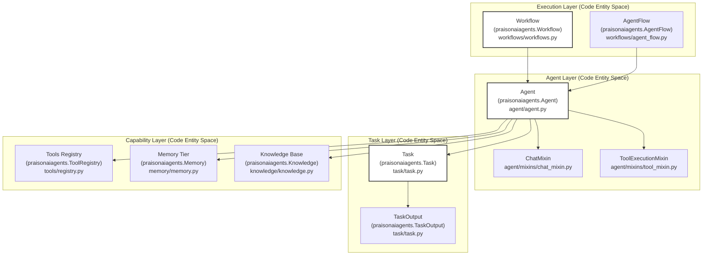
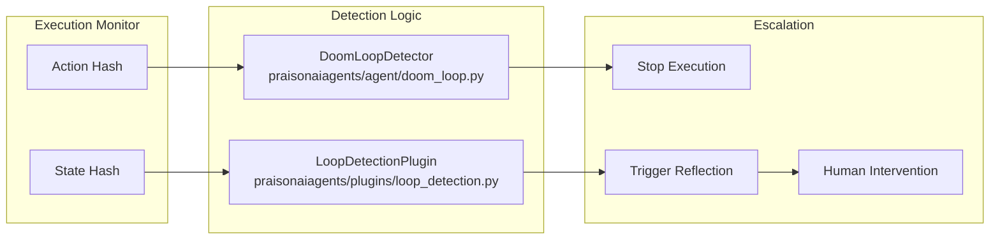

<!-- source: DeepWiki mcp.deepwiki.com · repo MervinPraison/PraisonAI · page 1.2 Key Concepts · fetched 2026-10-26 -->

# Key Concepts

Relevant source files

The following files were used as context for generating this wiki page:

- [README.md](README.md)
- [api.md](api.md)
- [src/praisonai-agents/praisonaiagents/__init__.py](src/praisonai-agents/praisonaiagents/__init__.py)
- [src/praisonai/README.md](src/praisonai/README.md)

## Purpose and Scope

This document introduces the fundamental concepts and terminology used throughout the PraisonAI framework. It covers the core building blocks: **Agents**, **Tasks**, **Workflows**, **Tools**, **Memory**, **Knowledge**, **Sessions**, **Handoffs**, and the **Five-Layer Stack**. These components work together to create autonomous, self-correcting AI systems.

For architectural details about how these components are implemented and interconnected, see [Architecture Overview](1.1).

---

## The Five-Layer Stack

PraisonAI is structured around a five-layer model that defines the lifecycle and execution boundaries of an agentic system. Each layer wraps the one inside it, providing a clear hierarchy for debugging and configuration.

| Layer | Question it Answers | PraisonAI Implementation |
| :--- | :--- | :--- |
| **1 · Prompt** | Did I say it clearly? | `instructions`, `role`, `goal`, `backstory`, `output` [README.md:128]() |
| **2 · Context** | Is the right thing in the window? | `memory`, `knowledge`, `context`, `ContextPolicy` [README.md:129]() |
| **3 · Harness** | Can it act, and be checked? | `tools`, `MCP()`, `guardrails`, `approval`, `hooks` [README.md:130]() |
| **4 · Loop** | When do we stop? | `ExecutionConfig`, `reflection`, `autonomy`, Doom-loop detection [README.md:131]() |
| **5 · Graph** | Who runs when? | `AgentFlow`, `route()`, `parallel()`, `loop()`, `repeat()` [README.md:132]() |
| **⬡ Managed** | Where does it actually run? | `run_on="docker"`, `sandbox`, `praisonai-deploy` [README.md:133]() |

**Sources:** [README.md:99-134]()

---

## Core Component Hierarchy

The following diagram bridges **Natural Language Space** to **Code Entity Space**, showing how core concepts map to specific classes and files in the repository.

**Sources:** [api.md:22-169](), [src/praisonai-agents/praisonaiagents/__init__.py:116-250](), [README.md:522-551]()

---

## Agent

An **Agent** is an autonomous entity that can reason, use tools, and maintain memory to accomplish goals. It is the primary execution unit.

### Key Implementation Details
- **Mixins**: The `Agent` class uses a mixin-based decomposition, including `ChatMixin` for LLM interaction, `ToolExecutionMixin` for handling tool calls, and `ExecutionMixin` for core logic [api.md:2.1]().
- **Lazy Loading**: Heavy dependencies like `litellm` are only loaded when `agent.start()` or `agent.chat()` is called [src/praisonai-agents/praisonaiagents/__init__.py:4-6]().
- **Persistence**: Durable execution is supported via `RunJournal` to track agent state across restarts [api.md:2.1]().

**Sources:** [api.md:31-93](), [src/praisonai-agents/praisonaiagents/agent/agent.py:1-100]()

---

## Task

A **Task** represents a single unit of work. Tasks define what needs to be done, the expected output format (Raw, JSON, or Pydantic), and dependencies.

### Task Data Flow
1. **Context Building**: Task collects outputs from all tasks listed in `depends_on` [src/praisonai-agents/praisonaiagents/task/task.py:1-50]().
2. **Execution**: The assigned `Agent` processes the task description using the collected context.
3. **Output Parsing**: Results are encapsulated in a `TaskOutput` object, which handles conversion to structured data [api.md:214-222]().

**Sources:** [api.md:214-222](), [README.md:1019-1036]()

---

## Workflow

A **Workflow** (or `AgentFlow`) orchestrates multiple agents and tasks into a coordinated execution pipeline.

### Control Structures
- **route()**: Conditional branching based on LLM evaluation or state [api.md:206-226]().
- **parallel()**: Concurrent execution of multiple agents or tasks [README.md:811-877]().
- **loop()**: Iteration over a list of items.
- **repeat()**: Iteration until a specific condition (reflection) is met.

**Sources:** [api.md:206-226](), [README.md:774-877]()

---

## Tools and MCP

**Tools** are Python functions or external services an agent can call.
- **Tool Registry**: Centralized discovery and execution via `ToolRegistry` [src/praisonai-agents/praisonaiagents/tools/registry.py:1-50]().
- **MCP (Model Context Protocol)**: A protocol allowing agents to connect to external tool servers (via `stdio`, `HTTP`, or `SSE`) without writing custom wrappers [README.md:1170]().

**Sources:** [api.md:172-203](), [api.md:516-526]()

---

## Memory and Knowledge

- **Memory**: Tiers of storage (Short-term, Long-term, Entity, Episodic) that persist across agent runs [README.md:674-678]().
- **Knowledge**: A RAG-based system for ingesting documents (PDF, MD, etc.) and retrieving relevant chunks during execution [api.md:274-342]().

**Sources:** [api.md:236-272](), [src/praisonai-agents/praisonaiagents/memory/memory.py:1-100]()

---

## Sessions and Handoffs

### Sessions
A **Session** (`praisonaiagents.session.Session`) manages the persistence of conversation history, agent states, and checkpoints [api.md:15.1](). It allows for "shadow git" checkpoints to enable undo/replay functionality [api.md:15.2]().

### Handoffs
A **Handoff** occurs when one agent transfers control to another.
- **HandoffConfig**: Defines how context is transferred (e.g., `summarize`, `full_history`) [api.md:16]().
- **HandoffManager**: Tracks handoff depth and detects infinite loops between agents [api.md:2.6]().

**Sources:** [api.md:10-21](), [api.md:55-56]()

---

## Doom-loop Detection

To prevent autonomous agents from getting stuck in infinite cycles, PraisonAI implements a two-tier detection system:

1.  **DoomLoopDetector**: Monitors for `REPEATED_ACTION` (calling the same tool with same args), `REPEATED_FAILURE` (same error multiple times), and `NO_PROGRESS` [api.md:3.5]().
2.  **LoopDetectionPlugin**: Uses a ping-pong hash detection algorithm to identify cycles in multi-agent handoffs [api.md:3.5]().

**Sources:** [api.md:3.5](), [src/praisonai-agents/praisonaiagents/agent/agent.py:58]() (last_stop_reason)

---

## Summary of Key Classes

| Concept | Code Entity | File Path |
| :--- | :--- | :--- |
| **Agent** | `Agent` | `praisonaiagents/agent/agent.py` [api.md:26]() |
| **Task** | `Task` | `praisonaiagents/task/task.py` [api.md:214]() |
| **Workflow** | `Workflow` | `praisonaiagents/workflows/workflows.py` [api.md:206]() |
| **Memory** | `Memory` | `praisonaiagents/memory/memory.py` [api.md:236]() |
| **Knowledge** | `Knowledge` | `praisonaiagents/knowledge/knowledge.py` [api.md:274]() |
| **Tool** | `BaseTool` | `praisonaiagents/tools/base.py` [api.md:122]() |
| **Handoff** | `HandoffResult` | `praisonaiagents/agent/handoff.py` [api.md:10]() |
| **Session** | `Session` | `praisonaiagents/session/session.py` [api.md:15.1]() |

**Sources:** [api.md:1-530]()

---

