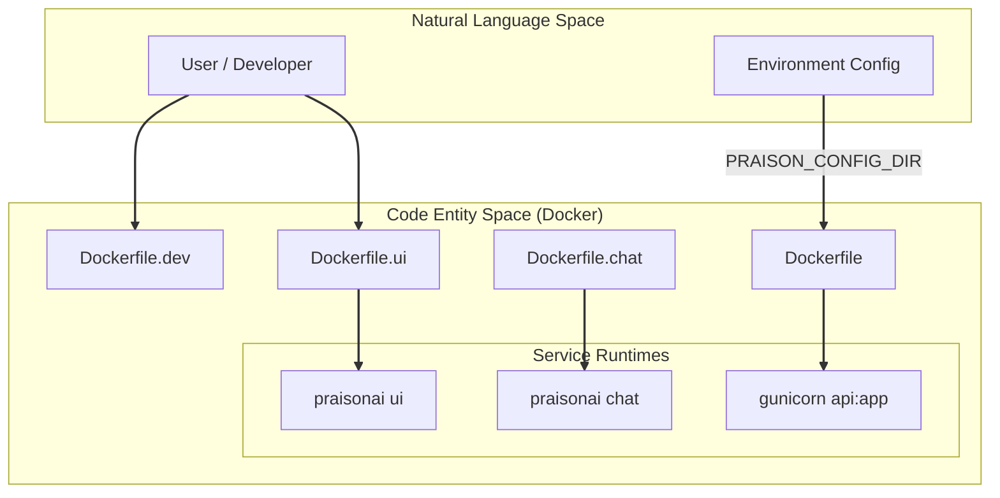
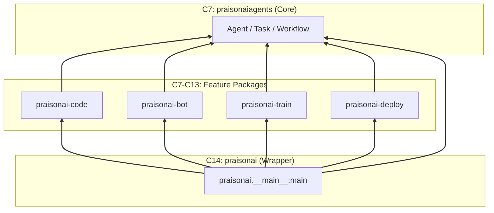

<!-- source: DeepWiki mcp.deepwiki.com · repo MervinPraison/PraisonAI · page 1.3 Installation · fetched 2026-10-26 -->

# Installation

<details>
<summary>Relevant source files</summary>

The following files were used as context for generating this wiki page:

- [docker/Dockerfile](docker/Dockerfile)
- [docker/Dockerfile.chat](docker/Dockerfile.chat)
- [docker/Dockerfile.dev](docker/Dockerfile.dev)
- [docker/Dockerfile.ui](docker/Dockerfile.ui)
- [docker/README.md](docker/README.md)
- [src/praisonai-agents/praisonaiagents/paths.py](src/praisonai-agents/praisonaiagents/paths.py)
- [src/praisonai-agents/pyproject.toml](src/praisonai-agents/pyproject.toml)
- [src/praisonai-agents/tests/unit/test_paths.py](src/praisonai-agents/tests/unit/test_paths.py)
- [src/praisonai-agents/uv.lock](src/praisonai-agents/uv.lock)
- [src/praisonai-code/praisonai_code/cli/commands/auth.py](src/praisonai-code/praisonai_code/cli/commands/auth.py)
- [src/praisonai-code/praisonai_code/cli/commands/setup.py](src/praisonai-code/praisonai_code/cli/commands/setup.py)
- [src/praisonai-code/praisonai_code/cli/configuration/credentials.py](src/praisonai-code/praisonai_code/cli/configuration/credentials.py)
- [src/praisonai-code/praisonai_code/cli/configuration/loader.py](src/praisonai-code/praisonai_code/cli/configuration/loader.py)
- [src/praisonai-code/praisonai_code/cli/configuration/model_resolver.py](src/praisonai-code/praisonai_code/cli/configuration/model_resolver.py)
- [src/praisonai-code/praisonai_code/cli/configuration/oauth.py](src/praisonai-code/praisonai_code/cli/configuration/oauth.py)
- [src/praisonai-code/praisonai_code/cli/configuration/paths.py](src/praisonai-code/praisonai_code/cli/configuration/paths.py)
- [src/praisonai-code/praisonai_code/cli/features/diag.py](src/praisonai-code/praisonai_code/cli/features/diag.py)
- [src/praisonai-code/praisonai_code/cli/features/setup/handler.py](src/praisonai-code/praisonai_code/cli/features/setup/handler.py)
- [src/praisonai-code/praisonai_code/llm/__init__.py](src/praisonai-code/praisonai_code/llm/__init__.py)
- [src/praisonai-code/praisonai_code/llm/catalogue.py](src/praisonai-code/praisonai_code/llm/catalogue.py)
- [src/praisonai-code/praisonai_code/llm/credentials.py](src/praisonai-code/praisonai_code/llm/credentials.py)
- [src/praisonai-code/praisonai_code/llm/env.py](src/praisonai-code/praisonai_code/llm/env.py)
- [src/praisonai-code/tests/unit/test_credential_env_blob.py](src/praisonai-code/tests/unit/test_credential_env_blob.py)
- [src/praisonai-code/tests/unit/test_credential_onboarding.py](src/praisonai-code/tests/unit/test_credential_onboarding.py)
- [src/praisonai-code/tests/unit/test_first_run_coherence.py](src/praisonai-code/tests/unit/test_first_run_coherence.py)
- [src/praisonai-code/tests/unit/test_oauth_provider_registry.py](src/praisonai-code/tests/unit/test_oauth_provider_registry.py)
- [src/praisonai-code/tests/unit/test_setup_onboarding.py](src/praisonai-code/tests/unit/test_setup_onboarding.py)
- [src/praisonai/praisonai.rb](src/praisonai/praisonai.rb)
- [src/praisonai/praisonai/cli/commands/agent.py](src/praisonai/praisonai/cli/commands/agent.py)
- [src/praisonai/praisonai/cli/commands/auth.py](src/praisonai/praisonai/cli/commands/auth.py)
- [src/praisonai/praisonai/cli/commands/command.py](src/praisonai/praisonai/cli/commands/command.py)
- [src/praisonai/praisonai/cli/commands/init.py](src/praisonai/praisonai/cli/commands/init.py)
- [src/praisonai/praisonai/cli/main.py](src/praisonai/praisonai/cli/main.py)
- [src/praisonai/praisonai/llm/credentials.py](src/praisonai/praisonai/llm/credentials.py)
- [src/praisonai/praisonai/llm/env.py](src/praisonai/praisonai/llm/env.py)
- [src/praisonai/praisonai/version.py](src/praisonai/praisonai/version.py)
- [src/praisonai/pyproject.toml](src/praisonai/pyproject.toml)
- [src/praisonai/tests/unit/cli/test_auth_functionality.py](src/praisonai/tests/unit/cli/test_auth_functionality.py)
- [src/praisonai/tests/unit/cli/test_auth_oauth.py](src/praisonai/tests/unit/cli/test_auth_oauth.py)
- [src/praisonai/tests/unit/cli/test_config_validation.py](src/praisonai/tests/unit/cli/test_config_validation.py)
- [src/praisonai/tests/unit/cli/test_init_provider_guard.py](src/praisonai/tests/unit/cli/test_init_provider_guard.py)
- [src/praisonai/tests/unit/cli/test_setup_command.py](src/praisonai/tests/unit/cli/test_setup_command.py)
- [src/praisonai/tests/unit/llm/test_credentials_is_configured.py](src/praisonai/tests/unit/llm/test_credentials_is_configured.py)
- [src/praisonai/tests/unit/llm/test_env_resolver.py](src/praisonai/tests/unit/llm/test_env_resolver.py)
- [src/praisonai/tests/unit/test_logging_regression.py](src/praisonai/tests/unit/test_logging_regression.py)
- [src/praisonai/uv.lock](src/praisonai/uv.lock)

</details>


This document provides comprehensive installation instructions for the PraisonAI framework, covering its nine-package tiered architecture, optional feature groups, containerized deployment, and development environment setup.

## Overview

PraisonAI is structured as a multi-package ecosystem to ensure modularity and lean deployments. The framework is distributed via PyPI under several specialized packages, with `praisonai` acting as the umbrella wrapper.

### The Nine-Package Tiered Model

| Package | Role | Key Code Entities |
| :--- | :--- | :--- |
| `praisonaiagents` | **Core Framework** | `Agent`, `Task`, `AgentTeam`, `Workflow` |
| `praisonai` | **Umbrella Wrapper** | `PraisonAI`, `AgentsGenerator`, CLI |
| `praisonai-code` | **Code Intelligence** | `CodeAgent`, Repository Indexing |
| `praisonai-bot` | **Messaging Gateway** | `WebSocketGateway`, `TelegramBot` |
| `praisonai-train` | **Model Training** | `LLMTrainer`, `AgentTrainer` |
| `praisonai-browser` | **Browser Automation** | `PlaywrightAgent`, `BrowserServer` |
| `praisonai-mcp` | **MCP Protocol** | `MCPServer`, `ModelContextProtocol` |
| `praisonai-sandbox` | **Secure Execution** | `SandboxManager`, `DockerBackend` |
| `praisonai-deploy` | **Cloud Deployment** | `DeployConfig`, `CloudProvider` |

**Sources:** [src/praisonai/pyproject.toml:15-22](), [src/praisonai-agents/pyproject.toml:6-8]()

---

## Package Manager: UV (Recommended)

PraisonAI utilizes the `uv` package manager for high-performance dependency resolution and environment management. Lockfiles are maintained for core packages to ensure deterministic builds.

**Sources:** [src/praisonai/uv.lock:1-11](), [src/praisonai-agents/uv.lock:1-11]()

---

## Installation Methods

### 1. Standard Installation (pip)

The simplest way to install the full framework is via the umbrella package:

```bash
pip install praisonai
```

This command installs the `praisonai` wrapper [src/praisonai/pyproject.toml:2](), which triggers the installation of all nine sub-packages as mandatory dependencies [src/praisonai/pyproject.toml:15-22]().

### 2. Specialized Core Installation

If you only require the agent orchestration logic without the CLI or deployment tools, install the core package:

```bash
pip install praisonaiagents
```

**Sources:** [src/praisonai-agents/pyproject.toml:6-21]()

---

## Optional Dependency Groups

PraisonAI uses PEP 508 optional dependencies to keep the base installation lean. These are categorized by package.

### `praisonaiagents` Core Extras

| Group | Command | Dependencies |
| :--- | :--- | :--- |
| **memory** | `pip install "praisonaiagents[memory]"` | `chromadb`, `litellm` |
| **knowledge** | `pip install "praisonaiagents[knowledge]"` | `mem0ai`, `markitdown`, `chonkie` |
| **mcp** | `pip install "praisonaiagents[mcp]"` | `mcp`, `fastapi`, `uvicorn` |
| **search** | `pip install "praisonaiagents[search]"` | `ddgs` (DuckDuckGo Search) |
| **crawl** | `pip install "praisonaiagents[crawl]"` | `crawl4ai`, `playwright` |
| **autonomy** | `pip install "praisonaiagents[autonomy]"` | `ast-grep-cli` |

**Sources:** [src/praisonai-agents/pyproject.toml:23-131]()

### `praisonai` Wrapper Extras

| Group | Command | Purpose |
| :--- | :--- | :--- |
| **ui** | `pip install "praisonai[ui]"` | Chainlit-based dashboard |
| **realtime** | `pip install "praisonai[realtime]"` | Voice and streaming support |
| **train** | `pip install "praisonai[train]"` | Pulls the heavy ML stack for fine-tuning |
| **flow** | `pip install "praisonai[flow]"` | Visual workflow builder (Langflow) |
| **all** | `pip install "praisonai[all]"` | Full messaging bot and storage stack |

**Sources:** [src/praisonai/pyproject.toml:44-206]()

---

## Environment Setup

### Configuration Directory
PraisonAI centralizes all runtime data (databases, configs, logs) in a specific directory.
- **Default:** `~/.praison`
- **Override:** Set `PRAISON_CONFIG_DIR` environment variable.

**Sources:** [docker/Dockerfile.dev:41](), [docker/README.md:71]()

### Post-Installation Script
The framework provides a utility to set up Conda environments for specific tasks like training:
```bash
setup-conda-env
```
**Sources:** [src/praisonai/pyproject.toml:36]()

---

## Containerized Installation (Docker)

Docker images are provided for different service roles.

### Code Entity Mapping: Docker Services



**Sources:** [docker/Dockerfile.ui:33](), [docker/Dockerfile.chat:33](), [docker/Dockerfile:46](), [docker/README.md:7-12]()

### Quick Start with Docker Compose
```bash
# Create .env with keys
echo "OPENAI_API_KEY=your_key" > .env

# Start multi-service stack
docker-compose up -d
```
**Sources:** [docker/README.md:35-51]()

---

## Implementation Details: Dependency Flow

The installation process ensures that high-level application features are layered on top of the core agentic primitives.

### Dependency Hierarchy Diagram



**Sources:** [src/praisonai/pyproject.toml:15-22](), [src/praisonai-agents/pyproject.toml:133-137]()

---

## Platform-Specific Installation

### macOS (Homebrew)
PraisonAI maintains a Homebrew formula for macOS users, which automates virtual environment creation.
```bash
brew install praisonai
```
**Sources:** [src/praisonai/praisonai.rb:1-20]()

### System Dependencies
For audio and specialized tool support (e.g., `praisonai[realtime]`), the following system packages are required:
- `portaudio19-dev`
- `python3-pyaudio`
- `gcc`

**Sources:** [docker/Dockerfile.dev:6-15]()

---

