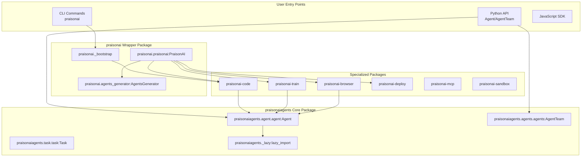
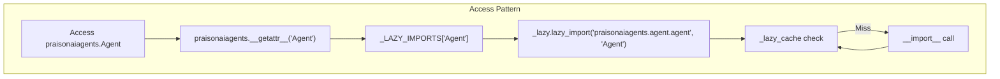

<!-- source: DeepWiki mcp.deepwiki.com · repo MervinPraison/PraisonAI · page 10 Package System · fetched 2026-10-26 -->

# Package System

Relevant source files

The following files were used as context for generating this wiki page:

- [docker/Dockerfile](docker/Dockerfile)
- [docker/Dockerfile.chat](docker/Dockerfile.chat)
- [docker/Dockerfile.dev](docker/Dockerfile.dev)
- [docker/Dockerfile.ui](docker/Dockerfile.ui)
- [docker/README.md](docker/README.md)
- [src/praisonai-agents/praisonaiagents/__init__.py](src/praisonai-agents/praisonaiagents/__init__.py)
- [src/praisonai-agents/pyproject.toml](src/praisonai-agents/pyproject.toml)
- [src/praisonai-agents/uv.lock](src/praisonai-agents/uv.lock)
- [src/praisonai/praisonai.rb](src/praisonai/praisonai.rb)
- [src/praisonai/praisonai/cli/main.py](src/praisonai/praisonai/cli/main.py)
- [src/praisonai/praisonai/version.py](src/praisonai/praisonai/version.py)
- [src/praisonai/pyproject.toml](src/praisonai/pyproject.toml)
- [src/praisonai/uv.lock](src/praisonai/uv.lock)

This document describes the package architecture of PraisonAI, covering the structure of the nine-package tiered model, the lazy loading system that minimizes import overhead, dependency management with optional feature groups, and the module organization strategy. The package system is designed around three core principles: zero overhead when features are unused, modular installation with optional dependencies, and full backward compatibility through dynamic imports.

For installation instructions and package variants, see [Installation](#1.3). For development environment setup, see [Development Environment](#9.3).

## Package Overview

PraisonAI is structured as a modular ecosystem of Python packages. While the two primary entry points are `praisonaiagents` (core) and `praisonai` (wrapper), the system includes specialized packages for code analysis, training, and deployment.

| Package | Purpose | Typical Use Case |
|---------|---------|------------------|
| `praisonaiagents` | Core agent library with Agent, AgentTeam, tools, memory, workflows | Direct usage when you need fine-grained control |
| `praisonai` | Wrapper/orchestrator with CLI, framework integration (CrewAI, AutoGen), UI | High-level usage with YAML configs or CLI |
| `praisonai-code` | Code analysis and repository intelligence tools | Agent-based code reviews and refactoring |
| `praisonai-train` | LLM fine-tuning and agent training loops | Improving agent performance on specific datasets |
| `praisonai-browser` | Browser automation and web crawling | Web research and UI interaction tasks |
| `praisonai-deploy` | Cloud and container deployment tools | Deploying agents to AWS, GCP, Azure, or Fly.io |

The separation enables users to choose their level of abstraction. Advanced users can use `praisonaiagents` directly for maximum control, while users who prefer declarative configurations can use the `praisonai` wrapper which orchestrates the specialized sub-packages.

Sources: [src/praisonai/pyproject.toml:15-22](), [src/praisonai-agents/praisonaiagents/__init__.py:83-91](), [src/praisonai/praisonai/cli/main.py:1-18]()

## Package Structure and Separation

### praisonaiagents (Core Library)

The `praisonaiagents` package provides the core agent execution engine. It is a standalone library that can be used independently of the wrapper package.

**Key characteristics:**
- **Minimal core dependencies**: `pydantic>=2.10.0`, `rich`, `openai>=1.68.2`, `aiohttp>=3.8.0` [src/praisonai-agents/pyproject.toml:14-21]().
- **Optional feature groups**: Install only what you need (e.g., `pip install praisonaiagents[mcp,memory]`) [src/praisonai-agents/pyproject.toml:23-131]().
- **Lazy loading**: Heavy dependencies like `litellm` load on-demand to minimize startup time [src/praisonai-agents/praisonaiagents/__init__.py:62-82]().

For detailed information about the core library structure, see [praisonaiagents Package](#10.1).

### praisonai (Wrapper Package)

The `praisonai` package provides higher-level abstractions, CLI, UI, and framework integration. It depends on all specialized sub-packages including `praisonaiagents`, `praisonai-code`, and `praisonai-train` [src/praisonai/pyproject.toml:15-22]().

**Key characteristics:**
- **Framework integration**: Supports AutoGen, CrewAI, and LangGraph via adapters [src/praisonai/pyproject.toml:39-43]().
- **CLI interface**: Centralized `praisonai` entry point defined in `praisonai.__main__:main` [src/praisonai/pyproject.toml:35]().
- **Unified Dependency**: Its `all` extra pulls in storage backends (Redis, MongoDB, Postgres), browser tools, and messaging bot SDKs [src/praisonai/pyproject.toml:171-206]().

For detailed information about the wrapper package, see [praisonai Package](#10.2).

## Lazy Loading Architecture

The package uses a sophisticated lazy loading system to minimize import time and memory usage. Heavy dependencies like `litellm` and `rich` are only loaded when actually needed [src/praisonai-agents/praisonaiagents/__init__.py:1-6]().

### Lazy Loading Mechanism

The lazy loading system is implemented using Python's `__getattr__` protocol at the module level, supported by a centralized `_lazy.py` utility [src/praisonai-agents/praisonaiagents/__init__.py:83-91]().

The `_LAZY_IMPORTS` dictionary in `praisonaiagents/__init__.py` maps hundreds of attribute names to their module paths, including tools, memory, and specialized agents like `DeepResearchAgent` [src/praisonai-agents/praisonaiagents/__init__.py:116-473]().

For detailed information about the lazy loading implementation, see [Lazy Loading System](#10.3).

Sources: [src/praisonai-agents/praisonaiagents/__init__.py:93-119](), [src/praisonai-agents/praisonaiagents/__init__.py:127-473](), [src/praisonai-agents/praisonaiagents/__init__.py:522-528]()

## Dependency Management

### Core Dependencies

The `praisonaiagents` core is kept lean to support lightweight deployments.

| Category | Dependencies |
|---------|------------------|
| **Core Agents** | `pydantic`, `rich`, `openai`, `posthog`, `PyYAML`, `aiohttp` [src/praisonai-agents/pyproject.toml:14-21]() |
| **Wrapper** | `praisonaiagents`, `praisonai-code`, `praisonai-bot`, `praisonai-train`, `litellm`, `typer` [src/praisonai/pyproject.toml:11-32]() |

### Optional Feature Groups

Optional dependencies are organized into logical feature groups. The `praisonai` wrapper package provides extensive extras for framework support and deployment environments:

**Key optional groups in `praisonai`:**

| Group | Dependencies | Use Case |
|-------|-------------|----------|
| `ui` | `aiui` | Chainlit-based web dashboard [src/praisonai/pyproject.toml:45-47]() |
| `realtime` | `websockets`, `plotly`, `yfinance` | Voice and real-time data agents [src/praisonai/pyproject.toml:101-110]() |
| `train` | `praisonai-train[llm]` | Heavy ML stack for fine-tuning [src/praisonai/pyproject.toml:121]() |
| `crewai` | `crewai>=0.157.0`, `praisonai-tools` | Integration with CrewAI framework [src/praisonai/pyproject.toml:124]() |
| `all` | `fastapi`, `redis`, `pymongo`, `psycopg2-binary`, `boto3` | Production-ready multi-tenant gateway [src/praisonai/pyproject.toml:171-206]() |

For detailed information about dependency constraints and version management, see [Dependency Management](#10.4).

## Deployment Infrastructure

The package system includes built-in support for Dockerized environments. The `Dockerfile.dev` provides a comprehensive environment including `praisonai[ui,chat,realtime,code]` and development tools like `jupyterlab` and `pytest` [docker/Dockerfile.dev:1-35]().

Specialized Dockerfiles exist for specific services:
- `Dockerfile.chat`: Optimized for the chat interface [docker/Dockerfile.chat:1-33]().
- `Dockerfile.ui`: Optimized for the web UI and CrewAI integration [docker/Dockerfile.ui:1-33]().

Sources: [docker/Dockerfile.dev:1-35](), [docker/Dockerfile.chat:1-33](), [docker/Dockerfile.ui:1-33]()

## Related Pages

- For detailed praisonaiagents structure: [praisonaiagents Package](#10.1)
- For detailed praisonai structure: [praisonai Package](#10.2)
- For lazy loading implementation: [Lazy Loading System](#10.3)
- For dependency specifications: [Dependency Management](#10.4)
- For installation instructions: [Installation](#1.3)
- For configuration system: [Configuration System](#8)

---

