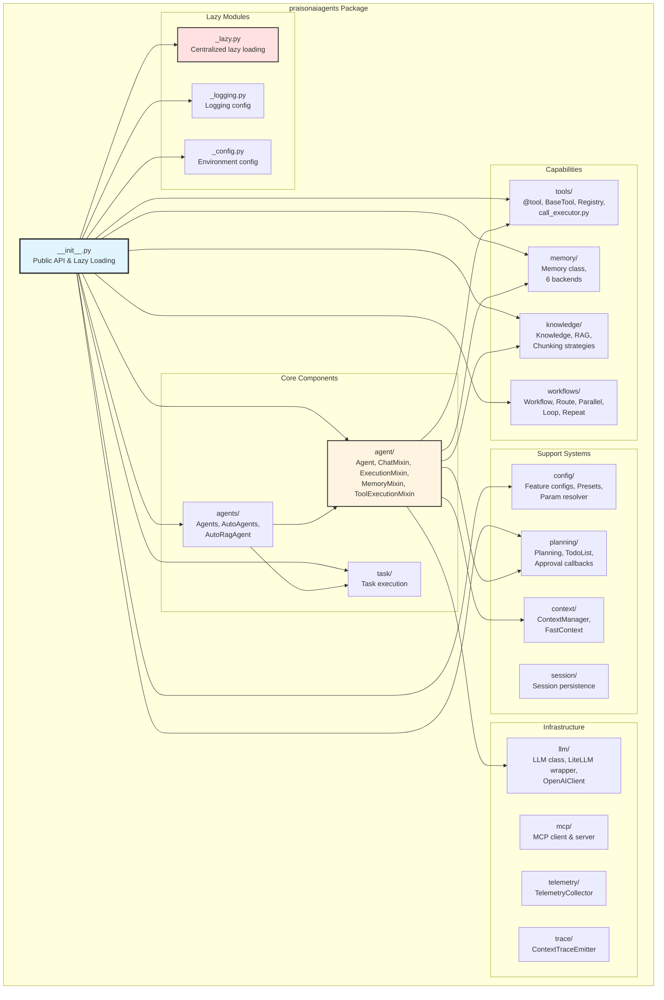
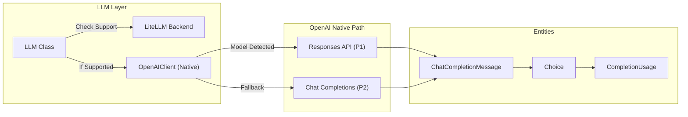
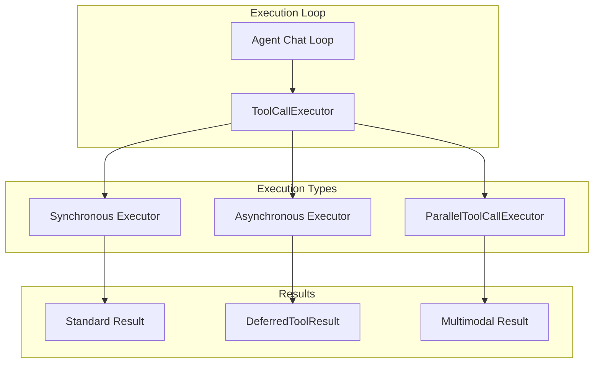

<!-- source: DeepWiki mcp.deepwiki.com · repo MervinPraison/PraisonAI · page 10.1 praisonaiagents Package · fetched 2026-10-26 -->

# praisonaiagents Package

Relevant source files

The following files were used as context for generating this wiki page:

- [src/praisonai-agents/praisonaiagents/__init__.py](src/praisonai-agents/praisonaiagents/__init__.py)
- [src/praisonai-agents/praisonaiagents/agent/agent.py](src/praisonai-agents/praisonaiagents/agent/agent.py)
- [src/praisonai-agents/praisonaiagents/agent/chat_mixin.py](src/praisonai-agents/praisonaiagents/agent/chat_mixin.py)
- [src/praisonai-agents/praisonaiagents/agent/durable.py](src/praisonai-agents/praisonaiagents/agent/durable.py)
- [src/praisonai-agents/praisonaiagents/agent/execution_mixin.py](src/praisonai-agents/praisonaiagents/agent/execution_mixin.py)
- [src/praisonai-agents/praisonaiagents/agent/interrupt.py](src/praisonai-agents/praisonaiagents/agent/interrupt.py)
- [src/praisonai-agents/praisonaiagents/agent/loop_detection.py](src/praisonai-agents/praisonaiagents/agent/loop_detection.py)
- [src/praisonai-agents/praisonaiagents/agent/tool_execution.py](src/praisonai-agents/praisonaiagents/agent/tool_execution.py)
- [src/praisonai-agents/praisonaiagents/agents/agents.py](src/praisonai-agents/praisonaiagents/agents/agents.py)
- [src/praisonai-agents/praisonaiagents/config/feature_configs.py](src/praisonai-agents/praisonaiagents/config/feature_configs.py)
- [src/praisonai-agents/praisonaiagents/escalation/doom_loop.py](src/praisonai-agents/praisonaiagents/escalation/doom_loop.py)
- [src/praisonai-agents/praisonaiagents/llm/llm.py](src/praisonai-agents/praisonaiagents/llm/llm.py)
- [src/praisonai-agents/praisonaiagents/llm/openai_client.py](src/praisonai-agents/praisonaiagents/llm/openai_client.py)
- [src/praisonai-agents/praisonaiagents/llm/sanitize.py](src/praisonai-agents/praisonaiagents/llm/sanitize.py)
- [src/praisonai-agents/praisonaiagents/plugins/loop_detection_plugin.py](src/praisonai-agents/praisonaiagents/plugins/loop_detection_plugin.py)
- [src/praisonai-agents/praisonaiagents/tools/call_executor.py](src/praisonai-agents/praisonaiagents/tools/call_executor.py)
- [src/praisonai-agents/praisonaiagents/tools/path_overlap.py](src/praisonai-agents/praisonaiagents/tools/path_overlap.py)
- [src/praisonai-agents/tests/integration/test_responses_api.py](src/praisonai-agents/tests/integration/test_responses_api.py)
- [src/praisonai-agents/tests/test_deferred_progress_tools.py](src/praisonai-agents/tests/test_deferred_progress_tools.py)
- [src/praisonai-agents/tests/test_native_deferred_parity.py](src/praisonai-agents/tests/test_native_deferred_parity.py)
- [src/praisonai-agents/tests/test_parallel_tools.py](src/praisonai-agents/tests/test_parallel_tools.py)
- [src/praisonai-agents/tests/test_tool_timeout.py](src/praisonai-agents/tests/test_tool_timeout.py)
- [src/praisonai-agents/tests/unit/agent/test_durable_run.py](src/praisonai-agents/tests/unit/agent/test_durable_run.py)
- [src/praisonai-agents/tests/unit/agent/test_loop_detector_wiring.py](src/praisonai-agents/tests/unit/agent/test_loop_detector_wiring.py)
- [src/praisonai-agents/tests/unit/llm/test_durable_tool_dispatch.py](src/praisonai-agents/tests/unit/llm/test_durable_tool_dispatch.py)
- [src/praisonai-agents/tests/unit/test_compaction_wiring.py](src/praisonai-agents/tests/unit/test_compaction_wiring.py)
- [src/praisonai-agents/tests/unit/test_doom_loop_no_progress_boundary.py](src/praisonai-agents/tests/unit/test_doom_loop_no_progress_boundary.py)
- [src/praisonai-agents/tests/unit/test_loop_detection.py](src/praisonai-agents/tests/unit/test_loop_detection.py)

The `praisonaiagents` package is the core framework package that provides the agent system, tools, memory, workflows, and all supporting infrastructure. This document covers the package structure, public API exports, lazy loading architecture, and the organization of 186+ symbols available to users.

For information about the application layer (CLI, deployment, UI systems), see [praisonai Package](#10.2). For detailed lazy loading mechanics, see [Lazy Loading System](#10.3).

## Package Purpose and Scope

The `praisonaiagents` package serves as the foundational framework for building AI agent applications. It provides:

- **Core Agent System**: `Agent` class with LLM integration, tools, memory, and planning capabilities [src/praisonai-agents/praisonaiagents/agent/agent.py:123-140]().
- **Multi-Agent Orchestration**: `Agents` class for coordinating multiple agents with shared state [src/praisonai-agents/praisonaiagents/agents/agents.py:61-159]().
- **Tool Ecosystem**: Decorator-based tool registration, MCP protocol support, and 100+ built-in tools [src/praisonai-agents/praisonaiagents/tools/call_executor.py:1-25]().
- **Memory & Knowledge**: Multiple storage backends (SQLite, Redis, Postgres, MongoDB, Mem0) and RAG pipeline [src/praisonai-agents/praisonaiagents/config/feature_configs.py:54-63]().
- **Workflow Engine**: Control flow operators (Route, Parallel, Loop, Repeat) for complex orchestration.
- **Safety Systems**: Guardrails, reflection, and human-in-the-loop approval workflows.

The package is designed with performance in mind, using lazy loading to reduce import time. All heavy dependencies (LiteLLM, Rich, vector stores) are loaded on-demand when first accessed [src/praisonai-agents/praisonaiagents/__init__.py:1-6]().

**Sources**: [src/praisonai-agents/praisonaiagents/__init__.py:1-6](), [src/praisonai-agents/praisonaiagents/agent/agent.py:1-40]()

## Package Structure

**Sources**: [src/praisonai-agents/praisonaiagents/__init__.py:1-594](), [src/praisonai-agents/praisonaiagents/agent/agent.py:16-32]()

## Core Agent Implementation

The `Agent` class is decomposed into multiple mixins to maintain a clean core structure while providing rich functionality.

| Mixin | File Path | Purpose |
|-------|-----------|---------|
| `ChatMixin` | [src/praisonai-agents/praisonaiagents/agent/chat_mixin.py]() | Handles LLM interaction, streaming, and message building [src/praisonai-agents/praisonaiagents/agent/chat_mixin.py:73-75](). |
| `ExecutionMixin` | [src/praisonai-agents/praisonaiagents/agent/execution_mixin.py]() | Manages `astart`, `arun`, and task generation lifecycle [src/praisonai-agents/praisonaiagents/agent/execution_mixin.py:73-75](). |
| `ToolExecutionMixin` | [src/praisonai-agents/praisonaiagents/agent/tool_execution.py]() | Resolves and executes tool calls, handles multimodal results [src/praisonai-agents/praisonaiagents/agent/tool_execution.py:1-7](). |
| `MemoryMixin` | [src/praisonai-agents/praisonaiagents/agent/memory_mixin.py]() | Provides synchronous and asynchronous memory access patterns. |

**Sources**: [src/praisonai-agents/praisonaiagents/agent/agent.py:16-32]()

## LLM Integration & Response API

The package provides a unified `LLM` class that abstracts multiple providers. A key feature is the `OpenAIClient` which supports the OpenAI Responses API.

**Sources**: [src/praisonai-agents/praisonaiagents/llm/llm.py:175-188](), [src/praisonai-agents/praisonaiagents/llm/openai_client.py:1-17](), [src/praisonai-agents/tests/integration/test_responses_api.py:37-72]()

## Durable Execution System

The package supports durable execution via a `RunJournal`, allowing agents to resume execution after failures or interruptions.

| Component | Role |
|-----------|------|
| `RunJournal` | Persistent storage for execution events (iterations, tool calls, results) [src/praisonai-agents/praisonaiagents/runtime/journal.py](). |
| `DurableRunContext` | Manages the replaying of events and wrapping of tool functions for idempotency [src/praisonai-agents/praisonaiagents/agent/durable.py](). |
| `ExecutionConfig` | Configures `durable=True` and specifies the `journal_path` [src/praisonai-agents/praisonaiagents/config/feature_configs.py]() |

**Sources**: [src/praisonai-agents/tests/unit/agent/test_durable_run.py:15-27](), [src/praisonai-agents/praisonaiagents/agent/chat_mixin.py:81-87]()

## Tool Execution Pipeline

Tool execution supports parallel calls, timeouts, and deferred results.

**Sources**: [src/praisonai-agents/praisonaiagents/tools/call_executor.py:1-25](), [src/praisonai-agents/praisonaiagents/agent/tool_execution.py:133-160]()

## Public API Exports (__all__)

The `__all__` list defines the core essentials for clean IDE experience [src/praisonai-agents/praisonaiagents/__init__.py:535-560]().

| Category | Exports |
|----------|---------|
| **Core Classes** | `Agent`, `Agents`, `Task` |
| **Tool System** | `tool`, `Tools` |
| **Embedding API** | `embedding`, `embeddings`, `aembedding`, `aembeddings`, `EmbeddingResult`, `get_dimensions` |
| **Sub-packages** | `config`, `tools`, `memory`, `workflows` |

**Sources**: [src/praisonai-agents/praisonaiagents/__init__.py:535-560]()

## Lazy Import Mapping

The `_LAZY_IMPORTS` dictionary maps 186+ symbols to their respective modules, enabling fast startup [src/praisonai-agents/praisonaiagents/__init__.py:127-384]().

| Feature | Mapping Example |
|---------|-----------------|
| **Agent** | `'Agent': ('praisonaiagents.agent.agent', 'Agent')` |
| **Workflows** | `'Workflow': ('praisonaiagents.workflows.workflow', 'Workflow')` |
| **Config** | `'MemoryConfig': ('praisonaiagents.config.feature_configs', 'MemoryConfig')` |
| **Tools** | `'BaseTool': ('praisonaiagents.tools.base', 'BaseTool')` |

**Sources**: [src/praisonai-agents/praisonaiagents/__init__.py:127-384]()

## Summary of Core Features

- **Lazy Loading**: Uses `_lazy.py` to defer loading of heavy dependencies like `litellm` and `rich` [src/praisonai-agents/praisonaiagents/__init__.py:83-90]().
- **Consolidated Configuration**: Unified configuration via `MemoryConfig`, `KnowledgeConfig`, and `ExecutionConfig` [src/praisonai-agents/praisonaiagents/config/feature_configs.py:1-32]().
- **Advanced Orchestration**: Supports `Handoff` between agents and `Workflow` control structures [src/praisonai-agents/praisonaiagents/agent/execution_mixin.py:95-142]().
- **Durable State**: Integrated `RunJournal` for resumable agentic loops [src/praisonai-agents/tests/unit/agent/test_durable_run.py:1-27]().
- **Multimodal Support**: Built-in handling for images and video in tool results and LLM messages [src/praisonai-agents/praisonaiagents/agent/tool_execution.py:65-131]().

**Sources**: [src/praisonai-agents/praisonaiagents/__init__.py:1-594](), [src/praisonai-agents/praisonaiagents/agent/agent.py:1-120]()

---

