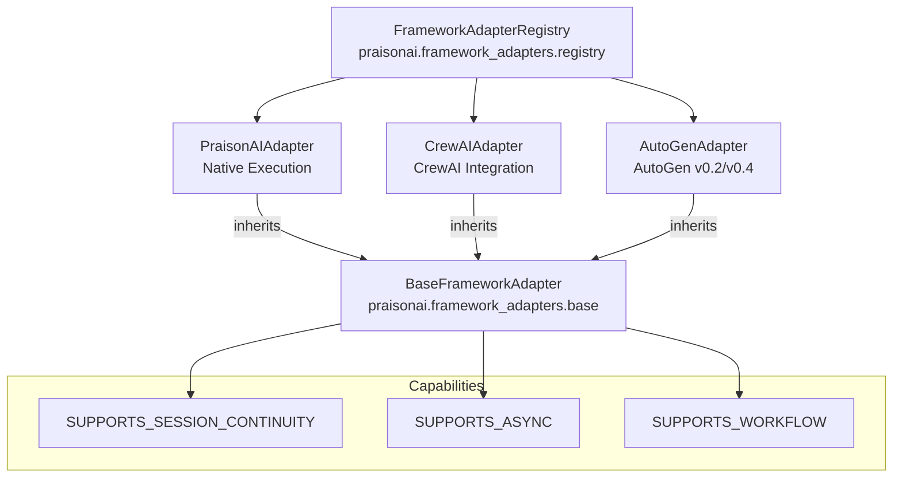
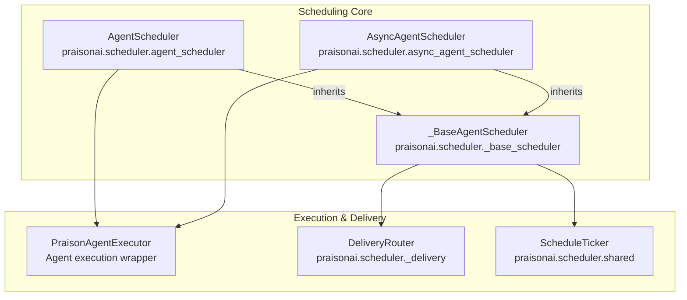

<!-- source: DeepWiki mcp.deepwiki.com · repo MervinPraison/PraisonAI · page 10.2 praisonai Package · fetched 2026-10-26 -->

# praisonai Package

Relevant source files

The following files were used as context for generating this wiki page:

- [src/praisonai-agents/praisonaiagents/scheduler/blueprint_defs.py](src/praisonai-agents/praisonaiagents/scheduler/blueprint_defs.py)
- [src/praisonai-agents/praisonaiagents/scheduler/config_store.py](src/praisonai-agents/praisonaiagents/scheduler/config_store.py)
- [src/praisonai-agents/praisonaiagents/scheduler/due.py](src/praisonai-agents/praisonaiagents/scheduler/due.py)
- [src/praisonai-agents/praisonaiagents/scheduler/parser.py](src/praisonai-agents/praisonaiagents/scheduler/parser.py)
- [src/praisonai-agents/praisonaiagents/scheduler/store.py](src/praisonai-agents/praisonaiagents/scheduler/store.py)
- [src/praisonai-agents/praisonaiagents/scheduler/suggestion_store.py](src/praisonai-agents/praisonaiagents/scheduler/suggestion_store.py)
- [src/praisonai-agents/tests/unit/test_delivery_target_preview.py](src/praisonai-agents/tests/unit/test_delivery_target_preview.py)
- [src/praisonai-agents/tests/unit/test_schedule_claim.py](src/praisonai-agents/tests/unit/test_schedule_claim.py)
- [src/praisonai-agents/tests/unit/test_schedule_timezone.py](src/praisonai-agents/tests/unit/test_schedule_timezone.py)
- [src/praisonai/praisonai/__init__.py](src/praisonai/praisonai/__init__.py)
- [src/praisonai/praisonai/__main__.py](src/praisonai/praisonai/__main__.py)
- [src/praisonai/praisonai/_async_bridge.py](src/praisonai/praisonai/_async_bridge.py)
- [src/praisonai/praisonai/_registry.py](src/praisonai/praisonai/_registry.py)
- [src/praisonai/praisonai/adapters/vector_stores.py](src/praisonai/praisonai/adapters/vector_stores.py)
- [src/praisonai/praisonai/agent_scheduler.py](src/praisonai/praisonai/agent_scheduler.py)
- [src/praisonai/praisonai/agents_generator.py](src/praisonai/praisonai/agents_generator.py)
- [src/praisonai/praisonai/async_agent_scheduler.py](src/praisonai/praisonai/async_agent_scheduler.py)
- [src/praisonai/praisonai/auto.py](src/praisonai/praisonai/auto.py)
- [src/praisonai/praisonai/cli/features/agent_scheduler.py](src/praisonai/praisonai/cli/features/agent_scheduler.py)
- [src/praisonai/praisonai/framework_adapters/__init__.py](src/praisonai/praisonai/framework_adapters/__init__.py)
- [src/praisonai/praisonai/framework_adapters/autogen_adapter.py](src/praisonai/praisonai/framework_adapters/autogen_adapter.py)
- [src/praisonai/praisonai/framework_adapters/base.py](src/praisonai/praisonai/framework_adapters/base.py)
- [src/praisonai/praisonai/framework_adapters/crewai_adapter.py](src/praisonai/praisonai/framework_adapters/crewai_adapter.py)
- [src/praisonai/praisonai/framework_adapters/praisonai_adapter.py](src/praisonai/praisonai/framework_adapters/praisonai_adapter.py)
- [src/praisonai/praisonai/framework_adapters/validators.py](src/praisonai/praisonai/framework_adapters/validators.py)
- [src/praisonai/praisonai/persistence/__init__.py](src/praisonai/praisonai/persistence/__init__.py)
- [src/praisonai/praisonai/persistence/conversation/__init__.py](src/praisonai/praisonai/persistence/conversation/__init__.py)
- [src/praisonai/praisonai/persistence/conversation/_sql_base.py](src/praisonai/praisonai/persistence/conversation/_sql_base.py)
- [src/praisonai/praisonai/persistence/conversation/async_mysql.py](src/praisonai/praisonai/persistence/conversation/async_mysql.py)
- [src/praisonai/praisonai/persistence/conversation/async_postgres.py](src/praisonai/praisonai/persistence/conversation/async_postgres.py)
- [src/praisonai/praisonai/persistence/conversation/async_sqlite.py](src/praisonai/praisonai/persistence/conversation/async_sqlite.py)
- [src/praisonai/praisonai/persistence/conversation/base.py](src/praisonai/praisonai/persistence/conversation/base.py)
- [src/praisonai/praisonai/persistence/conversation/mysql.py](src/praisonai/praisonai/persistence/conversation/mysql.py)
- [src/praisonai/praisonai/persistence/conversation/postgres.py](src/praisonai/praisonai/persistence/conversation/postgres.py)
- [src/praisonai/praisonai/persistence/conversation/singlestore.py](src/praisonai/praisonai/persistence/conversation/singlestore.py)
- [src/praisonai/praisonai/persistence/conversation/supabase.py](src/praisonai/praisonai/persistence/conversation/supabase.py)
- [src/praisonai/praisonai/persistence/conversation/surrealdb.py](src/praisonai/praisonai/persistence/conversation/surrealdb.py)
- [src/praisonai/praisonai/persistence/conversation/turso.py](src/praisonai/praisonai/persistence/conversation/turso.py)
- [src/praisonai/praisonai/persistence/factory.py](src/praisonai/praisonai/persistence/factory.py)
- [src/praisonai/praisonai/persistence/hooks/agent_hooks.py](src/praisonai/praisonai/persistence/hooks/agent_hooks.py)
- [src/praisonai/praisonai/persistence/knowledge/surrealdb_vector.py](src/praisonai/praisonai/persistence/knowledge/surrealdb_vector.py)
- [src/praisonai/praisonai/persistence/registry.py](src/praisonai/praisonai/persistence/registry.py)
- [src/praisonai/praisonai/persistence/state/async_mongodb.py](src/praisonai/praisonai/persistence/state/async_mongodb.py)
- [src/praisonai/praisonai/persistence/state/memory.py](src/praisonai/praisonai/persistence/state/memory.py)
- [src/praisonai/praisonai/persistence/tests/test_registry_lazy.py](src/praisonai/praisonai/persistence/tests/test_registry_lazy.py)
- [src/praisonai/praisonai/scheduler/_base_scheduler.py](src/praisonai/praisonai/scheduler/_base_scheduler.py)
- [src/praisonai/praisonai/scheduler/_delivery.py](src/praisonai/praisonai/scheduler/_delivery.py)
- [src/praisonai/praisonai/scheduler/agent_scheduler.py](src/praisonai/praisonai/scheduler/agent_scheduler.py)
- [src/praisonai/praisonai/scheduler/async_agent_scheduler.py](src/praisonai/praisonai/scheduler/async_agent_scheduler.py)
- [src/praisonai/praisonai/scheduler/blueprint_catalogue.py](src/praisonai/praisonai/scheduler/blueprint_catalogue.py)
- [src/praisonai/praisonai/scheduler/daemon_manager.py](src/praisonai/praisonai/scheduler/daemon_manager.py)
- [src/praisonai/praisonai/scheduler/shared.py](src/praisonai/praisonai/scheduler/shared.py)
- [src/praisonai/praisonai/scheduler/yaml_loader.py](src/praisonai/praisonai/scheduler/yaml_loader.py)
- [src/praisonai/praisonai/templates/cache.py](src/praisonai/praisonai/templates/cache.py)
- [src/praisonai/praisonai/tool_resolver.py](src/praisonai/praisonai/tool_resolver.py)
- [src/praisonai/tests/unit/cli/test_main_dispatcher.py](src/praisonai/tests/unit/cli/test_main_dispatcher.py)
- [src/praisonai/tests/unit/cli/test_typer_cli.py](src/praisonai/tests/unit/cli/test_typer_cli.py)
- [src/praisonai/tests/unit/persistence/test_knowledge_identifier_safety.py](src/praisonai/tests/unit/persistence/test_knowledge_identifier_safety.py)
- [src/praisonai/tests/unit/scheduler/test_async_agent_scheduler.py](src/praisonai/tests/unit/scheduler/test_async_agent_scheduler.py)
- [src/praisonai/tests/unit/scheduler/test_base.py](src/praisonai/tests/unit/scheduler/test_base.py)
- [src/praisonai/tests/unit/scheduler/test_delivery_origin.py](src/praisonai/tests/unit/scheduler/test_delivery_origin.py)
- [src/praisonai/tests/unit/scheduler/test_timezone_surface.py](src/praisonai/tests/unit/scheduler/test_timezone_surface.py)
- [src/praisonai/tests/unit/test_aiui_datastore.py](src/praisonai/tests/unit/test_aiui_datastore.py)
- [src/praisonai/tests/unit/test_async_bridge.py](src/praisonai/tests/unit/test_async_bridge.py)
- [src/praisonai/tests/unit/test_auto_lazy_loading.py](src/praisonai/tests/unit/test_auto_lazy_loading.py)
- [src/praisonai/tests/unit/test_framework_validators.py](src/praisonai/tests/unit/test_framework_validators.py)
- [src/praisonai/tests/unit/test_tool_source_registry.py](src/praisonai/tests/unit/test_tool_source_registry.py)
- [src/praisonai/tests/unit/test_tool_timeout_enforcement.py](src/praisonai/tests/unit/test_tool_timeout_enforcement.py)
- [src/praisonai/tests/unit/test_wrapper_layer_regression.py](src/praisonai/tests/unit/test_wrapper_layer_regression.py)

The `praisonai` package is the application layer of PraisonAI, providing user-facing interfaces, framework integration, and deployment tools. It acts as a wrapper for the core `praisonaiagents` library, offering command-line interfaces, an agent scheduler, framework adapters (CrewAI, AutoGen), and persistence layers. This package serves as the primary entry point for end users and developers interacting with the PraisonAI ecosystem.

---

## Architecture and Framework Integration

The `praisonai` package uses a plugin-based adapter architecture to integrate with multiple agent frameworks while providing a unified configuration interface.

### Framework Adapter Registry

Framework integration is managed by a centralized registry that resolves the appropriate adapter at runtime based on the user's configuration or environment variables.

**Sources:** [src/praisonai/praisonai/framework_adapters/registry.py:1-50](), [src/praisonai/praisonai/framework_adapters/base.py:65-89](), [src/praisonai/praisonai/framework_adapters/praisonai_adapter.py:20-43]()

### Native PraisonAI Adapter
The `PraisonAIAdapter` is the primary execution path. It supports advanced features like session continuity, native async execution, and full YAML workflow support [src/praisonai/praisonai/framework_adapters/praisonai_adapter.py:35-42]().

### AutoGen and CrewAI Adapters
- **AutoGenAdapter**: Dynamically resolves between v0.2 and v0.4 (or AG2) based on the `AUTOGEN_VERSION` environment variable [src/praisonai/praisonai/framework_adapters/autogen_adapter.py:30-68](). It includes a `_wrap_tool_for_execution` shim to translate `ToolTimeoutError` into string messages that the AutoGen chat loop can process without crashing [src/praisonai/praisonai/framework_adapters/autogen_adapter.py:71-101]().
- **CrewAIAdapter**: Handles the translation of PraisonAI tool definitions into CrewAI's expected format and manages telemetry suppression using `scoped_telemetry_disable` to prevent framework-level tracking interference [src/praisonai/praisonai/framework_adapters/base.py:170-187]().

---

## Agents Generator and Auto-Generation

The `AgentsGenerator` and `AutoGenerator` classes handle the transformation of high-level specifications (YAML or Natural Language) into executable agent teams.

### AgentsGenerator Logic
`AgentsGenerator` processes YAML configurations, resolving agents, tasks, and tools. It includes:
- **Duplicate Detection**: The `_list_to_dict` function prevents silent clobbering of agents with the same name, raising errors if `PRAISONAI_VALIDATE_STRICT` is enabled [src/praisonai/praisonai/agents_generator.py:43-65]().
- **YAML Normalization**: `_normalize_yaml_config` converts list-based YAML formats into the internal dictionary structure expected by adapters [src/praisonai/praisonai/agents_generator.py:68-124]().
- **Tool Timeout Enforcement**: Implements a `ToolTimeoutError` and uses a `ThreadPoolExecutor` to enforce execution limits on tools [src/praisonai/praisonai/agents_generator.py:176-193]().

### Auto-Generation (`auto.py`)
The `auto` module provides the "Natural Language to Code" bridge, using LLMs to generate agent configurations. It uses full lazy loading for heavy dependencies like `litellm` and `praisonai_tools` to maintain a fast CLI startup [src/praisonai/praisonai/auto.py:1-12]().

**Sources:** [src/praisonai/praisonai/agents_generator.py:1-200](), [src/praisonai/praisonai/auto.py:1-120]()

---

## Agent Scheduler

PraisonAI provides a robust scheduling system for running agents 24/7, supporting both synchronous and asynchronous execution.

### Scheduler Architecture

**Sources:** [src/praisonai/praisonai/scheduler/agent_scheduler.py:38-54](), [src/praisonai/praisonai/scheduler/async_agent_scheduler.py:85-108](), [src/praisonai/praisonai/scheduler/_base_scheduler.py:1-50]()

### Key Features
- **Timeout Management**: The `AgentScheduler` uses a `ThreadPoolExecutor` with worker leak accounting. If workers get stuck on timed-out tasks, the pool is recycled once half the workers are leaked [src/praisonai/praisonai/scheduler/agent_scheduler.py:126-145]().
- **Delivery System**: Supports routing successful agent results to external targets (e.g., Telegram) via the `deliver` parameter, utilizing a `DeliveryRouter` for rate limiting and idempotency [src/praisonai/praisonai/scheduler/agent_scheduler.py:91-100]().
- **Async Native**: `AsyncAgentScheduler` provides native `async/await` execution with cancellation support and `asyncio.Event` based stop signals [src/praisonai/praisonai/scheduler/async_agent_scheduler.py:151-178]().

---

## CLI and Entry Points

The package features a unified CLI entry point that routes commands between the modern Typer-based system and legacy argparse handlers.

### Dispatcher Logic (`__main__.py`)
The dispatcher performs "Typer-first" discovery:
1. **Short-circuit**: Checks for `--version` or `-V` immediately to avoid heavy imports [src/praisonai/praisonai/__main__.py:1-15]().
2. **Introspection**: Uses Click introspection to discover registered Typer commands [src/praisonai/praisonai/__main__.py:97-122]().
3. **Bare Prompt Routing**: If a user provides a plain string (e.g., `praisonai "find news"`), the `_looks_like_bare_prompt` function determines if it should be routed to the modern `run` engine by checking if all provided flags are supported by the modern command [src/praisonai/praisonai/__main__.py:161-175]().

**Sources:** [src/praisonai/praisonai/__main__.py:1-200](), [src/praisonai/tests/unit/cli/test_main_dispatcher.py:75-108]()

---

## Persistence and Observability

### Persistence Layer
The package includes adapters for various conversation and knowledge backends:
- **Conversation**: Support for SQLite, PostgreSQL, and MySQL (via `async_sqlite`, `async_postgres`, `async_mysql`) [src/praisonai/praisonai/persistence/conversation/async_sqlite.py:1-20]().
- **Knowledge**: Integration with SurrealDB for vector storage [src/praisonai/praisonai/persistence/knowledge/surrealdb_vector.py:1-30]().
- **Factory**: The `PersistenceFactory` and `PersistenceRegistry` handle the instantiation of these backends based on configuration [src/praisonai/praisonai/persistence/factory.py:1-25]().

### Observability and Telemetry
Telemetry defaults are managed in `praisonai/__init__.py`. It uses a thread-safe double-checked locking pattern to apply environment defaults (like `OTEL_SDK_DISABLED`) exactly once [src/praisonai/praisonai/__init__.py:70-84]().

---

## Summary Table: Key Components

| Component | File Path | Role |
|-----------|-----------|------|
| `PraisonAI` | `praisonai/cli/main.py` | Main CLI controller class |
| `AgentsGenerator` | `praisonai/agents_generator.py` | Transforms YAML to Agent Teams |
| `FrameworkAdapterRegistry` | `praisonai/framework_adapters/registry.py` | Manages external framework bridges |
| `AgentScheduler` | `praisonai/scheduler/agent_scheduler.py` | 24/7 Periodic agent execution |
| `AsyncBridge` | `praisonai/_async_bridge.py` | Runs coroutines from sync contexts safely |
| `CloudDeployer` | `praisonai/deploy.py` | GCP Cloud Run deployment logic |

**Sources:** [src/praisonai/praisonai/cli/main.py:18](), [src/praisonai/praisonai/agents_generator.py:1-10](), [src/praisonai/praisonai/framework_adapters/registry.py:21-21](), [src/praisonai/praisonai/scheduler/agent_scheduler.py:38-38](), [src/praisonai/praisonai/_async_bridge.py:22-22](), [src/praisonai/praisonai/deploy.py:1-20]()

---

