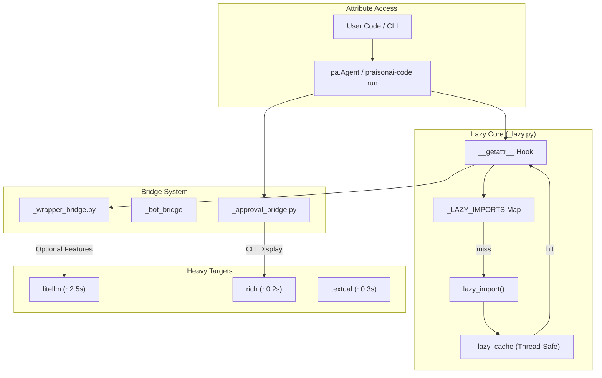
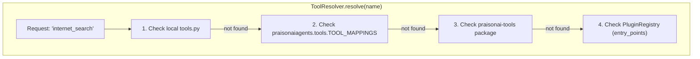

<!-- source: DeepWiki mcp.deepwiki.com · repo MervinPraison/PraisonAI · page 10.3 Lazy Loading System · fetched 2026-10-26 -->

# Lazy Loading System

<details>
<summary>Relevant source files</summary>

The following files were used as context for generating this wiki page:

- [.github/actions/install-monorepo-packages/action.yml](.github/actions/install-monorepo-packages/action.yml)
- [src/praisonai-agents/praisonaiagents/__init__.py](src/praisonai-agents/praisonaiagents/__init__.py)
- [src/praisonai-bot/praisonai_bot/_version.py](src/praisonai-bot/praisonai_bot/_version.py)
- [src/praisonai-bot/pyproject.toml](src/praisonai-bot/pyproject.toml)
- [src/praisonai-bot/tests/unit/test_gateway_tools.py](src/praisonai-bot/tests/unit/test_gateway_tools.py)
- [src/praisonai-bot/uv.lock](src/praisonai-bot/uv.lock)
- [src/praisonai-code/README.md](src/praisonai-code/README.md)
- [src/praisonai-code/praisonai_code/__init__.py](src/praisonai-code/praisonai_code/__init__.py)
- [src/praisonai-code/praisonai_code/_framework_availability.py](src/praisonai-code/praisonai_code/_framework_availability.py)
- [src/praisonai-code/praisonai_code/_safe_loader.py](src/praisonai-code/praisonai_code/_safe_loader.py)
- [src/praisonai-code/praisonai_code/cli/commands/serve.py](src/praisonai-code/praisonai_code/cli/commands/serve.py)
- [src/praisonai-code/praisonai_code/cli/features/_approval_bridge.py](src/praisonai-code/praisonai_code/cli/features/_approval_bridge.py)
- [src/praisonai-code/praisonai_code/cli/main.py](src/praisonai-code/praisonai_code/cli/main.py)
- [src/praisonai-code/praisonai_code/tool_registry.py](src/praisonai-code/praisonai_code/tool_registry.py)
- [src/praisonai-code/praisonai_code/tool_resolver.py](src/praisonai-code/praisonai_code/tool_resolver.py)
- [src/praisonai-code/pyproject.toml](src/praisonai-code/pyproject.toml)
- [src/praisonai-code/tests/unit/test_run_standalone_wrapper_gate.py](src/praisonai-code/tests/unit/test_run_standalone_wrapper_gate.py)
- [src/praisonai-code/uv.lock](src/praisonai-code/uv.lock)
- [src/praisonai/praisonai/_bootstrap.py](src/praisonai/praisonai/_bootstrap.py)
- [src/praisonai/praisonai/adapters/__init__.py](src/praisonai/praisonai/adapters/__init__.py)
- [src/praisonai/praisonai/adapters/readers.py](src/praisonai/praisonai/adapters/readers.py)
- [src/praisonai/praisonai/adapters/rerankers.py](src/praisonai/praisonai/adapters/rerankers.py)
- [src/praisonai/praisonai/adapters/retrievers.py](src/praisonai/praisonai/adapters/retrievers.py)
- [src/praisonai/scripts/_release_lib.py](src/praisonai/scripts/_release_lib.py)
- [src/praisonai/scripts/publish_all.py](src/praisonai/scripts/publish_all.py)
- [src/praisonai/tests/C7_VERIFICATION.md](src/praisonai/tests/C7_VERIFICATION.md)
- [src/praisonai/tests/PRAISONAI_BOT_MANIFEST.md](src/praisonai/tests/PRAISONAI_BOT_MANIFEST.md)

</details>


## Purpose and Scope

The PraisonAI Lazy Loading System is a performance-critical architecture designed to reduce package import times from approximately 3500ms to 20ms. By deferring the loading of heavy dependencies (such as `litellm`, `rich`, `openai`, and `textual`) until they are explicitly accessed, the system ensures a responsive CLI and minimal memory overhead for lightweight scripts. The system maintains full backward compatibility for over 186 exported symbols across the tiered package structure.

**Sources:** [src/praisonai-agents/praisonaiagents/__init__.py:1-6](), [src/praisonai-code/praisonai_code/__init__.py:1-13]()

---

## Architecture Overview

The system spans multiple packages (`praisonaiagents`, `praisonai-code`, and the `praisonai` wrapper), utilizing a centralized lazy import mechanism and bridge modules to navigate boundaries between core logic and optional features.


**Diagram: Multi-Package Lazy Resolution Flow**

**Sources:** [src/praisonai-agents/praisonaiagents/__init__.py:84-115](), [src/praisonai-code/praisonai_code/cli/features/_approval_bridge.py:1-10](), [src/praisonai-code/praisonai_code/_wrapper_bridge.py:1-15]()

---

## The Lazy Command System

In `praisonai-code`, CLI commands are managed via `LazyCommandGroup`. This allows the `praisonai-code` entry point to display help and version information without importing the entire agentic execution stack.

### Standalone Command Matrix
The system differentiates between "Standalone" commands (resident in `praisonai-code`) and "Wrapper-Resident" commands (requiring the full `praisonai` package).

| Command | Status | Entity | Bridge Used |
| :--- | :--- | :--- | :--- |
| `run` | Standalone | `praisonai_code.cli.commands.run` | N/A |
| `chat` | Standalone | `praisonai_code.cli.commands.chat` | N/A |
| `code` | Standalone | `praisonai_code.cli.commands.code` | N/A |
| `train` | Wrapper-Resident | `praisonai.cli.commands.train` | `_wrapper_bridge` |
| `bot` | Wrapper-Resident | `praisonai_bot.cli` | `_bot_bridge` |

**Sources:** [src/praisonai-code/README.md:50-78](), [src/praisonai-code/praisonai_code/cli/main.py:89-112]()

---

## Bridge Modules and Boundary Management

To avoid circular dependencies and maintain the tiered architecture (C7–C14), PraisonAI uses "Bridge" modules. These modules use dynamic imports to check for the presence of other packages in the environment.

### 1. _wrapper_bridge
Used by `praisonai-code` to access features that only exist in the main `praisonai` wrapper, such as framework adapters (CrewAI/AutoGen) and observability sinks (Langfuse).
- **Function:** `import_wrapper_module(name)` [src/praisonai-code/praisonai_code/cli/main.py:70-71]()

### 2. _approval_bridge
Facilitates human-in-the-loop approvals. If running in a terminal, it loads `rich`-based console prompts locally. If running via a bot (Telegram/Slack), it delegates to the wrapper's messaging logic.
- **Source:** [src/praisonai-code/praisonai_code/cli/features/_approval_bridge.py:1-15]()

### 3. _framework_availability
A lightweight utility to check if optional dependencies are installed without triggering an import error.
- **Source:** [src/praisonai-code/praisonai_code/_framework_availability.py:1-10]()
- **Usage:** `is_available("crewai")` [src/praisonai-code/praisonai_code/cli/main.py:31-44]()

---

## Implementation Details

### __getattr__ and _LAZY_IMPORTS
The `praisonaiagents` package defines a massive `_LAZY_IMPORTS` dictionary mapping 186+ symbols to their file paths.

```python
_LAZY_IMPORTS = {
    'Agent': ('praisonaiagents.agent.agent', 'Agent'),
    'Tools': ('praisonaiagents.tools.tools', 'Tools'),
    'Workflow': ('praisonaiagents.workflows', 'Workflow'),
    # ... 180+ more
}
```
**Sources:** [src/praisonai-agents/praisonaiagents/__init__.py:116-384]()

### Tool Resolution Logic
The `ToolResolver` utilizes lazy loading to find tools in a specific order without pre-loading every possible tool dependency.


**Diagram: Lazy Tool Resolution Order**

**Sources:** [src/praisonai-code/praisonai_code/tool_resolver.py:6-23](), [src/praisonai-code/praisonai_code/tool_resolver.py:131-155]()

---

## Performance Optimization: Warmup

While lazy loading is excellent for startup, some environments (like serverless functions) benefit from pre-loading. The `warmup()` function allows developers to selectively trigger heavy imports.

- `warmup(include_litellm=True)`: Loads LiteLLM and configures its internal telemetry and parameter dropping. [src/praisonai-agents/praisonaiagents/__init__.py:471-524]()
- `warmup(include_openai=True)`: Pre-loads the OpenAI SDK. [src/praisonai-agents/praisonaiagents/__init__.py:471-524]()

---

## Namespace Package Guard

To prevent common installation issues where stale directories shadow the real package, the system includes a namespace guard. If Python detects `praisonaiagents` as a namespace package (missing `__init__.py` in a shadowed path), it issues a specific `ImportWarning` with remediation steps.

**Sources:** [src/praisonai-agents/praisonaiagents/__init__.py:27-48]()

---

## Summary of Optimization Benefits

| Feature | Implementation | Impact |
| :--- | :--- | :--- |
| **Import Speed** | `__getattr__` + `_LAZY_IMPORTS` | 3500ms → 20ms |
| **Memory** | Deferring `litellm` and `rich` | ~150MB → ~15MB (initial) |
| **CLI Responsiveness** | `LazyCommandGroup` | Immediate help/version output |
| **Thread Safety** | `threading.local()` + Centralized Lock | Safe concurrent attribute access |

**Sources:** [src/praisonai-agents/praisonaiagents/__init__.py:1-6](), [src/praisonai-agents/praisonaiagents/__init__.py:96-108](), [src/praisonai-code/praisonai_code/cli/main.py:61-66]()

---

