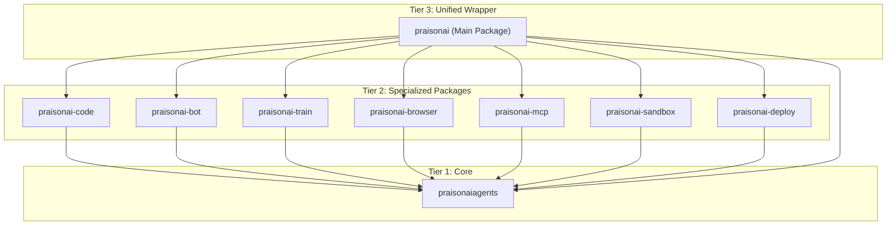
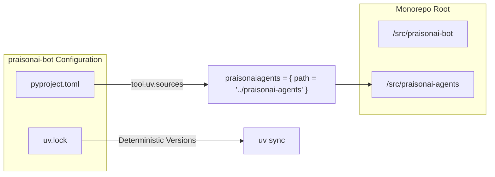

<!-- source: DeepWiki mcp.deepwiki.com · repo MervinPraison/PraisonAI · page 10.4 Dependency Management · fetched 2026-10-26 -->

# Dependency Management

Relevant source files

The following files were used as context for generating this wiki page:

- [.github/actions/install-monorepo-packages/action.yml](.github/actions/install-monorepo-packages/action.yml)
- [.github/scripts/release-gate-selftest.js](.github/scripts/release-gate-selftest.js)
- [.github/scripts/release-gate.js](.github/scripts/release-gate.js)
- [.github/workflows/nightly-release-gate.yml](.github/workflows/nightly-release-gate.yml)
- [.github/workflows/pypi-release.yml](.github/workflows/pypi-release.yml)
- [AGENTS.md](AGENTS.md)
- [docker/Dockerfile](docker/Dockerfile)
- [docker/Dockerfile.chat](docker/Dockerfile.chat)
- [docker/Dockerfile.dev](docker/Dockerfile.dev)
- [docker/Dockerfile.ui](docker/Dockerfile.ui)
- [docker/README.md](docker/README.md)
- [src/praisonai-agents/pyproject.toml](src/praisonai-agents/pyproject.toml)
- [src/praisonai-agents/uv.lock](src/praisonai-agents/uv.lock)
- [src/praisonai-bot/praisonai_bot/_version.py](src/praisonai-bot/praisonai_bot/_version.py)
- [src/praisonai-bot/pyproject.toml](src/praisonai-bot/pyproject.toml)
- [src/praisonai-bot/uv.lock](src/praisonai-bot/uv.lock)
- [src/praisonai-code/praisonai_code/cli/commands/serve.py](src/praisonai-code/praisonai_code/cli/commands/serve.py)
- [src/praisonai/praisonai.rb](src/praisonai/praisonai.rb)
- [src/praisonai/praisonai/_bootstrap.py](src/praisonai/praisonai/_bootstrap.py)
- [src/praisonai/praisonai/adapters/__init__.py](src/praisonai/praisonai/adapters/__init__.py)
- [src/praisonai/praisonai/adapters/readers.py](src/praisonai/praisonai/adapters/readers.py)
- [src/praisonai/praisonai/adapters/rerankers.py](src/praisonai/praisonai/adapters/rerankers.py)
- [src/praisonai/praisonai/adapters/retrievers.py](src/praisonai/praisonai/adapters/retrievers.py)
- [src/praisonai/praisonai/cli/main.py](src/praisonai/praisonai/cli/main.py)
- [src/praisonai/praisonai/version.py](src/praisonai/praisonai/version.py)
- [src/praisonai/pyproject.toml](src/praisonai/pyproject.toml)
- [src/praisonai/scripts/_release_lib.py](src/praisonai/scripts/_release_lib.py)
- [src/praisonai/scripts/bump_and_release.py](src/praisonai/scripts/bump_and_release.py)
- [src/praisonai/scripts/bump_version.py](src/praisonai/scripts/bump_version.py)
- [src/praisonai/scripts/publish_all.py](src/praisonai/scripts/publish_all.py)
- [src/praisonai/tests/PRAISONAI_BOT_MANIFEST.md](src/praisonai/tests/PRAISONAI_BOT_MANIFEST.md)
- [src/praisonai/uv.lock](src/praisonai/uv.lock)

## Purpose and Scope

This document describes the dependency management strategy for the PraisonAI monorepo. It covers the core and optional dependency groups across the nine-package tiered architecture, version constraints, the use of the `uv` package manager for deterministic builds, and the release automation scripts. PraisonAI utilizes a modular dependency system that allows users to install only the features they need, significantly reducing installation size and startup time.

For information about how lazy loading optimizes module imports at runtime, see [Lazy Loading System](10.3). For package structure and organization, see [praisonaiagents Package](10.1) and [praisonai Package](10.2).

---

## Package Architecture and Tiered Dependencies

PraisonAI is structured as a monorepo with multiple specialized packages. The `praisonai` wrapper package serves as the primary entry point, aggregating the other packages.

| Package | Purpose | Version | Core Focus |
|---------|---------|---------|------------|
| `praisonaiagents` | Core agent library | `1.6.167` | Agent execution, protocols, and task orchestration |
| `praisonai-code` | Code intelligence | `0.0.63` | CLI, code search, and developer tools |
| `praisonai-bot` | Messaging & Gateway | `0.0.48` | Telegram, Slack, Discord, and WebSocket gateway |
| `praisonai` | Wrapper/Orchestrator | `4.6.163` | Unified CLI, UI, and framework adapters |

The `praisonai` package depends on the entire suite of sub-packages [src/praisonai/pyproject.toml:15-22]().

### Diagram: Monorepo Dependency Flow

Sources: [src/praisonai/pyproject.toml:15-22](), [src/praisonai-bot/pyproject.toml:12-12]()

---

## Core Dependencies

### PraisonAIAgents Core
The `praisonaiagents` package requires the following core dependencies for basic agent functionality [src/praisonai-agents/pyproject.toml:14-21]():

| Dependency | Version Constraint | Purpose |
|------------|-------------------|---------|
| `pydantic` | `>=2.10.0` | Data validation and settings management |
| `rich` | (latest) | Console output formatting |
| `openai` | `>=1.68.2` | Primary LLM client |
| `posthog` | `>=3.0.0` | Telemetry and usage tracking |
| `PyYAML` | `>=6.0` | Configuration parsing |
| `aiohttp` | `>=3.8.0` | Async HTTP client |

### PraisonAI Wrapper Core
The `praisonai` package acts as a coordinator, requiring all sub-packages plus CLI and UI utilities [src/praisonai/pyproject.toml:11-32]():

| Dependency | Version Constraint | Purpose |
|------------|-------------------|---------|
| `litellm` | `>=1.83.14,<2` | Unified LLM provider abstraction |
| `typer` | `>=0.12.0` | CLI command structure |
| `textual` | `>=0.47.0` | Terminal User Interface (TUI) |
| `python-dotenv`| `>=0.19.0` | Environment variable management |

---

## Optional Feature Groups

PraisonAI uses `optional-dependencies` (extras) to manage heavy or specialized stacks.

### PraisonAIAgents Extras
Key feature groups in the core agent library [src/praisonai-agents/pyproject.toml:23-131]():

*   **`mcp`**: Adds `mcp>=1.20.0`, `fastapi`, and `websockets` for Model Context Protocol support.
*   **`knowledge`**: Adds `mem0ai`, `chromadb`, `markitdown[all]`, and `chonkie` for RAG capabilities.
*   **`crawl`**: Adds `crawl4ai>=0.4.0` and `playwright>=1.47.0` for web data extraction.
*   **`autonomy`**: Adds `ast-grep-cli` for code intelligence tools.
*   **`all`**: A meta-group aggregating all above extras [src/praisonai-agents/pyproject.toml:116-131]().

### PraisonAI Wrapper Extras
The wrapper provides high-level feature sets [src/praisonai/pyproject.toml:44-206]():

*   **`ui`**: Adds `aiui` for the web dashboard.
*   **`realtime`**: Includes `websockets`, `plotly`, and `yfinance` for voice/data agents.
*   **`train`**: Pulls `praisonai-train[llm]` for heavy ML fine-tuning tasks.
*   **`frameworks`**: Specific groups for `crewai`, `autogen`, `langgraph`, and `pydantic-ai` integration.

---

## Deterministic Environments with UV

The project uses `uv` for dependency resolution and locking. Each major package contains a `uv.lock` file to ensure reproducible builds across development and CI environments.

### Diagram: UV Lock and Local Sources

Sources: [src/praisonai-bot/pyproject.toml:70-71](), [src/praisonai-bot/uv.lock:1-10]()

---

## Release and Publish All Script

To maintain consistency across the nine packages, the `publish_all.py` script automates the release process.

### Implementation Details
*   **Version Synchronization**: The script ensures that when the wrapper is bumped, the sub-packages are released in the correct order to satisfy dependency constraints.
*   **Release Order**: Tier 1 (Core) -> Tier 2 (Specialized) -> Tier 3 (Wrapper).
*   **Release Gate**: The `nightly-release-gate.yml` and `python-package.yml` workflows verify that all dependencies are resolvable before a release is finalized [.github/workflows/nightly-release-gate.yml:1-20]().

---

## Docker Dependency Management

PraisonAI provides specialized Dockerfiles to minimize image size by installing only necessary extras.

| Dockerfile | Base | Installed Extras | Purpose |
|------------|------|------------------|---------|
| `Dockerfile.ui` | `python:3.11-slim` | `praisonai[ui,crewai]` | Web Dashboard |
| `Dockerfile.chat` | `python:3.11-slim` | `praisonai[chat]` | Simple Chat Interface |
| `Dockerfile.dev` | `python:3.11-slim` | `praisonai[ui,chat,realtime,code]` | Full Development Environment |

Sources: [docker/Dockerfile.ui:19-21](), [docker/Dockerfile.chat:17-21](), [docker/Dockerfile.dev:21-27]()

---

## Troubleshooting Dependency Issues

### Common Issues and Solutions

| Issue | Symptom | Solution |
|-------|---------|----------|
| **Missing Extra** | `ImportError: No module named 'crawl4ai'` | Install the specific extra: `pip install praisonai[chat]` |
| **Version Conflict** | `pydantic.errors.PydanticUserError` | Ensure `pydantic>=2.10.0` is installed. |
| **Playwright Missing** | `Executable doesn't exist` | Run `playwright install chromium` after installing `[crawl]` or `[chat]` [src/praisonai-agents/pyproject.toml:103-103](). |
| **Local Path Error** | `Path not found` in `uv` | Ensure monorepo structure is preserved; `uv` expects relative paths like `../praisonai-agents` [src/praisonai-bot/pyproject.toml:71-71](). |

Sources: [src/praisonai-agents/pyproject.toml:103-103](), [src/praisonai-bot/pyproject.toml:71-71]()

---

