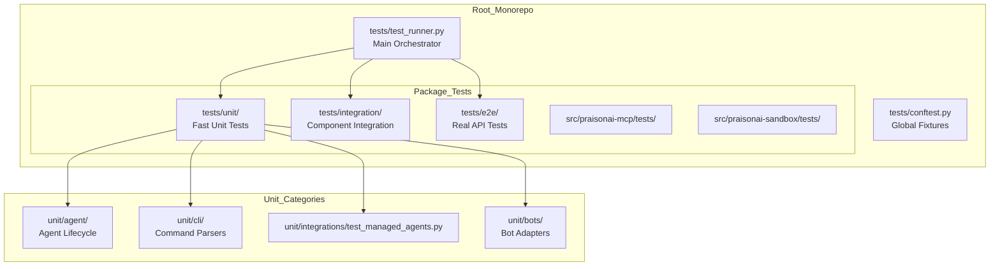
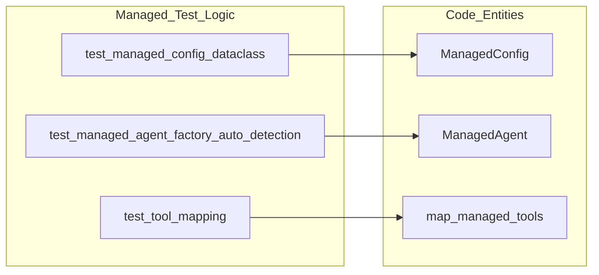
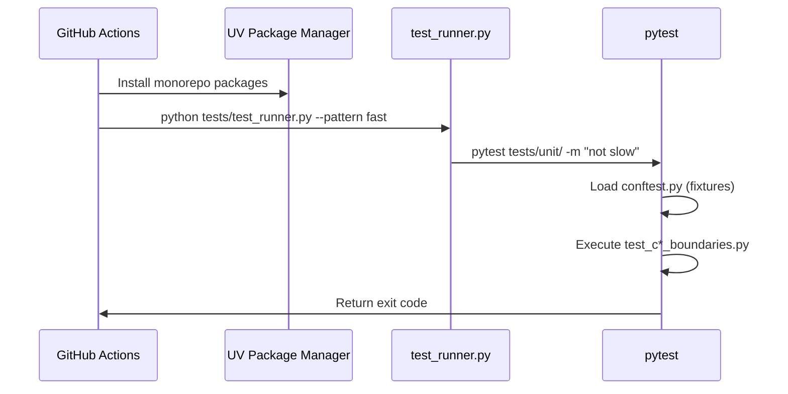

<!-- source: DeepWiki mcp.deepwiki.com · repo MervinPraison/PraisonAI · page 11.1 Testing Framework · fetched 2026-10-26 -->

# Testing Framework

<details>
<summary>Relevant source files</summary>

The following files were used as context for generating this wiki page:

- [.github/workflows/build-image.yml](.github/workflows/build-image.yml)
- [.github/workflows/python-package.yml](.github/workflows/python-package.yml)
- [.github/workflows/release.yml](.github/workflows/release.yml)
- [.github/workflows/test-comprehensive.yml](.github/workflows/test-comprehensive.yml)
- [.github/workflows/test-core.yml](.github/workflows/test-core.yml)
- [.github/workflows/test-extended.yml](.github/workflows/test-extended.yml)
- [.github/workflows/test-frameworks.yml](.github/workflows/test-frameworks.yml)
- [.github/workflows/test-optimized.yml](.github/workflows/test-optimized.yml)
- [.github/workflows/test-real.yml](.github/workflows/test-real.yml)
- [.github/workflows/test-windows.yml](.github/workflows/test-windows.yml)
- [src/praisonai-agents/praisonaiagents/frameworks/base.py](src/praisonai-agents/praisonaiagents/frameworks/base.py)
- [src/praisonai-agents/tests/managed/test_managed_persistence.py](src/praisonai-agents/tests/managed/test_managed_persistence.py)
- [src/praisonai/examples/python/frameworks/google_adk/agents.yaml](src/praisonai/examples/python/frameworks/google_adk/agents.yaml)
- [src/praisonai/praisonai/_api_auth.py](src/praisonai/praisonai/_api_auth.py)
- [src/praisonai/praisonai/acp/safe_edit.py](src/praisonai/praisonai/acp/safe_edit.py)
- [src/praisonai/praisonai/cli/commands/standardise.py](src/praisonai/praisonai/cli/commands/standardise.py)
- [src/praisonai/praisonai/cli/features/serve.py](src/praisonai/praisonai/cli/features/serve.py)
- [src/praisonai/praisonai/integrations/db_session_adapter.py](src/praisonai/praisonai/integrations/db_session_adapter.py)
- [src/praisonai/praisonai/jobs/__init__.py](src/praisonai/praisonai/jobs/__init__.py)
- [src/praisonai/praisonai/jobs/executor.py](src/praisonai/praisonai/jobs/executor.py)
- [src/praisonai/praisonai/jobs/router.py](src/praisonai/praisonai/jobs/router.py)
- [src/praisonai/praisonai/jobs/server.py](src/praisonai/praisonai/jobs/server.py)
- [src/praisonai/praisonai/jobs/store.py](src/praisonai/praisonai/jobs/store.py)
- [src/praisonai/praisonai/standardise/undo_redo.py](src/praisonai/praisonai/standardise/undo_redo.py)
- [src/praisonai/tests/_pytest_plugins/test_gating.py](src/praisonai/tests/_pytest_plugins/test_gating.py)
- [src/praisonai/tests/conftest.py](src/praisonai/tests/conftest.py)
- [src/praisonai/tests/integration/README.md](src/praisonai/tests/integration/README.md)
- [src/praisonai/tests/integration/test_managed_real.py](src/praisonai/tests/integration/test_managed_real.py)
- [src/praisonai/tests/test_runner.py](src/praisonai/tests/test_runner.py)
- [src/praisonai/tests/unit/cli/test_test_command.py](src/praisonai/tests/unit/cli/test_test_command.py)
- [src/praisonai/tests/unit/integrations/test_managed_agents.py](src/praisonai/tests/unit/integrations/test_managed_agents.py)
- [src/praisonai/tests/unit/jobs/test_store.py](src/praisonai/tests/unit/jobs/test_store.py)
- [src/praisonai/tests/unit/scheduler/test_agent_scheduler.py](src/praisonai/tests/unit/scheduler/test_agent_scheduler.py)
- [src/praisonai/tests/unit/standardise/test_cli_surface.py](src/praisonai/tests/unit/standardise/test_cli_surface.py)
- [src/praisonai/tests/unit/test_cli_features.py](src/praisonai/tests/unit/test_cli_features.py)
- [src/praisonai/tests/unit/test_setup_test_environment_fixture.py](src/praisonai/tests/unit/test_setup_test_environment_fixture.py)

</details>


The PraisonAI testing framework provides a comprehensive infrastructure for validating agent functionality, framework integrations, and API interactions across a tiered monorepo architecture. The system is built on `pytest` with custom orchestration through `test_runner.py` and automated execution via GitHub Actions. Test execution is organized into pattern-based categories with strict separation between mock tests and real API tests to prevent accidental costs.

## Test Architecture Overview

The framework validates the system across multiple dimensions:
- **Core Agents**: Unit tests for `praisonaiagents` functionality using mocked LLM responses.
- **Framework Integrations**: Compatibility testing for CrewAI and AutoGen adapters.
- **Protocol Compliance**: Validation of MCP (Model Context Protocol) and A2A (Agent-to-Agent) communication.
- **Managed Agents**: Verification of remote execution backends (Docker, E2B, Anthropic).
- **CLI/TUI Surface**: Testing command-line entry points and interactive terminal interfaces.

### Test Directory Structure


Sources: [src/praisonai/tests/test_runner.py:1-20](), [src/praisonai/tests/conftest.py:1-30](), [src/praisonai/tests/unit/test_cli_features.py:1-15]()

## Test Categories and Patterns

### Test Runner (`test_runner.py`)
The `test_runner.py` script implements pattern-based routing through the `run_tests()` function. It maps user-defined patterns to specific `pytest` command configurations.

| Pattern | Target Directory | Markers Applied | Purpose |
| :--- | :--- | :--- | :--- |
| `unit` | `tests/unit/` | None | Logic verification without network |
| `integration` | `tests/integration/` | None | Cross-component workflows |
| `fast` | `tests/unit/` | `not slow` | PR-gate validation |
| `real` | `tests/e2e/` | `real` | Actual LLM API calls (requires confirmation) |
| `frameworks` | `tests/integration/` | `autogen` or `crewai` | Third-party adapter testing |

Sources: [src/praisonai/tests/test_runner.py:202-256](), [src/praisonai/tests/test_runner.py:278-304]()

### Mock vs. Real Tests
The framework distinguishes between tests that use `unittest.mock` and those that require live credentials.
- **Mock Tests**: Default for CI. Uses `mock_llm_response` and `mock_vector_store` fixtures [src/praisonai/tests/conftest.py:74-115]().
- **Real Tests**: Marked with `@pytest.mark.real`. Requires `OPENAI_API_KEY` or equivalent. `test_runner.py` enforces an interactive prompt for these [src/praisonai/tests/test_runner.py:306-320]().

## Fixtures and Configuration

### Global Fixtures (`conftest.py`)
The `conftest.py` file provides shared resources for the suite:
- **`setup_test_environment`**: Automatically fills missing API keys with placeholder `test-key` for non-real tests to prevent import crashes [src/praisonai/tests/conftest.py:147-189]().
- **`mock_llm_response`**: Returns a static JSON structure mimicking a LiteLLM/OpenAI response [src/praisonai/tests/conftest.py:74-79]().
- **`mock_vector_store`**: Patches `chromadb.Client` to return sample documents for RAG testing [src/praisonai/tests/conftest.py:104-115]().
- **`cleanup_async_resources`**: Forces garbage collection after async tests to prevent unclosed session warnings [src/praisonai/tests/conftest.py:51-62]().

### Test Gating Plugins
PraisinAI uses custom `pytest` plugins for safety:
- **`test_gating`**: Prevents execution of specific tiers based on environment variables [src/praisonai/tests/conftest.py:13]().
- **`network_guard`**: Blocks unexpected outbound network calls during unit tests [src/praisonai/tests/conftest.py:14]().

## Boundary and Managed Agent Testing

### Managed Agent Integration
Tests in `tests/unit/integrations/test_managed_agents.py` validate the `ManagedAgent` factory and `ManagedConfig` dataclass without triggering remote compute.

**Managed Agent Test Flow:**

Sources: [src/praisonai/tests/unit/integrations/test_managed_agents.py:13-70]()

### Boundary Verification
The system includes specialized boundary tests (e.g., `test_c7_1_boundaries.py`) that enforce the nine-package tiered architecture. These tests ensure that lower-tier packages (like `praisonaiagents`) do not import from higher-tier wrappers (like `praisonai`), preventing circular dependencies [src/praisonai/.github/workflows/test-optimized.yml:82-89]().

## CI/CD Pipeline Integration

PraisonAI uses a multi-tier CI strategy:

1.  **Smoke Tests**: Fast unit tests and standalone import checks, targeting < 2 minutes [.github/workflows/test-optimized.yml:43-100]().
2.  **Core Tests**: Sharded execution of the full unit suite across multiple runners (cli, bots, train, mcp, sandbox, deploy) [.github/workflows/test-core.yml:78-161]().
3.  **Comprehensive Suite**: Weekly full integration testing, including performance benchmarks and framework adapters [.github/workflows/test-comprehensive.yml:26-106]().
4.  **Windows/Multi-Version**: Validation across Python 3.10, 3.11, and 3.12 on different OS environments [.github/workflows/test-windows.yml:21-185](), [.github/workflows/python-package.yml:9-44]().

### Workflow Data Flow


Sources: [.github/workflows/test-core.yml:48-61](), [src/praisonai/tests/test_runner.py:224-225](), [src/praisonai/tests/conftest.py:11-29]()

## Example Test Patterns

### CLI Feature Testing
Tests for CLI handlers use `unittest.mock.patch` to simulate feature execution without side effects. For example, `TestGuardrailHandler` verifies dependency availability and config application [src/praisonai/tests/unit/test_cli_features.py:17-68]().

### Framework Integration Testing
Integration tests for AutoGen and CrewAI use the `PraisonAI` wrapper class to load YAML configurations and verify the adapter registry:
```python
# Conceptual pattern from legacy test.py
praisonai = PraisonAI(agent_file="tests/autogen-agents.yaml")
result = praisonai.run() # Mocked in CI
```
Sources: [src/praisonai/tests/test.py:23-28](), [src/praisonai/tests/test.py:68-74]()

---

