<!-- source: DeepWiki mcp.deepwiki.com · repo MervinPraison/PraisonAI · page 11.2 CI/CD Pipeline · fetched 2026-10-26 -->

# CI/CD Pipeline

Relevant source files

The following files were used as context for generating this wiki page:

- [.github/actions/gemini/action.yml](.github/actions/gemini/action.yml)
- [.github/scripts/release-gate-selftest.js](.github/scripts/release-gate-selftest.js)
- [.github/scripts/release-gate.js](.github/scripts/release-gate.js)
- [.github/workflows/benchmark.yml](.github/workflows/benchmark.yml)
- [.github/workflows/build-image.yml](.github/workflows/build-image.yml)
- [.github/workflows/docker-publish.yml](.github/workflows/docker-publish.yml)
- [.github/workflows/gemini-issue-automated-triage.yml](.github/workflows/gemini-issue-automated-triage.yml)
- [.github/workflows/gemini-issue-review.yml](.github/workflows/gemini-issue-review.yml)
- [.github/workflows/gemini-pr-review.yml](.github/workflows/gemini-pr-review.yml)
- [.github/workflows/nightly-release-gate.yml](.github/workflows/nightly-release-gate.yml)
- [.github/workflows/pypi-release.yml](.github/workflows/pypi-release.yml)
- [.github/workflows/python-package.yml](.github/workflows/python-package.yml)
- [.github/workflows/release.yml](.github/workflows/release.yml)
- [.github/workflows/test-comprehensive.yml](.github/workflows/test-comprehensive.yml)
- [.github/workflows/test-core.yml](.github/workflows/test-core.yml)
- [.github/workflows/test-extended.yml](.github/workflows/test-extended.yml)
- [.github/workflows/test-frameworks.yml](.github/workflows/test-frameworks.yml)
- [.github/workflows/test-optimized.yml](.github/workflows/test-optimized.yml)
- [.github/workflows/test-real.yml](.github/workflows/test-real.yml)
- [.github/workflows/test-windows.yml](.github/workflows/test-windows.yml)
- [.github/workflows/update-api-md.yml](.github/workflows/update-api-md.yml)
- [.github/workflows/update-docs-parity.yml](.github/workflows/update-docs-parity.yml)
- [.github/workflows/update-parity-tracker.yml](.github/workflows/update-parity-tracker.yml)
- [AGENTS.md](AGENTS.md)
- [src/praisonai-agents/praisonaiagents/hooks/registry.py](src/praisonai-agents/praisonaiagents/hooks/registry.py)
- [src/praisonai-agents/praisonaiagents/tools/circuit_breaker.py](src/praisonai-agents/praisonaiagents/tools/circuit_breaker.py)
- [src/praisonai-agents/praisonaiagents/tools/circuit_breaker_integrations.py](src/praisonai-agents/praisonaiagents/tools/circuit_breaker_integrations.py)
- [src/praisonai-agents/praisonaiagents/tools/health_monitor.py](src/praisonai-agents/praisonaiagents/tools/health_monitor.py)
- [src/praisonai-agents/praisonaiagents/tools/retry.py](src/praisonai-agents/praisonaiagents/tools/retry.py)
- [src/praisonai-agents/praisonaiagents/trace/protocol.py](src/praisonai-agents/praisonaiagents/trace/protocol.py)
- [src/praisonai-agents/tests/unit/test_circuit_breaker.py](src/praisonai-agents/tests/unit/test_circuit_breaker.py)
- [src/praisonai/scripts/bump_and_release.py](src/praisonai/scripts/bump_and_release.py)
- [src/praisonai/scripts/bump_version.py](src/praisonai/scripts/bump_version.py)

## Purpose and Scope

This document describes the Continuous Integration and Continuous Deployment (CI/CD) pipeline for PraisonAI. The pipeline automates testing, code review, quality assurance, and deployment across the nine-package monorepo architecture. It includes a tiered testing strategy, AI-powered code review automation via Claude and Gemini, and release management for multi-package synchronization.

For information about the testing framework and test categories, see [Testing Framework](11.1). For details on AI automation features, see [GitHub AI Automation](11.3). For deployment infrastructure, see [Deployment and Infrastructure](9).

---

## Workflow Architecture

The CI/CD pipeline consists of 20+ GitHub Actions workflows organized by purpose: test execution, AI automation, quality assurance, and deployment. Each workflow is triggered by specific events and designed to provide fast feedback while minimizing CI resource usage and API costs.

### Workflow Trigger Mapping

```mermaid
graph TB
    subgraph "Trigger Events"
        PUSH["Push to Branch"]
        PR["Pull Request"]
        ISSUE["Issue Created/Commented"]
        SCHEDULE["Scheduled Cron"]
        MANUAL["Manual Dispatch"]
        RELEASE["Release Published"]
    end
    
    subgraph "Fast Feedback Workflows"
        CORE["test-core.yml<br/>Core Tests<br/>Shard-based execution"]
        OPTIMIZED["test-optimized.yml<br/>Smoke Tests<br/>Hot-path import gates"]
        WINDOWS["test-windows.yml<br/>Cross-platform validation"]
    end
    
    subgraph "AI Automation Workflows"
        GEMINI_PR["gemini-pr-review.yml<br/>PR Analysis + Commits"]
        GEMINI_ISSUE["gemini-issue-review.yml<br/>Issue Analysis + PR Creation"]
        TRIAGE["gemini-issue-automated-triage.yml<br/>Label assignment"]
    end
    
    subgraph "Comprehensive & Release Workflows"
        COMPREHENSIVE["test-comprehensive.yml<br/>Full Test Suite"]
        PYPI_REL["pypi-release.yml<br/>Multi-package publish"]
        NIGHTLY_GATE["nightly-release-gate.yml<br/>Stability verification"]
        DOCKER_PUB["docker-publish.yml<br/>Registry Push"]
    end
    
    PUSH --> CORE
    PUSH --> OPTIMIZED
    PR --> CORE
    PR --> OPTIMIZED
    PR --> WINDOWS
    
    ISSUE --> GEMINI_ISSUE
    PR --> GEMINI_PR
    
    MANUAL --> COMPREHENSIVE
    MANUAL --> PYPI_REL
    
    SCHEDULE --> COMPREHENSIVE
    SCHEDULE --> NIGHTLY_GATE
    
    RELEASE --> COMPREHENSIVE
    RELEASE --> DOCKER_PUB
```

**Sources:** [.github/workflows/test-core.yml](), [.github/workflows/test-optimized.yml](), [.github/workflows/pypi-release.yml](), [.github/workflows/gemini-pr-review.yml]()

---

## Test Workflows

The monorepo uses a tiered testing strategy to balance speed, coverage, and cross-package integrity.

### test-core.yml - Sharded Core Tests
This workflow executes the bulk of the unit and integration tests across the monorepo packages (`praisonai-agents`, `praisonai-code`, `praisonai-bot`, etc.).

**Key Features:**
- **Sharding Strategy:** Tests are split into shards like `cli`, `bots-gateway`, `train`, `mcp`, `sandbox`, `deploy`, and `subdirs` to parallelize execution [.github/workflows/test-core.yml:85-161]().
- **Dependency Isolation:** Each shard installs specific extras (e.g., `praisonaiagents[knowledge]`) and configures the `PYTHONPATH` to include necessary monorepo sources [.github/workflows/test-core.yml:100-129]().
- **Boundary Verification:** Shards for `praisonai-sandbox` and `praisonai-deploy` execute boundary verification scripts (`check_c13_sandbox_imports.sh`) to ensure strict architectural isolation [.github/workflows/test-core.yml:195-199]().

### test-optimized.yml - Smoke and Import Gates
Designed for ultra-fast feedback (target < 2 minutes), this workflow focuses on architectural integrity.

- **Smoke Tier:** Runs critical boundary tests (`test_c7_1_boundaries.py`, `test_c9_1_boundaries.py`) and backward compatibility checks [.github/workflows/test-optimized.yml:82-89]().
- **Standalone Import Gates:** Verifies that packages like `praisonai-code` and `praisonai-bot` can be imported and run in a clean virtual environment without the full `praisonai` wrapper, enforcing the tiered architecture [.github/workflows/test-optimized.yml:101-184]().
- **C7 Hot-path Gate:** Uses `check_c7_imports.sh` to ensure no module-level wrapper imports exist in core CLI commands [.github/workflows/test-optimized.yml:126-135]().

### test-windows.yml - Cross-Platform Validation
Ensures the core agent library and CLI work on Windows environments.
- **Scope:** Tests core imports, agent instantiation, workflow execution, and tool decorators [.github/workflows/test-windows.yml:44-110]().
- **CLI Testing:** Validates `praisonai --version` and `praisonai-bot gateway --help` on Windows shells [.github/workflows/test-windows.yml:175-180]().

**Sources:** [.github/workflows/test-core.yml:1-288](), [.github/workflows/test-optimized.yml:1-185](), [.github/workflows/test-windows.yml:1-213]()

---

## Release and Deployment

Release management is automated via specialized scripts and workflows that handle the complex dependency chain of the monorepo.

### pypi-release.yml - Orchestrated Publishing
This workflow manages the publishing of all 9+ packages to PyPI. It follows a strict order to ensure dependencies are available: `praisonaiagents` → `praisonai-code` → `praisonai-bot` → `praisonai-train` → `praisonai-browser` → `praisonai-mcp` → `praisonai-sandbox` → `praisonai-deploy` → `praisonai` (wrapper).

**Key Capabilities:**
- **Version Bumping:** Supports `patch`, `minor`, and `major` bumps across all packages [.github/workflows/pypi-release.yml:10-18]().
- **Skip Logic:** Allows skipping specific packages (e.g., `skip_agents`) for recovery if a partial release occurred [.github/workflows/pypi-release.yml:24-68]().
- **Environment Gating:** Uses `pypi-auto` for automated patch releases and `pypi` (requiring reviewers) for major/minor releases [.github/workflows/pypi-release.yml:158-163]().

### bump_and_release.py - Release Logic
The core logic resides in `src/praisonai/scripts/bump_and_release.py`. It automates the following steps:
1. **Pre-flight Checks:** Validates clean git state [.src/praisonai/scripts/bump_and_release.py:181-187]().
2. **PyPI Propagation:** Optionally waits for `praisonaiagents` to appear on PyPI before bumping the wrapper to prevent installation failures [.src/praisonai/scripts/bump_and_release.py:145-178]().
3. **File Updates:** Bumps versions in `pyproject.toml`, `version.py`, and `_version.py` across the monorepo [.src/praisonai/scripts/bump_and_release.py:190-203]().
4. **Build & Publish:** Runs `uv build` and `uv publish` for the target package.

**Sources:** [.github/workflows/pypi-release.yml:1-163](), [src/praisonai/scripts/bump_and_release.py:1-203]()

---

## AI-Powered Quality Assurance

PraisonAI utilizes Gemini models to automate issue triage and code reviews, ensuring adherence to the architecture defined in `AGENTS.md`.

### Gemini Issue & PR Review
The `gemini-issue-review.yml` and `gemini-pr-review.yml` workflows provide autonomous assistance.

- **Architecture Enforcement:** The AI is strictly instructed to read `src/praisonai-agents/AGENTS.md` before making any code modifications [.github/workflows/gemini-issue-review.yml:108]().
- **Autonomous Fixes:** Gemini can create new branches (`gemini/issue-NNN`), write code, and open Pull Requests [.github/workflows/gemini-issue-review.yml:111-130]().
- **PR Refinement:** For existing PRs, Gemini can checkout the PR branch, apply improvements, and push commits directly [.github/workflows/gemini-pr-review.yml:162-173]().

### Gemini Issue Triage
The `gemini-issue-automated-triage.yml` workflow automatically categorizes new issues by applying labels based on content analysis, reducing maintainer overhead.

**Sources:** [.github/workflows/gemini-issue-review.yml:1-201](), [.github/workflows/gemini-pr-review.yml:1-248](), [.github/workflows/gemini-issue-automated-triage.yml]()

---

## Infrastructure and Parity

### Parity Tracking
Workflows ensure that documentation and features remain synchronized across Python, TypeScript, and Rust SDKs.
- **update-docs-parity.yml:** Automatically runs `generate_docs_parity.py` to update `DOCS_PARITY.md` files in each SDK directory when core files change [.github/workflows/update-docs-parity.yml:1-83]().

### Docker Publishing
The `docker-publish.yml` workflow builds and pushes multi-platform images (e.g., `latest`, semver tags) to `ghcr.io/mervinpraison/praisonai` [.github/workflows/docker-publish.yml:1-54]().

### Release Gate
The `nightly-release-gate.yml` workflow acts as a final stability check, running a `release-gate.js` script to verify that the current `main` branch is healthy enough for a production release [.github/workflows/nightly-release-gate.yml]().

**Sources:** [.github/workflows/update-docs-parity.yml:1-83](), [.github/workflows/docker-publish.yml:1-54](), [.github/workflows/nightly-release-gate.yml]()

---

