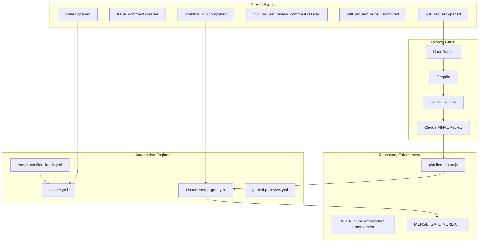
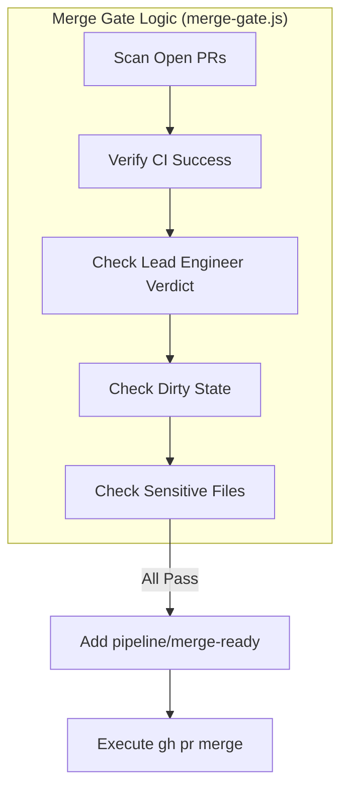

<!-- source: DeepWiki mcp.deepwiki.com · repo MervinPraison/PraisonAI · page 11.3 GitHub AI Automation · fetched 2026-10-26 -->

# GitHub AI Automation

Relevant source files

The following files were used as context for generating this wiki page:

- [.github/ISSUE_TEMPLATE/bug_report.md](.github/ISSUE_TEMPLATE/bug_report.md)
- [.github/actions/claude-code-action/action.yml](.github/actions/claude-code-action/action.yml)
- [.github/actions/claude-issue-triage-action/action.yml](.github/actions/claude-issue-triage-action/action.yml)
- [.github/actions/gemini/action.yml](.github/actions/gemini/action.yml)
- [.github/praisonai-reviewer.yaml](.github/praisonai-reviewer.yaml)
- [.github/scripts/ci-failure-claude-selftest.js](.github/scripts/ci-failure-claude-selftest.js)
- [.github/scripts/ci-failure-claude.js](.github/scripts/ci-failure-claude.js)
- [.github/scripts/merge-gate-selftest.js](.github/scripts/merge-gate-selftest.js)
- [.github/scripts/merge-gate.js](.github/scripts/merge-gate.js)
- [.github/scripts/pipeline-status-selftest.js](.github/scripts/pipeline-status-selftest.js)
- [.github/scripts/pipeline-status.js](.github/scripts/pipeline-status.js)
- [.github/scripts/pr-review-chain-selftest.js](.github/scripts/pr-review-chain-selftest.js)
- [.github/scripts/pr-review-chain.js](.github/scripts/pr-review-chain.js)
- [.github/workflows/auto-issue-comment.yml](.github/workflows/auto-issue-comment.yml)
- [.github/workflows/auto-pr-comment.yml](.github/workflows/auto-pr-comment.yml)
- [.github/workflows/benchmark.yml](.github/workflows/benchmark.yml)
- [.github/workflows/ci-failure-claude.yml](.github/workflows/ci-failure-claude.yml)
- [.github/workflows/claude-issue-triage.yml](.github/workflows/claude-issue-triage.yml)
- [.github/workflows/claude-merge-gate.yml](.github/workflows/claude-merge-gate.yml)
- [.github/workflows/claude.yml](.github/workflows/claude.yml)
- [.github/workflows/docker-publish.yml](.github/workflows/docker-publish.yml)
- [.github/workflows/gemini-issue-automated-triage.yml](.github/workflows/gemini-issue-automated-triage.yml)
- [.github/workflows/gemini-issue-review.yml](.github/workflows/gemini-issue-review.yml)
- [.github/workflows/gemini-pr-review.yml](.github/workflows/gemini-pr-review.yml)
- [.github/workflows/merge-conflict-claude.yml](.github/workflows/merge-conflict-claude.yml)
- [.github/workflows/pipeline-status-sync.yml](.github/workflows/pipeline-status-sync.yml)
- [.github/workflows/praisonai-issue-triage.yml](.github/workflows/praisonai-issue-triage.yml)
- [.github/workflows/praisonai-pr-review.yml](.github/workflows/praisonai-pr-review.yml)
- [.github/workflows/python-publish.yml](.github/workflows/python-publish.yml)
- [.github/workflows/update-api-md.yml](.github/workflows/update-api-md.yml)
- [.github/workflows/update-docs-parity.yml](.github/workflows/update-docs-parity.yml)
- [.github/workflows/update-parity-tracker.yml](.github/workflows/update-parity-tracker.yml)
- [examples/yaml/pr-reviewer/README.md](examples/yaml/pr-reviewer/README.md)
- [examples/yaml/praisonai-pr-review.yml.template](examples/yaml/praisonai-pr-review.yml.template)
- [src/praisonai-agents/.agent/workflows/e2e-analysis-issue-pr-merge.md](src/praisonai-agents/.agent/workflows/e2e-analysis-issue-pr-merge.md)
- [src/praisonai-agents/.agent/workflows/instruction.md](src/praisonai-agents/.agent/workflows/instruction.md)
- [src/praisonai-agents/.agent/workflows/local-fix.md](src/praisonai-agents/.agent/workflows/local-fix.md)
- [src/praisonai-agents/.agent/workflows/pr-review.md](src/praisonai-agents/.agent/workflows/pr-review.md)
- [src/praisonai-agents/.agent/workflows/review-chain.md](src/praisonai-agents/.agent/workflows/review-chain.md)
- [src/praisonai-agents/autoagents-tavily.py](src/praisonai-agents/autoagents-tavily.py)
- [src/praisonai-agents/praisonaiagents/hooks/registry.py](src/praisonai-agents/praisonaiagents/hooks/registry.py)
- [src/praisonai-agents/praisonaiagents/tools/circuit_breaker.py](src/praisonai-agents/praisonaiagents/tools/circuit_breaker.py)
- [src/praisonai-agents/praisonaiagents/tools/circuit_breaker_integrations.py](src/praisonai-agents/praisonaiagents/tools/circuit_breaker_integrations.py)
- [src/praisonai-agents/praisonaiagents/tools/health_monitor.py](src/praisonai-agents/praisonaiagents/tools/health_monitor.py)
- [src/praisonai-agents/praisonaiagents/tools/retry.py](src/praisonai-agents/praisonaiagents/tools/retry.py)
- [src/praisonai-agents/praisonaiagents/trace/protocol.py](src/praisonai-agents/praisonaiagents/trace/protocol.py)
- [src/praisonai-agents/tests/unit/test_circuit_breaker.py](src/praisonai-agents/tests/unit/test_circuit_breaker.py)
- [src/praisonai/praisonai/cli/commands/__init__.py](src/praisonai/praisonai/cli/commands/__init__.py)
- [src/praisonai/praisonai/cli/commands/port.py](src/praisonai/praisonai/cli/commands/port.py)
- [src/praisonai/praisonai/cli/features/tui/__init__.py](src/praisonai/praisonai/cli/features/tui/__init__.py)
- [src/praisonai/praisonai/persistence/knowledge/clickhouse.py](src/praisonai/praisonai/persistence/knowledge/clickhouse.py)
- [src/praisonai/scripts/docker/install-smoke/Dockerfile](src/praisonai/scripts/docker/install-smoke/Dockerfile)
- [src/praisonai/scripts/docker/install-smoke/run.sh](src/praisonai/scripts/docker/install-smoke/run.sh)
- [src/praisonai/scripts/install.sh](src/praisonai/scripts/install.sh)
- [src/praisonai/scripts/test-install-smoke.sh](src/praisonai/scripts/test-install-smoke.sh)
- [src/praisonai/tests/integration/test_install_sh_bot_onboarding.py](src/praisonai/tests/integration/test_install_sh_bot_onboarding.py)

This document describes the AI-powered automation system for GitHub workflows in the PraisonAI repository. The system uses two AI models—Claude and Gemini—to automatically review issues and pull requests, perform auto-triage, handle CI failures, and enforce architecture standards defined in `AGENTS.md`.

## System Overview

The GitHub AI automation system consists of dual AI assistants that monitor repository activity and respond to specific triggers. The system enables autonomous code review, issue resolution, and pull request modifications.

**Sources:** [.github/workflows/claude.yml:1-160](), [.github/workflows/auto-pr-comment.yml:3-43](), [.github/workflows/claude-merge-gate.yml:1-34](), [.github/workflows/merge-conflict-claude.yml:1-12]()

## Review Chain and PR Automation

PraisonAI implements a multi-stage review chain where specialized bots provide feedback before a final AI assessment.

### The Review Pipeline
The chain typically follows this sequence: **CodeRabbit → Greptile → Gemini/Qodo → Claude (FINAL)**.
1. **Trigger:** The chain is activated by PR creation or synchronization [.github/workflows/auto-pr-comment.yml:14-17]().
2. **Claude Final:** The `claude-after-prior-reviewers` job waits for prior bots to comment before triggering a "Lead Engineer" review [.github/workflows/auto-pr-comment.yml:32-43]().
3. **Architecture Enforcement:** All AI reviews, especially Gemini and Claude, are explicitly instructed to read and honor `src/praisonai-agents/AGENTS.md` before writing code [.github/workflows/gemini-issue-review.yml:108-108](), [.github/workflows/gemini-pr-review.yml:163-163]().

### CI Failure Handling
When a CI pipeline fails, the system can trigger Claude to analyze logs and suggest/implement fixes. The `claude-response` job is configured to allow `github-actions[bot]` to trigger it when specific failure markers like "CI failed on HEAD" are detected in comments [.github/workflows/claude.yml:142-146]().

**Sources:** [.github/workflows/auto-pr-comment.yml:3-26](), [.github/scripts/pr-review-chain.js:1-50](), [.github/workflows/gemini-pr-review.yml:163-163]()

## Auto-Triage System

The system performs lightweight triage for all new issues to maintain repository health without consuming heavy LLM resources for every event.

### Triage Logic
The `issue-triage` job in `claude.yml` uses a GitHub Script to:
- **Categorize:** Assigns `bug`, `enhancement`, or `question` labels based on content keywords (e.g., "crash", "how to", "feature request") [.github/workflows/claude.yml:52-61]().
- **Area Labeling:** Identifies specific domains like `security`, `performance`, `documentation`, or `javascript` [.github/workflows/claude.yml:64-75]().
- **Auto-Claude Trigger:** If an issue is from an owner or has an actionable title (e.g., `fix:`, `feat:`), it automatically adds the `claude` label to trigger a full code-fix analysis [.github/workflows/claude.yml:108-122]().

**Sources:** [.github/workflows/claude.yml:18-123]()

## Claude PR Merge Gate

The Merge Gate is a deterministic and LLM-based system that decides if a PR is ready for automated merging into `main`.

### Merge Readiness Heuristics
The logic in `.github/scripts/merge-gate.js` defines several safety checks:
- **Sensitive Paths:** Blocks auto-merge if changes affect `.github/workflows/`, `auth`, `policy`, or `sandbox` modules [.github/scripts/merge-gate.js:21-28]().
- **Review Status:** Requires a `MERGE_GATE_VERDICT: APPROVE` from a "Lead Engineer" Claude review posted after the latest commit [.github/scripts/merge-gate.js:143-152]().
- **Pipeline Status:** Syncs labels like `pipeline/merge-ready` only when all required tests (Core, Comprehensive, Optimized) are green [.github/scripts/merge-gate.js:29-44]().

### Merge Gate Workflow
The `claude-merge-gate.yml` workflow scans for candidates every 10 minutes [.github/workflows/claude-merge-gate.yml:9]().

**Sources:** [.github/scripts/merge-gate.js:6-55](), [.github/workflows/claude-merge-gate.yml:1-40](), [.github/scripts/pipeline-status.js:1-30]()

## Conflict Resolution Automation

The `merge-conflict-claude.yml` workflow monitors internal PRs for `DIRTY` merge states [.github/workflows/merge-conflict-claude.yml:129-130]().

1. **Detection:** Scans for PRs where `mergeStateStatus` is `DIRTY` [.github/workflows/merge-conflict-claude.yml:57-68]().
2. **Trigger:** Adds the `claude-conflict-pending` label and posts a specific instruction for Claude to rebase onto `main`, resolve conflicts, and force-push [.github/workflows/merge-conflict-claude.yml:41-48]().
3. **Safety:** Includes a cooldown period (12 hours) to prevent bot spamming on the same conflict [.github/workflows/merge-conflict-claude.yml:38-39]().

**Sources:** [.github/workflows/merge-conflict-claude.yml:1-164](), [.github/scripts/merge-gate.js:95-115]()

## Architecture Enforcement (AGENTS.md)

A core feature of the AI automation is the enforcement of the repository's architecture standards. Every AI agent (Claude and Gemini) is given a mandatory instruction to read `src/praisonai-agents/AGENTS.md` before performing any code modifications.

### Enforcement Protocol
- **Gemini:** Instructed in `STEP 2` of the review process to honor "Protocol-First design rules" [.github/workflows/gemini-issue-review.yml:108-108]().
- **Claude:** The `claude-code-action` includes context from the repository, and the auto-comments reinforce that Claude must "implement a minimal fix following AGENTS.md" [.github/workflows/auto-issue-comment.yml:45-45]().
- **Minimalism:** AI agents are explicitly told not to bloat the `Agent` class with additional parameters unless absolutely required [.github/workflows/merge-conflict-claude.yml:46-47]().

**Sources:** [.github/workflows/gemini-issue-review.yml:100-110](), [.github/workflows/auto-issue-comment.yml:41-46](), [.github/workflows/merge-conflict-claude.yml:46-48]()

## Implementation Details

### Pipeline Status Sync
The `pipeline-status.js` script manages the synchronization between CI status and GitHub labels. It ensures that the `pipeline/*` labels accurately reflect whether a PR is passing core tests, awaiting review, or ready for the merge gate.

**Sources:** [.github/scripts/pipeline-status.js:1-50](), [.github/workflows/pipeline-status-sync.yml:1-20]()

### Security and Permissions
The automation uses a tiered token system:
- **GitHub App Token:** Generated for high-privilege operations like labeling and PR creation to bypass standard `GITHUB_TOKEN` limitations [.github/workflows/claude.yml:28-35]().
- **Environment Isolation:** User-controlled inputs (issue bodies, PR titles) are passed as environment variables to prevent script injection in the GitHub Actions runner [.github/actions/claude-code-action/action.yml:95-110]().

**Sources:** [.github/workflows/claude.yml:28-35](), [.github/actions/claude-code-action/action.yml:95-110]()

---

