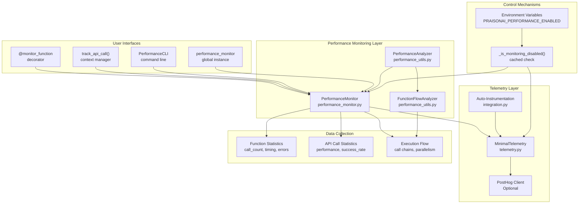
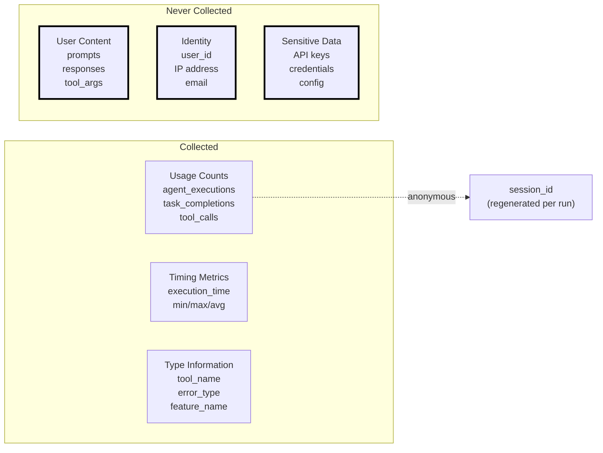
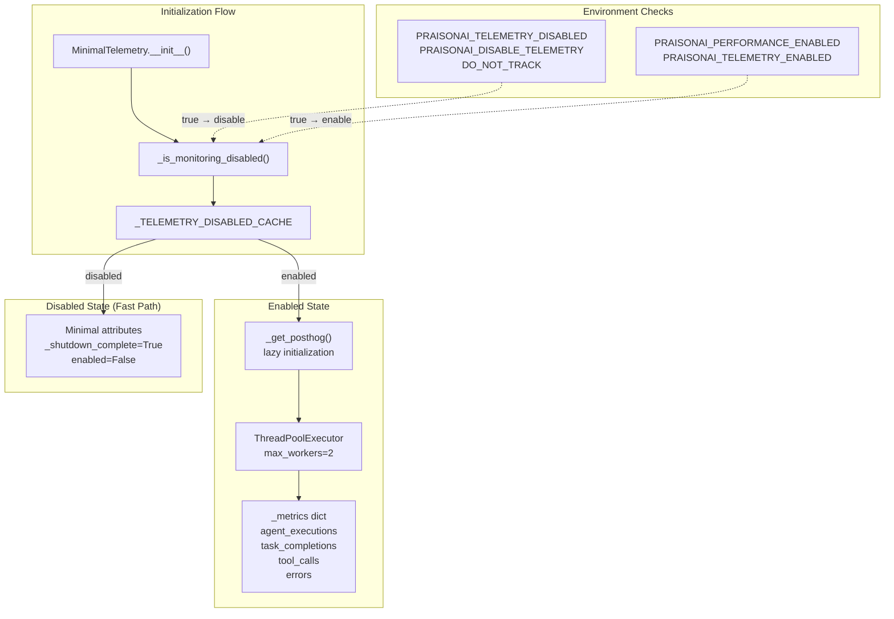
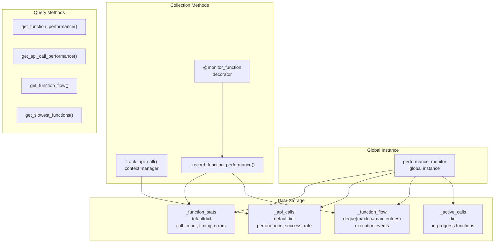
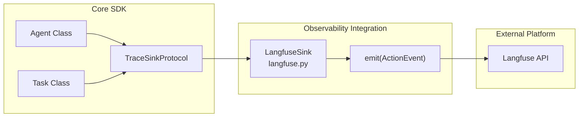

<!-- source: DeepWiki mcp.deepwiki.com · repo MervinPraison/PraisonAI · page 11.4 Performance Monitoring · fetched 2026-10-26 -->

# Performance Monitoring

<details>
<summary>Relevant source files</summary>

The following files were used as context for generating this wiki page:

- [examples/python/performance_monitoring_demo.py](examples/python/performance_monitoring_demo.py)
- [src/praisonai-agents/TELEMETRY_SUMMARY.md](src/praisonai-agents/TELEMETRY_SUMMARY.md)
- [src/praisonai-agents/debug_auto_instrument.py](src/praisonai-agents/debug_auto_instrument.py)
- [src/praisonai-agents/debug_telemetry.py](src/praisonai-agents/debug_telemetry.py)
- [src/praisonai-agents/debug_telemetry_double.py](src/praisonai-agents/debug_telemetry_double.py)
- [src/praisonai-agents/praisonaiagents/telemetry/README.md](src/praisonai-agents/praisonaiagents/telemetry/README.md)
- [src/praisonai-agents/praisonaiagents/telemetry/__init__.py](src/praisonai-agents/praisonaiagents/telemetry/__init__.py)
- [src/praisonai-agents/praisonaiagents/telemetry/integration.py](src/praisonai-agents/praisonaiagents/telemetry/integration.py)
- [src/praisonai-agents/praisonaiagents/telemetry/performance_cli.py](src/praisonai-agents/praisonaiagents/telemetry/performance_cli.py)
- [src/praisonai-agents/praisonaiagents/telemetry/performance_monitor.py](src/praisonai-agents/praisonaiagents/telemetry/performance_monitor.py)
- [src/praisonai-agents/praisonaiagents/telemetry/performance_utils.py](src/praisonai-agents/praisonaiagents/telemetry/performance_utils.py)
- [src/praisonai-agents/praisonaiagents/telemetry/telemetry.py](src/praisonai-agents/praisonaiagents/telemetry/telemetry.py)
- [src/praisonai-agents/telemetry_analysis.md](src/praisonai-agents/telemetry_analysis.md)
- [src/praisonai-agents/test_telemetry_performance.py](src/praisonai-agents/test_telemetry_performance.py)
- [src/praisonai/praisonai/cli/commands/flow.py](src/praisonai/praisonai/cli/commands/flow.py)
- [src/praisonai/praisonai/cli/commands/langextract.py](src/praisonai/praisonai/cli/commands/langextract.py)
- [src/praisonai/praisonai/cli/commands/up.py](src/praisonai/praisonai/cli/commands/up.py)
- [src/praisonai/praisonai/flow/client.py](src/praisonai/praisonai/flow/client.py)
- [src/praisonai/praisonai/flow/components/PraisonAI/praisonai_agent.py](src/praisonai/praisonai/flow/components/PraisonAI/praisonai_agent.py)
- [src/praisonai/praisonai/flow/components/PraisonAI/praisonai_agents.py](src/praisonai/praisonai/flow/components/PraisonAI/praisonai_agents.py)
- [src/praisonai/praisonai/flow/converter.py](src/praisonai/praisonai/flow/converter.py)
- [src/praisonai/praisonai/observability/__init__.py](src/praisonai/praisonai/observability/__init__.py)
- [src/praisonai/praisonai/observability/langextract.py](src/praisonai/praisonai/observability/langextract.py)
- [src/praisonai/praisonai/observability/langfuse.py](src/praisonai/praisonai/observability/langfuse.py)
- [src/praisonai/tests/unit/dev/test_api_md.py](src/praisonai/tests/unit/dev/test_api_md.py)
- [src/praisonai/tests/unit/test_db_adapter_runs_traces.py](src/praisonai/tests/unit/test_db_adapter_runs_traces.py)
- [src/praisonai/tests/unit/test_langextract_sink.py](src/praisonai/tests/unit/test_langextract_sink.py)
- [src/praisonai/tests/unit/test_langfuse_sink.py](src/praisonai/tests/unit/test_langfuse_sink.py)

</details>


This document describes PraisonAI Agents' telemetry and performance monitoring systems. It covers the privacy-first telemetry architecture, user-friendly performance monitoring tools for tracking function execution and API calls, flow analysis capabilities, and programmatic APIs for integrating monitoring into agent workflows.

The performance monitoring system is **disabled by default** and requires explicit opt-in to enable. For information about the testing infrastructure, see [Testing Framework](#11.1). For CI/CD integration, see [CI/CD Pipeline](#11.2).

**Sources:** [src/praisonai-agents/praisonaiagents/telemetry/__init__.py:1-28](), [src/praisonai-agents/praisonaiagents/telemetry/telemetry.py:44-93]()

## Telemetry Architecture Overview

PraisonAI Agents implements a dual-layer telemetry and performance monitoring architecture. The system is designed with privacy-first principles and is **disabled by default**, requiring explicit opt-in via environment variables.

**System Architecture**



**Sources:** [src/praisonai-agents/praisonaiagents/telemetry/__init__.py:1-133](), [src/praisonai-agents/praisonaiagents/telemetry/telemetry.py:44-93](), [src/praisonai-agents/praisonaiagents/telemetry/performance_monitor.py:36-102]()

### Privacy-First Design Principles

The telemetry system follows strict privacy guarantees:

| Principle | Implementation |
|-----------|---------------|
| **No Personal Data** | No prompts, responses, or user content collected |
| **Anonymous Metrics** | Only usage counts and feature adoption tracked |
| **Disabled by Default** | Requires `PRAISONAI_PERFORMANCE_ENABLED=true` |
| **Opt-Out Respected** | Honors `DO_NOT_TRACK` standard |
| **Transparent** | All collected data documented and queryable |
| **Local First** | Metrics stored in memory, optional PostHog export |

**Data Collection Boundaries:**



**Sources:** [src/praisonai-agents/praisonaiagents/telemetry/telemetry.py:111-158](), [src/praisonai-agents/praisonaiagents/telemetry/__init__.py:1-27]()

## MinimalTelemetry System

The `MinimalTelemetry` class at [src/praisonai-agents/praisonaiagents/telemetry/telemetry.py:111-158]() provides the foundation for anonymous usage tracking with zero overhead when disabled.

### Telemetry Initialization and Control



**Sources:** [src/praisonai-agents/praisonaiagents/telemetry/telemetry.py:22-33](), [src/praisonai-agents/praisonaiagents/telemetry/telemetry.py:44-109](), [src/praisonai-agents/praisonaiagents/telemetry/telemetry.py:132-158]()

### Tracking Methods

The `MinimalTelemetry` class provides methods for tracking usage without collecting content:

| Method | Use Case | Implementation |
|--------|----------|----------------|
| `track_error` | Track failure types | [src/praisonai-agents/praisonaiagents/telemetry/telemetry.py:392-397]() |
| `track_tool_usage` | Track tool execution timing | [src/praisonai-agents/praisonaiagents/telemetry/telemetry.py:347-380]() |
| `track_agent_execution` | Track agent start/success | [src/praisonai-agents/praisonaiagents/telemetry/telemetry.py:206-260]() |
| `track_task_completion` | Track task results | [src/praisonai-agents/praisonaiagents/telemetry/telemetry.py:262-300]() |

**Sources:** [src/praisonai-agents/praisonaiagents/telemetry/telemetry.py:206-397]()

## PerformanceMonitor System

The `PerformanceMonitor` class at [src/praisonai-agents/praisonaiagents/telemetry/performance_monitor.py:36-102]() provides user-friendly tools for tracking function performance, API calls, and execution flow.

### PerformanceMonitor Architecture



**Sources:** [src/praisonai-agents/praisonaiagents/telemetry/performance_monitor.py:36-102](), [src/praisonai-agents/praisonaiagents/telemetry/performance_monitor.py:103-179](), [src/praisonai-agents/praisonaiagents/telemetry/performance_monitor.py:181-213]()

### Function Performance Tracking

The `@monitor_function` decorator at [src/praisonai-agents/praisonaiagents/telemetry/performance_monitor.py:103-179]() tracks execution with minimal overhead:

```python
from praisonaiagents.telemetry import monitor_function

@monitor_function("data_processing")
def process_data(data_size: int):
    # Function implementation
    return result
```

**Collected Statistics:**
- `call_count`: Total number of calls.
- `total_time`: Cumulative execution time.
- `min_time` / `max_time`: Fastest and slowest executions.
- `success_rate`: Percentage of calls that did not raise exceptions.

**Sources:** [src/praisonai-agents/praisonaiagents/telemetry/performance_monitor.py:72-80](), [src/praisonai-agents/praisonaiagents/telemetry/performance_monitor.py:215-239]()

### API Call Tracking

The `track_api_call()` context manager at [src/praisonai-agents/praisonaiagents/telemetry/performance_monitor.py:181-213]() monitors API performance:

```python
from praisonaiagents.telemetry import track_api_call

with track_api_call("openai", "/v1/chat/completions"):
    response = client.chat.completions.create(...)
```

**Sources:** [src/praisonai-agents/praisonaiagents/telemetry/performance_monitor.py:181-213](), [src/praisonai-agents/praisonaiagents/telemetry/performance_monitor.py:241-264]()

## Performance Analysis Utilities

Advanced analysis tools are provided in [src/praisonai-agents/praisonaiagents/telemetry/performance_utils.py]().

### FunctionFlowAnalyzer

The `FunctionFlowAnalyzer` class at [src/praisonai-agents/praisonaiagents/telemetry/performance_utils.py:41-373]() identifies execution patterns and bottlenecks.

**Bottleneck Detection Thresholds:**
- `BOTTLENECK_THRESHOLD_AVERAGE`: 1.0s [src/praisonai-agents/praisonaiagents/telemetry/performance_utils.py:35]()
- `BOTTLENECK_THRESHOLD_MAX`: 5.0s [src/praisonai-agents/praisonaiagents/telemetry/performance_utils.py:36]()
- `HIGH_SEVERITY_THRESHOLD`: 2.0s [src/praisonai-agents/praisonaiagents/telemetry/performance_utils.py:37]()

**Sources:** [src/praisonai-agents/praisonaiagents/telemetry/performance_utils.py:153-206]()

### Flow Visualization

Execution flow can be visualized in multiple formats via `visualize_execution_flow` at [src/praisonai-agents/praisonaiagents/telemetry/performance_utils.py:305-372]():

1. **Text**: A tree-like representation of calls.
2. **Mermaid**: A sequence or flowchart representation.
3. **JSON**: Raw structured data for external tools.

**Sources:** [src/praisonai-agents/praisonaiagents/telemetry/performance_utils.py:305-372]()

## CLI and Observability Hooks

### Performance CLI

The `PerformanceCLI` at [src/praisonai-agents/praisonaiagents/telemetry/performance_cli.py:34-394]() provides terminal-based access to performance data:

- `report`: Comprehensive performance summary.
- `functions`: Detailed function stats.
- `apis`: Detailed API stats.
- `slowest-functions`: Top N bottlenecks.
- `flow`: Visual execution timeline.

**Sources:** [src/praisonai-agents/praisonaiagents/telemetry/performance_cli.py:42-284]()

### Observability Hooks (Langfuse)

PraisonAI integrates with external observability platforms like Langfuse via the `LangfuseSink` adapter at [src/praisonai/praisonai/observability/langfuse.py:58-257]().



**Sources:** [src/praisonai/praisonai/observability/langfuse.py:58-257](), [src/praisonai/praisonai/observability/langfuse.py:114-142]()

## Integration Mechanisms

The integration module at [src/praisonai-agents/praisonaiagents/telemetry/integration.py]() handles the non-blocking collection of events.

### Telemetry Queue Processing

To minimize performance impact, telemetry events are queued and processed in a background thread:

1. **Queueing**: Events are placed in `_telemetry_queue` (max size 1000) [src/praisonai-agents/praisonaiagents/telemetry/integration.py:71-72]().
2. **Processing**: A daemon thread `telemetry-queue-processor` batches events [src/praisonai-agents/praisonaiagents/telemetry/integration.py:78-83]().
3. **Batching**: Events are processed in batches of 10 or every 1 second [src/praisonai-agents/praisonaiagents/telemetry/integration.py:90-91]().

**Sources:** [src/praisonai-agents/praisonaiagents/telemetry/integration.py:49-132]()

### Performance Mode

Users can enable a "Performance Mode" to bypass telemetry overhead programmatically:

```python
from praisonaiagents.telemetry import enable_performance_mode

enable_performance_mode() # Sets _performance_mode_enabled = True
```

This is implemented via `enable_performance_mode` at [src/praisonai-agents/praisonaiagents/telemetry/integration.py:597-601]().

**Sources:** [src/praisonai-agents/praisonaiagents/telemetry/integration.py:597-606]()

---

