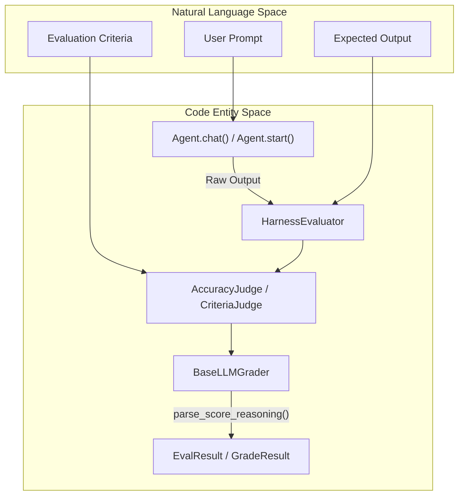
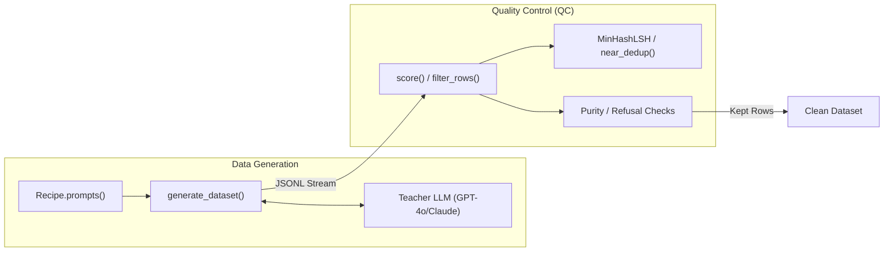

<!-- source: DeepWiki mcp.deepwiki.com · repo MervinPraison/PraisonAI · page 11.5 Evaluation Framework · fetched 2026-10-26 -->

# Evaluation Framework

Relevant source files

The following files were used as context for generating this wiki page:

- [src/praisonai-agents/praisonaiagents/_config.py](src/praisonai-agents/praisonaiagents/_config.py)
- [src/praisonai-agents/praisonaiagents/agent/message_queue.py](src/praisonai-agents/praisonaiagents/agent/message_queue.py)
- [src/praisonai-agents/praisonaiagents/agent/summarization.py](src/praisonai-agents/praisonaiagents/agent/summarization.py)
- [src/praisonai-agents/praisonaiagents/bus/__init__.py](src/praisonai-agents/praisonaiagents/bus/__init__.py)
- [src/praisonai-agents/praisonaiagents/eval/__init__.py](src/praisonai-agents/praisonaiagents/eval/__init__.py)
- [src/praisonai-agents/praisonaiagents/mcp/__init__.py](src/praisonai-agents/praisonaiagents/mcp/__init__.py)
- [src/praisonai-agents/praisonaiagents/skills/__init__.py](src/praisonai-agents/praisonaiagents/skills/__init__.py)
- [src/praisonai-agents/praisonaiagents/trace/__init__.py](src/praisonai-agents/praisonaiagents/trace/__init__.py)
- [src/praisonai-agents/praisonaiagents/trace/redact.py](src/praisonai-agents/praisonaiagents/trace/redact.py)
- [src/praisonai-agents/tests/smoke_core_phase_a_real.py](src/praisonai-agents/tests/smoke_core_phase_a_real.py)
- [src/praisonai-agents/tests/unit/agent/test_core_phase_a.py](src/praisonai-agents/tests/unit/agent/test_core_phase_a.py)
- [src/praisonai-train/README.md](src/praisonai-train/README.md)
- [src/praisonai-train/praisonai_train/cli/commands/data.py](src/praisonai-train/praisonai_train/cli/commands/data.py)
- [src/praisonai-train/praisonai_train/data/__init__.py](src/praisonai-train/praisonai_train/data/__init__.py)
- [src/praisonai-train/praisonai_train/data/_util.py](src/praisonai-train/praisonai_train/data/_util.py)
- [src/praisonai-train/praisonai_train/data/checks.py](src/praisonai-train/praisonai_train/data/checks.py)
- [src/praisonai-train/praisonai_train/data/dedup.py](src/praisonai-train/praisonai_train/data/dedup.py)
- [src/praisonai-train/praisonai_train/data/export_trials.py](src/praisonai-train/praisonai_train/data/export_trials.py)
- [src/praisonai-train/praisonai_train/data/generate.py](src/praisonai-train/praisonai_train/data/generate.py)
- [src/praisonai-train/praisonai_train/data/intent.py](src/praisonai-train/praisonai_train/data/intent.py)
- [src/praisonai-train/praisonai_train/data/protocols.py](src/praisonai-train/praisonai_train/data/protocols.py)
- [src/praisonai-train/praisonai_train/data/qc.py](src/praisonai-train/praisonai_train/data/qc.py)
- [src/praisonai-train/praisonai_train/data/recipes.py](src/praisonai-train/praisonai_train/data/recipes.py)
- [src/praisonai-train/praisonai_train/data/registry.py](src/praisonai-train/praisonai_train/data/registry.py)
- [src/praisonai-train/praisonai_train/train/agents/models.py](src/praisonai-train/praisonai_train/train/agents/models.py)
- [src/praisonai-train/praisonai_train/train/agents/orchestrator.py](src/praisonai-train/praisonai_train/train/agents/orchestrator.py)
- [src/praisonai-train/tests/unit/data/test_data.py](src/praisonai-train/tests/unit/data/test_data.py)
- [src/praisonai-train/tests/unit/data/test_dedup.py](src/praisonai-train/tests/unit/data/test_dedup.py)
- [src/praisonai-train/tests/unit/data/test_export_trials.py](src/praisonai-train/tests/unit/data/test_export_trials.py)
- [src/praisonai-train/tests/unit/data/test_generate_guard.py](src/praisonai-train/tests/unit/data/test_generate_guard.py)
- [src/praisonai-train/tests/unit/data/test_generate_progress.py](src/praisonai-train/tests/unit/data/test_generate_progress.py)
- [src/praisonai-train/tests/unit/data/test_task_aware_qc.py](src/praisonai-train/tests/unit/data/test_task_aware_qc.py)
- [src/praisonai-train/tests/unit/train/test_models.py](src/praisonai-train/tests/unit/train/test_models.py)
- [src/praisonai-train/tests/unit/train/test_orchestrator.py](src/praisonai-train/tests/unit/train/test_orchestrator.py)
- [src/praisonai/praisonai/replay/judge.py](src/praisonai/praisonai/replay/judge.py)

The PraisonAI Evaluation Framework is a comprehensive subsystem designed to measure, analyze, and optimize AI agent performance. It spans from simple accuracy checks to complex multi-agent handoff fidelity and loop health analysis. The framework is split across `praisonaiagents.eval` for runtime evaluation and `praisonai-train` for iterative improvement and dataset generation.

## Eval Subsystem Overview

The core evaluation logic resides in `praisonaiagents.eval`, which utilizes lazy loading to ensure zero performance impact when not actively used [src/praisonai-agents/praisonaiagents/eval/__init__.py:4-5](). It provides specialized evaluators for different dimensions of agent performance.

### Evaluator Types

| Evaluator | Purpose | Code Entity |
| :--- | :--- | :--- |
| **Accuracy** | Compares output against expected values using LLM-as-judge | `AccuracyEvaluator` |
| **Performance** | Measures runtime latency and memory usage | `PerformanceEvaluator` |
| **Reliability** | Verifies if specific tool calls were made | `ReliabilityEvaluator` |
| **Context** | Scores context budget compliance and handoff fidelity | `ContextEvaluator` |
| **Safety** | Detects harmful, biased, or inappropriate outputs | `SafetyEval` |
| **Loop** | Analyzes convergence and detects "doom-loops" | `LoopEvaluator` |
| **Comparison** | Side-by-side comparison of two agent outputs | `ComparisonEval` |

**Sources:** [src/praisonai-agents/praisonaiagents/eval/__init__.py:7-16](), [src/praisonai-agents/praisonaiagents/eval/__init__.py:121-130]()

## Grading and Judging Architecture

The framework employs a "Judge" pattern, where specialized LLM-based graders evaluate specific criteria. This is governed by the `Judge` class and `GraderProtocol`.

### Unified Judge API
The system follows a standard `add_X/get_X/list_X` pattern for managing judges [src/praisonai-agents/praisonaiagents/eval/__init__.py:71-72]().

*   **Judge Class**: The primary entry point for evaluation sessions [src/praisonai-agents/praisonaiagents/eval/__init__.py:164]().
*   **BaseLLMGrader**: A reusable base class for implementing LLM-as-judge logic, providing standardized score and reasoning parsing [src/praisonai-agents/praisonaiagents/eval/__init__.py:150-156]().
*   **AccuracyJudge**: Specifically designed to grade how well an output matches a reference [src/praisonai-agents/praisonaiagents/eval/__init__.py:169]().

### Evaluation Data Flow
The following diagram illustrates how an agent's output is processed through the evaluation harness.

**Evaluation Process Flow**

**Sources:** [src/praisonai-agents/praisonaiagents/eval/__init__.py:130-156](), [src/praisonai-agents/praisonaiagents/eval/__init__.py:164-171](), [src/praisonai/praisonai/replay/judge.py:7-8]()

## Context and Loop Evaluation

Beyond simple output matching, PraisonAI evaluates the internal state and execution flow of agents.

### ContextEvaluator
Evaluates how effectively context was passed between agents in a multi-agent workflow. It produces two key results:
1.  **ContextHandoffResult**: Measures fidelity during agent-to-agent transitions [src/praisonai-agents/praisonaiagents/eval/__init__.py:138]().
2.  **BudgetComplianceResult**: Tracks how well the agent stayed within token limits [src/praisonai-agents/praisonaiagents/eval/__init__.py:139]().

### LoopEvaluator
Analyzes agent execution health, specifically looking for:
*   **Convergence**: Is the agent getting closer to a solution?
*   **Wasted Iterations**: Are there redundant tool calls?
*   **Doom-loop Guards**: Verification that the safety escalation system (see Section 3.5) triggered correctly [src/praisonai-agents/praisonaiagents/eval/__init__.py:15-16](), [src/praisonai-agents/praisonaiagents/eval/__init__.py:105-106]().

## Prompt Optimization and Trials

The framework supports iterative improvement through `PromptOptimizer` and the `run_trials` engine.

*   **PromptOptimizer**: Automatically adjusts `agent.instructions` based on evaluation results to find the most effective prompt configuration [src/praisonai-agents/praisonaiagents/eval/__init__.py:108-109]().
*   **Trials Engine**: Executes `K` isolated attempts per evaluation case to calculate a pass-rate and identify the "frontier" (best performing) outputs [src/praisonai-agents/praisonaiagents/eval/__init__.py:110-116]().
*   **Export Trials**: The `export_trials` utility allows saving these results for rejection sampling or fine-tuning dataset creation [src/praisonai-train/praisonai_train/data/export_trials.py:11-12]().

**Sources:** [src/praisonai-agents/praisonaiagents/eval/__init__.py:108-116](), [src/praisonai-train/praisonai_train/data/export_trials.py:11-12]()

## AgentTrainer Integration

The `praisonai-train` package provides the `AgentTrainer` class, which orchestrates the training loop for iterative improvement.

### Training Loop Modes
1.  **LLM-as-Judge (Default)**: Automated review where an LLM grades output and provides suggestions for the next iteration [src/praisonai-train/praisonai_train/train/agents/orchestrator.py:43-45]().
2.  **Human-in-the-Loop**: Interactive mode where a human provides scores and feedback via the console [src/praisonai-train/praisonai_train/train/agents/orchestrator.py:47-49]().

### Key Training Components
*   **TrainingScenario**: Represents a single input/output pair for learning [src/praisonai-train/praisonai_train/train/agents/models.py:102-124]().
*   **TrainingIteration**: Captures the specific score, feedback, and suggestions for a single run [src/praisonai-train/praisonai_train/train/agents/models.py:142-158]().
*   **Early Stopping**: Training automatically stops if a score of 9.5/10 is reached, unless `no_early_stop` is set [src/praisonai-train/praisonai_train/train/agents/orchestrator.py:84-85](), [src/praisonai-train/praisonai_train/train/agents/orchestrator.py:91-92]().

**Sources:** [src/praisonai-train/praisonai_train/train/agents/orchestrator.py:37-93](), [src/praisonai-train/praisonai_train/train/agents/models.py:102-158]()

## Synthetic Dataset Generation

PraisonAI includes a robust pipeline for generating synthetic instruction data via a teacher LLM, located in `praisonai_train.data.generate`.

### Generation Pipeline
The pipeline uses "recipes" to synthesize `{instruction, input, output}` rows [src/praisonai-train/praisonai_train/data/generate.py:1-9]().

*   **Diversity Axes**: Prevents mode collapse in large runs [src/praisonai-train/praisonai_train/data/generate.py:5-6]().
*   **Billing Guard**: The `azure_sponsorship_guard` acts as a circuit breaker to halt generation if a sponsorship quota is exceeded [src/praisonai-train/praisonai_train/data/generate.py:116-125]().
*   **Deduplication**: Uses `MinHashLSH` for near-duplicate detection and removal [src/praisonai-train/praisonai_train/data/dedup.py:10-11]().

**Synthetic Data Generation Architecture**

**Sources:** [src/praisonai-train/praisonai_train/data/generate.py:1-9](), [src/praisonai-train/praisonai_train/data/qc.py:24-59](), [src/praisonai-train/praisonai_train/data/dedup.py:10-11](), [src/praisonai-train/praisonai_train/data/recipes.py:21]()

### Quality Control (QC) Filters
The `score` function in `praisonai_train.data.qc` applies several research-backed filters:
*   **Exact Duplicates**: SHA-1 hashing of normalized text [src/praisonai-train/praisonai_train/data/qc.py:38-42]().
*   **Near Duplicates**: MinHash or sliding window Jaccard similarity [src/praisonai-train/praisonai_train/data/qc.py:60-66]().
*   **Diversity Metrics**: Calculates `distinct-2` bigram diversity and length Coefficient of Variation (CV) [src/praisonai-train/praisonai_train/data/qc.py:68-74]().
*   **Script Purity**: Filters rows based on script ratios (e.g., ensuring Tamil translations actually contain Tamil) [src/praisonai-train/praisonai_train/data/qc.py:80-98]().

**Sources:** [src/praisonai-train/praisonai_train/data/qc.py:24-127]()

---

