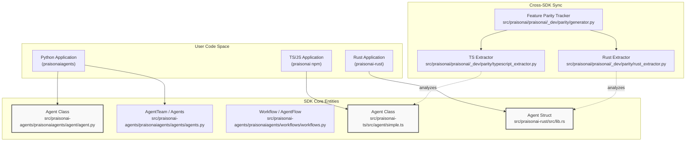
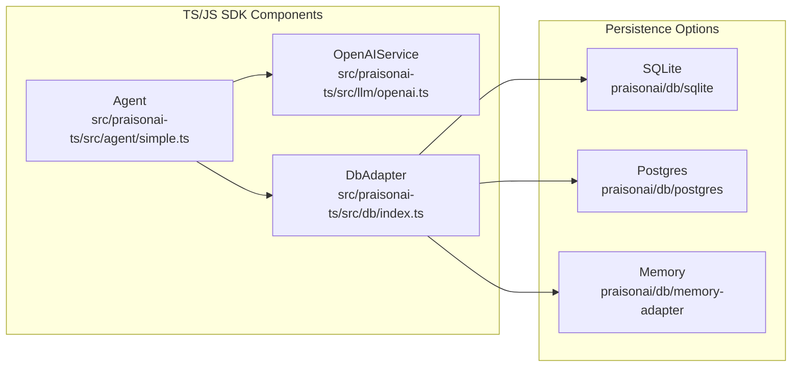

<!-- source: DeepWiki mcp.deepwiki.com · repo MervinPraison/PraisonAI · page 12 Development SDKs · fetched 2026-10-26 -->

# Development SDKs

Relevant source files

The following files were used as context for generating this wiki page:

- [src/praisonai-rust/FEATURE_PARITY_TRACKER.json](src/praisonai-rust/FEATURE_PARITY_TRACKER.json)
- [src/praisonai-rust/PARITY.md](src/praisonai-rust/PARITY.md)
- [src/praisonai-ts/FEATURE_PARITY_TRACKER.json](src/praisonai-ts/FEATURE_PARITY_TRACKER.json)
- [src/praisonai-ts/PARITY.md](src/praisonai-ts/PARITY.md)
- [src/praisonai-ts/README.md](src/praisonai-ts/README.md)
- [src/praisonai-ts/examples/commonjs/movie-script.js](src/praisonai-ts/examples/commonjs/movie-script.js)
- [src/praisonai-ts/examples/commonjs/single-agent.js](src/praisonai-ts/examples/commonjs/single-agent.js)
- [src/praisonai-ts/examples/simple/multi-tool-call.ts](src/praisonai-ts/examples/simple/multi-tool-call.ts)
- [src/praisonai-ts/examples/simple/single-agent-tool-call.ts](src/praisonai-ts/examples/simple/single-agent-tool-call.ts)
- [src/praisonai-ts/package.json](src/praisonai-ts/package.json)
- [src/praisonai-ts/src/agent/index.ts](src/praisonai-ts/src/agent/index.ts)
- [src/praisonai-ts/src/agent/proxy.ts](src/praisonai-ts/src/agent/proxy.ts)
- [src/praisonai-ts/src/agent/router.ts](src/praisonai-ts/src/agent/router.ts)
- [src/praisonai-ts/src/agent/simple.ts](src/praisonai-ts/src/agent/simple.ts)
- [src/praisonai-ts/src/agent/types.ts](src/praisonai-ts/src/agent/types.ts)
- [src/praisonai-ts/src/db/index.ts](src/praisonai-ts/src/db/index.ts)
- [src/praisonai-ts/src/db/postgres.ts](src/praisonai-ts/src/db/postgres.ts)
- [src/praisonai-ts/src/llm/openai.ts](src/praisonai-ts/src/llm/openai.ts)
- [src/praisonai-ts/src/planning/index.ts](src/praisonai-ts/src/planning/index.ts)
- [src/praisonai-ts/src/telemetry/index.ts](src/praisonai-ts/src/telemetry/index.ts)
- [src/praisonai-ts/src/tools/registry/index.ts](src/praisonai-ts/src/tools/registry/index.ts)
- [src/praisonai-ts/src/tools/registry/registry.ts](src/praisonai-ts/src/tools/registry/registry.ts)
- [src/praisonai-ts/src/tools/registry/types.ts](src/praisonai-ts/src/tools/registry/types.ts)
- [src/praisonai-ts/src/utils/logger.ts](src/praisonai-ts/src/utils/logger.ts)
- [src/praisonai-ts/src/utils/pretty-logger.ts](src/praisonai-ts/src/utils/pretty-logger.ts)
- [src/praisonai-ts/tests/development/simple/multi-tool-call.ts](src/praisonai-ts/tests/development/simple/multi-tool-call.ts)
- [src/praisonai-ts/tests/development/simple/single-agent-tool-call.ts](src/praisonai-ts/tests/development/simple/single-agent-tool-call.ts)
- [src/praisonai-ts/tests/tools/registry.test.ts](src/praisonai-ts/tests/tools/registry.test.ts)
- [src/praisonai-ts/tests/unit/agent/structured-output-and-tools.test.ts](src/praisonai-ts/tests/unit/agent/structured-output-and-tools.test.ts)
- [src/praisonai/praisonai/_dev/parity/__init__.py](src/praisonai/praisonai/_dev/parity/__init__.py)
- [src/praisonai/praisonai/_dev/parity/generator.py](src/praisonai/praisonai/_dev/parity/generator.py)
- [src/praisonai/praisonai/_dev/parity/rust_extractor.py](src/praisonai/praisonai/_dev/parity/rust_extractor.py)
- [src/praisonai/praisonai/_dev/parity/typescript_extractor.py](src/praisonai/praisonai/_dev/parity/typescript_extractor.py)

This document provides an overview of the Python, TypeScript/JavaScript, and Rust Software Development Kits (SDKs) for PraisonAI. It covers architecture, installation, core components, and the feature parity tracking system that ensures a consistent experience across different programming environments.

For detailed API documentation of individual classes and methods, see [Python API Reference](#12.1). For JavaScript-specific usage, see [TypeScript/JavaScript SDK](#12.2). For Rust implementation details, see [Rust SDK](#12.3).

---

## SDK Architecture Overview

**Sources:** [src/praisonai/praisonai/_dev/parity/generator.py:1-50](), [src/praisonai-ts/src/agent/simple.ts:106-150]()

---

## SDK Comparison and Parity

PraisonAI maintains a "Source of Truth" model where the Python `praisonaiagents` package defines the core feature set, and other SDKs track its progress.

| Feature Category | Python (Core) | TypeScript/JS | Rust |
|:---|:---:|:---:|:---:|
| **Core Agents** | ✅ Complete | ✅ Complete | ✅ Complete |
| **Specialized Agents** | ✅ Complete | ✅ Complete | ✅ Partial |
| **Workflows** | ✅ Complete | ✅ Complete | ✅ Complete |
| **Tools/MCP** | ✅ Complete | ✅ Complete | ✅ Complete |
| **Memory/Knowledge** | ✅ Complete | ✅ Partial | ✅ Complete |
| **Parity Status** | **100%** | **~90%** | **~70%** |

### Feature Parity Tracking
The framework uses an automated parity generator [src/praisonai/praisonai/_dev/parity/generator.py:1-100]() to compare exports and features across languages. This results in `FEATURE_PARITY_TRACKER.json` files in each SDK directory.

- **TypeScript Parity:** Currently tracks 411 core features with a gap of 117 (mostly P3 advanced features) [src/praisonai-ts/FEATURE_PARITY_TRACKER.json:6-15]().
- **Rust Parity:** Currently tracks 411 core features with a gap of 124, achieving roughly 69.8% parity [src/praisonai-rust/FEATURE_PARITY_TRACKER.json:6-12]().

**Sources:** [src/praisonai-ts/FEATURE_PARITY_TRACKER.json:1-20](), [src/praisonai-rust/FEATURE_PARITY_TRACKER.json:1-12](), [src/praisonai-rust/PARITY.md:1-15]()

---

## Python SDK (praisonaiagents)

The Python SDK is the primary development environment. It utilizes a lazy-loading architecture to ensure high performance and minimal startup overhead.

- **Key Classes:** `Agent`, `AgentTeam`, `Task`, `Workflow`, `Knowledge`, `RAG`.
- **Specialized Agents:** `DeepResearchAgent`, `CodeAgent`, `VisionAgent`, `AudioAgent`.
- **Performance:** Optimized for speed, with `Agent` instantiation taking ~3.77μs.

For details, see [Python API Reference](#12.1).

---

## TypeScript/JavaScript SDK

The TS/JS SDK provides a native experience for Node.js and Web developers. It mirrors the Python `Agent` API and includes a robust `ToolsRegistry` middleware system.

### Key Features
- **Simple Configuration:** `SimpleAgentConfig` allows for 3-line agent setup [src/praisonai-ts/src/agent/simple.ts:43-104]().
- **Persistence:** Supports multiple backends via `db()` factory, including SQLite, PostgreSQL (Neon), and Redis [src/praisonai-ts/src/db/index.ts:133-152]().
- **Structured Output:** Full support for `outputSchema` (JSON Schema) mapped to LLM response formats [src/praisonai-ts/src/agent/simple.ts:73-75]().

For details, see [TypeScript/JavaScript SDK](#12.2).

**Sources:** [src/praisonai-ts/src/agent/simple.ts:138-175](), [src/praisonai-ts/src/db/index.ts:27-76]()

---

## Rust SDK

The Rust SDK is designed for high-performance, type-safe agent implementations. It is currently in active development to reach full parity with the Python core.

### Architecture
- **Type Safety:** Heavily utilizes Rust's type system for `AgentBuilder` and `AgentTeamBuilder` patterns [src/praisonai-rust/PARITY.md:37-47]().
- **Alias Mapping:** Uses `RUST_ALIAS_MAPPING` to handle reserved keywords and ensure idiomatic Rust naming while maintaining API compatibility.
- **Feature Flags:** Modular architecture allowing users to opt-in to specific features (e.g., `mcp`, `rag`, `vision`) via `Cargo.toml`.

For details, see [Rust SDK](#12.3).

**Sources:** [src/praisonai-rust/FEATURE_PARITY_TRACKER.json:1-20](), [src/praisonai-rust/PARITY.md:15-50]()

---

## Cross-SDK Feature Summary

| Feature | Python | TS/JS | Rust | Code Entity |
|:---|:---:|:---:|:---:|:---|
| **Base Agent** | ✅ | ✅ | ✅ | `Agent` |
| **Agent Teams** | ✅ | ✅ | ✅ | `AgentTeam` / `Agents` |
| **Audio/Voice** | ✅ | ✅ | ✅ | `AudioAgent` |
| **Code Execution**| ✅ | ✅ | ✅ | `CodeAgent` |
| **Deep Research** | ✅ | ✅ | ✅ | `DeepResearchAgent` |
| **Workflows** | ✅ | ✅ | ✅ | `AgentFlow` / `Workflow` |
| **Persistence** | ✅ | ✅ | ✅ | `Session` / `DbAdapter` |
| **MCP Support** | ✅ | ✅ | ✅ | `MCP` / `MCPServer` |

**Sources:** [src/praisonai-ts/PARITY.md:21-78](), [src/praisonai-rust/PARITY.md:15-300]()

---

