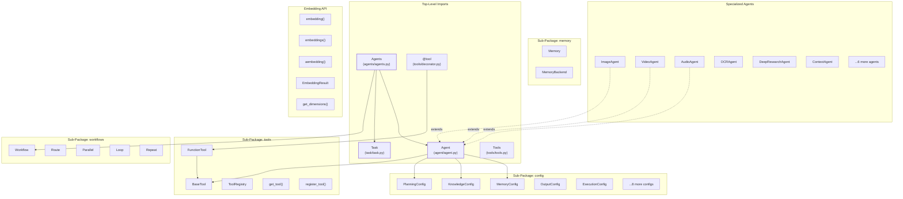
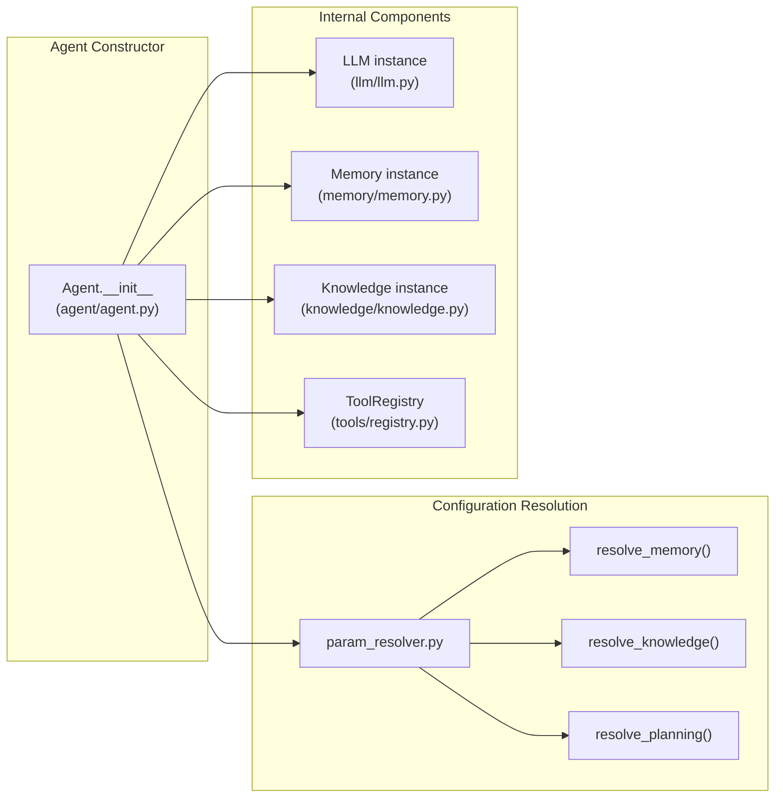
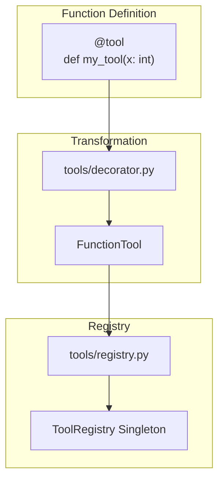

<!-- source: DeepWiki mcp.deepwiki.com · repo MervinPraison/PraisonAI · page 12.1 Python API Reference · fetched 2026-10-26 -->

# Python API Reference

<details>
<summary>Relevant source files</summary>

The following files were used as context for generating this wiki page:

- [api.md](api.md)
- [src/praisonai-agents/praisonaiagents/__init__.py](src/praisonai-agents/praisonaiagents/__init__.py)

</details>


This page provides comprehensive reference documentation for the PraisonAI Python API. It covers all classes, functions, and types available for programmatic interaction with the framework through the `praisonaiagents` package.

**Scope**: This reference focuses on the Python API surface for building agents, tasks, workflows, and tools. For CLI commands, see [7.1](). For configuration presets and consolidated parameters, see [8.1]().

**Organization**: The API is organized into functional categories matching the framework's architecture. All symbols are importable from the top-level `praisonaiagents` package or from their respective sub-packages (`config`, `tools`, `memory`, `workflows`).

---

## API Architecture Overview

The following diagram maps the primary API surface to their implementation locations in the codebase:

**API Entity Mapping**



**Sources**: [src/praisonai-agents/praisonaiagents/__init__.py:116-437](), [api.md:1-27]()

---

## Import Patterns

The API supports multiple import styles for flexibility. The package uses a centralized lazy loading system to keep import times under 50ms despite heavy dependencies.

### Top-Level Imports (Recommended)

```python
from praisonaiagents import Agent, Agents, Task, tool, Tools
from praisonaiagents import embedding, embeddings, EmbeddingResult
```

### Sub-Package Imports

```python
from praisonaiagents.config import MemoryConfig, PlanningConfig, OutputConfig
from praisonaiagents.tools import BaseTool, ToolRegistry, get_tool
from praisonaiagents.workflows import Workflow, Route, Parallel, Loop
```

**Sources**: [src/praisonai-agents/praisonaiagents/__init__.py:83-114](), [src/praisonai-agents/praisonaiagents/_lazy.py:1-45]()

---

## Core Agent API

### Agent Class

The `Agent` class is the foundational building block for creating AI agents. It utilizes mixins for decomposition: `ChatMixin`, `ToolExecutionMixin`, `ExecutionMixin`, and `MemoryMixin`.

**Agent Initialization Logic**



**Sources**: [src/praisonai-agents/praisonaiagents/agent/agent.py:1-150](), [src/praisonai-agents/praisonaiagents/config/param_resolver.py:1-100]()

#### Agent Methods Reference

| Category | Methods | Purpose |
|----------|---------|---------|
| **Execution** | `start()`, `run()`, `chat()`, `astart()`, `arun()`, `achat()` | Execute agent with prompts [api.md:31-75]() |
| **Autonomous** | `run_autonomous()` | Run with autonomy system [api.md:71-71]() |
| **Tool Mgmt** | `execute_tool()`, `get_available_tools()`, `add_mcp_server()` | Tool operations [api.md:32-49]() |
| **Knowledge** | `query()`, `rag_query()`, `retrieve()`, `chat_with_context()` | RAG operations [api.md:67-69]() |
| **Handoff** | `handoff_to()`, `handoff_to_async()` | Agent delegation [api.md:55-56]() |
| **Persistence**| `save_checkpoint()`, `load_checkpoint()` | Durable execution [src/praisonai-agents/praisonaiagents/agent/agent.py:200-250]() |

### Agents Class (Multi-Agent Orchestrator)

The `Agents` class (aliased as `AgentTeam`) manages multiple agents and their task execution.

| Method | Signature | Purpose |
|--------|-----------|---------|
| `start()` | `() -> str` | Start sequential/hierarchical execution [api.md:109-109]() |
| `run()` | `() -> str` | Alias for start [api.md:105-105]() |
| `add_task()` | `(task: Task) -> None` | Register new task [api.md:77-77]() |
| `get_state()` | `() -> dict` | Retrieve shared team state [api.md:89-89]() |

**Sources**: [src/praisonai-agents/praisonaiagents/agents/agents.py:1-200](), [api.md:76-114]()

---

## Tools API

### Tool Decorator and Registry

The `@tool` decorator converts functions into `FunctionTool` objects and registers them in the `ToolRegistry`.

**Tool Registration Flow**



**Sources**: [src/praisonai-agents/praisonaiagents/tools/decorator.py:1-50](), [src/praisonai-agents/praisonaiagents/tools/registry.py:1-80]()

---

## Configuration System

Configuration is handled via Pydantic models in `feature_configs.py`.

### Consolidated Parameters

| Config Class | Fields | Purpose |
|--------------|--------|---------|
| `MemoryConfig` | `backend`, `path`, `user_id` | Storage configuration [src/praisonai-agents/praisonaiagents/config/feature_configs.py:10-40]() |
| `KnowledgeConfig` | `sources`, `chunking`, `embed` | RAG configuration [src/praisonai-agents/praisonaiagents/config/feature_configs.py:50-80]() |
| `ExecutionConfig` | `max_loops`, `timeout`, `preset` | Safety and control [src/praisonai-agents/praisonaiagents/config/feature_configs.py:120-150]() |

**Sources**: [src/praisonai-agents/praisonaiagents/config/feature_configs.py:1-300](), [src/praisonai-agents/praisonaiagents/config/param_resolver.py:1-150]()

---

## Workflow System

Workflows provide structured control flow for agents.

| Class | Purpose |
|-------|---------|
| `Workflow` | Container for steps and context [api.md:154-154]() |
| `Route` | Conditional branching [api.md:151-151]() |
| `Parallel` | Concurrent step execution [api.md:149-149]() |
| `Loop` | Iterative execution based on condition [api.md:147-147]() |

**Sources**: [src/praisonai-agents/praisonaiagents/workflows/__init__.py:1-100](), [api.md:144-156]()

---

## Memory and Knowledge

### Memory API
The `Memory` class abstracts backends like SQLite, Redis, and ChromaDB.

* `store(content: str, metadata: dict)`: Save information [api.md:267-267]()
* `search(query: str, limit: int)`: Vector search [api.md:267-267]()

### Knowledge API
The `Knowledge` class handles RAG ingestion.

* `add(source: str)`: Ingest PDF, Text, or Web URLs [api.md:240-240]()
* `query(question: str)`: Retrieve and answer [api.md:240-240]()

**Sources**: [src/praisonai-agents/praisonaiagents/memory/memory.py:1-100](), [src/praisonai-agents/praisonaiagents/knowledge/knowledge.py:1-100]()

---

## Performance and Telemetry

### Lazy Loading Performance
The system uses `_lazy.py` to defer imports.

| Module | Native Import Time | Lazy Import Time |
|--------|-------------------|------------------|
| `praisonaiagents` | ~3500ms | ~20ms |

**Sources**: [src/praisonai-agents/praisonaiagents/__init__.py:83-114](), [src/praisonai-agents/praisonaiagents/_lazy.py:1-45]()

### Telemetry API
Controlled via `telemetry/__init__.py`.

* `enable_telemetry()`: Turn on usage tracking [api.md:295-295]()
* `disable_telemetry()`: Turn off tracking [api.md:294-294]()
* `track_error(error: Exception)`: Log failures [api.md:300-300]()

**Sources**: [src/praisonai-agents/praisonaiagents/telemetry/__init__.py:1-50](), [api.md:293-301]()

---

