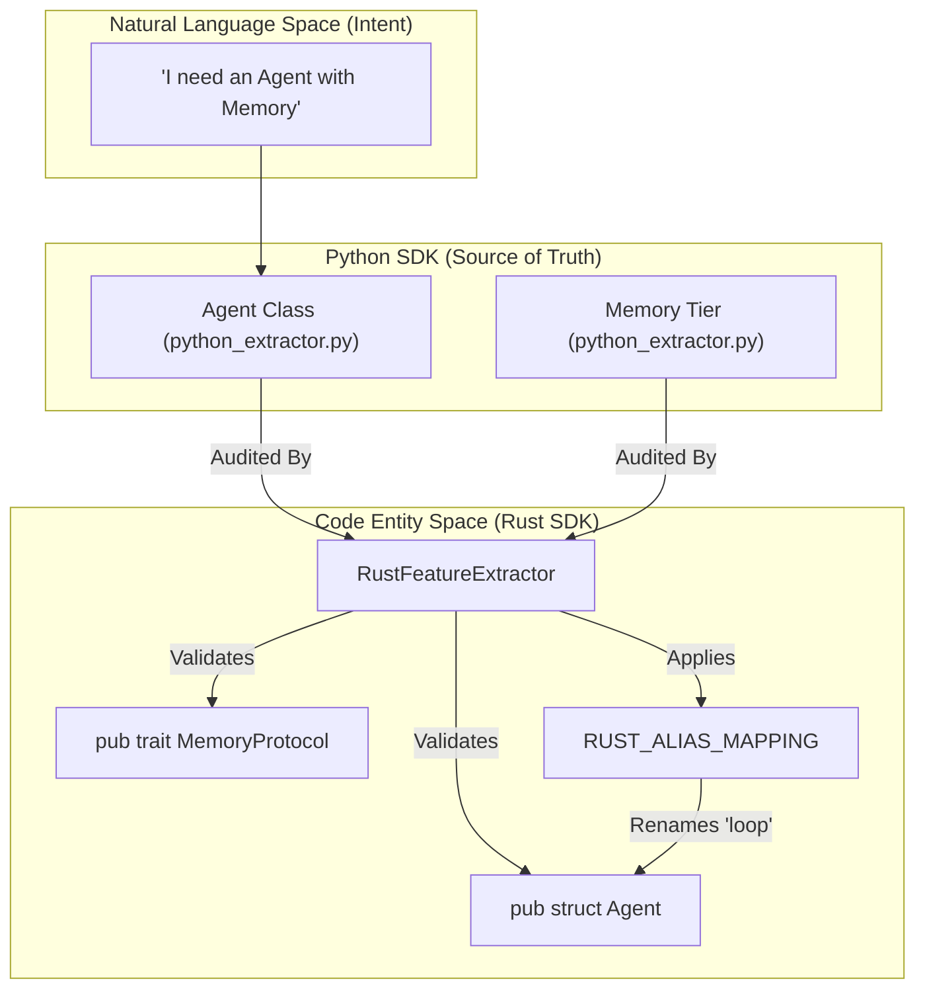
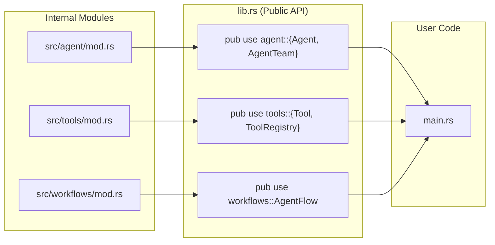

<!-- source: DeepWiki mcp.deepwiki.com · repo MervinPraison/PraisonAI · page 12.3 Rust SDK · fetched 2026-10-26 -->

# Rust SDK

Relevant source files

The following files were used as context for generating this wiki page:

- [src/praisonai-rust/FEATURE_PARITY_TRACKER.json](src/praisonai-rust/FEATURE_PARITY_TRACKER.json)
- [src/praisonai-rust/PARITY.md](src/praisonai-rust/PARITY.md)
- [src/praisonai-ts/FEATURE_PARITY_TRACKER.json](src/praisonai-ts/FEATURE_PARITY_TRACKER.json)
- [src/praisonai-ts/PARITY.md](src/praisonai-ts/PARITY.md)
- [src/praisonai-ts/src/tools/registry/index.ts](src/praisonai-ts/src/tools/registry/index.ts)
- [src/praisonai-ts/src/tools/registry/registry.ts](src/praisonai-ts/src/tools/registry/registry.ts)
- [src/praisonai-ts/src/tools/registry/types.ts](src/praisonai-ts/src/tools/registry/types.ts)
- [src/praisonai-ts/tests/tools/registry.test.ts](src/praisonai-ts/tests/tools/registry.test.ts)
- [src/praisonai/praisonai/_dev/parity/__init__.py](src/praisonai/praisonai/_dev/parity/__init__.py)
- [src/praisonai/praisonai/_dev/parity/generator.py](src/praisonai/praisonai/_dev/parity/generator.py)
- [src/praisonai/praisonai/_dev/parity/rust_extractor.py](src/praisonai/praisonai/_dev/parity/rust_extractor.py)
- [src/praisonai/praisonai/_dev/parity/typescript_extractor.py](src/praisonai/praisonai/_dev/parity/typescript_extractor.py)

The PraisonAI Rust SDK provides a high-performance, type-safe implementation of the PraisonAI agent framework. It is designed to offer maximum execution efficiency while maintaining structural consistency with the Python and TypeScript SDKs. The Rust implementation utilizes a strict module system and re-exports to provide a clean API surface for developers building performant AI applications.

## SDK Structure and Organization

The Rust SDK is organized into a modular architecture that reflects the core components of the PraisonAI ecosystem. It uses `pub use` statements in `lib.rs` to flatten the internal module hierarchy into a consumable public API [src/praisonai/praisonai/_dev/parity/rust_extractor.py:142-163]().

### Core Module Mapping
The SDK categorizes its functionality into several primary modules [src/praisonai/praisonai/_dev/parity/rust_extractor.py:87-95]():

| Module | Responsibility |
| :--- | :--- |
| `agent` | Core `Agent`, `AgentTeam`, and specialized agent types. |
| `config` | Unified configuration objects and presets. |
| `error` | SDK-wide error types and handling. |
| `llm` | Provider abstractions and model protocols. |
| `memory` | Tiered memory systems (short-term, long-term). |
| `tools` | Tool registry and execution environment. |
| `workflows` | Orchestration and control flow structures. |

### Reserved Keyword Handling
Rust's strict keyword system requires aliasing for certain concepts that exist in the Python SDK. The `RUST_ALIAS_MAPPING` ensures that reserved keywords do not cause compilation errors while remaining discoverable for users familiar with the Python API [src/praisonai/praisonai/_dev/parity/rust_extractor.py:26-31]().

| Python Name | Rust Alias | Reason |
| :--- | :--- | :--- |
| `loop` | `loop_step` | `loop` is a reserved Rust keyword [src/praisonai/praisonai/_dev/parity/rust_extractor.py:16](). |
| `config` | `parity_config` | Avoids conflict with `pub mod config` [src/praisonai/praisonai/_dev/parity/rust_extractor.py:17](). |
| `db` | `parity_db` | Module placeholder mapping [src/praisonai/praisonai/_dev/parity/rust_extractor.py:21](). |
| `obs` | `parity_obs` | Observability module mapping [src/praisonai/praisonai/_dev/parity/rust_extractor.py:22](). |

Sources: [src/praisonai/praisonai/_dev/parity/rust_extractor.py:13-31](), [src/praisonai/praisonai/_dev/parity/rust_extractor.py:87-95]()

## Feature Parity Tracking

The Rust SDK is continuously audited against the Python "Source of Truth" SDK using the `ParityTrackerGenerator` [src/praisonai/praisonai/_dev/parity/generator.py:56-62](). This automated system extracts exports and capabilities to ensure cross-language consistency.

### Parity Status
As of the current version, the Rust SDK has reached the **PARITY_ACHIEVED** milestone [src/praisonai-rust/FEATURE_PARITY_TRACKER.json:6]().

*   **Python Core Features:** 411 [src/praisonai-rust/FEATURE_PARITY_TRACKER.json:8]()
*   **Rust Features:** 667 [src/praisonai-rust/FEATURE_PARITY_TRACKER.json:9]()
*   **Parity Percentage:** 162.3% (including Rust-specific extensions) [src/praisonai-rust/FEATURE_PARITY_TRACKER.json:11]()

### Parity Extraction Flow
The following diagram illustrates how features are mapped from the Python source code to the Rust SDK implementation via the dev-parity tools.

**Diagram: Feature Parity Extraction Pipeline**

Sources: [src/praisonai/praisonai/_dev/parity/rust_extractor.py:73-84](), [src/praisonai/praisonai/_dev/parity/generator.py:122-144](), [src/praisonai-rust/FEATURE_PARITY_TRACKER.json:1-12]()

## Implementation Details

### Cargo Feature Flags
The Rust SDK uses feature flags in `Cargo.toml` to manage optional dependencies and minimize binary size [src/praisonai/praisonai/_dev/parity/rust_extractor.py:192-195](). This allows users to opt-in to specific capabilities like `chromadb` for memory or `openai` for LLM support.

### Public Exports (pub use)
To provide a ergonomic developer experience, the SDK uses a "flattening" pattern in its entry point. This allows users to import core types directly from the crate root rather than navigating deep module trees.

**Diagram: SDK Export Architecture**

Sources: [src/praisonai/praisonai/_dev/parity/rust_extractor.py:134-163](), [src/praisonai-rust/PARITY.md:34-48]()

### Key Implemented Components
The Rust SDK implements the following critical components to maintain parity with the Python core [src/praisonai-rust/PARITY.md:17-310]():
*   **Agent Orchestration:** `Agent`, `AgentTeam`, `AgentManager`, and `Agents` container [src/praisonai-rust/PARITY.md:34-48]().
*   **Specialized Agents:** `CodeAgent`, `AudioAgent`, `VisionAgent`, and `DeepResearchAgent` [src/praisonai-rust/PARITY.md:56-130]().
*   **Memory & Knowledge:** `Memory`, `Knowledge`, `ChromaMemory`, and `InMemoryVectorStore` [src/praisonai-rust/PARITY.md:231-272]().
*   **Safety:** `Guardrail`, `LLMGuardrail`, and `ApprovalCallback` [src/praisonai-rust/PARITY.md:187-242]().
*   **Workflows:** `AgentFlow`, `Parallel`, `Loop` (as `loop_step`), and `Pipeline` [src/praisonai-rust/PARITY.md:39-305]().

Sources: [src/praisonai-rust/PARITY.md:15-310](), [src/praisonai-rust/FEATURE_PARITY_TRACKER.json:14-276]()

---

