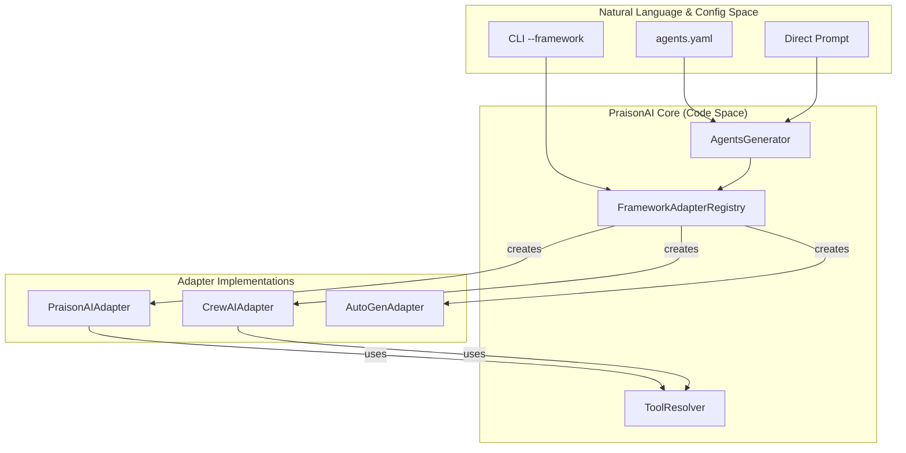
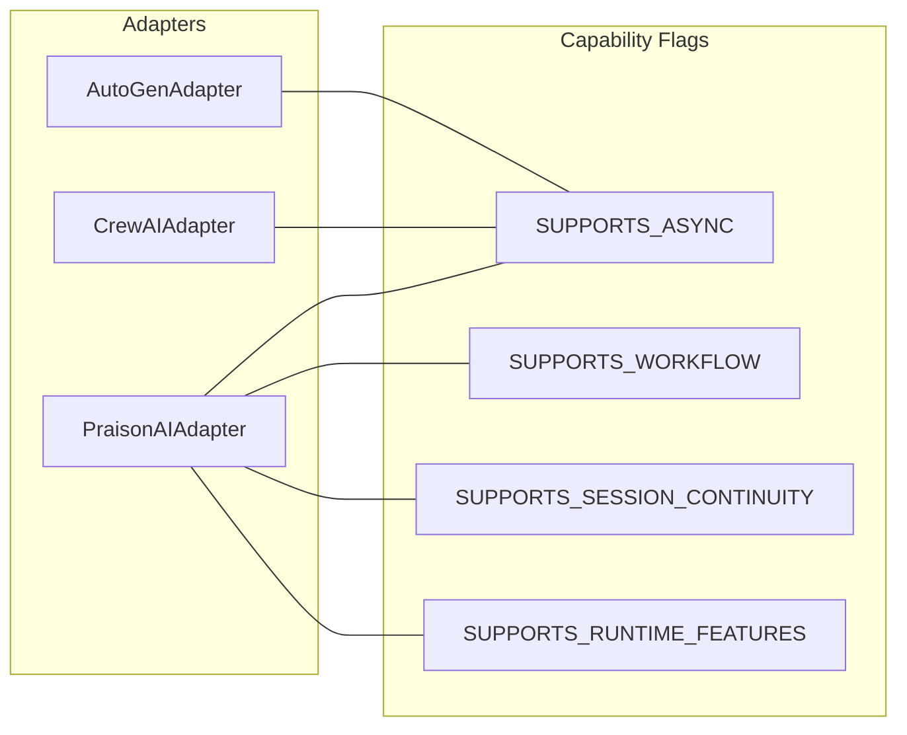

<!-- source: DeepWiki mcp.deepwiki.com · repo MervinPraison/PraisonAI · page 13 Framework Integrations · fetched 2026-10-26 -->

# Framework Integrations

Relevant source files

The following files were used as context for generating this wiki page:

- [examples/python/frameworks/custom_adapter/pyproject.toml](examples/python/frameworks/custom_adapter/pyproject.toml)
- [src/praisonai/examples/python/frameworks/pydantic_ai/agents.yaml](src/praisonai/examples/python/frameworks/pydantic_ai/agents.yaml)
- [src/praisonai/praisonai/__main__.py](src/praisonai/praisonai/__main__.py)
- [src/praisonai/praisonai/_async_bridge.py](src/praisonai/praisonai/_async_bridge.py)
- [src/praisonai/praisonai/_framework_availability.py](src/praisonai/praisonai/_framework_availability.py)
- [src/praisonai/praisonai/agents_generator.py](src/praisonai/praisonai/agents_generator.py)
- [src/praisonai/praisonai/auto.py](src/praisonai/praisonai/auto.py)
- [src/praisonai/praisonai/framework_adapters/__init__.py](src/praisonai/praisonai/framework_adapters/__init__.py)
- [src/praisonai/praisonai/framework_adapters/autogen_adapter.py](src/praisonai/praisonai/framework_adapters/autogen_adapter.py)
- [src/praisonai/praisonai/framework_adapters/base.py](src/praisonai/praisonai/framework_adapters/base.py)
- [src/praisonai/praisonai/framework_adapters/crewai_adapter.py](src/praisonai/praisonai/framework_adapters/crewai_adapter.py)
- [src/praisonai/praisonai/framework_adapters/praisonai_adapter.py](src/praisonai/praisonai/framework_adapters/praisonai_adapter.py)
- [src/praisonai/praisonai/framework_adapters/registry.py](src/praisonai/praisonai/framework_adapters/registry.py)
- [src/praisonai/praisonai/framework_adapters/validators.py](src/praisonai/praisonai/framework_adapters/validators.py)
- [src/praisonai/praisonai/framework_adapters/workflow_framework.py](src/praisonai/praisonai/framework_adapters/workflow_framework.py)
- [src/praisonai/praisonai/tool_resolver.py](src/praisonai/praisonai/tool_resolver.py)
- [src/praisonai/tests/e2e/README.md](src/praisonai/tests/e2e/README.md)
- [src/praisonai/tests/e2e/agno_e2e/test_agno_real.py](src/praisonai/tests/e2e/agno_e2e/test_agno_real.py)
- [src/praisonai/tests/e2e/google_adk_e2e/test_google_adk_real.py](src/praisonai/tests/e2e/google_adk_e2e/test_google_adk_real.py)
- [src/praisonai/tests/e2e/pydantic_ai_e2e/test_pydantic_ai_real.py](src/praisonai/tests/e2e/pydantic_ai_e2e/test_pydantic_ai_real.py)
- [src/praisonai/tests/unit/cli/test_main_dispatcher.py](src/praisonai/tests/unit/cli/test_main_dispatcher.py)
- [src/praisonai/tests/unit/cli/test_typer_cli.py](src/praisonai/tests/unit/cli/test_typer_cli.py)
- [src/praisonai/tests/unit/test_agno_frameworks_integration.py](src/praisonai/tests/unit/test_agno_frameworks_integration.py)
- [src/praisonai/tests/unit/test_aiui_datastore.py](src/praisonai/tests/unit/test_aiui_datastore.py)
- [src/praisonai/tests/unit/test_async_bridge.py](src/praisonai/tests/unit/test_async_bridge.py)
- [src/praisonai/tests/unit/test_auto_lazy_loading.py](src/praisonai/tests/unit/test_auto_lazy_loading.py)
- [src/praisonai/tests/unit/test_framework_entry_point_discovery.py](src/praisonai/tests/unit/test_framework_entry_point_discovery.py)
- [src/praisonai/tests/unit/test_framework_registry_helpers.py](src/praisonai/tests/unit/test_framework_registry_helpers.py)
- [src/praisonai/tests/unit/test_framework_validators.py](src/praisonai/tests/unit/test_framework_validators.py)
- [src/praisonai/tests/unit/test_google_adk_frameworks_integration.py](src/praisonai/tests/unit/test_google_adk_frameworks_integration.py)
- [src/praisonai/tests/unit/test_pydantic_ai_frameworks_integration.py](src/praisonai/tests/unit/test_pydantic_ai_frameworks_integration.py)
- [src/praisonai/tests/unit/test_tool_timeout_enforcement.py](src/praisonai/tests/unit/test_tool_timeout_enforcement.py)
- [src/praisonai/tests/unit/test_workflow_framework_validation.py](src/praisonai/tests/unit/test_workflow_framework_validation.py)
- [src/praisonai/tests/unit/test_wrapper_layer_regression.py](src/praisonai/tests/unit/test_wrapper_layer_regression.py)

PraisonAI provides a robust integration layer that allows the core system to orchestrate multiple AI agent frameworks. While `praisonaiagents` serves as the native high-performance framework, the system maintains deep compatibility with CrewAI and AutoGen (v0.2 and v0.4) through a standardized adapter architecture.

For specific implementation details, see [CrewAI Integration](#13.1), [AutoGen Integration](#13.2), and [External Agent Integrations](#13.3).

## Framework Adapter Architecture

The integration architecture has evolved from hardcoded execution methods to a formal **Framework Adapter** pattern. The `FrameworkAdapterRegistry` serves as the central authority for discovering and instantiating these adapters.

### Integration Layer Bridge

The following diagram illustrates how the `AgentsGenerator` bridges natural language configurations to specific code entities within the framework adapters.

**Sources:** [src/praisonai/praisonai/agents_generator.py:20-22](), [src/praisonai/praisonai/framework_adapters/registry.py:32-51](), [src/praisonai/praisonai/tool_resolver.py:1-14]()

## The Adapter Registry

The `FrameworkAdapterRegistry` manages the lifecycle and discovery of adapters. It uses a priority-based selection system to determine the default framework if none is specified by the user.

*   **Default Priority:** `praisonai` -> `crewai` -> `autogen` [src/praisonai/praisonai/framework_adapters/registry.py:50-50]().
*   **Validation:** The registry performs signature inspection on `run` and `arun` methods to ensure adapters comply with the `FrameworkAdapterProtocol` [src/praisonai/praisonai/framework_adapters/registry.py:113-156]().
*   **Dynamic Discovery:** Adapters can be registered via entry points, allowing for third-party framework support without modifying the core codebase [src/praisonai/praisonai/framework_adapters/registry.py:52-58]().

**Sources:** [src/praisonai/praisonai/framework_adapters/registry.py:1-111]()

## Framework Availability & Lazy Loading

To maintain a minimal footprint, PraisonAI uses a sophisticated lazy loading system for framework dependencies. Heavy libraries like `crewai` or `autogen` are only imported when an adapter specifically requires them.

### Availability Detection Mapping

The system tracks framework availability through a centralized detection module, mapping internal flags to package names.

| Internal Constant | Target Package | Detection Method |
| :--- | :--- | :--- |
| `PRAISONAI_AVAILABLE` | `praisonaiagents` | `is_available("praisonaiagents")` |
| `CREWAI_AVAILABLE` | `crewai` | `is_available("crewai")` |
| `AUTOGEN_AVAILABLE` | `autogen` | `is_available("autogen")` |
| `AG2_AVAILABLE` | `ag2` | `is_available("ag2")` |

**Sources:** [src/praisonai/praisonai/agents_generator.py:138-161](), [src/praisonai/praisonai/auto.py:1-12]()

## Execution Capabilities

Each adapter reports its capabilities to the core system, allowing the CLI to enable or disable features like async execution or session continuity based on the active framework.

**Sources:** [src/praisonai/praisonai/framework_adapters/praisonai_adapter.py:32-42](), [src/praisonai/praisonai/framework_adapters/autogen_adapter.py:22-22](), [src/praisonai/praisonai/framework_adapters/base.py:68-72]()

## Common Integration Utilities

The framework integration layer provides shared utilities that adapters use to maintain consistent behavior:

*   **`ToolResolver`**: A unified shim that ensures tools are resolved consistently across all entry points, including the Bot system and Job Workflows [src/praisonai/praisonai/tool_resolver.py:1-14](), [src/praisonai/tests/unit/test_wrapper_layer_regression.py:28-86]().
*   **`AsyncBridge`**: A single source of truth for running coroutines synchronously, essential for bridging async frameworks like AutoGen v0.4 to the sync CLI [src/praisonai/praisonai/_async_bridge.py:1-7]().
*   **`scoped_telemetry_disable`**: A context manager used to temporarily silence framework-specific telemetry (e.g., CrewAI's built-in telemetry) during PraisonAI runs [src/praisonai/praisonai/framework_adapters/base.py:170-187]().
*   **`warn_unsupported_fields`**: A utility that warns users when they use PraisonAI-specific YAML fields (like `approval` or `guardrails`) with frameworks that do not support them [src/praisonai/praisonai/framework_adapters/base.py:46-63]().

**Sources:** [src/praisonai/praisonai/_async_bridge.py:22-40](), [src/praisonai/praisonai/framework_adapters/base.py:23-40]()

---

