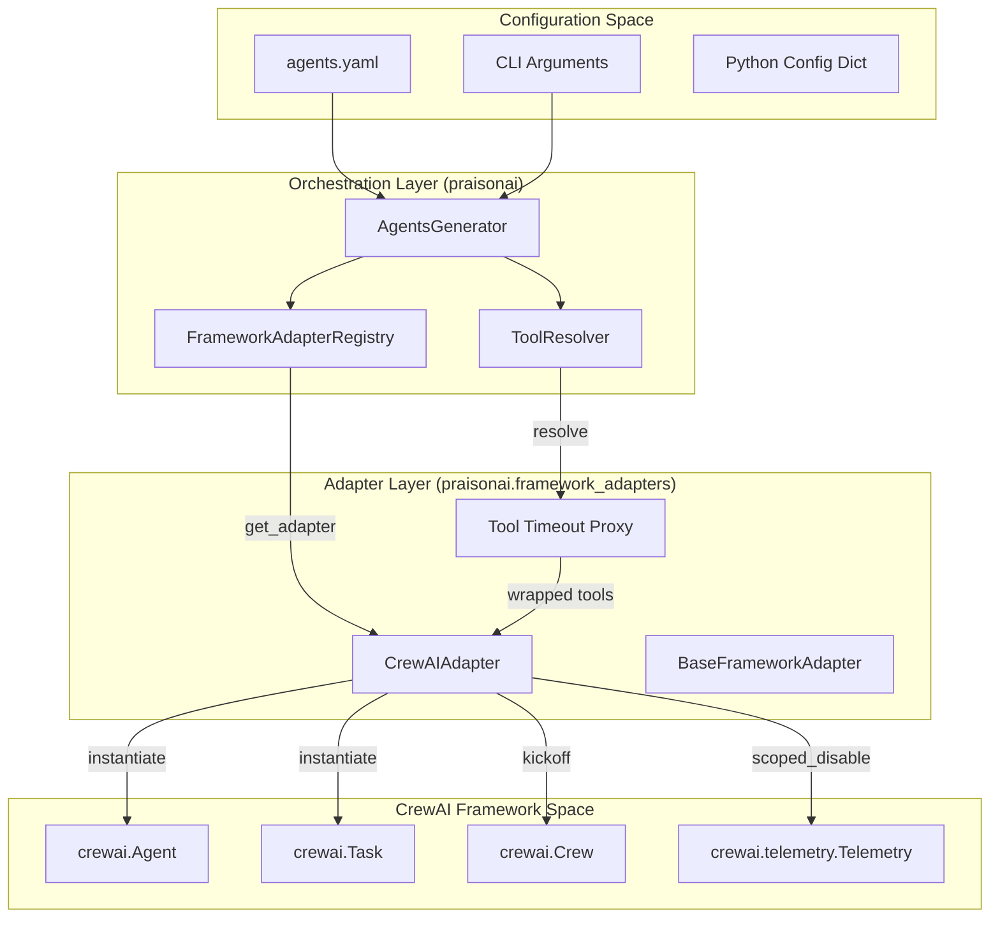
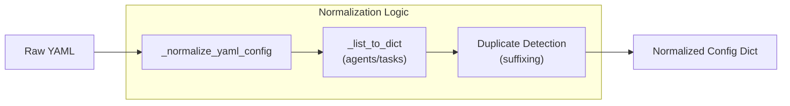

<!-- source: DeepWiki mcp.deepwiki.com · repo MervinPraison/PraisonAI · page 13.1 CrewAI Integration · fetched 2026-10-26 -->

# CrewAI Integration

Relevant source files

The following files were used as context for generating this wiki page:

- [src/praisonai/praisonai/__main__.py](src/praisonai/praisonai/__main__.py)
- [src/praisonai/praisonai/_async_bridge.py](src/praisonai/praisonai/_async_bridge.py)
- [src/praisonai/praisonai/agents_generator.py](src/praisonai/praisonai/agents_generator.py)
- [src/praisonai/praisonai/auto.py](src/praisonai/praisonai/auto.py)
- [src/praisonai/praisonai/framework_adapters/__init__.py](src/praisonai/praisonai/framework_adapters/__init__.py)
- [src/praisonai/praisonai/framework_adapters/autogen_adapter.py](src/praisonai/praisonai/framework_adapters/autogen_adapter.py)
- [src/praisonai/praisonai/framework_adapters/base.py](src/praisonai/praisonai/framework_adapters/base.py)
- [src/praisonai/praisonai/framework_adapters/crewai_adapter.py](src/praisonai/praisonai/framework_adapters/crewai_adapter.py)
- [src/praisonai/praisonai/framework_adapters/praisonai_adapter.py](src/praisonai/praisonai/framework_adapters/praisonai_adapter.py)
- [src/praisonai/praisonai/framework_adapters/validators.py](src/praisonai/praisonai/framework_adapters/validators.py)
- [src/praisonai/praisonai/tool_resolver.py](src/praisonai/praisonai/tool_resolver.py)
- [src/praisonai/tests/unit/cli/test_main_dispatcher.py](src/praisonai/tests/unit/cli/test_main_dispatcher.py)
- [src/praisonai/tests/unit/cli/test_typer_cli.py](src/praisonai/tests/unit/cli/test_typer_cli.py)
- [src/praisonai/tests/unit/test_aiui_datastore.py](src/praisonai/tests/unit/test_aiui_datastore.py)
- [src/praisonai/tests/unit/test_async_bridge.py](src/praisonai/tests/unit/test_async_bridge.py)
- [src/praisonai/tests/unit/test_auto_lazy_loading.py](src/praisonai/tests/unit/test_auto_lazy_loading.py)
- [src/praisonai/tests/unit/test_framework_validators.py](src/praisonai/tests/unit/test_framework_validators.py)
- [src/praisonai/tests/unit/test_tool_timeout_enforcement.py](src/praisonai/tests/unit/test_tool_timeout_enforcement.py)
- [src/praisonai/tests/unit/test_wrapper_layer_regression.py](src/praisonai/tests/unit/test_wrapper_layer_regression.py)

PraisonAI integrates with the CrewAI framework through a specialized adapter architecture, enabling users to define multi-agent systems using PraisonAI's YAML configuration or Python API and execute them using CrewAI's orchestration engine. This integration includes support for sequential and hierarchical processes, tool timeout enforcement, and scoped telemetry management.

## Integration Architecture

The integration is managed via the `FrameworkAdapterRegistry` which routes execution to the `CrewAIAdapter`. The `AgentsGenerator` acts as the high-level orchestrator that resolves configuration and initializes the appropriate framework backend.

### System Data Flow

**Sources:** [src/praisonai/praisonai/agents_generator.py:19-21](), [src/praisonai/praisonai/framework_adapters/base.py:65-73](), [src/praisonai/praisonai/framework_adapters/crewai_adapter.py:1-20]() (inferred), [src/praisonai/praisonai/tool_resolver.py:1-14]()

## Framework Adapter Implementation

The `CrewAIAdapter` (derived from `BaseFrameworkAdapter`) handles the translation between PraisonAI's internal agent representations and CrewAI's native objects.

### Key Capabilities
- **Async Support:** CrewAI integration typically offloads to a thread pool if the underlying framework is sync-heavy, managed by `AsyncBridge` [src/praisonai/praisonai/_async_bridge.py:22-40]().
- **Field Validation:** The adapter warns when YAML fields like `approval` or `guardrails` are used with CrewAI, as these are natively supported only by the `PraisonAIAdapter` [src/praisonai/praisonai/framework_adapters/base.py:23-40]().
- **LLM Resolution:** Uses `PraisonAIModel` to bridge LiteLLM-based configurations into the `langchain_openai` or `langchain_community` objects expected by CrewAI [src/praisonai/praisonai/framework_adapters/base.py:74-88]().

**Sources:** [src/praisonai/praisonai/framework_adapters/base.py:23-40](), [src/praisonai/praisonai/framework_adapters/base.py:74-88](), [src/praisonai/praisonai/_async_bridge.py:97-124]()

## Tool Timeout Enforcement

To prevent agents from hanging indefinitely on external tool calls, PraisonAI implements a proxy-based timeout system that wraps tools before they are handed to CrewAI.

### Tool Wrapping Mechanism

When `tool_timeout` is defined in the configuration (CLI or YAML), the `AgentsGenerator` wraps the tool callables using `_wrap_with_timeout`. This creates a `_TimeoutBoundTool` proxy that preserves the original tool's schema and class identity (e.g., `isinstance(tool, BaseTool)`) to ensure compatibility with CrewAI's internal validation.

| Component | Role |
|-----------|------|
| `ToolTimeoutError` | Exception raised when a tool exceeds its `timeout_seconds` [src/praisonai/praisonai/agents_generator.py:176-192](). |
| `_TimeoutBoundTool` | A proxy class that delegates attributes to the inner tool while intercepting `run()` and `_run()` calls [src/praisonai/tests/unit/test_tool_timeout_enforcement.py:135-156](). |
| `ThreadPoolExecutor` | Background workers that execute the tool call, allowing the main thread to enforce the timeout [src/praisonai/praisonai/agents_generator.py:194-210](). |

**Sources:** [src/praisonai/praisonai/agents_generator.py:176-192](), [src/praisonai/tests/unit/test_tool_timeout_enforcement.py:96-103](), [src/praisonai/tests/unit/test_tool_timeout_enforcement.py:135-168]()

## Telemetry Management

CrewAI includes built-in telemetry that PraisonAI allows users to disable or scope. The `scoped_telemetry_disable` context manager is used to temporarily silence CrewAI's telemetry methods during a run.

### Telemetry Disable Logic
The system supports two modes of disabling:
1. **Instance Shadowing:** Methods on a specific `telemetry` instance are replaced with `_noop` [src/praisonai/praisonai/framework_adapters/base.py:105-130]().
2. **Class Patching:** If no instance is available, the `Telemetry` class itself is patched using a lock and reference counting to prevent race conditions during concurrent runs [src/praisonai/praisonai/framework_adapters/base.py:133-168]().

**Sources:** [src/praisonai/praisonai/framework_adapters/base.py:105-130](), [src/praisonai/praisonai/framework_adapters/base.py:133-168](), [src/praisonai/praisonai/framework_adapters/base.py:170-187]()

## YAML Normalization for CrewAI

Before execution, PraisonAI normalizes YAML configurations to handle different formats (list-based vs dict-based) and ensure compatibility with CrewAI's expectations.

- **Instructions to Backstory:** If `instructions` are provided but `backstory` is missing, the system automatically copies instructions to backstory for CrewAI agents [src/praisonai/praisonai/agents_generator.py:81-83]().
- **Duplicate Handling:** If duplicate agent names are found, they are suffixed (e.g., `agent__dup_1`) to prevent silent clobbering [src/praisonai/praisonai/agents_generator.py:56-59]().

**Sources:** [src/praisonai/praisonai/agents_generator.py:43-65](), [src/praisonai/praisonai/agents_generator.py:68-124]()

## Auto-Generation and Framework Selection

The `praisonai.auto` module allows for the automatic generation of CrewAI teams based on a natural language prompt.

- **Framework Detection:** Uses `is_available("crewai")` to check for the presence of the library [src/praisonai/praisonai/auto.py:107-108]().
- **Lazy Loading:** CrewAI dependencies are only imported when `framework='crewai'` is explicitly invoked, minimizing startup time for other workflows [src/praisonai/praisonai/auto.py:3-12]().

**Sources:** [src/praisonai/praisonai/auto.py:3-12](), [src/praisonai/praisonai/auto.py:107-108](), [src/praisonai/praisonai/agents_generator.py:139-149]()

---

