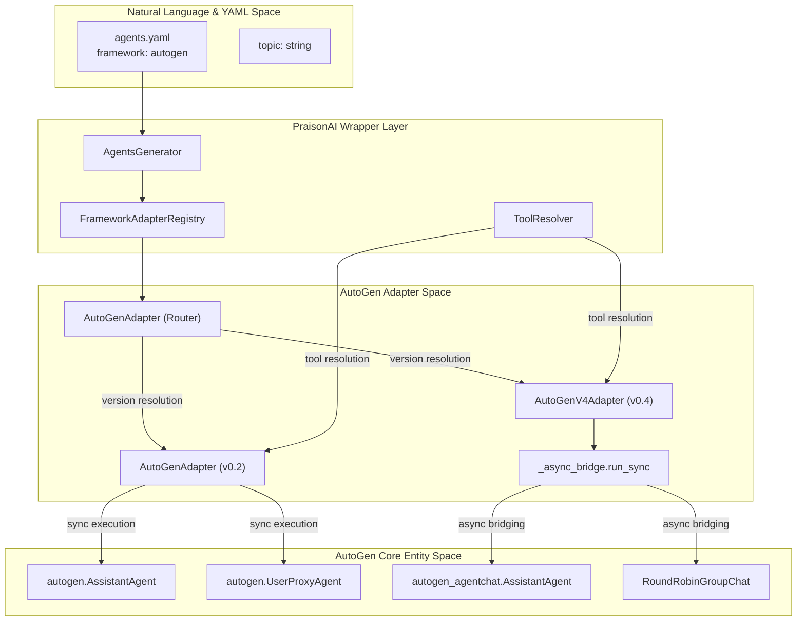
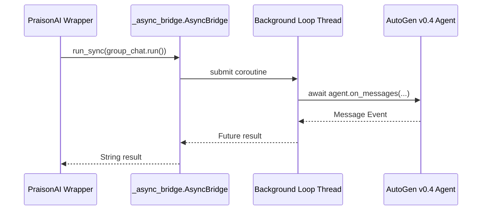

<!-- source: DeepWiki mcp.deepwiki.com · repo MervinPraison/PraisonAI · page 13.2 AutoGen Integration · fetched 2026-10-26 -->

# AutoGen Integration

<details>
<summary>Relevant source files</summary>

The following files were used as context for generating this wiki page:

- [src/praisonai/praisonai/__main__.py](src/praisonai/praisonai/__main__.py)
- [src/praisonai/praisonai/_async_bridge.py](src/praisonai/praisonai/_async_bridge.py)
- [src/praisonai/praisonai/agents_generator.py](src/praisonai/praisonai/agents_generator.py)
- [src/praisonai/praisonai/auto.py](src/praisonai/praisonai/auto.py)
- [src/praisonai/praisonai/framework_adapters/__init__.py](src/praisonai/praisonai/framework_adapters/__init__.py)
- [src/praisonai/praisonai/framework_adapters/autogen_adapter.py](src/praisonai/praisonai/framework_adapters/autogen_adapter.py)
- [src/praisonai/praisonai/framework_adapters/base.py](src/praisonai/praisonai/framework_adapters/base.py)
- [src/praisonai/praisonai/framework_adapters/crewai_adapter.py](src/praisonai/praisonai/framework_adapters/crewai_adapter.py)
- [src/praisonai/praisonai/framework_adapters/praisonai_adapter.py](src/praisonai/praisonai/framework_adapters/praisonai_adapter.py)
- [src/praisonai/praisonai/framework_adapters/validators.py](src/praisonai/praisonai/framework_adapters/validators.py)
- [src/praisonai/praisonai/tool_resolver.py](src/praisonai/praisonai/tool_resolver.py)
- [src/praisonai/tests/unit/cli/test_main_dispatcher.py](src/praisonai/tests/unit/cli/test_main_dispatcher.py)
- [src/praisonai/tests/unit/cli/test_typer_cli.py](src/praisonai/tests/unit/cli/test_typer_cli.py)
- [src/praisonai/tests/unit/test_aiui_datastore.py](src/praisonai/tests/unit/test_aiui_datastore.py)
- [src/praisonai/tests/unit/test_async_bridge.py](src/praisonai/tests/unit/test_async_bridge.py)
- [src/praisonai/tests/unit/test_auto_lazy_loading.py](src/praisonai/tests/unit/test_auto_lazy_loading.py)
- [src/praisonai/tests/unit/test_framework_validators.py](src/praisonai/tests/unit/test_framework_validators.py)
- [src/praisonai/tests/unit/test_tool_timeout_enforcement.py](src/praisonai/tests/unit/test_tool_timeout_enforcement.py)
- [src/praisonai/tests/unit/test_wrapper_layer_regression.py](src/praisonai/tests/unit/test_wrapper_layer_regression.py)

</details>


This document describes PraisonAI's integration with the AutoGen multi-agent conversation framework. PraisonAI provides a unified interface for creating and orchestrating AutoGen agents through YAML configuration files, supporting AutoGen v0.2, AutoGen v0.4, and AG2 via a specialized adapter architecture.

For information about other framework integrations, see [CrewAI Integration](#13.1). For general agent system architecture, see [Core Agent System](#2).

## Framework Adapter Architecture

PraisonAI uses a registry-based adapter pattern to interface with AutoGen. The `AutoGenAdapter` serves as a router that resolves the specific version to use based on configuration or environment variables.

### AutoGen Version Routing
The system resolves the concrete adapter variant using `AUTOGEN_VERSION` or `config["autogen_version"]`.

| Target Version | Class | Adapter Name |
| :--- | :--- | :--- |
| **v0.2** | `AutoGenAdapter` | `autogen_v2` |
| **v0.4** | `AutoGenV4Adapter` | `autogen_v4` |
| **AG2** | `AG2Adapter` | `ag2` |

Sources: [src/praisonai/praisonai/framework_adapters/autogen_adapter.py:15-19](), [src/praisonai/praisonai/framework_adapters/autogen_adapter.py:29-68]()

### Integration Data Flow



Sources: [src/praisonai/praisonai/agents_generator.py:127-130](), [src/praisonai/praisonai/framework_adapters/autogen_adapter.py:29-68](), [src/praisonai/praisonai/_async_bridge.py:97-124]()

## Tool Timeout Translation

A critical feature of the PraisonAI-AutoGen integration is the translation of tool timeouts. Since AutoGen runs tools within its own internal chat loop, an uncaught `TimeoutError` would crash the entire conversation.

### ToolTimeoutError Handling
The `AutoGenAdapter` uses `_wrap_tool_for_execution` to catch `ToolTimeoutError` and convert it into a string message that the LLM can understand, allowing the conversation to continue.

```python
# Conceptual implementation in the adapter boundary
try:
    return tool(*args, **kwargs)
except ToolTimeoutError as exc:
    return f"Error: tool {tool_name!r} timed out ({exc})."
```

Sources: [src/praisonai/praisonai/framework_adapters/autogen_adapter.py:71-101](), [src/praisonai/praisonai/agents_generator.py:176-193]()

## AutoGen v0.2 Implementation

The v0.2 implementation (internal name `autogen_v2`) is sync-only. When `arun` is called, it offloads execution to a thread pool.

### Component Mapping
| PraisonAI YAML Field | AutoGen v0.2 Entity |
| :--- | :--- |
| `role` | `AssistantAgent(name=...)` |
| `backstory` | `AssistantAgent(system_message=...)` |
| `tools` | `AssistantAgent.register_for_llm` & `UserProxyAgent.register_for_execution` |
| `tasks` | `user_proxy.initiate_chats()` |

Sources: [src/praisonai/praisonai/framework_adapters/autogen_adapter.py:167-184](), [src/praisonai/praisonai/framework_adapters/autogen_adapter.py:202-212]()

## AutoGen v0.4 (Async) Implementation

AutoGen v0.4 utilizes an event-driven async architecture. PraisonAI bridges this using the `AsyncBridge` to allow synchronous calls from the CLI/Wrapper to drive the async AutoGen loop.

### Async Bridging Logic
The `AsyncBridge` manages a background event loop thread (`praisonai-async`) to handle `autogen-agentchat` coroutines.



Sources: [src/praisonai/praisonai/_async_bridge.py:71-77](), [src/praisonai/praisonai/_async_bridge.py:97-108]()

## Configuration and Supported Fields

While PraisonAI supports many advanced features (Guardrails, Approval, Autonomy), AutoGen adapters only consume a subset of YAML fields.

**Supported Fields:**
- `llm` / `model`: LLM configuration.
- `function_calling_llm`: Specific model for tool selection.
- `tools`: List of tools resolved via `ToolResolver`.
- `tasks`: Sequential or group chat tasks.

**Unsupported Field Warning:**
If a user defines fields like `approval` or `guardrails` while using `framework: autogen`, the system issues a warning via `warn_unsupported_fields` because these are currently only honored by the native `praisonai` framework.

Sources: [src/praisonai/praisonai/framework_adapters/base.py:29-40](), [src/praisonai/praisonai/framework_adapters/base.py:46-62]()

## Installation and Availability

Framework availability is checked lazily to avoid heavy import costs at startup.

| Feature | Requirement |
| :--- | :--- |
| AutoGen v0.2 | `pip install "praisonai-frameworks[autogen]"` |
| AutoGen v0.4 | `pip install "praisonai-frameworks[autogen-v4]"` |
| Tool Timeout | `PRAISONAI_TOOL_TIMEOUT_WORKERS` (Env Var) |

Sources: [src/praisonai/praisonai/framework_adapters/autogen_adapter.py:19-20](), [src/praisonai/praisonai/agents_generator.py:138-164]()

---

