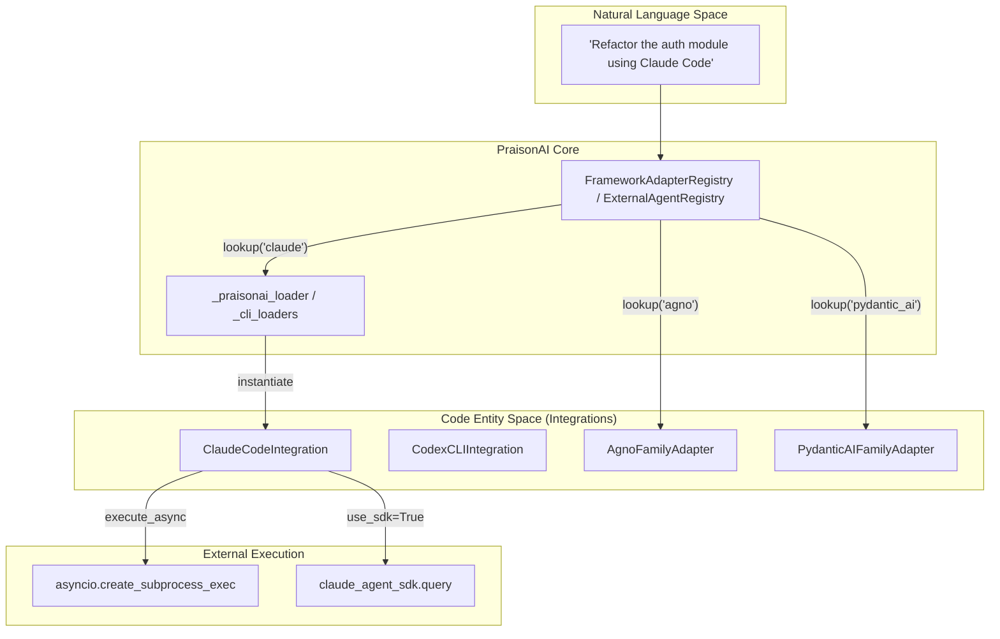

<!-- source: DeepWiki mcp.deepwiki.com · repo MervinPraison/PraisonAI · page 13.3 External Agent Integrations · fetched 2026-10-26 -->

# External Agent Integrations

Relevant source files

The following files were used as context for generating this wiki page:

- [examples/python/frameworks/custom_adapter/pyproject.toml](examples/python/frameworks/custom_adapter/pyproject.toml)
- [src/praisonai-ts/src/cli/features/external-agents.ts](src/praisonai-ts/src/cli/features/external-agents.ts)
- [src/praisonai/examples/python/frameworks/pydantic_ai/agents.yaml](src/praisonai/examples/python/frameworks/pydantic_ai/agents.yaml)
- [src/praisonai/praisonai/_framework_availability.py](src/praisonai/praisonai/_framework_availability.py)
- [src/praisonai/praisonai/cli/_shim.py](src/praisonai/praisonai/cli/_shim.py)
- [src/praisonai/praisonai/framework_adapters/registry.py](src/praisonai/praisonai/framework_adapters/registry.py)
- [src/praisonai/praisonai/framework_adapters/workflow_framework.py](src/praisonai/praisonai/framework_adapters/workflow_framework.py)
- [src/praisonai/praisonai/integrations/__init__.py](src/praisonai/praisonai/integrations/__init__.py)
- [src/praisonai/praisonai/integrations/_cli_loaders.py](src/praisonai/praisonai/integrations/_cli_loaders.py)
- [src/praisonai/praisonai/integrations/_unified_registry.py](src/praisonai/praisonai/integrations/_unified_registry.py)
- [src/praisonai/praisonai/integrations/base.py](src/praisonai/praisonai/integrations/base.py)
- [src/praisonai/praisonai/integrations/claude_code.py](src/praisonai/praisonai/integrations/claude_code.py)
- [src/praisonai/praisonai/integrations/codex_cli.py](src/praisonai/praisonai/integrations/codex_cli.py)
- [src/praisonai/praisonai/integrations/cursor_cli.py](src/praisonai/praisonai/integrations/cursor_cli.py)
- [src/praisonai/praisonai/integrations/gemini_cli.py](src/praisonai/praisonai/integrations/gemini_cli.py)
- [src/praisonai/praisonai/integrations/registry.py](src/praisonai/praisonai/integrations/registry.py)
- [src/praisonai/tests/e2e/README.md](src/praisonai/tests/e2e/README.md)
- [src/praisonai/tests/e2e/agno_e2e/test_agno_real.py](src/praisonai/tests/e2e/agno_e2e/test_agno_real.py)
- [src/praisonai/tests/e2e/google_adk_e2e/test_google_adk_real.py](src/praisonai/tests/e2e/google_adk_e2e/test_google_adk_real.py)
- [src/praisonai/tests/e2e/pydantic_ai_e2e/test_pydantic_ai_real.py](src/praisonai/tests/e2e/pydantic_ai_e2e/test_pydantic_ai_real.py)
- [src/praisonai/tests/unit/integrations/test_base_integration.py](src/praisonai/tests/unit/integrations/test_base_integration.py)
- [src/praisonai/tests/unit/integrations/test_claude_code.py](src/praisonai/tests/unit/integrations/test_claude_code.py)
- [src/praisonai/tests/unit/integrations/test_codex_cli.py](src/praisonai/tests/unit/integrations/test_codex_cli.py)
- [src/praisonai/tests/unit/integrations/test_cursor_cli.py](src/praisonai/tests/unit/integrations/test_cursor_cli.py)
- [src/praisonai/tests/unit/integrations/test_gemini_cli.py](src/praisonai/tests/unit/integrations/test_gemini_cli.py)
- [src/praisonai/tests/unit/test_agno_frameworks_integration.py](src/praisonai/tests/unit/test_agno_frameworks_integration.py)
- [src/praisonai/tests/unit/test_framework_entry_point_discovery.py](src/praisonai/tests/unit/test_framework_entry_point_discovery.py)
- [src/praisonai/tests/unit/test_framework_registry_helpers.py](src/praisonai/tests/unit/test_framework_registry_helpers.py)
- [src/praisonai/tests/unit/test_google_adk_frameworks_integration.py](src/praisonai/tests/unit/test_google_adk_frameworks_integration.py)
- [src/praisonai/tests/unit/test_pydantic_ai_frameworks_integration.py](src/praisonai/tests/unit/test_pydantic_ai_frameworks_integration.py)
- [src/praisonai/tests/unit/test_workflow_framework_validation.py](src/praisonai/tests/unit/test_workflow_framework_validation.py)

PraisonAI provides a unified interface for integrating with external AI agents and coding CLI tools. This system enables the orchestration of native PraisonAI agents alongside specialized external tools like Claude Code, Gemini CLI, and third-party frameworks such as Agno or PydanticAI. The integration layer consists of a unified registry, a shim layer for CLI tools, and specific adapters for external frameworks.

## Unified Integration Architecture

The integration system is built on two primary registries:
1.  **`FrameworkAdapterRegistry`**: Manages heavy-weight framework integrations (CrewAI, AutoGen, Agno, etc.) [src/praisonai/praisonai/framework_adapters/registry.py:32-40]().
2.  **`ExternalAgentRegistry`**: Manages CLI-based agent tools (Claude Code, Codex, etc.) [src/praisonai/praisonai/integrations/registry.py:38-46]().

### Data Flow: Natural Language to Code Entity Space

The following diagram illustrates how a natural language request is routed through the integration registry to specific code entities that handle external execution.

**Sources:** [src/praisonai/praisonai/framework_adapters/registry.py:22-30](), [src/praisonai/praisonai/integrations/claude_code.py:47-61](), [src/praisonai/praisonai/integrations/base.py:170-176]().

---

## External CLI Integrations

CLI integrations inherit from `BaseCLIIntegration` [src/praisonai/praisonai/integrations/base.py:36](). This base class provides:
*   **Availability Checking**: Uses `shutil.which` to check if the CLI is installed, with class-level caching and thread-safety locks [src/praisonai/praisonai/integrations/base.py:93-109]().
*   **Async Execution**: Standardized `execute_async` method using `asyncio.create_subprocess_exec` with configurable timeouts [src/praisonai/praisonai/integrations/base.py:153-192]().
*   **Error Handling**: Raises `CLIExecutionError` for non-zero exit codes, including stderr excerpts for debugging [src/praisonai/praisonai/integrations/base.py:23-34]().

### Claude Code CLI
`ClaudeCodeIntegration` supports both subprocess execution and the `claude-agent-sdk` [src/praisonai/praisonai/integrations/claude_code.py:47-52](). It handles headless mode, session continuation via the `--continue` flag, and tool restrictions [src/praisonai/praisonai/integrations/claude_code.py:111-176]().

### OpenAI Codex CLI
`CodexCLIIntegration` enables AI-powered coding tasks with features like `full-auto` mode for file modifications and sandbox security modes (`default` or `danger-full-access`) [src/praisonai/praisonai/integrations/codex_cli.py:40-49](). It supports JSON streaming output parsing via `_parse_json_events` [src/praisonai/praisonai/integrations/codex_cli.py:192-202]().

### Gemini and Cursor CLI
Similar shims exist for Gemini and Cursor, allowing these tools to be used as `BaseTool` objects within a PraisonAI `Agent` [src/praisonai/praisonai/integrations/base.py:270-280]().

| Feature | Claude Code | Codex CLI | Cursor CLI |
| :--- | :--- | :--- | :--- |
| **Command** | `claude` | `codex` | `cursor-agent` |
| **JSON Mode** | `--output-format json` | `--json` | Supported |
| **Auto-Edit** | Yes | `full-auto` | Yes |
| **SDK Support**| `claude-agent-sdk` | No | No |

**Sources:** [src/praisonai/praisonai/integrations/claude_code.py:131-176](), [src/praisonai/praisonai/integrations/codex_cli.py:106-169](), [src/praisonai/praisonai/integrations/base.py:80-91]().

---

## Framework Adapters

Framework adapters allow PraisonAI to run agent teams defined for other ecosystems. The `FrameworkAdapterRegistry` uses a priority-based resolution policy to select the best available framework [src/praisonai/praisonai/framework_adapters/registry.py:75-89]().

### Adapter Implementation Details
Adapters must implement the `FrameworkAdapter` protocol, which requires `run` and `arun` methods accepting `tools_dict`, `agent_callback`, and `task_callback` [src/praisonai/praisonai/framework_adapters/registry.py:127-143]().

```mermaid
classDiagram
    class FrameworkAdapterRegistry {
        +DEFAULT_PRIORITY: tuple
        +create(name, *args, **kwargs)
        +pick_default() str
        +is_available(name) bool
    }
    class FrameworkAdapter {
        <<interface>>
        +run(config, llm_config, topic, ...)
        +arun(config, llm_config, topic, ...)
    }
    class AgnoFamilyAdapter {
        +SUPPORTS_WORKFLOW: bool
    }
    class PydanticAIFamilyAdapter {
        +SUPPORTS_WORKFLOW: bool
    }

    FrameworkAdapterRegistry ..> FrameworkAdapter : manages
    FrameworkAdapter <|-- AgnoFamilyAdapter
    FrameworkAdapter <|-- PydanticAIFamilyAdapter
```

**Sources:** [src/praisonai/praisonai/framework_adapters/registry.py:32-50](), [src/praisonai/praisonai/framework_adapters/registry.py:113-161](), [src/praisonai/praisonai/framework_adapters/workflow_framework.py:36-70]().

### Supported External Frameworks
*   **Agno**: Integrated via `AgnoFamilyAdapter`.
*   **Google ADK**: Integrated via `GoogleADKFamilyAdapter`.
*   **PydanticAI**: Integrated via `PydanticAIFamilyAdapter`.
*   **CrewAI & AutoGen**: Built-in priority adapters [src/praisonai/praisonai/framework_adapters/registry.py:50]().

---

## The Integration Registry

The `ExternalAgentRegistry` (and its unified counterpart) provides a factory pattern for dynamic discovery of integrations.

### Key Functions
*   **`get_registry()`**: Returns the process-default registry instance [src/praisonai/praisonai/integrations/registry.py:163-170]().
*   **`register_integration(name, class)`**: Allows runtime registration of custom integration classes [src/praisonai/praisonai/integrations/registry.py:173-183]().
*   **`create_integration(name, **kwargs)`**: Instantiates a specific integration by name [src/praisonai/praisonai/integrations/registry.py:185-197]().
*   **`get_available()`**: Asynchronously probes all registered integrations to check if their underlying CLI tools are installed [src/praisonai/praisonai/integrations/registry.py:100-134]().

### Entry Point Discovery
The registry supports `praisonai.external_agents` entry points, allowing third-party packages to register their own CLI shims automatically during initialization [src/praisonai/praisonai/integrations/registry.py:51-53]().

**Sources:** [src/praisonai/praisonai/integrations/registry.py:38-53](), [src/praisonai/praisonai/integrations/registry.py:100-134](), [src/praisonai/praisonai/integrations/__init__.py:59-70]().

---

