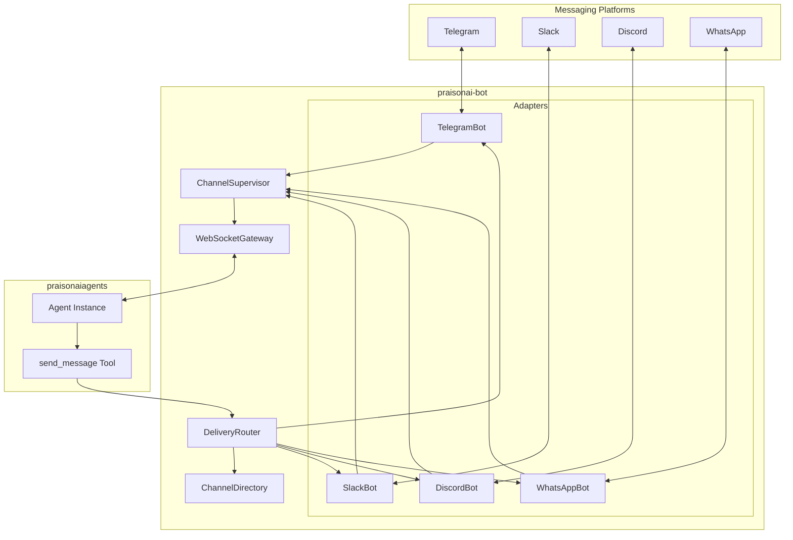
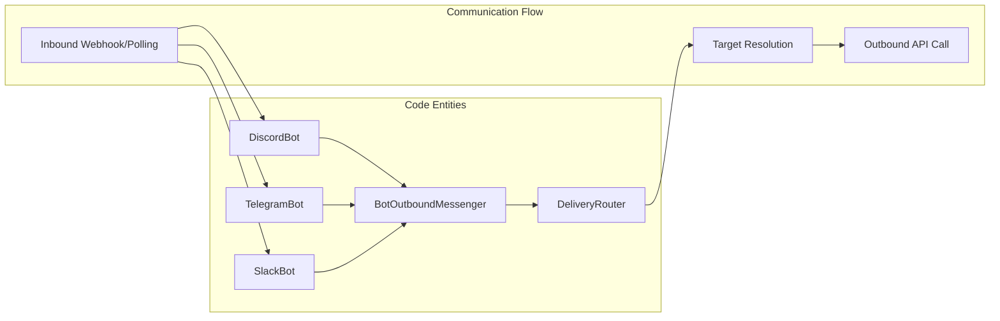

<!-- source: DeepWiki mcp.deepwiki.com · repo MervinPraison/PraisonAI · page 14 Bot and Gateway System · fetched 2026-10-26 -->

# Bot and Gateway System

Relevant source files

The following files were used as context for generating this wiki page:

- [.github/actions/install-monorepo-packages/action.yml](.github/actions/install-monorepo-packages/action.yml)
- [src/praisonai-agents/praisonaiagents/gateway/__init__.py](src/praisonai-agents/praisonaiagents/gateway/__init__.py)
- [src/praisonai-agents/praisonaiagents/gateway/config.py](src/praisonai-agents/praisonaiagents/gateway/config.py)
- [src/praisonai-agents/praisonaiagents/gateway/degraded_state.py](src/praisonai-agents/praisonaiagents/gateway/degraded_state.py)
- [src/praisonai-agents/praisonaiagents/gateway/protocols.py](src/praisonai-agents/praisonaiagents/gateway/protocols.py)
- [src/praisonai-agents/praisonaiagents/tools/messaging_tools.py](src/praisonai-agents/praisonaiagents/tools/messaging_tools.py)
- [src/praisonai-agents/tests/unit/test_gateway.py](src/praisonai-agents/tests/unit/test_gateway.py)
- [src/praisonai-agents/tests/unit/test_gateway_code_skew.py](src/praisonai-agents/tests/unit/test_gateway_code_skew.py)
- [src/praisonai-agents/tests/unit/test_gateway_config.py](src/praisonai-agents/tests/unit/test_gateway_config.py)
- [src/praisonai-agents/tests/unit/test_gateway_degraded_state.py](src/praisonai-agents/tests/unit/test_gateway_degraded_state.py)
- [src/praisonai-agents/tests/unit/test_gateway_liveness_policy.py](src/praisonai-agents/tests/unit/test_gateway_liveness_policy.py)
- [src/praisonai-agents/tests/unit/test_gateway_routing.py](src/praisonai-agents/tests/unit/test_gateway_routing.py)
- [src/praisonai-agents/tests/unit/test_gateway_turn_lock.py](src/praisonai-agents/tests/unit/test_gateway_turn_lock.py)
- [src/praisonai-agents/tests/unit/test_route_bindings.py](src/praisonai-agents/tests/unit/test_route_bindings.py)
- [src/praisonai-agents/tests/unit/tools/test_ask_conversation_tool.py](src/praisonai-agents/tests/unit/tools/test_ask_conversation_tool.py)
- [src/praisonai-agents/tests/unit/tools/test_send_message_tool.py](src/praisonai-agents/tests/unit/tools/test_send_message_tool.py)
- [src/praisonai-bot/praisonai_bot/_version.py](src/praisonai-bot/praisonai_bot/_version.py)
- [src/praisonai-bot/praisonai_bot/bots/_outbound_media.py](src/praisonai-bot/praisonai_bot/bots/_outbound_media.py)
- [src/praisonai-bot/praisonai_bot/bots/_outbound_messenger.py](src/praisonai-bot/praisonai_bot/bots/_outbound_messenger.py)
- [src/praisonai-bot/praisonai_bot/bots/delivery.py](src/praisonai-bot/praisonai_bot/bots/delivery.py)
- [src/praisonai-bot/praisonai_bot/gateway/redis_pubsub.py](src/praisonai-bot/praisonai_bot/gateway/redis_pubsub.py)
- [src/praisonai-bot/praisonai_bot/gateway/server.py](src/praisonai-bot/praisonai_bot/gateway/server.py)
- [src/praisonai-bot/pyproject.toml](src/praisonai-bot/pyproject.toml)
- [src/praisonai-bot/tests/unit/bots/test_outbound_media.py](src/praisonai-bot/tests/unit/bots/test_outbound_media.py)
- [src/praisonai-bot/tests/unit/bots/test_outbound_messenger.py](src/praisonai-bot/tests/unit/bots/test_outbound_messenger.py)
- [src/praisonai-bot/tests/unit/gateway/test_redis_pubsub_reconnect.py](src/praisonai-bot/tests/unit/gateway/test_redis_pubsub_reconnect.py)
- [src/praisonai-bot/tests/unit/gateway/test_reload_observability.py](src/praisonai-bot/tests/unit/gateway/test_reload_observability.py)
- [src/praisonai-bot/uv.lock](src/praisonai-bot/uv.lock)
- [src/praisonai-code/praisonai_code/cli/commands/serve.py](src/praisonai-code/praisonai_code/cli/commands/serve.py)
- [src/praisonai/praisonai/_bootstrap.py](src/praisonai/praisonai/_bootstrap.py)
- [src/praisonai/praisonai/adapters/__init__.py](src/praisonai/praisonai/adapters/__init__.py)
- [src/praisonai/praisonai/adapters/readers.py](src/praisonai/praisonai/adapters/readers.py)
- [src/praisonai/praisonai/adapters/rerankers.py](src/praisonai/praisonai/adapters/rerankers.py)
- [src/praisonai/praisonai/adapters/retrievers.py](src/praisonai/praisonai/adapters/retrievers.py)
- [src/praisonai/scripts/_release_lib.py](src/praisonai/scripts/_release_lib.py)
- [src/praisonai/scripts/publish_all.py](src/praisonai/scripts/publish_all.py)
- [src/praisonai/tests/PRAISONAI_BOT_MANIFEST.md](src/praisonai/tests/PRAISONAI_BOT_MANIFEST.md)

The `praisonai-bot` package provides a robust infrastructure for connecting PraisonAI agents to external messaging platforms and real-time client interfaces. It centers around a WebSocket-based control plane (the Gateway) and a suite of adapters for messaging platforms like Telegram, Slack, Discord, and WhatsApp.

## System Architecture

The system follows a hub-and-spoke model where the `WebSocketGateway` acts as the central coordinator, bridging agent turns to various communication channels.

### Gateway and Bot Connectivity

**Sources:** [src/praisonai-bot/praisonai_bot/gateway/server.py:92-120](), [src/praisonai-bot/praisonai_bot/bots/delivery.py:144-164](), [src/praisonai-bot/pyproject.toml:61-68]()

## WebSocket Gateway

The `WebSocketGateway` is the real-time control plane for PraisonAI deployments. It manages active sessions, handles protocol negotiation, and provides a unified interface for agents to interact with users across different platforms.

Key features include:
*   **Protocol Negotiation:** Supports versioned handshakes using `HelloParams` and `HelloResult` to ensure client-server compatibility [src/praisonai-agents/praisonaiagents/gateway/protocols.py:43-46]().
*   **Session Management:** Uses `GatewaySession` and `TurnLock` to manage turn-based execution and prevent race conditions [src/praisonai-agents/praisonaiagents/gateway/__init__.py:153-157]().
*   **Scaling:** Leverages Redis pub/sub for scaling across multiple gateway instances [src/praisonai-bot/pyproject.toml:29]().
*   **Liveness Monitoring:** Implements a `LivenessPolicy` to reap dead or half-open connections [src/praisonai-agents/praisonaiagents/gateway/protocols.py:88-96]().

For details, see [WebSocket Gateway](#14.1).

**Sources:** [src/praisonai-bot/praisonai_bot/gateway/server.py:1-6](), [src/praisonai-agents/praisonaiagents/gateway/protocols.py:67-102]()

## Messaging Bots

The bot system consists of multiple platform-specific adapters that translate external messages into internal agent events and vice versa.

### Bot Entity Mapping

**Sources:** [src/praisonai-bot/praisonai_bot/bots/delivery.py:5-8](), [src/praisonai-bot/praisonai_bot/bots/_outbound_messenger.py:45-63]()

*   **Delivery Routing:** The `DeliveryRouter` resolves symbolic targets (e.g., "origin", "slack:general") to concrete platform and channel IDs [src/praisonai-bot/praisonai_bot/bots/delivery.py:5-8]().
*   **Channel Directory:** `ChannelDirectory` manages reachable channels and supports friendly aliases persisted across restarts [src/praisonai-bot/praisonai_bot/bots/delivery.py:144-164]().
*   **Outbound Messaging:** Agents use the `send_message` tool, which is backed by `BotOutboundMessenger` to deliver text and media [src/praisonai-bot/praisonai_bot/bots/_outbound_messenger.py:76-91]().
*   **Media Policy:** The `OutboundMediaPolicy` acts as an exfiltration guard, governing which files agents are allowed to upload [src/praisonai-bot/praisonai_bot/bots/_outbound_messenger.py:60-62]().

For details, see [Messaging Bots](#14.2).

**Sources:** [src/praisonai-bot/praisonai_bot/bots/delivery.py:81-129](), [src/praisonai-bot/praisonai_bot/bots/_outbound_messenger.py:1-21]()

## Gateway Configuration

The system is configured via a unified `gateway.yaml` file, managed by the `MultiChannelGatewayConfig` class.

| Feature | Description | Code Pointer |
| :--- | :--- | :--- |
| **Hot Reloading** | Config changes can be applied without restarting the process. | [src/praisonai-agents/praisonaiagents/gateway/__init__.py:29-31]() |
| **Degraded State** | Registry for tracking failed channels or model credentials. | [src/praisonai-agents/praisonaiagents/gateway/degraded_state.py:1-21]() |
| **Doctor Fix** | CLI tool to migrate and repair gateway configurations. | [src/praisonai-agents/praisonaiagents/gateway/config.py:147-163]() |
| **Auth Token** | Secure WebSocket authentication with loopback bypass for local dev. | [src/praisonai-bot/praisonai_bot/gateway/server.py:135-165]() |

*   **Migration Rules:** `GATEWAY_CONFIG_RULES` defines declarative rules for moving legacy configurations to the current version [src/praisonai-agents/praisonaiagents/gateway/config.py:106-117]().
*   **Credential Supervision:** The `ChannelSupervisor` monitors the health of individual bot adapters and reports degradation [src/praisonai-bot/praisonai_bot/gateway/server.py:55]().

For details, see [Gateway Configuration](#14.3).

**Sources:** [src/praisonai-agents/praisonaiagents/gateway/config.py:33-46](), [src/praisonai-agents/tests/unit/test_gateway_config.py:130-148]()

---

